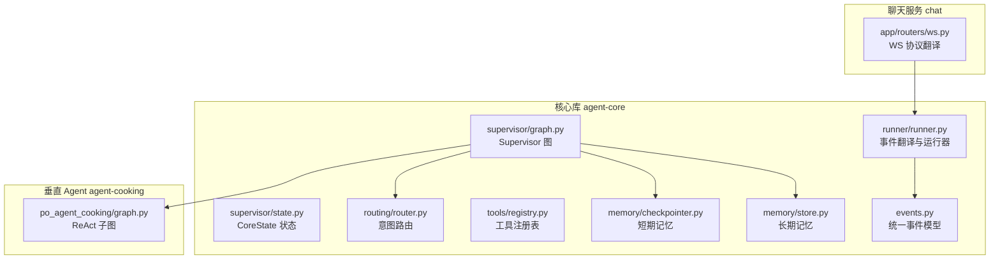
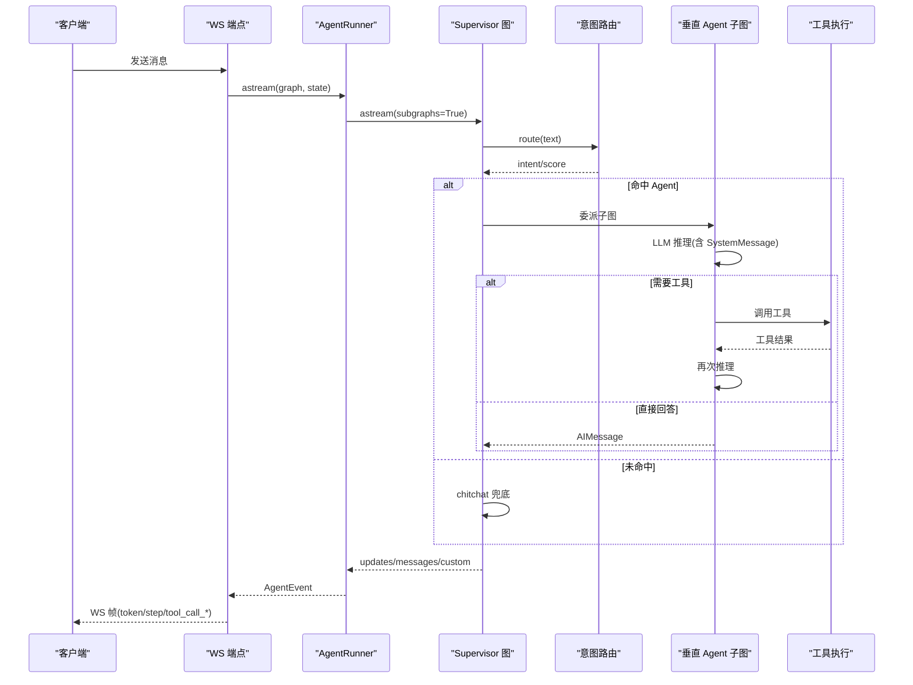
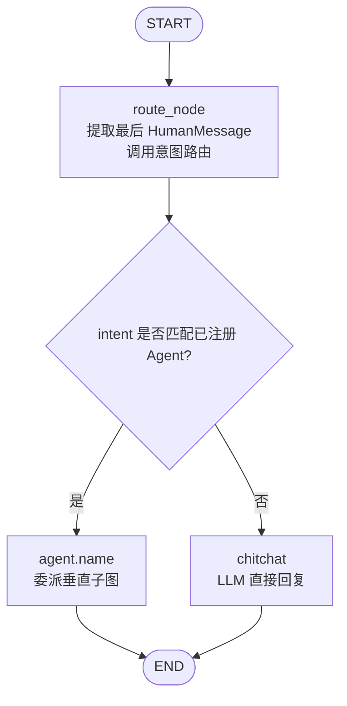
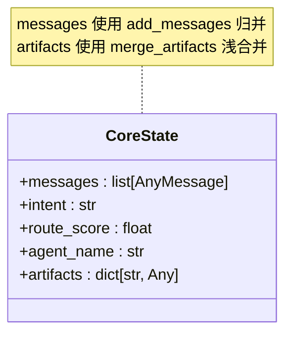
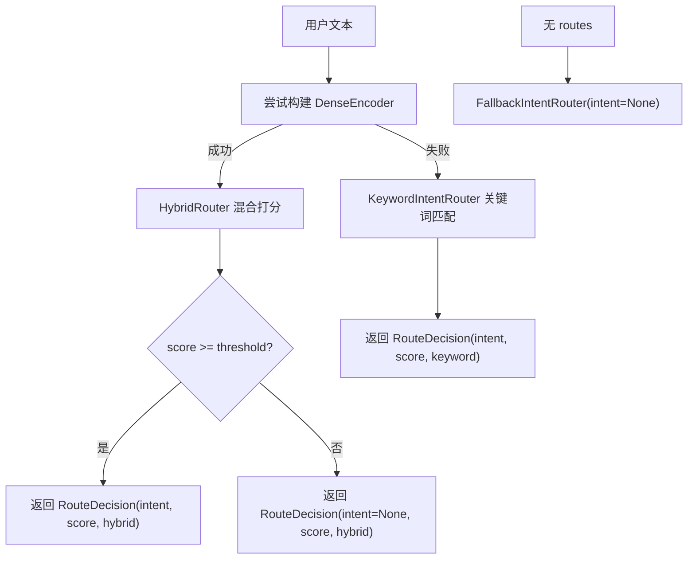
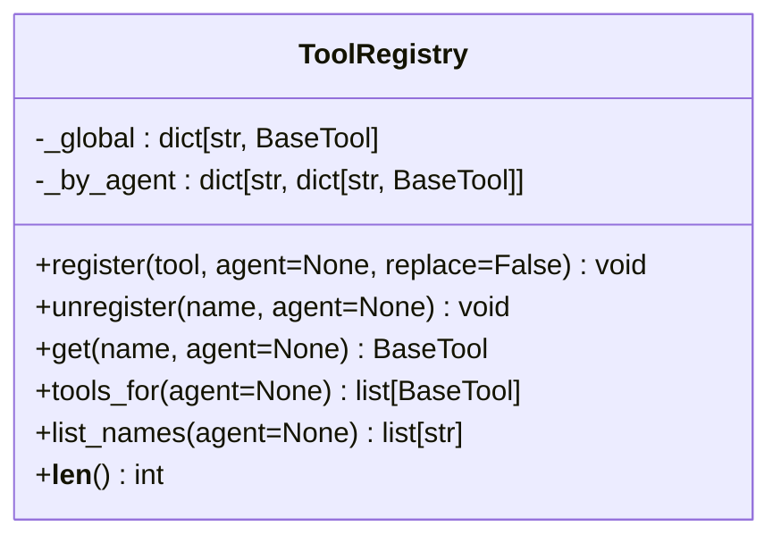
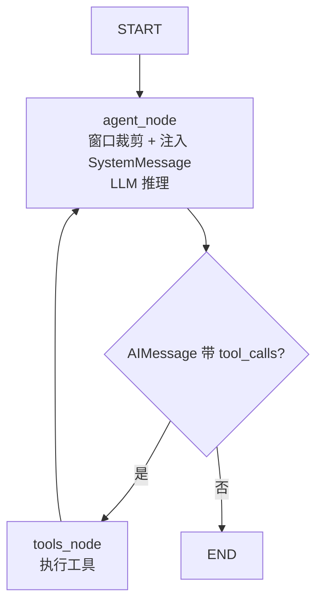
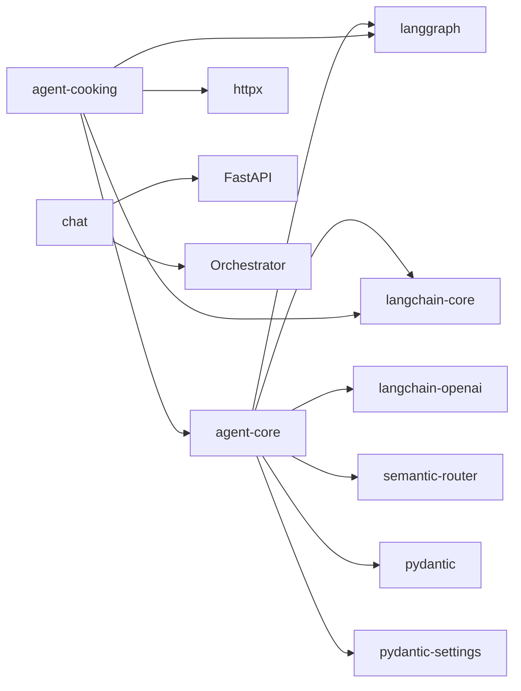

# AI Agent 系统

<cite>
**本文引用的文件**   
- [services/agent-core/src/po_agent_core/supervisor/graph.py](file://services/agent-core/src/po_agent_core/supervisor/graph.py)
- [services/agent-core/src/po_agent_core/supervisor/state.py](file://services/agent-core/src/po_agent_core/supervisor/state.py)
- [services/agent-core/src/po_agent_core/routing/router.py](file://services/agent-core/src/po_agent_core/routing/router.py)
- [services/agent-core/src/po_agent_core/tools/registry.py](file://services/agent-core/src/po_agent_core/tools/registry.py)
- [services/agent-core/src/po_agent_core/memory/checkpointer.py](file://services/agent-core/src/po_agent_core/memory/checkpointer.py)
- [services/agent-core/src/po_agent_core/memory/store.py](file://services/agent-core/src/po_agent_core/memory/store.py)
- [services/agent-core/src/po_agent_core/events.py](file://services/agent-core/src/po_agent_core/events.py)
- [services/agent-core/src/po_agent_core/runner/runner.py](file://services/agent-core/src/po_agent_core/runner/runner.py)
- [services/chat/app/routers/ws.py](file://services/chat/app/routers/ws.py)
- [services/agent-cooking/src/po_agent_cooking/graph.py](file://services/agent-cooking/src/po_agent_cooking/graph.py)
- [services/agent-cooking/tests/test_graph.py](file://services/agent-cooking/tests/test_graph.py)
- [services/agent-core/pyproject.toml](file://services/agent-core/pyproject.toml)
- [services/agent-cooking/pyproject.toml](file://services/agent-cooking/pyproject.toml)
</cite>

## 目录
1. [引言](#引言)
2. [项目结构](#项目结构)
3. [核心组件](#核心组件)
4. [架构总览](#架构总览)
5. [详细组件分析](#详细组件分析)
6. [依赖关系分析](#依赖关系分析)
7. [性能与可扩展性](#性能与可扩展性)
8. [故障排查指南](#故障排查指南)
9. [结论](#结论)
10. [附录：开发指南](#附录开发指南)

## 引言
本仓库实现了一个基于 LangGraph 的 AI Agent 编排系统，采用 Supervisor（监督者）+ Vertical Agent（垂直领域子图）的分层架构。Supervisor 负责意图识别与任务分发；每个垂直 Agent 内部以 ReAct 模式组织推理、行动、观察循环，并通过工具注册表进行插件化工具调用。系统提供统一事件流，将 LangGraph 的执行细节翻译为 WebSocket、A2A、MCP 等协议帧，同时通过 Checkpointer 和 Store 管理短期记忆与长期记忆，支持 Redis/SQLite/Memory 多种策略，具备完善的降级与容错机制。

## 项目结构
Agent 相关代码主要分布在两个 Python 包中：
- agent-core：框架无关的核心库，包含 Supervisor 图、状态模型、意图路由、工具注册、记忆管理、事件模型与运行器。
- agent-cooking：烹饪助手垂直 Agent，实现 ReAct 子图与菜谱工具。
- chat：WebSocket 服务，作为协议翻译层，把 AgentEvent 映射为 WS 帧。

**图示来源**  
- [services/agent-core/src/po_agent_core/supervisor/graph.py:1-142](file://services/agent-core/src/po_agent_core/supervisor/graph.py#L1-L142)
- [services/agent-core/src/po_agent_core/supervisor/state.py:1-39](file://services/agent-core/src/po_agent_core/supervisor/state.py#L1-L39)
- [services/agent-core/src/po_agent_core/routing/router.py:1-225](file://services/agent-core/src/po_agent_core/routing/router.py#L1-L225)
- [services/agent-core/src/po_agent_core/tools/registry.py:1-77](file://services/agent-core/src/po_agent_core/tools/registry.py#L1-L77)
- [services/agent-core/src/po_agent_core/memory/checkpointer.py:1-116](file://services/agent-core/src/po_agent_core/memory/checkpointer.py#L1-L116)
- [services/agent-core/src/po_agent_core/memory/store.py:1-85](file://services/agent-core/src/po_agent_core/memory/store.py#L1-L85)
- [services/agent-core/src/po_agent_core/events.py:1-77](file://services/agent-core/src/po_agent_core/events.py#L1-L77)
- [services/agent-core/src/po_agent_core/runner/runner.py:1-399](file://services/agent-core/src/po_agent_core/runner/runner.py#L1-L399)
- [services/chat/app/routers/ws.py:1-189](file://services/chat/app/routers/ws.py#L1-L189)
- [services/agent-cooking/src/po_agent_cooking/graph.py:1-92](file://services/agent-cooking/src/po_agent_cooking/graph.py#L1-L92)

**章节来源**  
- [services/agent-core/pyproject.toml:1-30](file://services/agent-core/pyproject.toml#L1-L30)
- [services/agent-cooking/pyproject.toml:1-31](file://services/agent-cooking/pyproject.toml#L1-L31)

## 核心组件
- Supervisor 图：定义 START → route_node → (垂直 Agent | chitchat) → END 的控制流，负责意图识别与任务分发。
- CoreState：最小化共享状态，包含消息、意图、路由分数、实际委托节点名、各 Agent 私有 artifacts。
- 意图路由：HybridRouter（稠密 + BM25）为主，降级到 KeywordIntentRouter 或 FallbackIntentRouter。
- 工具注册表：全局 + 按 Agent 命名空间两级注册，运行时只读，零锁开销。
- 记忆管理：CheckpointerManager 管理短期记忆（Redis/SQLite/Memory），StoreManager 管理长期记忆（按用户命名空间）。
- 事件与运行器：AgentRunner 将 LangGraph 流式输出翻译为统一 AgentEvent，供 WS/A2A/MCP 消费。
- 垂直 Agent（cooking）：ReAct 子图，控制 SystemMessage 注入与窗口裁剪，避免上下文膨胀与孤儿 ToolMessage。

**章节来源**  
- [services/agent-core/src/po_agent_core/supervisor/graph.py:1-142](file://services/agent-core/src/po_agent_core/supervisor/graph.py#L1-L142)
- [services/agent-core/src/po_agent_core/supervisor/state.py:1-39](file://services/agent-core/src/po_agent_core/supervisor/state.py#L1-L39)
- [services/agent-core/src/po_agent_core/routing/router.py:1-225](file://services/agent-core/src/po_agent_core/routing/router.py#L1-L225)
- [services/agent-core/src/po_agent_core/tools/registry.py:1-77](file://services/agent-core/src/po_agent_core/tools/registry.py#L1-L77)
- [services/agent-core/src/po_agent_core/memory/checkpointer.py:1-116](file://services/agent-core/src/po_agent_core/memory/checkpointer.py#L1-L116)
- [services/agent-core/src/po_agent_core/memory/store.py:1-85](file://services/agent-core/src/po_agent_core/memory/store.py#L1-L85)
- [services/agent-core/src/po_agent_core/events.py:1-77](file://services/agent-core/src/po_agent_core/events.py#L1-L77)
- [services/agent-core/src/po_agent_core/runner/runner.py:1-399](file://services/agent-core/src/po_agent_core/runner/runner.py#L1-L399)
- [services/agent-cooking/src/po_agent_cooking/graph.py:1-92](file://services/agent-cooking/src/po_agent_cooking/graph.py#L1-L92)

## 架构总览
Supervisor 图在启动时编译，接收一组 VerticalAgent 插槽与 Layer1 意图路由器。每次请求进入后：
1. 提取最后一条 HumanMessage 文本。
2. 同步调用意图路由（线程池包裹），得到 intent 与 score。
3. 若命中已注册 Agent 名，则委派对应子图；否则走 chitchat 兜底。
4. 子图内部完成 ReAct 多轮工具调用，完成后返回 END。
5. Runner 将 LangGraph 流式事件翻译为 AgentEvent，WS 层再映射为 JSON 帧。

**图示来源**  
- [services/agent-core/src/po_agent_core/supervisor/graph.py:56-113](file://services/agent-core/src/po_agent_core/supervisor/graph.py#L56-L113)
- [services/agent-core/src/po_agent_core/routing/router.py:75-80](file://services/agent-core/src/po_agent_core/routing/router.py#L75-L80)
- [services/agent-cooking/src/po_agent_cooking/graph.py:56-91](file://services/agent-cooking/src/po_agent_cooking/graph.py#L56-L91)
- [services/agent-core/src/po_agent_core/runner/runner.py:261-324](file://services/agent-core/src/po_agent_core/runner/runner.py#L261-L324)
- [services/chat/app/routers/ws.py:67-83](file://services/chat/app/routers/ws.py#L67-L83)

## 详细组件分析

### Supervisor 图的意图识别与任务分发
- 入口节点 route_node：从 CoreState.messages 倒序查找最后一条 HumanMessage，异步线程调用 router.route(text)，记录 intent、route_score、agent_name。
- 条件边 route_from_intent：若 intent 匹配已注册 Agent 名，则委派该子图；否则进入 chitchat 节点。
- chitchat 节点：直接用 BaseChatModel 应答，保证任何配置下都有可用出口。
- 子图挂载：每个 VerticalAgent.graph 以 agent.name 为节点名加入图，LangGraph 自动对接父子状态，interrupt 穿透父图。

**图示来源**  
- [services/agent-core/src/po_agent_core/supervisor/graph.py:44-95](file://services/agent-core/src/po_agent_core/supervisor/graph.py#L44-L95)
- [services/agent-core/src/po_agent_core/supervisor/graph.py:97-113](file://services/agent-core/src/po_agent_core/supervisor/graph.py#L97-L113)

**章节来源**  
- [services/agent-core/src/po_agent_core/supervisor/graph.py:1-142](file://services/agent-core/src/po_agent_core/supervisor/graph.py#L1-L142)

### 状态管理与 artifacts 隔离
- CoreState 字段：
  - messages：对话消息，使用 add_messages reducer 追加。
  - intent / route_score：Layer1 路由决策结果。
  - agent_name：本次委托的节点名（观测用）。
  - artifacts：各垂直 Agent 的私有数据，按 agent 名分命名空间，浅合并，后写胜出。
- 设计原则：禁止向 CoreState 添加领域字段，所有领域状态进入 artifacts[agent_name]，保持编排最小状态。

**图示来源**  
- [services/agent-core/src/po_agent_core/supervisor/state.py:22-38](file://services/agent-core/src/po_agent_core/supervisor/state.py#L22-L38)

**章节来源**  
- [services/agent-core/src/po_agent_core/supervisor/state.py:1-39](file://services/agent-core/src/po_agent_core/supervisor/state.py#L1-L39)

### 意图路由与降级策略
- IntentRouter：HybridRouter = DenseEncoder + BM25Encoder，alpha=0.3 偏向 BM25，阈值由 settings.router_threshold 控制。
- 降级链：
  - 无 routes：FallbackIntentRouter，恒判未命中。
  - DenseEncoder 构建失败：KeywordIntentRouter（本地 bigram 覆盖率）。
  - HybridRouter 装配失败：回退到 KeywordIntentRouter。
- 路由决策 RouteDecision：包含 intent、score、source，供 supervisor 判断去向。

**图示来源**  
- [services/agent-core/src/po_agent_core/routing/router.py:38-80](file://services/agent-core/src/po_agent_core/routing/router.py#L38-L80)
- [services/agent-core/src/po_agent_core/routing/router.py:181-225](file://services/agent-core/src/po_agent_core/routing/router.py#L181-L225)

**章节来源**  
- [services/agent-core/src/po_agent_core/routing/router.py:1-225](file://services/agent-core/src/po_agent_core/routing/router.py#L1-L225)

### 工具注册与调用的插件化架构
- ToolRegistry：
  - 全局 + 按 Agent 命名空间两级存储。
  - register/unregister/get/tools_for/list_names 提供完整生命周期。
  - 同名覆盖需显式 replace=True，避免意外替换。
- 运行时行为：宿主在启动阶段注册工具，运行期只读，无并发锁，零开销。

**图示来源**  
- [services/agent-core/src/po_agent_core/tools/registry.py:19-77](file://services/agent-core/src/po_agent_core/tools/registry.py#L19-L77)

**章节来源**  
- [services/agent-core/src/po_agent_core/tools/registry.py:1-77](file://services/agent-core/src/po_agent_core/tools/registry.py#L1-L77)

### ReAct 模式的实现（推理、行动、观察）
- cooking 子图结构：START → agent → (有工具调用?) → tools → agent → … → END。
- agent_node：
  - 对 messages 应用 _window 裁剪到 HumanMessage 边界，避免孤儿 ToolMessage。
  - 每轮注入 SystemMessage（不写入 state，防止 checkpointer 累积重复提示词）。
  - 调用 bind_tools(chat_model) 让 LLM 自主决定工具调用。
- tools_node：LangGraph ToolNode 根据最后一条 AIMessage.tool_calls 执行工具，异常被捕获为 ToolMessage。
- 测试验证：test_react_round_trip_calls_tool_then_answers 确认“模型发起工具调用 → 工具执行 → 模型基于结果作答”。

**图示来源**  
- [services/agent-cooking/src/po_agent_cooking/graph.py:40-91](file://services/agent-cooking/src/po_agent_cooking/graph.py#L40-L91)
- [services/agent-cooking/tests/test_graph.py:24-36](file://services/agent-cooking/tests/test_graph.py#L24-L36)

**章节来源**  
- [services/agent-cooking/src/po_agent_cooking/graph.py:1-92](file://services/agent-cooking/src/po_agent_cooking/graph.py#L1-L92)
- [services/agent-cooking/tests/test_graph.py:1-36](file://services/agent-cooking/tests/test_graph.py#L1-L36)

### 降级策略与容错机制
- 意图路由降级：
  - 无 routes → FallbackIntentRouter。
  - DenseEncoder 构建失败 → KeywordIntentRouter。
  - HybridRouter 装配失败 → KeywordIntentRouter。
- LLM/外部服务不可用：
  - Supervisor 的 chitchat 节点始终可用，确保图有确定出口。
  - CheckpointerManager.get_saver 连接失败向上抛异常，宿主可降级到 memory。
  - StoreManager 仅 redis 持久，其余策略落 InMemoryStore。
- 运行超时：AgentRunner 设置 timeout_seconds，超时抛出 RUN_ERROR。
- WS 层错误处理：无效帧返回 error 帧，客户端断开视为正常结束。

**章节来源**  
- [services/agent-core/src/po_agent_core/routing/router.py:181-225](file://services/agent-core/src/po_agent_core/routing/router.py#L181-L225)
- [services/agent-core/src/po_agent_core/supervisor/graph.py:79-88](file://services/agent-core/src/po_agent_core/supervisor/graph.py#L79-L88)
- [services/agent-core/src/po_agent_core/memory/checkpointer.py:67-99](file://services/agent-core/src/po_agent_core/memory/checkpointer.py#L67-L99)
- [services/agent-core/src/po_agent_core/memory/store.py:49-75](file://services/agent-core/src/po_agent_core/memory/store.py#L49-L75)
- [services/agent-core/src/po_agent_core/runner/runner.py:256-324](file://services/agent-core/src/po_agent_core/runner/runner.py#L256-L324)
- [services/chat/app/routers/ws.py:144-151](file://services/chat/app/routers/ws.py#L144-L151)

### Prompt 工程、上下文管理与记忆持久化
- Prompt 工程：
  - cooking 子图在 agent_node 中注入 SYSTEM_PROMPT，但不写入 state，避免长会话重复累积。
  - 历史限制 HISTORY_LIMIT 控制窗口大小。
- 上下文管理：
  - _window 函数按 HumanMessage 边界裁剪，避免孤儿 ToolMessage。
  - Runner 在续接会话前读取 thread 已有消息，登记已下发集合，避免重放。
- 记忆持久化：
  - 短期记忆：CheckpointerManager 管理 Redis/SQLite/Memory，延迟初始化，显式关闭。
  - 长期记忆：StoreManager 按 user_namespace(user_id) 隔离，redis 持久，其余内存。

**章节来源**  
- [services/agent-cooking/src/po_agent_cooking/graph.py:40-75](file://services/agent-cooking/src/po_agent_cooking/graph.py#L40-L75)
- [services/agent-core/src/po_agent_core/runner/runner.py:327-344](file://services/agent-core/src/po_agent_core/runner/runner.py#L327-L344)
- [services/agent-core/src/po_agent_core/memory/checkpointer.py:49-116](file://services/agent-core/src/po_agent_core/memory/checkpointer.py#L49-L116)
- [services/agent-core/src/po_agent_core/memory/store.py:25-85](file://services/agent-core/src/po_agent_core/memory/store.py#L25-L85)

### 自定义工具和 Agent 的开发指南
- 自定义工具：
  - 继承 langchain_core.tools.BaseTool，实现必要方法。
  - 通过 ToolRegistry.register(tool, agent="your_agent") 注册到指定 Agent 命名空间或全局。
  - 在垂直 Agent 构建时，从 registry.tools_for(agent) 获取工具列表传入 graph。
- 自定义 Agent：
  - 实现 VerticalAgent 插槽（name、utterances、graph），确保 name 与路由 Route.name 对齐。
  - 在 graph 中复用 CoreState，仅操作 messages，领域数据放入 artifacts[agent_name]。
  - 如需人机确认，抛出 LangGraph Interrupt，Runner 会翻译为 INTERRUPT 事件，宿主需 resume。

**章节来源**  
- [services/agent-core/src/po_agent_core/tools/registry.py:26-70](file://services/agent-core/src/po_agent_core/tools/registry.py#L26-L70)
- [services/agent-core/src/po_agent_core/supervisor/state.py:27-38](file://services/agent-core/src/po_agent_core/supervisor/state.py#L27-L38)
- [services/agent-core/src/po_agent_core/runner/runner.py:114-132](file://services/agent-core/src/po_agent_core/runner/runner.py#L114-L132)

## 依赖关系分析
- agent-core 依赖 langgraph、langchain-core、langchain-openai、semantic-router、pydantic、pydantic-settings。
- agent-cooking 依赖 po-agent-core、langgraph、langchain-core、pydantic、httpx。
- chat 服务依赖 FastAPI、Pydantic，并与 Orchestrator 协作。

**图示来源**  
- [services/agent-core/pyproject.toml:1-30](file://services/agent-core/pyproject.toml#L1-L30)
- [services/agent-cooking/pyproject.toml:1-31](file://services/agent-cooking/pyproject.toml#L1-L31)

**章节来源**  
- [services/agent-core/pyproject.toml:1-30](file://services/agent-core/pyproject.toml#L1-L30)
- [services/agent-cooking/pyproject.toml:1-31](file://services/agent-cooking/pyproject.toml#L1-L31)

## 性能与可扩展性
- 意图路由同步调用：Semantic Router 的 embedding 网络请求放在 asyncio.to_thread 中，避免阻塞事件循环。
- 工具注册表无锁：注册发生在启动阶段，运行期只读，零锁开销。
- 子图透传：Runner 使用 subgraphs=True，垂直 Agent 内部事件上浮，前端可见细粒度步骤。
- 去重策略：AIMessage 按 id 去重，缺失 id 按内容哈希去重，避免重复下发。
- 记忆管理：Checkpointer/Store 延迟初始化，显式关闭，避免资源泄漏。

[本节为通用指导，不直接分析具体文件]

## 故障排查指南
- 意图路由未命中：
  - 检查 routes 是否为空，threshold 是否过高。
  - 查看日志中的降级路径（fallback/keyword/hybrid）。
- LLM 或外部服务不可用：
  - 确认 embedding API key/base_url 配置正确。
  - 若 HybridRouter 装配失败，系统将降级到关键词路由。
- 工具调用失败：
  - 检查工具是否注册到正确的 Agent 命名空间。
  - 查看 ToolMessage 的 status 与 content，定位工具内部异常。
- 记忆丢失：
  - 确认 CheckpointerManager 与 StoreManager 已正确初始化。
  - 生产环境建议使用 Redis，SQLite 适合单机演示。
- WS 中断与恢复：
  - 收到 INTERRUPT 帧后，前端必须等待 done 帧再发送 resume。
  - resume 帧必须携带 conversation_id，否则无法定位 thread。

**章节来源**  
- [services/agent-core/src/po_agent_core/routing/router.py:181-225](file://services/agent-core/src/po_agent_core/routing/router.py#L181-L225)
- [services/agent-core/src/po_agent_core/tools/registry.py:45-62](file://services/agent-core/src/po_agent_core/tools/registry.py#L45-L62)
- [services/agent-core/src/po_agent_core/memory/checkpointer.py:67-99](file://services/agent-core/src/po_agent_core/memory/checkpointer.py#L67-L99)
- [services/chat/app/routers/ws.py:37-49](file://services/chat/app/routers/ws.py#L37-L49)

## 结论
本系统通过 Supervisor 图与垂直 Agent 子图的分层设计，实现了意图识别、任务分发、ReAct 推理、工具调用、记忆持久化与事件驱动的完整闭环。其降级策略确保在 LLM 或外部服务不可用时仍能提供基础能力，而统一的 AgentEvent 协议使得 WebSocket、A2A、MCP 等多传输层共享同一编排语义。开发者可通过工具注册表与 VerticalAgent 插槽扩展领域能力，保持系统的模块化与可扩展性。

[本节为总结性内容，不直接分析具体文件]

## 附录：开发指南
- 新增垂直 Agent：
  - 定义 VerticalAgent（name、utterances、graph）。
  - 在 Supervisor 构建时传入 agents 列表。
  - 确保 utterances 不为空，以便参与意图路由。
- 新增工具：
  - 实现 BaseTool，注册到 ToolRegistry。
  - 在垂直 Agent 构建时注入 tools 列表。
- 调试建议：
  - 启用日志查看路由决策与降级路径。
  - 使用 test_graph 类似断言验证 ReAct 往返流程。
  - 通过 WS 帧观察 STEP、tool_call_*、token 事件流。

**章节来源**  
- [services/agent-core/src/po_agent_core/supervisor/graph.py:116-142](file://services/agent-core/src/po_agent_core/supervisor/graph.py#L116-L142)
- [services/agent-cooking/tests/test_graph.py:24-36](file://services/agent-cooking/tests/test_graph.py#L24-L36)
- [services/chat/app/routers/ws.py:67-83](file://services/chat/app/routers/ws.py#L67-L83)