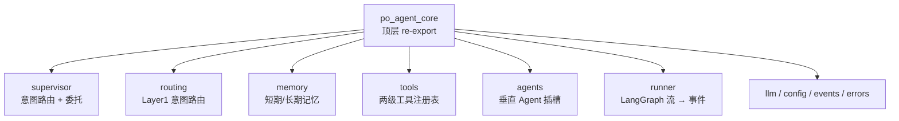
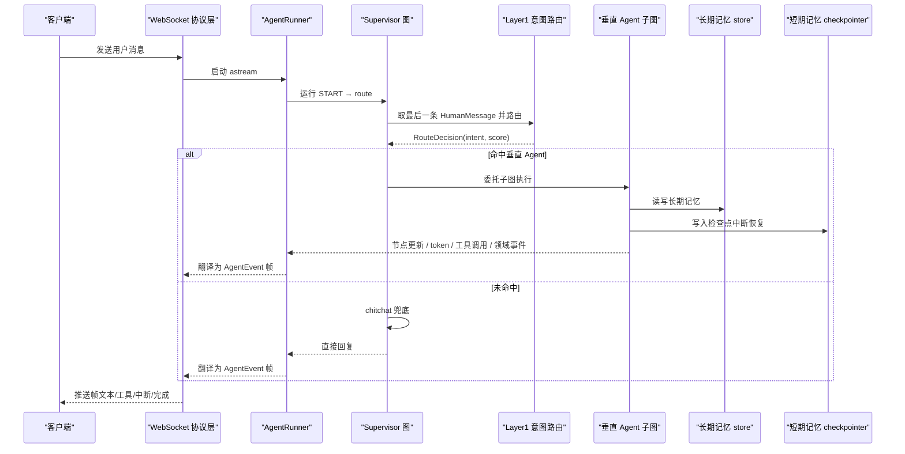
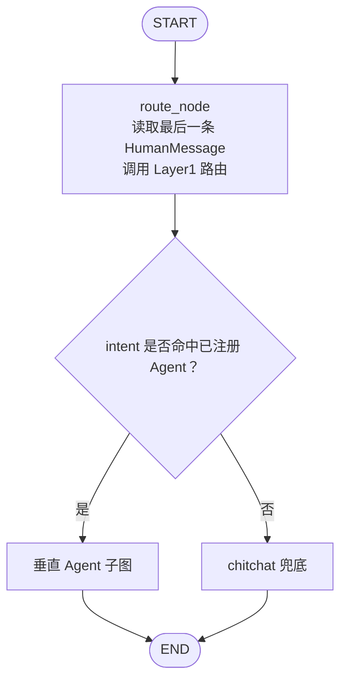
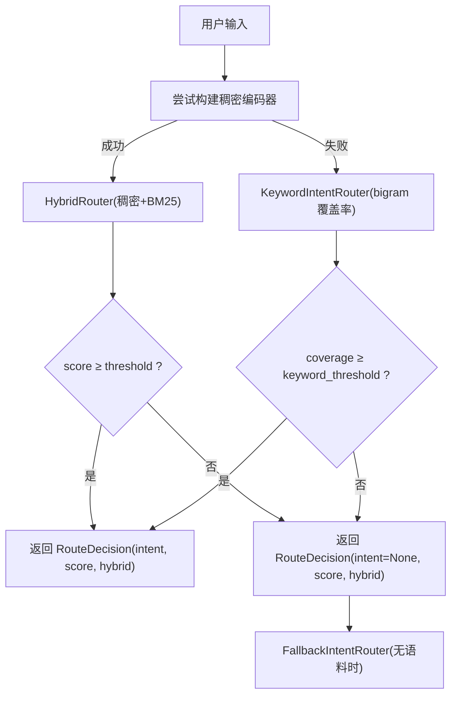
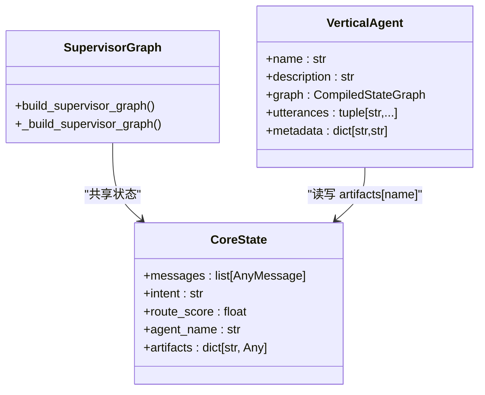
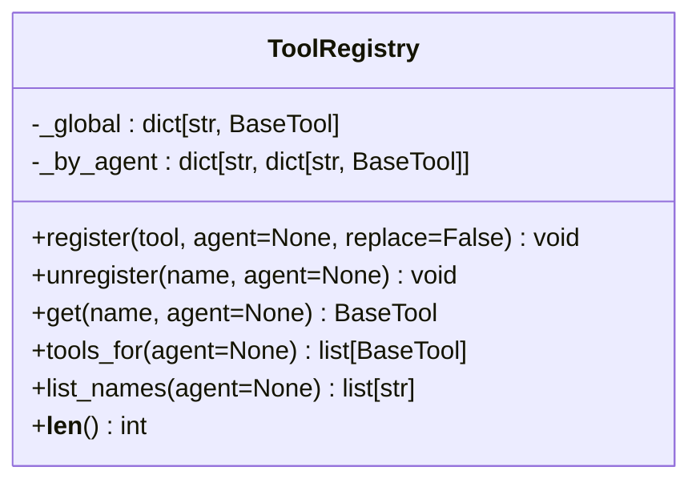
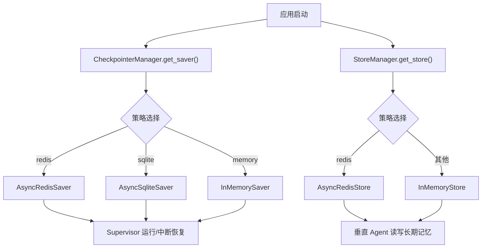
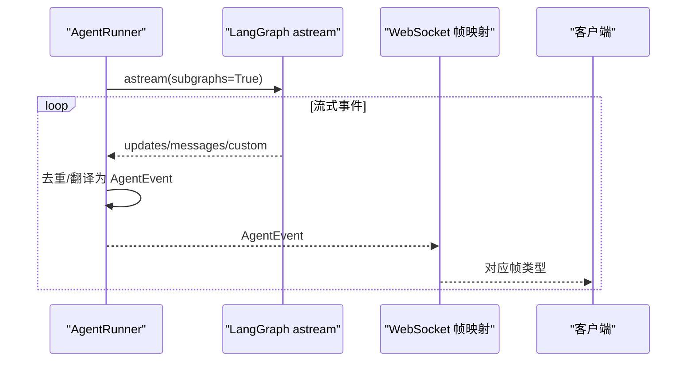
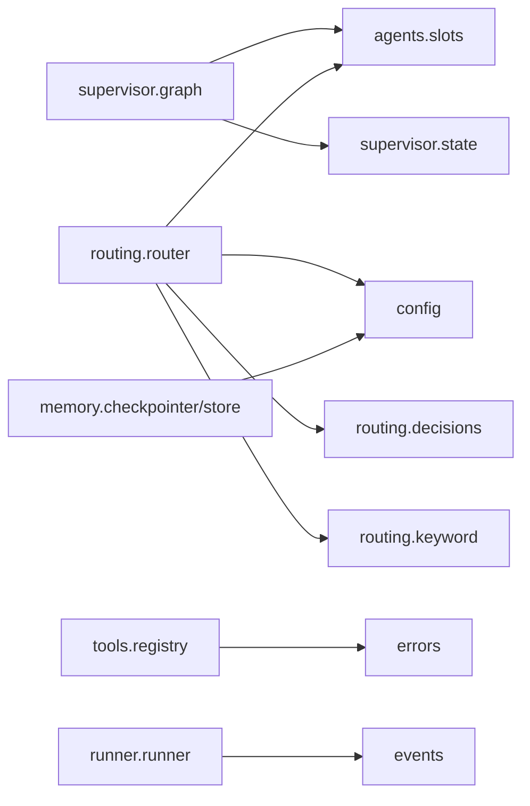
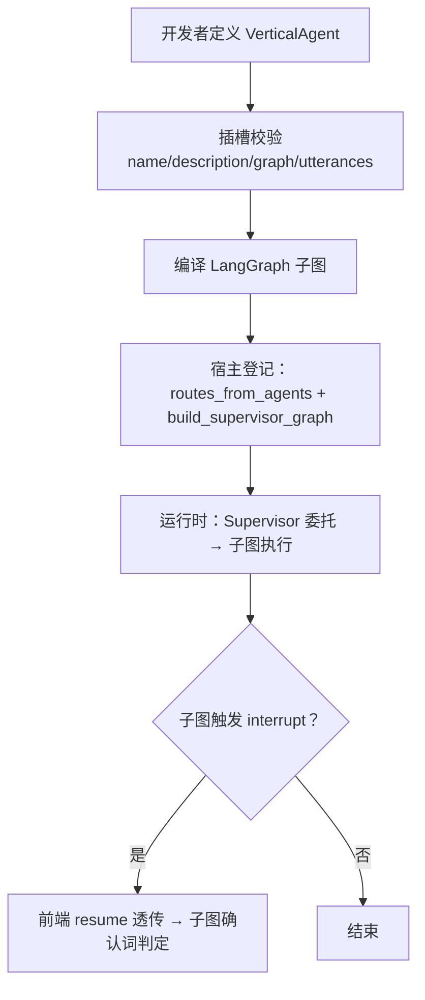

# Agent 核心框架

<cite>
**本文引用的文件**   
- [pyproject.toml](file://services/agent-core/pyproject.toml)
- [__init__.py](file://services/agent-core/src/po_agent_core/__init__.py)
- [README.md](file://services/agent-core/README.md)
- [config.py](file://services/agent-core/src/po_agent_core/config.py)
- [errors.py](file://services/agent-core/src/po_agent_core/errors.py)
- [events.py](file://services/agent-core/src/po_agent_core/events.py)
- [slots.py](file://services/agent-core/src/po_agent_core/agents/slots.py)
- [graph.py](file://services/agent-core/src/po_agent_core/supervisor/graph.py)
- [state.py](file://services/agent-core/src/po_agent_core/supervisor/state.py)
- [router.py](file://services/agent-core/src/po_agent_core/routing/router.py)
- [decisions.py](file://services/agent-core/src/po_agent_core/routing/decisions.py)
- [keyword.py](file://services/agent-core/src/po_agent_core/routing/keyword.py)
- [checkpointer.py](file://services/agent-core/src/po_agent_core/memory/checkpointer.py)
- [store.py](file://services/agent-core/src/po_agent_core/memory/store.py)
- [registry.py](file://services/agent-core/src/po_agent_core/tools/registry.py)
- [runner.py](file://services/agent-core/src/po_agent_core/runner/runner.py)
- [ws.py](file://services/chat/app/routers/ws.py)
- [test_supervisor.py](file://services/agent-core/tests/test_supervisor.py)
- [test_cooking_wiring.py](file://services/chat/tests/test_cooking_wiring.py)
- [agent.py](file://services/agent-cooking/src/po_agent_cooking/agent.py)
</cite>

## 目录
1. [引言](#引言)
2. [项目结构](#项目结构)
3. [核心组件](#核心组件)
4. [架构总览](#架构总览)
5. [详细组件分析](#详细组件分析)
6. [依赖关系分析](#依赖关系分析)
7. [性能与可扩展性](#性能与可扩展性)
8. [故障排查指南](#故障排查指南)
9. [结论](#结论)
10. [附录：自定义垂直 Agent 开发指南](#附录自定义垂直-agent-开发指南)

## 引言
本文件面向“Agent 核心框架”的技术文档，聚焦基于 LangGraph 的编排架构。内容覆盖 Supervisor 图的意图识别与任务分发、Layer1 语义路由（稠密+稀疏混合）的工作原理、CoreState 状态管理与数据流转、工具注册表的插件化设计、短期记忆（checkpointer）与长期记忆（store）的区别与使用场景，以及自定义垂直 Agent 的开发规范。文末提供架构图与数据流图，帮助读者快速建立整体认知。

## 项目结构
agent-core 是纯 Python 库，不依赖任何 Web 框架；它通过显式工厂和插槽机制暴露能力，供 chat 宿主、未来 agentgateway 或独立垂直 Agent 服务复用。顶层 re-export 统一对外 API，内部模块按职责划分：配置、事件协议、LLM 工厂、记忆、路由、Supervisor 编排、Runner 事件翻译、工具注册表、垂直 Agent 插槽等。

图表来源
- [__init__.py:1-71](file://services/agent-core/src/po_agent_core/__init__.py#L1-L71)
- [README.md:12-25](file://services/agent-core/README.md#L12-L25)

章节来源
- [__init__.py:1-71](file://services/agent-core/src/po_agent_core/__init__.py#L1-L71)
- [README.md:1-25](file://services/agent-core/README.md#L1-L25)
- [pyproject.toml:1-18](file://services/agent-core/pyproject.toml#L1-L18)

## 核心组件
- 配置与错误：AgentCoreSettings、ModelRole、ModelSlot、AgentCoreError、AgentCoreConfigError。
- 事件协议：AgentEvent、EventType，作为 WS/A2A/MCP 的统一上游。
- LLM 工厂：create_chat_model、create_embeddings，支持多角色槽位与 provider 预设。
- 记忆子系统：CheckpointerManager（短期）、StoreManager + user_namespace（长期）。
- Layer1 意图路由：IntentRouter（HybridRouter）、KeywordIntentRouter、FallbackIntentRouter。
- Supervisor 编排：build_supervisor_graph、CoreState。
- Runner：AgentRunner，LangGraph astream → AgentEvent 翻译。
- 工具注册表：ToolRegistry（全局 + per-agent 命名空间）。
- 垂直 Agent 插槽：VerticalAgent 契约校验与元信息。

章节来源
- [__init__.py:17-71](file://services/agent-core/src/po_agent_core/__init__.py#L17-L71)
- [config.py:27-54](file://services/agent-core/src/po_agent_core/config.py#L27-L54)
- [events.py](file://services/agent-core/src/po_agent_core/events.py)
- [errors.py](file://services/agent-core/src/po_agent_core/errors.py)

## 架构总览
Supervisor 图负责“意图识别→任务分发→兜底应答”，垂直 Agent 子图在内部完成多轮工具循环。Runner 将 LangGraph 执行流翻译为统一的 AgentEvent，WS/A2A/MCP 等协议层只做帧映射，不做业务判断。

图表来源
- [graph.py:1-141](file://services/agent-core/src/po_agent_core/supervisor/graph.py#L1-L141)
- [runner.py:1-28](file://services/agent-core/src/po_agent_core/runner/runner.py#L1-L28)
- [ws.py:30-49](file://services/chat/app/routers/ws.py#L30-L49)
- [checkpointer.py:1-116](file://services/agent-core/src/po_agent_core/memory/checkpointer.py#L1-L116)
- [store.py:1-85](file://services/agent-core/src/po_agent_core/memory/store.py#L1-L85)

## 详细组件分析

### Supervisor 图与意图分发
Supervisor 图由 START → route_node → (垂直 Agent | chitchat) → END 构成。route_node 从 CoreState 中取出最后一条人类消息，调用 Layer1 路由器得到 RouteDecision，并将 intent、route_score、agent_name 写回状态。条件边根据 intent 是否匹配已注册的 Agent 名决定走向具体子图或 chitchat。chitchat 直接使用聊天模型生成回复，保证任何配置下都有出口。

图表来源
- [graph.py:56-113](file://services/agent-core/src/po_agent_core/supervisor/graph.py#L56-L113)

章节来源
- [graph.py:1-141](file://services/agent-core/src/po_agent_core/supervisor/graph.py#L1-L141)

### Layer1 语义路由与降级链
Layer1 路由采用三层决策：
- 正常态：IntentRouter 包装 HybridRouter（稠密 embedding + BM25 稀疏），alpha=0.3 偏向 BM25，阈值统一由 router_threshold 控制。
- 降级一：embedding 不可用或未配置时，退化为 KeywordIntentRouter（字符 bigram 覆盖率），保持“能路由到领域”的底线。
- 降级二：无路由语料（无垂直 Agent）时，FallbackIntentRouter 恒判未命中，交由 supervisor 走 chitchat。

图表来源
- [router.py:38-100](file://services/agent-core/src/po_agent_core/routing/router.py#L38-L100)
- [router.py:181-225](file://services/agent-core/src/po_agent_core/routing/router.py#L181-L225)
- [keyword.py:30-74](file://services/agent-core/src/po_agent_core/routing/keyword.py#L30-L74)
- [decisions.py:12-25](file://services/agent-core/src/po_agent_core/routing/decisions.py#L12-L25)

章节来源
- [router.py:1-225](file://services/agent-core/src/po_agent_core/routing/router.py#L1-L225)
- [keyword.py:1-74](file://services/agent-core/src/po_agent_core/routing/keyword.py#L1-L74)
- [decisions.py:1-25](file://services/agent-core/src/po_agent_core/routing/decisions.py#L1-L25)

### 状态管理：CoreState 设计与数据流转
CoreState 刻意维持最小字段集合：messages（add_messages 归并）、intent/route_score（路由结果）、agent_name（观测）、artifacts（按 agent 名分命名空间的私有数据，merge_artifacts 浅合并后写胜出）。节点可只返回变更字段，LangGraph 自动合并。

图表来源
- [state.py:1-39](file://services/agent-core/src/po_agent_core/supervisor/state.py#L1-L39)
- [graph.py:56-113](file://services/agent-core/src/po_agent_core/supervisor/graph.py#L56-L113)
- [slots.py:31-59](file://services/agent-core/src/po_agent_core/agents/slots.py#L31-L59)

章节来源
- [state.py:1-39](file://services/agent-core/src/po_agent_core/supervisor/state.py#L1-L39)
- [graph.py:56-113](file://services/agent-core/src/po_agent_core/supervisor/graph.py#L56-L113)
- [slots.py:1-59](file://services/agent-core/src/po_agent_core/agents/slots.py#L1-L59)

### 工具注册机制与插件化扩展
ToolRegistry 提供两级注册：全局与 per-agent 命名空间。装配期注册、运行期只读，无需锁。get 优先 agent 命名空间，再查全局；tools_for 合并两者（agent 同名覆盖全局）。后续 MCP 远端工具也经此注入编排层。

图表来源
- [registry.py:19-77](file://services/agent-core/src/po_agent_core/tools/registry.py#L19-L77)

章节来源
- [registry.py:1-77](file://services/agent-core/src/po_agent_core/tools/registry.py#L1-L77)

### 记忆持久化：短期 vs 长期
- 短期记忆（checkpointer）：用于线程恢复与 interrupt 状态，策略包括 redis/sqlite/memory。CheckpointerManager 延迟初始化、幂等获取、显式关闭。
- 长期记忆（store）：跨会话的用户级命名空间隔离（("users", user_id)），redis 跨重启持久，其余落 InMemoryStore。StoreManager 生命周期同 CheckpointerManager。

图表来源
- [checkpointer.py:49-116](file://services/agent-core/src/po_agent_core/memory/checkpointer.py#L49-L116)
- [store.py:25-85](file://services/agent-core/src/po_agent_core/memory/store.py#L25-L85)

章节来源
- [checkpointer.py:1-116](file://services/agent-core/src/po_agent_core/memory/checkpointer.py#L1-L116)
- [store.py:1-85](file://services/agent-core/src/po_agent_core/memory/store.py#L1-L85)

### 事件流与协议翻译
AgentRunner 将 LangGraph 的 updates/messages/custom 流翻译为统一的 AgentEvent（STEP、TOOL_CALL_*、TEXT_MESSAGE_CONTENT、INTERRUPT、RUN_ERROR 等），去重策略基于 message id 或内容哈希。WS 层仅做帧映射，不介入业务逻辑。

图表来源
- [runner.py:1-28](file://services/agent-core/src/po_agent_core/runner/runner.py#L1-L28)
- [ws.py:30-49](file://services/chat/app/routers/ws.py#L30-L49)

章节来源
- [runner.py:1-28](file://services/agent-core/src/po_agent_core/runner/runner.py#L1-L28)
- [ws.py:30-49](file://services/chat/app/routers/ws.py#L30-L49)

## 依赖关系分析
- 外部依赖：langgraph、langchain-core、langchain-openai、semantic-router、pydantic、pydantic-settings；可选 redis/sqlite 后端。
- 内部耦合：
  - supervisor.graph 依赖 agents.slots.VerticalAgent、supervisor.state.CoreState。
  - routing.router 依赖 agents.slots、config、llm.factory、routing.decisions、routing.keyword。
  - memory.checkpointer/store 依赖 config.AgentCoreSettings。
  - tools.registry 依赖 langchain_core.tools.BaseTool 与 po_agent_core.errors。
  - runner 与 ws 解耦于传输层，仅消费/产出 AgentEvent。

图表来源
- [graph.py:29-31](file://services/agent-core/src/po_agent_core/supervisor/graph.py#L29-L31)
- [router.py:28-33](file://services/agent-core/src/po_agent_core/routing/router.py#L28-L33)
- [checkpointer.py:24-24](file://services/agent-core/src/po_agent_core/memory/checkpointer.py#L24-L24)
- [store.py:20-20](file://services/agent-core/src/po_agent_core/memory/store.py#L20-L20)
- [registry.py:10-12](file://services/agent-core/src/po_agent_core/tools/registry.py#L10-L12)

章节来源
- [graph.py:1-141](file://services/agent-core/src/po_agent_core/supervisor/graph.py#L1-L141)
- [router.py:1-225](file://services/agent-core/src/po_agent_core/routing/router.py#L1-L225)
- [checkpointer.py:1-116](file://services/agent-core/src/po_agent_core/memory/checkpointer.py#L1-L116)
- [store.py:1-85](file://services/agent-core/src/po_agent_core/memory/store.py#L1-L85)
- [registry.py:1-77](file://services/agent-core/src/po_agent_core/tools/registry.py#L1-L77)

## 性能与可扩展性
- 路由层同步调用嵌入网络：IntentRouter.route 同步执行，Supervisor 用 asyncio.to_thread 避免阻塞事件循环。
- 混合路由 alpha=0.3 偏向 BM25，提升术语命中稳定性；阈值统一在路由层一刀切，避免 encoder 级阈值漂移。
- 记忆管理器延迟初始化、幂等获取、显式关闭，避免连接泄漏。
- 工具注册表装配期注册、运行期只读，零锁开销。
- 可扩展点：
  - 替换 DenseEncoder（测试或自定义 embedding）。
  - 新增垂直 Agent 插槽（实现 VerticalAgent 契约）。
  - 扩展 ToolRegistry 以接入 MCP 远端工具。
  - 切换 checkpointer/store 后端（redis/sqlite/memory）。

章节来源
- [graph.py:65-77](file://services/agent-core/src/po_agent_core/supervisor/graph.py#L65-L77)
- [router.py:38-80](file://services/agent-core/src/po_agent_core/routing/router.py#L38-L80)
- [checkpointer.py:49-116](file://services/agent-core/src/po_agent_core/memory/checkpointer.py#L49-L116)
- [store.py:36-85](file://services/agent-core/src/po_agent_core/memory/store.py#L36-L85)
- [registry.py:19-77](file://services/agent-core/src/po_agent_core/tools/registry.py#L19-L77)

## 故障排查指南
- 路由未命中：
  - 检查 Layer1 路由器的 threshold 与 utterances 是否覆盖典型说法；查看 route_score 定位“差一点命中”。
  - 若 embedding 不可用，确认是否已降级至 KeywordIntentRouter。
- 垂直 Agent 名称冲突：
  - build_supervisor_graph 会拒绝重复 name 或占用保留节点名（route/chitchat）。
- 工具注册冲突：
  - ToolRegistry.register 同名冲突需 replace=True；get 不存在会抛 ToolRegistrationError。
- 记忆连接问题：
  - CheckpointerManager.get_saver 连接失败向上抛异常，宿主应降级到 memory 策略；StoreManager 同理。
- 中断流程：
  - WS 层收到 INTERRUPT 帧后，前端必须消费到 done 再发 resume；resume 值透传给垂直 Agent 内部确认词判定。

章节来源
- [graph.py:132-141](file://services/agent-core/src/po_agent_core/supervisor/graph.py#L132-L141)
- [registry.py:26-62](file://services/agent-core/src/po_agent_core/tools/registry.py#L26-L62)
- [checkpointer.py:67-99](file://services/agent-core/src/po_agent_core/memory/checkpointer.py#L67-L99)
- [store.py:49-75](file://services/agent-core/src/po_agent_core/memory/store.py#L49-L75)
- [ws.py:37-49](file://services/chat/app/routers/ws.py#L37-L49)

## 结论
该框架以 LangGraph 为核心，通过 Supervisor 图实现意图识别与任务分发，Layer1 语义路由提供稠密+稀疏混合与稳健降级链，CoreState 约束状态边界，ToolRegistry 提供插件化工具扩展，Checkpointer/Store 分别承担短期与长期记忆职责。Runner 与协议层解耦，便于统一对接 WS/A2A/MCP。整体设计强调低耦合、可观测、可插拔与高可用。

## 附录：自定义垂直 Agent 开发指南
- 插槽接口：
  - 实现 VerticalAgent：name 必须与 Layer1 Route.name 一致；utterances 提供意图路由语料；graph 必须是已编译的 CompiledStateGraph；description 必填；metadata 可放静态资源。
  - 子图内部 interrupt 会穿透到 supervisor 执行面，由 Runner 翻译为 INTERRUPT 事件。
- 图构建：
  - 使用 StateGraph(CoreState) 构建子图，节点返回 messages 与 artifacts[name] 领域数据。
  - 子图内可自由组织多轮工具循环（generate→reflect 等骨架属于领域内部）。
- 错误处理：
  - 使用 VerticalAgentError 表达插槽契约违反；工具注册使用 ToolRegistrationError。
  - 模型不可用时建议像 cooking 示例一样降级到离线模型，保证服务可用性。
- 注册与装配：
  - 在宿主侧通过 routes_from_agents 派生 Route 列表，交给 create_intent_router。
  - 通过 build_supervisor_graph 把 VerticalAgent 子图挂入 Supervisor 图并 compile（传入 checkpointer/store）。
- 参考实现：
  - 烹饪助手示例展示了模型角色、utterances、HTTP 菜谱源、工具装配与 Offline 降级路径。

图表来源
- [slots.py:31-59](file://services/agent-core/src/po_agent_core/agents/slots.py#L31-L59)
- [test_supervisor.py:26-37](file://services/agent-core/tests/test_supervisor.py#L26-L37)
- [agent.py:80-109](file://services/agent-cooking/src/po_agent_cooking/agent.py#L80-L109)

章节来源
- [slots.py:1-59](file://services/agent-core/src/po_agent_core/agents/slots.py#L1-L59)
- [test_supervisor.py:1-37](file://services/agent-core/tests/test_supervisor.py#L1-L37)
- [agent.py:1-110](file://services/agent-cooking/src/po_agent_cooking/agent.py#L1-L110)
- [test_cooking_wiring.py:31-66](file://services/chat/tests/test_cooking_wiring.py#L31-L66)