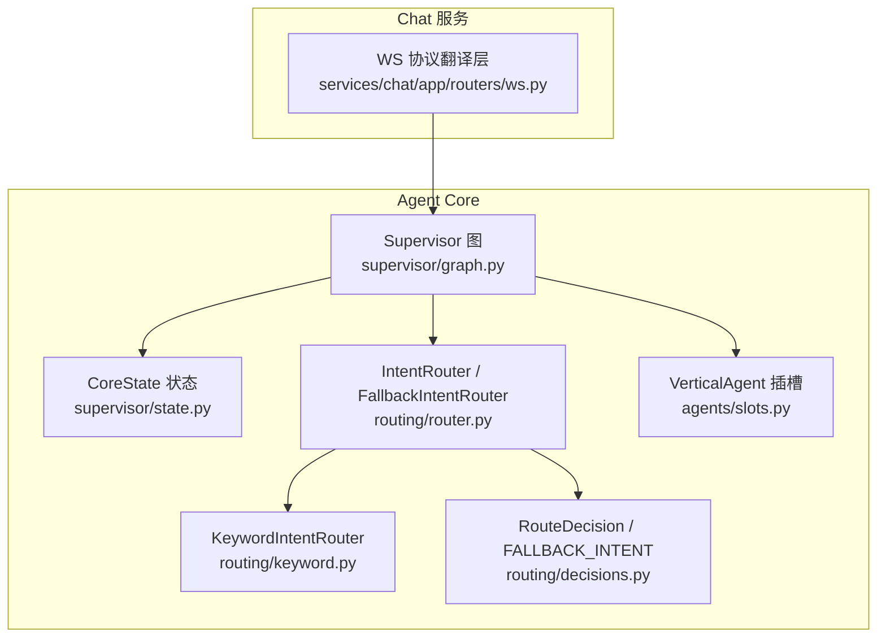
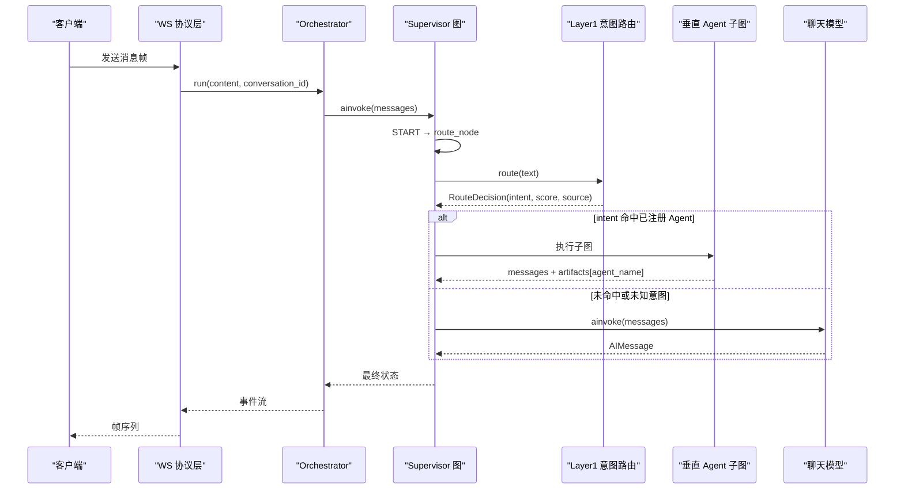
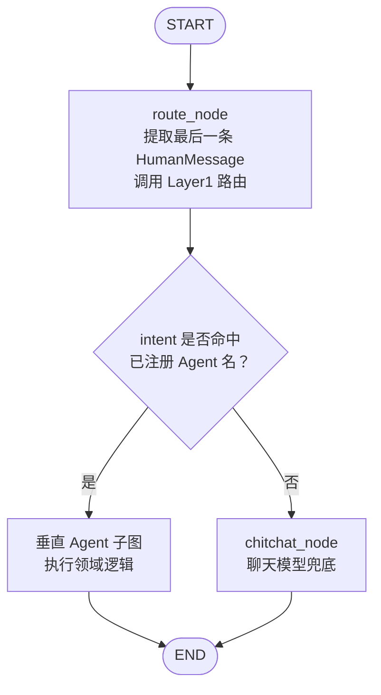
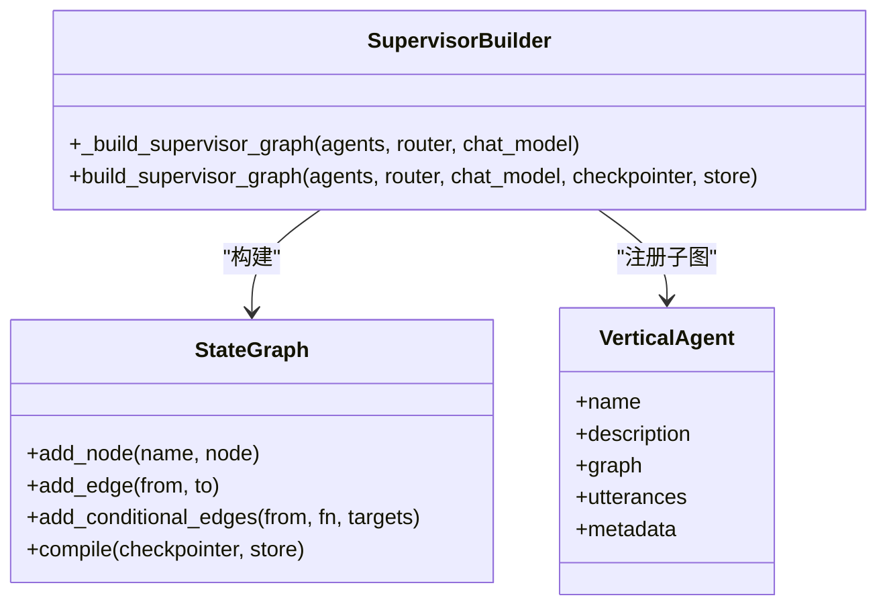
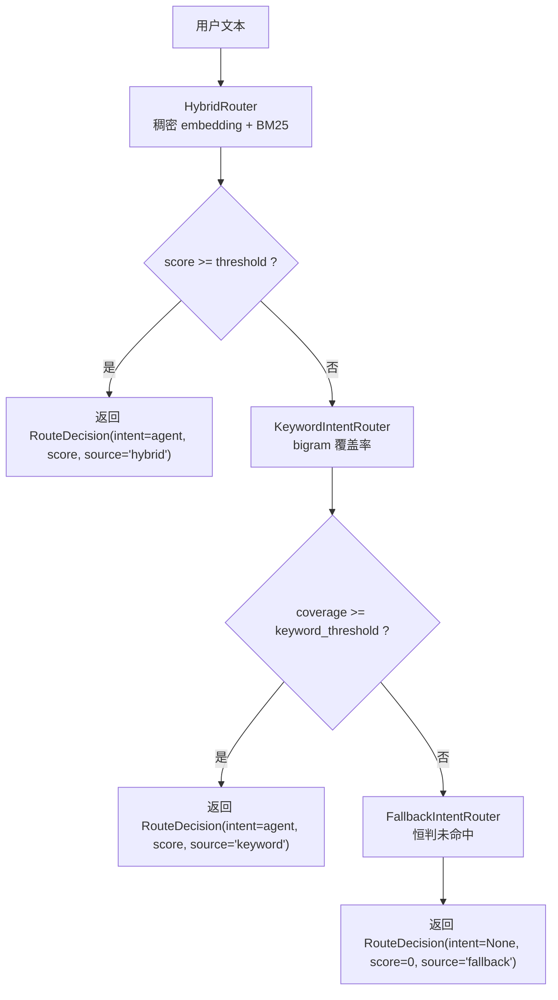
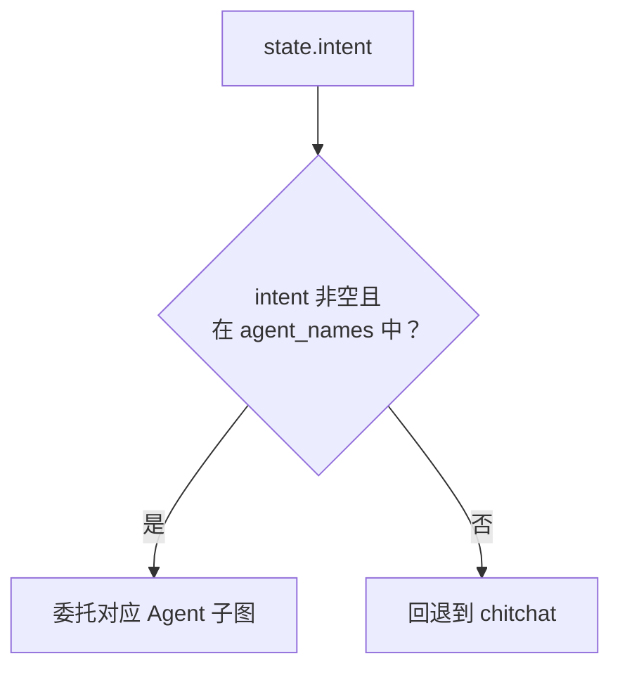
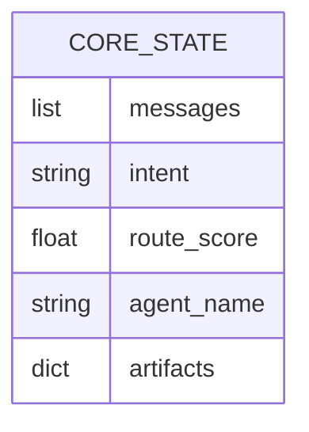
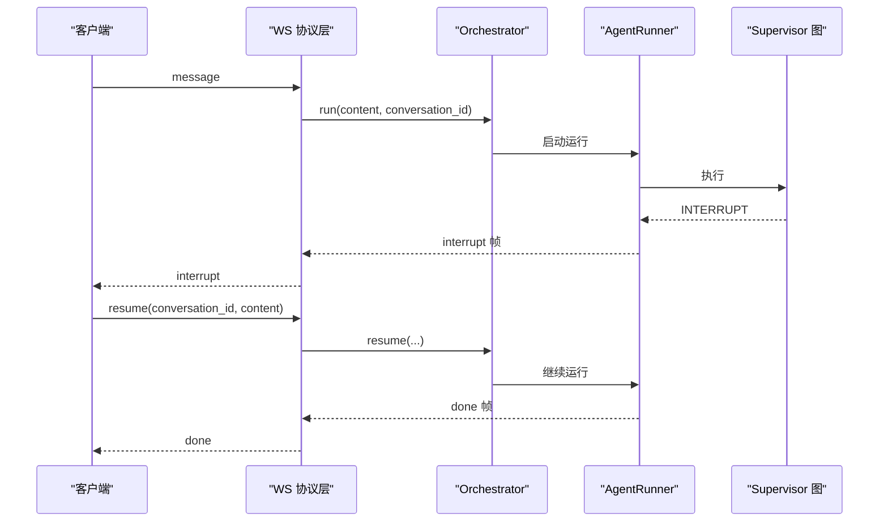
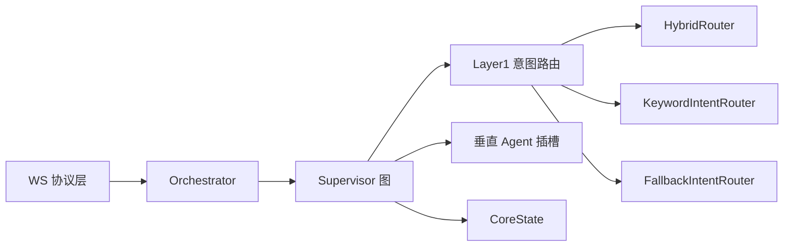

# Supervisor 编排器

<cite>
**本文引用的文件**   
- [services/agent-core/src/po_agent_core/supervisor/graph.py](file://services/agent-core/src/po_agent_core/supervisor/graph.py)
- [services/agent-core/src/po_agent_core/supervisor/state.py](file://services/agent-core/src/po_agent_core/supervisor/state.py)
- [services/agent-core/src/po_agent_core/routing/router.py](file://services/agent-core/src/po_agent_core/routing/router.py)
- [services/agent-core/src/po_agent_core/routing/decisions.py](file://services/agent-core/src/po_agent_core/routing/decisions.py)
- [services/agent-core/src/po_agent_core/routing/keyword.py](file://services/agent-core/src/po_agent_core/routing/keyword.py)
- [services/agent-core/src/po_agent_core/agents/slots.py](file://services/agent-core/src/po_agent_core/agents/slots.py)
- [services/agent-core/tests/test_supervisor.py](file://services/agent-core/tests/test_supervisor.py)
- [services/chat/app/routers/ws.py](file://services/chat/app/routers/ws.py)
</cite>

## 目录
1. [引言](#引言)
2. [项目结构定位](#项目结构定位)
3. [核心组件](#核心组件)
4. [架构总览](#架构总览)
5. [详细组件分析](#详细组件分析)
6. [依赖关系分析](#依赖关系分析)
7. [性能与并发特性](#性能与并发特性)
8. [故障排查指南](#故障排查指南)
9. [结论](#结论)

## 引言
本文件面向 Supervisor 编排器的实现，围绕基于 LangGraph 的图编排架构展开，重点解释以下目标：
- 执行流程：`START → route_node → (垂直 Agent 子图 | chitchat) → END`。
- 意图识别、任务分发与结果聚合机制。
- Layer1 语义路由的工作原理，包括异步线程池调用避免阻塞事件循环的设计。
- 条件边选路逻辑：根据 `intent` 匹配已注册的 Agent 名进行动态路由。
- `chitchat` 兜底节点的实现：降级处理与闲聊场景的统一处理。
- Supervisor 图的构建过程：节点注册、边连接和编译配置。
- 架构图展示各组件间的交互关系和数据流向。

Supervisor 是“编排层”，不承载具体领域能力；它负责把用户输入交给合适的垂直 Agent 子图，或在无法命中时走 `chitchat` 兜底。所有领域私有状态统一写入 `artifacts`，由对应 Agent 命名空间隔离。

## 项目结构定位
Supervisor 相关代码集中在 Python 包 `po_agent_core` 中，关键位置如下：
- 编排图工厂与节点定义：`supervisor/graph.py`
- 共享状态契约：`supervisor/state.py`
- Layer1 意图路由与降级链：`routing/router.py`、`routing/keyword.py`、`routing/decisions.py`
- 垂直 Agent 插槽契约：`agents/slots.py`
- 编排图行为测试：`tests/test_supervisor.py`
- WebSocket 协议翻译层（编排器外部接入点）：`services/chat/app/routers/ws.py`

**图表来源** 
- [services/agent-core/src/po_agent_core/supervisor/graph.py:1-142](file://services/agent-core/src/po_agent_core/supervisor/graph.py#L1-L142)
- [services/agent-core/src/po_agent_core/supervisor/state.py:1-39](file://services/agent-core/src/po_agent_core/supervisor/state.py#L1-L39)
- [services/agent-core/src/po_agent_core/routing/router.py:1-225](file://services/agent-core/src/po_agent_core/routing/router.py#L1-L225)
- [services/agent-core/src/po_agent_core/routing/keyword.py:1-74](file://services/agent-core/src/po_agent_core/routing/keyword.py#L1-L74)
- [services/agent-core/src/po_agent_core/routing/decisions.py:1-25](file://services/agent-core/src/po_agent_core/routing/decisions.py#L1-L25)
- [services/agent-core/src/po_agent_core/agents/slots.py:1-59](file://services/agent-core/src/po_agent_core/agents/slots.py#L1-L59)
- [services/chat/app/routers/ws.py:1-189](file://services/chat/app/routers/ws.py#L1-L189)

**章节来源**
- [services/agent-core/src/po_agent_core/supervisor/graph.py:1-142](file://services/agent-core/src/po_agent_core/supervisor/graph.py#L1-L142)
- [services/agent-core/src/po_agent_core/supervisor/state.py:1-39](file://services/agent-core/src/po_agent_core/supervisor/state.py#L1-L39)
- [services/agent-core/src/po_agent_core/routing/router.py:1-225](file://services/agent-core/src/po_agent_core/routing/router.py#L1-L225)
- [services/agent-core/src/po_agent_core/routing/keyword.py:1-74](file://services/agent-core/src/po_agent_core/routing/keyword.py#L1-L74)
- [services/agent-core/src/po_agent_core/routing/decisions.py:1-25](file://services/agent-core/src/po_agent_core/routing/decisions.py#L1-L25)
- [services/agent-core/src/po_agent_core/agents/slots.py:1-59](file://services/agent-core/src/po_agent_core/agents/slots.py#L1-L59)
- [services/chat/app/routers/ws.py:1-189](file://services/chat/app/routers/ws.py#L1-L189)

## 核心组件
- **Supervisor 图**：以 LangGraph 的 `StateGraph` 构建，包含 `route_node`、`chitchat_node` 以及若干垂直 Agent 子图节点。
- **Layer1 意图路由**：优先使用混合路由（稠密 embedding + BM25），失败时降级到本地关键词路由或兜底路由。
- **CoreState 状态**：最小化编排字段，包含消息、路由决策、实际委托节点名和按 Agent 隔离的 artifacts。
- **VerticalAgent 插槽**：声明垂直 Agent 的名称、描述、已编译子图和意图语料，供 Supervisor 挂载和路由。
- **WS 协议层**：将上游 WebSocket 帧转换为 Orchestrator 调用，并转发编排侧事件为前端帧。

**章节来源**
- [services/agent-core/src/po_agent_core/supervisor/graph.py:1-142](file://services/agent-core/src/po_agent_core/supervisor/graph.py#L1-L142)
- [services/agent-core/src/po_agent_core/supervisor/state.py:1-39](file://services/agent-core/src/po_agent_core/supervisor/state.py#L1-L39)
- [services/agent-core/src/po_agent_core/routing/router.py:1-225](file://services/agent-core/src/po_agent_core/routing/router.py#L1-L225)
- [services/agent-core/src/po_agent_core/agents/slots.py:1-59](file://services/agent-core/src/po_agent_core/agents/slots.py#L1-L59)
- [services/chat/app/routers/ws.py:1-189](file://services/chat/app/routers/ws.py#L1-L189)

## 架构总览
Supervisor 编排器采用“单轮委托”语义：一次用户输入进入图后，先做意图识别，再选择某个垂直 Agent 子图或直接走 `chitchat`；Agent 子图内部可完成多轮工具循环，但对外只暴露一次执行结果。

**图表来源**
- [services/chat/app/routers/ws.py:131-189](file://services/chat/app/routers/ws.py#L131-L189)
- [services/agent-core/src/po_agent_core/supervisor/graph.py:65-113](file://services/agent-core/src/po_agent_core/supervisor/graph.py#L65-L113)
- [services/agent-core/src/po_agent_core/routing/router.py:75-80](file://services/agent-core/src/po_agent_core/routing/router.py#L75-L80)

## 详细组件分析

### Supervisor 图与执行流程
Supervisor 图的核心路径是 `START → route_node → (垂直 Agent 子图 | chitchat) → END`：
- `route_node`：从 `messages` 中倒序查找最后一条 `HumanMessage`，提取文本后调用 Layer1 路由。
- 条件边：若 `intent` 命中已注册的 Agent 名，则委托该子图；否则进入 `chitchat`。
- `chitchat_node`：直接调用聊天模型生成回复，作为降级和闲聊的统一出口。
- 每个垂直 Agent 子图以自身 `name` 作为节点名挂载，执行完成后直接连向 `END`。

**图表来源**
- [services/agent-core/src/po_agent_core/supervisor/graph.py:65-113](file://services/agent-core/src/po_agent_core/supervisor/graph.py#L65-L113)

#### 节点职责与数据流
- `route_node`：
  - 读取 `state["messages"]`，找到最后一个 `HumanMessage`。
  - 通过 `asyncio.to_thread(router.route, text)` 同步调用路由，避免阻塞事件循环。
  - 返回 `intent`、`route_score`、`agent_name`。
- `chitchat_node`：
  - 调用 `chat_model.ainvoke(messages)`。
  - 保证返回 `AIMessage`，并将消息追加到 `messages`。
- 条件边函数 `route_from_intent`：
  - 仅当 `intent` 非空且存在于已注册 Agent 名集合时，才委托对应子图。
  - 其他情况一律回退到 `chitchat`。

**章节来源**
- [services/agent-core/src/po_agent_core/supervisor/graph.py:44-95](file://services/agent-core/src/po_agent_core/supervisor/graph.py#L44-L95)

#### 图的构建与编译
- `_build_supervisor_graph`：
  - 创建 `StateGraph(CoreState)`。
  - 注册 `route_node`、`chitchat_node` 和所有垂直 Agent 子图。
  - 添加 `START → route_node`。
  - 添加条件边 `route_node → {agent_names} ∪ {"chitchat"}`。
  - 为每个 Agent 子图添加 `→ END`，并为 `chitchat` 添加 `→ END`。
- `build_supervisor_graph`：
  - 校验 Agent 名称唯一性，禁止重复。
  - 禁止占用保留节点名 `route` 和 `chitchat`。
  - 调用 `_build_supervisor_graph` 并传入 `checkpointer`、`store` 编译为 `CompiledStateGraph`。

**图表来源**
- [services/agent-core/src/po_agent_core/supervisor/graph.py:56-142](file://services/agent-core/src/po_agent_core/supervisor/graph.py#L56-L142)
- [services/agent-core/src/po_agent_core/agents/slots.py:31-59](file://services/agent-core/src/po_agent_core/agents/slots.py#L31-L59)

**章节来源**
- [services/agent-core/src/po_agent_core/supervisor/graph.py:56-142](file://services/agent-core/src/po_agent_core/supervisor/graph.py#L56-L142)

### Layer1 语义路由与降级链
Layer1 的目标是把用户文本映射到某个垂直 Agent 的意图，或者判定为未命中。其设计强调“同步路由 + 异步宿主包裹”，以避免 embedding 网络请求阻塞事件循环。

**图表来源**
- [services/agent-core/src/po_agent_core/routing/router.py:38-100](file://services/agent-core/src/po_agent_core/routing/router.py#L38-L100)
- [services/agent-core/src/po_agent_core/routing/keyword.py:30-74](file://services/agent-core/src/po_agent_core/routing/keyword.py#L30-L74)
- [services/agent-core/src/po_agent_core/routing/decisions.py:12-25](file://services/agent-core/src/po_agent_core/routing/decisions.py#L12-L25)

#### IntentRouter（混合路由）
- 构造时接收 `routes`、`DenseEncoder`、BM25 稀疏编码器、阈值和 alpha。
- `route(text)` 调用 `HybridRouter`，若 `choice.name` 存在且分数达到阈值，返回命中的 `RouteDecision`；否则返回 `intent=None`。
- 稠密编码器从配置解析，缺失 key 或模型名异常时会尝试回退策略。

#### KeywordIntentRouter（本地关键词路由）
- 使用字符 bigram 计算查询与 utterance 的重叠覆盖率。
- 分母取语料长度，避免长查询稀释命中率。
- 阈值独立于混合路由，默认较低以覆盖短语料场景。

#### FallbackIntentRouter（兜底路由）
- 无路由语料时的末端兜底，始终返回 `intent=None`。
- 配合 Supervisor 的 `chitchat` 节点，保证任何配置下都有确定去向。

**章节来源**
- [services/agent-core/src/po_agent_core/routing/router.py:38-100](file://services/agent-core/src/po_agent_core/routing/router.py#L38-L100)
- [services/agent-core/src/po_agent_core/routing/keyword.py:1-74](file://services/agent-core/src/po_agent_core/routing/keyword.py#L1-L74)
- [services/agent-core/src/po_agent_core/routing/decisions.py:1-25](file://services/agent-core/src/po_agent_core/routing/decisions.py#L1-L25)

### 条件边选路与动态路由
条件边选路的关键在于“只委托已注册的 Agent 名”：
- `route_from_intent` 检查 `state["intent"]` 是否在 `agent_names` 集合中。
- 如果路由返回了未注册的意图名，Supervisor 不会盲目信任，而是回退到 `chitchat`。
- 这保证了图的安全性：即使上层路由被替换或注入错误意图，也不会路由到不存在节点。

**图表来源**
- [services/agent-core/src/po_agent_core/supervisor/graph.py:90-95](file://services/agent-core/src/po_agent_core/supervisor/graph.py#L90-L95)

**章节来源**
- [services/agent-core/src/po_agent_core/supervisor/graph.py:90-95](file://services/agent-core/src/po_agent_core/supervisor/graph.py#L90-L95)

### chitchat 兜底节点
`chitchat` 节点承担两类场景：
- 闲聊：用户没有明确业务意图。
- 降级：Layer1 路由不可用或未命中。

实现要点：
- 直接调用 `chat_model.ainvoke(messages)`。
- 确保返回 `AIMessage`，并把消息追加到 `messages`。
- 不写入 `artifacts`，因此 `chitchat` 不会污染领域状态。

**章节来源**
- [services/agent-core/src/po_agent_core/supervisor/graph.py:79-88](file://services/agent-core/src/po_agent_core/supervisor/graph.py#L79-L88)

### CoreState 状态与结果聚合
`CoreState` 是 Supervisor 与垂直 Agent 子图共享的状态契约，字段刻意保持最小：
- `messages`：对话消息，使用 `add_messages` reducer 归并。
- `intent`：Layer1 路由命中的意图。
- `route_score`：路由分数，用于排查差一点命中的情况。
- `agent_name`：本次实际委托的节点名，观测用。
- `artifacts`：各垂直 Agent 的私有数据，按 Agent 名命名空间隔离，使用浅合并策略。

结果聚合机制：
- 垂直 Agent 子图返回 `messages` 和 `artifacts[agent_name]`。
- Supervisor 不解释 `artifacts` 内容，仅负责按命名空间隔离和浅合并。
- `merge_artifacts` 对同名命名空间整体替换，后写胜出。

**图表来源**
- [services/agent-core/src/po_agent_core/supervisor/state.py:22-39](file://services/agent-core/src/po_agent_core/supervisor/state.py#L22-L39)

**章节来源**
- [services/agent-core/src/po_agent_core/supervisor/state.py:1-39](file://services/agent-core/src/po_agent_core/supervisor/state.py#L1-L39)

### 垂直 Agent 插槽契约
`VerticalAgent` 是 Supervisor 之下的领域子图插槽，契约包括：
- `name`：必须与 Layer1 路由的 `Route.name` 一致。
- `utterances`：Layer1 意图路由语料；为空表示不参与意图路由。
- `graph`：已编译的 LangGraph 子图，状态 schema 与 `CoreState` 兼容。
- `metadata`：静态资源预留扩展位。

插槽校验：
- name 不能为空或以 `__` 开头。
- description 必填。
- graph 必须是 `CompiledStateGraph`。
- utterances 元素必须是非空字符串。

**章节来源**
- [services/agent-core/src/po_agent_core/agents/slots.py:1-59](file://services/agent-core/src/po_agent_core/agents/slots.py#L1-L59)

### WebSocket 协议层与编排器集成
WS 模块是协议翻译层，不做业务判断，只做事件到帧的转换：
- 入站帧：`message`、`resume`、`ping`。
- 出站帧：`run_started`、`token`、`thinking`、`plan`、`step`、`tool_call_*`、`interrupt`、`done`、`error`。
- `resume` 必须携带 `conversation_id`，用于恢复挂起的 LangGraph 线程。
- 垂直 Agent 触发人机确认会上抛 `INTERRUPT`，随后仍以 `RUN_FINISHED` 收尾；前端需等待 `done` 后再发 `resume`。

**图表来源**
- [services/chat/app/routers/ws.py:67-83](file://services/chat/app/routers/ws.py#L67-L83)
- [services/chat/app/routers/ws.py:158-180](file://services/chat/app/routers/ws.py#L158-L180)

**章节来源**
- [services/chat/app/routers/ws.py:1-189](file://services/chat/app/routers/ws.py#L1-L189)

## 依赖关系分析
Supervisor 编排器的依赖关系呈现清晰的层次：
- WS 协议层依赖 Orchestrator，间接依赖 Supervisor 图。
- Supervisor 图依赖 Layer1 意图路由和垂直 Agent 插槽。
- Layer1 路由依赖 semantic-router、embedding 配置和本地关键词算法。
- CoreState 提供最小状态契约，避免上帝对象。

**图表来源**
- [services/chat/app/routers/ws.py:1-189](file://services/chat/app/routers/ws.py#L1-L189)
- [services/agent-core/src/po_agent_core/supervisor/graph.py:1-142](file://services/agent-core/src/po_agent_core/supervisor/graph.py#L1-L142)
- [services/agent-core/src/po_agent_core/routing/router.py:1-225](file://services/agent-core/src/po_agent_core/routing/router.py#L1-L225)
- [services/agent-core/src/po_agent_core/supervisor/state.py:1-39](file://services/agent-core/src/po_agent_core/supervisor/state.py#L1-L39)

**章节来源**
- [services/chat/app/routers/ws.py:1-189](file://services/chat/app/routers/ws.py#L1-L189)
- [services/agent-core/src/po_agent_core/supervisor/graph.py:1-142](file://services/agent-core/src/po_agent_core/supervisor/graph.py#L1-L142)
- [services/agent-core/src/po_agent_core/routing/router.py:1-225](file://services/agent-core/src/po_agent_core/routing/router.py#L1-L225)
- [services/agent-core/src/po_agent_core/supervisor/state.py:1-39](file://services/agent-core/src/po_agent_core/supervisor/state.py#L1-L39)

## 性能与并发特性
- **异步线程池调用**：`route_node` 使用 `asyncio.to_thread(router.route, text)` 包裹同步路由调用，避免 embedding 网络请求阻塞事件循环。
- **轻量状态**：`CoreState` 字段最小化，减少状态复制和合并成本。
- **短路兜底**：`chitchat` 直接调用聊天模型，不经过复杂逻辑，保证低延迟兜底。
- **条件边安全**：仅委托已注册 Agent，避免无效跳转和额外开销。

**章节来源**
- [services/agent-core/src/po_agent_core/supervisor/graph.py:65-77](file://services/agent-core/src/po_agent_core/supervisor/graph.py#L65-L77)
- [services/agent-core/src/po_agent_core/supervisor/state.py:22-39](file://services/agent-core/src/po_agent_core/supervisor/state.py#L22-L39)

## 故障排查指南
常见问题和定位方式：
- **意图未命中**：
  - 检查 Layer1 路由的 `threshold` 和 `keyword_threshold`。
  - 查看 `route_score` 和 `source`，确认是 hybrid、keyword 还是 fallback。
  - 若为 fallback，检查是否有可用 routes。
- **未知意图导致回退**：
  - 确认路由返回的 `intent` 是否已在 `agent_names` 中。
  - 若路由返回未注册意图，Supervisor 会强制回退到 `chitchat`。
- **Agent 名称冲突**：
  - 构建 Supervisor 图时会校验重复名称和保留节点名，抛出 `VerticalAgentError`。
- **WS 中断恢复问题**：
  - 确保 `resume` 帧携带正确的 `conversation_id`。
  - 前端必须在收到 `done` 后再发送 `resume`，避免帧交错。

**章节来源**
- [services/agent-core/src/po_agent_core/supervisor/graph.py:132-141](file://services/agent-core/src/po_agent_core/supervisor/graph.py#L132-L141)
- [services/agent-core/src/po_agent_core/routing/router.py:181-225](file://services/agent-core/src/po_agent_core/routing/router.py#L181-L225)
- [services/chat/app/routers/ws.py:158-180](file://services/chat/app/routers/ws.py#L158-L180)
- [services/agent-core/tests/test_supervisor.py:98-108](file://services/agent-core/tests/test_supervisor.py#L98-L108)

## 结论
Supervisor 编排器通过 LangGraph 实现了清晰、可扩展的多 Agent 调度架构：
- 以 `START → route_node → (垂直 Agent 子图 | chitchat) → END` 为主线，保证意图识别、任务分发和结果聚合的可观测性。
- Layer1 语义路由具备完善的降级链，确保在无 embedding 或无语料时仍能稳定运行。
- 条件边选路严格限制为已注册 Agent，提升安全性。
- `chitchat` 提供统一的降级和闲聊出口。
- CoreState 最小化状态契约，避免上帝对象，便于维护和扩展。
- WS 协议层与编排器解耦，专注于事件到帧的转换，便于前端适配和未来扩展。