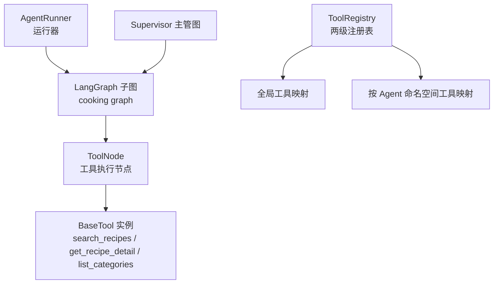
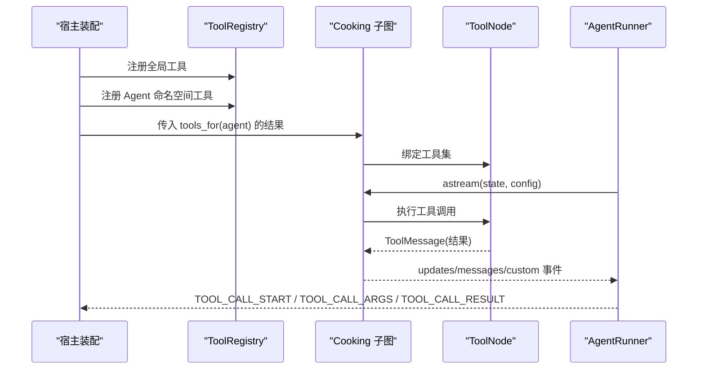
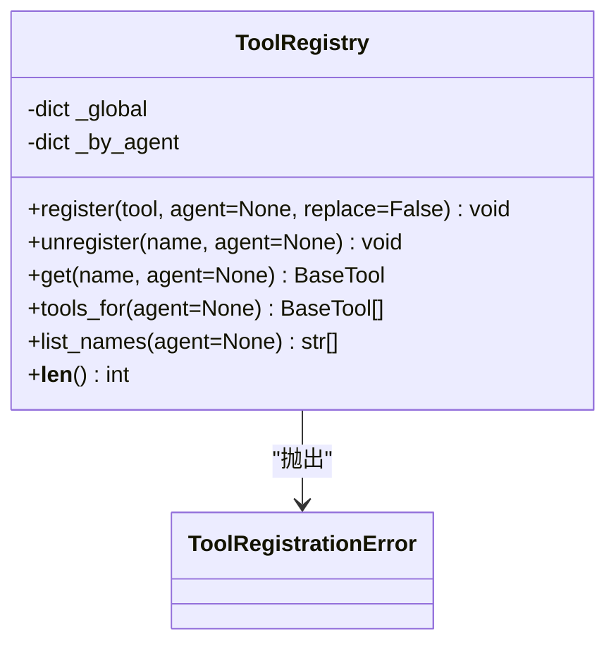
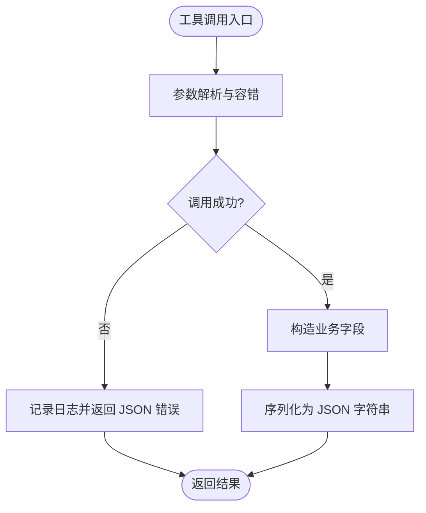
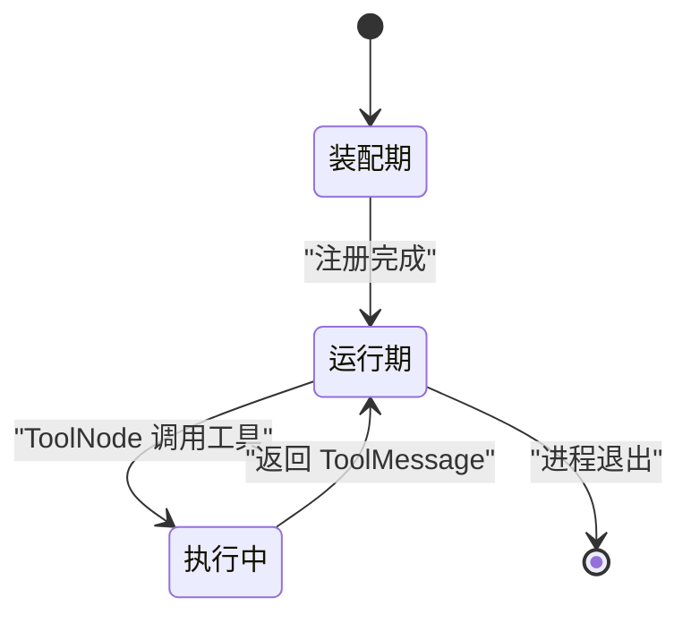
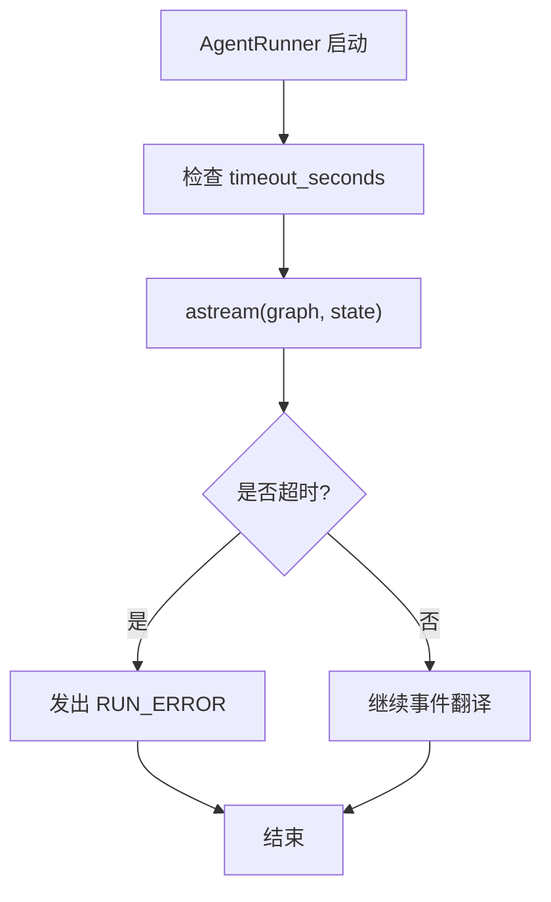
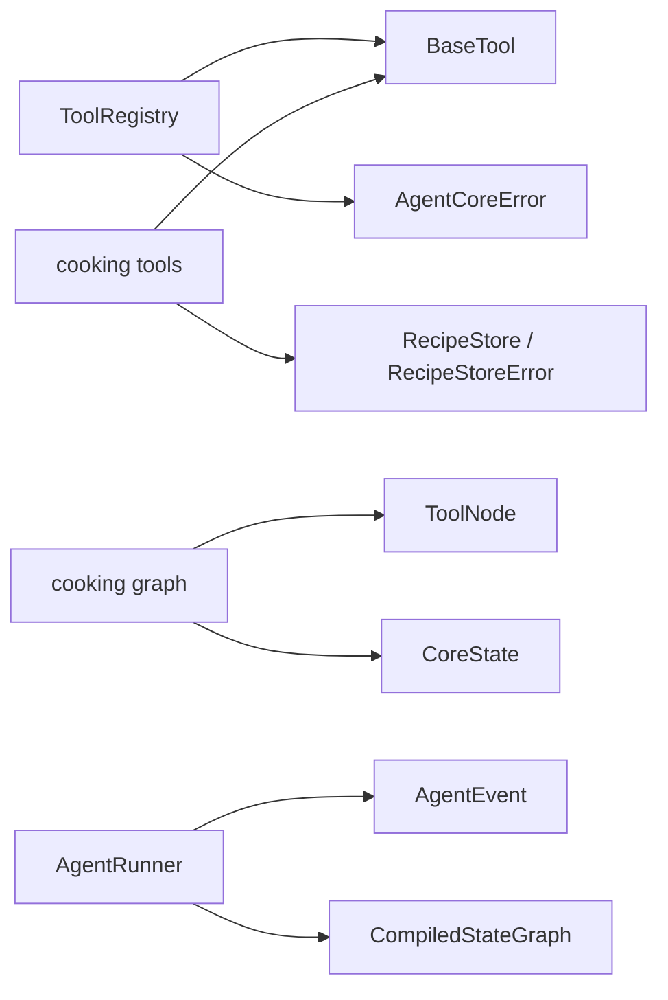

# 工具注册机制

<cite>
**本文引用的文件**   
- [services/agent-core/src/po_agent_core/tools/registry.py](file://services/agent-core/src/po_agent_core/tools/registry.py)
- [services/agent-core/tests/test_tools_registry.py](file://services/agent-core/tests/test_tools_registry.py)
- [services/agent-cooking/src/po_agent_cooking/tools.py](file://services/agent-cooking/src/po_agent_cooking/tools.py)
- [services/agent-cooking/src/po_agent_cooking/graph.py](file://services/agent-cooking/src/po_agent_cooking/graph.py)
- [services/agent-core/src/po_agent_core/runner/runner.py](file://services/agent-core/src/po_agent_core/runner/runner.py)
- [services/agent-core/src/po_agent_core/errors.py](file://services/agent-core/src/po_agent_core/errors.py)
- [services/agent-core/src/po_agent_core/__init__.py](file://services/agent-core/src/po_agent_core/__init__.py)
- [services/agent-core/src/po_agent_core/supervisor/graph.py](file://services/agent-core/src/po_agent_core/supervisor/graph.py)
</cite>

## 目录
1. [引言](#引言)
2. [项目结构](#项目结构)
3. [核心组件](#核心组件)
4. [架构总览](#架构总览)
5. [详细组件分析](#详细组件分析)
6. [依赖关系分析](#依赖关系分析)
7. [性能与并发特性](#性能与并发特性)
8. [安全与资源限制](#安全与资源限制)
9. [自定义工具开发指南](#自定义工具开发指南)
10. [工具组合与编排](#工具组合与编排)
11. [故障排查](#故障排查)
12. [结论](#结论)

## 引言
本文围绕“工具注册机制”展开，聚焦插件化工具架构的设计与实现。重点说明：
- ToolRegistry 的两级命名空间（全局 + 垂直 Agent）如何支持工具的动态注册、发现与调用。
- 工具接口抽象、参数校验、返回值转换与错误处理策略。
- 工具生命周期：装配期注册、运行期只读、执行期由 LangGraph 的 ToolNode 调度。
- 安全机制：权限控制、资源限制与执行超时在现有代码中的体现与扩展点。
- 自定义工具开发流程：接口实现、元数据定义、测试方法。
- 工具组合与编排：串行、并行与条件分支在 ReAct 子图中的落地方式。

## 项目结构
本仓库中与工具注册和执行相关的关键位置如下：
- 工具注册表：`services/agent-core/src/po_agent_core/tools/registry.py`
- 工具注册单元测试：`services/agent-core/tests/test_tools_registry.py`
- 菜谱领域工具实现：`services/agent-cooking/src/po_agent_cooking/tools.py`
- 菜谱 ReAct 子图（工具调用入口）：`services/agent-cooking/src/po_agent_cooking/graph.py`
- 运行器与事件流（超时、异常、工具调用事件）：`services/agent-core/src/po_agent_core/runner/runner.py`
- 核心异常基类：`services/agent-core/src/po_agent_core/errors.py`
- 核心包对外导出（含 ToolRegistry）：`services/agent-core/src/po_agent_core/__init__.py`
- 主管图（Supervisor）将垂直 Agent 子图接入整体编排：`services/agent-core/src/po_agent_core/supervisor/graph.py`

**图表来源**
- [services/agent-core/src/po_agent_core/runner/runner.py:249-324](file://services/agent-core/src/po_agent_core/runner/runner.py#L249-L324)
- [services/agent-cooking/src/po_agent_cooking/graph.py:56-91](file://services/agent-cooking/src/po_agent_cooking/graph.py#L56-L91)
- [services/agent-core/src/po_agent_core/tools/registry.py:19-76](file://services/agent-core/src/po_agent_core/tools/registry.py#L19-L76)
- [services/agent-core/src/po_agent_core/supervisor/graph.py:116-141](file://services/agent-core/src/po_agent_core/supervisor/graph.py#L116-L141)

**章节来源**
- [services/agent-core/src/po_agent_core/tools/registry.py:1-76](file://services/agent-core/src/po_agent_core/tools/registry.py#L1-L76)
- [services/agent-cooking/src/po_agent_cooking/tools.py:1-206](file://services/agent-cooking/src/po_agent_cooking/tools.py#L1-L206)
- [services/agent-cooking/src/po_agent_cooking/graph.py:1-92](file://services/agent-cooking/src/po_agent_cooking/graph.py#L1-L92)
- [services/agent-core/src/po_agent_core/runner/runner.py:1-399](file://services/agent-core/src/po_agent_core/runner/runner.py#L1-L399)

## 核心组件
- ToolRegistry：提供两级工具注册表（全局 + 按 Agent 命名空间），支持注册、注销、查询、列出名称和长度统计。
- ToolRegistrationError：注册冲突或删除不存在工具时抛出的专用异常。
- BaseTool：来自 langchain_core.tools，是工具的统一抽象；领域工具通过装饰器或函数封装后作为 BaseTool 使用。
- ToolNode：LangGraph 提供的工具执行节点，负责根据 AIMessage 的工具调用执行对应 BaseTool，并返回 ToolMessage。
- AgentRunner：将 LangGraph 的执行流翻译为统一 AgentEvent 事件流，负责超时治理、异常捕获、工具调用事件转发。
- cooking tools：三个具体工具（搜索、详情、分类列表），遵循“不抛异常、返回 JSON 字符串”的契约。
- cooking graph：ReAct 子图，组装 agent 节点与 ToolNode，形成“模型 → 工具 → 模型”的循环。

**章节来源**
- [services/agent-core/src/po_agent_core/tools/registry.py:15-76](file://services/agent-core/src/po_agent_core/tools/registry.py#L15-L76)
- [services/agent-cooking/src/po_agent_cooking/tools.py:95-205](file://services/agent-cooking/src/po_agent_cooking/tools.py#L95-L205)
- [services/agent-cooking/src/po_agent_cooking/graph.py:56-91](file://services/agent-cooking/src/po_agent_cooking/graph.py#L56-L91)
- [services/agent-core/src/po_agent_core/runner/runner.py:249-324](file://services/agent-core/src/po_agent_core/runner/runner.py#L249-L324)

## 架构总览
工具注册机制处于“装配期”，而工具执行发生在“运行期”。整体流程如下：
1. 宿主在启动阶段创建 ToolRegistry，并将全局工具与各垂直 Agent 的工具分别注册到不同命名空间。
2. 垂直 Agent（如 cooking）构建自己的 ReAct 子图，从 ToolRegistry 中取出该 Agent 命名空间的工具集合。
3. 子图通过 LangGraph 的 ToolNode 执行工具调用，结果以 ToolMessage 形式回传。
4. AgentRunner 监听 LangGraph 的事件流，将工具调用开始、参数、结束与结果转换为统一的 AgentEvent，供上层传输层（WS/A2A/MCP）消费。
5. 若运行超时或抛出未捕获异常，AgentRunner 会发出 RUN_ERROR 终止帧。

**图表来源**
- [services/agent-core/src/po_agent_core/tools/registry.py:26-70](file://services/agent-core/src/po_agent_core/tools/registry.py#L26-L70)
- [services/agent-cooking/src/po_agent_cooking/graph.py:68-91](file://services/agent-cooking/src/po_agent_cooking/graph.py#L68-L91)
- [services/agent-core/src/po_agent_core/runner/runner.py:261-324](file://services/agent-core/src/po_agent_core/runner/runner.py#L261-L324)

## 详细组件分析

### ToolRegistry 与 ToolRegistrationError
ToolRegistry 维护两个内部映射：
- `_global`：全局工具名到 BaseTool 的映射。
- `_by_agent`：Agent 命名空间到工具名的二级映射。

关键行为：
- register：校验工具名非空；同名冲突默认拒绝，可通过 replace=True 覆盖；支持按 agent 注册到指定命名空间。
- unregister：仅删除目标桶中的工具；若桶不存在或工具未注册则抛出 ToolRegistrationError。
- get：优先从 Agent 命名空间查找，找不到再回退到全局；未找到抛出 ToolRegistrationError。
- tools_for：合并全局与指定 Agent 的工具（Agent 同名覆盖全局）。
- list_names：基于 tools_for 返回工具名列表。
- __len__：统计全局与所有 Agent 命名空间工具总数。

**图表来源**
- [services/agent-core/src/po_agent_core/tools/registry.py:15-76](file://services/agent-core/src/po_agent_core/tools/registry.py#L15-L76)

**章节来源**
- [services/agent-core/src/po_agent_core/tools/registry.py:1-76](file://services/agent-core/src/po_agent_core/tools/registry.py#L1-L76)
- [services/agent-core/tests/test_tools_registry.py:26-72](file://services/agent-core/tests/test_tools_registry.py#L26-L72)

### 工具接口抽象与错误处理
- 工具抽象：领域工具通过 langchain_core.tools 的 `@tool` 装饰器生成 BaseTool 实例，具备 name、description、参数签名等元信息。
- 参数校验：工具函数签名即参数契约；领域工具内部对输入做容错处理（例如难度字段的别名映射与空值容忍）。
- 返回值转换：工具统一返回 JSON 字符串，便于模型消费与前端渲染；失败路径返回包含 error 字段的 JSON。
- 错误处理：工具内部 try/except 捕获领域错误（如 RecipeStoreError），转为 JSON 错误文本；ToolNode 对工具异常有二次兜底，避免整轮对话直接失败。

**图表来源**
- [services/agent-cooking/src/po_agent_cooking/tools.py:56-93](file://services/agent-cooking/src/po_agent_cooking/tools.py#L56-L93)
- [services/agent-cooking/src/po_agent_cooking/tools.py:103-205](file://services/agent-cooking/src/po_agent_cooking/tools.py#L103-L205)

**章节来源**
- [services/agent-cooking/src/po_agent_cooking/tools.py:1-206](file://services/agent-cooking/src/po_agent_cooking/tools.py#L1-L206)

### 工具生命周期管理
- 初始化（装配期）：宿主创建 ToolRegistry，注册全局工具与各 Agent 命名空间工具。
- 执行（运行期）：子图编译时将工具集注入 ToolNode；LangGraph 根据 AIMessage 的工具调用执行工具。
- 销毁：当前实现中未显式销毁工具；由于运行期只读且无锁设计，工具对象通常随进程生命周期存在。

**图表来源**
- [services/agent-core/src/po_agent_core/tools/registry.py:1-6](file://services/agent-core/src/po_agent_core/tools/registry.py#L1-L6)
- [services/agent-cooking/src/po_agent_cooking/graph.py:68-91](file://services/agent-cooking/src/po_agent_cooking/graph.py#L68-L91)

**章节来源**
- [services/agent-core/src/po_agent_core/tools/registry.py:1-76](file://services/agent-core/src/po_agent_core/tools/registry.py#L1-L76)
- [services/agent-cooking/src/po_agent_cooking/graph.py:1-92](file://services/agent-cooking/src/po_agent_cooking/graph.py#L1-L92)

### 工具的安全机制
- 权限控制：当前代码未实现基于角色的工具访问控制；可在宿主装配层结合用户身份决定向某个 Agent 注入哪些工具。
- 资源限制：工具本身未内置 CPU/内存限制；可在宿主侧通过进程隔离或容器资源配额进行限制。
- 执行超时：AgentRunner 对整次运行设置超时（默认 300 秒），超时后发出 RUN_ERROR 终止帧；工具级超时可结合异步任务取消或外部网关限制。

**图表来源**
- [services/agent-core/src/po_agent_core/runner/runner.py:249-324](file://services/agent-core/src/po_agent_core/runner/runner.py#L249-L324)

**章节来源**
- [services/agent-core/src/po_agent_core/runner/runner.py:249-324](file://services/agent-core/src/po_agent_core/runner/runner.py#L249-L324)

## 依赖关系分析
- ToolRegistry 依赖 langchain_core.tools.BaseTool 与 po_agent_core.errors.AgentCoreError。
- cooking tools 依赖 langchain_core.tools.BaseTool、po_agent_cooking.config.CookingSettings、po_agent_cooking.recipes.RecipeStore 与 RecipeStoreError。
- cooking graph 依赖 langgraph.graph.StateGraph、langgraph.prebuilt.ToolNode 与 CoreState。
- AgentRunner 依赖 langchain_core.messages.AIMessage/ToolMessage、langgraph.graph.state.CompiledStateGraph 与 po_agent_core.events.AgentEvent。
- 核心包导出 ToolRegistry 与 ToolRegistrationError，供宿主与其他模块使用。

**图表来源**
- [services/agent-core/src/po_agent_core/tools/registry.py:10-12](file://services/agent-core/src/po_agent_core/tools/registry.py#L10-L12)
- [services/agent-cooking/src/po_agent_cooking/tools.py:25-28](file://services/agent-cooking/src/po_agent_cooking/tools.py#L25-L28)
- [services/agent-cooking/src/po_agent_cooking/graph.py:26-31](file://services/agent-cooking/src/po_agent_cooking/graph.py#L26-L31)
- [services/agent-core/src/po_agent_core/runner/runner.py:53-57](file://services/agent-core/src/po_agent_core/runner/runner.py#L53-L57)
- [services/agent-core/src/po_agent_core/__init__.py:32-34](file://services/agent-core/src/po_agent_core/__init__.py#L32-L34)

**章节来源**
- [services/agent-core/src/po_agent_core/tools/registry.py:1-76](file://services/agent-core/src/po_agent_core/tools/registry.py#L1-L76)
- [services/agent-cooking/src/po_agent_cooking/tools.py:1-206](file://services/agent-cooking/src/po_agent_cooking/tools.py#L1-L206)
- [services/agent-cooking/src/po_agent_cooking/graph.py:1-92](file://services/agent-cooking/src/po_agent_cooking/graph.py#L1-L92)
- [services/agent-core/src/po_agent_core/runner/runner.py:1-399](file://services/agent-core/src/po_agent_core/runner/runner.py#L1-L399)
- [services/agent-core/src/po_agent_core/__init__.py:23-34](file://services/agent-core/src/po_agent_core/__init__.py#L23-L34)

## 性能与并发特性
- 注册期只读：注释明确“注册发生在宿主装配期（启动阶段），运行期只读——因此不做并发控制，换取零锁开销”。
- 工具调用：由 LangGraph 的 ToolNode 调度，Runner 通过 astream 流式翻译事件，减少阻塞。
- 去重策略：Runner 对消息与工具调用进行去重，避免子图上浮重复事件导致前端重复下发。

**章节来源**
- [services/agent-core/src/po_agent_core/tools/registry.py:1-6](file://services/agent-core/src/po_agent_core/tools/registry.py#L1-L6)
- [services/agent-core/src/po_agent_core/runner/runner.py:60-112](file://services/agent-core/src/po_agent_core/runner/runner.py#L60-L112)

## 安全与资源限制
- 工具异常不穿透：领域工具内部捕获异常并返回 JSON 错误，避免 ToolNode 抛出异常导致整轮对话失败。
- 运行超时：AgentRunner 对整次运行设置超时，超时后发出 RUN_ERROR。
- 可扩展点：可在宿主装配层增加权限校验（按用户/角色注入工具）、资源限制（进程/容器配额）、工具级超时（异步任务取消）。

**章节来源**
- [services/agent-cooking/src/po_agent_cooking/tools.py:10-17](file://services/agent-cooking/src/po_agent_cooking/tools.py#L10-L17)
- [services/agent-core/src/po_agent_core/runner/runner.py:249-324](file://services/agent-core/src/po_agent_core/runner/runner.py#L249-L324)

## 自定义工具开发指南

### 接口实现
- 使用 langchain_core.tools 的 `@tool` 装饰器定义工具函数，确保函数签名清晰表达参数类型与返回值。
- 工具内部应捕获领域异常，返回结构化 JSON 字符串，避免异常穿透 ToolNode。
- 如需与后端存储交互，通过闭包注入 store 实例，保持工具函数无状态。

**章节来源**
- [services/agent-cooking/src/po_agent_cooking/tools.py:95-205](file://services/agent-cooking/src/po_agent_cooking/tools.py#L95-L205)

### 元数据定义
- 工具名：由装饰器或函数名决定，必须唯一且在注册时有效。
- 描述：docstring 作为工具描述，供模型理解用途。
- 参数：函数签名即参数契约；建议在工具内部做容错与别名映射。

**章节来源**
- [services/agent-cooking/src/po_agent_cooking/tools.py:103-205](file://services/agent-cooking/src/po_agent_cooking/tools.py#L103-L205)

### 测试方法
- 使用 pytest 与 langchain_core.tools 的 `@tool` 装饰器编写用例。
- 验证全局注册与获取、Agent 命名空间覆盖、重复注册拒绝与覆盖、未注册工具报错、按命名空间注销等行为。

**章节来源**
- [services/agent-core/tests/test_tools_registry.py:1-72](file://services/agent-core/tests/test_tools_registry.py#L1-L72)

## 工具组合与编排

### 串行执行
- ReAct 子图通过“agent → tools → agent → … → END”的结构实现串行调用：模型决定是否需要工具调用，ToolNode 执行后返回结果，再由模型继续推理。

**章节来源**
- [services/agent-cooking/src/po_agent_cooking/graph.py:1-20](file://services/agent-cooking/src/po_agent_cooking/graph.py#L1-L20)
- [services/agent-cooking/src/po_agent_cooking/graph.py:77-91](file://services/agent-cooking/src/po_agent_cooking/graph.py#L77-L91)

### 并行执行
- 当前实现未显式并行执行多个工具；可在宿主装配层将多个工具注入 ToolNode，由 LangGraph 根据 AIMessage 的工具调用列表并行调度（取决于底层实现）。

### 条件分支
- 子图通过 tools_condition 判断末条 AIMessage 是否包含 tool_calls：若有则进入 tools 节点，否则结束。

**章节来源**
- [services/agent-cooking/src/po_agent_cooking/graph.py:83-89](file://services/agent-cooking/src/po_agent_cooking/graph.py#L83-L89)

## 故障排查
- 工具未注册：get 或 unregister 时会抛出 ToolRegistrationError，提示工具不存在或未注册。
- 重复注册：register 同名冲突时抛出 ToolRegistrationError，需使用 replace=True 覆盖。
- 工具异常：领域工具内部应捕获异常并返回 JSON 错误；若异常穿透 ToolNode，Runner 可能发出 RUN_ERROR。
- 运行超时：AgentRunner 超时后发出 RUN_ERROR，前端应等待唯一的终止事件。

**章节来源**
- [services/agent-core/src/po_agent_core/tools/registry.py:34-61](file://services/agent-core/src/po_agent_core/tools/registry.py#L34-L61)
- [services/agent-core/tests/test_tools_registry.py:48-72](file://services/agent-core/tests/test_tools_registry.py#L48-L72)
- [services/agent-core/src/po_agent_core/runner/runner.py:301-324](file://services/agent-core/src/po_agent_core/runner/runner.py#L301-L324)

## 结论
本项目的工具注册机制以 ToolRegistry 为核心，采用两级命名空间（全局 + 垂直 Agent）实现工具的动态注册与发现；运行期只读设计带来零锁开销。领域工具遵循“不抛异常、返回 JSON 字符串”的契约，配合 LangGraph 的 ToolNode 与 AgentRunner 的事件流，形成稳定、可观测、可扩展的工具执行链路。未来可在宿主装配层增强权限控制、资源限制与工具级超时，以满足更严格的安全与性能要求。