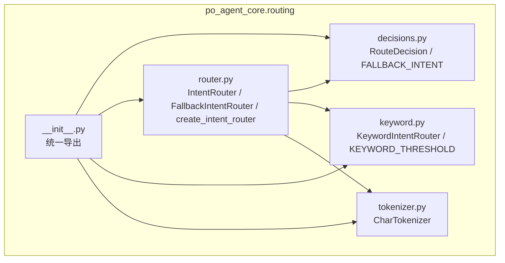
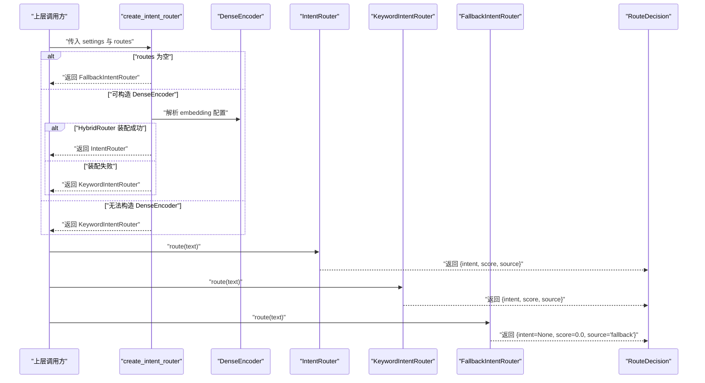
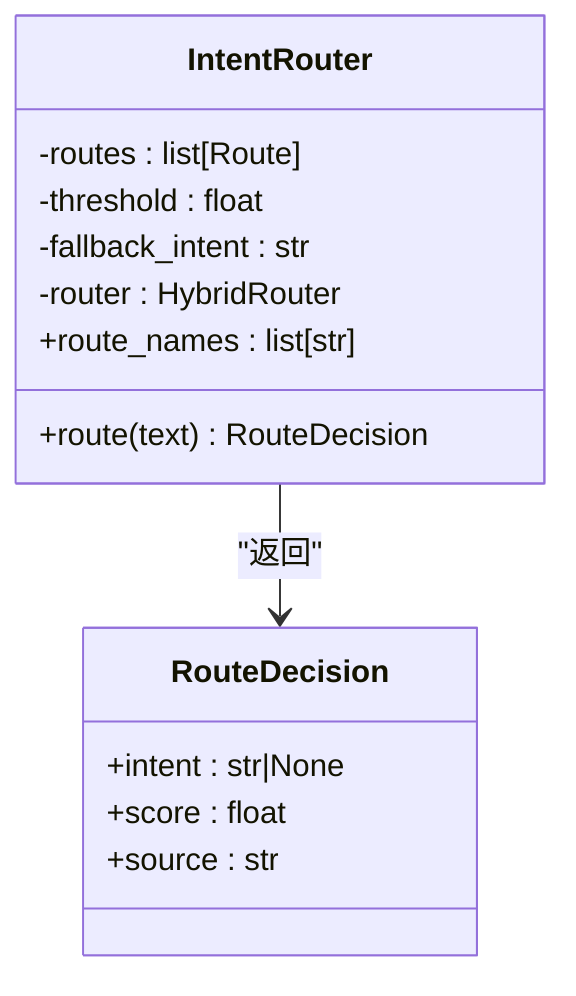
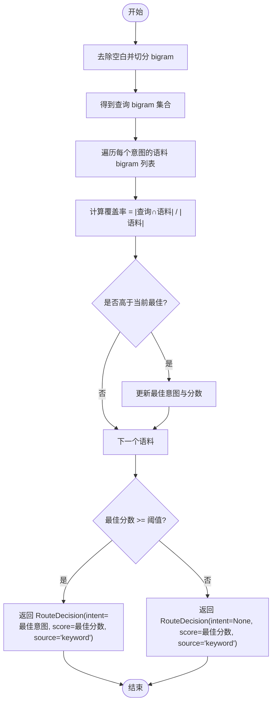
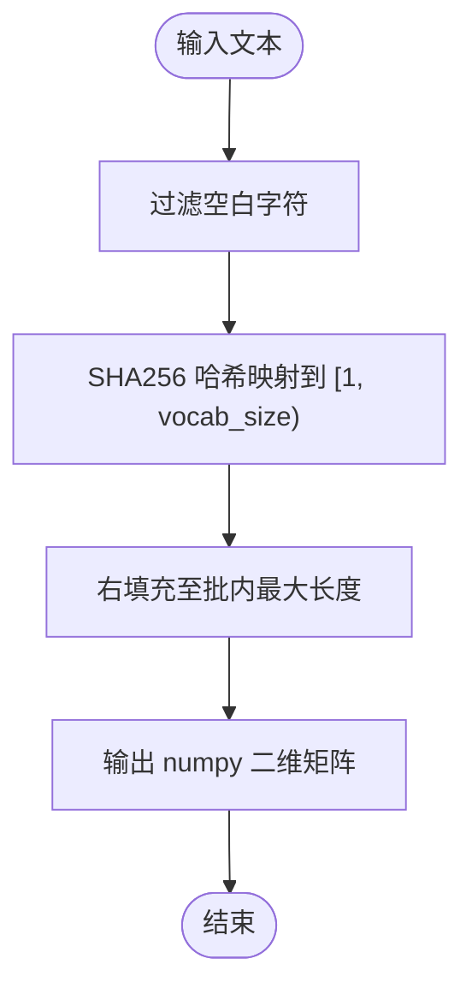
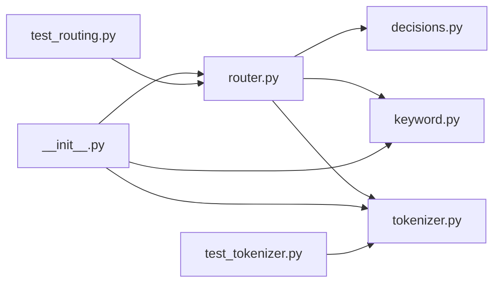
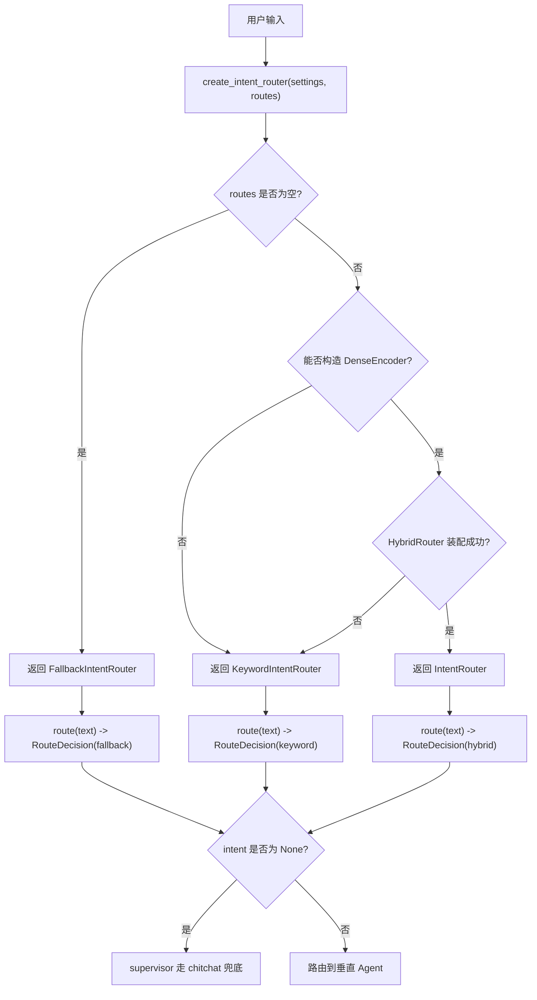

# 意图路由系统

<cite>
**本文引用的文件**   
- [routing/__init__.py](file://services/agent-core/src/po_agent_core/routing/__init__.py)
- [router.py](file://services/agent-core/src/po_agent_core/routing/router.py)
- [decisions.py](file://services/agent-core/src/po_agent_core/routing/decisions.py)
- [keyword.py](file://services/agent-core/src/po_agent_core/routing/keyword.py)
- [tokenizer.py](file://services/agent-core/src/po_agent_core/routing/tokenizer.py)
- [test_routing.py](file://services/agent-core/tests/test_routing.py)
- [test_tokenizer.py](file://services/agent-core/tests/test_tokenizer.py)
</cite>

## 目录
1. [引言](#引言)
2. [项目结构](#项目结构)
3. [核心组件](#核心组件)
4. [架构总览](#架构总览)
5. [详细组件分析](#详细组件分析)
6. [依赖关系分析](#依赖关系分析)
7. [性能与扩展性](#性能与扩展性)
8. [故障排查指南](#故障排查指南)
9. [结论](#结论)
10. [附录：配置与自定义开发](#附录配置与自定义开发)

## 引言
本文件面向 Layer1 语义意图路由子系统，目标是解释从用户输入到垂直 Agent 或闲聊兜底的完整决策路径。系统以“混合语义 + 关键词降级 + 末端兜底”的三层策略为核心：正常态使用稠密向量与 BM25 混合打分；当 embedding 不可用时退化为本地关键词 bigram 匹配；当没有任何路由目标时进入兜底模式，统一返回未命中，交由上层编排器走闲聊流程。

该设计的关键价值在于：
- 对上层 supervisor 暴露统一的 `route(text)` 接口和 `RouteDecision` 结果类型，屏蔽具体实现差异。
- 通过阈值控制、权重调节和多规则组合，使路由在领域术语精确命中与语义泛化之间取得平衡。
- 保证在缺少外部服务（embedding）或语料为空时仍可稳定运行，不中断整体启动。

## 项目结构
意图路由相关代码集中在 Python 包 `po_agent_core.routing` 下，采用“协议 + 多实现 + 工厂”的组织方式：
- `decisions.py`：定义无依赖的决策数据结构与常量。
- `router.py`：实现混合语义路由器、兜底路由器及工厂函数。
- `keyword.py`：实现本地关键词 bigram 覆盖率路由器。
- `tokenizer.py`：提供纯本地字符级 tokenizer，用于 BM25 稀疏编码。
- `__init__.py`：对外暴露统一入口与常用符号。

**图表来源**
- [__init__.py:1-31](file://services/agent-core/src/po_agent_core/routing/__init__.py#L1-L31)
- [router.py:1-225](file://services/agent-core/src/po_agent_core/routing/router.py#L1-L225)
- [decisions.py:1-25](file://services/agent-core/src/po_agent_core/routing/decisions.py#L1-L25)
- [keyword.py:1-74](file://services/agent-core/src/po_agent_core/routing/keyword.py#L1-L74)
- [tokenizer.py:1-87](file://services/agent-core/src/po_agent_core/routing/tokenizer.py#L1-L87)

**章节来源**
- [__init__.py:1-31](file://services/agent-core/src/po_agent_core/routing/__init__.py#L1-L31)

## 核心组件
本节聚焦意图路由系统的核心对象与职责边界：
- `RouteDecision`：单次路由决策结果，包含意图名称、评分与来源标识。
- `IntentRouter`：混合语义路由器，封装 semantic-router 的 HybridRouter，负责稠密与稀疏加权打分并应用阈值。
- `KeywordIntentRouter`：本地关键词路由器，基于 bigram 覆盖率进行匹配，作为 embedding 不可用时的降级方案。
- `FallbackIntentRouter`：末端兜底路由器，恒返回未命中，确保编排图在任何配置下都有确定去向。
- `CharTokenizer`：字符级 tokenizer，为 BM25Encoder 提供稳定的字符 id 映射。
- `create_intent_router`：工厂函数，根据配置与可用性选择具体路由器实现。

这些组件共同构成 Layer1 意图路由的统一抽象，上层 supervisor 仅依赖 `route(text) -> RouteDecision` 契约。

**章节来源**
- [decisions.py:1-25](file://services/agent-core/src/po_agent_core/routing/decisions.py#L1-L25)
- [router.py:38-100](file://services/agent-core/src/po_agent_core/routing/router.py#L38-L100)
- [keyword.py:30-74](file://services/agent-core/src/po_agent_core/routing/keyword.py#L30-L74)
- [tokenizer.py:27-87](file://services/agent-core/src/po_agent_core/routing/tokenizer.py#L27-L87)
- [router.py:181-225](file://services/agent-core/src/po_agent_core/routing/router.py#L181-L225)

## 架构总览
Layer1 意图路由的整体流程如下：
1. 上层调用 `create_intent_router(settings, routes)` 构建路由器。
2. 若路由语料为空，直接返回 `FallbackIntentRouter`。
3. 若无法构造稠密编码器（缺 key 或 provider 未知），返回 `KeywordIntentRouter`。
4. 若 HybridRouter 装配失败（如 embedding 接口不可达），也返回 `KeywordIntentRouter`。
5. 正常态返回 `IntentRouter`，内部使用 DenseEncoder + CharTokenizer(BM25) 混合打分。
6. 每次 `route(text)` 返回 `RouteDecision`，其中 `intent=None` 表示未命中，由 supervisor 决定走闲聊兜底。

**图表来源**
- [router.py:181-225](file://services/agent-core/src/po_agent_core/routing/router.py#L181-L225)
- [router.py:38-100](file://services/agent-core/src/po_agent_core/routing/router.py#L38-L100)
- [keyword.py:30-74](file://services/agent-core/src/po_agent_core/routing/keyword.py#L30-L74)
- [decisions.py:15-25](file://services/agent-core/src/po_agent_core/routing/decisions.py#L15-L25)

## 详细组件分析

### IntentRouter 协议设计与 route 方法规范
`IntentRouter` 是 Layer1 的主实现，封装 semantic-router 的 `HybridRouter`，将稠密向量相似度与 BM25 稀疏分数按权重融合，并通过阈值判定是否命中意图。其关键特性包括：
- 构造函数接收 `routes`、`encoder`、可选 `sparse_encoder`、`alpha`（稠密权重）、`threshold`（阈值）与 `fallback_intent`。
- `route_names` 属性暴露所有路由名称，便于监控与调试。
- `route(text)` 返回 `RouteDecision`：当 `choice.name` 存在且分数不低于阈值时，返回命中的意图名称；否则返回 `intent=None`，由上层决定后续处理。
- 同步设计：宿主在异步环境中需自行线程化调用，避免阻塞事件循环。

**图表来源**
- [router.py:38-80](file://services/agent-core/src/po_agent_core/routing/router.py#L38-L80)
- [decisions.py:15-25](file://services/agent-core/src/po_agent_core/routing/decisions.py#L15-L25)

**章节来源**
- [router.py:38-80](file://services/agent-core/src/po_agent_core/routing/router.py#L38-L80)
- [test_routing.py:54-82](file://services/agent-core/tests/test_routing.py#L54-L82)

### RouteDecision 决策对象结构
`RouteDecision` 是一个不可变数据类，字段含义如下：
- `intent`：命中的意图名称；若为 `None`，表示未命中，上层应走兜底逻辑。
- `score`：本次路由的评分，用于日志分析与阈值调优。
- `source`：路由来源标识，取值包括 `"hybrid"`、`"keyword"`、`"fallback"`，便于定位降级原因。

该结构被所有路由器共享，确保上层无需关心具体实现细节。

**章节来源**
- [decisions.py:15-25](file://services/agent-core/src/po_agent_core/routing/decisions.py#L15-L25)

### 关键词路由 KeywordIntentRouter 实现
`KeywordIntentRouter` 在 embedding 不可用时提供本地降级能力，核心机制为 bigram 覆盖率匹配：
- 预处理阶段对每条 utterance 切分相邻两字符集合，并在构造期缓存。
- 查询时对输入文本同样切分 bigram，计算与每个 utterance 的交集覆盖率。
- 对同一意图的多条 utterance 取最高覆盖率作为该意图得分。
- 默认阈值为经验值 `KEYWORD_THRESHOLD = 0.2`，可通过构造函数覆盖。
- 未达阈值仍返回最高分，便于上层日志定位“差一点命中”的查询。

**图表来源**
- [keyword.py:20-74](file://services/agent-core/src/po_agent_core/routing/keyword.py#L20-L74)

**章节来源**
- [keyword.py:1-74](file://services/agent-core/src/po_agent_core/routing/keyword.py#L1-L74)
- [test_routing.py:123-141](file://services/agent-core/tests/test_routing.py#L123-L141)

### 分词器 CharTokenizer 功能
`CharTokenizer` 为 BM25Encoder 提供纯本地、确定性的字符级 token 化：
- 使用 SHA256 哈希将字符映射到 `[1, vocab_size)` 的稳定 id，0 保留为 padding/unknown。
- `tokenize` 方法输出 `(n_docs, max_len)` 的二维矩阵，短文档右填充至批内最长长度。
- 过滤空白字符，保证中文路由语料的局部词序表达。
- 支持 `save/load` 持久化配置，确保不同进程间一致性。

**图表来源**
- [tokenizer.py:56-87](file://services/agent-core/src/po_agent_core/routing/tokenizer.py#L56-L87)

**章节来源**
- [tokenizer.py:1-87](file://services/agent-core/src/po_agent_core/routing/tokenizer.py#L1-L87)
- [test_tokenizer.py:7-64](file://services/agent-core/tests/test_tokenizer.py#L7-L64)

### 路由策略配置与多规则组合
路由策略的核心配置点包括：
- `settings.router_threshold`：混合语义路由器的阈值，控制是否命中意图。
- `alpha`：稠密向量与 BM25 稀疏分数的融合权重，默认偏向 BM25（0.3），提升领域术语稳定性。
- `KEYWORD_THRESHOLD`：关键词路由器的独立阈值，默认 0.2，适用于 bigram 覆盖率量纲。
- `routes_from_agents(agents)`：从垂直 Agent 插槽派生路由语料，空 utterances 的 Agent 不参与路由。

多规则组合体现在：
- 正常态使用混合语义（稠密+BM25）。
- 降级态一使用关键词 bigram 匹配。
- 降级态二使用兜底路由器，恒返回未命中。

**章节来源**
- [router.py:45-69](file://services/agent-core/src/po_agent_core/routing/router.py#L45-L69)
- [router.py:169-178](file://services/agent-core/src/po_agent_core/routing/router.py#L169-L178)
- [keyword.py:15-17](file://services/agent-core/src/po_agent_core/routing/keyword.py#L15-L17)

### 自定义路由器开发指南
要扩展意图路由系统，开发者可实现以下接口与模式：
- 实现 `route(text) -> RouteDecision` 方法，遵循统一协议。
- 提供 `route_names` 属性，便于监控与调试。
- 在 `create_intent_router` 中注册新实现，或通过注入 `encoder` 替换稠密编码器。
- 编写测试用例，覆盖正常命中、阈值未命中、降级路径等场景。

示例参考：
- 测试中使用 `BagOfCharsEncoder` 模拟稠密编码器，验证混合路由行为。
- 测试覆盖 `KeywordIntentRouter` 的 bigram 覆盖率匹配与阈值控制。
- 测试覆盖 `FallbackIntentRouter` 的恒未命中行为。

**章节来源**
- [test_routing.py:34-51](file://services/agent-core/tests/test_routing.py#L34-L51)
- [test_routing.py:144-158](file://services/agent-core/tests/test_routing.py#L144-L158)

## 依赖关系分析
意图路由模块的内部依赖关系如下：
- `router.py` 依赖 `decisions.py`（RouteDecision/FALLBACK_INTENT）、`keyword.py`（KeywordIntentRouter）、`tokenizer.py`（CharTokenizer）。
- `__init__.py` 统一导出所有公共符号，供上层导入。
- 测试文件覆盖各组件行为，确保降级路径与阈值控制正确。

**图表来源**
- [__init__.py:1-31](file://services/agent-core/src/po_agent_core/routing/__init__.py#L1-L31)
- [router.py:1-35](file://services/agent-core/src/po_agent_core/routing/router.py#L1-L35)
- [test_routing.py:1-24](file://services/agent-core/tests/test_routing.py#L1-L24)
- [test_tokenizer.py:1-4](file://services/agent-core/tests/test_tokenizer.py#L1-L4)

**章节来源**
- [__init__.py:1-31](file://services/agent-core/src/po_agent_core/routing/__init__.py#L1-L31)
- [router.py:1-35](file://services/agent-core/src/po_agent_core/routing/router.py#L1-L35)

## 性能与扩展性
- 混合语义路由器的稠密向量计算可能涉及网络请求，因此设计为同步调用，宿主需在异步环境中线程化执行，避免阻塞事件循环。
- 关键词路由器为纯本地计算，构造期预切分 bigram，查询阶段仅做集合运算，性能稳定。
- CharTokenizer 使用固定 vocab_size 与稳定哈希，避免词表漂移，确保 BM25 统计可复现。
- 扩展性方面，可通过注入自定义 DenseEncoder 或实现新的路由器来适配不同场景。

[本节为通用性能讨论，不直接分析具体文件]

## 故障排查指南
常见问题与排查建议：
- **embedding 配置缺失**：检查 `AGENT_CORE_EMBEDDING_API_KEY` 或 `AGENT_CORE_LLM_API_KEY` 是否正确设置。
- **provider base_url 未知**：确认 `llm_provider` 是否在预设中存在对应 base_url。
- **HybridRouter 装配失败**：检查 embedding 接口是否可达，或降级到关键词路由。
- **阈值过高导致未命中**：调整 `router_threshold` 或 `KEYWORD_THRESHOLD`，观察日志中的 score 分布。
- **路由语料为空**：确认垂直 Agent 的 utterances 非空，否则将进入兜底模式。

**章节来源**
- [router.py:102-134](file://services/agent-core/src/po_agent_core/routing/router.py#L102-L134)
- [router.py:181-225](file://services/agent-core/src/po_agent_core/routing/router.py#L181-L225)

## 结论
Layer1 意图路由系统通过混合语义、关键词降级与末端兜底的三层策略，实现了高可用、可扩展的意图识别能力。其统一协议与清晰的分层设计，使得上层 supervisor 无需感知具体实现，同时保证了在资源受限或外部服务不可用时的稳定运行。开发者可通过配置阈值、权重与自定义路由器，灵活适配不同业务场景。

[本节为总结性内容，不直接分析具体文件]

## 附录：配置与自定义开发

### 路由流程图与决策树示例
以下流程图展示不同输入的处理路径：

**图表来源**
- [router.py:181-225](file://services/agent-core/src/po_agent_core/routing/router.py#L181-L225)
- [decisions.py:15-25](file://services/agent-core/src/po_agent_core/routing/decisions.py#L15-L25)

### 配置项说明
- `router_threshold`：混合语义路由器的阈值，默认值由 settings 提供。
- `alpha`：稠密向量与 BM25 稀疏分数的融合权重，默认 0.3。
- `KEYWORD_THRESHOLD`：关键词路由器的阈值，默认 0.2。
- `embedding_model`、`embedding_api_key`、`embedding_base_url`：稠密编码器配置。
- `llm_provider`、`llm_api_key`、`llm_base_url`：LLM 提供商预设与基础 URL。

**章节来源**
- [router.py:45-69](file://services/agent-core/src/po_agent_core/routing/router.py#L45-L69)
- [router.py:102-167](file://services/agent-core/src/po_agent_core/routing/router.py#L102-L167)
- [keyword.py:15-17](file://services/agent-core/src/po_agent_core/routing/keyword.py#L15-L17)