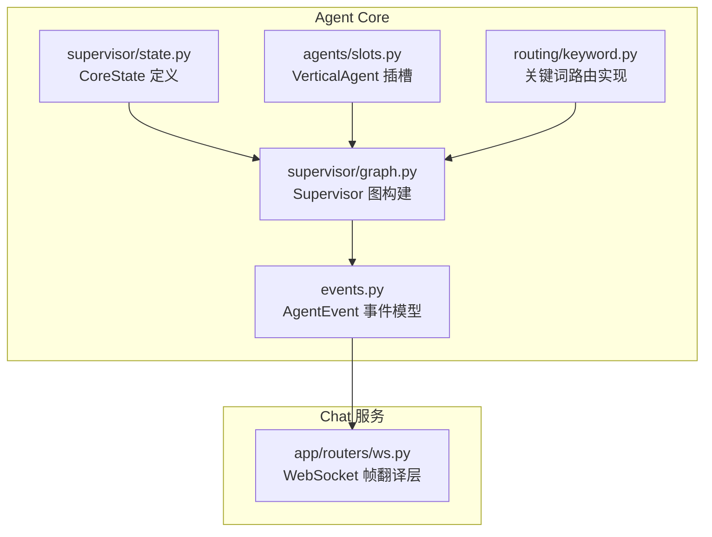
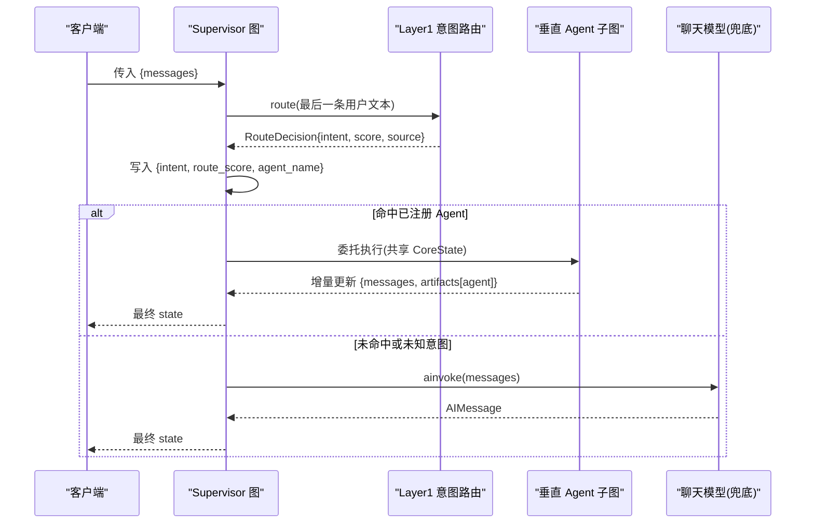
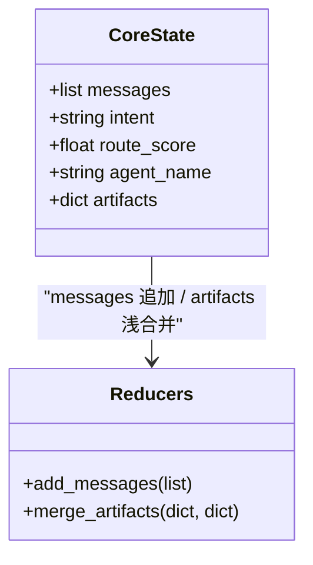
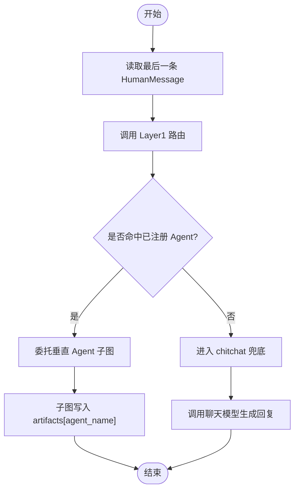
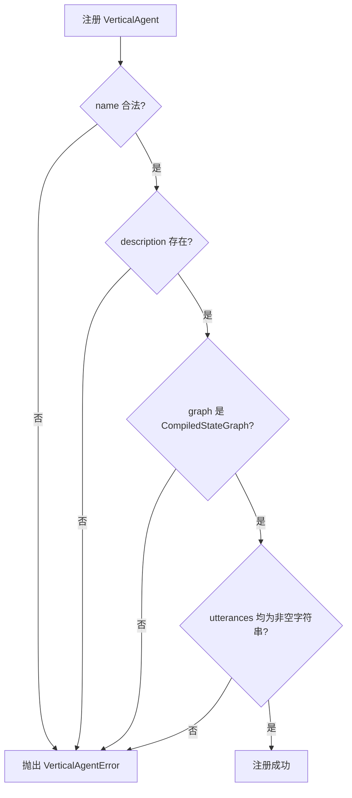
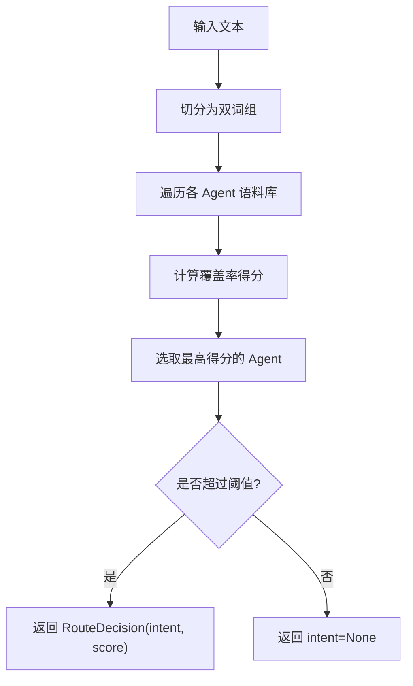
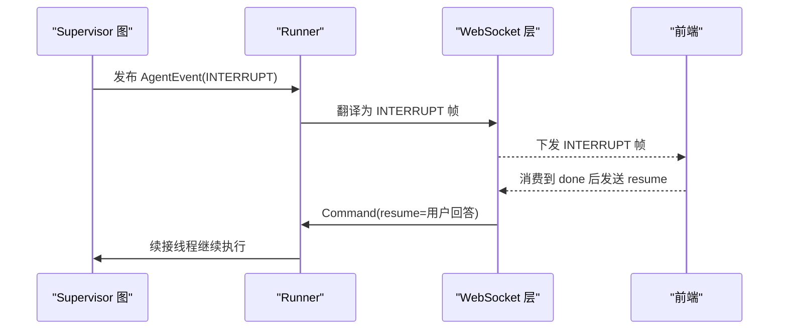
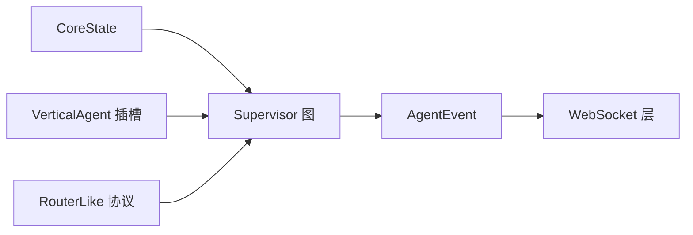

# 状态管理系统

<cite>
**本文引用的文件**   
- [services/agent-core/src/po_agent_core/supervisor/state.py](file://services/agent-core/src/po_agent_core/supervisor/state.py)
- [services/agent-core/src/po_agent_core/supervisor/graph.py](file://services/agent-core/src/po_agent_core/supervisor/graph.py)
- [services/agent-core/src/po_agent_core/agents/slots.py](file://services/agent-core/src/po_agent_core/agents/slots.py)
- [services/agent-core/tests/test_supervisor.py](file://services/agent-core/tests/test_supervisor.py)
- [services/agent-core/src/po_agent_core/routing/keyword.py](file://services/agent-core/src/po_agent_core/routing/keyword.py)
- [services/agent-core/src/po_agent_core/events.py](file://services/agent-core/src/po_agent_core/events.py)
- [services/chat/app/routers/ws.py](file://services/chat/app/routers/ws.py)
</cite>

## 目录
1. [引言](#引言)
2. [项目结构](#项目结构)
3. [核心组件](#核心组件)
4. [架构总览](#架构总览)
5. [详细组件分析](#详细组件分析)
6. [依赖关系分析](#依赖关系分析)
7. [性能与一致性考量](#性能与一致性考量)
8. [故障排查指南](#故障排查指南)
9. [结论](#结论)
10. [附录：最佳实践](#附录最佳实践)

## 引言
本文件围绕 CoreState 的状态管理系统展开，重点解释 Supervisor 图与垂直 Agent 子图之间的状态契约、数据流转机制、更新模式以及验证策略。CoreState 是编排层的最小共享状态，仅保留编排必需字段；领域私有状态通过 artifacts 命名空间隔离，避免“上帝对象”式的全局状态蔓延。Supervisor 负责 Layer1 意图路由、委托选择与兜底闲聊；垂直 Agent 子图在自身内部完成多轮工具循环等复杂流程，并通过 Runner 将事件翻译为对外协议。

## 项目结构
与状态管理直接相关的代码集中在 agent-core 的 supervisor、agents 与 routing 模块中，并在 chat 服务中以 WebSocket 作为对外传输层。

**图表来源**
- [services/agent-core/src/po_agent_core/supervisor/state.py:1-39](file://services/agent-core/src/po_agent_core/supervisor/state.py#L1-L39)
- [services/agent-core/src/po_agent_core/supervisor/graph.py:1-142](file://services/agent-core/src/po_agent_core/supervisor/graph.py#L1-L142)
- [services/agent-core/src/po_agent_core/agents/slots.py:1-59](file://services/agent-core/src/po_agent_core/agents/slots.py#L1-L59)
- [services/agent-core/src/po_agent_core/routing/keyword.py:32-66](file://services/agent-core/src/po_agent_core/routing/keyword.py#L32-L66)
- [services/agent-core/src/po_agent_core/events.py:41-76](file://services/agent-core/src/po_agent_core/events.py#L41-L76)
- [services/chat/app/routers/ws.py:30-49](file://services/chat/app/routers/ws.py#L30-L49)

**章节来源**
- [services/agent-core/src/po_agent_core/supervisor/state.py:1-39](file://services/agent-core/src/po_agent_core/supervisor/state.py#L1-L39)
- [services/agent-core/src/po_agent_core/supervisor/graph.py:1-142](file://services/agent-core/src/po_agent_core/supervisor/graph.py#L1-L142)
- [services/agent-core/src/po_agent_core/agents/slots.py:1-59](file://services/agent-core/src/po_agent_core/agents/slots.py#L1-L59)

## 核心组件
- CoreState：Supervisor 共享状态的 TypedDict 定义，包含 messages、intent、route_score、agent_name、artifacts 五个键，采用 reducer 归并策略（messages 追加、artifacts 浅合并）。
- Supervisor 图：由 START → route_node → (垂直 Agent 子图 | chitchat) → END 构成，负责取最后一条用户消息进行意图路由，并将结果写入 state。
- VerticalAgent 插槽：声明垂直 Agent 的名称、描述、已编译子图、语料与元数据，并在构造期做契约校验。
- 关键词路由：基于双词组覆盖率的轻量意图匹配，返回 RouteDecision（含 intent、score、source），供 Supervisor 使用。
- 事件模型：AgentEvent 统一封装运行期事件，供 Runner 翻译到 WebSocket/A2A/MCP 等传输层。

**章节来源**
- [services/agent-core/src/po_agent_core/supervisor/state.py:1-39](file://services/agent-core/src/po_agent_core/supervisor/state.py#L1-L39)
- [services/agent-core/src/po_agent_core/supervisor/graph.py:1-142](file://services/agent-core/src/po_agent_core/supervisor/graph.py#L1-L142)
- [services/agent-core/src/po_agent_core/agents/slots.py:1-59](file://services/agent-core/src/po_agent_core/agents/slots.py#L1-L59)
- [services/agent-core/src/po_agent_core/routing/keyword.py:32-66](file://services/agent-core/src/po_agent_core/routing/keyword.py#L32-L66)
- [services/agent-core/src/po_agent_core/events.py:41-76](file://services/agent-core/src/po_agent_core/events.py#L41-L76)

## 架构总览
Supervisor 图以 CoreState 为共享状态契约，按以下流程工作：
- 入口节点读取最后一条 HumanMessage，调用 Layer1 路由器得到 RouteDecision。
- 将 intent、route_score、agent_name 写回 state。
- 条件边判断：若 intent 命中已注册垂直 Agent，则委托对应子图；否则进入 chitchat 兜底。
- 子图执行完成后回到 END；chitchat 直接调用聊天模型生成回复。

**图表来源**
- [services/agent-core/src/po_agent_core/supervisor/graph.py:44-113](file://services/agent-core/src/po_agent_core/supervisor/graph.py#L44-L113)
- [services/agent-core/src/po_agent_core/routing/keyword.py:32-66](file://services/agent-core/src/po_agent_core/routing/keyword.py#L32-L66)

**章节来源**
- [services/agent-core/src/po_agent_core/supervisor/graph.py:44-113](file://services/agent-core/src/po_agent_core/supervisor/graph.py#L44-L113)

## 详细组件分析

### CoreState 设计模式与字段约束
CoreState 采用 TypedDict(total=False)，允许节点只返回自己改动的键，LangGraph 根据字段上的 reducer 进行归并：
- messages：类型为 AnyMessage 列表，reducer 为 add_messages，用于对话历史追加。
- intent：字符串，表示 Layer1 路由命中的意图名；未命中为空串。
- route_score：浮点数，记录路由评分，便于诊断“差一点命中”。
- agent_name：字符串，表示本次实际被委托的节点名；兜底时为 chitchat。
- artifacts：字典，按 agent_name 分命名空间存储各垂直 Agent 的私有数据；reducer 为 merge_artifacts（浅合并，同名命名空间整体替换）。

**图表来源**
- [services/agent-core/src/po_agent_core/supervisor/state.py:22-39](file://services/agent-core/src/po_agent_core/supervisor/state.py#L22-L39)

**章节来源**
- [services/agent-core/src/po_agent_core/supervisor/state.py:1-39](file://services/agent-core/src/po_agent_core/supervisor/state.py#L1-L39)

### Supervisor 图与垂直 Agent 子图的状态传递
- 父子状态同步：Supervisor 将 CoreState 传给子图；子图可读写 messages 与 artifacts[name]。LangGraph 自动对接父子状态，子图的 interrupt 会穿透到父图执行面。
- 隔离机制：领域状态必须写入 artifacts[agent_name]，Supervisor 不解释内容；不同 Agent 的 artifacts 命名空间相互隔离。
- 单轮委托语义：Supervisor 每轮只委托一次；多轮工具循环在垂直 Agent 子图内部完成。

**图表来源**
- [services/agent-core/src/po_agent_core/supervisor/graph.py:44-113](file://services/agent-core/src/po_agent_core/supervisor/graph.py#L44-L113)

**章节来源**
- [services/agent-core/src/po_agent_core/supervisor/graph.py:44-113](file://services/agent-core/src/po_agent_core/supervisor/graph.py#L44-L113)
- [services/agent-core/src/po_agent_core/agents/slots.py:1-59](file://services/agent-core/src/po_agent_core/agents/slots.py#L1-L59)

### 状态更新操作模式
- 增量更新：节点返回部分键（如 messages、artifacts[name]），LangGraph 按 reducer 归并。例如垂直 Agent 子图追加 AI 回复并写入 artifacts。
- 全量替换：当某个命名空间需要整体替换时，应返回该键的新值（如 artifacts[name] 整体替换），因为 merge_artifacts 对同名键是后写胜出。
- 典型场景：
  - 增量追加消息：适合对话历史累积。
  - 全量替换 artifacts：适合某 Agent 重新计算领域状态快照。

**章节来源**
- [services/agent-core/src/po_agent_core/supervisor/state.py:22-39](file://services/agent-core/src/po_agent_core/supervisor/state.py#L22-L39)
- [services/agent-core/tests/test_supervisor.py:26-41](file://services/agent-core/tests/test_supervisor.py#L26-L41)

### 状态验证与类型检查
- VerticalAgent 插槽校验：
  - name 非空且不以 __ 开头。
  - description 必填。
  - graph 必须是 CompiledStateGraph。
  - utterances 元素为非空字符串。
- Supervisor 图构建校验：
  - 拒绝重复的 Agent 名称。
  - 拒绝占用保留节点名 route/chitchat。
- 运行时行为校验：
  - 未命中或未知意图均走 chitchat 兜底。
  - 子图内部 interrupt 透传到父图执行面。

**图表来源**
- [services/agent-core/src/po_agent_core/agents/slots.py:41-59](file://services/agent-core/src/po_agent_core/agents/slots.py#L41-L59)
- [services/agent-core/src/po_agent_core/supervisor/graph.py:132-141](file://services/agent-core/src/po_agent_core/supervisor/graph.py#L132-L141)

**章节来源**
- [services/agent-core/src/po_agent_core/agents/slots.py:41-59](file://services/agent-core/src/po_agent_core/agents/slots.py#L41-L59)
- [services/agent-core/src/po_agent_core/supervisor/graph.py:132-141](file://services/agent-core/src/po_agent_core/supervisor/graph.py#L132-L141)
- [services/agent-core/tests/test_supervisor.py:98-135](file://services/agent-core/tests/test_supervisor.py#L98-L135)

### 意图路由与评分机制
- 关键词路由基于双词组覆盖率，计算查询与语料的交集比例，返回 RouteDecision。
- Supervisor 从 RouteDecision 提取 intent 与 score，并写入 state；score 用于诊断“差一点命中”。
- 若 intent 不在已注册 Agent 集合中，强制走 chitchat，防止路由到未注册节点。

**图表来源**
- [services/agent-core/src/po_agent_core/routing/keyword.py:32-66](file://services/agent-core/src/po_agent_core/routing/keyword.py#L32-L66)

**章节来源**
- [services/agent-core/src/po_agent_core/routing/keyword.py:32-66](file://services/agent-core/src/po_agent_core/routing/keyword.py#L32-L66)
- [services/agent-core/src/po_agent_core/supervisor/graph.py:65-77](file://services/agent-core/src/po_agent_core/supervisor/graph.py#L65-L77)

### 事件与中断处理
- AgentEvent 统一封装运行期事件，Runner 将其翻译为 WebSocket/A2A/MCP 帧。
- INTERRUPT 事件表示编排挂起等人确认；前端需消费到 done 后再发送 resume，resume 的值原样回灌给 LangGraph。
- WS 层不做业务判断，仅做协议翻译，确保帧名稳定。

**图表来源**
- [services/agent-core/src/po_agent_core/events.py:41-76](file://services/agent-core/src/po_agent_core/events.py#L41-L76)
- [services/chat/app/routers/ws.py:30-49](file://services/chat/app/routers/ws.py#L30-L49)

**章节来源**
- [services/agent-core/src/po_agent_core/events.py:41-76](file://services/agent-core/src/po_agent_core/events.py#L41-L76)
- [services/chat/app/routers/ws.py:30-49](file://services/chat/app/routers/ws.py#L30-L49)

## 依赖关系分析
- CoreState 被 Supervisor 图与垂直 Agent 子图共同引用，形成最小共享契约。
- Supervisor 图依赖 VerticalAgent 插槽与 Layer1 路由协议（RouterLike），解耦具体路由实现。
- Runner 与 WS 层依赖 AgentEvent 模型，保证跨传输层的统一事件语义。

**图表来源**
- [services/agent-core/src/po_agent_core/supervisor/state.py:27-39](file://services/agent-core/src/po_agent_core/supervisor/state.py#L27-L39)
- [services/agent-core/src/po_agent_core/supervisor/graph.py:38-42](file://services/agent-core/src/po_agent_core/supervisor/graph.py#L38-L42)
- [services/agent-core/src/po_agent_core/events.py:55-76](file://services/agent-core/src/po_agent_core/events.py#L55-L76)

**章节来源**
- [services/agent-core/src/po_agent_core/supervisor/state.py:27-39](file://services/agent-core/src/po_agent_core/supervisor/state.py#L27-L39)
- [services/agent-core/src/po_agent_core/supervisor/graph.py:38-42](file://services/agent-core/src/po_agent_core/supervisor/graph.py#L38-L42)
- [services/agent-core/src/po_agent_core/events.py:55-76](file://services/agent-core/src/po_agent_core/events.py#L55-L76)

## 性能与一致性考量
- 增量更新优先：尽量返回少量键，利用 reducer 归并减少状态拷贝成本。
- artifacts 浅合并：同名命名空间整体替换，避免深层嵌套导致的复制开销。
- 路由计算前置：关键词路由在构造期预处理语料双词组，降低请求期计算压力。
- 异步与线程隔离：路由调用通过 asyncio.to_thread 包裹，避免阻塞事件循环。
- 事件去重：Runner 对同一条消息按 id 去重，避免父子两级 updates 重复下发。

**章节来源**
- [services/agent-core/src/po_agent_core/supervisor/state.py:22-39](file://services/agent-core/src/po_agent_core/supervisor/state.py#L22-L39)
- [services/agent-core/src/po_agent_core/routing/keyword.py:32-66](file://services/agent-core/src/po_agent_core/routing/keyword.py#L32-L66)
- [services/agent-core/src/po_agent_core/supervisor/graph.py:65-77](file://services/agent-core/src/po_agent_core/supervisor/graph.py#L65-L77)

## 故障排查指南
- 意图未命中：检查 Layer1 路由语料与阈值设置；确认 intent 是否为空或未知。
- 未知意图路由：Supervisor 会强制走 chitchat，检查路由返回的 intent 是否在已注册 Agent 集合中。
- 重复 Agent 名称：构建 Supervisor 图时会抛出错误，检查 agents 列表的唯一性。
- 保留节点名冲突：禁止使用 route/chitchat 作为 Agent 名称。
- 插槽契约违反：检查 name、description、graph、utterances 是否符合校验规则。
- 事件重复下发：确认 Runner 的消息去重逻辑是否生效，避免父子两级 updates 同时下发。

**章节来源**
- [services/agent-core/tests/test_supervisor.py:52-135](file://services/agent-core/tests/test_supervisor.py#L52-L135)
- [services/agent-core/src/po_agent_core/supervisor/graph.py:132-141](file://services/agent-core/src/po_agent_core/supervisor/graph.py#L132-L141)
- [services/agent-core/src/po_agent_core/agents/slots.py:41-59](file://services/agent-core/src/po_agent_core/agents/slots.py#L41-L59)

## 结论
CoreState 通过最小化共享字段与明确的 reducer 策略，实现了 Supervisor 与垂直 Agent 子图之间清晰的状态契约。Supervisor 负责意图路由与委托选择，垂直 Agent 专注领域逻辑与多轮工具循环；artifacts 命名空间提供强隔离，避免状态污染。结合严格的插槽校验与运行时保护，系统在可扩展性与一致性之间取得平衡。

## 附录最佳实践
- 命名规范：
  - Agent 名称保持唯一且不与保留节点名冲突。
  - artifacts 命名空间使用 agent_name 作为键，避免跨 Agent 污染。
- 版本兼容性：
  - 扩展领域状态时优先写入 artifacts[name]，不要向 CoreState 新增字段。
  - 变更路由语料或阈值时，注意向后兼容与灰度发布。
- 性能优化：
  - 使用增量更新，避免每次返回完整 state。
  - 合理设置路由阈值，减少误判与不必要的 chitchat 调用。
  - 预计算路由语料，降低请求期 CPU 消耗。
- 状态流转图参考：
  - 参见“架构总览”与“Supervisor 图与垂直 Agent 子图的状态传递”两节图示。