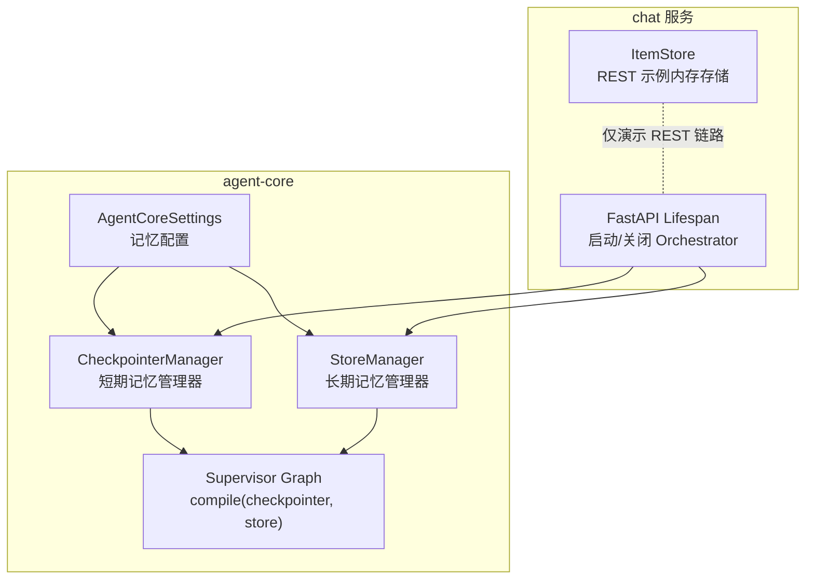
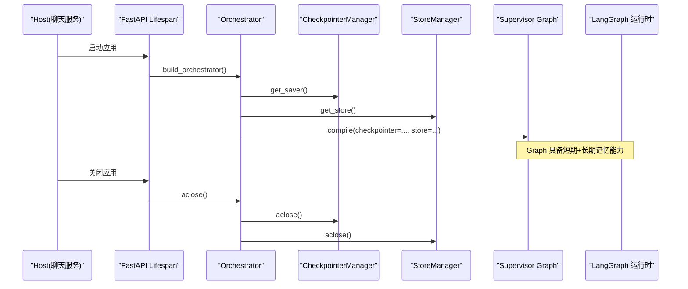
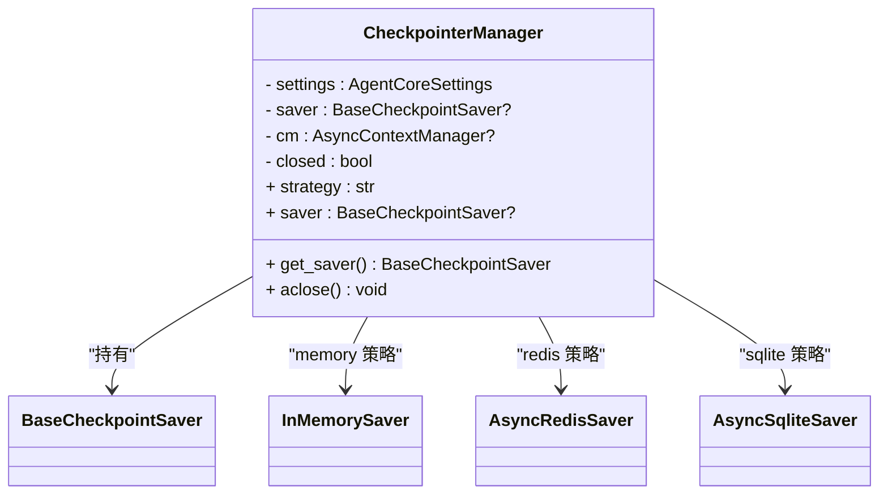
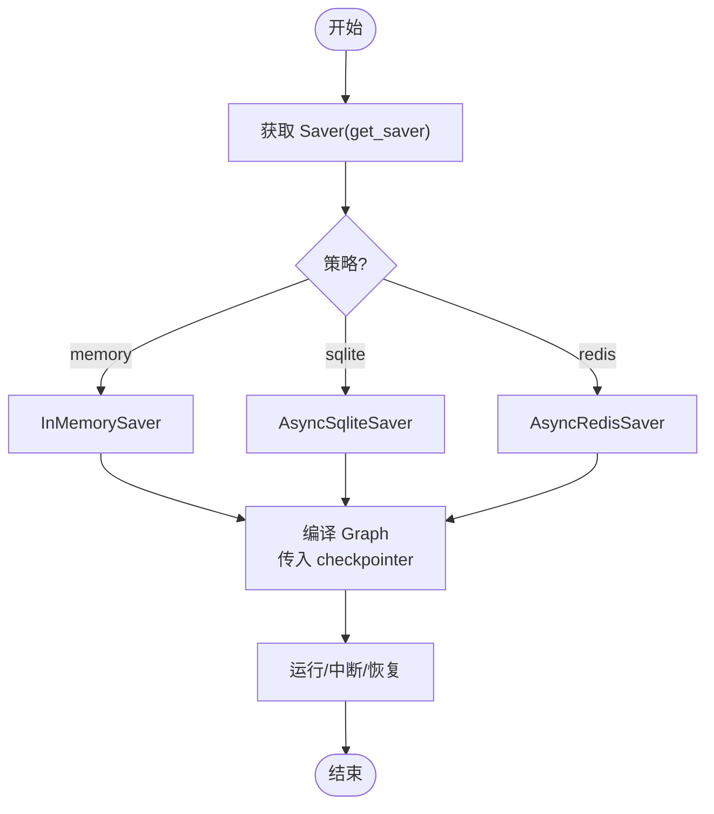
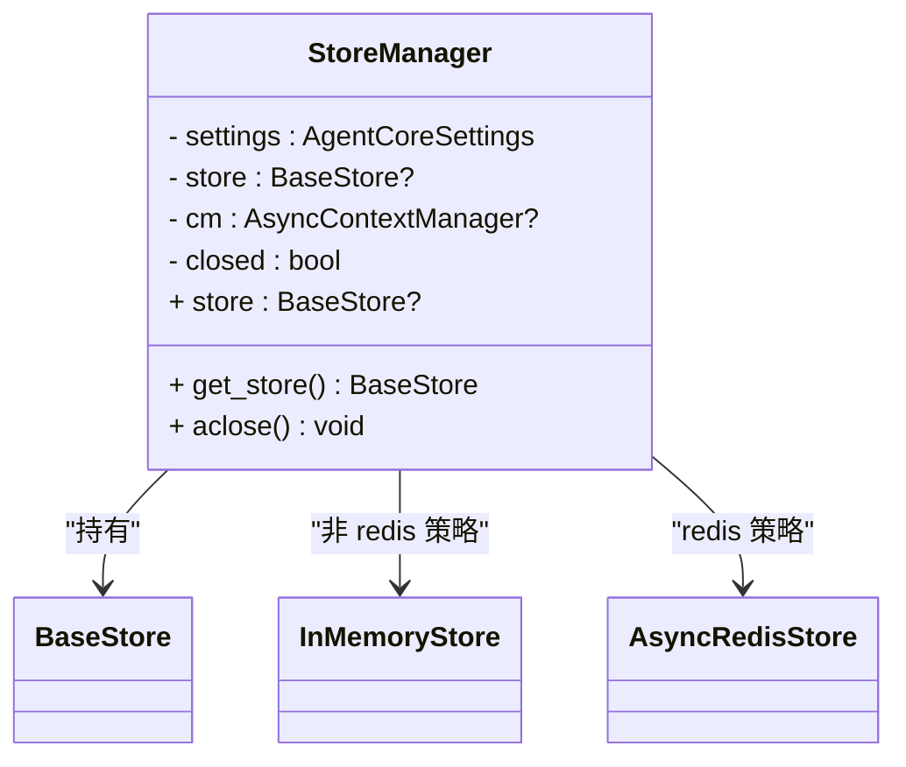
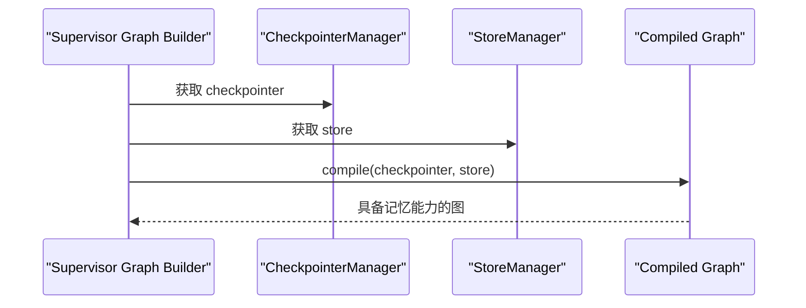
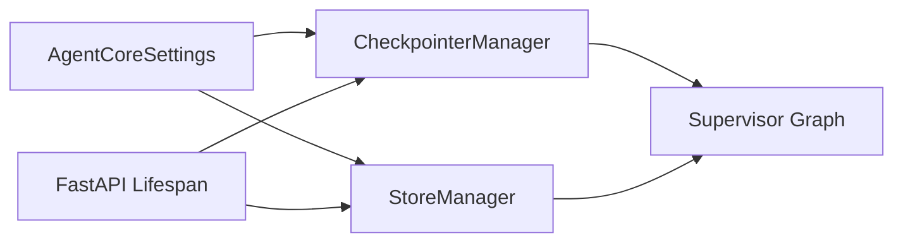

# 记忆持久化系统

<cite>
**本文引用的文件**   
- [checkpointer.py](file://services/agent-core/src/po_agent_core/memory/checkpointer.py)
- [store.py（长期记忆）](file://services/agent-core/src/po_agent_core/memory/store.py)
- [__init__.py（记忆子系统）](file://services/agent-core/src/po_agent_core/memory/__init__.py)
- [config.py](file://services/agent-core/src/po_agent_core/config.py)
- [graph.py（编排图装配）](file://services/agent-core/src/po_agent_core/supervisor/graph.py)
- [test_checkpointer.py](file://services/agent-core/tests/test_checkpointer.py)
- [main.py（chat 应用生命周期）](file://services/chat/app/main.py)
- [store.py（REST items 内存存储）](file://services/chat/app/store.py)
</cite>

## 目录
1. [引言](#引言)
2. [项目结构](#项目结构)
3. [核心组件](#核心组件)
4. [架构总览](#架构总览)
5. [详细组件分析](#详细组件分析)
6. [依赖关系分析](#依赖关系分析)
7. [性能与可扩展性](#性能与可扩展性)
8. [故障排查指南](#故障排查指南)
9. [结论](#结论)
10. [附录：配置项速查](#附录配置项速查)

## 引言
本文件面向“记忆持久化系统”，聚焦两类记忆能力：
- 短期记忆（Checkpointer）：用于单轮对话、多轮会话的状态恢复与中断处理，典型场景包括线程级状态快照、断点续跑。
- 长期记忆（Store）：用于跨会话的用户偏好、人设、领域事实等数据，按用户命名空间隔离。

系统基于 LangGraph 的 Checkpoint 与 Store 抽象，提供统一的生命周期管理、延迟初始化、显式关闭以及策略选择（Redis / SQLite / Memory）。Agent 框架通过编译 Graph 时注入 checkpointer 与 store，实现“短期记忆 + 长期记忆”的组合使用。

## 项目结构
记忆相关代码主要位于 agent-core 包中，chat 服务作为宿主负责应用生命周期与资源释放；同时 chat 服务内还有一个独立的 REST items 内存存储示例，用于演示校验 → 存储 → 序列化的链路，但与 Agent 记忆系统职责不同。

图示来源
- [checkpointer.py:49-116](file://services/agent-core/src/po_agent_core/memory/checkpointer.py#L49-L116)
- [store.py（长期记忆）:36-85](file://services/agent-core/src/po_agent_core/memory/store.py#L36-L85)
- [config.py:97-100](file://services/agent-core/src/po_agent_core/config.py#L97-L100)
- [graph.py:128-141](file://services/agent-core/src/po_agent_core/supervisor/graph.py#L128-L141)
- [main.py:24-50](file://services/chat/app/main.py#L24-L50)
- [store.py（REST items 内存存储）:20-92](file://services/chat/app/store.py#L20-L92)

章节来源
- [checkpointer.py:1-116](file://services/agent-core/src/po_agent_core/memory/checkpointer.py#L1-L116)
- [store.py（长期记忆）:1-85](file://services/agent-core/src/po_agent_core/memory/store.py#L1-L85)
- [config.py:58-111](file://services/agent-core/src/po_agent_core/config.py#L58-L111)
- [graph.py:128-141](file://services/agent-core/src/po_agent_core/supervisor/graph.py#L128-L141)
- [main.py:24-50](file://services/chat/app/main.py#L24-L50)
- [store.py（REST items 内存存储）:1-92](file://services/chat/app/store.py#L1-L92)

## 核心组件
- CheckpointerManager：统一管理短期记忆的三种后端（redis/sqlite/memory），提供延迟初始化、幂等获取、显式关闭。
- StoreManager：统一管理长期记忆的两种后端（redis/memory），提供 user_namespace 命名空间隔离和同构生命周期管理。
- AgentCoreSettings：集中描述记忆相关的配置项，包括策略、Redis URL、SQLite 路径。
- Supervisor Graph：在编译 Graph 时注入 checkpointer 与 store，使 Agent 运行时具备短期与长期记忆能力。
- Chat 应用生命周期：在 FastAPI lifespan 中构建并释放 Orchestrator，确保外部连接正确关闭。

章节来源
- [checkpointer.py:49-116](file://services/agent-core/src/po_agent_core/memory/checkpointer.py#L49-L116)
- [store.py（长期记忆）:36-85](file://services/agent-core/src/po_agent_core/memory/store.py#L36-L85)
- [config.py:97-100](file://services/agent-core/src/po_agent_core/config.py#L97-L100)
- [graph.py:128-141](file://services/agent-core/src/po_agent_core/supervisor/graph.py#L128-L141)
- [main.py:24-50](file://services/chat/app/main.py#L24-L50)

## 架构总览
下图展示记忆系统与 Agent 框架的集成方式：宿主（chat 服务）在应用启动时装配 Orchestrator，内部通过 CheckpointerManager 与 StoreManager 分别提供短期与长期记忆；Supervisor Graph 在 compile 阶段接收两者，从而让 Agent 在执行过程中既能恢复线程状态，又能读写用户维度的长期记忆。

图示来源
- [main.py:40-49](file://services/chat/app/main.py#L40-L49)
- [graph.py:128-141](file://services/agent-core/src/po_agent_core/supervisor/graph.py#L128-L141)
- [checkpointer.py:67-116](file://services/agent-core/src/po_agent_core/memory/checkpointer.py#L67-L116)
- [store.py（长期记忆）:49-85](file://services/agent-core/src/po_agent_core/memory/store.py#L49-L85)

## 详细组件分析

### 短期记忆：CheckpointerManager
CheckpointerManager 是短期记忆的入口，封装了 LangGraph 的 BaseCheckpointSaver 抽象，支持三种策略：
- redis：生产推荐，跨进程、跨重启持久。
- sqlite：单机演示友好，落盘持久。
- memory：测试与 CI 常用，进程内无副作用。

关键特性：
- 延迟初始化：构造不产生连接，首次 get_saver() 才建立连接。
- 幂等：重复 get_saver() 返回同一实例；aclose() 可重复调用。
- 显式关闭：由宿主在 shutdown 钩子中调用 aclose()，释放 Redis 连接或 SQLite 句柄。
- 可选依赖安全：Redis/SQLite 驱动仅在函数体内 import，避免未安装可选依赖时报错。

图示来源
- [checkpointer.py:49-116](file://services/agent-core/src/po_agent_core/memory/checkpointer.py#L49-L116)

#### 会话恢复与中断处理
- 会话恢复：通过 thread_id 配置，LangGraph 可在多次 invoke 之间恢复消息历史与中间状态。
- 中断处理：当执行被中断（interrupt）时，checkpoint 保存当前节点与状态，后续可从 checkpoint 继续执行。
- 状态快照：每次状态变更会生成 checkpoint，供 aget_state 读取或恢复。

图示来源
- [checkpointer.py:67-116](file://services/agent-core/src/po_agent_core/memory/checkpointer.py#L67-L116)
- [test_checkpointer.py:65-73](file://services/agent-core/tests/test_checkpointer.py#L65-L73)

章节来源
- [checkpointer.py:1-116](file://services/agent-core/src/po_agent_core/memory/checkpointer.py#L1-L116)
- [test_checkpointer.py:52-79](file://services/agent-core/tests/test_checkpointer.py#L52-L79)

### 长期记忆：StoreManager 与命名空间隔离
StoreManager 提供长期记忆的访问入口，按用户维度隔离数据：
- user_namespace(user_id)：强制以 ("users", user_id) 形式构造命名空间，避免散落硬编码。
- 后端策略：若 checkpointer 为 redis，则使用 AsyncRedisStore；否则使用 InMemoryStore。
- 生命周期：与 CheckpointerManager 同构，延迟初始化 + 显式关闭。

图示来源
- [store.py（长期记忆）:36-85](file://services/agent-core/src/po_agent_core/memory/store.py#L36-L85)

#### 用户命名空间隔离
所有宿主必须通过 user_namespace(user_id) 构造命名空间，保证 WS、A2A 等不同入口对同一用户的记忆视图一致。该设计避免了直接拼接字符串导致的键冲突与权限泄漏风险。

章节来源
- [store.py（长期记忆）:1-85](file://services/agent-core/src/po_agent_core/memory/store.py#L1-L85)

### 记忆系统的序列化与反序列化
- 短期记忆：由 LangGraph 的 BaseCheckpointSaver 负责消息与状态的序列化/反序列化，CheckpointerManager 不直接处理具体对象类型。
- 长期记忆：BaseStore 提供键值存取接口，StoreManager 不关心具体值的序列化细节，交由底层 store 实现。
- 复杂对象：建议将复杂对象序列化为 JSON 或结构化字典后再写入 store；对于消息历史，应使用 LangChain/LangGraph 提供的消息类型，以确保兼容性与一致性。

说明：本仓库未定义自定义序列化器，序列化逻辑委托给 LangGraph 的 Saver/Store 实现。

章节来源
- [checkpointer.py:21-23](file://services/agent-core/src/po_agent_core/memory/checkpointer.py#L21-L23)
- [store.py（长期记忆）:17-18](file://services/agent-core/src/po_agent_core/memory/store.py#L17-L18)

### 适用场景对比
- Checkpointer（短期记忆）：适合单轮对话的状态恢复、多轮会话上下文保持、中断后继续执行。
- Store（长期记忆）：适合跨会话的用户偏好、人设、领域知识、历史记录等。

章节来源
- [__init__.py（记忆子系统）:1-12](file://services/agent-core/src/po_agent_core/memory/__init__.py#L1-L12)

### 与 Agent 框架的集成
Supervisor Graph 在编译时接收 checkpointer 与 store，使 Agent 具备短期与长期记忆能力。这样，垂直 Agent 无需关心记忆的具体实现，只需通过统一的 API 进行状态恢复与用户数据读写。

图示来源
- [graph.py:128-141](file://services/agent-core/src/po_agent_core/supervisor/graph.py#L128-L141)

章节来源
- [graph.py:128-141](file://services/agent-core/src/po_agent_core/supervisor/graph.py#L128-L141)

### REST 示例存储（与记忆系统无关）
chat 服务中的 ItemStore 是一个线程安全的内存存储，用于演示 REST 链路的校验 → 存储 → 序列化。它不是 Agent 的记忆系统，也不具备跨进程共享或持久化能力。

章节来源
- [store.py（REST items 内存存储）:1-92](file://services/chat/app/store.py#L1-L92)

## 依赖关系分析
- CheckpointerManager 依赖 AgentCoreSettings 决定策略；可选依赖（redis/sqlite）通过函数内 import 避免模块加载失败。
- StoreManager 复用 checkpointer 的策略判断，但仅 redis 对应持久化 store，其余走内存。
- Supervisor Graph 在编译时注入 checkpointer 与 store，形成对 LangGraph 运行时的记忆能力扩展。
- Chat 应用生命周期负责 Orchestrator 的创建与销毁，确保外部连接正确释放。

图示来源
- [config.py:97-100](file://services/agent-core/src/po_agent_core/config.py#L97-L100)
- [checkpointer.py:49-116](file://services/agent-core/src/po_agent_core/memory/checkpointer.py#L49-L116)
- [store.py（长期记忆）:36-85](file://services/agent-core/src/po_agent_core/memory/store.py#L36-L85)
- [graph.py:128-141](file://services/agent-core/src/po_agent_core/supervisor/graph.py#L128-L141)
- [main.py:24-50](file://services/chat/app/main.py#L24-L50)

章节来源
- [config.py:58-111](file://services/agent-core/src/po_agent_core/config.py#L58-L111)
- [checkpointer.py:49-116](file://services/agent-core/src/po_agent_core/memory/checkpointer.py#L49-L116)
- [store.py（长期记忆）:36-85](file://services/agent-core/src/po_agent_core/memory/store.py#L36-L85)
- [graph.py:128-141](file://services/agent-core/src/po_agent_core/supervisor/graph.py#L128-L141)
- [main.py:24-50](file://services/chat/app/main.py#L24-L50)

## 性能与可扩展性
- 延迟初始化：避免不必要的连接开销，提升启动速度。
- 幂等获取：减少重复连接与资源竞争。
- 显式关闭：防止连接泄漏，尤其在 Redis/SQLite 场景下尤为重要。
- 策略选择：生产环境推荐 Redis，单机演示用 SQLite，测试用 Memory。
- 可扩展性：新增后端只需在 CheckpointerManager/StoreManager 中添加策略分支，并保持延迟初始化与显式关闭语义。

[本节为通用指导，不直接分析具体文件]

## 故障排查指南
- Redis 不可达：get_saver() 会抛出异常，宿主装配层应捕获并降级到 memory 策略，避免静默失败掩盖真实错误。
- 连接未释放：确保在应用关闭时调用 aclose()，释放 Redis 连接或 SQLite 句柄。
- 命名空间错误：长期记忆务必使用 user_namespace(user_id)，避免硬编码导致的数据串扰。
- 测试环境：CI 通常无 Redis，可通过环境变量门控跳过 Redis 连接测试，或使用 memory/sqlite 策略。

章节来源
- [checkpointer.py:67-99](file://services/agent-core/src/po_agent_core/memory/checkpointer.py#L67-L99)
- [store.py（长期记忆）:49-75](file://services/agent-core/src/po_agent_core/memory/store.py#L49-L75)
- [test_checkpointer.py:1-5](file://services/agent-core/tests/test_checkpointer.py#L1-L5)

## 结论
本记忆持久化系统通过 CheckpointerManager 与 StoreManager 统一了短期与长期记忆的生命周期管理与策略选择，结合 Supervisor Graph 的 compile 注入机制，为 Agent 框架提供了稳定、可扩展的记忆能力。短期记忆保障会话恢复与中断处理，长期记忆提供用户维度的跨会话数据隔离。配合合理的配置与生命周期管理，系统在生产环境中具备良好的可靠性与可维护性。

[本节为总结性内容，不直接分析具体文件]

## 附录：配置项速查
- AGENT_CORE_CHECKPOINTER：记忆策略，取值 redis/sqlite/memory，默认 redis。
- AGENT_CORE_REDIS_URL：Redis 连接字符串，默认 redis://localhost:6379。
- AGENT_CORE_SQLITE_PATH：SQLite 文件路径，默认 .agent-core/checkpoints.sqlite。

章节来源
- [config.py:97-100](file://services/agent-core/src/po_agent_core/config.py#L97-L100)