# 烹饪助手 Agent

<cite>
**本文引用的文件**   
- [agent.py](file://services/agent-cooking/src/po_agent_cooking/agent.py)
- [graph.py](file://services/agent-cooking/src/po_agent_cooking/graph.py)
- [tools.py](file://services/agent-cooking/src/po_agent_cooking/tools.py)
- [prompts.py](file://services/agent-cooking/src/po_agent_cooking/prompts.py)
- [offline.py](file://services/agent-cooking/src/po_agent_cooking/offline.py)
- [config.py](file://services/agent-cooking/src/po_agent_cooking/config.py)
- [README.md](file://services/agent-cooking/README.md)
- [pyproject.toml](file://services/agent-cooking/pyproject.toml)
- [state.py](file://services/agent-core/src/po_agent_core/supervisor/state.py)
- [graph.py（supervisor）](file://services/agent-core/src/po_agent_core/supervisor/graph.py)
- [events.py](file://services/agent-core/src/po_agent_core/events.py)
- [ws.py](file://services/chat/app/routers/ws.py)
- [chat.tsx](file://apps/cooking-mini/src/pages/ai/chat.tsx)
- [assistant.ts](file://apps/cooking-mini/src/lib/ai/assistant.ts)
- [recipe-utils.ts](file://apps/cooking-mini/src/lib/recipe-utils.ts)
- [test_agent.py](file://services/agent-cooking/tests/test_agent.py)
</cite>

## 目录
1. [简介](#简介)
2. [项目结构](#项目结构)
3. [核心组件](#核心组件)
4. [架构总览](#架构总览)
5. [详细组件分析](#详细组件分析)
6. [依赖关系分析](#依赖关系分析)
7. [性能与容量规划](#性能与容量规划)
8. [降级与容错策略](#降级与容错策略)
9. [调试与测试指南](#调试与测试指南)
10. [结论](#结论)

## 简介
本文件面向“烹饪助手”这一垂直领域 AI 对话系统，重点解释 ReAct 模式在菜谱检索、食材匹配、步骤指导等工具链中的实现方式，并说明提示词工程、状态机设计、降级策略以及端到端调试方法。该系统由三层构成：
- 编排层：基于 agent-core 的 Supervisor 图，负责意图路由、会话记忆和事件流。
- 领域层：cooking 垂直 Agent，封装 ReAct 子图、菜谱工具和提示词。
- 接入层：WebSocket 聊天服务与移动端页面，负责协议翻译与前端渲染。

## 项目结构
仓库中与烹饪助手直接相关的代码分布在以下位置：
- 领域 Agent：`services/agent-cooking`
- 编排核心：`services/agent-core`
- 聊天接入：`services/chat`
- 移动端示例：`apps/cooking-mini`

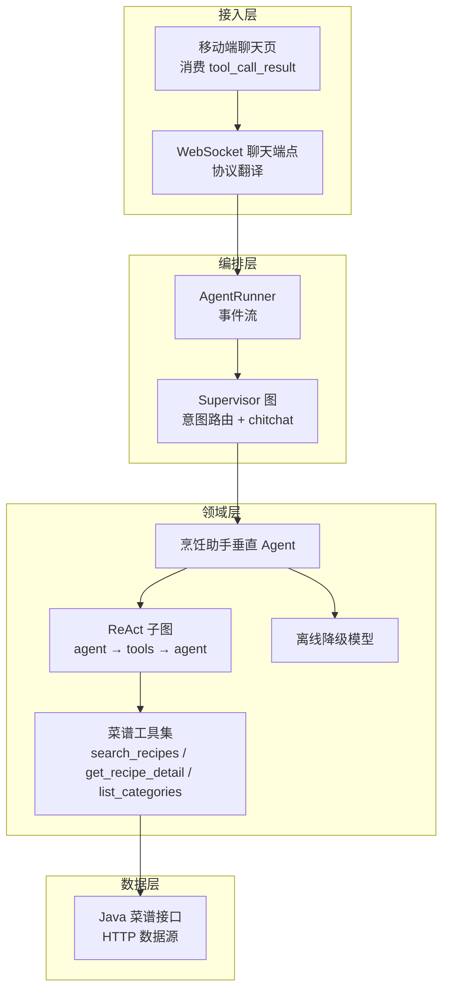

**图示来源**
- [ws.py:1-49](file://services/chat/app/routers/ws.py#L1-L49)
- [graph.py（supervisor）:1-14](file://services/agent-core/src/po_agent_core/supervisor/graph.py#L1-L14)
- [agent.py:1-14](file://services/agent-cooking/src/po_agent_cooking/agent.py#L1-L14)
- [graph.py:1-20](file://services/agent-cooking/src/po_agent_cooking/graph.py#L1-L20)
- [tools.py:1-17](file://services/agent-cooking/src/po_agent_cooking/tools.py#L1-L17)
- [offline.py:1-11](file://services/agent-cooking/src/po_agent_cooking/offline.py#L1-L11)

**章节来源**
- [pyproject.toml:1-13](file://services/agent-cooking/pyproject.toml#L1-L13)
- [agent.py:1-14](file://services/agent-cooking/src/po_agent_cooking/agent.py#L1-L14)
- [graph.py（supervisor）:1-14](file://services/agent-core/src/po_agent_core/supervisor/graph.py#L1-L14)
- [ws.py:1-49](file://services/chat/app/routers/ws.py#L1-L49)

## 核心组件
- 垂直 Agent 装配入口：负责按角色解析模型、装配数据源与工具、注册插槽名与意图语料。
- ReAct 子图：手写 `agent` 与 `tools` 节点，控制系统提示注入与消息窗口裁剪。
- 菜谱工具集：提供搜索、详情、分类三类工具，统一返回 JSON 字符串，异常不抛出。
- 离线降级模型：当 LLM 或网络不可用时，返回确定性话术，不调用工具。
- Supervisor 图：Layer1 意图路由，命中 cooking 则委托子图，否则走 chitchat。
- WebSocket 协议层：将 AgentEvent 映射为帧，支持 token、tool_call_*、interrupt/done/error。

**章节来源**
- [agent.py:38-67](file://services/agent-cooking/src/po_agent_cooking/agent.py#L38-L67)
- [graph.py:56-91](file://services/agent-cooking/src/po_agent_cooking/graph.py#L56-L91)
- [tools.py:95-205](file://services/agent-cooking/src/po_agent_cooking/tools.py#L95-L205)
- [offline.py:52-92](file://services/agent-cooking/src/po_agent_cooking/offline.py#L52-L92)
- [graph.py（supervisor）:56-113](file://services/agent-core/src/po_agent_core/supervisor/graph.py#L56-L113)
- [ws.py:67-83](file://services/chat/app/routers/ws.py#L67-L83)

## 架构总览
从用户输入到最终建议的完整处理链路如下：

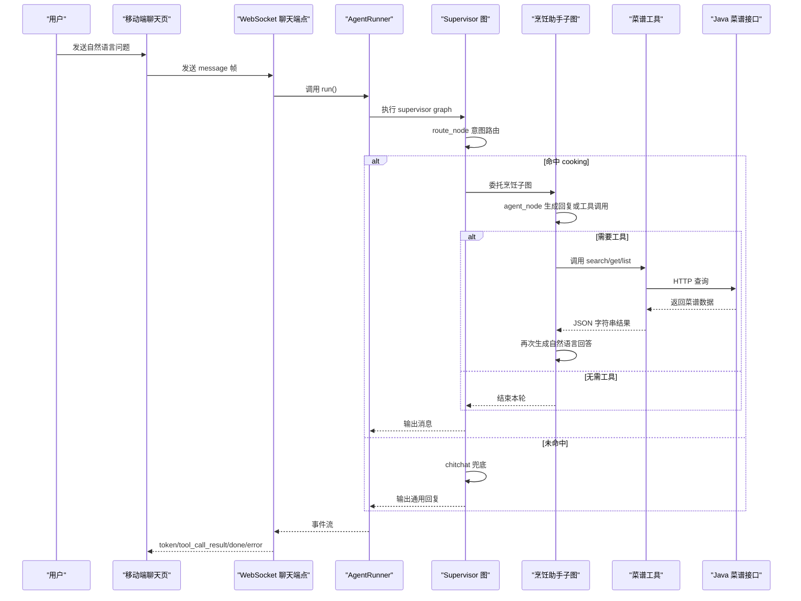

**图示来源**
- [ws.py:131-180](file://services/chat/app/routers/ws.py#L131-L180)
- [graph.py（supervisor）:65-112](file://services/agent-core/src/po_agent_core/supervisor/graph.py#L65-L112)
- [graph.py:70-90](file://services/agent-cooking/src/po_agent_cooking/graph.py#L70-L90)
- [tools.py:103-205](file://services/agent-cooking/src/po_agent_cooking/tools.py#L103-L205)

## 详细组件分析

### 垂直 Agent 装配与降级
- 插槽名固定为 `cooking`，意图语料覆盖找菜、问做法、问食材、按条件筛选四类典型说法。
- 模型解析失败时降级为离线模型，保证宿主可启动且用户体验诚实。
- 数据源默认走 HTTP 接口，装配期不探活；后端不可用时工具返回可读错误。

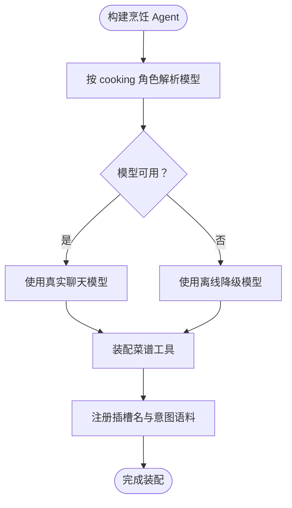

**图示来源**
- [agent.py:70-109](file://services/agent-cooking/src/po_agent_cooking/agent.py#L70-L109)
- [offline.py:52-92](file://services/agent-cooking/src/po_agent_cooking/offline.py#L52-L92)

**章节来源**
- [agent.py:38-67](file://services/agent-cooking/src/po_agent_cooking/agent.py#L38-L67)
- [agent.py:70-109](file://services/agent-cooking/src/po_agent_cooking/agent.py#L70-L109)
- [offline.py:1-11](file://services/agent-cooking/src/po_agent_cooking/offline.py#L1-L11)

### ReAct 子图：推理、行动、观察循环
- `agent_node`：每轮拼接系统提示与历史消息，调用绑定工具的模型。
- `tools`：LangGraph 内置 `ToolNode`，根据末条 AIMessage 的 tool_calls 执行工具。
- 条件边：若存在工具调用则进入 `tools`，否则结束。
- 窗口裁剪：按 HumanMessage 边界取最近 N 条消息，避免孤儿 ToolMessage。

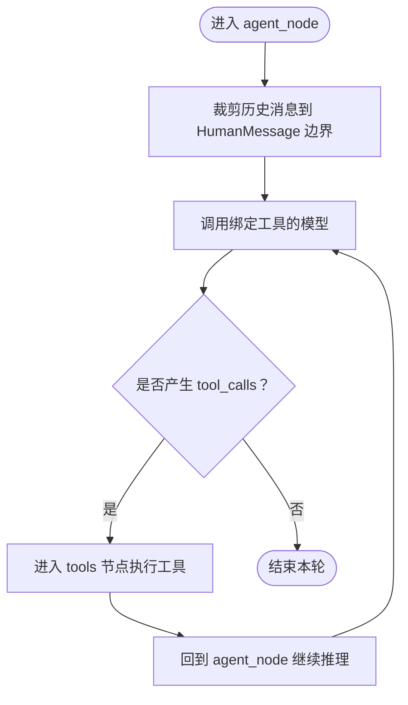

**图示来源**
- [graph.py:40-53](file://services/agent-cooking/src/po_agent_cooking/graph.py#L40-L53)
- [graph.py:70-90](file://services/agent-cooking/src/po_agent_cooking/graph.py#L70-L90)

**章节来源**
- [graph.py:1-20](file://services/agent-cooking/src/po_agent_cooking/graph.py#L1-L20)
- [graph.py:56-91](file://services/agent-cooking/src/po_agent_cooking/graph.py#L56-L91)

### 菜谱工具链：搜索、详情、分类
三个工具覆盖“找菜 → 看细节 → 报分类”的完整检索链路：
- `search_recipes`：按关键词、分类、难度搜索，返回摘要列表；无命中时附带 hint。
- `get_recipe_detail`：按 id 查询用料与步骤，返回结构化 recipe 对象。
- `list_categories`：列出可用分类名，辅助模型确认菜系。

所有工具返回值均为 JSON 字符串，异常被捕获并转为 `{"error": "..."}`，确保整轮对话不断裂。

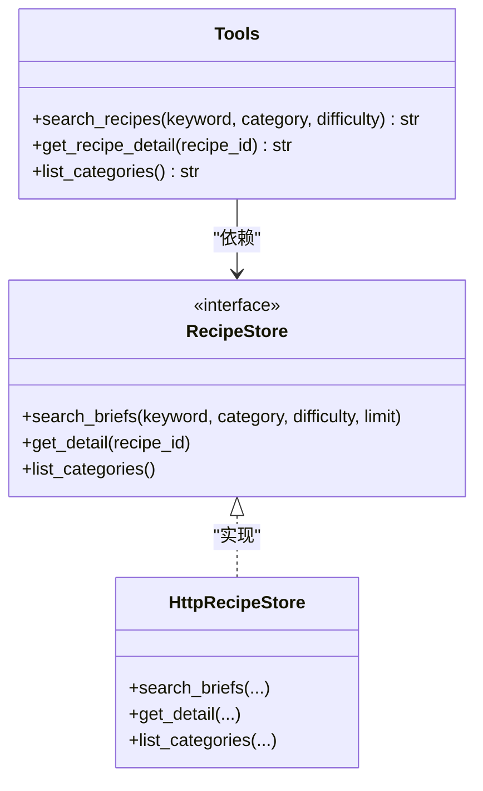

**图示来源**
- [tools.py:95-205](file://services/agent-cooking/src/po_agent_cooking/tools.py#L95-L205)

**章节来源**
- [tools.py:1-17](file://services/agent-cooking/src/po_agent_cooking/tools.py#L1-L17)
- [tools.py:56-93](file://services/agent-cooking/src/po_agent_cooking/tools.py#L56-L93)
- [tools.py:103-205](file://services/agent-cooking/src/po_agent_cooking/tools.py#L103-L205)

### 提示词工程策略
提示词模块集中定义行为约束与输出格式要求：
- 禁止凭记忆编造菜谱，必须以工具返回为准。
- 禁止 Markdown 标题与表格，移动端纯文本渲染。
- 推荐 2-3 道菜，讲做法时分步骤短横线列举。
- 涉及用量以工具数据为准，保持简短口语化中文。

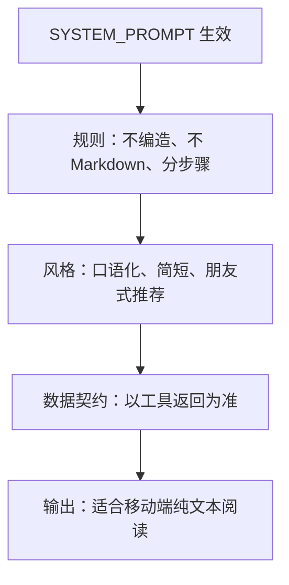

**图示来源**
- [prompts.py:1-36](file://services/agent-cooking/src/po_agent_cooking/prompts.py#L1-L36)

**章节来源**
- [prompts.py:1-36](file://services/agent-cooking/src/po_agent_cooking/prompts.py#L1-L36)

### 状态机设计：从用户输入到最终建议
Supervisor 共享状态 `CoreState` 仅保留编排必需字段：
- `messages`：对话消息，追加归并。
- `intent` / `route_score`：意图路由决策。
- `agent_name`：实际委托节点名。
- `artifacts`：各垂直 Agent 私有数据命名空间。

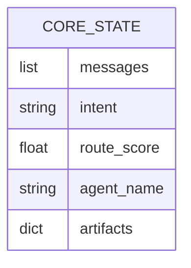

**图示来源**
- [state.py:22-39](file://services/agent-core/src/po_agent_core/supervisor/state.py#L22-L39)

**章节来源**
- [state.py:1-39](file://services/agent-core/src/po_agent_core/supervisor/state.py#L1-L39)

### 协议与事件流：WebSocket 帧映射
WebSocket 层将 `AgentEvent` 映射为帧类型：
- `token`：打字机增量文本。
- `tool_call_start/args/end/result`：工具调用生命周期。
- `interrupt`：等待用户确认。
- `done` / `error`：运行结束或错误。

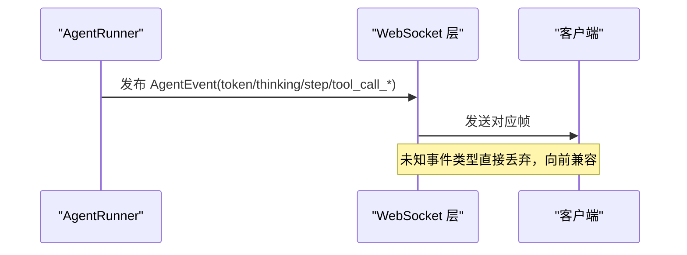

**图示来源**
- [ws.py:67-83](file://services/chat/app/routers/ws.py#L67-L83)
- [events.py:41-76](file://services/agent-core/src/po_agent_core/events.py#L41-L76)

**章节来源**
- [ws.py:131-180](file://services/chat/app/routers/ws.py#L131-L180)
- [events.py:41-76](file://services/agent-core/src/po_agent_core/events.py#L41-L76)

## 依赖关系分析
- 领域 Agent 依赖 agent-core 提供的 VerticalAgent、CoreState、事件协议。
- 工具依赖 RecipeStore 抽象，默认实现为 HTTP 访问 Java 接口。
- 前端消费 tool_call_result 中的 recipes 数据，用于渲染卡片。

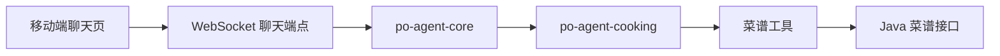

**图示来源**
- [pyproject.toml:6-13](file://services/agent-cooking/pyproject.toml#L6-L13)
- [tools.py:27-28](file://services/agent-cooking/src/po_agent_cooking/tools.py#L27-L28)
- [chat.tsx:213-233](file://apps/cooking-mini/src/pages/ai/chat.tsx#L213-L233)

**章节来源**
- [pyproject.toml:6-13](file://services/agent-cooking/pyproject.toml#L6-L13)
- [tools.py:27-28](file://services/agent-cooking/src/po_agent_cooking/tools.py#L27-L28)
- [chat.tsx:213-233](file://apps/cooking-mini/src/pages/ai/chat.tsx#L213-L233)

## 性能与容量规划
- 历史窗口限制：HISTORY_LIMIT 控制每次调模型的上下文长度，避免长会话膨胀。
- 搜索结果上限：search_limit 控制单次检索返回条数，影响上下文大小与响应速度。
- 工具返回值：JSON 字符串同时作为模型上下文与前端数据源，字段稳定可减少序列化开销。
- 异步执行：WS 层串行发送事件，避免并发写冲突。

**章节来源**
- [prompts.py:16-18](file://services/agent-cooking/src/po_agent_cooking/prompts.py#L16-L18)
- [config.py:31-35](file://services/agent-cooking/src/po_agent_cooking/config.py#L31-L35)
- [tools.py:56-58](file://services/agent-cooking/src/po_agent_cooking/tools.py#L56-L58)
- [ws.py:177-180](file://services/chat/app/routers/ws.py#L177-L180)

## 降级与容错策略
- 模型降级：cooking 角色模型不可用时，使用 OfflineCookingModel，不调工具，返回确定性话术。
- 数据源降级：工具捕获 RecipeStoreError，返回 `{"error": "..."}`，前端显示“暂时查不到”。
- 路由降级：未命中任何垂直 Agent 时，Supervisor 走 chitchat 节点，保证图始终有出口。
- 协议降级：未知事件类型直接丢弃，前端忽略未知帧，向后兼容。

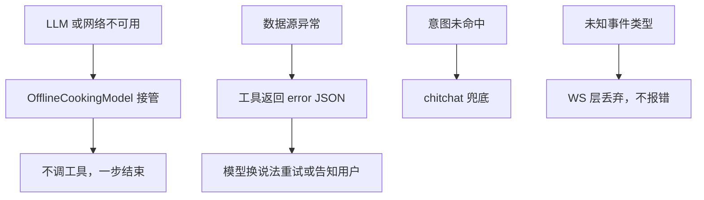

**图示来源**
- [offline.py:52-92](file://services/agent-cooking/src/po_agent_cooking/offline.py#L52-L92)
- [tools.py:120-137](file://services/agent-cooking/src/po_agent_cooking/tools.py#L120-L137)
- [graph.py（supervisor）:79-88](file://services/agent-core/src/po_agent_core/supervisor/graph.py#L79-L88)
- [ws.py:104-116](file://services/chat/app/routers/ws.py#L104-L116)

**章节来源**
- [offline.py:1-11](file://services/agent-cooking/src/po_agent_cooking/offline.py#L1-L11)
- [tools.py:120-137](file://services/agent-cooking/src/po_agent_cooking/tools.py#L120-L137)
- [graph.py（supervisor）:79-88](file://services/agent-core/src/po_agent_core/supervisor/graph.py#L79-L88)
- [ws.py:104-116](file://services/chat/app/routers/ws.py#L104-L116)

## 调试与测试指南
- 单元测试验证插槽名、意图语料覆盖、离线降级行为。
- 通过 WS 帧观察 token、tool_call_result、done/error，定位模型与工具行为。
- 前端消费 tool_call_result 中的 recipes 数据，校验卡片渲染是否符合预期。
- 使用 mock store 替换真实数据源，便于隔离测试。

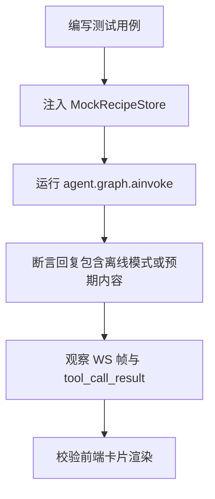

**图示来源**
- [test_agent.py:53-62](file://services/agent-cooking/tests/test_agent.py#L53-L62)
- [chat.tsx:213-233](file://apps/cooking-mini/src/pages/ai/chat.tsx#L213-L233)

**章节来源**
- [test_agent.py:37-66](file://services/agent-cooking/tests/test_agent.py#L37-L66)
- [chat.tsx:213-233](file://apps/cooking-mini/src/pages/ai/chat.tsx#L213-L233)
- [assistant.ts:99-132](file://apps/cooking-mini/src/lib/ai/assistant.ts#L99-L132)
- [recipe-utils.ts:1-39](file://apps/cooking-mini/src/lib/recipe-utils.ts#L1-L39)

## 结论
烹饪助手 Agent 通过清晰的层次划分与严格的契约设计，实现了稳定的 ReAct 循环、可靠的工具链与健壮的降级策略。Supervisor 图负责意图路由与兜底，cooking 子图专注菜谱检索与步骤讲解，WS 层提供统一的协议翻译。开发者可通过单元测试、WS 帧观察与前端 UI 校验，逐步优化提示词、工具返回结构与模型选择，持续提升用户体验。