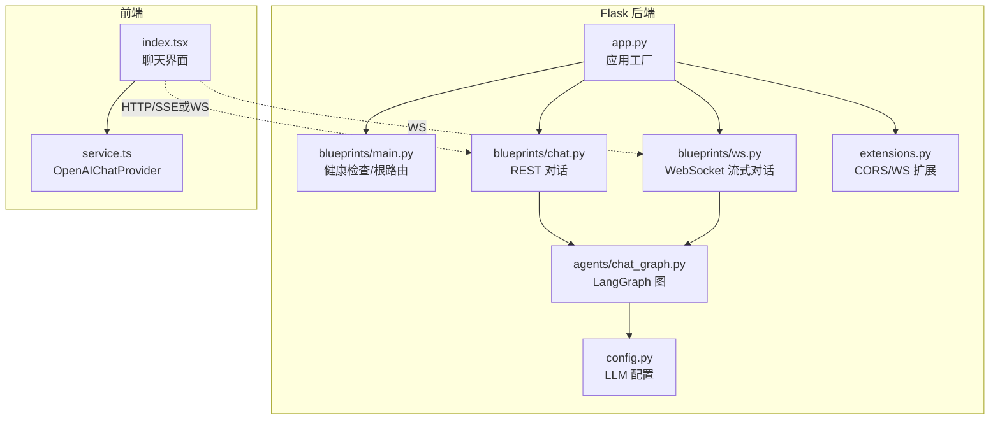
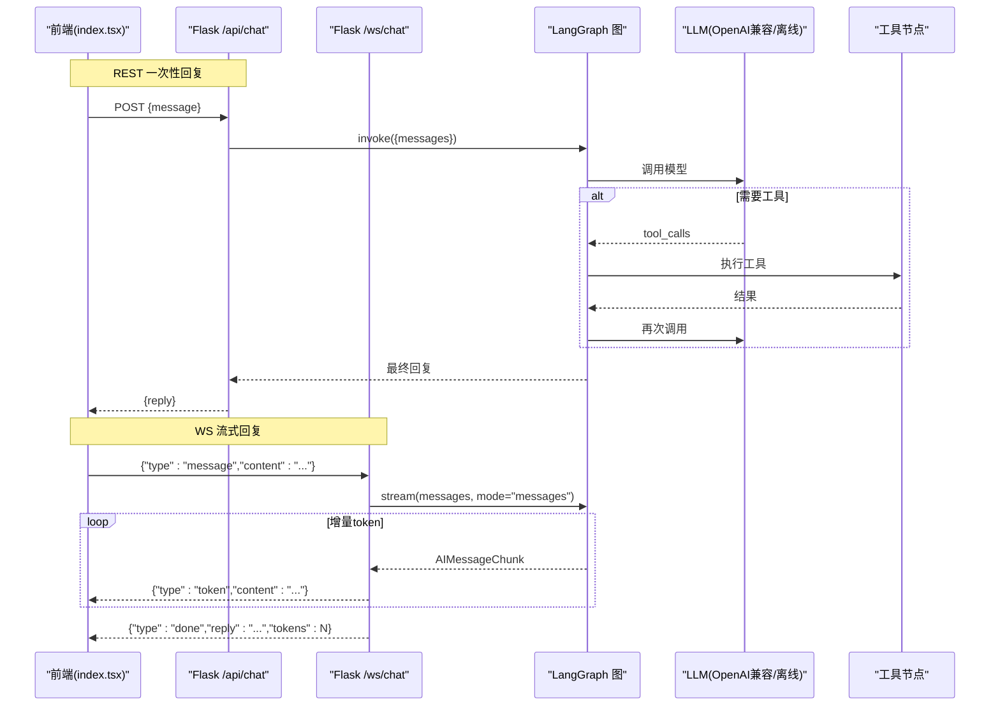
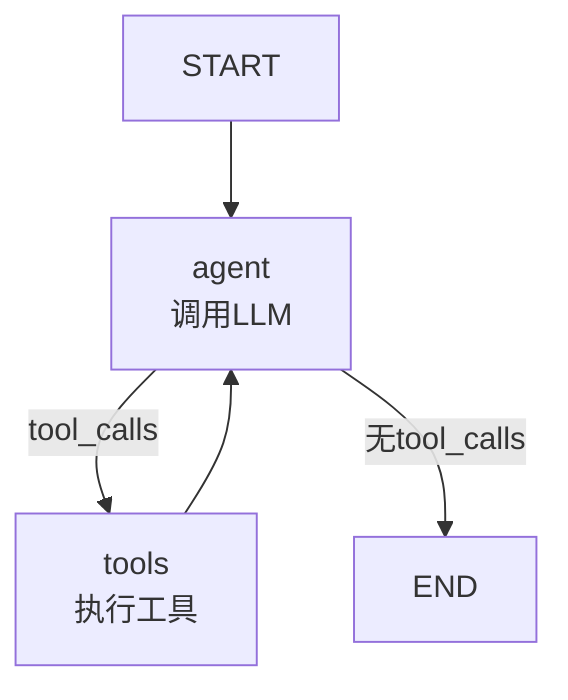
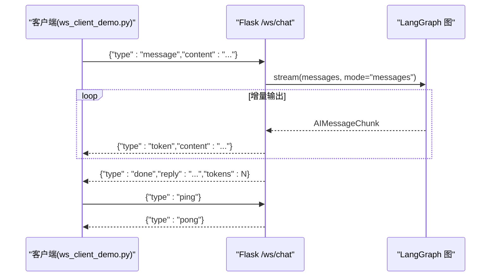
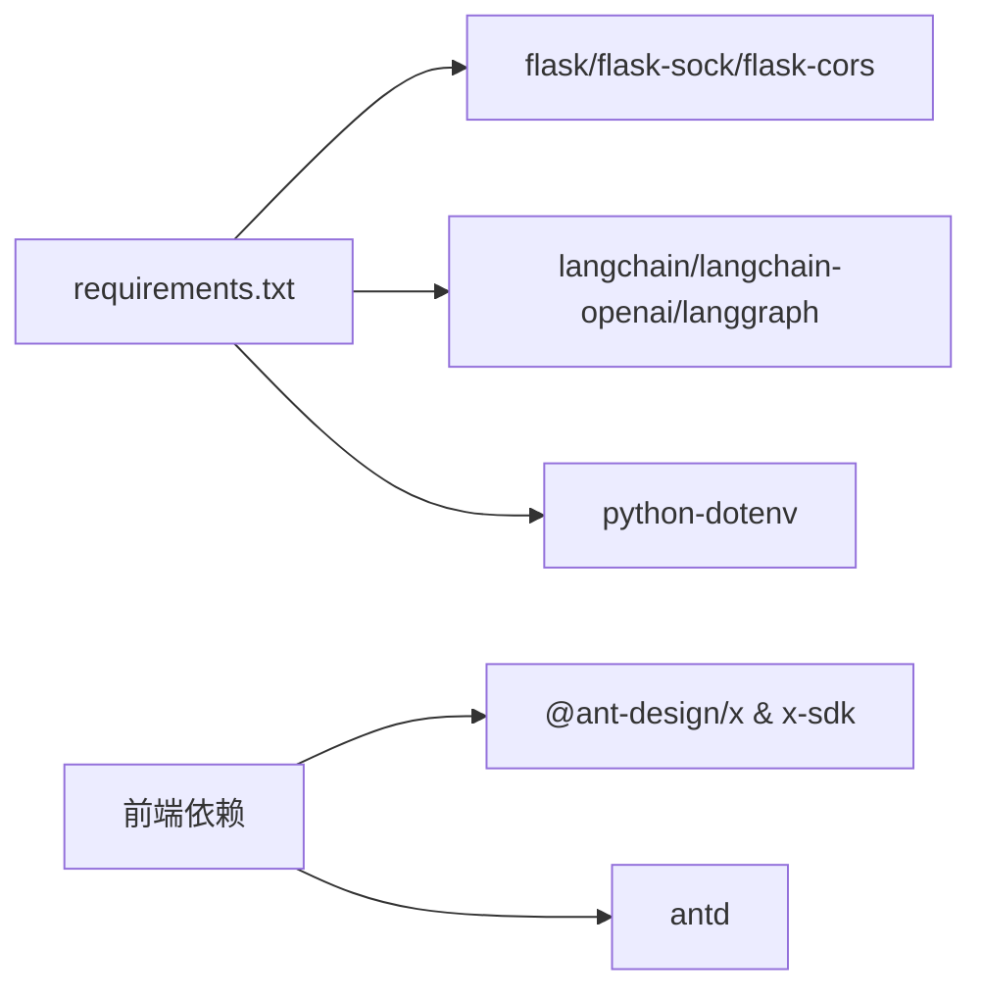

# AI对话服务

<cite>
**本文引用的文件**
- [app.py](file://py_server/app.py)
- [config.py](file://py_server/config.py)
- [extensions.py](file://py_server/extensions.py)
- [chat_graph.py](file://py_server/agents/chat_graph.py)
- [ws.py](file://py_server/blueprints/ws.py)
- [chat.py](file://py_server/blueprints/chat.py)
- [main.py](file://py_server/blueprints/main.py)
- [requirements.txt](file://py_server/requirements.txt)
- [index.tsx](file://web_client/po-admin/src/pages/chatbot/index.tsx)
- [service.ts](file://web_client/po-admin/src/pages/chatbot/service.ts)
- [data.d.ts](file://web_client/po-admin/src/pages/chatbot/data.d.ts)
- [ws_client_demo.py](file://py_server/scripts/ws_client_demo.py)
</cite>

## 目录
1. [简介](#简介)
2. [项目结构](#项目结构)
3. [核心组件](#核心组件)
4. [架构总览](#架构总览)
5. [详细组件分析](#详细组件分析)
6. [依赖关系分析](#依赖关系分析)
7. [性能考虑](#性能考虑)
8. [故障排查指南](#故障排查指南)
9. [结论](#结论)
10. [附录](#附录)

## 简介
本服务基于 Python Flask 提供 AI 对话能力，后端使用 LangChain + LangGraph 构建可编排的对话工作流，支持 REST 一次性回复与 WebSocket 流式回复两种模式。通过统一的 LLM 适配层，可接入 OpenAI、DeepSeek、通义千问等任意 OpenAI 兼容接口；未配置密钥时自动降级为离线演示模式，便于联调。前端采用 React + Ant Design Pro 聊天页面，并通过自定义 Provider 对接后端流式接口。

## 项目结构
- 后端（py_server）
  - 应用入口与蓝图：app.py、blueprints/*
  - 配置与扩展：config.py、extensions.py
  - 智能体与工作流：agents/chat_graph.py
  - 脚本与依赖：scripts/ws_client_demo.py、requirements.txt
- 前端（web_client/po-admin）
  - 聊天页面与数据模型：src/pages/chatbot/index.tsx、data.d.ts
  - 请求提供者封装：src/pages/chatbot/service.ts

图表来源
- [app.py:24-44](file://py_server/app.py#L24-L44)
- [main.py:9-29](file://py_server/blueprints/main.py#L9-L29)
- [chat.py:10-23](file://py_server/blueprints/chat.py#L10-L23)
- [ws.py:30-89](file://py_server/blueprints/ws.py#L30-L89)
- [chat_graph.py:46-86](file://py_server/agents/chat_graph.py#L46-L86)
- [config.py:10-25](file://py_server/config.py#L10-L25)
- [extensions.py:1-7](file://py_server/extensions.py#L1-L7)

章节来源
- [app.py:1-51](file://py_server/app.py#L1-L51)
- [requirements.txt:1-13](file://py_server/requirements.txt#L1-L13)

## 核心组件
- 应用工厂与蓝图注册：统一初始化 CORS、Sock、蓝图，并在启动时预热编译 LangGraph 图。
- 配置中心：集中管理服务端口、调试开关以及 LLM 参数（API Key、Base URL、Model）。
- 智能体工作流：基于 LangGraph 的状态图，实现 ReAct 循环（Agent -> Tools -> Agent ...），支持工具调用与条件边跳转。
- REST 对话：POST /api/chat 接收消息，返回完整回复。
- WebSocket 流式对话：/ws/chat 以 JSON 文本帧协议进行双向通信，逐 token 推送增量内容。
- 前端聊天页：React 组件集成 Ant Design X 聊天 UI，通过 Provider 发起流式请求并渲染 Markdown。

章节来源
- [app.py:24-44](file://py_server/app.py#L24-L44)
- [config.py:10-25](file://py_server/config.py#L10-L25)
- [chat_graph.py:40-86](file://py_server/agents/chat_graph.py#L40-L86)
- [chat.py:10-23](file://py_server/blueprints/chat.py#L10-L23)
- [ws.py:30-89](file://py_server/blueprints/ws.py#L30-L89)
- [index.tsx:116-333](file://web_client/po-admin/src/pages/chatbot/index.tsx#L116-L333)
- [service.ts:1-19](file://web_client/po-admin/src/pages/chatbot/service.ts#L1-L19)

## 架构总览
系统由“前端页面 -> Flask 路由 -> LangGraph 工作流 -> LLM 提供商”构成。工作流内部维护消息状态，根据模型是否产生 tool_calls 决定进入工具节点或结束。REST 与 WS 两条路径复用同一工作流，保证行为一致。

图表来源
- [chat.py:10-23](file://py_server/blueprints/chat.py#L10-L23)
- [ws.py:30-89](file://py_server/blueprints/ws.py#L30-L89)
- [chat_graph.py:46-86](file://py_server/agents/chat_graph.py#L46-L86)

## 详细组件分析

### 基于 LangGraph 的对话工作流
- 状态定义：使用 TypedDict 描述状态，消息字段通过 add_messages 注解实现自动累加。
- 节点设计：
  - agent：调用 LLM 生成回复，若包含 tool_calls 则交由工具节点处理。
  - tools：执行工具并将结果回写消息列表。
- 边连接：
  - START -> agent
  - agent -> END（无条件）
  - agent --条件--> tools（当存在 tool_calls）
  - tools -> agent（工具执行后继续推理）
- 多 LLM 适配：
  - 已配置 OPENAI_API_KEY：使用 ChatOpenAI，绑定工具，开启 streaming。
  - 未配置：使用 FakeListChatModel 返回固定提示，便于离线联调。
- 缓存策略：get_chat_graph 使用 lru_cache 在进程内单例化编译后的图，避免重复构建。

图表来源
- [chat_graph.py:40-86](file://py_server/agents/chat_graph.py#L40-L86)

章节来源
- [chat_graph.py:26-92](file://py_server/agents/chat_graph.py#L26-L92)

### WebSocket 实时通信
- 协议（JSON 文本帧）：
  - 客户端 -> 服务端：{"type":"message","content":"..."}、{"type":"ping"}
  - 服务端 -> 客户端：{"type":"token","content":"..."}、{"type":"done","reply":"...","tokens":N}、{"type":"pong"}、{"type":"error","message":"..."}
- 流程要点：
  - 建立连接后进入消息循环，解析 JSON 帧。
  - 对 message 类型调用 get_chat_graph().stream(stream_mode="messages")，逐块发送 token。
  - 完成时发送 done，携带完整 reply 与 tokens 计数。
  - 异常与关闭：捕获 ConnectionClosed 与通用异常，返回 error 并记录日志。
- 心跳机制：支持 ping/pong 保持连接活跃。

图表来源
- [ws.py:30-89](file://py_server/blueprints/ws.py#L30-L89)
- [ws_client_demo.py:19-52](file://py_server/scripts/ws_client_demo.py#L19-L52)

章节来源
- [ws.py:1-90](file://py_server/blueprints/ws.py#L1-L90)
- [ws_client_demo.py:1-53](file://py_server/scripts/ws_client_demo.py#L1-L53)

### 多 LLM 提供商集成方案
- 配置项：OPENAI_API_KEY、OPENAI_BASE_URL、OPENAI_MODEL。
- 行为：
  - 有 KEY：使用 ChatOpenAI，支持 base_url 指向任意 OpenAI 兼容接口（如 DeepSeek、通义千问等），并启用 streaming。
  - 无 KEY：使用 FakeListChatModel 返回离线提示，不绑定工具，保证链路可用。
- 建议：
  - 将不同厂商的 Base URL 与 Model 通过环境变量切换，无需改动代码。
  - 在生产环境务必设置有效的 API Key 与正确的 Base URL。

章节来源
- [config.py:10-25](file://py_server/config.py#L10-L25)
- [chat_graph.py:46-56](file://py_server/agents/chat_graph.py#L46-L56)

### 工具调用机制
- 内置工具：get_current_time，返回服务器本地时间字符串。
- 绑定方式：在在线模式下通过 bind_tools 将工具注入 LLM。
- 执行流程：模型返回 tool_calls -> 进入 tools 节点 -> 执行工具 -> 结果写入消息 -> 回到 agent 继续推理。
- 离线模式：FakeListChatModel 不支持 tool_calls，因此不会触发工具执行。

章节来源
- [chat_graph.py:26-32](file://py_server/agents/chat_graph.py#L26-L32)
- [chat_graph.py:46-56](file://py_server/agents/chat_graph.py#L46-L56)
- [chat_graph.py:67-86](file://py_server/agents/chat_graph.py#L67-L86)

### 上下文管理与错误处理
- 上下文：ChatState 中的 messages 字段通过 add_messages 自动追加历史消息，天然支持多轮对话。
- 错误处理：
  - REST：捕获异常返回 500 与错误信息，并记录堆栈。
  - WS：捕获无效 JSON、未知类型、空 content、连接关闭与通用异常，返回 type=error 帧并记录日志。
- 健康检查：/api/health 暴露 llm_configured 与当前 model，便于监控与诊断。

章节来源
- [chat_graph.py:40-44](file://py_server/agents/chat_graph.py#L40-L44)
- [chat.py:10-23](file://py_server/blueprints/chat.py#L10-L23)
- [ws.py:43-85](file://py_server/blueprints/ws.py#L43-L85)
- [main.py:22-29](file://py_server/blueprints/main.py#L22-L29)

### 前端 JavaScript 集成与最佳实践
- 页面组件：
  - 使用 Ant Design X 的 Bubble、Conversations、Sender、XMarkdown 等组件构建聊天界面。
  - 通过 useXChat 管理请求生命周期、消息解析与流式更新。
- Provider 封装：
  - service.ts 中创建 OpenAIChatProvider，配合 XRequest 指定手动模式与流式参数。
  - 可通过环境变量 CHAT_API_URL 调整后端地址。
- 消息解析：
  - index.tsx 中的 parser 支持将 assistant 的 think 标签内容分离为思考内容与正文，提升可读性。
- 最佳实践：
  - 使用 useMemo 缓存 provider，避免重复创建。
  - 合理设置 loading 与 status，确保 UI 在流式更新时的体验。
  - 对网络异常与中断进行兜底处理（例如重试、提示用户）。

章节来源
- [index.tsx:51-72](file://web_client/po-admin/src/pages/chatbot/index.tsx#L51-L72)
- [index.tsx:116-333](file://web_client/po-admin/src/pages/chatbot/index.tsx#L116-L333)
- [service.ts:1-19](file://web_client/po-admin/src/pages/chatbot/service.ts#L1-L19)
- [data.d.ts:3-12](file://web_client/po-admin/src/pages/chatbot/data.d.ts#L3-L12)

## 依赖关系分析
- 后端依赖：
  - Flask、flask-sock、flask-cors：Web 框架、WebSocket、跨域。
  - langchain、langchain-openai、langgraph：LLM 编排与图工作流。
  - python-dotenv：加载 .env 环境变量。
- 前端依赖：
  - @ant-design/x、@ant-design/x-sdk：聊天 UI 与流式请求封装。
  - antd：基础组件库。

图表来源
- [requirements.txt:1-13](file://py_server/requirements.txt#L1-L13)

章节来源
- [requirements.txt:1-13](file://py_server/requirements.txt#L1-L13)

## 性能考虑
- 工作流编译缓存：get_chat_graph 使用 lru_cache 缓存编译后的图，减少启动与首次调用开销。
- 流式传输：WS 端逐 token 推送，降低首字延迟，提升交互体验。
- 并发与资源：
  - 生产环境建议使用 gunicorn/uwsgi 等多进程部署，结合 Nginx 反向代理。
  - 合理设置超时与连接池，避免 LLM 调用阻塞。
- 降级策略：未配置 API Key 时自动降级到离线模式，保障联调与演示可用性。

[本节为通用指导，不直接分析具体文件]

## 故障排查指南
- 无法连接 WebSocket：
  - 检查 CORS 配置与浏览器控制台是否有跨域错误。
  - 确认 ws.py 路由已注册且服务监听端口正确。
- 收到“无效的 JSON 帧”或“未知的消息类型”：
  - 检查客户端发送的 JSON 结构与字段名是否正确。
- 流式响应为空：
  - 确认 LLM 是否返回 AIMessageChunk；离线模式下可能无流式内容。
- 工具未生效：
  - 确认已配置 OPENAI_API_KEY 且模型支持 tool_calls。
- 健康检查异常：
  - 访问 /api/health 查看 llm_configured 与 model 字段，定位配置问题。

章节来源
- [ws.py:43-85](file://py_server/blueprints/ws.py#L43-L85)
- [main.py:22-29](file://py_server/blueprints/main.py#L22-L29)
- [chat_graph.py:46-56](file://py_server/agents/chat_graph.py#L46-L56)

## 结论
该服务以 Flask 为入口，结合 LangGraph 实现了可扩展的对话工作流，支持 REST 与 WebSocket 双通道；通过统一的 LLM 适配层，可灵活接入多种 OpenAI 兼容模型，并提供离线降级能力。前端采用现代 React 组件与流式 UI 库，提供良好的用户体验。整体架构清晰、职责分明，易于扩展与维护。

[本节为总结性内容，不直接分析具体文件]

## 附录

### API 参考
- 根路由
  - GET /：返回服务信息与可用端点
- 健康检查
  - GET /api/health：返回服务状态、是否配置 LLM、当前模型
- REST 对话
  - POST /api/chat：请求体 {message}，响应 {reply}
- WebSocket 对话
  - WS /ws/chat：协议见 ws.py 注释

章节来源
- [main.py:9-29](file://py_server/blueprints/main.py#L9-L29)
- [chat.py:10-23](file://py_server/blueprints/chat.py#L10-L23)
- [ws.py:1-13](file://py_server/blueprints/ws.py#L1-L13)

### 环境变量与配置
- SECRET_KEY：Flask 密钥
- HOST、PORT、DEBUG：服务监听与调试开关
- OPENAI_API_KEY、OPENAI_BASE_URL、OPENAI_MODEL：LLM 配置

章节来源
- [config.py:10-25](file://py_server/config.py#L10-L25)

### 快速开始
- 安装依赖：pip install -r requirements.txt
- 启动服务：python app.py
- 测试 REST：curl -X POST http://localhost:5090/api/chat -H "Content-Type: application/json" -d '{"message":"你好"}'
- 测试 WS：运行 scripts/ws_client_demo.py

章节来源
- [app.py:49-51](file://py_server/app.py#L49-L51)
- [ws_client_demo.py:19-52](file://py_server/scripts/ws_client_demo.py#L19-L52)