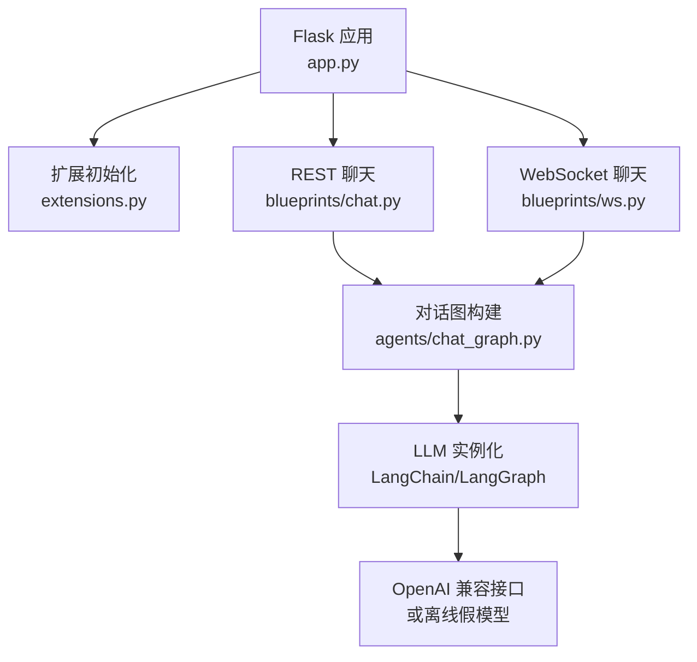
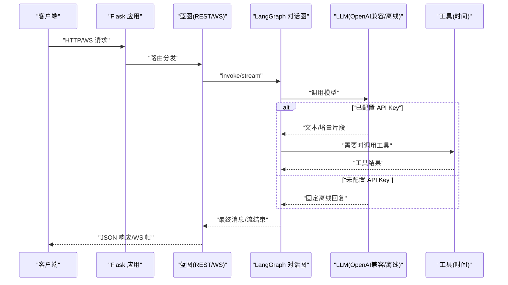
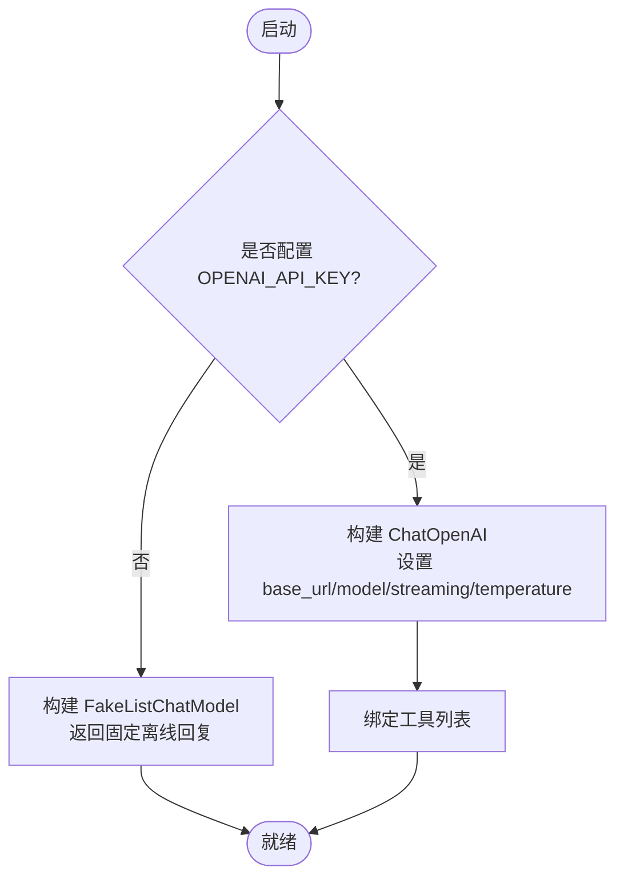
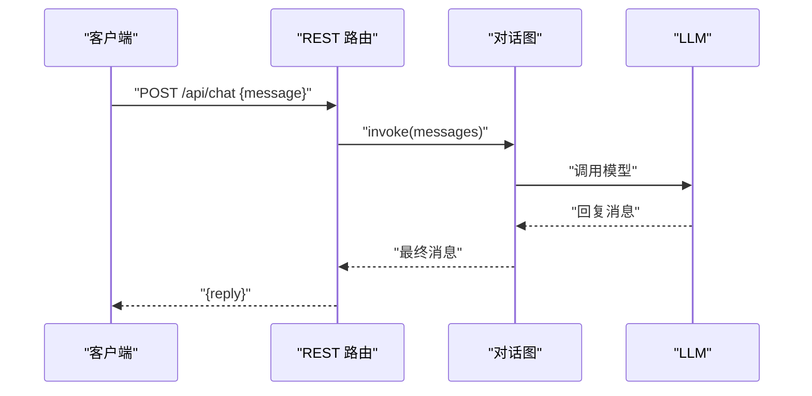
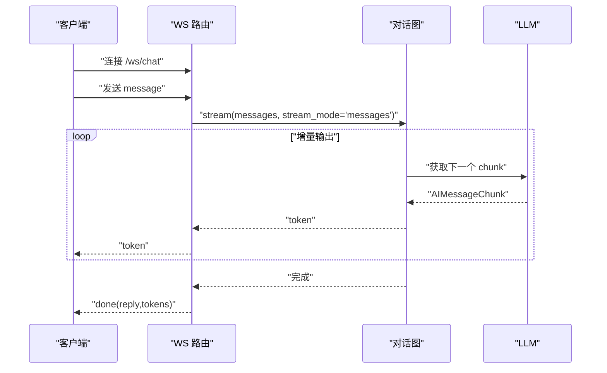
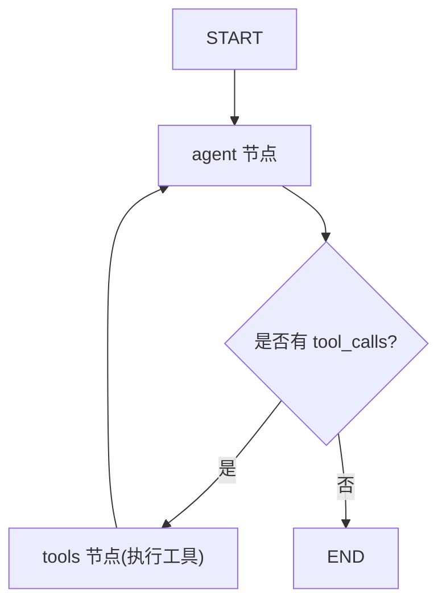
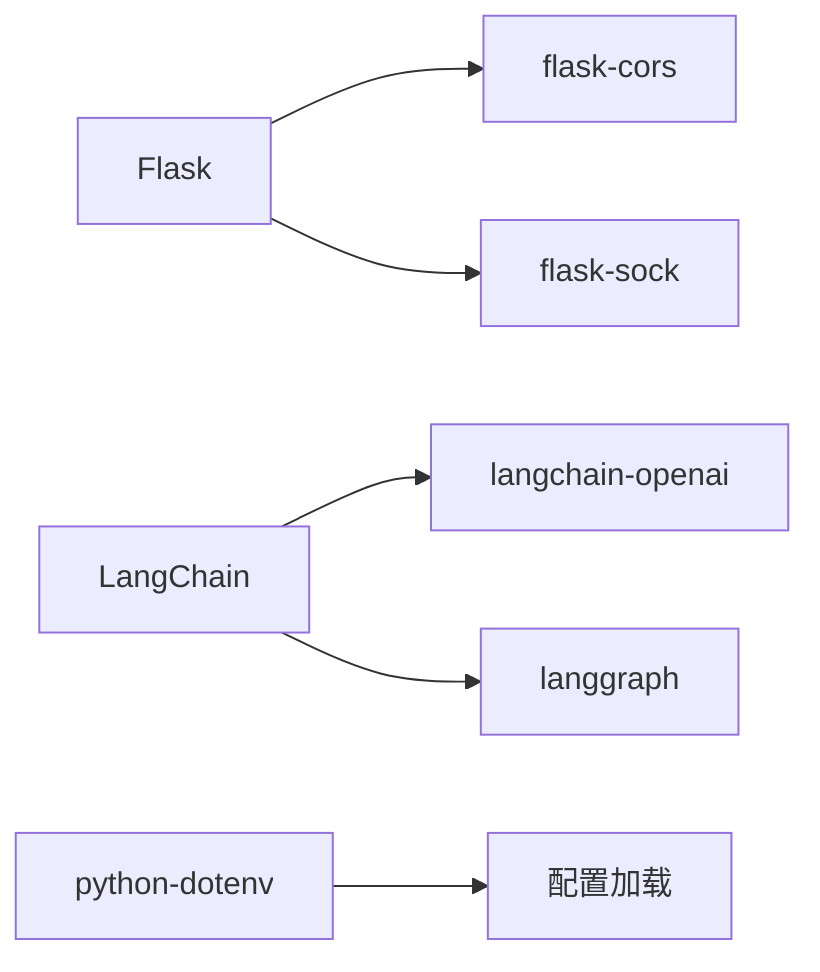

# LLM模型集成

<cite>
**本文引用的文件**
- [config.py](file://py_server/config.py)
- [app.py](file://py_server/app.py)
- [extensions.py](file://py_server/extensions.py)
- [requirements.txt](file://py_server/requirements.txt)
- [README.md](file://py_server/README.md)
- [agents/chat_graph.py](file://py_server/agents/chat_graph.py)
- [blueprints/chat.py](file://py_server/blueprints/chat.py)
- [blueprints/ws.py](file://py_server/blueprints/ws.py)
- [scripts/ws_client_demo.py](file://py_server/scripts/ws_client_demo.py)
</cite>

## 目录
1. [简介](#简介)
2. [项目结构](#项目结构)
3. [核心组件](#核心组件)
4. [架构总览](#架构总览)
5. [详细组件分析](#详细组件分析)
6. [依赖关系分析](#依赖关系分析)
7. [性能与稳定性](#性能与稳定性)
8. [故障排查指南](#故障排查指南)
9. [结论](#结论)
10. [附录：配置与环境变量](#附录配置与环境变量)

## 简介
本仓库的 Python 后端服务基于 Flask + LangChain + LangGraph，提供统一的 OpenAI 兼容接口接入能力，支持 REST 一次性回复与 WebSocket 流式回复。当未配置 API Key 时，服务自动降级为离线演示模式（使用 FakeListChatModel），保证联调链路可用。文档将详细说明：
- OpenAI 兼容接口的配置方式（API Key、基础 URL、模型参数）
- 离线模式的降级机制与适用场景
- 模型选择策略与温度参数的影响
- 流式响应的启用方法与协议
- 完整的环境变量配置示例与生产最佳实践
- 错误处理与重试建议，确保服务稳定运行

## 项目结构
Python 后端位于 py_server 目录，采用应用工厂 + 蓝图组织路由，通过 LangGraph 编排对话智能体，统一暴露 REST 与 WebSocket 接口。

图表来源
- [app.py:24-47](file://py_server/app.py#L24-L47)
- [extensions.py:1-7](file://py_server/extensions.py#L1-L7)
- [blueprints/chat.py:1-24](file://py_server/blueprints/chat.py#L1-L24)
- [blueprints/ws.py:1-90](file://py_server/blueprints/ws.py#L1-L90)
- [agents/chat_graph.py:1-92](file://py_server/agents/chat_graph.py#L1-L92)

章节来源
- [app.py:1-51](file://py_server/app.py#L1-L51)
- [extensions.py:1-7](file://py_server/extensions.py#L1-L7)
- [README.md:34-51](file://py_server/README.md#L34-L51)

## 核心组件
- 配置加载：从 .env 读取 OPENAI_API_KEY、OPENAI_BASE_URL、OPENAI_MODEL 等；未配置时自动进入离线模式。
- 对话图：基于 LangGraph 的 ReAct 循环，agent 节点调用 LLM，必要时执行工具（如获取当前时间）。
- REST 接口：POST /api/chat，返回一次性完整回复。
- WebSocket 接口：WS /ws/chat，逐 token 推送流式输出，并发送完成帧。
- 扩展：CORS 跨域、Sock 原生 WebSocket 支持。

章节来源
- [config.py:10-25](file://py_server/config.py#L10-L25)
- [agents/chat_graph.py:46-86](file://py_server/agents/chat_graph.py#L46-L86)
- [blueprints/chat.py:10-24](file://py_server/blueprints/chat.py#L10-L24)
- [blueprints/ws.py:30-90](file://py_server/blueprints/ws.py#L30-L90)
- [extensions.py:1-7](file://py_server/extensions.py#L1-L7)

## 架构总览
下图展示了请求从客户端到 LLM 的完整路径，包括在线与离线两种模式。

图表来源
- [blueprints/chat.py:10-24](file://py_server/blueprints/chat.py#L10-L24)
- [blueprints/ws.py:30-90](file://py_server/blueprints/ws.py#L30-L90)
- [agents/chat_graph.py:46-86](file://py_server/agents/chat_graph.py#L46-L86)

## 详细组件分析

### 配置与离线降级
- 配置项：
  - OPENAI_API_KEY：若为空则进入离线模式
  - OPENAI_BASE_URL：指向任意 OpenAI 兼容接口
  - OPENAI_MODEL：模型名称（默认 gpt-4o-mini）
- 降级逻辑：
  - 有 Key：构造 ChatOpenAI，开启 streaming，绑定工具
  - 无 Key：构造 FakeListChatModel，返回固定提示，不绑定工具

图表来源
- [config.py:20-25](file://py_server/config.py#L20-L25)
- [agents/chat_graph.py:46-57](file://py_server/agents/chat_graph.py#L46-L57)

章节来源
- [config.py:10-25](file://py_server/config.py#L10-L25)
- [agents/chat_graph.py:46-57](file://py_server/agents/chat_graph.py#L46-L57)

### 模型选择策略与温度参数
- 模型选择：
  - 默认 gpt-4o-mini，适合通用对话、成本敏感场景
  - 可替换为任意 OpenAI 兼容模型（如 deepseek-chat），通过 OPENAI_BASE_URL 与 OPENAI_MODEL 切换
- 温度 temperature：
  - 代码中设置为 0.7，平衡创造性与稳定性
  - 较低温度更稳定、重复性高；较高温度更具创造性但可能不稳定
- 工具绑定：
  - 在线模式绑定工具（如获取当前时间），用于增强回答能力
  - 离线模式不绑定工具

章节来源
- [agents/chat_graph.py:26-33](file://py_server/agents/chat_graph.py#L26-L33)
- [agents/chat_graph.py:46-57](file://py_server/agents/chat_graph.py#L46-L57)

### REST 接口：一次性回复
- 路径：POST /api/chat
- 输入：{ "message": "..." }
- 行为：调用 get_chat_graph()，invoke 一次，返回最后一条消息内容
- 错误：捕获异常并返回 500

图表来源
- [blueprints/chat.py:10-24](file://py_server/blueprints/chat.py#L10-L24)
- [agents/chat_graph.py:75-86](file://py_server/agents/chat_graph.py#L75-L86)

章节来源
- [blueprints/chat.py:10-24](file://py_server/blueprints/chat.py#L10-L24)

### WebSocket 接口：流式回复
- 路径：WS /ws/chat
- 协议：
  - 客户端发送 {"type":"message","content":"..."}
  - 服务端逐 token 推送 {"type":"token","content":"..."}
  - 完成后推送 {"type":"done","reply":"...","tokens":N}
  - 心跳 {"type":"ping"} -> {"type":"pong"}
  - 错误 {"type":"error","message":"..."}
- 实现：stream_mode="messages"，累积 AIMessageChunk 的 content 并逐块推送

图表来源
- [blueprints/ws.py:30-90](file://py_server/blueprints/ws.py#L30-L90)
- [agents/chat_graph.py:75-86](file://py_server/agents/chat_graph.py#L75-L86)

章节来源
- [blueprints/ws.py:1-90](file://py_server/blueprints/ws.py#L1-L90)

### 工具与 ReAct 循环
- 工具：get_current_time，返回服务器本地时间
- 条件边：若模型返回 tool_calls，则进入 tools 节点执行工具，再回到 agent
- 离线模式：FakeListChatModel 不支持 tool_calls，因此不绑定工具

图表来源
- [agents/chat_graph.py:26-33](file://py_server/agents/chat_graph.py#L26-L33)
- [agents/chat_graph.py:67-86](file://py_server/agents/chat_graph.py#L67-L86)

章节来源
- [agents/chat_graph.py:26-33](file://py_server/agents/chat_graph.py#L26-L33)
- [agents/chat_graph.py:67-86](file://py_server/agents/chat_graph.py#L67-L86)

## 依赖关系分析
- Web 框架与 WS：flask、flask-sock、flask-cors
- LLM 编排：langchain、langchain-openai、langgraph
- 环境变量：python-dotenv

图表来源
- [requirements.txt:1-13](file://py_server/requirements.txt#L1-L13)

章节来源
- [requirements.txt:1-13](file://py_server/requirements.txt#L1-L13)

## 性能与稳定性
- 流式传输：WS 使用 stream_mode="messages" 逐 token 推送，降低首字延迟，提升交互体验
- 并发与部署：生产建议使用 gunicorn + gevent worker，以支撑大量长连接
- 资源占用：每个 WS 连接在工作进程内占用一个工作单元；gevent 可高效调度协程
- 缓存：对话图编译后缓存（lru_cache），避免重复构建开销

章节来源
- [blueprints/ws.py:67-82](file://py_server/blueprints/ws.py#L67-L82)
- [agents/chat_graph.py:75-86](file://py_server/agents/chat_graph.py#L75-L86)
- [README.md:115-125](file://py_server/README.md#L115-L125)

## 故障排查指南
- 常见问题
  - 未配置 OPENAI_API_KEY：服务进入离线模式，返回固定提示；检查 .env 是否正确加载
  - 无效 JSON 帧：WS 会返回 error 类型帧；检查客户端发送格式
  - 空消息：REST/WS 均校验 message/content 非空，否则返回错误
- 日志与错误
  - REST 与 WS 均捕获异常并记录日志，返回 500 或 error 帧
  - 健康检查：GET /api/health 可查看服务状态与 LLM 配置情况
- 调试工具
  - 使用 scripts/ws_client_demo.py 快速验证 WS 链路

章节来源
- [blueprints/chat.py:10-24](file://py_server/blueprints/chat.py#L10-L24)
- [blueprints/ws.py:43-85](file://py_server/blueprints/ws.py#L43-L85)
- [scripts/ws_client_demo.py:19-48](file://py_server/scripts/ws_client_demo.py#L19-L48)
- [README.md:53-67](file://py_server/README.md#L53-L67)

## 结论
该服务通过统一配置与 LangGraph 编排，实现了多 LLM 提供商的灵活接入与离线降级保障。REST 与 WebSocket 双通道满足不同交互需求，配合合理的温度参数与工具绑定，可在多种场景下取得良好效果。生产环境建议结合 gunicorn+gevent 部署，严格管理环境变量与密钥，完善监控与日志，以确保服务的稳定性与可扩展性。

## 附录：配置与环境变量
- 环境变量
  - OPENAI_API_KEY：OpenAI 兼容接口密钥（留空则离线模式）
  - OPENAI_BASE_URL：API 基础地址（例如 DeepSeek、通义千问等）
  - OPENAI_MODEL：模型名称（默认 gpt-4o-mini）
  - SECRET_KEY、HOST、PORT、DEBUG：服务基础配置
- 推荐实践
  - 生产环境务必在安全的位置管理 .env，不要提交到版本库
  - 使用最小权限原则分配 API Key，并定期轮换
  - 对关键接口增加鉴权与限流，防止滥用
  - 监控 LLM 调用成功率与延迟，设置告警
- 参考示例
  - 见 README 中的模型配置与部署说明

章节来源
- [config.py:10-25](file://py_server/config.py#L10-L25)
- [README.md:102-125](file://py_server/README.md#L102-L125)
- [.gitignore:7-8](file://py_server/.gitignore#L7-L8)