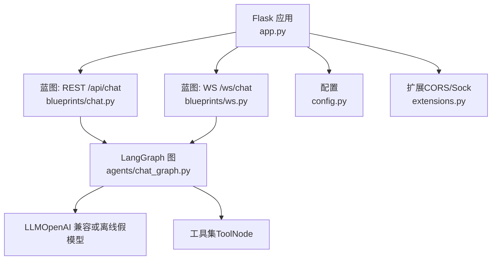
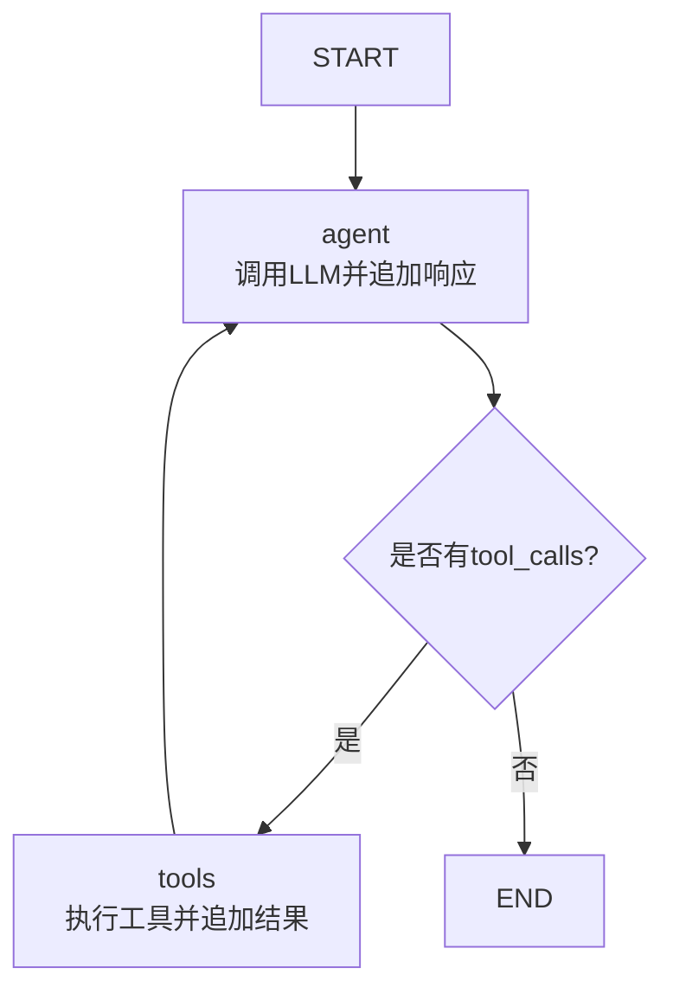
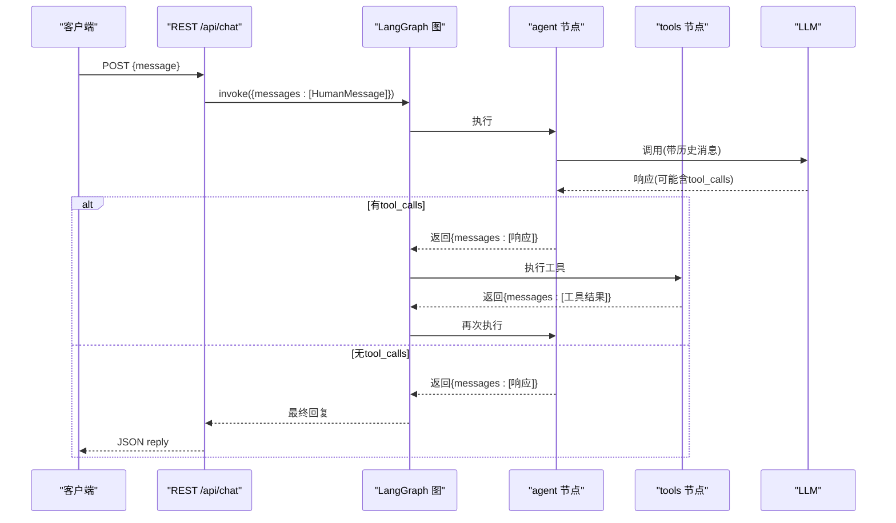
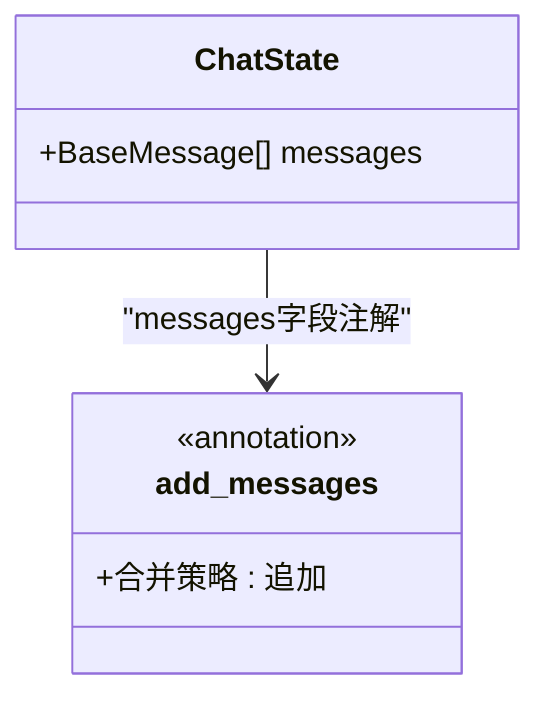
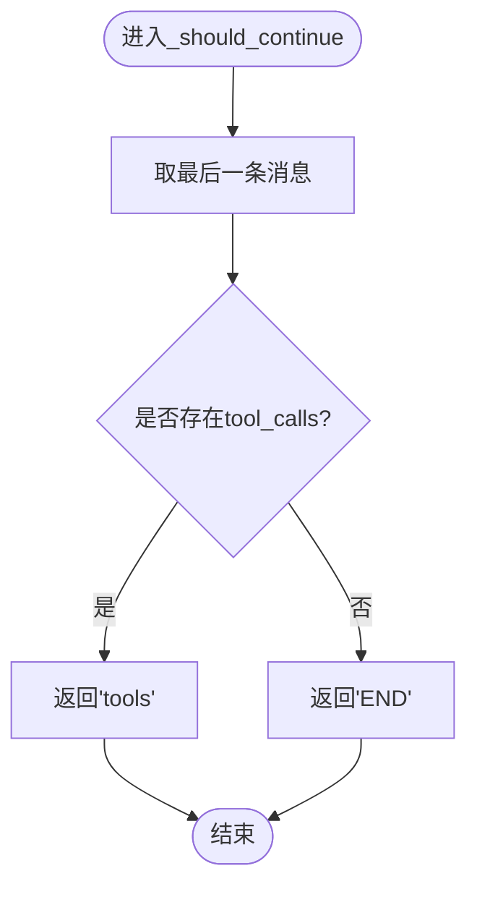
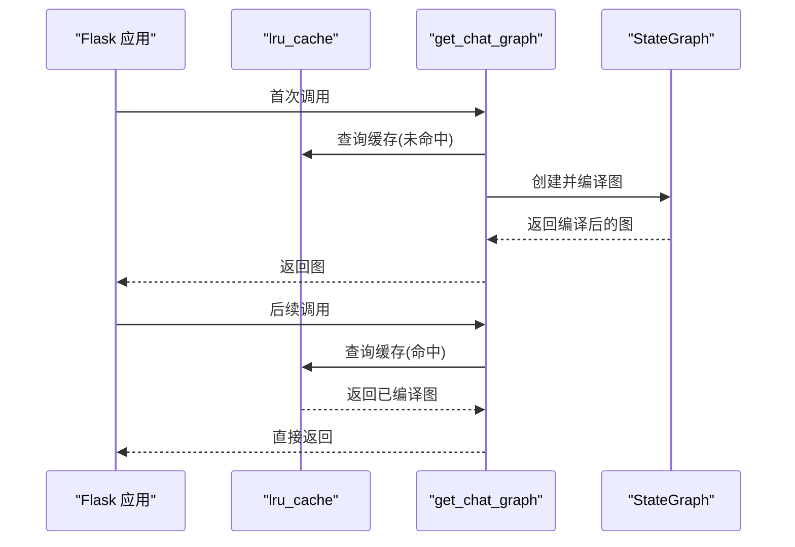
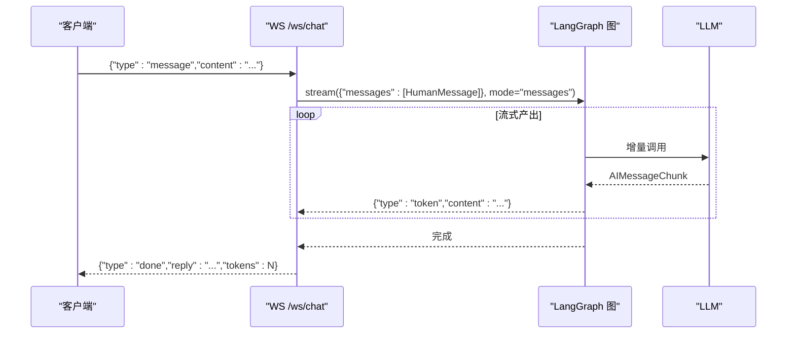
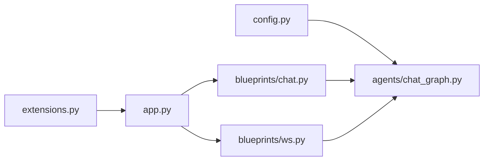

# LangGraph工作流设计

<cite>
**本文引用的文件**
- [chat_graph.py](file://py_server/agents/chat_graph.py)
- [chat.py](file://py_server/blueprints/chat.py)
- [ws.py](file://py_server/blueprints/ws.py)
- [app.py](file://py_server/app.py)
- [config.py](file://py_server/config.py)
- [extensions.py](file://py_server/extensions.py)
- [README.md](file://py_server/README.md)
- [ws_client_demo.py](file://py_server/scripts/ws_client_demo.py)
</cite>

## 目录
1. [简介](#简介)
2. [项目结构](#项目结构)
3. [核心组件](#核心组件)
4. [架构总览](#架构总览)
5. [详细组件分析](#详细组件分析)
6. [依赖关系分析](#依赖关系分析)
7. [性能与缓存](#性能与缓存)
8. [故障排查指南](#故障排查指南)
9. [结论](#结论)
10. [附录：执行示例与调试](#附录执行示例与调试)

## 简介
本技术文档围绕基于 LangGraph 的对话工作流，系统性阐述 ReAct 循环架构的实现原理、状态管理与条件边逻辑、图编译与缓存机制，以及 REST 与 WebSocket 两种调用方式。目标是帮助开发者快速理解并调试复杂的状态转换过程，掌握从用户输入到模型响应、工具调用的完整链路。

## 项目结构
Python 后端服务采用 Flask + LangChain/LangGraph 的组合，提供 REST 一次性回复与 WebSocket 流式回复两种接口；LangGraph 负责编排 agent 与 tools 的 ReAct 循环，并通过 TypedDict 管理会话消息状态。

图表来源
- [app.py:24-44](file://py_server/app.py#L24-L44)
- [chat.py:10-23](file://py_server/blueprints/chat.py#L10-L23)
- [ws.py:30-89](file://py_server/blueprints/ws.py#L30-L89)
- [chat_graph.py:46-86](file://py_server/agents/chat_graph.py#L46-L86)
- [config.py:10-25](file://py_server/config.py#L10-L25)
- [extensions.py:1-7](file://py_server/extensions.py#L1-L7)

章节来源
- [app.py:1-51](file://py_server/app.py#L1-L51)
- [README.md:34-51](file://py_server/README.md#L34-L51)

## 核心组件
- 对话图与节点
  - agent 节点：调用 LLM，将响应追加到消息列表。
  - tools 节点：使用 ToolNode 执行工具调用结果。
  - START/END：图的入口与出口。
- 状态管理
  - ChatState：TypedDict，包含 messages 字段，通过 add_messages 实现自动累加。
- 条件边
  - _should_continue：根据最后一条消息是否包含 tool_calls 决定进入 tools 还是 END。
- 图编译与缓存
  - get_chat_graph：使用 lru_cache 单例缓存编译后的图，避免重复构建。
- 接入层
  - REST：POST /api/chat，一次性返回最终回复。
  - WebSocket：WS /ws/chat，按 token 流式推送。

章节来源
- [chat_graph.py:40-86](file://py_server/agents/chat_graph.py#L40-L86)
- [chat.py:10-23](file://py_server/blueprints/chat.py#L10-L23)
- [ws.py:30-89](file://py_server/blueprints/ws.py#L30-L89)

## 架构总览
下图展示了 ReAct 循环在 LangGraph 中的节点连接与状态流转：START → agent → 条件判断 → tools → agent … → END。

图表来源
- [chat_graph.py:75-86](file://py_server/agents/chat_graph.py#L75-L86)

章节来源
- [chat_graph.py:1-92](file://py_server/agents/chat_graph.py#L1-L92)

## 详细组件分析

### ReAct 循环与节点连接
- 节点定义
  - agent：封装 LLM 调用，将响应作为新消息追加到状态中。
  - tools：使用 ToolNode 统一处理工具调用，将工具输出追加到状态。
- 边连接
  - START → agent：流程起点。
  - agent → tools/END：由条件边决定。
  - tools → agent：工具执行后回到 agent，继续推理。
- 状态更新
  - 所有节点通过返回 {"messages": [...]} 的方式更新状态，add_messages 确保消息列表自动累加而非覆盖。

图表来源
- [chat_graph.py:59-86](file://py_server/agents/chat_graph.py#L59-L86)
- [chat.py:10-23](file://py_server/blueprints/chat.py#L10-L23)

章节来源
- [chat_graph.py:59-86](file://py_server/agents/chat_graph.py#L59-L86)
- [chat.py:10-23](file://py_server/blueprints/chat.py#L10-L23)

### ChatState 状态管理与消息累加
- 类型定义
  - ChatState 为 TypedDict，包含 messages 字段，类型为 BaseMessage 列表。
- 自动累加机制
  - 通过 Annotated[list[BaseMessage], add_messages] 指定消息字段的合并策略为“追加”，每次节点返回的新消息会追加到历史消息末尾，保证上下文累积。
- 影响范围
  - agent 节点每次返回 {"messages": [response]}，会被 add_messages 合并到历史。
  - tools 节点执行工具后同样以消息形式追加结果，供后续 agent 推理使用。

图表来源
- [chat_graph.py:40-44](file://py_server/agents/chat_graph.py#L40-L44)

章节来源
- [chat_graph.py:40-44](file://py_server/agents/chat_graph.py#L40-L44)

### 条件边与_should_continue逻辑
- 决策依据
  - 读取状态中最后一条消息，检查是否存在 tool_calls 属性。
  - 若存在，则返回 "tools"，进入工具执行阶段；否则返回 END，结束本轮对话。
- 作用
  - 实现 ReAct 的核心：让模型自主决定是否调用工具，并在工具完成后继续推理。

图表来源
- [chat_graph.py:67-72](file://py_server/agents/chat_graph.py#L67-L72)

章节来源
- [chat_graph.py:67-72](file://py_server/agents/chat_graph.py#L67-L72)

### 图编译与缓存机制（单例模式）
- 编译过程
  - StateGraph(ChatState) 创建图，添加节点与边，最终 compile() 生成可执行图。
- 缓存策略
  - get_chat_graph 使用 @lru_cache(maxsize=1) 装饰器，确保进程内只编译一次图，提升性能并减少资源消耗。
- 预热
  - 应用启动时调用 get_chat_graph() 进行预热，尽早暴露配置问题。

图表来源
- [chat_graph.py:75-86](file://py_server/agents/chat_graph.py#L75-L86)
- [app.py:41-43](file://py_server/app.py#L41-L43)

章节来源
- [chat_graph.py:75-86](file://py_server/agents/chat_graph.py#L75-L86)
- [app.py:41-43](file://py_server/app.py#L41-L43)

### REST 与 WebSocket 接入
- REST
  - POST /api/chat：接收 message，构造 HumanMessage 并调用 graph.invoke，返回最终回复。
- WebSocket
  - WS /ws/chat：接收消息帧，使用 graph.stream(stream_mode="messages") 逐 token 推送，结束时发送 done。

图表来源
- [ws.py:30-89](file://py_server/blueprints/ws.py#L30-L89)
- [chat_graph.py:59-64](file://py_server/agents/chat_graph.py#L59-L64)

章节来源
- [chat.py:10-23](file://py_server/blueprints/chat.py#L10-L23)
- [ws.py:30-89](file://py_server/blueprints/ws.py#L30-L89)

## 依赖关系分析
- 模块耦合
  - app.py 注册蓝图并初始化扩展，同时预热图。
  - blueprints/chat.py 与 blueprints/ws.py 均依赖 agents/chat_graph.py 获取图实例。
  - agents/chat_graph.py 依赖 config.py 获取模型配置，并使用 langchain/langgraph 库。
- 外部依赖
  - OpenAI 兼容 LLM：当配置 OPENAI_API_KEY 时使用 ChatOpenAI，否则降级为 FakeListChatModel。
  - CORS 与 WebSocket：flask-cors 与 flask-sock 提供跨域与原生 WebSocket 支持。

图表来源
- [config.py:10-25](file://py_server/config.py#L10-L25)
- [extensions.py:1-7](file://py_server/extensions.py#L1-L7)
- [app.py:24-44](file://py_server/app.py#L24-L44)
- [chat_graph.py:46-86](file://py_server/agents/chat_graph.py#L46-L86)

章节来源
- [config.py:10-25](file://py_server/config.py#L10-L25)
- [extensions.py:1-7](file://py_server/extensions.py#L1-L7)
- [app.py:24-44](file://py_server/app.py#L24-L44)

## 性能与缓存
- 图编译缓存
  - 使用 lru_cache 对 get_chat_graph 进行单例缓存，避免重复编译带来的开销。
- 流式输出
  - WebSocket 使用 stream_mode="messages" 逐 token 推送，降低首字节延迟，提升交互体验。
- 降级策略
  - 未配置 OPENAI_API_KEY 时自动切换至离线假模型，便于联调与测试，不影响整体链路性能。

章节来源
- [chat_graph.py:75-86](file://py_server/agents/chat_graph.py#L75-L86)
- [ws.py:67-82](file://py_server/blueprints/ws.py#L67-L82)
- [config.py:20-25](file://py_server/config.py#L20-L25)

## 故障排查指南
- 常见问题定位
  - 模型未配置：服务将运行在离线演示模式，可通过 is_llm_configured 或健康检查确认。
  - 无效 JSON 帧：WebSocket 收到非 JSON 或未知 type 时会返回 error 帧。
  - 空消息：REST 与 WebSocket 均校验 message/content 是否为空。
- 日志与错误
  - REST：捕获异常并记录日志，返回 500。
  - WebSocket：捕获异常并发送 error 帧，记录日志。
- 调试建议
  - 使用 ws_client_demo.py 验证 WebSocket 链路。
  - 通过 curl 调用 REST 接口验证基础功能。
  - 检查 .env 配置是否正确加载。

章节来源
- [chat.py:17-23](file://py_server/blueprints/chat.py#L17-L23)
- [ws.py:43-65](file://py_server/blueprints/ws.py#L43-L65)
- [ws.py:83-85](file://py_server/blueprints/ws.py#L83-L85)
- [README.md:102-113](file://py_server/README.md#L102-L113)

## 结论
该工作流以 LangGraph 为核心，实现了经典的 ReAct 循环：agent 推理、工具调用、再推理直至结束。通过 TypedDict 与 add_messages 实现消息状态的自动累加，_should_continue 条件边驱动工具调用分支，lru_cache 保证图编译的单例与高性能。REST 与 WebSocket 双通道满足不同场景需求，配合降级策略与完善的错误处理，具备良好的可维护性与可扩展性。

## 附录：执行示例与调试
- REST 调用示例
  - 使用 curl 发送 POST /api/chat，传入 message 字段，获得最终回复。
- WebSocket 联调
  - 使用 scripts/ws_client_demo.py 发送消息，观察 token 流式输出与 done 完成帧。
- 前端示例
  - 浏览器 WebSocket 连接 /ws/chat，监听 token 与 done 事件，渲染实时回复。

章节来源
- [README.md:53-100](file://py_server/README.md#L53-L100)
- [ws_client_demo.py:19-48](file://py_server/scripts/ws_client_demo.py#L19-L48)