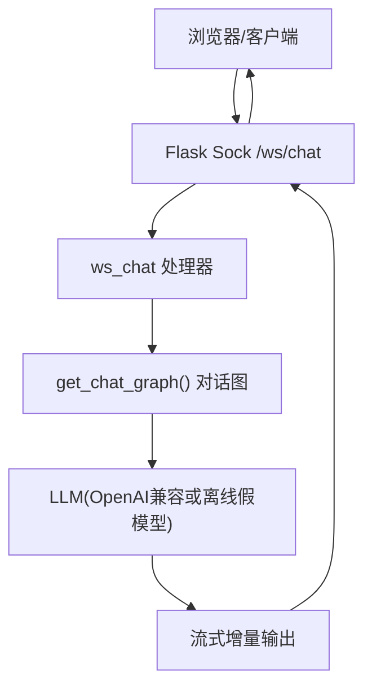
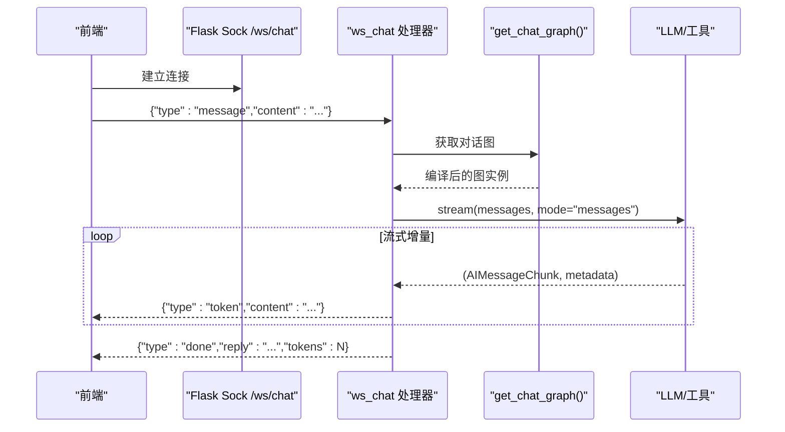
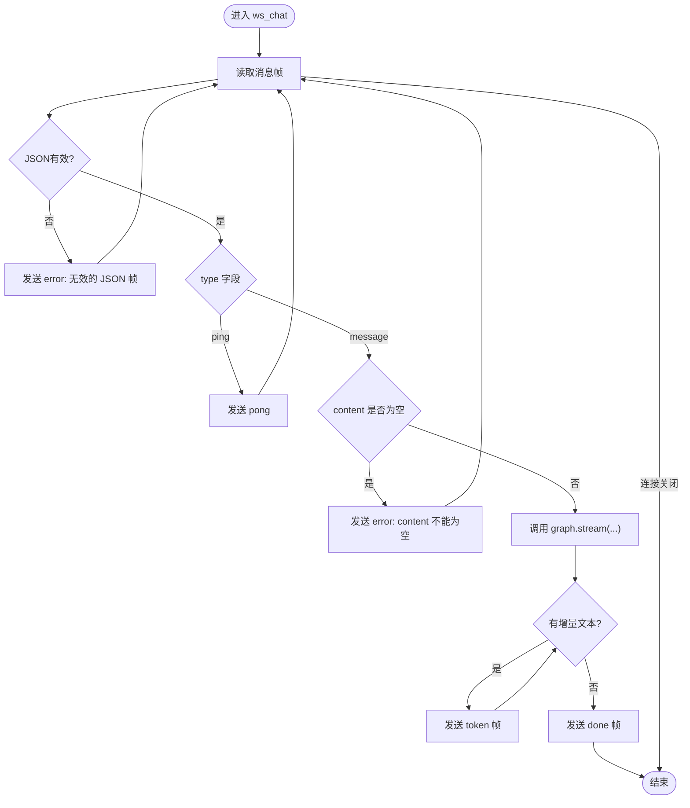
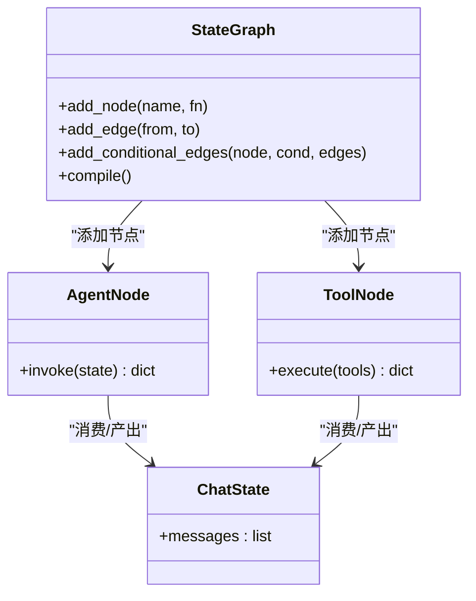
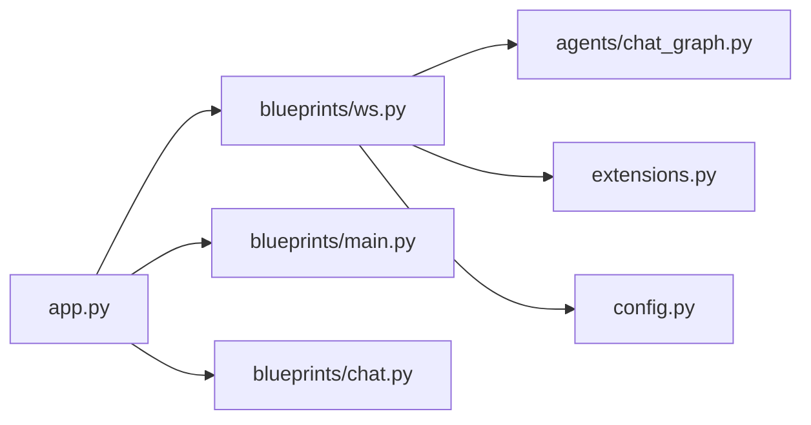

# WebSocket实时通信

<cite>
**本文引用的文件**
- [py_server/blueprints/ws.py](file://py_server/blueprints/ws.py)
- [py_server/app.py](file://py_server/app.py)
- [py_server/agents/chat_graph.py](file://py_server/agents/chat_graph.py)
- [py_server/config.py](file://py_server/config.py)
- [py_server/extensions.py](file://py_server/extensions.py)
- [py_server/scripts/ws_client_demo.py](file://py_server/scripts/ws_client_demo.py)
- [web_client/po-admin/src/pages/chatbot/index.tsx](file://web_client/po-admin/src/pages/chatbot/index.tsx)
- [web_client/po-admin/src/pages/chatbot/service.ts](file://web_client/po-admin/src/pages/chatbot/service.ts)
</cite>

## 目录
1. [简介](#简介)
2. [项目结构](#项目结构)
3. [核心组件](#核心组件)
4. [架构总览](#架构总览)
5. [详细组件分析](#详细组件分析)
6. [依赖关系分析](#依赖关系分析)
7. [性能与并发优化](#性能与并发优化)
8. [故障排查指南](#故障排查指南)
9. [结论](#结论)
10. [附录：协议与接口规范](#附录协议与接口规范)

## 简介
本文件为WebSocket实时通信系统的实现文档，覆盖连接建立与管理、心跳检测与断线重连策略、消息格式定义、流式响应原理、客户端集成方案、并发连接管理与资源优化等。系统后端基于Flask + flask-sock提供WebSocket路由，结合LangGraph构建对话智能体，以逐token流式推送方式向前端返回结果；前端通过Ant Design X的聊天SDK进行SSE/流式交互（同时提供Python联调客户端）。

## 项目结构
- 后端服务
  - Flask应用入口与蓝图注册：[app.py](file://py_server/app.py)
  - WebSocket路由与处理逻辑：[ws.py](file://py_server/blueprints/ws.py)
  - 对话智能体（LangGraph图）：[chat_graph.py](file://py_server/agents/chat_graph.py)
  - 配置与环境变量：[config.py](file://py_server/config.py)
  - 扩展初始化（CORS、Sock）：[extensions.py](file://py_server/extensions.py)
  - 联调客户端脚本：[ws_client_demo.py](file://py_server/scripts/ws_client_demo.py)
- 前端页面
  - 聊天页UI与状态管理：[index.tsx](file://web_client/po-admin/src/pages/chatbot/index.tsx)
  - 聊天提供者与请求封装：[service.ts](file://web_client/po-admin/src/pages/chatbot/service.ts)

**图表来源**
- [py_server/app.py:24-43](file://py_server/app.py#L24-L43)
- [py_server/blueprints/ws.py:30-89](file://py_server/blueprints/ws.py#L30-L89)
- [py_server/agents/chat_graph.py:75-86](file://py_server/agents/chat_graph.py#L75-L86)

**章节来源**
- [py_server/app.py:1-51](file://py_server/app.py#L1-L51)
- [py_server/blueprints/ws.py:1-90](file://py_server/blueprints/ws.py#L1-L90)
- [py_server/agents/chat_graph.py:1-92](file://py_server/agents/chat_graph.py#L1-L92)

## 核心组件
- WebSocket路由与消息处理：负责接收JSON帧、校验类型、执行对话流程并流式推送token，发送完成帧与错误帧。
- 对话智能体：基于LangGraph的状态图，支持工具调用与条件边，按配置选择真实LLM或离线假模型。
- 应用工厂与扩展：统一初始化CORS与Sock，注册蓝图，预热对话图。
- 配置中心：集中管理端口、调试开关与LLM相关环境变量。
- 联调客户端：用于快速验证WebSocket链路和流式输出。

**章节来源**
- [py_server/blueprints/ws.py:26-89](file://py_server/blueprints/ws.py#L26-L89)
- [py_server/agents/chat_graph.py:46-86](file://py_server/agents/chat_graph.py#L46-L86)
- [py_server/app.py:24-43](file://py_server/app.py#L24-L43)
- [py_server/config.py:10-25](file://py_server/config.py#L10-L25)
- [py_server/scripts/ws_client_demo.py:19-52](file://py_server/scripts/ws_client_demo.py#L19-L52)

## 架构总览
后端采用Flask + flask-sock暴露WebSocket端点，前端通过HTTP SSE或WebSocket与后端交互。对话由LangGraph驱动，支持工具调用与流式输出。CORS允许跨域访问，便于本地开发联调。

**图表来源**
- [py_server/blueprints/ws.py:30-89](file://py_server/blueprints/ws.py#L30-L89)
- [py_server/agents/chat_graph.py:75-86](file://py_server/agents/chat_graph.py#L75-L86)

## 详细组件分析

### WebSocket路由与消息处理（/ws/chat）
- 连接生命周期
  - 连接建立时记录日志，进入消息循环。
  - 读取消息帧，捕获连接关闭异常并安全退出。
  - finally块中记录断开日志，确保资源释放。
- 消息解析与路由
  - 解析JSON帧，非法JSON返回错误帧。
  - 支持“ping”心跳，回发“pong”。
  - 仅接受“message”类型，其他类型返回错误。
  - content为空时返回错误。
- 流式响应
  - 调用对话图的stream模式，逐块产出增量文本。
  - 对每个非空增量文本发送“token”帧。
  - 所有增量结束后发送“done”帧，包含完整回复与分片数量。
- 错误处理
  - 对话处理异常捕获并返回错误帧，记录堆栈日志。

**图表来源**
- [py_server/blueprints/ws.py:30-89](file://py_server/blueprints/ws.py#L30-L89)

**章节来源**
- [py_server/blueprints/ws.py:26-89](file://py_server/blueprints/ws.py#L26-L89)

### 对话智能体（LangGraph）
- 图结构
  - START -> agent -> 条件边 -> tools -> agent ... -> END。
  - 若最后一条消息包含tool_calls则进入工具节点，否则结束。
- LLM构建
  - 已配置OPENAI_API_KEY时使用ChatOpenAI并绑定工具，启用流式。
  - 未配置时降级为FakeListChatModel，保证链路可联调。
- 缓存
  - get_chat_graph使用lru_cache单例，避免重复编译。

**图表来源**
- [py_server/agents/chat_graph.py:40-86](file://py_server/agents/chat_graph.py#L40-L86)

**章节来源**
- [py_server/agents/chat_graph.py:1-92](file://py_server/agents/chat_graph.py#L1-L92)

### 应用工厂与扩展
- 初始化CORS，允许/api/*与/ws/*跨域。
- 注册main、chat、ws三个蓝图。
- 启动时预热对话图，提前暴露配置问题。

**章节来源**
- [py_server/app.py:24-43](file://py_server/app.py#L24-L43)
- [py_server/extensions.py:1-7](file://py_server/extensions.py#L1-L7)

### 配置与环境变量
- HOST、PORT、DEBUG控制服务监听与调试模式。
- OPENAI_API_KEY、OPENAI_BASE_URL、OPENAI_MODEL控制LLM接入。
- 未配置Key时自动降级到离线演示模式。

**章节来源**
- [py_server/config.py:10-25](file://py_server/config.py#L10-L25)

### 联调客户端（Python）
- 连接ws://127.0.0.1:5090/ws/chat。
- 发送{"type":"message","content":"..."}。
- 循环接收并打印token、done、error。
- 显式关闭连接，避免进程挂起。

**章节来源**
- [py_server/scripts/ws_client_demo.py:19-52](file://py_server/scripts/ws_client_demo.py#L19-L52)

### 前端集成（Ant Design X）
- 聊天页使用XProvider与useXChat管理会话与消息。
- 通过createChatProvider创建OpenAIChatProvider，使用XRequest发起带stream参数的请求。
- 渲染层根据loading与status控制流式更新与Markdown渲染。

**章节来源**
- [web_client/po-admin/src/pages/chatbot/index.tsx:116-176](file://web_client/po-admin/src/pages/chatbot/index.tsx#L116-L176)
- [web_client/po-admin/src/pages/chatbot/service.ts:1-19](file://web_client/po-admin/src/pages/chatbot/service.ts#L1-L19)

## 依赖关系分析
- 模块耦合
  - ws.py依赖flask-sock、langchain_core.messages、simple_websocket以及agents.chat_graph。
  - app.py聚合蓝图与扩展，统一入口。
  - chat_graph.py依赖langgraph与可选的OpenAI兼容LLM。
- 外部依赖
  - CORS用于跨域，Sock用于WebSocket。
  - 前端依赖Ant Design X SDK进行流式聊天。

**图表来源**
- [py_server/app.py:24-43](file://py_server/app.py#L24-L43)
- [py_server/blueprints/ws.py:16-23](file://py_server/blueprints/ws.py#L16-L23)
- [py_server/agents/chat_graph.py:11-23](file://py_server/agents/chat_graph.py#L11-L23)

**章节来源**
- [py_server/app.py:24-43](file://py_server/app.py#L24-L43)
- [py_server/blueprints/ws.py:16-23](file://py_server/blueprints/ws.py#L16-L23)
- [py_server/agents/chat_graph.py:11-23](file://py_server/agents/chat_graph.py#L11-L23)

## 性能与并发优化
- 连接模型
  - flask-sock在多worker或多线程模型下，每个WebSocket连接占用一个工作单元；建议使用gevent worker支撑大量长连接。
- 流式传输
  - 服务端逐token推送，减少首字节延迟，提升用户体验。
  - 前端按需渲染增量内容，避免阻塞。
- 资源优化
  - 对话图编译缓存（lru_cache），避免重复构建。
  - 合理设置CORS与跨域策略，减少预检开销。
- 监控与日志
  - 连接建立/断开日志、异常堆栈记录，便于定位问题。

**章节来源**
- [py_server/README.md:123-125](file://py_server/README.md#L123-L125)
- [py_server/agents/chat_graph.py:75-86](file://py_server/agents/chat_graph.py#L75-L86)
- [py_server/blueprints/ws.py:30-89](file://py_server/blueprints/ws.py#L30-L89)

## 故障排查指南
- 常见错误
  - 无效JSON帧：检查客户端发送的消息格式。
  - 未知消息类型：确认type字段为message或ping。
  - content为空：确保content字段存在且非空白。
  - 对话处理失败：查看服务端日志中的异常堆栈。
- 连接问题
  - 连接关闭：检查网络与代理设置，确认服务端地址与端口。
  - 跨域限制：确认CORS配置允许/ws/*。
- 前端问题
  - 流式不更新：检查provider与request配置是否正确开启stream。
  - 渲染卡顿：减少每次增量渲染的DOM操作，必要时合并片段。

**章节来源**
- [py_server/blueprints/ws.py:43-85](file://py_server/blueprints/ws.py#L43-L85)
- [py_server/app.py:31-34](file://py_server/app.py#L31-L34)
- [web_client/po-admin/src/pages/chatbot/service.ts:12-18](file://web_client/po-admin/src/pages/chatbot/service.ts#L12-L18)

## 结论
该WebSocket实时通信系统通过简洁的JSON帧协议与流式推送机制，实现了低延迟的对话体验。后端基于LangGraph的对话图提供了可扩展的智能体能力，前端借助Ant Design X的流式聊天能力实现即时渲染。通过合理的并发模型与资源优化策略，系统具备良好的高可用性与性能表现。

## 附录：协议与接口规范

### WebSocket端点
- 路径：/ws/chat
- 协议：JSON文本帧
- 跨域：CORS允许/ws/*

**章节来源**
- [py_server/blueprints/ws.py:1-13](file://py_server/blueprints/ws.py#L1-L13)
- [py_server/app.py:31-34](file://py_server/app.py#L31-L34)

### 消息格式定义
- 客户端 -> 服务端
  - 请求消息：{"type": "message", "content": "用户输入"}
  - 心跳：{"type": "ping"}
- 服务端 -> 客户端
  - 增量token：{"type": "token", "content": "增量文本"}
  - 完成：{"type": "done", "reply": "完整回复", "tokens": N}
  - 心跳应答：{"type": "pong"}
  - 错误：{"type": "error", "message": "错误信息"}

**章节来源**
- [py_server/blueprints/ws.py:1-13](file://py_server/blueprints/ws.py#L1-L13)
- [py_server/blueprints/ws.py:49-85](file://py_server/blueprints/ws.py#L49-L85)

### 事件类型与序列
- 事件类型：message、token、done、ping、pong、error
- 典型序列
  - 客户端发送message，服务端多次推送token，最后推送done。
  - 客户端发送ping，服务端回pong。
  - 任何阶段出现错误，服务端推送error并可能关闭连接。

**章节来源**
- [py_server/blueprints/ws.py:49-85](file://py_server/blueprints/ws.py#L49-L85)

### 状态同步机制
- 通过token增量推进显示状态，done标记一轮完成。
- 前端根据loading与status控制渲染与动画。
- 错误帧用于中断当前请求并提示用户。

**章节来源**
- [web_client/po-admin/src/pages/chatbot/index.tsx:178-222](file://web_client/po-admin/src/pages/chatbot/index.tsx#L178-L222)
- [web_client/po-admin/src/pages/chatbot/service.ts:12-18](file://web_client/po-admin/src/pages/chatbot/service.ts#L12-L18)

### 心跳检测与断线重连策略
- 心跳检测
  - 客户端定时发送{"type":"ping"}，服务端回{"type":"pong"}。
  - 若长时间无心跳，可判定连接失效。
- 断线重连
  - 捕获连接关闭异常后，等待指数退避时间并重试。
  - 重连前清理状态，重新建立会话上下文（如需要）。
- 最佳实践
  - 在onclose/onerror中触发重连逻辑。
  - 限制最大重试次数，避免雪崩。
  - 在网络恢复后，优先发送ping确认连通性。

**章节来源**
- [py_server/blueprints/ws.py:51-53](file://py_server/blueprints/ws.py#L51-L53)
- [py_server/scripts/ws_client_demo.py:27-48](file://py_server/scripts/ws_client_demo.py#L27-L48)

### 客户端集成方案（JavaScript）
- 使用原生WebSocket或框架提供的SSE/WS能力。
- 连接建立后发送message帧，订阅token与done事件。
- 错误处理：捕获网络异常与协议错误，提示用户并重试。
- 进度更新：根据token数量或done的tokens字段展示进度。
- 实时渲染：增量拼接内容，避免整段替换导致的闪烁。

**章节来源**
- [web_client/po-admin/src/pages/chatbot/index.tsx:178-222](file://web_client/po-admin/src/pages/chatbot/index.tsx#L178-L222)
- [web_client/po-admin/src/pages/chatbot/service.ts:12-18](file://web_client/po-admin/src/pages/chatbot/service.ts#L12-L18)