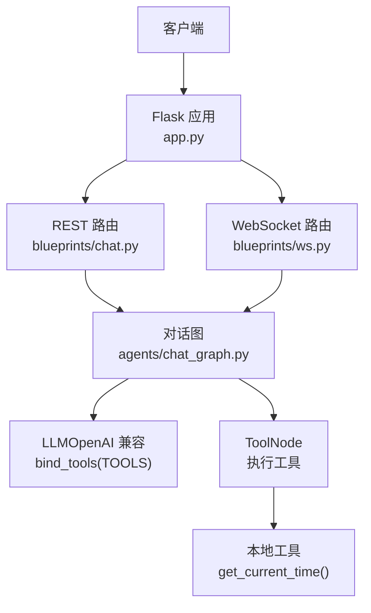
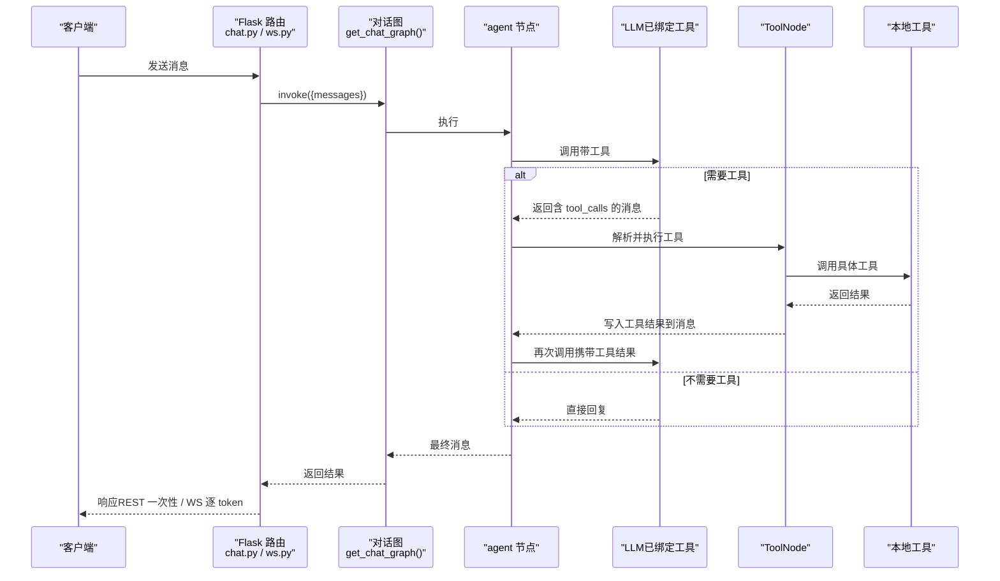
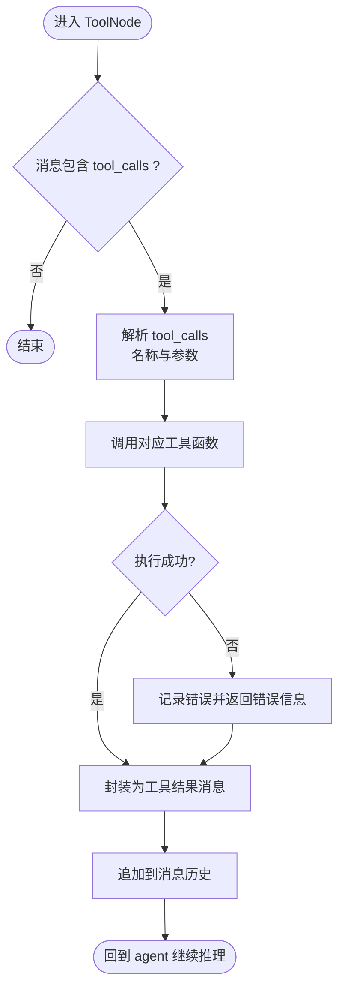
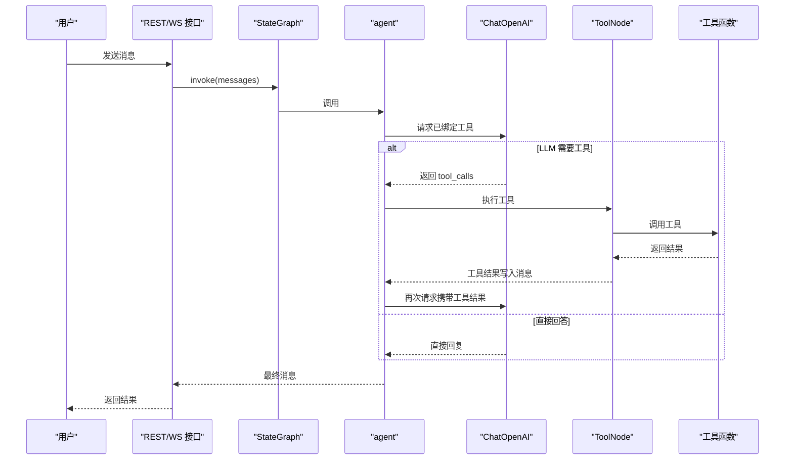
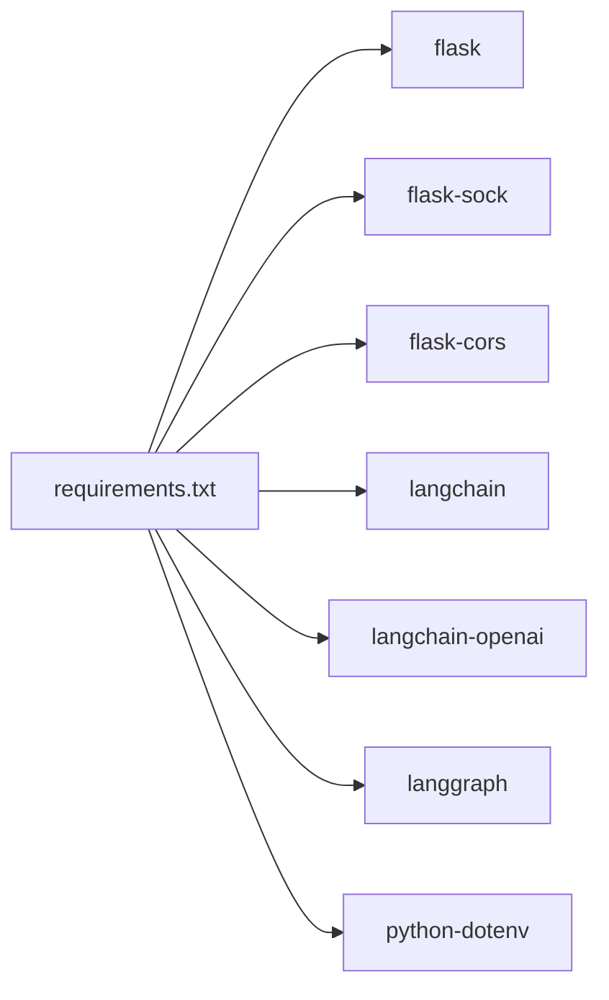

# 工具调用系统

<cite>
**本文引用的文件**
- [chat_graph.py](file://py_server/agents/chat_graph.py)
- [config.py](file://py_server/config.py)
- [app.py](file://py_server/app.py)
- [chat.py](file://py_server/blueprints/chat.py)
- [ws.py](file://py_server/blueprints/ws.py)
- [main.py](file://py_server/blueprints/main.py)
- [requirements.txt](file://py_server/requirements.txt)
</cite>

## 目录
1. [简介](#简介)
2. [项目结构](#项目结构)
3. [核心组件](#核心组件)
4. [架构总览](#架构总览)
5. [详细组件分析](#详细组件分析)
6. [依赖关系分析](#依赖关系分析)
7. [性能考虑](#性能考虑)
8. [故障排查指南](#故障排查指南)
9. [结论](#结论)
10. [附录](#附录)

## 简介
本技术文档围绕“工具调用系统”展开，聚焦于基于 LangChain/LangGraph 的 Agent 工作流。重点说明：
- @tool 装饰器的使用与工具函数定义规范（参数、返回值、错误处理）
- ToolNode 的工作原理（解析、执行、结果返回）
- 工具与 LLM 的交互流程（请求生成、调度执行、本地工具集成）
- 工具注册与管理机制（动态加载与发现）
- 自定义工具开发指南（设计原则、测试方法、部署策略）
- 安全与权限控制建议

## 项目结构
后端服务位于 py_server，采用 Flask + LangChain + LangGraph 的组合：
- agents/chat_graph.py：定义对话图、工具、LLM 绑定与执行流程
- blueprints/*：REST 与 WebSocket 路由入口
- config.py：配置管理（含 LLM 凭据与环境变量）
- app.py：应用工厂与启动入口
- requirements.txt：关键依赖声明

图表来源
- [app.py:24-44](file://py_server/app.py#L24-L44)
- [chat.py:10-23](file://py_server/blueprints/chat.py#L10-L23)
- [ws.py:30-89](file://py_server/blueprints/ws.py#L30-L89)
- [chat_graph.py:46-86](file://py_server/agents/chat_graph.py#L46-L86)

章节来源
- [app.py:1-51](file://py_server/app.py#L1-L51)
- [requirements.txt:1-12](file://py_server/requirements.txt#L1-L12)

## 核心组件
- 工具定义与注册
  - 通过 @tool 装饰器将普通函数声明为工具，并加入 TOOLS 列表供 LLM 绑定与 ToolNode 执行。
  - 示例工具：获取服务器当前时间。
- 对话图（Agent 编排）
  - StateGraph 定义 agent 节点与 tools 节点，并通过条件边实现 ReAct 循环。
  - _should_continue 根据最后一条消息是否包含 tool_calls 决定进入 tools 或结束。
- LLM 绑定
  - 当配置了 OPENAI_API_KEY 时，使用 ChatOpenAI 并 .bind_tools(TOOLS)；否则降级为离线假模型。
- 工具执行
  - ToolNode(TOOLS) 负责解析 tool_calls 并调用对应工具，将结果写回消息上下文，再回到 agent 继续推理。

章节来源
- [chat_graph.py:26-32](file://py_server/agents/chat_graph.py#L26-L32)
- [chat_graph.py:46-86](file://py_server/agents/chat_graph.py#L46-L86)

## 架构总览
下图展示了从请求到工具执行的完整链路，包括 REST 与 WebSocket 两条路径。

图表来源
- [chat.py:10-23](file://py_server/blueprints/chat.py#L10-L23)
- [ws.py:30-89](file://py_server/blueprints/ws.py#L30-L89)
- [chat_graph.py:59-86](file://py_server/agents/chat_graph.py#L59-L86)

## 详细组件分析

### 工具定义与规范（@tool）
- 使用方式
  - 使用 @tool 装饰器标记函数为工具，便于 LLM 识别与调用。
  - 将工具函数加入 TOOLS 列表，以便在构建 LLM 时通过 bind_tools 绑定，并在 ToolNode 中执行。
- 参数验证
  - 当前工具 get_current_time 无输入参数，因此无需参数校验。
  - 扩展建议：对复杂工具使用类型注解与 docstring 描述参数语义，便于 LLM 正确传参。
- 返回值格式
  - 工具应返回字符串或可序列化为字符串的内容，LangChain/LangGraph 会将其包装为工具结果消息。
- 错误处理
  - 建议在工具内部捕获异常并返回明确的错误信息字符串，避免中断整个对话流程。
  - 对于外部依赖（如网络、IO），需设置超时与重试策略，保证稳定性。

章节来源
- [chat_graph.py:26-32](file://py_server/agents/chat_graph.py#L26-L32)

### ToolNode 工作原理
- 解析
  - ToolNode 接收来自 agent 的消息，检查是否存在 tool_calls。
- 执行
  - 根据 tool_calls 中的名称与参数，定位并调用 TOOLS 列表中对应的工具函数。
- 结果返回
  - 工具执行结果被封装为工具结果消息，追加到消息历史，随后回到 agent 进行下一轮推理。

图表来源
- [chat_graph.py:67-86](file://py_server/agents/chat_graph.py#L67-L86)

章节来源
- [chat_graph.py:67-86](file://py_server/agents/chat_graph.py#L67-L86)

### 工具与 LLM 的交互流程
- 请求生成
  - 当 LLM 认为需要外部能力时，会在回复中包含 tool_calls。
- 调度执行
  - 条件边判断 last_message 是否包含 tool_calls，若包含则进入 tools 节点执行。
- 本地工具集成
  - 所有本地工具统一通过 TOOLS 列表注册，LLM 通过 bind_tools 感知可用工具。

图表来源
- [chat_graph.py:46-86](file://py_server/agents/chat_graph.py#L46-L86)
- [chat.py:10-23](file://py_server/blueprints/chat.py#L10-L23)
- [ws.py:30-89](file://py_server/blueprints/ws.py#L30-L89)

章节来源
- [chat_graph.py:46-86](file://py_server/agents/chat_graph.py#L46-L86)
- [chat.py:10-23](file://py_server/blueprints/chat.py#L10-L23)
- [ws.py:30-89](file://py_server/blueprints/ws.py#L30-L89)

### 工具注册与管理机制
- 静态注册
  - 当前通过 TOOLS = [get_current_time] 集中声明可用工具。
- 动态加载与发现
  - 当前代码未实现自动扫描与动态加载。可在启动时按约定目录扫描模块，收集带有 @tool 装饰器的函数并加入 TOOLS。
  - 建议：提供统一的工具命名空间与版本标识，支持热更新与灰度发布。
- 生命周期
  - 工具函数应为幂等且无副作用（除必要的 IO），避免状态污染。
  - 对耗时操作建议使用异步与限流，防止阻塞主线程。

章节来源
- [chat_graph.py:26-32](file://py_server/agents/chat_graph.py#L26-L32)

### 自定义工具开发指南
- 设计原则
  - 单一职责：每个工具只做一件事，输入输出清晰。
  - 可观测性：记录关键日志与指标，便于排障。
  - 健壮性：处理异常与边界情况，返回友好错误信息。
- 测试方法
  - 单元测试：覆盖正常路径与异常路径，断言返回值格式。
  - 集成测试：通过 ToolNode 与 LLM 联调，验证 tool_calls 解析与结果回写。
- 部署策略
  - 将新工具纳入 TOOLS 列表，重启服务或实现热加载。
  - 配合健康检查接口暴露工具可用性状态。

[本节为通用指导，不直接分析具体文件]

### 安全与权限控制
- 输入校验
  - 对工具输入进行严格校验，拒绝非法参数与注入攻击。
- 最小权限
  - 工具仅访问必要资源，遵循最小权限原则。
- 审计与限流
  - 记录工具调用审计日志，实施速率限制与熔断保护。
- 敏感信息
  - 避免在工具输出中泄露敏感数据，必要时脱敏。

[本节为通用指导，不直接分析具体文件]

## 依赖关系分析
- 关键依赖
  - Flask：Web 框架
  - flask-sock：原生 WebSocket 支持
  - flask-cors：跨域支持
  - langchain/langchain-openai：LLM 与工具绑定
  - langgraph：智能体编排（StateGraph、ToolNode）
  - python-dotenv：环境变量加载

图表来源
- [requirements.txt:1-12](file://py_server/requirements.txt#L1-L12)

章节来源
- [requirements.txt:1-12](file://py_server/requirements.txt#L1-L12)

## 性能考虑
- 图编译缓存
  - get_chat_graph 使用 lru_cache 缓存编译后的图，避免重复构建开销。
- 流式输出
  - WebSocket 端逐 token 推送，降低首包延迟，提升用户体验。
- 工具执行优化
  - 对耗时工具引入异步与并发控制，避免阻塞。
  - 对 I/O 密集的工具设置超时与重试，提高鲁棒性。
- 降级模式
  - 未配置 LLM 时降级为离线假模型，便于开发与联调。

章节来源
- [chat_graph.py:75-86](file://py_server/agents/chat_graph.py#L75-L86)
- [ws.py:30-89](file://py_server/blueprints/ws.py#L30-L89)

## 故障排查指南
- 常见问题
  - 未配置 OPENAI_API_KEY：服务以离线模式运行，不会触发工具调用。
  - 工具执行失败：检查工具内部异常与日志，确保返回字符串结果。
  - WebSocket 断开：关注 ConnectionClosed 异常与连接生命周期。
- 诊断步骤
  - 查看健康检查接口确认 LLM 配置状态。
  - 检查日志输出，定位异常堆栈。
  - 逐步缩小范围：先验证工具单独调用，再验证 ToolNode 执行，最后验证 LLM 绑定。

章节来源
- [main.py:22-29](file://py_server/blueprints/main.py#L22-L29)
- [ws.py:30-89](file://py_server/blueprints/ws.py#L30-L89)
- [chat_graph.py:46-56](file://py_server/agents/chat_graph.py#L46-L56)

## 结论
本系统基于 LangChain/LangGraph 实现了可扩展的工具调用能力。通过 @tool 与 ToolNode，开发者可以便捷地定义与集成本地工具；通过 StateGraph 的条件边，实现了 ReAct 循环的智能体编排。结合 Flask 的 REST 与 WebSocket 接口，提供了灵活的前端接入方式。后续可进一步增强动态工具加载、权限控制与监控告警，以提升系统的可维护性与安全性。

## 附录
- 快速开始
  - 安装依赖：pip install -r requirements.txt
  - 配置环境变量：在 py_server/.env 中设置 OPENAI_API_KEY 等
  - 启动服务：python app.py
- 接口说明
  - GET /：服务信息
  - GET /api/health：健康检查（含 LLM 配置状态）
  - POST /api/chat：对话（一次性返回完整回复）
  - WS /ws/chat：流式对话（逐 token 推送）

章节来源
- [README.md:1-61](file://py_server/README.md#L1-L61)
- [app.py:1-51](file://py_server/app.py#L1-L51)
- [main.py:9-29](file://py_server/blueprints/main.py#L9-L29)
- [chat.py:10-23](file://py_server/blueprints/chat.py#L10-L23)
- [ws.py:1-89](file://py_server/blueprints/ws.py#L1-L89)