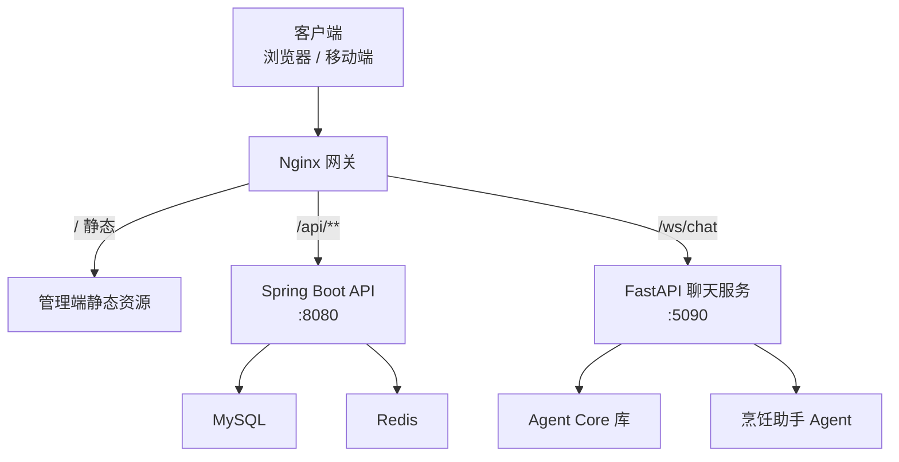
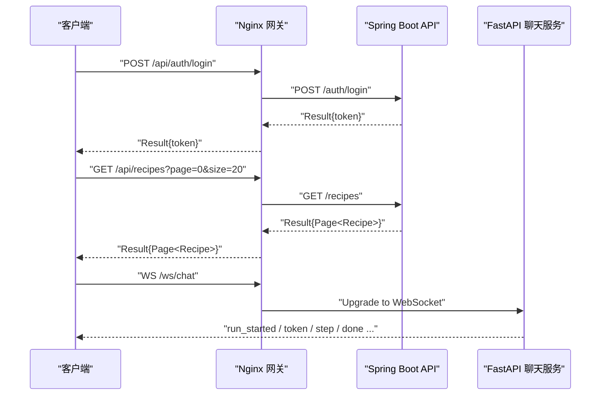
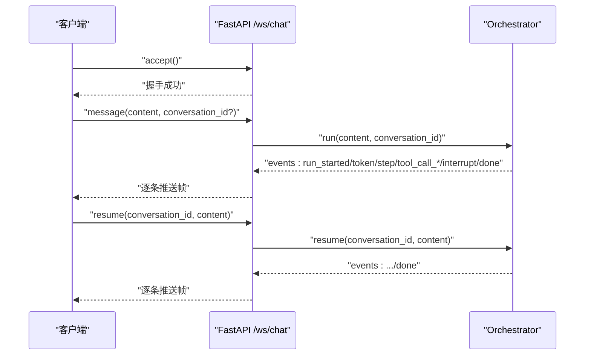
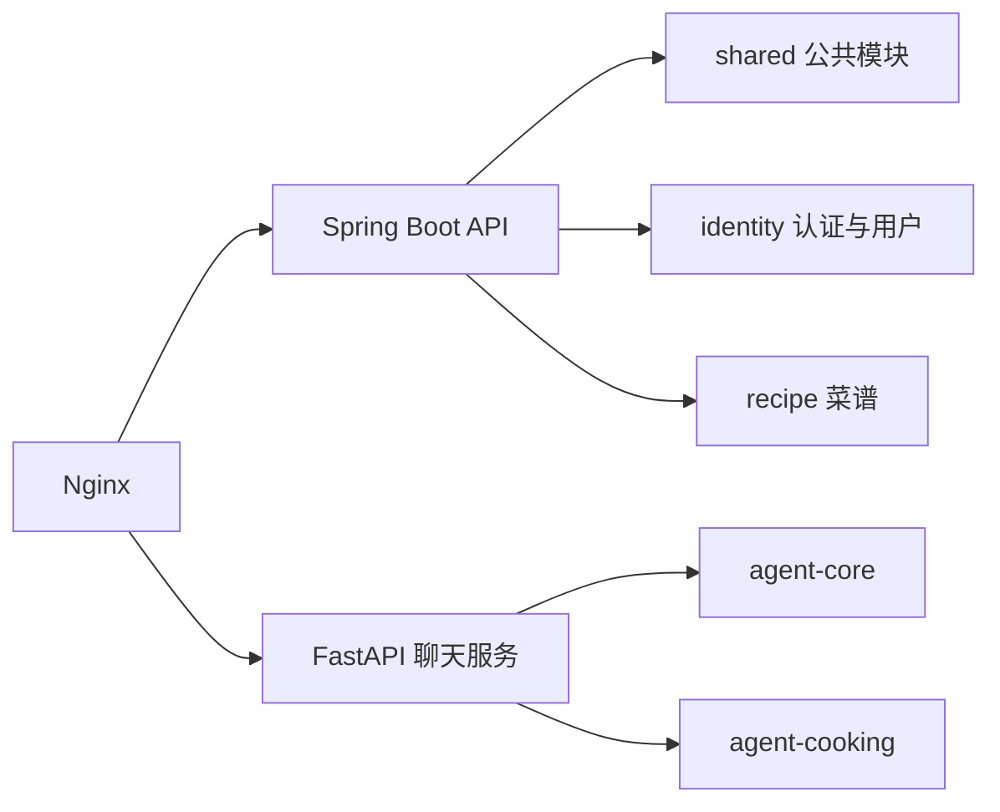

# API 接口文档

<cite>
**本文引用的文件**   
- [README.md](file://README.md)
- [技术方案.md](file://技术方案.md)
- [services/api/identity/src/main/java/com/goodzheng/po/identity/controller/AuthController.java](file://services/api/identity/src/main/java/com/goodzheng/po/identity/controller/AuthController.java)
- [services/api/identity/src/main/java/com/goodzheng/po/identity/controller/UserController.java](file://services/api/identity/src/main/java/com/goodzheng/po/identity/controller/UserController.java)
- [services/api/recipe/src/main/java/com/goodzheng/po/recipe/controller/RecipeController.java](file://services/api/recipe/src/main/java/com/goodzheng/po/recipe/controller/RecipeController.java)
- [services/chat/app/routers/ws.py](file://services/chat/app/routers/ws.py)
- [services/chat/app/routers/health.py](file://services/chat/app/routers/health.py)
</cite>

## 目录
1. [简介](#简介)
2. [项目结构](#项目结构)
3. [核心组件](#核心组件)
4. [架构总览](#架构总览)
5. [详细接口说明](#详细接口说明)
6. [依赖关系分析](#依赖关系分析)
7. [性能与可靠性](#性能与可靠性)
8. [故障排查指南](#故障排查指南)
9. [结论](#结论)
10. [附录：客户端集成与最佳实践](#附录客户端集成与最佳实践)

## 简介
本仓库是“菜谱 / 用户业务”的全栈 Monorepo，包含管理前端、移动端、共享类型、Spring Boot 后端、FastAPI 聊天服务、Agent 编排库以及 Nginx + Docker Compose 部署方案。对外统一由 Nginx 网关按路径前缀分流：REST 接口走 Spring Boot，流式聊天走 FastAPI WebSocket，静态资源由 Nginx 托管。

- 管理端：Umi Max + React + Ant Design，开发时通过代理访问 `/api` 与 `/ws`。
- 移动端：Expo 应用直连后端 REST，并通过独立地址连接聊天 WebSocket。
- 后端 API：Spring Boot 多模块单体，提供认证、用户、菜谱等 REST 接口，使用 JWT 鉴权。
- 聊天服务：FastAPI + LangGraph，提供 `/ws/chat` 流式对话，支持中断与恢复。
- Agent 编排：纯库 `agent-core` 与垂直 `agent-cooking`，在聊天服务中装配。

## 项目结构
从网关视角，请求进入 Nginx 后按前缀转发到不同上游服务；生产环境仅暴露 Web 端口，其余服务仅在容器网络内互通。

**图示来源**
- [README.md:16-43](file://README.md#L16-L43)

**章节来源**
- [README.md:16-43](file://README.md#L16-L43)

## 核心组件
- 认证授权：Spring Security + JWT，登录成功后返回 Token，后续请求携带 Token 进行鉴权。
- 用户管理：用户注册、登录、个人资料、头像上传、角色与审批管理。
- 菜谱管理：公开浏览、筛选分页、收藏点赞、历史、创建更新删除、审核队列。
- 聊天服务：WebSocket 长连接，事件驱动，支持断点续传、心跳、中断与恢复。
- 健康检查：FastAPI 与 Spring Boot 均提供健康探测接口。

**章节来源**
- [README.md:16-43](file://README.md#L16-L43)
- [README.md:45-86](file://README.md#L45-L86)

## 架构总览
系统采用 HTTP + WebSocket 混合通信模式：HTTP 负责无状态任务提交与查询，WebSocket 负责双向实时交互。

**图示来源**
- [README.md:36-43](file://README.md#L36-L43)
- [services/chat/app/routers/ws.py:131-189](file://services/chat/app/routers/ws.py#L131-L189)

**章节来源**
- [README.md:36-43](file://README.md#L36-L43)
- [技术方案.md:1-28](file://技术方案.md#L1-L28)

## 详细接口说明

### 通用约定
- 基础路径
  - REST：`/api`（Spring Boot，由 `server.servlet.context-path=/api` 消费）。
  - 聊天 REST：`/api/health`、`/api/items/**`（FastAPI）。
  - 聊天 WebSocket：`/ws/chat`（FastAPI）。
- 统一响应体：`Result<T>`，包含成功数据或错误码与消息。
- 认证方式：JWT Bearer Token，通常放在请求头中。
- 版本管理：当前未显式路径版本化；向后兼容以不破坏现有字段为原则，新增能力优先扩展而非替换。

**章节来源**
- [README.md:36-43](file://README.md#L36-L43)

### 认证接口

#### POST /api/auth/register
- 功能：注册用户。
- 参数
  - query：`username`（必填）、`password`（必填）、`email`（可选）。
- 响应
  - 成功：`Result<String>`，消息为注册结果。
  - 失败：`Result.error(400, message)`。
- 错误码
  - 400：用户名重复、密码不符合规则等。
- 示例
  - 请求：`POST /api/auth/register?username=demo&password=Passw0rd123&email=demo@example.com`
  - 响应：`{"code":200,"data":"注册成功","message":""}`

**章节来源**
- [services/api/identity/src/main/java/com/goodzheng/po/identity/controller/AuthController.java:36-46](file://services/api/identity/src/main/java/com/goodzheng/po/identity/controller/AuthController.java#L36-L46)

#### POST /api/auth/login
- 功能：用户名密码登录。
- 参数
  - body：`LoginRequest`（含用户名、密码等）。
- 响应
  - 成功：`Result<LoginResponse>`，包含 Token。
  - 失败：`Result.error(401, message)`。
- 错误码
  - 401：用户名或密码错误。
- 示例
  - 请求：`POST /api/auth/login`，body 为 `{username:"demo", password:"Passw0rd123"}`
  - 响应：`{"code":200,"data":{"token":"..."},"message":""}`

**章节来源**
- [services/api/identity/src/main/java/com/goodzheng/po/identity/controller/AuthController.java:26-34](file://services/api/identity/src/main/java/com/goodzheng/po/identity/controller/AuthController.java#L26-L34)

#### POST /api/auth/app-register
- 功能：App 端注册。
- 参数
  - body：`AppRegisterRequest`。
- 响应
  - 成功：`Result<LoginResponse>`。
  - 失败：`Result.error(400, message)`。

**章节来源**
- [services/api/identity/src/main/java/com/goodzheng/po/identity/controller/AuthController.java:48-56](file://services/api/identity/src/main/java/com/goodzheng/po/identity/controller/AuthController.java#L48-L56)

#### POST /api/auth/openid-login
- 功能：OpenID 登录，支持可选的微信 OpenID 头。
- 参数
  - body：`OpenIdLoginRequest`。
  - header：`X-Wx-Openid`（可选）。
- 响应
  - 成功：`Result<LoginResponse>`。
  - 失败：`Result.error(401, message)`。

**章节来源**
- [services/api/identity/src/main/java/com/goodzheng/po/identity/controller/AuthController.java:58-68](file://services/api/identity/src/main/java/com/goodzheng/po/identity/controller/AuthController.java#L58-L68)

#### POST /api/auth/wechat-login
- 功能：微信登录。
- 参数
  - body：`WeChatLoginRequest`。
- 响应
  - 成功：`Result<LoginResponse>`。
  - 失败：`Result.error(401, message)`。

**章节来源**
- [services/api/identity/src/main/java/com/goodzheng/po/identity/controller/AuthController.java:70-78](file://services/api/identity/src/main/java/com/goodzheng/po/identity/controller/AuthController.java#L70-L78)

### 用户接口

#### GET /api/users
- 功能：分页查询用户列表（管理员及以上）。
- 参数
  - query：`page`（默认 0）、`size`（默认 10）、`keyword`（可选）。
- 响应
  - 成功：`Result<Page<User>>`。
- 权限
  - 需要管理员及以上角色。

**章节来源**
- [services/api/identity/src/main/java/com/goodzheng/po/identity/controller/UserController.java:59-69](file://services/api/identity/src/main/java/com/goodzheng/po/identity/controller/UserController.java#L59-L69)

#### GET /api/users/pending
- 功能：待审批用户列表（管理员及以上）。
- 响应
  - 成功：`Result<List<User>>`。

**章节来源**
- [services/api/identity/src/main/java/com/goodzheng/po/identity/controller/UserController.java:72-76](file://services/api/identity/src/main/java/com/goodzheng/po/identity/controller/UserController.java#L72-L76)

#### GET /api/users/{id}
- 功能：获取单个用户详情（管理员及以上）。
- 路径参数
  - `id`：用户 ID。
- 响应
  - 成功：`Result<User>`。
  - 失败：`Result.error(400, message)`。

**章节来源**
- [services/api/identity/src/main/java/com/goodzheng/po/identity/controller/UserController.java:79-86](file://services/api/identity/src/main/java/com/goodzheng/po/identity/controller/UserController.java#L79-L86)

#### GET /api/users/me
- 功能：获取当前登录用户信息。
- 响应
  - 成功：`Result<User>`。
  - 失败：`Result.error(401, message)`。

**章节来源**
- [services/api/identity/src/main/java/com/goodzheng/po/identity/controller/UserController.java:89-96](file://services/api/identity/src/main/java/com/goodzheng/po/identity/controller/UserController.java#L89-L96)

#### PUT /api/users/me
- 功能：更新当前用户个人资料。
- 参数
  - body：`ProfileRequest`（昵称、邮箱、电话、头像等）。
- 响应
  - 成功：`Result<User>`。
  - 失败：`Result.error(400, message)`。

**章节来源**
- [services/api/identity/src/main/java/com/goodzheng/po/identity/controller/UserController.java:99-115](file://services/api/identity/src/main/java/com/goodzheng/po/identity/controller/UserController.java#L99-L115)

#### PUT /api/users/me/password
- 功能：修改当前用户密码。
- 参数
  - body：`ChangePasswordRequest`。
- 响应
  - 成功：`Result<String>`。
  - 失败：`Result.error(400, message)`。

**章节来源**
- [services/api/identity/src/main/java/com/goodzheng/po/identity/controller/UserController.java:118-129](file://services/api/identity/src/main/java/com/goodzheng/po/identity/controller/UserController.java#L118-L129)

#### POST /api/users/me/avatar
- 功能：上传头像。
- 参数
  - form-data：`file`（jpg/png/gif/webp，≤2MB）。
- 响应
  - 成功：`Result<String>`，返回头像 URL。
  - 失败：`Result.error(400, message)`。

**章节来源**
- [services/api/identity/src/main/java/com/goodzheng/po/identity/controller/UserController.java:132-165](file://services/api/identity/src/main/java/com/goodzheng/po/identity/controller/UserController.java#L132-L165)

#### POST /api/users
- 功能：创建用户（管理员及以上）。
- 参数
  - body：`UserRequest`。
- 响应
  - 成功：`Result<User>`。
  - 失败：`Result.error(400, message)`。

**章节来源**
- [services/api/identity/src/main/java/com/goodzheng/po/identity/controller/UserController.java:168-178](file://services/api/identity/src/main/java/com/goodzheng/po/identity/controller/UserController.java#L168-L178)

#### PUT /api/users/{id}
- 功能：更新用户（管理员及以上）。
- 路径参数
  - `id`：用户 ID。
- 参数
  - body：`UserRequest`。
- 响应
  - 成功：`Result<User>`。
  - 失败：`Result.error(400, message)`。

**章节来源**
- [services/api/identity/src/main/java/com/goodzheng/po/identity/controller/UserController.java:181-205](file://services/api/identity/src/main/java/com/goodzheng/po/identity/controller/UserController.java#L181-L205)

#### PUT /api/users/{id}/role
- 功能：修改用户角色（管理员及以上）。
- 路径参数
  - `id`：用户 ID。
- 参数
  - body：`{role: "..."}`。
- 响应
  - 成功：`Result<User>`。
  - 失败：`Result.error(400, message)`。

**章节来源**
- [services/api/identity/src/main/java/com/goodzheng/po/identity/controller/UserController.java:208-236](file://services/api/identity/src/main/java/com/goodzheng/po/identity/controller/UserController.java#L208-L236)

#### PUT /api/users/{id}/approval
- 功能：审批用户（管理员及以上）。
- 路径参数
  - `id`：用户 ID。
- 参数
  - body：`ApprovalRequest`（action 为 approved 或 rejected）。
- 响应
  - 成功：`Result<User>`。
  - 失败：`Result.error(400, message)`。

**章节来源**
- [services/api/identity/src/main/java/com/goodzheng/po/identity/controller/UserController.java:239-252](file://services/api/identity/src/main/java/com/goodzheng/po/identity/controller/UserController.java#L239-L252)

#### DELETE /api/users/{id}
- 功能：删除用户（管理员及以上）。
- 路径参数
  - `id`：用户 ID。
- 响应
  - 成功：`Result<String>`。
  - 失败：`Result.error(400, message)`。

**章节来源**
- [services/api/identity/src/main/java/com/goodzheng/po/identity/controller/UserController.java:255-272](file://services/api/identity/src/main/java/com/goodzheng/po/identity/controller/UserController.java#L255-L272)

#### DELETE /api/users/batch
- 功能：批量删除用户（管理员及以上）。
- 参数
  - body：`List<Long>` ids。
- 响应
  - 成功：`Result<String>`。
  - 失败：`Result.error(400, message)`。

**章节来源**
- [services/api/identity/src/main/java/com/goodzheng/po/identity/controller/UserController.java:275-295](file://services/api/identity/src/main/java/com/goodzheng/po/identity/controller/UserController.java#L275-L295)

#### PUT /api/users/batch/status
- 功能：批量修改用户状态（管理员及以上）。
- 参数
  - body：`{ids:[], status:"..."}`。
- 响应
  - 成功：`Result<String>`。
  - 失败：`Result.error(400, message)`。

**章节来源**
- [services/api/identity/src/main/java/com/goodzheng/po/identity/controller/UserController.java:298-323](file://services/api/identity/src/main/java/com/goodzheng/po/identity/controller/UserController.java#L298-L323)

### 菜谱接口

#### POST /api/recipes
- 功能：创建菜谱。
- 权限
  - 管理员直接通过；App 用户创建的菜谱进入待审核。
- 参数
  - body：`RecipeRequest`。
- 响应
  - 成功：`Result<Recipe>`。
  - 失败：`Result.error(400, message)`。

**章节来源**
- [services/api/recipe/src/main/java/com/goodzheng/po/recipe/controller/RecipeController.java:39-51](file://services/api/recipe/src/main/java/com/goodzheng/po/recipe/controller/RecipeController.java#L39-L51)

#### GET /api/recipes/{id}
- 功能：查询单个菜谱详情。
- 权限
  - 未发布仅作者本人或管理员可见；登录浏览计入历史。
- 路径参数
  - `id`：菜谱 ID。
- 响应
  - 成功：`Result<Recipe>`。
  - 失败：`Result.error(404, message)`。

**章节来源**
- [services/api/recipe/src/main/java/com/goodzheng/po/recipe/controller/RecipeController.java:54-70](file://services/api/recipe/src/main/java/com/goodzheng/po/recipe/controller/RecipeController.java#L54-L70)

#### GET /api/recipes
- 功能：筛选排序列表（公开：仅已通过审核且公开的菜谱）。
- 参数
  - query：`page`（默认 0）、`size`（默认 20）、`categoryIdStr`（可选）、`difficulty`（可选）、`keyword`（可选）、`sort`（默认 recommend）。
- 响应
  - 成功：`Result<Page<Recipe>>`。

**章节来源**
- [services/api/recipe/src/main/java/com/goodzheng/po/recipe/controller/RecipeController.java:73-90](file://services/api/recipe/src/main/java/com/goodzheng/po/recipe/controller/RecipeController.java#L73-L90)

#### GET /api/recipes/mine
- 功能：我的菜谱（全部状态，含待审核/已驳回）。
- 参数
  - query：`page`（默认 0）、`size`（默认 20）。
- 响应
  - 成功：`Result<Page<Recipe>>`。

**章节来源**
- [services/api/recipe/src/main/java/com/goodzheng/po/recipe/controller/RecipeController.java:93-100](file://services/api/recipe/src/main/java/com/goodzheng/po/recipe/controller/RecipeController.java#L93-L100)

#### GET /api/recipes/favorites
- 功能：我的收藏。
- 参数
  - query：`page`（默认 0）、`size`（默认 20）。
- 响应
  - 成功：`Result<Page<Recipe>>`。

**章节来源**
- [services/api/recipe/src/main/java/com/goodzheng/po/recipe/controller/RecipeController.java:103-112](file://services/api/recipe/src/main/java/com/goodzheng/po/recipe/controller/RecipeController.java#L103-L112)

#### GET /api/recipes/history
- 功能：我的浏览历史。
- 参数
  - query：`page`（默认 0）、`size`（默认 20）。
- 响应
  - 成功：`Result<Page<Recipe>>`。

**章节来源**
- [services/api/recipe/src/main/java/com/goodzheng/po/recipe/controller/RecipeController.java:115-124](file://services/api/recipe/src/main/java/com/goodzheng/po/recipe/controller/RecipeController.java#L115-L124)

#### GET /api/recipes/review
- 功能：管理端审核队列（仅管理端管理员）。
- 参数
  - query：`status`（可选）、`keyword`（可选）、`page`（默认 0）、`size`（默认 20）。
- 响应
  - 成功：`Result<Page<Recipe>>`。
  - 失败：`Result.error(400, message)`。

**章节来源**
- [services/api/recipe/src/main/java/com/goodzheng/po/recipe/controller/RecipeController.java:127-139](file://services/api/recipe/src/main/java/com/goodzheng/po/recipe/controller/RecipeController.java#L127-L139)

#### PUT /api/recipes/{id}/audit
- 功能：管理端审核（仅管理端管理员）。
- 路径参数
  - `id`：菜谱 ID。
- 参数
  - body：`AuditRequest`（action、reason）。
- 响应
  - 成功：`Result<Recipe>`。
  - 失败：`Result.error(400, message)`。

**章节来源**
- [services/api/recipe/src/main/java/com/goodzheng/po/recipe/controller/RecipeController.java:142-151](file://services/api/recipe/src/main/java/com/goodzheng/po/recipe/controller/RecipeController.java#L142-L151)

#### POST /api/recipes/{id}/favorite
- 功能：收藏菜谱（登录用户）。
- 路径参数
  - `id`：菜谱 ID。
- 响应
  - 成功：`Result<String>`。
  - 失败：`Result.error(400, message)`。

**章节来源**
- [services/api/recipe/src/main/java/com/goodzheng/po/recipe/controller/RecipeController.java:154-163](file://services/api/recipe/src/main/java/com/goodzheng/po/recipe/controller/RecipeController.java#L154-L163)

#### DELETE /api/recipes/{id}/favorite
- 功能：取消收藏（登录用户）。
- 路径参数
  - `id`：菜谱 ID。
- 响应
  - 成功：`Result<String>`。
  - 失败：`Result.error(400, message)`。

**章节来源**
- [services/api/recipe/src/main/java/com/goodzheng/po/recipe/controller/RecipeController.java:165-174](file://services/api/recipe/src/main/java/com/goodzheng/po/recipe/controller/RecipeController.java#L165-L174)

#### POST /api/recipes/{id}/like
- 功能：点赞切换（登录用户）。
- 路径参数
  - `id`：菜谱 ID。
- 响应
  - 成功：`Result<LikeResult>`。
  - 失败：`Result.error(400, message)`。

**章节来源**
- [services/api/recipe/src/main/java/com/goodzheng/po/recipe/controller/RecipeController.java:177-185](file://services/api/recipe/src/main/java/com/goodzheng/po/recipe/controller/RecipeController.java#L177-L185)

#### PUT /api/recipes/{id}
- 功能：更新菜谱（管理员任意；作者本人修改后重新送审）。
- 路径参数
  - `id`：菜谱 ID。
- 参数
  - body：`RecipeRequest`。
- 响应
  - 成功：`Result<Recipe>`。
  - 失败：`Result.error(400, message)`。

**章节来源**
- [services/api/recipe/src/main/java/com/goodzheng/po/recipe/controller/RecipeController.java:188-197](file://services/api/recipe/src/main/java/com/goodzheng/po/recipe/controller/RecipeController.java#L188-L197)

#### DELETE /api/recipes/{id}
- 功能：删除菜谱（软删除；管理员任意，作者只能删自己的）。
- 路径参数
  - `id`：菜谱 ID。
- 响应
  - 成功：`Result<String>`。
  - 失败：`Result.error(400, message)`。

**章节来源**
- [services/api/recipe/src/main/java/com/goodzheng/po/recipe/controller/RecipeController.java:200-209](file://services/api/recipe/src/main/java/com/goodzheng/po/recipe/controller/RecipeController.java#L200-L209)

### 聊天服务接口

#### GET /api/health
- 功能：聊天服务健康检查。
- 响应
  - `{"status":"ok","agent_core_version":"..."}`。

**章节来源**
- [services/chat/app/routers/health.py:15-21](file://services/chat/app/routers/health.py#L15-L21)

#### WS /ws/chat
- 功能：流式聊天主循环，一连接多轮会话。
- 入站帧
  - `message`：新消息，可带 `conversation_id`。
  - `resume`：中断后继续，必须带 `conversation_id`。
  - `ping`：心跳，服务端回 `pong`。
- 出站帧
  - `run_started`：开始运行，payload 含 `thread_id`。
  - `token`：打字机增量文本。
  - `thinking` / `plan`：思考与计划。
  - `step`：步骤。
  - `tool_call_start` / `tool_call_args` / `tool_call_end` / `tool_call_result`：工具调用生命周期。
  - `interrupt`：等待 resume。
  - `done`：运行结束。
  - `error`：错误。
- 时序要点
  - 收到 `interrupt` 后必须先消费到 `done`，再发送 `resume`。
  - 不传 `conversation_id` 时服务端生成并随 `run_started.payload.thread_id` 返回，客户端需保存并在下一轮回传。

**图示来源**
- [services/chat/app/routers/ws.py:131-189](file://services/chat/app/routers/ws.py#L131-L189)

**章节来源**
- [services/chat/app/routers/ws.py:1-49](file://services/chat/app/routers/ws.py#L1-L49)
- [services/chat/app/routers/ws.py:131-189](file://services/chat/app/routers/ws.py#L131-L189)

## 依赖关系分析
- 网关依赖
  - Nginx 根据路径前缀将请求分发到 Spring Boot 与 FastAPI。
- API 依赖
  - Spring Boot 模块 `shared`、`identity`、`recipe` 共同组成单体应用。
  - 数据库 MySQL、缓存 Redis。
- 聊天服务依赖
  - FastAPI 宿主装配 `agent-core` 与 `agent-cooking`。
  - LLM 配置缺失时降级为离线模式，接口仍可用。

**图示来源**
- [README.md:16-34](file://README.md#L16-L34)

**章节来源**
- [README.md:16-34](file://README.md#L16-L34)

## 性能与可靠性
- 连接数与内存
  - SSE 适合单向下行推送，内存占用低；WebSocket 全双工但内存占用较高。
- 重连与断点续传
  - SSE 浏览器内置自动重连与 Last-Event-ID；WebSocket 需自行实现心跳与重连。
- 代理穿透
  - SSE 天然兼容 Nginx、CDN、WAF；WebSocket 需特殊代理配置。
- 聊天服务降级
  - LLM 不可用时聊天服务降级为离线模式，接口仍可用。

**章节来源**
- [技术方案.md:1-28](file://技术方案.md#L1-L28)
- [README.md:76-86](file://README.md#L76-L86)

## 故障排查指南
- 健康检查
  - Spring Boot：`/api/actuator/health`。
  - FastAPI：`/api/health`。
- 常见问题
  - WebSocket 帧校验失败：服务端会返回 `error` 帧，客户端无需重连，修正协议后继续复用连接。
  - resume 缺少 `conversation_id`：服务端返回错误帧，提示需要挂起线程 id。
  - 客户端断开：服务端捕获 `WebSocketDisconnect` 或 `_ClientGone`，静默结束协程。
- 日志与异常
  - WS 聊天处理异常会记录日志并上抛，由框架关闭连接。

**章节来源**
- [README.md:101-107](file://README.md#L101-L107)
- [services/chat/app/routers/ws.py:144-189](file://services/chat/app/routers/ws.py#L144-L189)

## 结论
本项目通过 Nginx 网关统一入口，REST 接口由 Spring Boot 提供，聊天服务由 FastAPI 提供 WebSocket 流式对话。认证授权基于 JWT，用户与菜谱接口具备完善的权限控制与业务规则。聊天服务采用事件驱动模型，支持中断与恢复，具备良好的可扩展性与降级能力。

## 附录：客户端集成与最佳实践
- 认证流程
  - 登录后保存 Token，后续请求携带 Token。
  - 若 Token 过期，引导用户重新登录。
- 聊天连接
  - 建立 `/ws/chat` 连接，首次发送 `message` 获取 `run_started.payload.thread_id`。
  - 后续消息携带 `conversation_id` 保持多轮记忆。
  - 收到 `interrupt` 后先消费到 `done`，再发送 `resume`。
  - 定期发送 `ping` 维持心跳。
- 错误处理
  - 对未知帧类型忽略而非报错。
  - 对 `error` 帧提示用户并重试或降级。
- 版本迁移
  - 新增字段保持向后兼容，避免破坏现有客户端。
  - 废弃字段保留一段时间并提供迁移指南。

**章节来源**
- [services/chat/app/routers/ws.py:1-49](file://services/chat/app/routers/ws.py#L1-L49)
- [services/chat/app/routers/ws.py:131-189](file://services/chat/app/routers/ws.py#L131-L189)