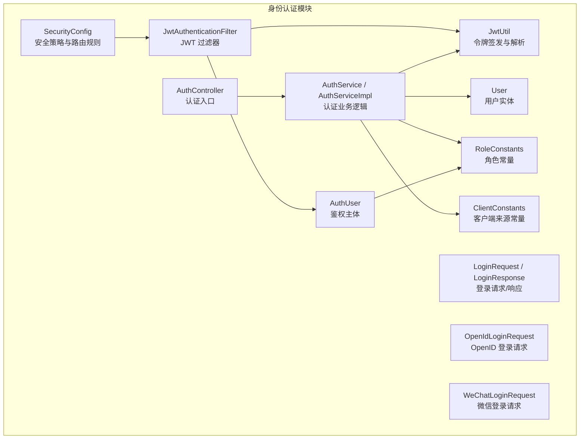
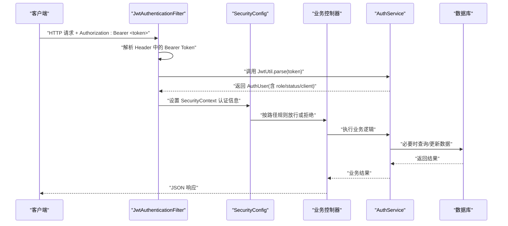
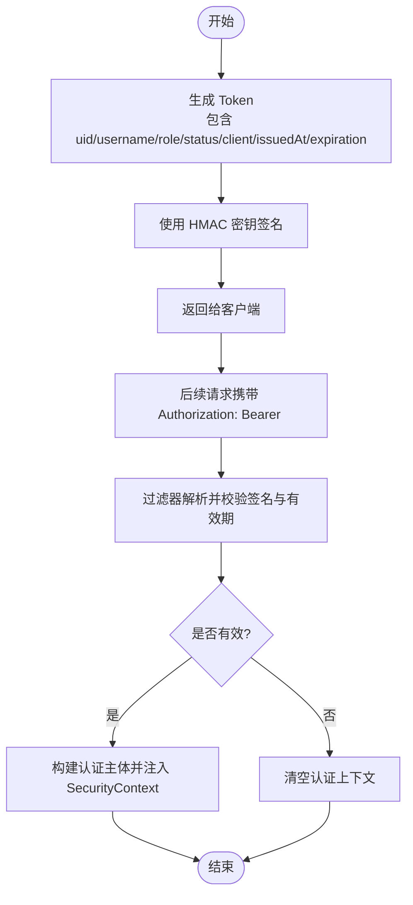
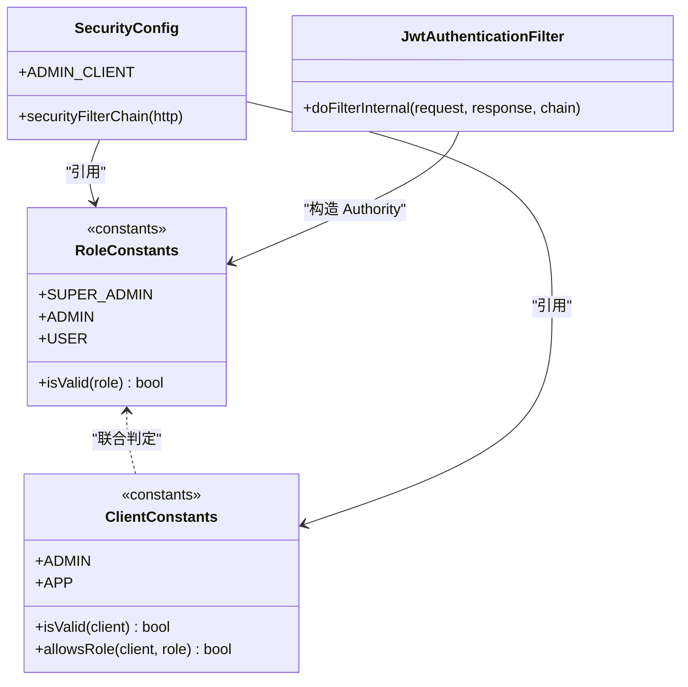
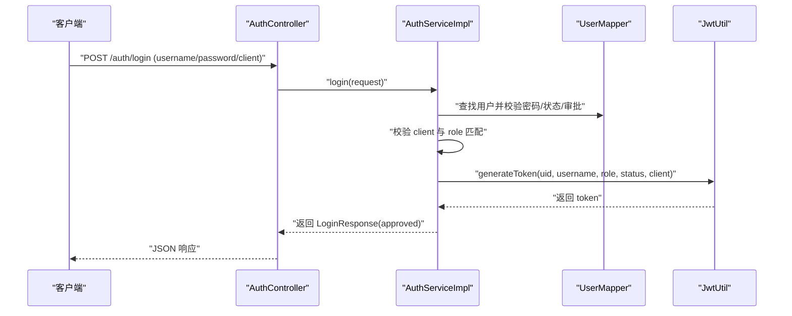
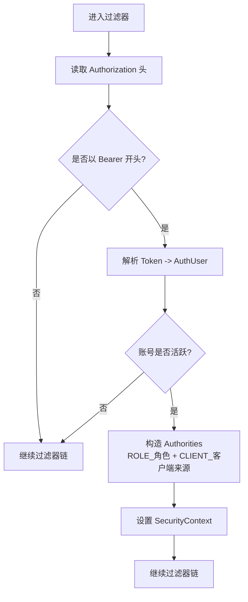
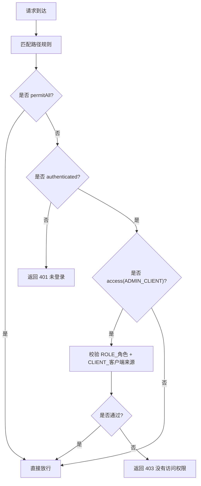
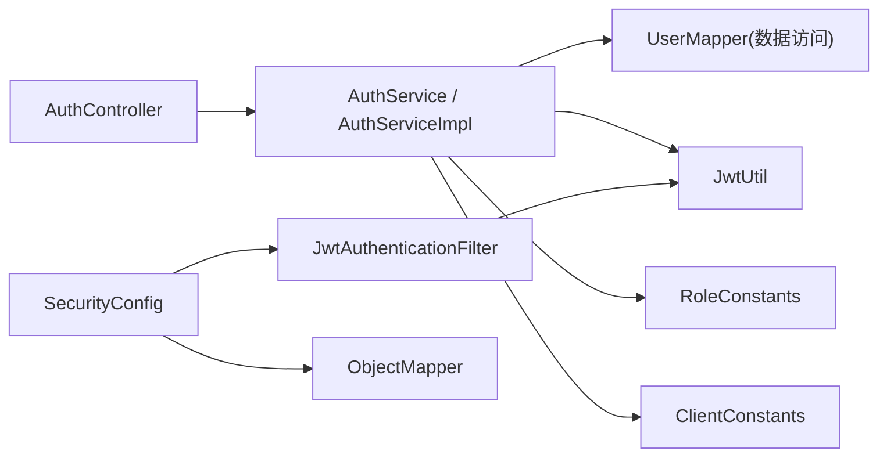

# API 认证与授权

<cite>
**本文引用的文件**   
- [JwtUtil.java](file://services/api/identity/src/main/java/com/goodzheng/po/identity/security/JwtUtil.java)
- [JwtAuthenticationFilter.java](file://services/api/identity/src/main/java/com/goodzheng/po/identity/security/JwtAuthenticationFilter.java)
- [SecurityConfig.java](file://services/api/identity/src/main/java/com/goodzheng/po/identity/security/SecurityConfig.java)
- [AuthController.java](file://services/api/identity/src/main/java/com/goodzheng/po/identity/controller/AuthController.java)
- [AuthService.java](file://services/api/identity/src/main/java/com/goodzheng/po/identity/service/AuthService.java)
- [AuthServiceImpl.java](file://services/api/identity/src/main/java/com/goodzheng/po/identity/service/impl/AuthServiceImpl.java)
- [LoginRequest.java](file://services/api/identity/src/main/java/com/goodzheng/po/identity/dto/LoginRequest.java)
- [LoginResponse.java](file://services/api/identity/src/main/java/com/goodzheng/po/identity/dto/LoginResponse.java)
- [OpenIdLoginRequest.java](file://services/api/identity/src/main/java/com/goodzheng/po/identity/dto/OpenIdLoginRequest.java)
- [WeChatLoginRequest.java](file://services/api/identity/src/main/java/com/goodzheng/po/identity/dto/WeChatLoginRequest.java)
- [User.java](file://services/api/identity/src/main/java/com/goodzheng/po/identity/entity/User.java)
- [AuthUser.java](file://services/api/identity/src/main/java/com/goodzheng/po/identity/security/AuthUser.java)
- [RoleConstants.java](file://services/api/identity/src/main/java/com/goodzheng/po/identity/constant/RoleConstants.java)
- [ClientConstants.java](file://services/api/identity/src/main/java/com/goodzheng/po/identity/constant/ClientConstants.java)
</cite>

## 目录
1. [简介](#简介)
2. [项目结构](#项目结构)
3. [核心组件](#核心组件)
4. [架构总览](#架构总览)
5. [详细组件分析](#详细组件分析)
6. [依赖关系分析](#依赖关系分析)
7. [性能考虑](#性能考虑)
8. [故障排查指南](#故障排查指南)
9. [结论](#结论)
10. [附录](#附录)

## 简介
本文件系统性说明后端 API 的认证与授权机制，覆盖以下要点：
- JWT Token 的生成、解析与校验流程；Token 结构与有效期管理；安全存储建议。
- 基于角色的访问控制（RBAC）模型：角色定义、客户端来源隔离、接口级权限控制。
- 多种登录方式：用户名密码登录、微信 OAuth 登录、OpenID 登录。
- 请求中 Token 传递方式、过滤器工作原理、权限校验流程。
- 客户端集成示例与安全最佳实践。

## 项目结构
认证与授权相关代码集中在 identity 模块中，主要包含控制器、服务、安全配置、JWT 工具、常量与数据模型等。

**图表来源**
- [AuthController.java:19-79](file://services/api/identity/src/main/java/com/goodzheng/po/identity/controller/AuthController.java#L19-L79)
- [AuthService.java:9-20](file://services/api/identity/src/main/java/com/goodzheng/po/identity/service/AuthService.java#L9-L20)
- [AuthServiceImpl.java:23-199](file://services/api/identity/src/main/java/com/goodzheng/po/identity/service/impl/AuthServiceImpl.java#L23-L199)
- [SecurityConfig.java:39-100](file://services/api/identity/src/main/java/com/goodzheng/po/identity/security/SecurityConfig.java#L39-L100)
- [JwtAuthenticationFilter.java:24-56](file://services/api/identity/src/main/java/com/goodzheng/po/identity/security/JwtAuthenticationFilter.java#L24-L56)
- [JwtUtil.java:13-58](file://services/api/identity/src/main/java/com/goodzheng/po/identity/security/JwtUtil.java#L13-L58)
- [AuthUser.java:6-24](file://services/api/identity/src/main/java/com/goodzheng/po/identity/security/AuthUser.java#L6-L24)
- [RoleConstants.java:6-24](file://services/api/identity/src/main/java/com/goodzheng/po/identity/constant/RoleConstants.java#L6-L24)
- [ClientConstants.java:7-32](file://services/api/identity/src/main/java/com/goodzheng/po/identity/constant/ClientConstants.java#L7-L32)
- [User.java:13-55](file://services/api/identity/src/main/java/com/goodzheng/po/identity/entity/User.java#L13-L55)
- [LoginRequest.java:6-18](file://services/api/identity/src/main/java/com/goodzheng/po/identity/dto/LoginRequest.java#L6-L18)
- [LoginResponse.java:5-39](file://services/api/identity/src/main/java/com/goodzheng/po/identity/dto/LoginResponse.java#L5-L39)
- [OpenIdLoginRequest.java:6-11](file://services/api/identity/src/main/java/com/goodzheng/po/identity/dto/OpenIdLoginRequest.java#L6-L11)
- [WeChatLoginRequest.java:6-14](file://services/api/identity/src/main/java/com/goodzheng/po/identity/dto/WeChatLoginRequest.java#L6-L14)

**章节来源**
- [AuthController.java:19-79](file://services/api/identity/src/main/java/com/goodzheng/po/identity/controller/AuthController.java#L19-L79)
- [SecurityConfig.java:39-100](file://services/api/identity/src/main/java/com/goodzheng/po/identity/security/SecurityConfig.java#L39-L100)

## 核心组件
- 认证控制器：提供统一认证入口，包括用户名密码登录、注册、App 端注册、OpenID 登录、微信登录。
- 认证服务：实现账号校验、审批状态检查、客户端来源限制、第三方登录流程与 Token 签发。
- 安全配置：定义无状态会话、CORS、路径级访问控制、异常处理与过滤器链顺序。
- JWT 过滤器：从请求头提取 Bearer Token，解析并注入 Spring Security 认证上下文。
- JWT 工具：负责密钥初始化、Token 签发与解析。
- 常量与模型：角色常量、客户端来源常量、用户实体、认证主体记录、登录请求/响应 DTO。

**章节来源**
- [AuthController.java:19-79](file://services/api/identity/src/main/java/com/goodzheng/po/identity/controller/AuthController.java#L19-L79)
- [AuthService.java:9-20](file://services/api/identity/src/main/java/com/goodzheng/po/identity/service/AuthService.java#L9-L20)
- [AuthServiceImpl.java:23-199](file://services/api/identity/src/main/java/com/goodzheng/po/identity/service/impl/AuthServiceImpl.java#L23-L199)
- [SecurityConfig.java:39-100](file://services/api/identity/src/main/java/com/goodzheng/po/identity/security/SecurityConfig.java#L39-L100)
- [JwtAuthenticationFilter.java:24-56](file://services/api/identity/src/main/java/com/goodzheng/po/identity/security/JwtAuthenticationFilter.java#L24-L56)
- [JwtUtil.java:13-58](file://services/api/identity/src/main/java/com/goodzheng/po/identity/security/JwtUtil.java#L13-L58)
- [RoleConstants.java:6-24](file://services/api/identity/src/main/java/com/goodzheng/po/identity/constant/RoleConstants.java#L6-L24)
- [ClientConstants.java:7-32](file://services/api/identity/src/main/java/com/goodzheng/po/identity/constant/ClientConstants.java#L7-L32)
- [User.java:13-55](file://services/api/identity/src/main/java/com/goodzheng/po/identity/entity/User.java#L13-L55)
- [AuthUser.java:6-24](file://services/api/identity/src/main/java/com/goodzheng/po/identity/security/AuthUser.java#L6-L24)
- [LoginRequest.java:6-18](file://services/api/identity/src/main/java/com/goodzheng/po/identity/dto/LoginRequest.java#L6-L18)
- [LoginResponse.java:5-39](file://services/api/identity/src/main/java/com/goodzheng/po/identity/dto/LoginResponse.java#L5-L39)

## 架构总览
下图展示一次受保护接口的完整调用链路：客户端携带 Authorization 头发起请求，过滤器解析 JWT 并构建认证主体，Spring Security 根据路径规则与角色/客户端来源进行授权判断。

**图表来源**
- [JwtAuthenticationFilter.java:32-55](file://services/api/identity/src/main/java/com/goodzheng/po/identity/security/JwtAuthenticationFilter.java#L32-L55)
- [JwtUtil.java:40-57](file://services/api/identity/src/main/java/com/goodzheng/po/identity/security/JwtUtil.java#L40-L57)
- [SecurityConfig.java:54-99](file://services/api/identity/src/main/java/com/goodzheng/po/identity/security/SecurityConfig.java#L54-L99)

## 详细组件分析

### JWT 令牌机制
- 令牌结构：包含用户标识、用户名、角色、状态、客户端来源、签发时间与过期时间。
- 签发流程：认证成功后由服务层调用工具类生成令牌，并在响应中返回。
- 验证流程：过滤器从请求头提取 Bearer Token，解析并校验签名与有效期；若无效则清空认证上下文。
- 有效期管理：通过配置项控制过期时长；未提供刷新令牌机制，过期后需重新登录。
- 安全存储建议：
  - 服务端：密钥使用 Base64 解码后的字节作为 HMAC 密钥；避免硬编码，建议使用环境变量或密钥管理服务。
  - 客户端：将 Token 保存在内存或安全存储（如移动端 Keychain/Keystore），避免持久化到明文文件或 Cookie。

**图表来源**
- [JwtUtil.java:19-38](file://services/api/identity/src/main/java/com/goodzheng/po/identity/security/JwtUtil.java#L19-L38)
- [JwtUtil.java:40-57](file://services/api/identity/src/main/java/com/goodzheng/po/identity/security/JwtUtil.java#L40-L57)
- [JwtAuthenticationFilter.java:32-55](file://services/api/identity/src/main/java/com/goodzheng/po/identity/security/JwtAuthenticationFilter.java#L32-L55)

**章节来源**
- [JwtUtil.java:13-58](file://services/api/identity/src/main/java/com/goodzheng/po/identity/security/JwtUtil.java#L13-L58)
- [JwtAuthenticationFilter.java:24-56](file://services/api/identity/src/main/java/com/goodzheng/po/identity/security/JwtAuthenticationFilter.java#L24-L56)

### RBAC 角色与访问控制
- 角色定义：超级管理员、管理员、普通用户。
- 客户端来源隔离：管理端仅允许管理员/超级管理员登录；移动端仅允许普通用户登录。
- 接口访问控制：
  - 公开接口：登录、注册、微信登录、OpenID 登录、内容浏览、TTS、静态资源。
  - 已登录接口：个人中心、我的菜谱/收藏/历史、文件上传、互动操作。
  - 管理端专用：审核队列、审核操作、用户管理、内容写操作。
- 授权决策：基于 Authority（ROLE_角色）与 CLIENT_客户端来源组合进行判断。

**图表来源**
- [RoleConstants.java:6-24](file://services/api/identity/src/main/java/com/goodzheng/po/identity/constant/RoleConstants.java#L6-L24)
- [ClientConstants.java:7-32](file://services/api/identity/src/main/java/com/goodzheng/po/identity/constant/ClientConstants.java#L7-L32)
- [SecurityConfig.java:44-49](file://services/api/identity/src/main/java/com/goodzheng/po/identity/security/SecurityConfig.java#L44-L49)
- [JwtAuthenticationFilter.java:40-47](file://services/api/identity/src/main/java/com/goodzheng/po/identity/security/JwtAuthenticationFilter.java#L40-L47)

**章节来源**
- [RoleConstants.java:6-24](file://services/api/identity/src/main/java/com/goodzheng/po/identity/constant/RoleConstants.java#L6-L24)
- [ClientConstants.java:7-32](file://services/api/identity/src/main/java/com/goodzheng/po/identity/constant/ClientConstants.java#L7-L32)
- [SecurityConfig.java:54-99](file://services/api/identity/src/main/java/com/goodzheng/po/identity/security/SecurityConfig.java#L54-L99)

### 登录流程与多方式支持
- 用户名密码登录：
  - 校验客户端来源合法性。
  - 校验用户名与密码、账号状态与审批状态。
  - 校验客户端来源与角色匹配。
  - 签发 Token 并返回用户基本信息。
- OpenID 登录：
  - 优先使用容器注入的 X-Wx-Openid，否则用 code 换取 openid。
  - 自动创建或关联用户，检查状态与审批状态。
  - 固定客户端来源为移动端，签发 Token。
- 微信 OAuth 登录：
  - 通过 code 获取 openid 与手机号。
  - 自动创建或关联用户，必要时更新手机号或绑定 openid。
  - 固定客户端来源为移动端，签发 Token。

**图表来源**
- [AuthController.java:26-34](file://services/api/identity/src/main/java/com/goodzheng/po/identity/controller/AuthController.java#L26-L34)
- [AuthServiceImpl.java:71-106](file://services/api/identity/src/main/java/com/goodzheng/po/identity/service/impl/AuthServiceImpl.java#L71-L106)
- [JwtUtil.java:25-38](file://services/api/identity/src/main/java/com/goodzheng/po/identity/security/JwtUtil.java#L25-L38)

**章节来源**
- [AuthController.java:26-78](file://services/api/identity/src/main/java/com/goodzheng/po/identity/controller/AuthController.java#L26-L78)
- [AuthServiceImpl.java:40-199](file://services/api/identity/src/main/java/com/goodzheng/po/identity/service/impl/AuthServiceImpl.java#L40-L199)
- [LoginRequest.java:6-18](file://services/api/identity/src/main/java/com/goodzheng/po/identity/dto/LoginRequest.java#L6-L18)
- [LoginResponse.java:5-39](file://services/api/identity/src/main/java/com/goodzheng/po/identity/dto/LoginResponse.java#L5-L39)
- [OpenIdLoginRequest.java:6-11](file://services/api/identity/src/main/java/com/goodzheng/po/identity/dto/OpenIdLoginRequest.java#L6-L11)
- [WeChatLoginRequest.java:6-14](file://services/api/identity/src/main/java/com/goodzheng/po/identity/dto/WeChatLoginRequest.java#L6-L14)

### 请求头与拦截器工作原理
- 请求头：Authorization: Bearer <token>。
- 过滤器：
  - 读取 Authorization 头并判断前缀。
  - 解析 Token 得到 AuthUser。
  - 若账号活跃，构造 Authorities（ROLE_角色、CLIENT_客户端来源）。
  - 将认证对象注入 SecurityContext。
  - 捕获异常时清空上下文，交由授权规则决定放行与否。

**图表来源**
- [JwtAuthenticationFilter.java:32-55](file://services/api/identity/src/main/java/com/goodzheng/po/identity/security/JwtAuthenticationFilter.java#L32-L55)

**章节来源**
- [JwtAuthenticationFilter.java:24-56](file://services/api/identity/src/main/java/com/goodzheng/po/identity/security/JwtAuthenticationFilter.java#L24-L56)

### 权限校验流程
- 路径级规则：在 SecurityConfig 中声明各路径的访问策略（permitAll/authenticated/access）。
- 管理端专用：使用 ADMIN_CLIENT 组合条件，要求同时满足角色与管理端客户端来源。
- 异常处理：未认证返回 401，已认证但无权返回 403，统一 JSON 格式。

**图表来源**
- [SecurityConfig.java:54-99](file://services/api/identity/src/main/java/com/goodzheng/po/identity/security/SecurityConfig.java#L54-L99)
- [SecurityConfig.java:115-132](file://services/api/identity/src/main/java/com/goodzheng/po/identity/security/SecurityConfig.java#L115-L132)

**章节来源**
- [SecurityConfig.java:39-132](file://services/api/identity/src/main/java/com/goodzheng/po/identity/security/SecurityConfig.java#L39-L132)

## 依赖关系分析
- 控制器依赖服务层，服务层依赖数据访问与 JWT 工具。
- 过滤器依赖 JWT 工具，并将认证主体注入安全上下文。
- 安全配置依赖过滤器与对象映射器，用于统一异常响应。
- 常量被服务层与过滤器共同引用，保证角色与客户端来源的一致性。

**图表来源**
- [AuthController.java:19-79](file://services/api/identity/src/main/java/com/goodzheng/po/identity/controller/AuthController.java#L19-L79)
- [AuthServiceImpl.java:23-199](file://services/api/identity/src/main/java/com/goodzheng/po/identity/service/impl/AuthServiceImpl.java#L23-L199)
- [JwtAuthenticationFilter.java:24-56](file://services/api/identity/src/main/java/com/goodzheng/po/identity/security/JwtAuthenticationFilter.java#L24-L56)
- [SecurityConfig.java:39-100](file://services/api/identity/src/main/java/com/goodzheng/po/identity/security/SecurityConfig.java#L39-L100)
- [RoleConstants.java:6-24](file://services/api/identity/src/main/java/com/goodzheng/po/identity/constant/RoleConstants.java#L6-L24)
- [ClientConstants.java:7-32](file://services/api/identity/src/main/java/com/goodzheng/po/identity/constant/ClientConstants.java#L7-L32)

**章节来源**
- [AuthController.java:19-79](file://services/api/identity/src/main/java/com/goodzheng/po/identity/controller/AuthController.java#L19-L79)
- [AuthServiceImpl.java:23-199](file://services/api/identity/src/main/java/com/goodzheng/po/identity/service/impl/AuthServiceImpl.java#L23-L199)
- [JwtAuthenticationFilter.java:24-56](file://services/api/identity/src/main/java/com/goodzheng/po/identity/security/JwtAuthenticationFilter.java#L24-L56)
- [SecurityConfig.java:39-100](file://services/api/identity/src/main/java/com/goodzheng/po/identity/security/SecurityConfig.java#L39-L100)

## 性能考虑
- 无状态会话：禁用服务器端 Session，减少内存占用与跨节点同步开销。
- 令牌解析轻量：JWT 解析仅在过滤器中进行，避免重复数据库查询。
- 路径匹配优化：将高频公开接口置于靠前位置，减少不必要的鉴权计算。
- 密钥与加密：BCrypt 密码哈希适合登录场景；JWT 签名采用 HMAC，避免复杂算法带来的额外开销。

[本节为通用指导，不直接分析具体文件]

## 故障排查指南
- 401 未登录或登录状态失效：
  - 检查 Authorization 头是否存在且以 Bearer 开头。
  - 检查 Token 是否过期或签名无效。
  - 检查账号状态是否为活跃。
- 403 没有访问权限：
  - 检查客户端来源与角色是否匹配。
  - 检查路径是否属于管理端专用接口。
- 登录失败：
  - 用户名密码错误：核对凭据与密码哈希。
  - 账号被禁用：联系管理员恢复。
  - 审批未通过：等待审批完成或被拒绝。
  - 客户端来源非法：确认 client 参数为 admin 或 app。

**章节来源**
- [SecurityConfig.java:115-132](file://services/api/identity/src/main/java/com/goodzheng/po/identity/security/SecurityConfig.java#L115-L132)
- [AuthServiceImpl.java:71-106](file://services/api/identity/src/main/java/com/goodzheng/po/identity/service/impl/AuthServiceImpl.java#L71-L106)

## 结论
该认证与授权方案采用无状态 JWT 与 Spring Security 的路径级访问控制，结合角色与客户端来源的双向隔离，实现了清晰的安全边界。通过统一的过滤器与异常处理，前后端交互一致且易于扩展。建议在后续版本引入刷新令牌机制与更细粒度的权限模型，以满足更复杂的业务需求。

[本节为总结性内容，不直接分析具体文件]

## 附录

### 客户端集成示例（概念性步骤）
- 登录：
  - 调用 /auth/login 提交 username、password、client。
  - 保存返回的 token 与用户信息。
- 发起受保护请求：
  - 在请求头添加 Authorization: Bearer <token>。
- 处理响应：
  - 401：清除本地 token，跳转登录页。
  - 403：提示无权限或降级显示。
- 安全建议：
  - 使用 HTTPS。
  - 不在日志中打印 token。
  - 定期更换密钥与缩短过期时间。

[本节为概念性指导，不直接分析具体文件]