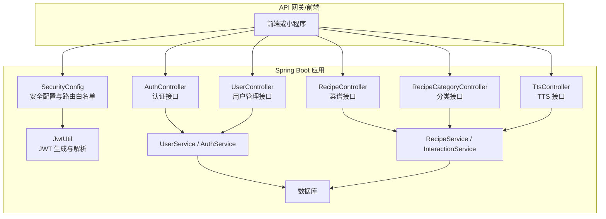
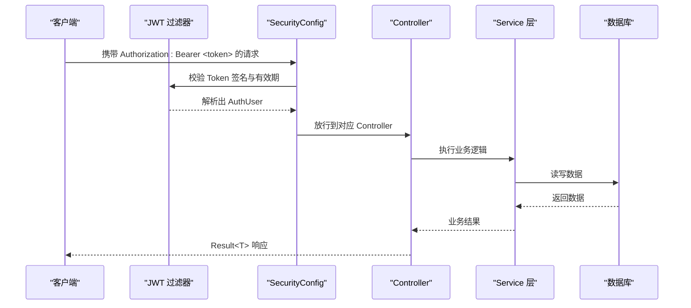
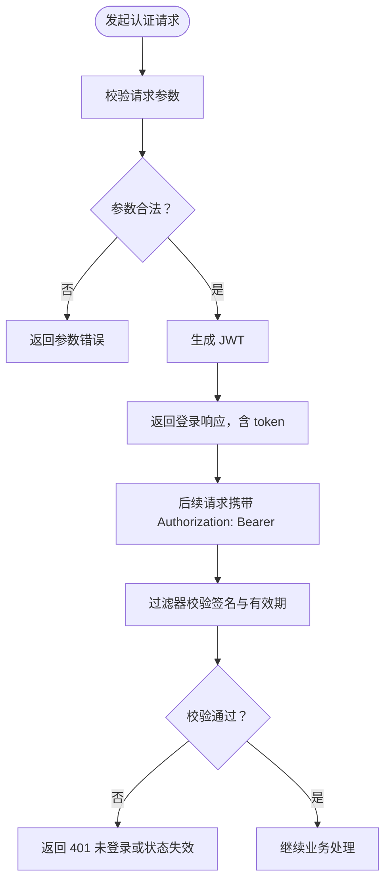
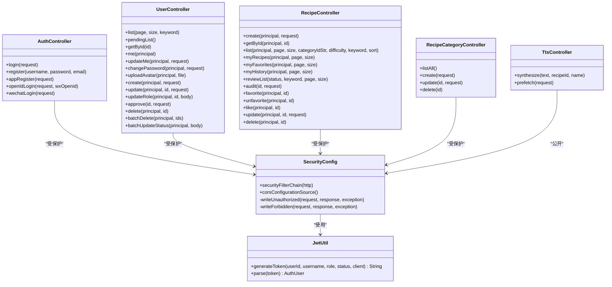

# RESTful API

<cite>
**本文引用的文件**   
- [AuthController.java](file://services/api/identity/src/main/java/com/goodzheng/po/identity/controller/AuthController.java)
- [UserController.java](file://services/api/identity/src/main/java/com/goodzheng/po/identity/controller/UserController.java)
- [RecipeController.java](file://services/api/recipe/src/main/java/com/goodzheng/po/recipe/controller/RecipeController.java)
- [RecipeCategoryController.java](file://services/api/recipe/src/main/java/com/goodzheng/po/recipe/controller/RecipeCategoryController.java)
- [TtsController.java](file://services/api/recipe/src/main/java/com/goodzheng/po/recipe/controller/TtsController.java)
- [SecurityConfig.java](file://services/api/identity/src/main/java/com/goodzheng/po/identity/security/SecurityConfig.java)
- [JwtUtil.java](file://services/api/identity/src/main/java/com/goodzheng/po/identity/security/JwtUtil.java)
- [Result.java](file://services/api/shared/src/main/java/com/goodzheng/po/shared/dto/Result.java)
</cite>

## 目录
1. [简介](#简介)
2. [项目结构](#项目结构)
3. [核心组件](#核心组件)
4. [架构总览](#架构总览)
5. [接口总览与权限规则](#接口总览与权限规则)
6. [认证与授权](#认证与授权)
7. [通用响应格式与错误码](#通用响应格式与错误码)
8. [用户认证接口](#用户认证接口)
9. [用户管理接口](#用户管理接口)
10. [菜谱管理接口](#菜谱管理接口)
11. [菜谱分类接口](#菜谱分类接口)
12. [TTS 语音合成接口](#tts-语音合成接口)
13. [依赖关系分析](#依赖关系分析)
14. [性能与可用性建议](#性能与可用性建议)
15. [故障排查指南](#故障排查指南)
16. [结论](#结论)

## 简介
本文件为后端 RESTful API 的完整接口文档，覆盖以下能力：
- 用户认证：账号密码登录、注册、App 注册、微信登录、OpenID 登录。
- 用户管理：用户列表、详情、个人资料修改、头像上传、角色与状态管理、审批流程。
- 菜谱管理：创建、查询、筛选、分页、收藏、点赞、历史、审核队列与管理端审核、更新与删除。
- 菜谱分类：分类列表、新增、更新、删除。
- TTS 语音合成：单条合成与批量预热，返回腾讯云 COS 公网音频 URL。

所有接口统一通过 Spring Security 进行无状态 JWT 鉴权，并以统一的 Result 对象作为响应体。

## 项目结构
后端服务位于 services/api 下，按领域拆分为 identity（身份认证与用户）、recipe（菜谱、分类、TTS）以及 shared（通用 DTO）。控制器层暴露 HTTP 接口，Service 层实现业务逻辑，Repository 层访问数据库。

**图表来源**
- [SecurityConfig.java:54-99](file://services/api/identity/src/main/java/com/goodzheng/po/identity/security/SecurityConfig.java#L54-L99)
- [AuthController.java:19-79](file://services/api/identity/src/main/java/com/goodzheng/po/identity/controller/AuthController.java#L19-L79)
- [UserController.java:39-353](file://services/api/identity/src/main/java/com/goodzheng/po/identity/controller/UserController.java#L39-L353)
- [RecipeController.java:30-229](file://services/api/recipe/src/main/java/com/goodzheng/po/recipe/controller/RecipeController.java#L30-L229)
- [RecipeCategoryController.java:24-73](file://services/api/recipe/src/main/java/com/goodzheng/po/recipe/controller/RecipeCategoryController.java#L24-L73)
- [TtsController.java:24-77](file://services/api/recipe/src/main/java/com/goodzheng/po/recipe/controller/TtsController.java#L24-L77)
- [JwtUtil.java:13-58](file://services/api/identity/src/main/java/com/goodzheng/po/identity/security/JwtUtil.java#L13-L58)

**章节来源**
- [SecurityConfig.java:35-99](file://services/api/identity/src/main/java/com/goodzheng/po/identity/security/SecurityConfig.java#L35-L99)

## 核心组件
- 安全配置与安全过滤器：统一处理跨域、会话策略、路径级权限控制、未认证与拒绝访问的统一 JSON 响应。
- JWT 工具：负责签发包含用户标识、角色、状态、客户端来源的令牌，并校验签名与有效期。
- 统一响应体：所有接口返回 Result<T>，包含 code、success、data、message。

**章节来源**
- [SecurityConfig.java:54-132](file://services/api/identity/src/main/java/com/goodzheng/po/identity/security/SecurityConfig.java#L54-L132)
- [JwtUtil.java:13-58](file://services/api/identity/src/main/java/com/goodzheng/po/identity/security/JwtUtil.java#L13-L58)
- [Result.java:1-33](file://services/api/shared/src/main/java/com/goodzheng/po/shared/dto/Result.java#L1-L33)

## 架构总览
系统采用前后端分离架构，前端通过 HTTP 调用后端 REST 接口；认证使用无状态 JWT，服务端不保存会话。鉴权由 SecurityFilterChain 在请求进入 Controller 前完成，Controller 仅处理业务规则。

**图表来源**
- [SecurityConfig.java:54-99](file://services/api/identity/src/main/java/com/goodzheng/po/identity/security/SecurityConfig.java#L54-L99)
- [JwtUtil.java:25-58](file://services/api/identity/src/main/java/com/goodzheng/po/identity/security/JwtUtil.java#L25-L58)

## 接口总览与权限规则
- 公开接口：无需登录即可访问，如登录、注册、微信登录、OpenID 登录、App 注册、菜谱列表与详情、分类列表、TTS 合成、静态资源等。
- 已登录接口：需要有效 JWT，如个人中心、我的菜谱、收藏、点赞、历史、菜谱创建与互动。
- 管理员接口：需要管理端管理员或超级管理员身份，如用户管理、菜谱审核、分类写操作、内容写操作。

权限判定关键点：
- 管理端管理员/超级管理员需同时满足角色与客户端来源条件。
- 普通 App 用户可维护自己的资料与头像，但不能访问用户管理或内容写接口。
- 部分接口虽允许登录访问，但归属权校验在 Service 层执行（例如作者只能删自己的菜谱）。

**章节来源**
- [SecurityConfig.java:44-94](file://services/api/identity/src/main/java/com/goodzheng/po/identity/security/SecurityConfig.java#L44-L94)

## 认证与授权
### JWT Token 获取与使用
- 获取方式：通过认证接口成功登录后返回 LoginResponse，其中包含 token。
- 使用方法：后续请求在请求头中携带 Authorization: Bearer <token>。
- Token 载荷：包含用户标识、用户名、角色、状态、客户端来源，用于过滤器链直接鉴权。
- 过期处理：Token 过期或未携带时，SecurityConfig 会返回 401 未登录或状态失效。

**图表来源**
- [AuthController.java:26-78](file://services/api/identity/src/main/java/com/goodzheng/po/identity/controller/AuthController.java#L26-L78)
- [JwtUtil.java:25-58](file://services/api/identity/src/main/java/com/goodzheng/po/identity/security/JwtUtil.java#L25-L58)
- [SecurityConfig.java:115-132](file://services/api/identity/src/main/java/com/goodzheng/po/identity/security/SecurityConfig.java#L115-L132)

**章节来源**
- [JwtUtil.java:13-58](file://services/api/identity/src/main/java/com/goodzheng/po/identity/security/JwtUtil.java#L13-L58)
- [SecurityConfig.java:54-99](file://services/api/identity/src/main/java/com/goodzheng/po/identity/security/SecurityConfig.java#L54-L99)

## 通用响应格式与错误码
所有接口统一返回 Result<T>，字段如下：
- code：业务状态码，成功通常为 1，失败为 0 或具体错误码。
- success：布尔值，表示是否成功。
- data：业务数据，可能为空。
- message：提示信息，成功时可省略，失败时提供原因。

常见 HTTP 状态码与业务含义：
- 200：请求成功，Result.success(...)。
- 400：参数错误或业务校验失败，Result.error(400, message)。
- 401：未登录或 Token 失效，SecurityConfig 统一返回。
- 403：已登录但无权访问，SecurityConfig 统一返回。
- 404：资源不存在或不可见，部分接口返回。
- 500：服务器内部异常，部分接口返回。

**章节来源**
- [Result.java:1-33](file://services/api/shared/src/main/java/com/goodzheng/po/shared/dto/Result.java#L1-L33)
- [SecurityConfig.java:115-132](file://services/api/identity/src/main/java/com/goodzheng/po/identity/security/SecurityConfig.java#L115-L132)

## 用户认证接口
### 账号密码登录
- 方法：POST
- 路径：/auth/login
- 请求体：LoginRequest（包含用户名、密码等字段）
- 响应：Result<LoginResponse>，包含 token 与用户基本信息
- 权限：公开
- 错误：
  - 401：用户名或密码错误
  - 400：参数校验失败

### 账号注册
- 方法：POST
- 路径：/auth/register
- 查询参数：username、password、email（可选）
- 响应：Result<String>，返回注册消息
- 权限：公开
- 错误：
  - 400：用户名重复或参数非法

### App 注册
- 方法：POST
- 路径：/auth/app-register
- 请求体：AppRegisterRequest（包含 App 端注册所需字段）
- 响应：Result<LoginResponse>，返回 token
- 权限：公开
- 错误：
  - 400：参数校验失败

### OpenID 登录
- 方法：POST
- 路径：/auth/openid-login
- 请求体：OpenIdLoginRequest
- 请求头：X-Wx-Openid（可选，用于补充微信 OpenID）
- 响应：Result<LoginResponse>，返回 token
- 权限：公开
- 错误：
  - 401：OpenID 无效或绑定失败

### 微信登录
- 方法：POST
- 路径：/auth/wechat-login
- 请求体：WeChatLoginRequest（包含微信授权码等）
- 响应：Result<LoginResponse>，返回 token
- 权限：公开
- 错误：
  - 401：微信授权失败或用户不存在

**章节来源**
- [AuthController.java:26-78](file://services/api/identity/src/main/java/com/goodzheng/po/identity/controller/AuthController.java#L26-L78)

## 用户管理接口
### 获取当前用户信息
- 方法：GET
- 路径：/users/me
- 权限：已登录
- 响应：Result<User>，返回当前用户资料
- 错误：
  - 401：未登录或 Token 失效

### 更新当前用户资料
- 方法：PUT
- 路径：/users/me
- 请求体：ProfileRequest（昵称、邮箱、手机号、头像等）
- 权限：已登录
- 约束：仅放行基本资料字段，角色/状态/密码不可自助修改
- 响应：Result<User>
- 错误：
  - 400：参数非法或更新失败

### 修改当前用户密码
- 方法：PUT
- 路径：/users/me/password
- 请求体：ChangePasswordRequest（旧密码、新密码）
- 权限：已登录
- 响应：Result<String>
- 错误：
  - 400：旧密码错误或新密码不符合要求

### 上传头像
- 方法：POST
- 路径：/users/me/avatar
- 表单字段：file（MultipartFile）
- 权限：已登录
- 约束：
  - 支持 jpg/png/gif/webp
  - 大小不超过 2MB
  - 上传至腾讯云 COS，自动写入用户 avatar 字段
- 响应：Result<String>，返回头像 URL
- 错误：
  - 400：文件格式不支持或超过大小限制

### 用户列表（分页）
- 方法：GET
- 路径：/users?page=0&size=10&keyword=xxx
- 权限：管理端管理员或超级管理员
- 响应：Result<Page<User>>
- 错误：
  - 403：非管理员访问

### 待审批用户列表
- 方法：GET
- 路径：/users/pending
- 权限：管理端管理员或超级管理员
- 响应：Result<List<User>>

### 获取用户详情
- 方法：GET
- 路径：/users/{id}
- 权限：管理端管理员或超级管理员
- 响应：Result<User>
- 错误：
  - 400：用户不存在

### 创建用户
- 方法：POST
- 路径：/users
- 请求体：UserRequest（用户名、角色、状态等）
- 权限：管理端管理员或超级管理员
- 约束：
  - 仅超级管理员可以授予超级管理员角色
  - 角色值必须合法
- 响应：Result<User>
- 错误：
  - 400：参数非法或角色分配不合法

### 更新用户
- 方法：PUT
- 路径：/users/{id}
- 请求体：UserRequest
- 权限：管理端管理员或超级管理员
- 约束：
  - 管理员不能修改超级管理员
  - 超级管理员不能修改自己的角色
  - 目标角色必须在操作者权限范围内
- 响应：Result<User>
- 错误：
  - 400：业务规则冲突或参数非法

### 修改用户角色
- 方法：PUT
- 路径：/users/{id}/role
- 请求体：{ "role": "admin" | "super_admin" }
- 权限：管理端管理员或超级管理员
- 约束：
  - 仅超级管理员可授予/撤销超级管理员角色
  - 超级管理员不能修改自己的角色
- 响应：Result<User>
- 错误：
  - 400：非法角色值或权限不足

### 审批用户
- 方法：PUT
- 路径：/users/{id}/approval
- 请求体：ApprovalRequest（action: approved | rejected）
- 权限：管理端管理员或超级管理员
- 响应：Result<User>
- 错误：
  - 400：审批动作无效

### 删除用户
- 方法：DELETE
- 路径：/users/{id}
- 权限：管理端管理员或超级管理员
- 约束：
  - 不能删除自己
  - 管理员不能删除超级管理员
- 响应：Result<String>
- 错误：
  - 400：业务规则冲突

### 批量删除用户
- 方法：DELETE
- 路径：/users/batch
- 请求体：[id1, id2, ...]
- 权限：管理端管理员或超级管理员
- 约束：
  - 不能删除自己
  - 管理员不能删除超级管理员
- 响应：Result<String>
- 错误：
  - 400：业务规则冲突

### 批量修改用户状态
- 方法：PUT
- 路径：/users/batch/status
- 请求体：{ "ids": [1,2], "status": "active" | "disabled" }
- 权限：管理端管理员或超级管理员
- 约束：
  - 不能修改自己的状态
  - 管理员不能修改超级管理员的状态
- 响应：Result<String>
- 错误：
  - 400：业务规则冲突

**章节来源**
- [UserController.java:58-353](file://services/api/identity/src/main/java/com/goodzheng/po/identity/controller/UserController.java#L58-L353)

## 菜谱管理接口
### 创建菜谱
- 方法：POST
- 路径：/recipes
- 请求体：RecipeRequest
- 权限：已登录
- 约束：
  - 管理员创建的菜谱直接通过审核
  - App 用户创建的菜谱进入待审核
- 响应：Result<Recipe>
- 错误：
  - 400：参数非法或业务校验失败

### 查询单个菜谱详情
- 方法：GET
- 路径：/recipes/{id}
- 权限：公开（未发布仅作者本人或管理员可见）
- 行为：
  - 若菜谱未发布且当前用户无权查看，返回 404
  - 若已登录，记录浏览历史并填充收藏/点赞标记
- 响应：Result<Recipe>
- 错误：
  - 404：菜谱不存在或未通过审核

### 筛选排序列表
- 方法：GET
- 路径：/recipes?page=0&size=20&categoryIdStr=1,2&difficulty=1&keyword=xxx&sort=recommend
- 权限：公开
- 行为：
  - 仅返回已通过审核且公开的菜谱
  - 若已登录，填充收藏/点赞标记
- 响应：Result<Page<Recipe>>
- 错误：
  - 400：参数解析失败

### 我的菜谱
- 方法：GET
- 路径：/recipes/mine?page=0&size=20
- 权限：已登录
- 行为：返回该作者的全部菜谱（含待审核/已驳回）
- 响应：Result<Page<Recipe>>
- 错误：
  - 401：未登录

### 我的收藏
- 方法：GET
- 路径：/recipes/favorites?page=0&size=20
- 权限：已登录
- 行为：返回收藏的菜谱并填充标记
- 响应：Result<Page<Recipe>>
- 错误：
  - 401：未登录

### 我的浏览历史
- 方法：GET
- 路径：/recipes/history?page=0&size=20
- 权限：已登录
- 行为：返回最近浏览的菜谱并填充标记
- 响应：Result<Page<Recipe>>
- 错误：
  - 401：未登录

### 管理端审核队列
- 方法：GET
- 路径：/recipes/review?status=pending&keyword=xxx&page=0&size=20
- 权限：管理端管理员或超级管理员
- 响应：Result<Page<Recipe>>
- 错误：
  - 400：参数非法

### 管理端审核
- 方法：PUT
- 路径：/recipes/{id}/audit
- 请求体：AuditRequest（action、reason）
- 权限：管理端管理员或超级管理员
- 响应：Result<Recipe>
- 错误：
  - 400：审核动作非法或业务校验失败

### 收藏
- 方法：POST
- 路径：/recipes/{id}/favorite
- 权限：已登录
- 响应：Result<String>
- 错误：
  - 400：收藏失败

### 取消收藏
- 方法：DELETE
- 路径：/recipes/{id}/favorite
- 权限：已登录
- 响应：Result<String>
- 错误：
  - 400：取消收藏失败

### 点赞切换
- 方法：POST
- 路径：/recipes/{id}/like
- 权限：已登录
- 响应：Result<LikeResult>，包含是否已点赞及计数
- 错误：
  - 400：点赞失败

### 更新菜谱
- 方法：PUT
- 路径：/recipes/{id}
- 请求体：RecipeRequest
- 权限：已登录
- 约束：
  - 管理员可任意编辑
  - 作者本人编辑后重新送审
- 响应：Result<Recipe>
- 错误：
  - 400：参数非法或权限不足

### 删除菜谱
- 方法：DELETE
- 路径：/recipes/{id}
- 权限：已登录
- 约束：
  - 管理员可任意删除
  - 作者只能删除自己的菜谱
- 响应：Result<String>
- 错误：
  - 400：权限不足或删除失败

**章节来源**
- [RecipeController.java:38-229](file://services/api/recipe/src/main/java/com/goodzheng/po/recipe/controller/RecipeController.java#L38-L229)

## 菜谱分类接口
### 查询所有分类
- 方法：GET
- 路径：/recipe-categories
- 权限：公开
- 响应：Result<List<RecipeCategory>>
- 错误：
  - 500：服务器内部异常

### 新建分类
- 方法：POST
- 路径：/recipe-categories
- 请求体：RecipeCategoryRequest
- 权限：管理端管理员或超级管理员
- 响应：Result<RecipeCategory>
- 错误：
  - 400：参数非法

### 更新分类
- 方法：PUT
- 路径：/recipe-categories/{id}
- 请求体：RecipeCategoryRequest
- 权限：管理端管理员或超级管理员
- 响应：Result<RecipeCategory>
- 错误：
  - 400：参数非法

### 删除分类
- 方法：DELETE
- 路径：/recipe-categories/{id}
- 权限：管理端管理员或超级管理员
- 响应：Result<String>
- 错误：
  - 400：删除失败

**章节来源**
- [RecipeCategoryController.java:31-73](file://services/api/recipe/src/main/java/com/goodzheng/po/recipe/controller/RecipeCategoryController.java#L31-L73)

## TTS 语音合成接口
### 合成单条播报
- 方法：GET
- 路径：/tts?text=...&recipeId=...&name=...
- 权限：公开
- 行为：
  - text 必填
  - recipeId/name 用于组织缓存目录与文件名
  - 返回腾讯云 COS 公网音频 URL
- 响应：Result<Map<String, String>>，data.url 为音频地址
- 错误：
  - 400：文本为空
  - 500：语音合成失败

### 批量预热
- 方法：POST
- 路径：/tts/prefetch
- 请求体：TtsPrefetchRequest（clips 数组，每项包含文本、可选 recipeId/name）
- 权限：公开
- 行为：
  - 单次最多处理 50 条
  - 桶内已有音频立即返回 URL，缺失项后台异步合成
  - 首次进入某道菜可能返回空 map，属于正常
- 响应：Result<TtsPrefetchResult>
- 错误：
  - 400：播报内容为空
  - 500：语音预热失败

**章节来源**
- [TtsController.java:39-76](file://services/api/recipe/src/main/java/com/goodzheng/po/recipe/controller/TtsController.java#L39-L76)

## 依赖关系分析

**图表来源**
- [SecurityConfig.java:54-99](file://services/api/identity/src/main/java/com/goodzheng/po/identity/security/SecurityConfig.java#L54-L99)
- [JwtUtil.java:13-58](file://services/api/identity/src/main/java/com/goodzheng/po/identity/security/JwtUtil.java#L13-L58)
- [AuthController.java:19-79](file://services/api/identity/src/main/java/com/goodzheng/po/identity/controller/AuthController.java#L19-L79)
- [UserController.java:39-353](file://services/api/identity/src/main/java/com/goodzheng/po/identity/controller/UserController.java#L39-L353)
- [RecipeController.java:30-229](file://services/api/recipe/src/main/java/com/goodzheng/po/recipe/controller/RecipeController.java#L30-L229)
- [RecipeCategoryController.java:24-73](file://services/api/recipe/src/main/java/com/goodzheng/po/recipe/controller/RecipeCategoryController.java#L24-L73)
- [TtsController.java:24-77](file://services/api/recipe/src/main/java/com/goodzheng/po/recipe/controller/TtsController.java#L24-L77)

**章节来源**
- [SecurityConfig.java:44-94](file://services/api/identity/src/main/java/com/goodzheng/po/identity/security/SecurityConfig.java#L44-L94)

## 性能与可用性建议
- 分页与排序：菜谱列表与用户列表均支持分页，建议前端合理设置 size，避免过大页导致数据库压力。
- 缓存与预热：TTS 预热接口可在进入做菜模式时提前合成音频，减少首帧等待时间。
- 静态资源：头像、封面、食材图片、声音等资源通过公共路径访问，建议配合 CDN 提升加载速度。
- 鉴权开销：JWT 校验轻量，但频繁解析仍需注意 Token 生命周期与刷新策略。

## 故障排查指南
- 401 未登录或状态失效：检查 Authorization 头是否正确携带，Token 是否过期。
- 403 没有访问权限：确认当前用户是否为管理端管理员或超级管理员，或是否尝试访问受限接口。
- 400 参数或业务错误：检查请求体字段是否符合校验规则，角色/状态值是否合法。
- 404 资源不存在：菜谱未发布且当前用户无权查看，或 ID 不存在。
- 500 服务器异常：关注日志中的异常堆栈，尤其是 TTS 合成与存储相关错误。

**章节来源**
- [SecurityConfig.java:115-132](file://services/api/identity/src/main/java/com/goodzheng/po/identity/security/SecurityConfig.java#L115-L132)
- [TtsController.java:44-76](file://services/api/recipe/src/main/java/com/goodzheng/po/recipe/controller/TtsController.java#L44-L76)

## 结论
本 API 以 Spring Security 为核心构建无状态鉴权体系，围绕用户、菜谱、分类与 TTS 四大领域提供完整的 REST 接口。通过统一的 Result 响应体与清晰的权限边界，既满足公开浏览体验，又保障管理与内容安全。建议在集成时严格遵循请求头与参数规范，并结合分页、缓存与预热策略优化用户体验。