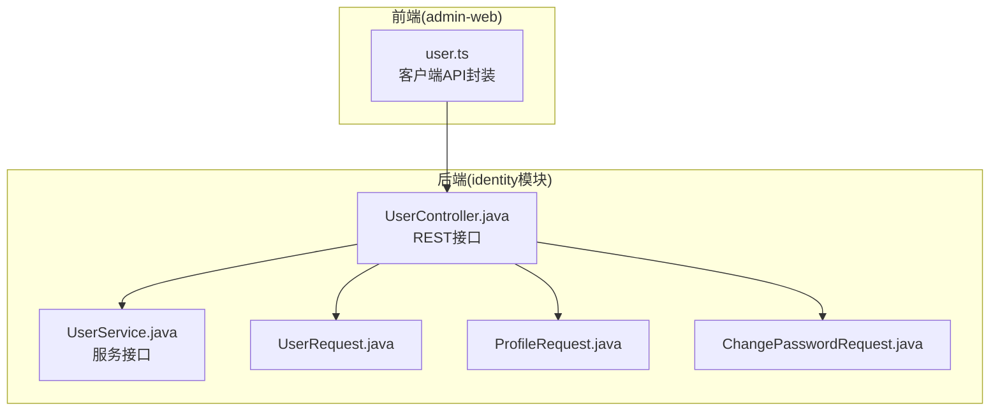
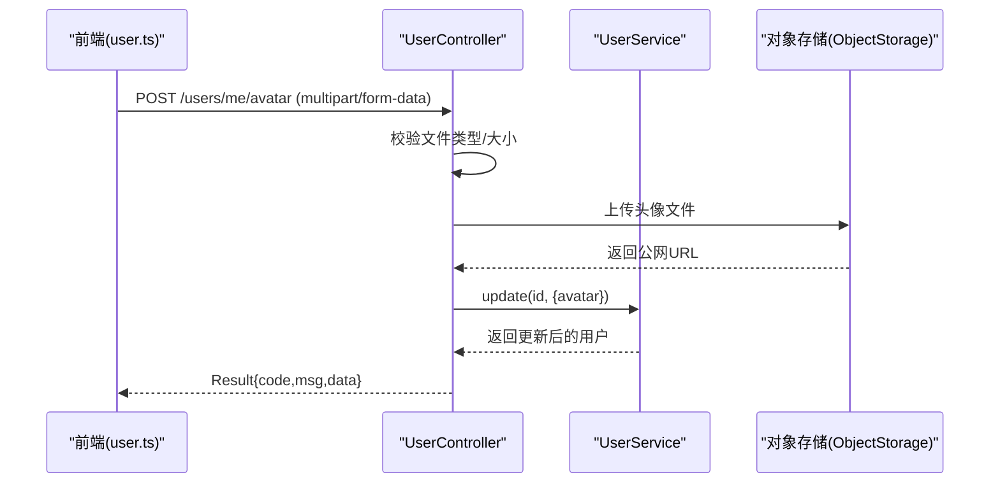
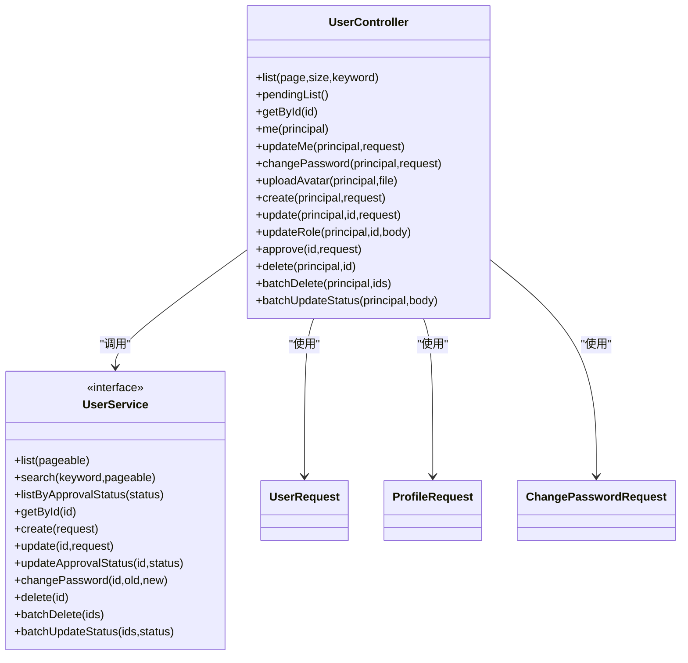

# 用户管理接口

<cite>
**本文引用的文件**   
- [UserController.java](file://services/api/identity/src/main/java/com/goodzheng/po/identity/controller/UserController.java)
- [UserService.java](file://services/api/identity/src/main/java/com/goodzheng/po/identity/service/UserService.java)
- [UserRequest.java](file://services/api/identity/src/main/java/com/goodzheng/po/identity/dto/UserRequest.java)
- [ProfileRequest.java](file://services/api/identity/src/main/java/com/goodzheng/po/identity/dto/ProfileRequest.java)
- [ChangePasswordRequest.java](file://services/api/identity/src/main/java/com/goodzheng/po/identity/dto/ChangePasswordRequest.java)
- [user.ts](file://apps/admin-web/src/services/user.ts)
</cite>

## 目录
1. [简介](#简介)
2. [项目结构](#项目结构)
3. [核心组件](#核心组件)
4. [架构总览](#架构总览)
5. [详细接口说明](#详细接口说明)
6. [依赖关系分析](#依赖关系分析)
7. [性能与容量](#性能与容量)
8. [故障排查指南](#故障排查指南)
9. [结论](#结论)

## 简介
本文件为“用户管理”相关接口的完整 API 文档，覆盖以下能力：
- 用户信息 CRUD（分页查询、详情、创建、更新、删除）
- 个人资料管理（昵称、邮箱、手机号、头像）
- 密码修改（需校验原密码）
- 用户审批（待审批列表、通过/拒绝）
- 角色权限控制（超级管理员与普通管理员的差异化权限）
- 用户状态管理（启用/禁用等批量操作）

所有接口统一返回 Result 包装结构，错误以业务异常抛出并由控制器捕获后转为统一响应。

## 项目结构
后端采用 Spring Boot + MyBatis + Spring Security 的分层架构：
- Controller 层：定义 REST 接口、参数校验、权限与业务规则
- Service 层：封装用户领域逻辑（CRUD、审批、密码变更、批量操作）
- DTO 层：请求体模型与校验注解
- 前端调用：admin-web 中 user.ts 提供客户端方法映射到后端路径

图表来源
- [UserController.java:39-42](file://services/api/identity/src/main/java/com/goodzheng/po/identity/controller/UserController.java#L39-L42)
- [UserService.java:10-34](file://services/api/identity/src/main/java/com/goodzheng/po/identity/service/UserService.java#L10-L34)
- [UserRequest.java:6-29](file://services/api/identity/src/main/java/com/goodzheng/po/identity/dto/UserRequest.java#L6-L29)
- [ProfileRequest.java:11-26](file://services/api/identity/src/main/java/com/goodzheng/po/identity/dto/ProfileRequest.java#L11-L26)
- [ChangePasswordRequest.java:8-14](file://services/api/identity/src/main/java/com/goodzheng/po/identity/dto/ChangePasswordRequest.java#L8-L14)
- [user.ts:15-172](file://apps/admin-web/src/services/user.ts#L15-L172)

章节来源
- [UserController.java:39-42](file://services/api/identity/src/main/java/com/goodzheng/po/identity/controller/UserController.java#L39-L42)
- [user.ts:15-172](file://apps/admin-web/src/services/user.ts#L15-L172)

## 核心组件
- UserController：对外暴露 /users 系列接口，负责鉴权上下文获取、参数校验、权限判定、异常转 Result
- UserService：用户领域能力抽象，包含分页、搜索、详情、创建、更新、删除、批量操作、审批、密码修改
- DTO：
  - UserRequest：用户创建/更新请求体，含用户名、密码、邮箱、姓名、手机、角色、状态、昵称、头像
  - ProfileRequest：当前用户自助更新资料，含昵称、邮箱、手机号、头像，带格式校验
  - ChangePasswordRequest：修改密码请求体，含旧密码与新密码

章节来源
- [UserController.java:39-42](file://services/api/identity/src/main/java/com/goodzheng/po/identity/controller/UserController.java#L39-L42)
- [UserService.java:10-34](file://services/api/identity/src/main/java/com/goodzheng/po/identity/service/UserService.java#L10-L34)
- [UserRequest.java:6-29](file://services/api/identity/src/main/java/com/goodzheng/po/identity/dto/UserRequest.java#L6-L29)
- [ProfileRequest.java:11-26](file://services/api/identity/src/main/java/com/goodzheng/po/identity/dto/ProfileRequest.java#L11-L26)
- [ChangePasswordRequest.java:8-14](file://services/api/identity/src/main/java/com/goodzheng/po/identity/dto/ChangePasswordRequest.java#L8-L14)

## 架构总览
下图展示一次“上传头像并自动写入 avatar”的调用链路与数据流。

图表来源
- [UserController.java:131-165](file://services/api/identity/src/main/java/com/goodzheng/po/identity/controller/UserController.java#L131-L165)
- [user.ts:36-48](file://apps/admin-web/src/services/user.ts#L36-L48)

## 详细接口说明

### 通用约定
- 基础路径：/api/users
- 认证方式：由安全过滤器链统一处理，接口内通过 @AuthenticationPrincipal 获取当前登录用户
- 统一响应：Result<T>，包含 code、message、data；业务异常在控制器中被捕获并返回错误码与消息
- 分页参数：page（从0开始）、size（默认10），按 createTime 倒序
- 角色常量：SUPER_ADMIN（超级管理员）、普通管理员等，具体值见 RoleConstants

### 1) 分页查询用户列表
- 方法：GET
- 路径：/api/users
- 权限：管理员及以上
- 查询参数：
  - page：页码，默认 0
  - size：每页数量，默认 10
  - keyword：可选关键词搜索
- 成功响应：Result<Page<User>>
- 错误处理：未授权或无权限时由安全层拦截；其他异常返回 Result.error

示例请求
- GET /api/users?page=0&size=10&keyword=admin

示例响应
- { "code": 200, "message": "success", "data": { "content": [...], "totalElements": 100, "number": 0, "size": 10 } }

章节来源
- [UserController.java:58-69](file://services/api/identity/src/main/java/com/goodzheng/po/identity/controller/UserController.java#L58-L69)
- [user.ts:63-73](file://apps/admin-web/src/services/user.ts#L63-L73)

### 2) 获取单个用户详情
- 方法：GET
- 路径：/api/users/{id}
- 权限：管理员及以上
- 路径参数：id（用户ID）
- 成功响应：Result<User>
- 错误处理：找不到用户或非法参数时返回错误

示例请求
- GET /api/users/1

示例响应
- { "code": 200, "message": "success", "data": { "id": 1, "username": "admin", ... } }

章节来源
- [UserController.java:78-86](file://services/api/identity/src/main/java/com/goodzheng/po/identity/controller/UserController.java#L78-L86)
- [user.ts:75-84](file://apps/admin-web/src/services/user.ts#L75-L84)

### 3) 创建用户
- 方法：POST
- 路径：/api/users
- 权限：管理员及以上
- 请求体：UserRequest
- 成功响应：Result<User>
- 校验规则：
  - username：必填
  - role：若传入，需合法且受操作者权限限制（仅超级管理员可授予 SUPER_ADMIN）
- 错误处理：非法角色或越权时返回错误

示例请求
- POST /api/users
- Body: { "username": "test", "email": "test@example.com", "role": "ADMIN" }

示例响应
- { "code": 200, "message": "success", "data": { "id": 2, "username": "test", ... } }

章节来源
- [UserController.java:167-178](file://services/api/identity/src/main/java/com/goodzheng/po/identity/controller/UserController.java#L167-L178)
- [UserRequest.java:6-29](file://services/api/identity/src/main/java/com/goodzheng/po/identity/dto/UserRequest.java#L6-L29)
- [user.ts:86-97](file://apps/admin-web/src/services/user.ts#L86-L97)

### 4) 更新用户
- 方法：PUT
- 路径：/api/users/{id}
- 权限：管理员及以上
- 路径参数：id
- 请求体：Partial<UserRequest>
- 业务规则：
  - 管理员不能修改超级管理员
  - 超级管理员不能修改自己的角色
  - 目标角色需经 validateRoleAssignment 校验
- 成功响应：Result<User>

示例请求
- PUT /api/users/1
- Body: { "role": "ADMIN" }

示例响应
- { "code": 200, "message": "success", "data": { "id": 1, "role": "ADMIN", ... } }

章节来源
- [UserController.java:180-205](file://services/api/identity/src/main/java/com/goodzheng/po/identity/controller/UserController.java#L180-L205)
- [user.ts:99-111](file://apps/admin-web/src/services/user.ts#L99-L111)

### 5) 修改用户角色
- 方法：PUT
- 路径：/api/users/{id}/role
- 权限：管理员及以上
- 路径参数：id
- 请求体：{ "role": string }
- 业务规则：
  - 角色必须合法
  - 管理员不能修改超级管理员的角色
  - 超级管理员不能修改自己的角色
- 成功响应：Result<User>

示例请求
- PUT /api/users/1/role
- Body: { "role": "ADMIN" }

示例响应
- { "code": 200, "message": "success", "data": { "id": 1, "role": "ADMIN", ... } }

章节来源
- [UserController.java:207-236](file://services/api/identity/src/main/java/com/goodzheng/po/identity/controller/UserController.java#L207-L236)
- [user.ts:113-125](file://apps/admin-web/src/services/user.ts#L113-L125)

### 6) 删除用户
- 方法：DELETE
- 路径：/api/users/{id}
- 权限：管理员及以上
- 路径参数：id
- 业务规则：
  - 不能删除自己
  - 管理员不能删除超级管理员
- 成功响应：Result<String>

示例请求
- DELETE /api/users/1

示例响应
- { "code": 200, "message": "删除成功", "data": null }

章节来源
- [UserController.java:254-272](file://services/api/identity/src/main/java/com/goodzheng/po/identity/controller/UserController.java#L254-L272)
- [user.ts:127-136](file://apps/admin-web/src/services/user.ts#L127-L136)

### 7) 批量修改用户状态
- 方法：PUT
- 路径：/api/users/batch/status
- 权限：管理员及以上
- 请求体：{ "ids": number[], "status": string }
- 业务规则：
  - 不能修改自己的状态
  - 管理员不能修改超级管理员的状态
- 成功响应：Result<String>

示例请求
- PUT /api/users/batch/status
- Body: { "ids": [2,3], "status": "DISABLED" }

示例响应
- { "code": 200, "message": "状态更新成功", "data": null }

章节来源
- [UserController.java:297-323](file://services/api/identity/src/main/java/com/goodzheng/po/identity/controller/UserController.java#L297-L323)
- [user.ts:138-150](file://apps/admin-web/src/services/user.ts#L138-L150)

### 8) 获取待审批用户列表
- 方法：GET
- 路径：/api/users/pending
- 权限：管理员及以上
- 成功响应：Result<User[]>

示例请求
- GET /api/users/pending

示例响应
- { "code": 200, "message": "success", "data": [ { "id": 1, "approvalStatus": "PENDING", ... } ] }

章节来源
- [UserController.java:71-76](file://services/api/identity/src/main/java/com/goodzheng/po/identity/controller/UserController.java#L71-L76)
- [user.ts:152-158](file://apps/admin-web/src/services/user.ts#L152-L158)

### 9) 审批用户
- 方法：PUT
- 路径：/api/users/{id}/approval
- 权限：管理员及以上
- 路径参数：id
- 请求体：{ "action": "approved" | "rejected" }
- 成功响应：Result<User>

示例请求
- PUT /api/users/1/approval
- Body: { "action": "approved" }

示例响应
- { "code": 200, "message": "success", "data": { "id": 1, "approvalStatus": "APPROVED", ... } }

章节来源
- [UserController.java:238-252](file://services/api/identity/src/main/java/com/goodzheng/po/identity/controller/UserController.java#L238-L252)
- [user.ts:160-172](file://apps/admin-web/src/services/user.ts#L160-L172)

### 10) 获取当前用户信息
- 方法：GET
- 路径：/api/users/me
- 权限：已登录用户
- 成功响应：Result<User>

示例请求
- GET /api/users/me

示例响应
- { "code": 200, "message": "success", "data": { "id": 1, "username": "me", ... } }

章节来源
- [UserController.java:88-96](file://services/api/identity/src/main/java/com/goodzheng/po/identity/controller/UserController.java#L88-L96)
- [user.ts:15-21](file://apps/admin-web/src/services/user.ts#L15-L21)

### 11) 更新当前用户个人资料
- 方法：PUT
- 路径：/api/users/me
- 权限：已登录用户
- 请求体：ProfileRequest
- 字段校验：
  - nickname：长度不超过 30
  - email：邮箱格式
  - phoneNumber：中国大陆手机号正则（允许空串表示清除）
  - avatar：字符串URL
- 成功响应：Result<User>

示例请求
- PUT /api/users/me
- Body: { "nickname": "小明", "email": "xiaoming@example.com", "phoneNumber": "13800001111" }

示例响应
- { "code": 200, "message": "success", "data": { "id": 1, "nickname": "小明", ... } }

章节来源
- [UserController.java:98-115](file://services/api/identity/src/main/java/com/goodzheng/po/identity/controller/UserController.java#L98-L115)
- [ProfileRequest.java:11-26](file://services/api/identity/src/main/java/com/goodzheng/po/identity/dto/ProfileRequest.java#L11-L26)
- [user.ts:23-34](file://apps/admin-web/src/services/user.ts#L23-L34)

### 12) 修改当前用户密码
- 方法：PUT
- 路径：/api/users/me/password
- 权限：已登录用户
- 请求体：ChangePasswordRequest
- 业务规则：需验证旧密码正确性
- 成功响应：Result<String>

示例请求
- PUT /api/users/me/password
- Body: { "oldPassword": "****", "newPassword": "****" }

示例响应
- { "code": 200, "message": "密码修改成功", "data": null }

章节来源
- [UserController.java:117-129](file://services/api/identity/src/main/java/com/goodzheng/po/identity/controller/UserController.java#L117-L129)
- [ChangePasswordRequest.java:8-14](file://services/api/identity/src/main/java/com/goodzheng/po/identity/dto/ChangePasswordRequest.java#L8-L14)
- [user.ts:50-61](file://apps/admin-web/src/services/user.ts#L50-L61)

### 13) 上传当前用户头像
- 方法：POST
- 路径：/api/users/me/avatar
- 权限：已登录用户
- 请求体：multipart/form-data，字段名 file
- 校验规则：
  - 仅支持 jpg/png/gif/webp
  - 文件大小上限 2MB
- 成功后直接更新用户 avatar 字段并返回 URL
- 成功响应：Result<String>

示例请求
- POST /api/users/me/avatar
- Content-Type: multipart/form-data
- File: image.jpg

示例响应
- { "code": 200, "message": "头像上传成功", "data": "https://.../avatars/xxx.webp" }

章节来源
- [UserController.java:131-165](file://services/api/identity/src/main/java/com/goodzheng/po/identity/controller/UserController.java#L131-L165)
- [user.ts:36-48](file://apps/admin-web/src/services/user.ts#L36-L48)

## 依赖关系分析
- 控制器与服务解耦：Controller 仅做入参校验、权限判断与异常转换，业务逻辑下沉至 Service
- DTO 与实体分离：DTO 承载请求校验，实体承载持久化模型
- 前端与后端契约：user.ts 中的函数签名与后端路径一一对应，便于维护

图表来源
- [UserController.java:39-352](file://services/api/identity/src/main/java/com/goodzheng/po/identity/controller/UserController.java#L39-L352)
- [UserService.java:10-34](file://services/api/identity/src/main/java/com/goodzheng/po/identity/service/UserService.java#L10-L34)
- [UserRequest.java:6-29](file://services/api/identity/src/main/java/com/goodzheng/po/identity/dto/UserRequest.java#L6-L29)
- [ProfileRequest.java:11-26](file://services/api/identity/src/main/java/com/goodzheng/po/identity/dto/ProfileRequest.java#L11-L26)
- [ChangePasswordRequest.java:8-14](file://services/api/identity/src/main/java/com/goodzheng/po/identity/dto/ChangePasswordRequest.java#L8-L14)

章节来源
- [UserController.java:39-352](file://services/api/identity/src/main/java/com/goodzheng/po/identity/controller/UserController.java#L39-L352)
- [UserService.java:10-34](file://services/api/identity/src/main/java/com/goodzheng/po/identity/service/UserService.java#L10-L34)

## 性能与容量
- 分页查询：默认按 createTime 倒序，建议合理设置 page/size，避免过大分页
- 头像上传：
  - 类型白名单：jpg/png/gif/webp
  - 大小限制：2MB
  - 存储：对象存储（COS），避免多实例本地磁盘不一致
- 批量操作：对 ids 集合进行权限校验后再执行，注意批量规模不宜过大

[本节为通用指导，不直接分析具体文件]

## 故障排查指南
- 常见错误
  - 未登录或无权限：由安全过滤器拦截，通常返回 401/403
  - 非法角色：提交 role 不在允许范围或越权授予 SUPER_ADMIN
  - 头像格式/大小不符：仅支持 jpg/png/gif/webp，且不超过 2MB
  - 修改自身敏感信息：禁止修改自己的角色/状态或删除自己
- 定位建议
  - 检查请求头是否携带有效令牌
  - 核对 DTO 校验注解（如邮箱、手机号、昵称长度）
  - 查看控制器 catch 块返回的错误消息

章节来源
- [UserController.java:131-165](file://services/api/identity/src/main/java/com/goodzheng/po/identity/controller/UserController.java#L131-L165)
- [UserController.java:180-205](file://services/api/identity/src/main/java/com/goodzheng/po/identity/controller/UserController.java#L180-L205)
- [UserController.java:254-272](file://services/api/identity/src/main/java/com/goodzheng/po/identity/controller/UserController.java#L254-L272)
- [UserController.java:297-323](file://services/api/identity/src/main/java/com/goodzheng/po/identity/controller/UserController.java#L297-L323)

## 结论
本套用户管理接口围绕“最小权限原则”和“职责分层”设计，将鉴权、校验、权限判定集中在 Controller，业务逻辑下沉至 Service，并通过 DTO 明确输入约束。结合统一的 Result 响应结构与对象存储方案，既保证了安全性与一致性，也提升了扩展性与可维护性。前端通过 user.ts 与后端保持清晰契约，便于后续迭代与测试。