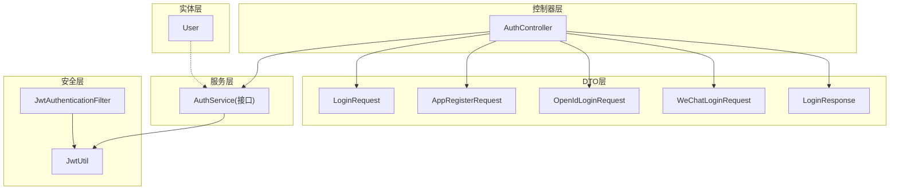
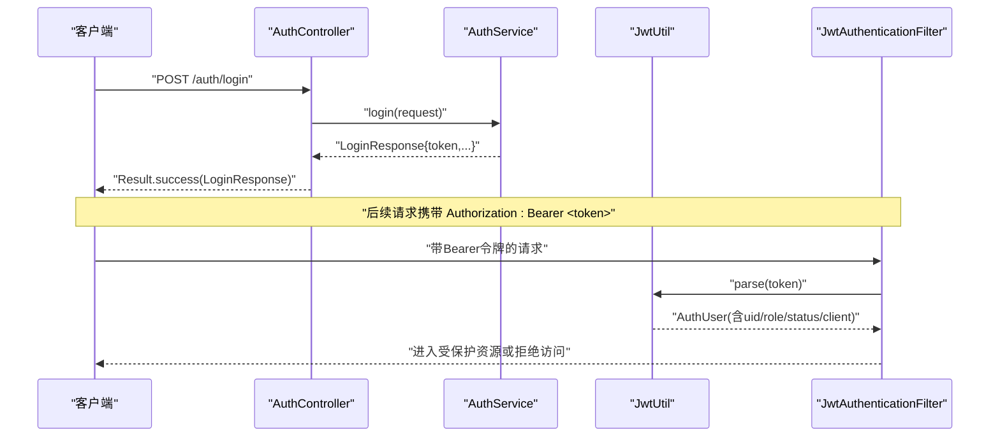
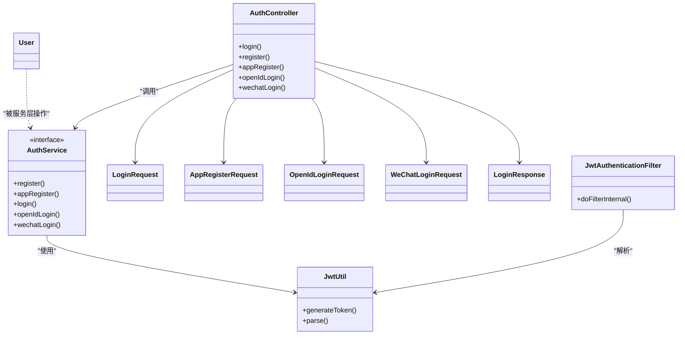

# 用户认证接口

<cite>
**本文引用的文件**   
- [AuthController.java](file://services/api/identity/src/main/java/com/goodzheng/po/identity/controller/AuthController.java)
- [AuthService.java](file://services/api/identity/src/main/java/com/goodzheng/po/identity/service/AuthService.java)
- [LoginRequest.java](file://services/api/identity/src/main/java/com/goodzheng/po/identity/dto/LoginRequest.java)
- [LoginResponse.java](file://services/api/identity/src/main/java/com/goodzheng/po/identity/dto/LoginResponse.java)
- [AppRegisterRequest.java](file://services/api/identity/src/main/java/com/goodzheng/po/identity/dto/AppRegisterRequest.java)
- [OpenIdLoginRequest.java](file://services/api/identity/src/main/java/com/goodzheng/po/identity/dto/OpenIdLoginRequest.java)
- [WeChatLoginRequest.java](file://services/api/identity/src/main/java/com/goodzheng/po/identity/dto/WeChatLoginRequest.java)
- [JwtUtil.java](file://services/api/identity/src/main/java/com/goodzheng/po/identity/security/JwtUtil.java)
- [JwtAuthenticationFilter.java](file://services/api/identity/src/main/java/com/goodzheng/po/identity/security/JwtAuthenticationFilter.java)
- [User.java](file://services/api/identity/src/main/java/com/goodzheng/po/identity/entity/User.java)
</cite>

## 目录
1. [简介](#简介)
2. [项目结构](#项目结构)
3. [核心组件](#核心组件)
4. [架构总览](#架构总览)
5. [详细接口说明](#详细接口说明)
6. [依赖关系分析](#依赖关系分析)
7. [性能与扩展性](#性能与扩展性)
8. [故障排查指南](#故障排查指南)
9. [结论](#结论)

## 简介
本文件为“用户认证”相关接口的完整API文档，覆盖以下端点：
- POST /auth/login（用户名密码登录）
- POST /auth/register（用户注册）
- POST /auth/app-register（应用注册）
- POST /auth/openid-login（OpenID登录）
- POST /auth/wechat-login（微信登录）

文档包含请求参数、响应格式、错误码与状态码、JWT Token获取与使用流程、Token过期处理机制、数据验证规则、安全考虑与最佳实践，并提供成功与失败场景的请求/响应示例。

## 项目结构
认证能力集中在后端Java服务中，关键路径如下：
- 控制器层：定义REST端点并接收请求参数
- 服务层：封装业务逻辑（由AuthService接口定义）
- DTO层：定义请求与响应的数据结构及校验规则
- 安全层：负责JWT生成、解析与过滤器链鉴权
- 实体层：用户模型映射数据库表

图表来源
- [AuthController.java:19-78](file://services/api/identity/src/main/java/com/goodzheng/po/identity/controller/AuthController.java#L19-L78)
- [AuthService.java:9-19](file://services/api/identity/src/main/java/com/goodzheng/po/identity/service/AuthService.java#L9-L19)
- [LoginRequest.java:6-18](file://services/api/identity/src/main/java/com/goodzheng/po/identity/dto/LoginRequest.java#L6-L18)
- [LoginResponse.java:5-38](file://services/api/identity/src/main/java/com/goodzheng/po/identity/dto/LoginResponse.java#L5-L38)
- [AppRegisterRequest.java:7-19](file://services/api/identity/src/main/java/com/goodzheng/po/identity/dto/AppRegisterRequest.java#L7-L19)
- [OpenIdLoginRequest.java:6-11](file://services/api/identity/src/main/java/com/goodzheng/po/identity/dto/OpenIdLoginRequest.java#L6-L11)
- [WeChatLoginRequest.java:6-14](file://services/api/identity/src/main/java/com/goodzheng/po/identity/dto/WeChatLoginRequest.java#L6-L14)
- [JwtUtil.java:13-57](file://services/api/identity/src/main/java/com/goodzheng/po/identity/security/JwtUtil.java#L13-L57)
- [JwtAuthenticationFilter.java:20-55](file://services/api/identity/src/main/java/com/goodzheng/po/identity/security/JwtAuthenticationFilter.java#L20-L55)
- [User.java:13-55](file://services/api/identity/src/main/java/com/goodzheng/po/identity/entity/User.java#L13-L55)

章节来源
- [AuthController.java:19-78](file://services/api/identity/src/main/java/com/goodzheng/po/identity/controller/AuthController.java#L19-L78)
- [AuthService.java:9-19](file://services/api/identity/src/main/java/com/goodzheng/po/identity/service/AuthService.java#L9-L19)

## 核心组件
- AuthController：统一暴露认证相关REST端点，负责参数校验与结果包装
- AuthService：认证业务接口，具体实现由其他模块提供
- DTO对象：定义各接口的输入输出结构与校验约束
- JwtUtil：负责JWT的生成与解析，携带用户标识、角色、状态、客户端来源等声明
- JwtAuthenticationFilter：从Authorization头提取Bearer令牌，解析并注入Spring Security上下文
- User：用户实体，包含角色、状态、审批状态等字段

章节来源
- [AuthController.java:19-78](file://services/api/identity/src/main/java/com/goodzheng/po/identity/controller/AuthController.java#L19-L78)
- [AuthService.java:9-19](file://services/api/identity/src/main/java/com/goodzheng/po/identity/service/AuthService.java#L9-L19)
- [JwtUtil.java:13-57](file://services/api/identity/src/main/java/com/goodzheng/po/identity/security/JwtUtil.java#L13-L57)
- [JwtAuthenticationFilter.java:20-55](file://services/api/identity/src/main/java/com/goodzheng/po/identity/security/JwtAuthenticationFilter.java#L20-L55)
- [User.java:13-55](file://services/api/identity/src/main/java/com/goodzheng/po/identity/entity/User.java#L13-L55)

## 架构总览
认证流程的关键交互如下：
- 客户端调用认证接口，服务端返回JWT
- 后续请求在Authorization头携带Bearer Token
- 过滤器解析Token并注入认证信息，供授权策略使用

图表来源
- [AuthController.java:26-34](file://services/api/identity/src/main/java/com/goodzheng/po/identity/controller/AuthController.java#L26-L34)
- [AuthService.java:15-15](file://services/api/identity/src/main/java/com/goodzheng/po/identity/service/AuthService.java#L15-L15)
- [JwtUtil.java:25-48](file://services/api/identity/src/main/java/com/goodzheng/po/identity/security/JwtUtil.java#L25-L48)
- [JwtAuthenticationFilter.java:32-55](file://services/api/identity/src/main/java/com/goodzheng/po/identity/security/JwtAuthenticationFilter.java#L32-L55)

## 详细接口说明

### 通用约定
- 基础路径：/auth
- 统一响应体：Result<T>
  - data：业务数据
  - code：业务状态码（非HTTP状态码）
  - message：提示信息
- HTTP状态码：
  - 200：请求成功（包括业务错误时也可能返回200，需以code判断）
  - 400：请求参数错误或业务校验失败
  - 401：认证失败（用户名/密码错误、第三方登录失败等）
  - 403：未授权（Token无效、账号禁用、权限不足等）
  - 500：服务器内部错误

章节来源
- [AuthController.java:26-78](file://services/api/identity/src/main/java/com/goodzheng/po/identity/controller/AuthController.java#L26-L78)

---

### POST /auth/login（用户名密码登录）
- 功能：使用用户名和密码进行登录，成功后返回JWT及相关用户信息
- 请求体：LoginRequest
  - username：必填，非空字符串
  - password：必填，非空字符串
  - client：必填，非空字符串；用于区分登录来源（如admin管理后台、app移动端），影响可登录的角色范围
- 成功响应：Result<LoginResponse>
  - LoginResponse字段：
    - id：用户ID
    - token：JWT令牌
    - username：用户名
    - nickname：昵称
    - role：角色
    - phoneNumber：手机号
    - approvalStatus：审批状态（approved/pending/rejected）
- 失败场景：
  - 用户名/密码错误：返回401
  - 参数缺失或为空：返回400
- 示例（成功）
  - 请求
    - Content-Type: application/json
    - Body: { "username": "demo", "password": "******", "client": "app" }
  - 响应
    - HTTP 200
    - Body: { "code": 0, "message": "success", "data": { "id": 1, "token": "eyJ...", "username": "demo", "nickname": "Demo", "role": "user", "phoneNumber": "", "approvalStatus": "approved" } }
- 示例（失败）
  - 请求同上
  - 响应
    - HTTP 401
    - Body: { "code": 401, "message": "用户名或密码错误" }

章节来源
- [AuthController.java:26-34](file://services/api/identity/src/main/java/com/goodzheng/po/identity/controller/AuthController.java#L26-L34)
- [LoginRequest.java:6-18](file://services/api/identity/src/main/java/com/goodzheng/po/identity/dto/LoginRequest.java#L6-L18)
- [LoginResponse.java:5-38](file://services/api/identity/src/main/java/com/goodzheng/po/identity/dto/LoginResponse.java#L5-L38)

---

### POST /auth/register（用户注册）
- 功能：通过表单参数注册用户
- 请求参数（application/x-www-form-urlencoded）
  - username：必填
  - password：必填
  - email：可选
- 成功响应：Result<String>
  - data：注册成功消息
- 失败场景：
  - 参数缺失或非法：返回400
  - 用户名已存在等：返回400
- 示例（成功）
  - 请求
    - Content-Type: application/x-www-form-urlencoded
    - Params: username=demo&password=******&email=demo@example.com
  - 响应
    - HTTP 200
    - Body: { "code": 0, "message": "success", "data": "注册成功" }
- 示例（失败）
  - 请求同上（缺少password）
  - 响应
    - HTTP 400
    - Body: { "code": 400, "message": "密码不能为空" }

章节来源
- [AuthController.java:36-46](file://services/api/identity/src/main/java/com/goodzheng/po/identity/controller/AuthController.java#L36-L46)

---

### POST /auth/app-register（应用注册）
- 功能：面向移动端的注册接口，支持昵称
- 请求体：AppRegisterRequest
  - username：必填，长度3-32
  - password：必填，长度6-32
  - nickname：可选
- 成功响应：Result<LoginResponse>
  - 返回用户信息与JWT
- 失败场景：
  - 参数校验失败：返回400
  - 业务异常：返回400
- 示例（成功）
  - 请求
    - Content-Type: application/json
    - Body: { "username": "demo", "password": "******", "nickname": "Demo" }
  - 响应
    - HTTP 200
    - Body: { "code": 0, "message": "success", "data": { "id": 1, "token": "eyJ...", "username": "demo", "nickname": "Demo", "role": "user", "phoneNumber": "", "approvalStatus": "approved" } }
- 示例（失败）
  - 请求
    - Body: { "username": "ab", "password": "123" }
  - 响应
    - HTTP 400
    - Body: { "code": 400, "message": "用户名长度需在 3-32 位之间" }

章节来源
- [AuthController.java:48-56](file://services/api/identity/src/main/java/com/goodzheng/po/identity/controller/AuthController.java#L48-L56)
- [AppRegisterRequest.java:7-19](file://services/api/identity/src/main/java/com/goodzheng/po/identity/dto/AppRegisterRequest.java#L7-L19)
- [LoginResponse.java:5-38](file://services/api/identity/src/main/java/com/goodzheng/po/identity/dto/LoginResponse.java#L5-L38)

---

### POST /auth/openid-login（OpenID登录）
- 功能：基于微信OpenID进行登录，支持服务端侧透传OpenID
- 请求体：OpenIdLoginRequest
  - loginCode：必填，微信登录code
- 请求头（可选）
  - X-Wx-Openid：微信OpenID（服务端透传时使用）
- 成功响应：Result<LoginResponse>
- 失败场景：
  - 第三方登录失败或凭证无效：返回401
  - 参数缺失：返回400
- 示例（成功）
  - 请求
    - Content-Type: application/json
    - Headers: X-Wx-Openid: wx_openid_xxx
    - Body: { "loginCode": "wx_code_xxx" }
  - 响应
    - HTTP 200
    - Body: { "code": 0, "message": "success", "data": { "id": 1, "token": "eyJ...", "username": "demo", "nickname": "Demo", "role": "user", "phoneNumber": "", "approvalStatus": "approved" } }
- 示例（失败）
  - 请求
    - Body: { "loginCode": "" }
  - 响应
    - HTTP 400
    - Body: { "code": 400, "message": "微信登录 code 不能为空" }

章节来源
- [AuthController.java:58-68](file://services/api/identity/src/main/java/com/goodzheng/po/identity/controller/AuthController.java#L58-L68)
- [OpenIdLoginRequest.java:6-11](file://services/api/identity/src/main/java/com/goodzheng/po/identity/dto/OpenIdLoginRequest.java#L6-L11)

---

### POST /auth/wechat-login（微信登录）
- 功能：结合微信登录code与手机号授权code完成登录
- 请求体：WeChatLoginRequest
  - loginCode：必填，微信登录code
  - phoneCode：必填，手机号授权code
- 成功响应：Result<LoginResponse>
- 失败场景：
  - 第三方登录失败或凭证无效：返回401
  - 参数缺失：返回400
- 示例（成功）
  - 请求
    - Content-Type: application/json
    - Body: { "loginCode": "wx_code_xxx", "phoneCode": "phone_code_xxx" }
  - 响应
    - HTTP 200
    - Body: { "code": 0, "message": "success", "data": { "id": 1, "token": "eyJ...", "username": "demo", "nickname": "Demo", "role": "user", "phoneNumber": "13800000000", "approvalStatus": "approved" } }
- 示例（失败）
  - 请求
    - Body: { "loginCode": "wx_code_xxx" }
  - 响应
    - HTTP 400
    - Body: { "code": 400, "message": "手机号授权 code 不能为空" }

章节来源
- [AuthController.java:70-78](file://services/api/identity/src/main/java/com/goodzheng/po/identity/controller/AuthController.java#L70-L78)
- [WeChatLoginRequest.java:6-14](file://services/api/identity/src/main/java/com/goodzheng/po/identity/dto/WeChatLoginRequest.java#L6-L14)

---

### JWT Token 获取与使用

#### 获取流程
- 调用任意认证接口（如 /auth/login、/auth/app-register、/auth/openid-login、/auth/wechat-login）
- 成功时返回LoginResponse.token
- 该token为JWT，包含用户标识、角色、状态、客户端来源等信息

章节来源
- [LoginResponse.java:5-38](file://services/api/identity/src/main/java/com/goodzheng/po/identity/dto/LoginResponse.java#L5-L38)
- [JwtUtil.java:25-38](file://services/api/identity/src/main/java/com/goodzheng/po/identity/security/JwtUtil.java#L25-L38)

#### 在后续请求中的使用方法
- 在请求头添加：Authorization: Bearer <token>
- 过滤器会解析Token并注入认证信息，供后续鉴权使用

章节来源
- [JwtAuthenticationFilter.java:32-55](file://services/api/identity/src/main/java/com/goodzheng/po/identity/security/JwtAuthenticationFilter.java#L32-L55)

#### Token过期处理机制
- 当Token过期或签名无效时，过滤器将清空认证上下文
- 后续受保护接口将视为未认证，通常返回401或403
- 客户端应捕获此类响应并引导用户重新登录

章节来源
- [JwtAuthenticationFilter.java:49-52](file://services/api/identity/src/main/java/com/goodzheng/po/identity/security/JwtAuthenticationFilter.java#L49-L52)

---

### 数据验证规则
- LoginRequest
  - username：必填
  - password：必填
  - client：必填
- AppRegisterRequest
  - username：必填，长度3-32
  - password：必填，长度6-32
  - nickname：可选
- OpenIdLoginRequest
  - loginCode：必填
- WeChatLoginRequest
  - loginCode：必填
  - phoneCode：必填

章节来源
- [LoginRequest.java:6-18](file://services/api/identity/src/main/java/com/goodzheng/po/identity/dto/LoginRequest.java#L6-L18)
- [AppRegisterRequest.java:7-19](file://services/api/identity/src/main/java/com/goodzheng/po/identity/dto/AppRegisterRequest.java#L7-L19)
- [OpenIdLoginRequest.java:6-11](file://services/api/identity/src/main/java/com/goodzheng/po/identity/dto/OpenIdLoginRequest.java#L6-L11)
- [WeChatLoginRequest.java:6-14](file://services/api/identity/src/main/java/com/goodzheng/po/identity/dto/WeChatLoginRequest.java#L6-L14)

---

### 安全考虑与最佳实践
- 传输安全
  - 所有接口必须通过HTTPS传输，避免明文泄露
- 密码安全
  - 服务端对密码进行加盐哈希存储，不在日志中记录敏感信息
- Token安全
  - 使用强密钥配置jwt.secret，并在生产环境严格保密
  - 合理设置jwt.expiration，平衡安全性与用户体验
  - 客户端仅在必要接口携带Authorization头，避免误发
- 账号状态控制
  - 若用户状态为inactive/suspended，即使Token有效也会被过滤器忽略，从而拒绝访问
- 第三方登录
  - 建议在后端校验第三方平台返回的code与openid一致性，防止重放攻击
- 审计与限流
  - 对认证接口实施限流与防暴力破解策略
  - 记录登录失败与异常事件，便于审计与告警

章节来源
- [JwtUtil.java:19-23](file://services/api/identity/src/main/java/com/goodzheng/po/identity/security/JwtUtil.java#L19-L23)
- [JwtAuthenticationFilter.java:39-52](file://services/api/identity/src/main/java/com/goodzheng/po/identity/security/JwtAuthenticationFilter.java#L39-L52)
- [User.java:39-46](file://services/api/identity/src/main/java/com/goodzheng/po/identity/entity/User.java#L39-L46)

## 依赖关系分析
认证相关类的依赖关系如下：

图表来源
- [AuthController.java:19-78](file://services/api/identity/src/main/java/com/goodzheng/po/identity/controller/AuthController.java#L19-L78)
- [AuthService.java:9-19](file://services/api/identity/src/main/java/com/goodzheng/po/identity/service/AuthService.java#L9-L19)
- [LoginRequest.java:6-18](file://services/api/identity/src/main/java/com/goodzheng/po/identity/dto/LoginRequest.java#L6-L18)
- [LoginResponse.java:5-38](file://services/api/identity/src/main/java/com/goodzheng/po/identity/dto/LoginResponse.java#L5-L38)
- [AppRegisterRequest.java:7-19](file://services/api/identity/src/main/java/com/goodzheng/po/identity/dto/AppRegisterRequest.java#L7-L19)
- [OpenIdLoginRequest.java:6-11](file://services/api/identity/src/main/java/com/goodzheng/po/identity/dto/OpenIdLoginRequest.java#L6-L11)
- [WeChatLoginRequest.java:6-14](file://services/api/identity/src/main/java/com/goodzheng/po/identity/dto/WeChatLoginRequest.java#L6-L14)
- [JwtUtil.java:13-57](file://services/api/identity/src/main/java/com/goodzheng/po/identity/security/JwtUtil.java#L13-L57)
- [JwtAuthenticationFilter.java:20-55](file://services/api/identity/src/main/java/com/goodzheng/po/identity/security/JwtAuthenticationFilter.java#L20-L55)
- [User.java:13-55](file://services/api/identity/src/main/java/com/goodzheng/po/identity/entity/User.java#L13-L55)

## 性能与扩展性
- 无状态鉴权：JWT使服务端无需每次查询数据库校验会话，提升吞吐
- 过滤器链轻量：仅解析Token并注入认证信息，减少额外开销
- 可扩展点：
  - 在AuthService实现中增加多因素认证、设备指纹绑定
  - 在过滤器链中增加IP白名单、地域限制等策略
  - 引入Redis缓存黑名单Token以实现主动失效

[本节为通用指导，不直接分析具体文件]

## 故障排查指南
- 常见问题
  - 401 认证失败：检查用户名/密码是否正确、第三方code是否有效
  - 400 参数错误：检查必填字段是否缺失、长度是否符合要求
  - 403 未授权：检查Authorization头是否携带正确Bearer Token、账号状态是否为active
  - Token过期：客户端收到401/403后引导重新登录
- 定位步骤
  - 查看控制器返回的错误码与message
  - 检查过滤器是否成功解析Token
  - 核对JWT密钥与过期时间配置
  - 确认用户状态与角色是否符合访问条件

章节来源
- [AuthController.java:26-78](file://services/api/identity/src/main/java/com/goodzheng/po/identity/controller/AuthController.java#L26-L78)
- [JwtAuthenticationFilter.java:49-52](file://services/api/identity/src/main/java/com/goodzheng/po/identity/security/JwtAuthenticationFilter.java#L49-L52)

## 结论
本文档提供了用户认证接口的完整规范与实现要点，涵盖请求/响应格式、错误码、JWT生命周期与安全实践。建议在集成时严格遵循参数校验与HTTPS传输，合理配置JWT密钥与过期时间，并结合账号状态与角色进行细粒度授权控制。