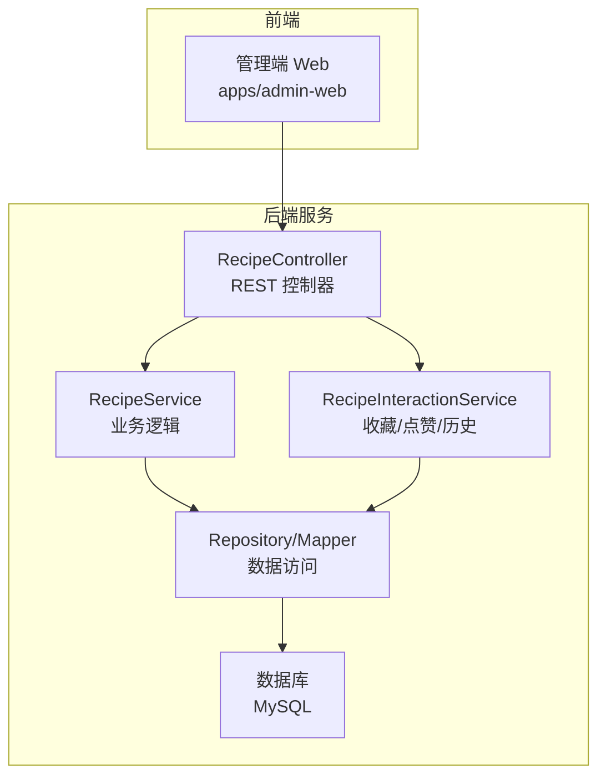
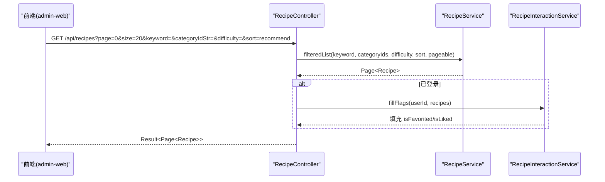
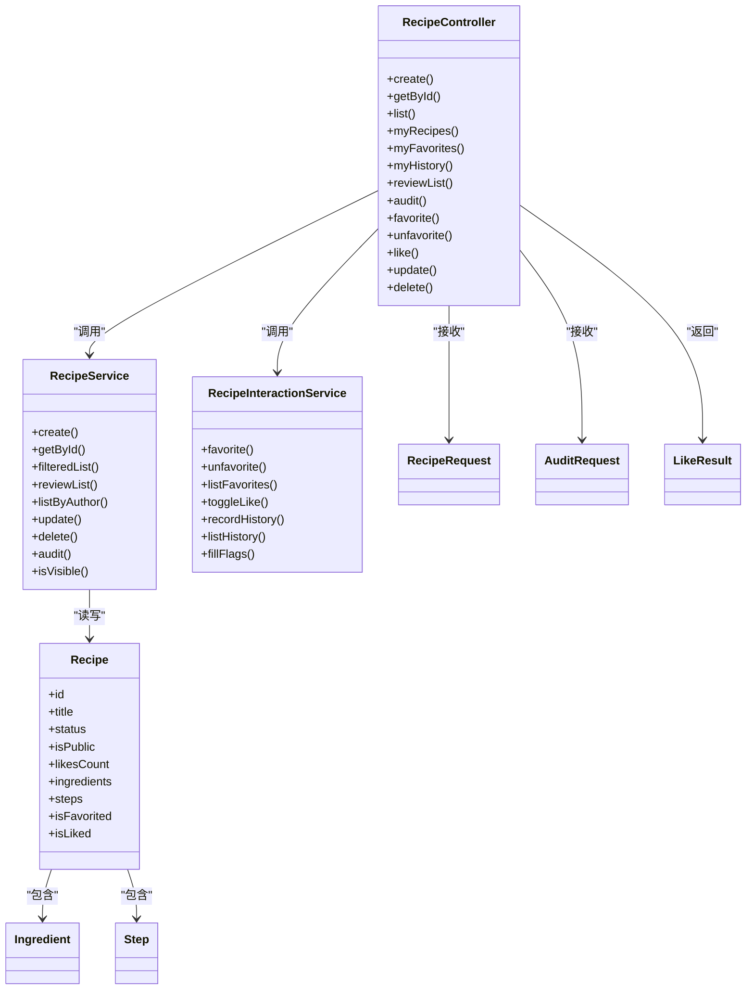

# 菜谱管理接口

<cite>
**本文引用的文件**   
- [RecipeController.java](file://services/api/recipe/src/main/java/com/goodzheng/po/recipe/controller/RecipeController.java)
- [RecipeService.java](file://services/api/recipe/src/main/java/com/goodzheng/po/recipe/service/RecipeService.java)
- [RecipeInteractionService.java](file://services/api/recipe/src/main/java/com/goodzheng/po/recipe/service/RecipeInteractionService.java)
- [Recipe.java](file://services/api/recipe/src/main/java/com/goodzheng/po/recipe/entity/Recipe.java)
- [Ingredient.java](file://services/api/recipe/src/main/java/com/goodzheng/po/recipe/entity/Ingredient.java)
- [Step.java](file://services/api/recipe/src/main/java/com/goodzheng/po/recipe/entity/Step.java)
- [RecipeRequest.java](file://services/api/recipe/src/main/java/com/goodzheng/po/recipe/dto/RecipeRequest.java)
- [AuditRequest.java](file://services/api/recipe/src/main/java/com/goodzheng/po/recipe/dto/AuditRequest.java)
- [LikeResult.java](file://services/api/recipe/src/main/java/com/goodzheng/po/recipe/dto/LikeResult.java)
- [recipe.ts](file://apps/admin-web/src/services/recipe.ts)
- [recipe.ts（类型定义）](file://packages/types/src/recipe.ts)
- [index.ts（类型导出）](file://packages/types/src/index.ts)
</cite>

## 目录
1. [简介](#简介)
2. [项目结构](#项目结构)
3. [核心组件](#核心组件)
4. [架构总览](#架构总览)
5. [详细接口说明](#详细接口说明)
6. [依赖关系分析](#依赖关系分析)
7. [性能与缓存策略](#性能与缓存策略)
8. [权限、校验与业务规则](#权限校验与业务规则)
9. [故障排查指南](#故障排查指南)
10. [结论](#结论)

## 简介
本文件为“菜谱管理”相关接口的完整 API 文档，覆盖以下能力：
- 菜谱的创建、查询、更新、删除（软删除）
- 分类管理（获取、新增、修改、删除）
- 搜索与筛选（关键词、分类、难度、排序）
- 收藏、点赞、浏览历史
- 管理端审核流程（待审队列、通过/驳回）
- 图片上传与文件处理（路径约定与注意事项）
- 分页参数、排序选项、过滤条件
- 权限控制、数据验证与业务约束

该文档面向前后端开发者与产品运营人员，既提供高层架构说明，也给出逐接口规范与示例。

## 项目结构
后端采用 Spring Boot + MyBatis-Plus 的分层架构：
- Controller 层：对外暴露 REST 接口，负责参数校验、鉴权上下文注入、统一结果封装
- Service 层：业务逻辑（菜谱 CRUD、筛选排序、审核、交互统计）
- Entity/DTO 层：数据库实体与请求 DTO
- 前端 admin-web：调用后端 /api/recipes 与 /api/recipe-categories 等接口

图表来源
- [RecipeController.java:30-36](file://services/api/recipe/src/main/java/com/goodzheng/po/recipe/controller/RecipeController.java#L30-L36)
- [RecipeService.java:10-52](file://services/api/recipe/src/main/java/com/goodzheng/po/recipe/service/RecipeService.java#L10-L52)
- [RecipeInteractionService.java:10-33](file://services/api/recipe/src/main/java/com/goodzheng/po/recipe/service/RecipeInteractionService.java#L10-L33)

章节来源
- [RecipeController.java:25-36](file://services/api/recipe/src/main/java/com/goodzheng/po/recipe/controller/RecipeController.java#L25-L36)
- [RecipeService.java:10-52](file://services/api/recipe/src/main/java/com/goodzheng/po/recipe/service/RecipeService.java#L10-L52)
- [RecipeInteractionService.java:10-33](file://services/api/recipe/src/main/java/com/goodzheng/po/recipe/service/RecipeInteractionService.java#L10-L33)

## 核心组件
- RecipeController：定义所有菜谱相关 REST 接口，包括列表、详情、创建、更新、删除、收藏、点赞、历史、审核队列与审核操作。
- RecipeService：实现菜谱的业务逻辑，包含公开筛选、作者维度列表、审核队列、更新与删除、可见性判断等。
- RecipeInteractionService：实现收藏、取消收藏、点赞切换、浏览历史记录与填充当前用户视角标记（isFavorited/isLiked）。
- Entity/DTO：
  - Recipe：菜谱主实体，含审核状态、软删除、营养信息、扩展字段等
  - Ingredient/Step：食材与步骤子实体
  - RecipeRequest：创建/更新请求体，含嵌套的食材与步骤
  - AuditRequest：管理端审核动作与原因
  - LikeResult：点赞切换结果

章节来源
- [RecipeController.java:30-229](file://services/api/recipe/src/main/java/com/goodzheng/po/recipe/controller/RecipeController.java#L30-L229)
- [RecipeService.java:10-52](file://services/api/recipe/src/main/java/com/goodzheng/po/recipe/service/RecipeService.java#L10-L52)
- [RecipeInteractionService.java:10-33](file://services/api/recipe/src/main/java/com/goodzheng/po/recipe/service/RecipeInteractionService.java#L10-L33)
- [Recipe.java:15-102](file://services/api/recipe/src/main/java/com/goodzheng/po/recipe/entity/Recipe.java#L15-L102)
- [Ingredient.java:9-34](file://services/api/recipe/src/main/java/com/goodzheng/po/recipe/entity/Ingredient.java#L9-L34)
- [Step.java:9-30](file://services/api/recipe/src/main/java/com/goodzheng/po/recipe/entity/Step.java#L9-L30)
- [RecipeRequest.java:10-66](file://services/api/recipe/src/main/java/com/goodzheng/po/recipe/dto/RecipeRequest.java#L10-L66)
- [AuditRequest.java:6-16](file://services/api/recipe/src/main/java/com/goodzheng/po/recipe/dto/AuditRequest.java#L6-L16)
- [LikeResult.java:6-15](file://services/api/recipe/src/main/java/com/goodzheng/po/recipe/dto/LikeResult.java#L6-L15)

## 架构总览
下图展示一次“公开菜谱列表”的典型调用链：前端发起 GET /api/recipes，后端 Controller 解析分页与筛选参数，调用 Service 进行公开筛选与排序，必要时由 InteractionService 填充当前用户的收藏/点赞标记。

图表来源
- [RecipeController.java:72-90](file://services/api/recipe/src/main/java/com/goodzheng/po/recipe/controller/RecipeController.java#L72-L90)
- [RecipeService.java:21-30](file://services/api/recipe/src/main/java/com/goodzheng/po/recipe/service/RecipeService.java#L21-L30)
- [RecipeInteractionService.java:31-32](file://services/api/recipe/src/main/java/com/goodzheng/po/recipe/service/RecipeInteractionService.java#L31-L32)

## 详细接口说明

### 通用约定
- 基础路径
  - 菜谱：/api/recipes
  - 分类：/api/recipe-categories
- 统一响应体：Result<T>
  - data：业务数据
  - code：状态码（成功通常为 200；错误时返回具体业务码）
  - message：提示信息
- 分页参数
  - page：页码，从 0 开始
  - size：每页条数
- 排序选项
  - sort：recommend（推荐，默认）、likes（点赞降序）、newest（最新发布）
- 认证
  - 标注“需登录”的接口需要携带有效会话/JWT
  - 标注“仅管理员”的接口需要管理员角色

章节来源
- [RecipeController.java:38-209](file://services/api/recipe/src/main/java/com/goodzheng/po/recipe/controller/RecipeController.java#L38-L209)
- [recipe.ts:74-135](file://apps/admin-web/src/services/recipe.ts#L74-L135)

### 菜谱列表（公开）
- 方法：GET
- 路径：/api/recipes
- 认证：无需登录（可选登录以填充 isFavorited/isLiked）
- 查询参数
  - page：页码，默认 0
  - size：每页大小，默认 20
  - keyword：关键词（标题/描述/标签模糊匹配）
  - categoryIdStr：分类 ID 列表，逗号分隔字符串（如 "1,2,3"）
  - difficulty：难度 1/2/3
  - sort：recommend | likes | newest，默认 recommend
- 响应
  - data：Page<Recipe>
- 行为
  - 仅返回已通过审核且公开、未删除的菜谱
  - 若已登录，会填充 isFavorited/isLiked

请求示例
- GET /api/recipes?page=0&size=20&keyword=红烧&categoryIdStr=1,2&difficulty=2&sort=newest

响应示例
- {
    "code": 200,
    "message": "success",
    "data": {
      "content": [/* Recipe 数组 */],
      "totalElements": 120,
      "totalPages": 6,
      "number": 0,
      "size": 20
    }
  }

章节来源
- [RecipeController.java:72-90](file://services/api/recipe/src/main/java/com/goodzheng/po/recipe/controller/RecipeController.java#L72-L90)
- [RecipeService.java:21-30](file://services/api/recipe/src/main/java/com/goodzheng/po/recipe/service/RecipeService.java#L21-L30)

### 我的菜谱（作者维度）
- 方法：GET
- 路径：/api/recipes/mine
- 认证：需登录
- 查询参数
  - page：页码，默认 0
  - size：每页大小，默认 20
- 响应
  - data：Page<Recipe>
- 行为
  - 返回该作者的全部状态（含 pending/approved/rejected），用于移动端审核状态展示

请求示例
- GET /api/recipes/mine?page=0&size=20

响应示例
- {
    "code": 200,
    "message": "success",
    "data": {
      "content": [/* Recipe 数组 */],
      "totalElements": 10,
      "totalPages": 1,
      "number": 0,
      "size": 20
    }
  }

章节来源
- [RecipeController.java:92-100](file://services/api/recipe/src/main/java/com/goodzheng/po/recipe/controller/RecipeController.java#L92-L100)
- [RecipeService.java:35-36](file://services/api/recipe/src/main/java/com/goodzheng/po/recipe/service/RecipeService.java#L35-L36)

### 我的收藏
- 方法：GET
- 路径：/api/recipes/favorites
- 认证：需登录
- 查询参数
  - page：页码，默认 0
  - size：每页大小，默认 20
- 响应
  - data：Page<Recipe>
- 行为
  - 按收藏时间倒序，仅返回未删除的菜谱
  - 填充 isFavorited/isLiked

请求示例
- GET /api/recipes/favorites?page=0&size=20

响应示例
- {
    "code": 200,
    "message": "success",
    "data": {
      "content": [/* Recipe 数组 */],
      "totalElements": 5,
      "totalPages": 1,
      "number": 0,
      "size": 20
    }
  }

章节来源
- [RecipeController.java:102-112](file://services/api/recipe/src/main/java/com/goodzheng/po/recipe/controller/RecipeController.java#L102-L112)
- [RecipeInteractionService.java:19-20](file://services/api/recipe/src/main/java/com/goodzheng/po/recipe/service/RecipeInteractionService.java#L19-L20)

### 我的浏览历史
- 方法：GET
- 路径：/api/recipes/history
- 认证：需登录
- 查询参数
  - page：页码，默认 0
  - size：每页大小，默认 20
- 响应
  - data：Page<Recipe>
- 行为
  - 按最近浏览时间倒序，仅返回未删除的菜谱
  - 填充 isFavorited/isLiked

请求示例
- GET /api/recipes/history?page=0&size=20

响应示例
- {
    "code": 200,
    "message": "success",
    "data": {
      "content": [/* Recipe 数组 */],
      "totalElements": 8,
      "totalPages": 1,
      "number": 0,
      "size": 20
    }
  }

章节来源
- [RecipeController.java:114-124](file://services/api/recipe/src/main/java/com/goodzheng/po/recipe/controller/RecipeController.java#L114-L124)
- [RecipeInteractionService.java:25-29](file://services/api/recipe/src/main/java/com/goodzheng/po/recipe/service/RecipeInteractionService.java#L25-L29)

### 管理端审核队列
- 方法：GET
- 路径：/api/recipes/review
- 认证：仅管理员
- 查询参数
  - status：审核状态筛选（可空，为空表示全部）
  - keyword：标题模糊匹配（可空）
  - page：页码，默认 0
  - size：每页大小，默认 20
- 响应
  - data：Page<Recipe>

请求示例
- GET /api/recipes/review?status=pending&keyword=糖醋&page=0&size=20

响应示例
- {
    "code": 200,
    "message": "success",
    "data": {
      "content": [/* Recipe 数组 */],
      "totalElements": 3,
      "totalPages": 1,
      "number": 0,
      "size": 20
    }
  }

章节来源
- [RecipeController.java:126-139](file://services/api/recipe/src/main/java/com/goodzheng/po/recipe/controller/RecipeController.java#L126-L139)
- [RecipeService.java:32-33](file://services/api/recipe/src/main/java/com/goodzheng/po/recipe/service/RecipeService.java#L32-L33)

### 管理端审核（通过/驳回）
- 方法：PUT
- 路径：/api/recipes/{id}/audit
- 认证：仅管理员
- 路径参数
  - id：菜谱 ID
- 请求体
  - action：approve | reject
  - reason：当 action=reject 时必填
- 响应
  - data：Recipe（审核后的最新状态）

请求示例
- PUT /api/recipes/123/audit
- Body: { "action": "reject", "reason": "内容不完整" }

响应示例
- {
    "code": 200,
    "message": "success",
    "data": {
      "id": 123,
      "title": "...",
      "status": "rejected",
      "rejectReason": "内容不完整",
      ...
    }
  }

章节来源
- [RecipeController.java:141-151](file://services/api/recipe/src/main/java/com/goodzheng/po/recipe/controller/RecipeController.java#L141-L151)
- [AuditRequest.java:6-16](file://services/api/recipe/src/main/java/com/goodzheng/po/recipe/dto/AuditRequest.java#L6-L16)
- [RecipeService.java:47-48](file://services/api/recipe/src/main/java/com/goodzheng/po/recipe/service/RecipeService.java#L47-L48)

### 收藏（切换）
- 方法：POST
- 路径：/api/recipes/{id}/favorite
- 认证：需登录
- 路径参数
  - id：菜谱 ID
- 响应
  - data：字符串消息（如“收藏成功”）
- 行为
  - 幂等：重复收藏无副作用

请求示例
- POST /api/recipes/123/favorite

响应示例
- {
    "code": 200,
    "message": "success",
    "data": "收藏成功"
  }

章节来源
- [RecipeController.java:153-163](file://services/api/recipe/src/main/java/com/goodzheng/po/recipe/controller/RecipeController.java#L153-L163)
- [RecipeInteractionService.java:13-14](file://services/api/recipe/src/main/java/com/goodzheng/po/recipe/service/RecipeInteractionService.java#L13-L14)

### 取消收藏
- 方法：DELETE
- 路径：/api/recipes/{id}/favorite
- 认证：需登录
- 路径参数
  - id：菜谱 ID
- 响应
  - data：字符串消息（如“已取消收藏”）
- 行为
  - 幂等：重复取消无副作用

请求示例
- DELETE /api/recipes/123/favorite

响应示例
- {
    "code": 200,
    "message": "success",
    "data": "已取消收藏"
  }

章节来源
- [RecipeController.java:165-174](file://services/api/recipe/src/main/java/com/goodzheng/po/recipe/controller/RecipeController.java#L165-L174)
- [RecipeInteractionService.java:16-17](file://services/api/recipe/src/main/java/com/goodzheng/po/recipe/service/RecipeInteractionService.java#L16-L17)

### 点赞（切换）
- 方法：POST
- 路径：/api/recipes/{id}/like
- 认证：需登录
- 路径参数
  - id：菜谱 ID
- 响应
  - data：LikeResult
    - liked：切换后的点赞状态
    - likesCount：最新点赞数
- 行为
  - 幂等：重复点赞会切换状态

请求示例
- POST /api/recipes/123/like

响应示例
- {
    "code": 200,
    "message": "success",
    "data": {
      "liked": true,
      "likesCount": 128
    }
  }

章节来源
- [RecipeController.java:176-185](file://services/api/recipe/src/main/java/com/goodzheng/po/recipe/controller/RecipeController.java#L176-L185)
- [LikeResult.java:6-15](file://services/api/recipe/src/main/java/com/goodzheng/po/recipe/dto/LikeResult.java#L6-L15)
- [RecipeInteractionService.java:22-23](file://services/api/recipe/src/main/java/com/goodzheng/po/recipe/service/RecipeInteractionService.java#L22-L23)

### 创建菜谱
- 方法：POST
- 路径：/api/recipes
- 认证：需登录
- 请求体
  - RecipeRequest（见下方数据结构）
- 响应
  - data：Recipe
- 行为
  - 管理员创建：初始状态 approved
  - 普通用户创建：初始状态 pending（进入审核队列）

请求示例
- POST /api/recipes
- Body: {
    "title": "红烧肉",
    "description": "经典家常菜",
    "coverImageUrl": "/uploads/covers/xxx.jpg",
    "prepTime": 10,
    "cookTime": 40,
    "totalTime": 50,
    "difficulty": 2,
    "servings": 4,
    "category": "家常菜",
    "tags": "下饭,肉类",
    "isPublic": true,
    "calories": 800,
    "protein": 30,
    "fat": 40,
    "carbs": 20,
    "tips": "火候是关键",
    "flavorProfile": "咸鲜微甜",
    "ingredients": [
      { "name": "五花肉", "amount": "500g", "unit": "克", "isEssential": true, "sortOrder": 0, "imageUrl": "/uploads/ingredients/meat.jpg" },
      { "name": "冰糖", "amount": "30g", "unit": "克", "isEssential": false, "sortOrder": 1 }
    ],
    "steps": [
      { "stepNumber": 1, "content": "五花肉切块焯水", "imageUrl": "/uploads/steps/s1.jpg", "videoUrl": "", "duration": 5 },
      { "stepNumber": 2, "content": "炒糖色后翻炒上色", "imageUrl": "/uploads/steps/s2.jpg", "videoUrl": "", "duration": 10 }
    ]
  }

响应示例
- {
    "code": 200,
    "message": "success",
    "data": {
      "id": 123,
      "title": "红烧肉",
      "status": "pending",
      ...
    }
  }

章节来源
- [RecipeController.java:38-51](file://services/api/recipe/src/main/java/com/goodzheng/po/recipe/controller/RecipeController.java#L38-L51)
- [RecipeRequest.java:10-66](file://services/api/recipe/src/main/java/com/goodzheng/po/recipe/dto/RecipeRequest.java#L10-L66)
- [RecipeService.java:12-17](file://services/api/recipe/src/main/java/com/goodzheng/po/recipe/service/RecipeService.java#L12-L17)

### 获取菜谱详情
- 方法：GET
- 路径：/api/recipes/{id}
- 认证：无需登录（可选登录以填充 isFavorited/isLiked 并记录历史）
- 路径参数
  - id：菜谱 ID
- 响应
  - data：Recipe
- 行为
  - 未发布仅作者本人或管理员可见
  - 登录用户浏览会记录历史

请求示例
- GET /api/recipes/123

响应示例
- {
    "code": 200,
    "message": "success",
    "data": {
      "id": 123,
      "title": "红烧肉",
      "status": "approved",
      "isFavorited": false,
      "isLiked": true,
      "ingredients": [...],
      "steps": [...]
    }
  }

章节来源
- [RecipeController.java:53-70](file://services/api/recipe/src/main/java/com/goodzheng/po/recipe/controller/RecipeController.java#L53-L70)
- [RecipeService.java:19-20](file://services/api/recipe/src/main/java/com/goodzheng/po/recipe/service/RecipeService.java#L19-L20)
- [RecipeInteractionService.java:25-26](file://services/api/recipe/src/main/java/com/goodzheng/po/recipe/service/RecipeInteractionService.java#L25-L26)

### 更新菜谱
- 方法：PUT
- 路径：/api/recipes/{id}
- 认证：需登录
- 路径参数
  - id：菜谱 ID
- 请求体
  - RecipeRequest
- 响应
  - data：Recipe
- 行为
  - 管理员可改任意菜谱
  - 作者只能改自己的；普通作者每次修改后状态重置为 pending（重新送审）、清空驳回原因

请求示例
- PUT /api/recipes/123
- Body: { /* 同创建请求体，按需更新字段 */ }

响应示例
- {
    "code": 200,
    "message": "success",
    "data": {
      "id": 123,
      "title": "红烧肉(已更新)",
      "status": "pending",
      "rejectReason": null,
      ...
    }
  }

章节来源
- [RecipeController.java:187-197](file://services/api/recipe/src/main/java/com/goodzheng/po/recipe/controller/RecipeController.java#L187-L197)
- [RecipeService.java:38-42](file://services/api/recipe/src/main/java/com/goodzheng/po/recipe/service/RecipeService.java#L38-L42)

### 删除菜谱（软删除）
- 方法：DELETE
- 路径：/api/recipes/{id}
- 认证：需登录
- 路径参数
  - id：菜谱 ID
- 响应
  - data：字符串消息（如“删除成功”）
- 行为
  - 管理员可删任意；作者只能删自己的
  - 软删除：deletedAt 非空即视为删除

请求示例
- DELETE /api/recipes/123

响应示例
- {
    "code": 200,
    "message": "success",
    "data": "删除成功"
  }

章节来源
- [RecipeController.java:199-209](file://services/api/recipe/src/main/java/com/goodzheng/po/recipe/controller/RecipeController.java#L199-L209)
- [RecipeService.java:44-45](file://services/api/recipe/src/main/java/com/goodzheng/po/recipe/service/RecipeService.java#L44-L45)
- [Recipe.java:69-70](file://services/api/recipe/src/main/java/com/goodzheng/po/recipe/entity/Recipe.java#L69-L70)

### 分类管理（管理端）
- 获取所有分类
  - GET /api/recipe-categories
  - 响应：Result<RecipeCategory[]>
- 新建分类（管理员）
  - POST /api/recipe-categories
  - 请求体：RecipeCategoryRequest
  - 响应：Result<RecipeCategory>
- 更新分类（管理员）
  - PUT /api/recipe-categories/{id}
  - 请求体：RecipeCategoryRequest
  - 响应：Result<RecipeCategory>
- 删除分类（管理员，软删除）
  - DELETE /api/recipe-categories/{id}
  - 响应：Result<string>

注意：分类相关接口在管理端前端中已定义调用方式，后端分类控制器文件在当前仓库中未找到，但前端调用路径明确。

章节来源
- [recipe.ts:24-70](file://apps/admin-web/src/services/recipe.ts#L24-L70)
- [recipe.ts（类型定义）:7-23](file://packages/types/src/recipe.ts#L7-L23)

## 依赖关系分析
- Controller 依赖 Service 与 InteractionService
- Service 负责数据一致性、可见性判断与审核流转
- InteractionService 负责用户行为（收藏/点赞/历史）与批量填充当前用户视角标记
- Entity 与 DTO 承载数据模型与校验规则

图表来源
- [RecipeController.java:30-229](file://services/api/recipe/src/main/java/com/goodzheng/po/recipe/controller/RecipeController.java#L30-L229)
- [RecipeService.java:10-52](file://services/api/recipe/src/main/java/com/goodzheng/po/recipe/service/RecipeService.java#L10-L52)
- [RecipeInteractionService.java:10-33](file://services/api/recipe/src/main/java/com/goodzheng/po/recipe/service/RecipeInteractionService.java#L10-L33)
- [Recipe.java:15-102](file://services/api/recipe/src/main/java/com/goodzheng/po/recipe/entity/Recipe.java#L15-L102)
- [Ingredient.java:9-34](file://services/api/recipe/src/main/java/com/goodzheng/po/recipe/entity/Ingredient.java#L9-L34)
- [Step.java:9-30](file://services/api/recipe/src/main/java/com/goodzheng/po/recipe/entity/Step.java#L9-L30)
- [RecipeRequest.java:10-66](file://services/api/recipe/src/main/java/com/goodzheng/po/recipe/dto/RecipeRequest.java#L10-L66)
- [AuditRequest.java:6-16](file://services/api/recipe/src/main/java/com/goodzheng/po/recipe/dto/AuditRequest.java#L6-L16)
- [LikeResult.java:6-15](file://services/api/recipe/src/main/java/com/goodzheng/po/recipe/dto/LikeResult.java#L6-L15)

## 性能与缓存策略
- 列表接口
  - 使用分页（page/size）避免一次性加载大量数据
  - 推荐排序（recommend）结合点赞加权与时间衰减，适合首页曝光
  - 对已登录用户批量填充 isFavorited/isLiked，减少前端多次请求
- 详情页
  - 登录用户浏览计入历史，建议异步落库
  - 图片资源建议使用 CDN 加速，静态资源开启浏览器缓存
- 收藏/点赞
  - 高频写操作建议引入缓存（如 Redis）做计数与状态去重
  - 点赞切换接口返回最新 likesCount，便于前端即时反馈
- 审核队列
  - 管理端分页加载，避免全量扫描
  - 可按 status/keyword 组合筛选，减少无效数据

[本节为通用性能建议，不直接分析具体文件]

## 权限、校验与业务规则
- 权限
  - 创建/更新/删除：需登录；管理员可操作任意菜谱
  - 收藏/点赞/历史：需登录
  - 审核队列与审核操作：仅管理员
  - 未发布菜谱仅作者本人或管理员可见
- 数据校验
  - 标题必填、难度必填
  - 步骤序号与内容必填
  - 审核动作必填，驳回时必须填写原因
- 业务规则
  - 普通用户创建的菜谱初始状态为 pending，进入审核队列
  - 普通用户修改菜谱后状态重置为 pending，清空驳回原因
  - 公开列表仅返回 approved、isPublic=true、未删除的菜谱
  - 软删除：deletedAt 非空即视为删除

章节来源
- [RecipeController.java:38-209](file://services/api/recipe/src/main/java/com/goodzheng/po/recipe/controller/RecipeController.java#L38-L209)
- [RecipeRequest.java:10-66](file://services/api/recipe/src/main/java/com/goodzheng/po/recipe/dto/RecipeRequest.java#L10-L66)
- [AuditRequest.java:6-16](file://services/api/recipe/src/main/java/com/goodzheng/po/recipe/dto/AuditRequest.java#L6-L16)
- [RecipeService.java:38-51](file://services/api/recipe/src/main/java/com/goodzheng/po/recipe/service/RecipeService.java#L38-L51)

## 故障排查指南
- 常见错误
  - 400：请求体校验失败（如标题/难度/步骤缺失）
  - 404：菜谱不存在或未通过审核
  - 401/403：未登录或无权限（如非管理员访问审核接口）
- 定位建议
  - 检查请求参数是否符合接口定义（分页、排序、过滤）
  - 确认是否携带有效会话/JWT
  - 查看后端日志中的异常堆栈与业务提示
- 数据不一致
  - 点赞数与 isLiked 状态不一致：检查 toggleLike 是否被并发调用，考虑加锁或原子更新
  - 收藏/历史未生效：确认是否为公开且未删除的菜谱

章节来源
- [RecipeController.java:48-50](file://services/api/recipe/src/main/java/com/goodzheng/po/recipe/controller/RecipeController.java#L48-L50)
- [RecipeController.java:67-69](file://services/api/recipe/src/main/java/com/goodzheng/po/recipe/controller/RecipeController.java#L67-L69)
- [RecipeController.java:148-150](file://services/api/recipe/src/main/java/com/goodzheng/po/recipe/controller/RecipeController.java#L148-L150)
- [RecipeController.java:160-162](file://services/api/recipe/src/main/java/com/goodzheng/po/recipe/controller/RecipeController.java#L160-L162)
- [RecipeController.java:182-184](file://services/api/recipe/src/main/java/com/goodzheng/po/recipe/controller/RecipeController.java#L182-L184)
- [RecipeController.java:194-196](file://services/api/recipe/src/main/java/com/goodzheng/po/recipe/controller/RecipeController.java#L194-L196)
- [RecipeController.java:206-208](file://services/api/recipe/src/main/java/com/goodzheng/po/recipe/controller/RecipeController.java#L206-L208)

## 结论
本 API 体系围绕“菜谱”这一核心实体，提供了完整的生命周期管理与用户互动能力。通过清晰的权限边界、严格的参数校验与合理的分页/排序机制，既能满足管理端的审核与运维需求，也能支撑前端的流畅体验。建议在后续迭代中持续优化高频写操作的并发与缓存策略，完善分类管理的后端实现，并补充更丰富的筛选维度与数据分析能力。