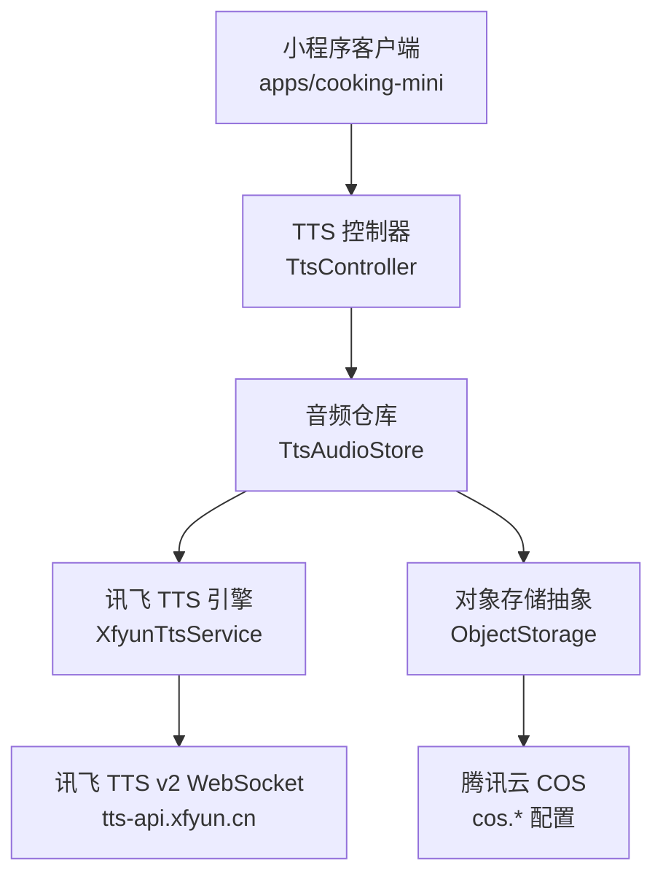
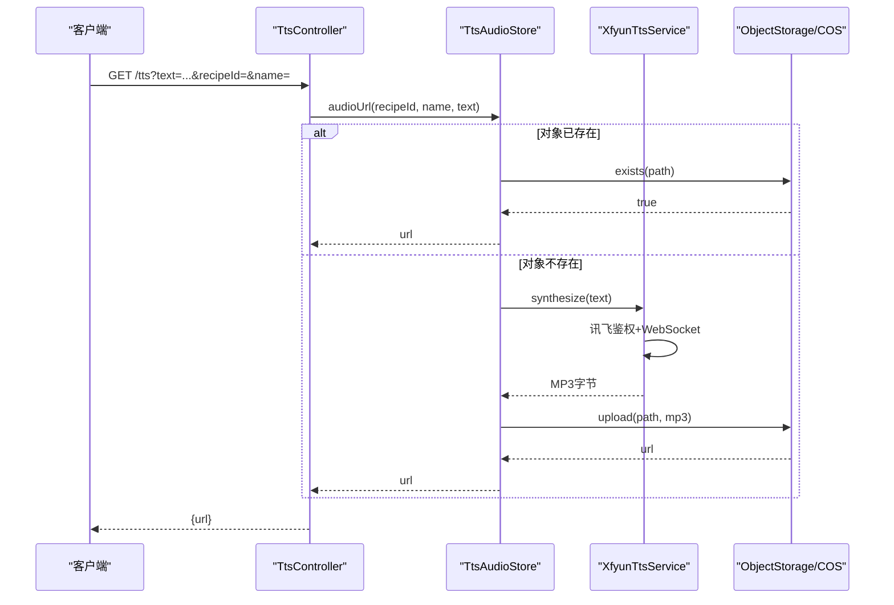
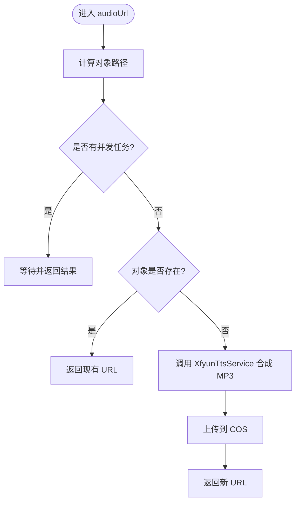
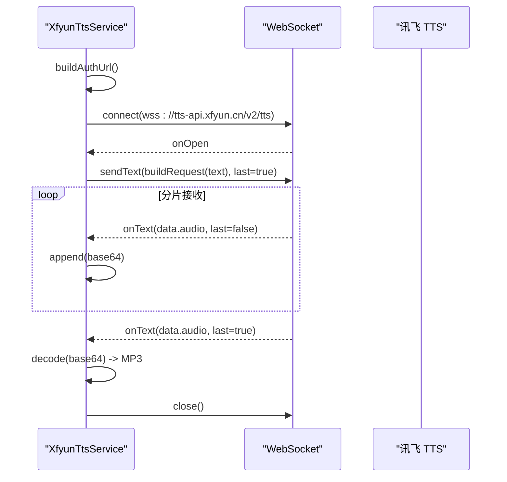
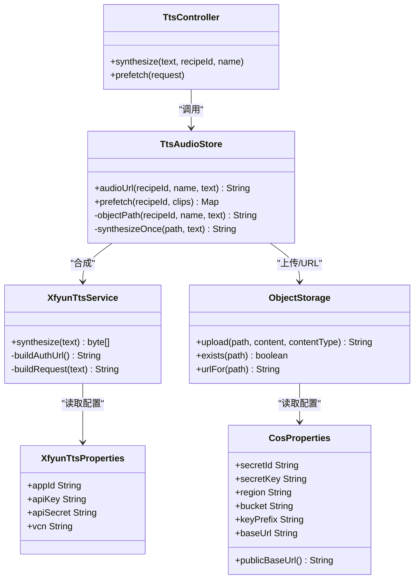

# 语音合成接口

<cite>
**本文引用的文件**   
- [TtsController.java](file://services/api/recipe/src/main/java/com/goodzheng/po/recipe/controller/TtsController.java)
- [XfyunTtsService.java](file://services/api/recipe/src/main/java/com/goodzheng/po/recipe/tts/XfyunTtsService.java)
- [XfyunTtsProperties.java](file://services/api/recipe/src/main/java/com/goodzheng/po/recipe/tts/XfyunTtsProperties.java)
- [TtsAudioStore.java](file://services/api/recipe/src/main/java/com/goodzheng/po/recipe/tts/TtsAudioStore.java)
- [TtsClip.java](file://services/api/recipe/src/main/java/com/goodzheng/po/recipe/dto/TtsClip.java)
- [TtsPrefetchRequest.java](file://services/api/recipe/src/main/java/com/goodzheng/po/recipe/dto/TtsPrefetchRequest.java)
- [TtsPrefetchResult.java](file://services/api/recipe/src/main/java/com/goodzheng/po/recipe/dto/TtsPrefetchResult.java)
- [ObjectStorage.java](file://services/api/shared/src/main/java/com/goodzheng/po/shared/storage/ObjectStorage.java)
- [CosProperties.java](file://services/api/shared/src/main/java/com/goodzheng/po/shared/storage/CosProperties.java)
- [application.yaml](file://services/api/api-bootstrap/src/main/resources/application.yaml)
- [docker-compose.yml](file://docker-compose.yml)
- [tts.ts](file://apps/cooking-mini/src/lib/tts.ts)
</cite>

## 目录
1. [简介](#简介)
2. [项目结构](#项目结构)
3. [核心组件](#核心组件)
4. [架构总览](#架构总览)
5. [接口规范](#接口规范)
6. [详细组件分析](#详细组件分析)
7. [依赖关系分析](#依赖关系分析)
8. [性能与并发](#性能与并发)
9. [存储、缓存与 CDN](#存储缓存与-cdn)
10. [错误处理与故障恢复](#错误处理与故障恢复)
11. [配置与环境变量](#配置与环境变量)
12. [常见问题排查](#常见问题排查)
13. [结论](#结论)

## 简介
本接口提供文本转语音（TTS）能力，后端通过讯飞 TTS v2 WebSocket 服务将中文文本合成为 MP3 音频，并持久化到腾讯云 COS。对外暴露两个接口：
- 单条合成：根据文案生成或复用音频 URL。
- 批量预热：在用户进入某道菜谱前，提前把步骤播报准备好；已就绪的立即返回 URL，缺失的后台异步合成。

该方案适合“做菜播报”等场景：短文本、可预取、对首帧延迟敏感，且需要稳定、可复用的音频地址。

## 项目结构
TTS 相关代码集中在 Java 后端模块中，前端小程序侧仅调用 HTTP 接口并播放返回的 MP3 URL。



**图表来源**
- [TtsController.java:20-77](file://services/api/recipe/src/main/java/com/goodzheng/po/recipe/controller/TtsController.java#L20-L77)
- [TtsAudioStore.java:24-103](file://services/api/recipe/src/main/java/com/goodzheng/po/recipe/tts/TtsAudioStore.java#L24-L103)
- [XfyunTtsService.java:26-43](file://services/api/recipe/src/main/java/com/goodzheng/po/recipe/tts/XfyunTtsService.java#L26-L43)
- [ObjectStorage.java:14-49](file://services/api/shared/src/main/java/com/goodzheng/po/shared/storage/ObjectStorage.java#L14-L49)

**章节来源**
- [TtsController.java:20-77](file://services/api/recipe/src/main/java/com/goodzheng/po/recipe/controller/TtsController.java#L20-L77)
- [TtsAudioStore.java:24-103](file://services/api/recipe/src/main/java/com/goodzheng/po/recipe/tts/TtsAudioStore.java#L24-L103)
- [XfyunTtsService.java:26-43](file://services/api/recipe/src/main/java/com/goodzheng/po/recipe/tts/XfyunTtsService.java#L26-L43)
- [ObjectStorage.java:14-49](file://services/api/shared/src/main/java/com/goodzheng/po/shared/storage/ObjectStorage.java#L14-L49)

## 核心组件
- TtsController：对外暴露 `/tts` 和 `/tts/prefetch` 两个 REST 接口，负责参数校验、异常兜底与统一响应封装。
- TtsAudioStore：音频仓库，负责对象路径计算、去重、并发合并、预热队列、COS 上传与 URL 生成。
- XfyunTtsService：讯飞 TTS v2 客户端，使用 WebSocket 鉴权、发送文本、接收分片音频并拼接为 MP3。
- ObjectStorage：腾讯云 COS 客户端封装，提供上传、存在性检查与公网 URL 生成。
- DTO：TtsClip、TtsPrefetchRequest、TtsPrefetchResult 描述批量预热的输入输出。
- 配置：XfyunTtsProperties 与 CosProperties 分别承载讯飞与 COS 的配置项。

**章节来源**
- [TtsController.java:20-77](file://services/api/recipe/src/main/java/com/goodzheng/po/recipe/controller/TtsController.java#L20-L77)
- [TtsAudioStore.java:24-103](file://services/api/recipe/src/main/java/com/goodzheng/po/recipe/tts/TtsAudioStore.java#L24-L103)
- [XfyunTtsService.java:26-43](file://services/api/recipe/src/main/java/com/goodzheng/po/recipe/tts/XfyunTtsService.java#L26-L43)
- [ObjectStorage.java:14-49](file://services/api/shared/src/main/java/com/goodzheng/po/shared/storage/ObjectStorage.java#L14-L49)
- [TtsClip.java:5-17](file://services/api/recipe/src/main/java/com/goodzheng/po/recipe/dto/TtsClip.java#L5-L17)
- [TtsPrefetchRequest.java:6-15](file://services/api/recipe/src/main/java/com/goodzheng/po/recipe/dto/TtsPrefetchRequest.java#L6-L15)
- [TtsPrefetchResult.java:7-14](file://services/api/recipe/src/main/java/com/goodzheng/po/recipe/dto/TtsPrefetchResult.java#L7-L14)

## 架构总览
TTS 请求从控制器进入，先由音频仓库判断是否已有对象；若没有则调用讯飞引擎合成 MP3，再上传至 COS，最后返回公网 URL。批量预热会尽量利用已存在的对象，未命中的条目进入后台线程池排队合成。



**图表来源**
- [TtsController.java:39-55](file://services/api/recipe/src/main/java/com/goodzheng/po/recipe/controller/TtsController.java#L39-L55)
- [TtsAudioStore.java:86-103](file://services/api/recipe/src/main/java/com/goodzheng/po/recipe/tts/TtsAudioStore.java#L86-L103)
- [XfyunTtsService.java:46-101](file://services/api/recipe/src/main/java/com/goodzheng/po/recipe/tts/XfyunTtsService.java#L46-L101)
- [ObjectStorage.java:29-49](file://services/api/shared/src/main/java/com/goodzheng/po/shared/storage/ObjectStorage.java#L29-L49)

## 接口规范

### 通用说明
- 基础路径：`/tts`
- 认证策略：TTS 接口与音频访问均允许匿名访问，便于播放器直接加载 URL。
- 返回格式：统一使用 `Result` 包装，成功时 data 字段包含业务数据，失败时返回可读错误信息。
- 音频格式：MP3（mimeType 为 `audio/mpeg`）。
- 音质与语速：当前实现固定为讯飞默认音色与标准质量；如需扩展可在引擎层增加参数。

### 单条合成接口
- 方法：GET
- 路径：`/tts`
- 查询参数：
  - text：必填，要合成的中文文本。
  - recipeId：可选，所属菜谱 ID；用于决定对象目录。
  - name：可选，语义文件名片段，如 step-3、finish；非法或缺失时退化为纯哈希。
- 成功响应：
  - data.url：音频公网 URL。
- 失败响应：
  - 当 text 为空时返回“文本不能为空”。
  - 其他异常返回“语音合成失败”，具体原因见日志。

请求示例
- GET `/tts?text=开始烹饪&recipeId=123&name=step-1`

响应示例
- 成功：`{ code: 0, data: { url: "https://.../tts/recipes/123/xiaoyan/step-1-xxxxxx.mp3" } }`
- 失败：`{ code: 1, message: "文本不能为空" }`

**章节来源**
- [TtsController.java:39-55](file://services/api/recipe/src/main/java/com/goodzheng/po/recipe/controller/TtsController.java#L39-L55)

### 批量预热接口
- 方法：POST
- 路径：`/tts/prefetch`
- 请求体：TtsPrefetchRequest
  - recipeId：可选，所属菜谱 ID。
  - clips：必填数组，元素为 TtsClip：
    - name：可选，语义名，限制字母数字与 `- _`，长度不超过 32。
    - text：必填，要合成的文本。
- 行为：
  - 服务端最多处理 50 条；超出部分截断。
  - 桶内已存在的对象立即返回 URL。
  - 缺失的对象进入后台线程池异步合成，本次响应不等待。
  - 首次预热可能返回空 map，属于正常结果。
- 成功响应：
  - data.urls：clip.name → 音频 URL 的映射，只包含已就绪条目。
- 失败响应：
  - clips 为空时返回“播报内容不能为空”。
  - 其他异常返回“语音预热失败”。

请求示例
```json
{
  "recipeId": 123,
  "clips": [
    { "name": "step-1", "text": "准备食材" },
    { "name": "step-2", "text": "切菜" },
    { "name": "finish", "text": "完成" }
  ]
}
```

响应示例
- 成功：`{ code: 0, data: { urls: { "step-1": "https://...mp3", "finish": "https://...mp3" } } }`
- 失败：`{ code: 1, message: "播报内容不能为空" }`

**章节来源**
- [TtsController.java:61-76](file://services/api/recipe/src/main/java/com/goodzheng/po/recipe/controller/TtsController.java#L61-L76)
- [TtsPrefetchRequest.java:6-15](file://services/api/recipe/src/main/java/com/goodzheng/po/recipe/dto/TtsPrefetchRequest.java#L6-L15)
- [TtsClip.java:5-17](file://services/api/recipe/src/main/java/com/goodzheng/po/recipe/dto/TtsClip.java#L5-L17)
- [TtsPrefetchResult.java:7-14](file://services/api/recipe/src/main/java/com/goodzheng/po/recipe/dto/TtsPrefetchResult.java#L7-L14)

## 详细组件分析

### TtsController：对外接口入口
职责
- 暴露 `/tts` 与 `/tts/prefetch`。
- 校验 text 是否为空。
- 调用 TtsAudioStore 获取音频 URL。
- 捕获异常并返回统一错误消息。

关键点
- 单次合成：直接返回音频 URL。
- 批量预热：限制最大 50 条，避免异常请求；响应不等待后台合成。

**章节来源**
- [TtsController.java:20-77](file://services/api/recipe/src/main/java/com/goodzheng/po/recipe/controller/TtsController.java#L20-L77)

### TtsAudioStore：音频仓库与缓存
职责
- 计算对象路径：按 recipeId、vcn、text 生成稳定 key。
- 并发合并：同一文本的请求合并为一次合成。
- 预热队列：后台线程池异步合成，队列满时降级为播放时同步合成。
- 上传与 URL：调用 ObjectStorage 上传 MP3 并返回公网 URL。

数据结构与复杂度
- inFlight：ConcurrentHashMap，key 为对象路径，value 为 CompletableFuture，时间复杂度 O(1)。
- queued：Set，记录已排队的 path，避免重复入队。
- prefetchPool：固定大小线程池（2 核），队列容量 200，适合讯飞并发限制。

路径规则
- 有菜谱上下文：`tts/recipes/{recipeId}/{vcn}/{name}-{hash8}.mp3`
- 无菜谱上下文：`tts/misc/{vcn}/{hash前2位}/{hash}.mp3`
- vcn 参与哈希与目录，换音色后旧音频自然失效。



**图表来源**
- [TtsAudioStore.java:86-103](file://services/api/recipe/src/main/java/com/goodzheng/po/recipe/tts/TtsAudioStore.java#L86-L103)
- [TtsAudioStore.java:153-164](file://services/api/recipe/src/main/java/com/goodzheng/po/recipe/tts/TtsAudioStore.java#L153-L164)

**章节来源**
- [TtsAudioStore.java:24-103](file://services/api/recipe/src/main/java/com/goodzheng/po/recipe/tts/TtsAudioStore.java#L24-L103)
- [TtsAudioStore.java:105-164](file://services/api/recipe/src/main/java/com/goodzheng/po/recipe/tts/TtsAudioStore.java#L105-L164)

### XfyunTtsService：讯飞 TTS v2 客户端
职责
- 构建 WebSocket 鉴权 URL。
- 发送文本请求，接收分片音频。
- 拼接 base64 音频并解码为 MP3 字节。
- 超时控制与连接关闭。

关键流程
- 鉴权：HMAC-SHA256 签名，authorization 作为 query 参数。
- 请求体：aue=lame（MP3）、vcn 取自配置、text 以 Base64 编码、status=2（单帧完整文本）。
- 响应：code=0 表示成功，data.audio 为分片 base64，data.status=2 表示结束。



**图表来源**
- [XfyunTtsService.java:46-101](file://services/api/recipe/src/main/java/com/goodzheng/po/recipe/tts/XfyunTtsService.java#L46-L101)
- [XfyunTtsService.java:132-172](file://services/api/recipe/src/main/java/com/goodzheng/po/recipe/tts/XfyunTtsService.java#L132-L172)

**章节来源**
- [XfyunTtsService.java:26-43](file://services/api/recipe/src/main/java/com/goodzheng/po/recipe/tts/XfyunTtsService.java#L26-L43)
- [XfyunTtsService.java:46-101](file://services/api/recipe/src/main/java/com/goodzheng/po/recipe/tts/XfyunTtsService.java#L46-L101)
- [XfyunTtsService.java:132-172](file://services/api/recipe/src/main/java/com/goodzheng/po/recipe/tts/XfyunTtsService.java#L132-L172)

### DTO 模型
- TtsClip：一条待合成的播报，包含 name 与 text。
- TtsPrefetchRequest：批量预热请求，包含 recipeId 与 clips。
- TtsPrefetchResult：批量预热结果，包含 urls 映射。

**章节来源**
- [TtsClip.java:5-17](file://services/api/recipe/src/main/java/com/goodzheng/po/recipe/dto/TtsClip.java#L5-L17)
- [TtsPrefetchRequest.java:6-15](file://services/api/recipe/src/main/java/com/goodzheng/po/recipe/dto/TtsPrefetchRequest.java#L6-L15)
- [TtsPrefetchResult.java:7-14](file://services/api/recipe/src/main/java/com/goodzheng/po/recipe/dto/TtsPrefetchResult.java#L7-L14)

## 依赖关系分析



**图表来源**
- [TtsController.java:20-77](file://services/api/recipe/src/main/java/com/goodzheng/po/recipe/controller/TtsController.java#L20-L77)
- [TtsAudioStore.java:24-103](file://services/api/recipe/src/main/java/com/goodzheng/po/recipe/tts/TtsAudioStore.java#L24-L103)
- [XfyunTtsService.java:26-43](file://services/api/recipe/src/main/java/com/goodzheng/po/recipe/tts/XfyunTtsService.java#L26-L43)
- [ObjectStorage.java:14-49](file://services/api/shared/src/main/java/com/goodzheng/po/shared/storage/ObjectStorage.java#L14-L49)
- [XfyunTtsProperties.java:7-18](file://services/api/recipe/src/main/java/com/goodzheng/po/recipe/tts/XfyunTtsProperties.java#L7-L18)
- [CosProperties.java:7-44](file://services/api/shared/src/main/java/com/goodzheng/po/shared/storage/CosProperties.java#L7-L44)

**章节来源**
- [TtsController.java:20-77](file://services/api/recipe/src/main/java/com/goodzheng/po/recipe/controller/TtsController.java#L20-L77)
- [TtsAudioStore.java:24-103](file://services/api/recipe/src/main/java/com/goodzheng/po/recipe/tts/TtsAudioStore.java#L24-L103)
- [XfyunTtsService.java:26-43](file://services/api/recipe/src/main/java/com/goodzheng/po/recipe/tts/XfyunTtsService.java#L26-L43)
- [ObjectStorage.java:14-49](file://services/api/shared/src/main/java/com/goodzheng/po/shared/storage/ObjectStorage.java#L14-L49)
- [XfyunTtsProperties.java:7-18](file://services/api/recipe/src/main/java/com/goodzheng/po/recipe/tts/XfyunTtsProperties.java#L7-L18)
- [CosProperties.java:7-44](file://services/api/shared/src/main/java/com/goodzheng/po/shared/storage/CosProperties.java#L7-L44)

## 性能与并发
- 并发合并：TtsAudioStore 使用 inFlight 合并相同文本的并发请求，避免重复合成。
- 预热线程池：固定 2 个线程，队列容量 200；讯飞并发路数有限，串行合成即可满足体验。
- 超时控制：XfyunTtsService 对 WebSocket 合成设置 15 秒超时，避免长时间阻塞。
- 降级策略：预热队列满时拒绝执行，改为播放时再同步合成，不拖慢接口。

优化建议
- 热点文案优先预热，减少首次合成延迟。
- 合理设置 vcn，避免频繁切换导致缓存失效。
- 对长文本进行分段或提示用户缩短播报内容。

**章节来源**
- [TtsAudioStore.java:57-77](file://services/api/recipe/src/main/java/com/goodzheng/po/recipe/tts/TtsAudioStore.java#L57-L77)
- [TtsAudioStore.java:127-146](file://services/api/recipe/src/main/java/com/goodzheng/po/recipe/tts/TtsAudioStore.java#L127-L146)
- [XfyunTtsService.java:40-40](file://services/api/recipe/src/main/java/com/goodzheng/po/recipe/tts/XfyunTtsService.java#L40-L40)

## 存储、缓存与 CDN
- 存储后端：腾讯云 COS，通过 ObjectStorage 封装。
- 对象路径：
  - 有菜谱：`tts/recipes/{recipeId}/{vcn}/{name}-{hash8}.mp3`
  - 无菜谱：`tts/misc/{vcn}/{hash前2位}/{hash}.mp3`
- 缓存机制：
  - 对象存在即命中，不再重复合成。
  - 发音人 vcn 参与哈希，换音色后旧音频失效。
- CDN：
  - 可通过 cos.base-url 自定义 CDN 域名；留空则使用 COS 默认公网域名。
  - 小程序端直接播放返回的绝对 URL。

**章节来源**
- [TtsAudioStore.java:24-37](file://services/api/recipe/src/main/java/com/goodzheng/po/recipe/tts/TtsAudioStore.java#L24-L37)
- [TtsAudioStore.java:172-185](file://services/api/recipe/src/main/java/com/goodzheng/po/recipe/tts/TtsAudioStore.java#L172-L185)
- [ObjectStorage.java:29-49](file://services/api/shared/src/main/java/com/goodzheng/po/shared/storage/ObjectStorage.java#L29-L49)
- [CosProperties.java:31-43](file://services/api/shared/src/main/java/com/goodzheng/po/shared/storage/CosProperties.java#L31-L43)

## 错误处理与故障恢复
- 参数校验：text 为空返回“文本不能为空”；clips 为空返回“播报内容不能为空”。
- 上游异常：讯飞鉴权失败、网络异常、返回 code≠0 等，统一抛出异常，上层记录日志并返回“语音合成失败”或“语音预热失败”。
- 空音频：合成结果为空时抛出异常，避免上传无效对象。
- 资源清理：WebSocket 连接在异常或完成后主动关闭；预热线程池在应用销毁时 shutdownNow。

故障恢复建议
- 重试策略：对网络抖动导致的临时失败，客户端可重试 GET 接口；预热失败可再次触发预热。
- 降级播放：若 TTS 不可用，前端可回退到本地音效或静音。
- 监控告警：关注日志中的“TTS 合成失败”“TTS 预热失败”“TTS 预热队列已满”。

**章节来源**
- [TtsController.java:44-55](file://services/api/recipe/src/main/java/com/goodzheng/po/recipe/controller/TtsController.java#L44-L55)
- [TtsController.java:67-76](file://services/api/recipe/src/main/java/com/goodzheng/po/recipe/controller/TtsController.java#L67-L76)
- [XfyunTtsService.java:46-101](file://services/api/recipe/src/main/java/com/goodzheng/po/recipe/tts/XfyunTtsService.java#L46-L101)
- [TtsAudioStore.java:153-164](file://services/api/recipe/src/main/java/com/goodzheng/po/recipe/tts/TtsAudioStore.java#L153-L164)
- [TtsAudioStore.java:148-151](file://services/api/recipe/src/main/java/com/goodzheng/po/recipe/tts/TtsAudioStore.java#L148-L151)

## 配置与环境变量
讯飞 TTS 与 COS 配置均来自环境变量，不落库、不打镜像。

讯飞 TTS
- xfyun.tts.app-id：IFLYTEK_APP_ID
- xfyun.tts.api-key：IFLYTEK_API_KEY
- xfyun.tts.api-secret：IFLYTEK_API_SECRET
- xfyun.tts.vcn：IFLYTEK_TTS_VCN，默认 xiaoyan

腾讯云 COS
- cos.secret-id：COS_SECRET_ID
- cos.secret-key：COS_SECRET_KEY
- cos.region：COS_REGION，默认 ap-shanghai
- cos.bucket：COS_BUCKET
- cos.key-prefix：COS_KEY_PREFIX，默认 po
- cos.base-url：COS_BASE_URL，留空则使用默认 COS 域名

**章节来源**
- [application.yaml:98-120](file://services/api/api-bootstrap/src/main/resources/application.yaml#L98-L120)
- [docker-compose.yml:56-67](file://docker-compose.yml#L56-L67)
- [XfyunTtsProperties.java:7-18](file://services/api/recipe/src/main/java/com/goodzheng/po/recipe/tts/XfyunTtsProperties.java#L7-L18)
- [CosProperties.java:7-44](file://services/api/shared/src/main/java/com/goodzheng/po/shared/storage/CosProperties.java#L7-L44)

## 常见问题排查
- 文本为空：检查前端传参，确保 text 非空。
- 讯飞未配置：确认 IFLYTEK_* 环境变量已注入；未配置时会抛出异常。
- COS 未配置：确认 COS_SECRET_ID/SECRET_KEY/REGION/BUCKET 已注入；未配置时会抛出异常。
- 预热返回空 map：首次预热属正常，后台正在合成；可再次调用 GET 接口获取 URL。
- 音频无法播放：检查 COS 域名与权限；确认返回 URL 可直接访问。
- 音色变化后仍播旧音：确认 vcn 已变更；vcn 参与哈希，换音色应命中新对象。

**章节来源**
- [TtsController.java:44-55](file://services/api/recipe/src/main/java/com/goodzheng/po/recipe/controller/TtsController.java#L44-L55)
- [TtsAudioStore.java:153-164](file://services/api/recipe/src/main/java/com/goodzheng/po/recipe/tts/TtsAudioStore.java#L153-L164)
- [ObjectStorage.java:57-73](file://services/api/shared/src/main/java/com/goodzheng/po/shared/storage/ObjectStorage.java#L57-L73)

## 结论
本 TTS 接口以简洁的 REST API 暴露文本转语音能力，结合讯飞 WebSocket 与腾讯云 COS，实现了高可用、可缓存、可预热的音频服务。通过对象路径与哈希策略，保证同文案同音色只合成一次；通过并发合并与预热队列，提升用户体验。生产环境建议配合 CDN 加速、监控告警与合理的重试策略，以获得更稳定的服务表现。