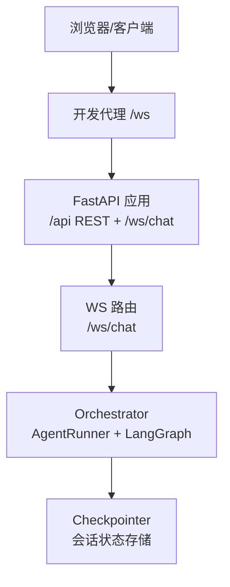
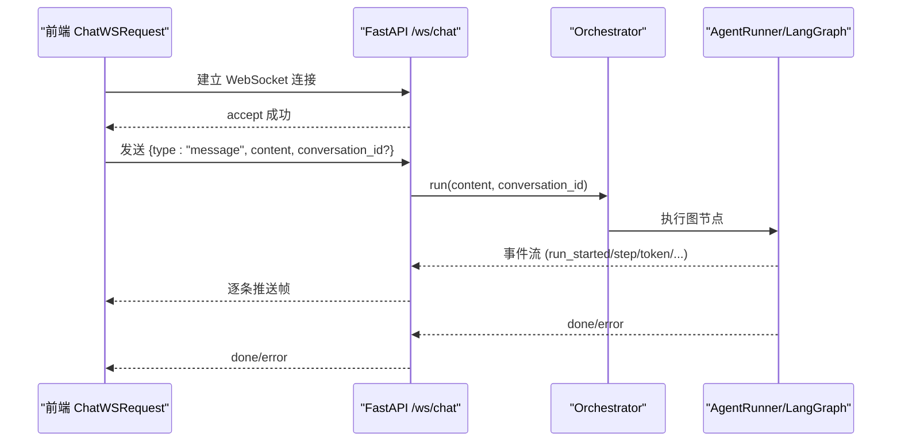
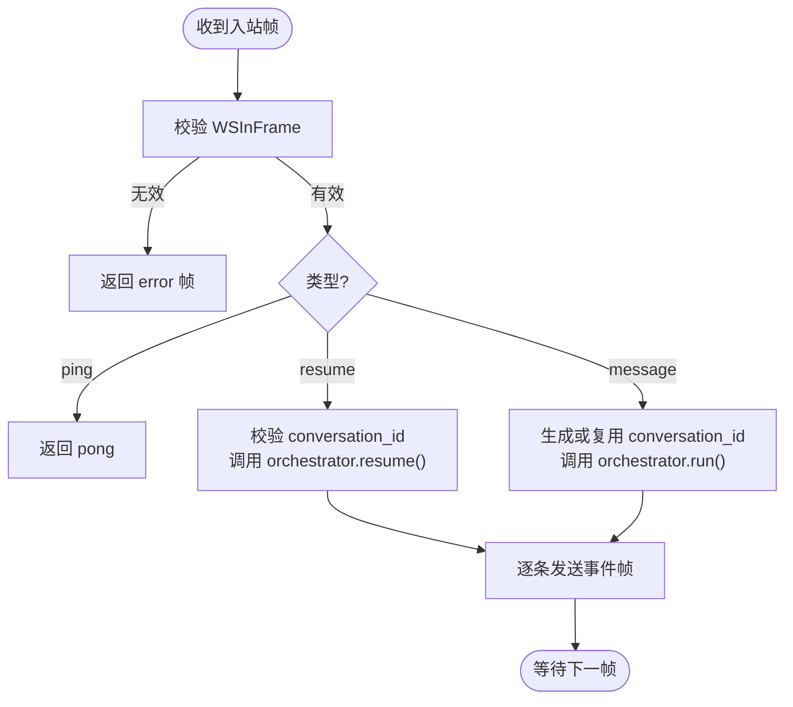
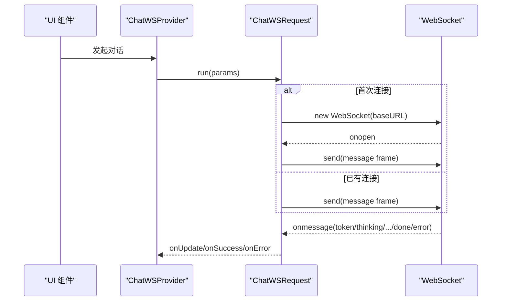
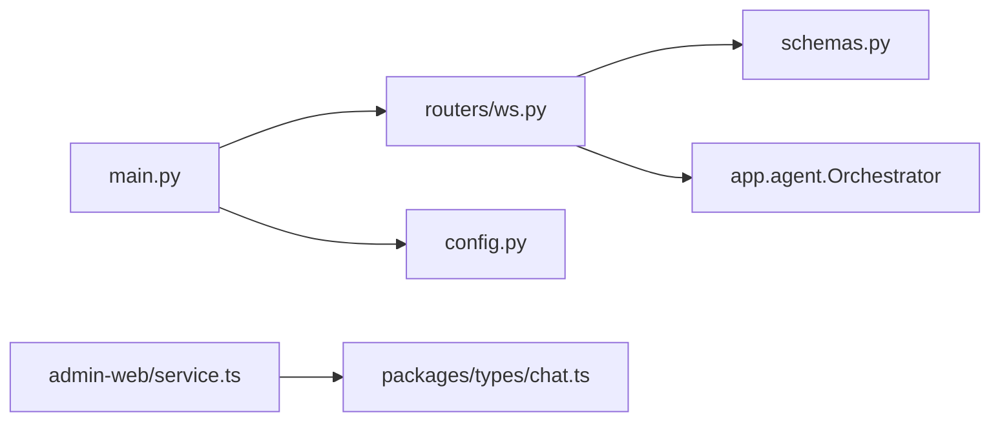
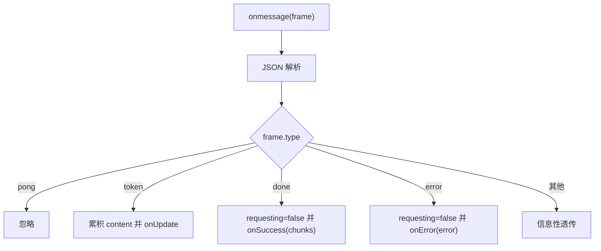

# WebSocket API

<cite>
**本文引用的文件**   
- [services/chat/app/main.py](file://services/chat/app/main.py)
- [services/chat/app/routers/ws.py](file://services/chat/app/routers/ws.py)
- [services/chat/app/schemas.py](file://services/chat/app/schemas.py)
- [services/chat/app/config.py](file://services/chat/app/config.py)
- [packages/types/src/chat.ts](file://packages/types/src/chat.ts)
- [apps/admin-web/src/pages/chatbot/service.ts](file://apps/admin-web/src/pages/chatbot/service.ts)
- [apps/admin-web/src/pages/chatbot/data.d.ts](file://apps/admin-web/src/pages/chatbot/data.d.ts)
- [services/chat/tests/test_ws.py](file://services/chat/tests/test_ws.py)
</cite>

## 目录
1. [简介](#简介)
2. [项目结构](#项目结构)
3. [核心组件](#核心组件)
4. [架构总览](#架构总览)
5. [详细组件分析](#详细组件分析)
6. [依赖关系分析](#依赖关系分析)
7. [性能与并发](#性能与并发)
8. [连接、认证与会话管理](#连接认证与会话管理)
9. [消息协议与事件类型](#消息协议与事件类型)
10. [流式响应处理](#流式响应处理)
11. [错误处理与重连机制](#错误处理与重连机制)
12. [持久化与会话记忆](#持久化与会话记忆)
13. [调试工具与监控指标](#调试工具与监控指标)
14. [故障排查指南](#故障排查指南)
15. [结论](#结论)

## 简介
本接口文档面向实时聊天场景，定义基于 WebSocket 的流式通信协议。服务端使用 FastAPI 提供 `/ws/chat` 端点，将 Agent 编排层的事件流转换为统一的 JSON 帧；客户端通过长连接发送消息、接收增量 token、控制事件（如 thinking/plan/tool_call/interrupt）以及完成信号。文档覆盖连接建立、心跳、会话标识、消息格式、事件语义、错误处理、重连策略、性能优化与调试方法。

## 项目结构
chat 服务采用 FastAPI 应用工厂模式：
- 应用入口装配 Orchestrator、CORS 中间件与路由。
- WS 路由位于独立模块，负责协议翻译与事件分发。
- Pydantic 模型集中定义入站/出站帧结构。
- 前端在 admin-web 中实现 ChatWSRequest，封装连接、心跳、流式拼接与回调。

图表来源
- [services/chat/app/main.py:52-71](file://services/chat/app/main.py#L52-L71)
- [services/chat/app/routers/ws.py:131-189](file://services/chat/app/routers/ws.py#L131-L189)

章节来源
- [services/chat/app/main.py:1-76](file://services/chat/app/main.py#L1-L76)
- [services/chat/app/config.py:18-59](file://services/chat/app/config.py#L18-L59)

## 核心组件
- FastAPI 应用与生命周期：启动时构建 Orchestrator，关闭时释放资源；注册 CORS、REST 路由与 WS 路由。
- WS 路由：唯一协议翻译层，把 AgentEvent 映射为 WSOutFrame，处理 message/ping/resume 入站帧。
- 帧模型：WSInFrame/WSOutFrame 统一约束入站/出站字段，保证前后端契约稳定。
- 前端 ChatWSRequest：维护单连接、心跳、消息缓冲、token 拼接、done/error 回调。

章节来源
- [services/chat/app/main.py:24-71](file://services/chat/app/main.py#L24-L71)
- [services/chat/app/routers/ws.py:67-189](file://services/chat/app/routers/ws.py#L67-L189)
- [services/chat/app/schemas.py:59-102](file://services/chat/app/schemas.py#L59-L102)
- [apps/admin-web/src/pages/chatbot/service.ts:28-234](file://apps/admin-web/src/pages/chatbot/service.ts#L28-L234)

## 架构总览
WS 链路位置：
- 上游：前端 chatbot service.ts，开发态经 `/ws` 代理转发到后端。
- 下游：Orchestrator → AgentRunner → LangGraph supervisor graph。
- 本模块只做协议翻译，不介入业务判断。

图表来源
- [services/chat/app/routers/ws.py:131-189](file://services/chat/app/routers/ws.py#L131-L189)
- [apps/admin-web/src/pages/chatbot/service.ts:65-177](file://apps/admin-web/src/pages/chatbot/service.ts#L65-L177)

## 详细组件分析

### WebSocket 路由与帧协议
- 路径：`/ws/chat`（不带 `/api` 前缀）。
- 入站帧类型：`message`、`ping`、`resume`。
- 出站帧类型：`run_started`、`thinking`、`plan`、`step`、`tool_call_start`、`tool_call_args`、`tool_call_end`、`tool_call_result`、`interrupt`、`token`、`done`、`error`、`pong`。
- 会话标识：`conversation_id` 对应 LangGraph thread_id，用于多轮记忆与 resume 定位挂起线程。

图表来源
- [services/chat/app/routers/ws.py:131-189](file://services/chat/app/routers/ws.py#L131-L189)
- [services/chat/app/schemas.py:59-102](file://services/chat/app/schemas.py#L59-L102)

章节来源
- [services/chat/app/routers/ws.py:1-49](file://services/chat/app/routers/ws.py#L1-L49)
- [services/chat/app/routers/ws.py:67-189](file://services/chat/app/routers/ws.py#L67-L189)
- [services/chat/app/schemas.py:59-102](file://services/chat/app/schemas.py#L59-L102)

### 前端连接与流式处理
- 连接地址：根据当前页面协议自动选择 `ws://` 或 `wss://`，路径为 `/ws/chat`。
- 心跳：每 30 秒发送一次 `ping`，服务端回 `pong`。
- 消息发送：取最后一条用户消息作为 content，携带可选 `conversationId`。
- 流式拼接：累积 `token` 帧内容，`done` 触发 onSuccess，`error` 触发 onError。
- 未知帧：对 `run_started/step/thinking/plan/tool_call_*/interrupt` 等过程帧透传但不结束请求。

图表来源
- [apps/admin-web/src/pages/chatbot/service.ts:18-234](file://apps/admin-web/src/pages/chatbot/service.ts#L18-L234)

章节来源
- [apps/admin-web/src/pages/chatbot/service.ts:18-234](file://apps/admin-web/src/pages/chatbot/service.ts#L18-L234)
- [apps/admin-web/src/pages/chatbot/data.d.ts:1-13](file://apps/admin-web/src/pages/chatbot/data.d.ts#L1-L13)

## 依赖关系分析
- main.py 创建 FastAPI 应用，注入 CORS 中间件，挂载 health/items/ws 路由。
- ws.py 依赖 schemas.py 的 WSInFrame/WSOutFrame，依赖 Orchestrator 进行运行与恢复。
- config.py 提供宿主级配置（端口、CORS），与编排侧 AGENT_CORE_* 命名空间隔离。
- 前端 types 包定义 ChatInFrame/ChatWSFrame，与服务端帧类型保持一致。

图表来源
- [services/chat/app/main.py:52-71](file://services/chat/app/main.py#L52-L71)
- [services/chat/app/routers/ws.py:51-65](file://services/chat/app/routers/ws.py#L51-L65)
- [services/chat/app/schemas.py:59-102](file://services/chat/app/schemas.py#L59-L102)
- [services/chat/app/config.py:18-59](file://services/chat/app/config.py#L18-L59)
- [packages/types/src/chat.ts:1-40](file://packages/types/src/chat.ts#L1-L40)
- [apps/admin-web/src/pages/chatbot/service.ts:1-20](file://apps/admin-web/src/pages/chatbot/service.ts#L1-L20)

章节来源
- [services/chat/app/main.py:52-71](file://services/chat/app/main.py#L52-L71)
- [services/chat/app/routers/ws.py:51-65](file://services/chat/app/routers/ws.py#L51-L65)
- [services/chat/app/config.py:18-59](file://services/chat/app/config.py#L18-L59)
- [packages/types/src/chat.ts:1-40](file://packages/types/src/chat.ts#L1-L40)

## 性能与并发
- 单连接串行处理：WS 路由在同一 socket 上串行读取与发送，避免并发写冲突。
- 心跳保活：客户端每 30 秒 ping，降低空闲连接被网关回收的概率。
- 进程内内存存储示例：ItemStore 演示了线程安全与锁粒度，但非生产持久层；真实部署应替换为数据库或缓存。
- 配置缓存：get_settings 使用 lru_cache 避免重复解析环境变量。

建议：
- 在高并发场景下，结合反向代理（Nginx/Cloudflare）与负载均衡，按连接数与带宽限制调优。
- 对大消息或长流式响应，考虑分片与背压控制（前端节流渲染）。
- 使用连接池或复用连接（前端已实现单连接复用）。

章节来源
- [services/chat/app/routers/ws.py:177-189](file://services/chat/app/routers/ws.py#L177-L189)
- [apps/admin-web/src/pages/chatbot/service.ts:179-194](file://apps/admin-web/src/pages/chatbot/service.ts#L179-L194)
- [services/chat/app/store.py:20-92](file://services/chat/app/store.py#L20-L92)
- [services/chat/app/config.py:52-59](file://services/chat/app/config.py#L52-L59)

## 连接、认证与会话管理
- 连接建立：客户端直接连接 `/ws/chat`，无需额外鉴权头；若需认证，可在代理层或后续扩展中添加握手帧。
- 会话管理：通过 `conversation_id` 映射 LangGraph thread_id，相同 id 共享上下文，不同 id 相互隔离。
- 默认行为：未传 `conversation_id` 时服务端生成新 id，并在 `run_started.payload.thread_id` 返回给客户端保存。

章节来源
- [services/chat/app/routers/ws.py:170-176](file://services/chat/app/routers/ws.py#L170-L176)
- [services/chat/tests/test_ws.py:61-69](file://services/chat/tests/test_ws.py#L61-L69)

## 消息协议与事件类型

### 入站帧（WSInFrame）
- type：`message` | `ping` | `resume`
- content：字符串消息体（默认空串）
- conversation_id：会话标识（默认空串；resume 必填）

### 出站帧（WSOutFrame）
- type：`token` | `done` | `pong` | `error` | `run_started` | `step` | `thinking` | `plan` | `tool_call_start` | `tool_call_args` | `tool_call_end` | `tool_call_result` | `interrupt`
- content：文本内容（如 token 增量、错误信息、中断问题）
- payload：结构化附加信息（如 thread_id、node、tool name/args/result）

### 事件映射表
- RUN_STARTED → run_started
- THINKING → thinking
- PLAN → plan
- STEP → step
- TEXT_MESSAGE_CONTENT → token
- TOOL_CALL_START/ARGS/END/RESULT → tool_call_start/args/end/result
- INTERRUPT → interrupt
- RUN_FINISHED → done
- RUN_ERROR → error

章节来源
- [services/chat/app/schemas.py:59-102](file://services/chat/app/schemas.py#L59-L102)
- [services/chat/app/routers/ws.py:67-83](file://services/chat/app/routers/ws.py#L67-L83)

## 流式响应处理
- 客户端收到 `token` 帧后追加到本地缓冲区，并触发 onUpdate。
- 收到 `done` 帧后结束请求，触发 onSuccess，传入累积帧数组。
- 收到 `error` 帧后结束请求，触发 onError。
- 其他过程帧（run_started/step/thinking/plan/tool_call_*/interrupt）仅透传，不改变请求状态。

图表来源
- [apps/admin-web/src/pages/chatbot/service.ts:142-177](file://apps/admin-web/src/pages/chatbot/service.ts#L142-L177)

章节来源
- [apps/admin-web/src/pages/chatbot/service.ts:142-177](file://apps/admin-web/src/pages/chatbot/service.ts#L142-L177)

## 错误处理与重连机制
- 服务端：
  - 帧校验失败返回 `error` 帧，不中断连接。
  - 客户端断开或发送失败捕获 `_ClientGone`，静默结束协程。
  - 其他异常记录日志并交由框架关闭连接。
- 客户端：
  - onerror/onclose 触发 onError，重置 requesting 状态。
  - 心跳定时器在连接打开时启动，关闭时清理。
  - 断连后由上层 UI 或重试逻辑决定是否重建连接。

章节来源
- [services/chat/app/routers/ws.py:86-102](file://services/chat/app/routers/ws.py#L86-L102)
- [services/chat/app/routers/ws.py:145-189](file://services/chat/app/routers/ws.py#L145-L189)
- [apps/admin-web/src/pages/chatbot/service.ts:94-128](file://apps/admin-web/src/pages/chatbot/service.ts#L94-L128)

## 持久化与会话记忆
- 会话记忆：通过 `conversation_id` 与 LangGraph checkpointer 绑定，同 id 多次消息共享上下文。
- 测试验证：
  - 同一 conversation_id 的多轮消息会累积历史。
  - 不同 conversation_id 的消息彼此隔离。
- 生产建议：
  - 使用 Redis/SQL checkpointer 以支持跨进程/重启持久化。
  - 在前端保存 conversation_id，确保多轮对话连续性。

章节来源
- [services/chat/tests/test_ws.py:92-158](file://services/chat/tests/test_ws.py#L92-L158)

## 调试工具与监控指标
- 开发代理：admin-web 开发环境下通过 `/ws` 代理转发到后端 WS 端点。
- 心跳检测：客户端每 30 秒发送 ping，服务端回 pong，可用于连接健康检查。
- 日志与异常：
  - 服务端 WS 处理异常记录日志。
  - 前端 onerror/onclose 上报错误信息。
- 测试用例：
  - 流式 token 与 done 序列。
  - run_started 携带 thread_id。
  - ping/pong 交互。
  - 非法帧返回 error。
  - 断连不抛异常。
  - 会话记忆与隔离。
  - interrupt/resume 流程。

章节来源
- [services/chat/app/main.py:1-14](file://services/chat/app/main.py#L1-L14)
- [services/chat/app/routers/ws.py:184-189](file://services/chat/app/routers/ws.py#L184-L189)
- [services/chat/tests/test_ws.py:48-91](file://services/chat/tests/test_ws.py#L48-L91)
- [services/chat/tests/test_ws.py:181-213](file://services/chat/tests/test_ws.py#L181-L213)

## 故障排查指南
常见问题与定位步骤：
- 无法连接 `/ws/chat`：
  - 检查代理是否转发 WS 到后端。
  - 确认 CORS 配置允许前端域名。
- 收不到 token：
  - 检查是否发送了有效的 `message` 帧。
  - 查看服务端日志是否有 WS 处理异常。
- 会话丢失：
  - 确认前端是否正确保存并使用 `conversation_id`。
  - 检查服务端是否在 `run_started.payload.thread_id` 返回了预期值。
- 中断后无响应：
  - 确认先消费完本次 run 的 `done` 帧再发送 `resume`。
  - 检查 `resume` 帧是否包含正确的 `conversation_id`。

章节来源
- [services/chat/app/routers/ws.py:158-175](file://services/chat/app/routers/ws.py#L158-L175)
- [services/chat/tests/test_ws.py:181-213](file://services/chat/tests/test_ws.py#L181-L213)

## 结论
本 WebSocket API 以 `/ws/chat` 为入口，通过统一的帧协议承载实时聊天能力。服务端专注协议翻译与事件分发，前端负责连接管理与流式渲染。通过 `conversation_id` 实现会话记忆，配合心跳与错误处理保障连接稳定性。建议在部署时完善持久化与监控，结合代理与负载均衡提升并发处理能力。