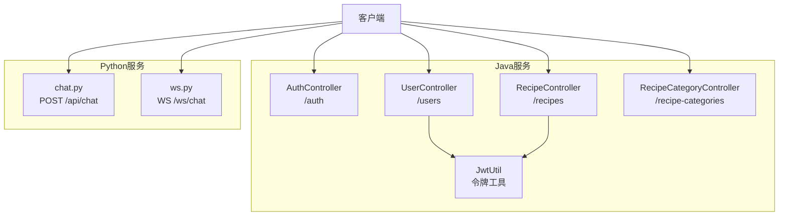
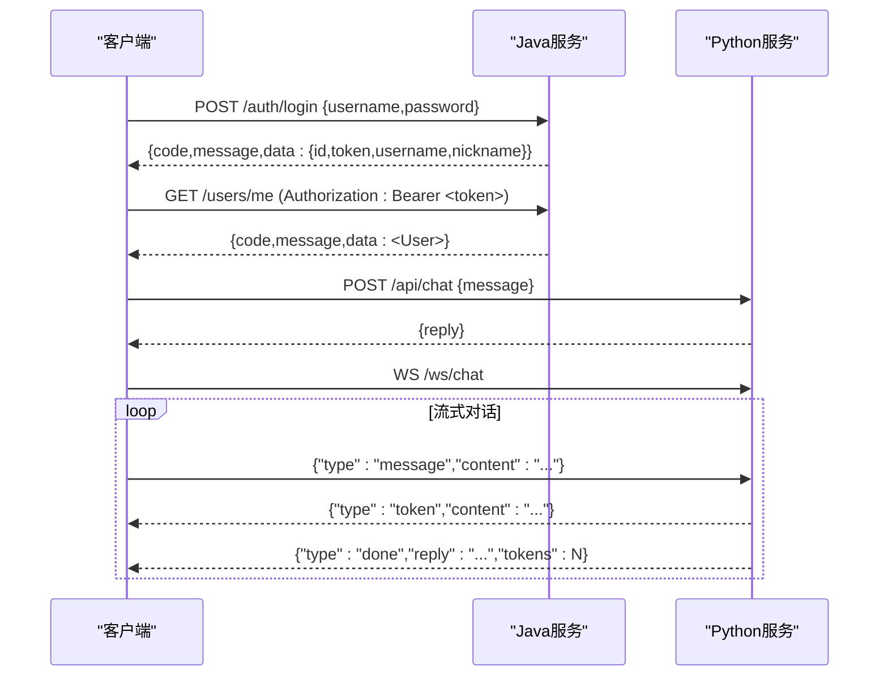
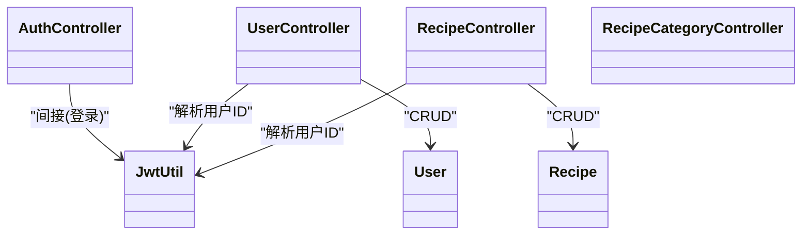

# API接口文档

<cite>
**本文引用的文件**
- [AuthController.java](file://java_server/po/src/main/java/com/goodzheng/po/controller/AuthController.java)
- [UserController.java](file://java_server/po/src/main/java/com/goodzheng/po/controller/UserController.java)
- [RecipeController.java](file://java_server/po/src/main/java/com/goodzheng/po/controller/RecipeController.java)
- [RecipeCategoryController.java](file://java_server/po/src/main/java/com/goodzheng/po/controller/RecipeCategoryController.java)
- [JwtUtil.java](file://java_server/po/src/main/java/com/goodzheng/po/util/JwtUtil.java)
- [Result.java](file://java_server/po/src/main/java/com/goodzheng/po/dto/Result.java)
- [LoginRequest.java](file://java_server/po/src/main/java/com/goodzheng/po/dto/LoginRequest.java)
- [LoginResponse.java](file://java_server/po/src/main/java/com/goodzheng/po/dto/LoginResponse.java)
- [UserRequest.java](file://java_server/po/src/main/java/com/goodzheng/po/dto/UserRequest.java)
- [RecipeRequest.java](file://java_server/po/src/main/java/com/goodzheng/po/dto/RecipeRequest.java)
- [User.java](file://java_server/po/src/main/java/com/goodzheng/po/entity/User.java)
- [Recipe.java](file://java_server/po/src/main/java/com/goodzheng/po/entity/Recipe.java)
- [ws.py](file://py_server/blueprints/ws.py)
- [chat.py](file://py_server/blueprints/chat.py)
- [config.py](file://py_server/config.py)
</cite>

## 目录
1. [简介](#简介)
2. [项目结构](#项目结构)
3. [核心组件](#核心组件)
4. [架构总览](#架构总览)
5. [详细接口说明](#详细接口说明)
6. [依赖关系分析](#依赖关系分析)
7. [性能与扩展性](#性能与扩展性)
8. [故障排查指南](#故障排查指南)
9. [结论](#结论)
10. [附录：客户端集成示例](#附录客户端集成示例)

## 简介
本文件为项目的完整API接口参考，覆盖RESTful HTTP接口与WebSocket流式对话接口。内容包括：
- 所有HTTP接口的URL、方法、请求参数、响应结构与状态码
- JWT认证机制的获取、验证与使用方式
- WebSocket连接协议、消息格式与事件类型
- 数据校验规则、权限控制与错误处理策略
- 客户端集成示例与常见问题解决方案

## 项目结构
后端由两部分组成：
- Java Spring Boot服务：提供用户、菜谱、分类等REST接口，统一返回Result封装体，并使用JWT进行鉴权
- Python Flask服务：提供聊天REST接口（一次性回复）与WebSocket流式对话接口（逐token推送）

图表来源
- [AuthController.java:11-39](file://java_server/po/src/main/java/com/goodzheng/po/controller/AuthController.java#L11-L39)
- [UserController.java:19-131](file://java_server/po/src/main/java/com/goodzheng/po/controller/UserController.java#L19-L131)
- [RecipeController.java:18-118](file://java_server/po/src/main/java/com/goodzheng/po/controller/RecipeController.java#L18-L118)
- [RecipeCategoryController.java:11-27](file://java_server/po/src/main/java/com/goodzheng/po/controller/RecipeCategoryController.java#L11-L27)
- [JwtUtil.java:13-55](file://java_server/po/src/main/java/com/goodzheng/po/util/JwtUtil.java#L13-L55)
- [chat.py:1-24](file://py_server/blueprints/chat.py#L1-L24)
- [ws.py:1-90](file://py_server/blueprints/ws.py#L1-L90)

章节来源
- [AuthController.java:11-39](file://java_server/po/src/main/java/com/goodzheng/po/controller/AuthController.java#L11-L39)
- [UserController.java:19-131](file://java_server/po/src/main/java/com/goodzheng/po/controller/UserController.java#L19-L131)
- [RecipeController.java:18-118](file://java_server/po/src/main/java/com/goodzheng/po/controller/RecipeController.java#L18-L118)
- [RecipeCategoryController.java:11-27](file://java_server/po/src/main/java/com/goodzheng/po/controller/RecipeCategoryController.java#L11-L27)
- [JwtUtil.java:13-55](file://java_server/po/src/main/java/com/goodzheng/po/util/JwtUtil.java#L13-L55)
- [chat.py:1-24](file://py_server/blueprints/chat.py#L1-L24)
- [ws.py:1-90](file://py_server/blueprints/ws.py#L1-L90)

## 核心组件
- 统一响应体 Result：包含code、message、data字段，用于标准化成功与失败响应
- JWT工具 JwtUtil：负责生成、解析与校验JWT令牌
- 控制器层：AuthController、UserController、RecipeController、RecipeCategoryController
- Python服务：Flask蓝图提供聊天REST与WebSocket流式接口

章节来源
- [Result.java:7-31](file://java_server/po/src/main/java/com/goodzheng/po/dto/Result.java#L7-L31)
- [JwtUtil.java:13-55](file://java_server/po/src/main/java/com/goodzheng/po/util/JwtUtil.java#L13-L55)
- [AuthController.java:11-39](file://java_server/po/src/main/java/com/goodzheng/po/controller/AuthController.java#L11-L39)
- [UserController.java:19-131](file://java_server/po/src/main/java/com/goodzheng/po/controller/UserController.java#L19-L131)
- [RecipeController.java:18-118](file://java_server/po/src/main/java/com/goodzheng/po/controller/RecipeController.java#L18-L118)
- [RecipeCategoryController.java:11-27](file://java_server/po/src/main/java/com/goodzheng/po/controller/RecipeCategoryController.java#L11-L27)
- [chat.py:1-24](file://py_server/blueprints/chat.py#L1-L24)
- [ws.py:1-90](file://py_server/blueprints/ws.py#L1-L90)

## 架构总览
下图展示了客户端与Java/Python服务的交互流程，包括登录获取JWT、受保护资源访问以及WebSocket流式对话。

图表来源
- [AuthController.java:19-27](file://java_server/po/src/main/java/com/goodzheng/po/controller/AuthController.java#L19-L27)
- [UserController.java:55-64](file://java_server/po/src/main/java/com/goodzheng/po/controller/UserController.java#L55-L64)
- [chat.py:10-23](file://py_server/blueprints/chat.py#L10-L23)
- [ws.py:30-89](file://py_server/blueprints/ws.py#L30-L89)

## 详细接口说明

### 通用约定
- 统一响应体 Result
  - 字段：code（整数）、message（字符串）、data（任意类型）
  - 成功：code=200，message="success"或自定义提示，data为业务数据
  - 失败：code非200，message为错误信息，data为空
- 分页参数
  - page：页码，默认0
  - size：每页大小
  - Sort：按创建时间倒序（具体接口见各控制器）
- 认证方式
  - 通过Authorization头携带Bearer Token
  - 未携带或无效Token将返回401

章节来源
- [Result.java:7-31](file://java_server/po/src/main/java/com/goodzheng/po/dto/Result.java#L7-L31)
- [UserController.java:55-64](file://java_server/po/src/main/java/com/goodzheng/po/controller/UserController.java#L55-L64)
- [RecipeController.java:70-83](file://java_server/po/src/main/java/com/goodzheng/po/controller/RecipeController.java#L70-L83)

### 认证接口（/auth）
- POST /auth/login
  - 请求体：LoginRequest
    - username：必填
    - password：必填
  - 响应：Result<LoginResponse>
    - data.id：用户ID
    - data.token：JWT令牌
    - data.username：用户名
    - data.nickname：昵称
  - 状态码：200成功；401认证失败
- POST /auth/register
  - 查询参数：username、password、email（可选）
  - 响应：Result<String>
  - 状态码：200成功；400注册失败

章节来源
- [AuthController.java:19-39](file://java_server/po/src/main/java/com/goodzheng/po/controller/AuthController.java#L19-L39)
- [LoginRequest.java:6-14](file://java_server/po/src/main/java/com/goodzheng/po/dto/LoginRequest.java#L6-L14)
- [LoginResponse.java:6-14](file://java_server/po/src/main/java/com/goodzheng/po/dto/LoginResponse.java#L6-L14)

### 用户接口（/users）
- GET /users
  - 查询参数：page、size、keyword（可选）
  - 响应：Result<Page<User>>
  - 状态码：200成功
- GET /users/{id}
  - 路径参数：id
  - 响应：Result<User>
  - 状态码：200成功；404不存在
- GET /users/me
  - 请求头：Authorization: Bearer <token>
  - 响应：Result<User>
  - 状态码：200成功；401未授权
- POST /users
  - 请求体：UserRequest（支持校验）
  - 响应：Result<User>
  - 状态码：200成功；400校验失败
- PUT /users/{id}
  - 路径参数：id
  - 请求体：UserRequest
  - 响应：Result<User>
  - 状态码：200成功；400校验失败
- DELETE /users/{id}
  - 路径参数：id
  - 响应：Result<String>
  - 状态码：200成功；400删除失败
- DELETE /users/batch
  - 请求体：List<Long> ids
  - 响应：Result<String>
  - 状态码：200成功；400批量删除失败
- PUT /users/batch/status
  - 请求体：{ids:[...], status:"..."}
  - 响应：Result<String>
  - 状态码：200成功；400状态更新失败

章节来源
- [UserController.java:29-122](file://java_server/po/src/main/java/com/goodzheng/po/controller/UserController.java#L29-L122)
- [UserRequest.java:6-29](file://java_server/po/src/main/java/com/goodzheng/po/dto/UserRequest.java#L6-L29)
- [User.java:8-58](file://java_server/po/src/main/java/com/goodzheng/po/entity/User.java#L8-L58)

### 菜谱接口（/recipes）
- POST /recipes
  - 请求头：Authorization: Bearer <token>
  - 请求体：RecipeRequest（支持嵌套校验）
  - 响应：Result<Recipe>
  - 状态码：200成功；400校验失败
- GET /recipes/{id}
  - 路径参数：id
  - 响应：Result<Recipe>
  - 状态码：200成功；404不存在
- GET /recipes
  - 查询参数：page、size、categoryId（可选，列表）、keyword（可选）
  - 响应：Result<Page<Recipe>>
  - 状态码：200成功
- GET /recipes/mine
  - 请求头：Authorization: Bearer <token>
  - 查询参数：page、size
  - 响应：Result<Page<Recipe>>
  - 状态码：200成功；401未授权
- PUT /recipes/{id}
  - 路径参数：id
  - 请求头：Authorization: Bearer <token>
  - 请求体：RecipeRequest
  - 响应：Result<Recipe>
  - 状态码：200成功；400校验失败
- DELETE /recipes/{id}
  - 路径参数：id
  - 请求头：Authorization: Bearer <token>
  - 响应：Result<String>
  - 状态码：200成功；400删除失败

章节来源
- [RecipeController.java:28-109](file://java_server/po/src/main/java/com/goodzheng/po/controller/RecipeController.java#L28-L109)
- [RecipeRequest.java:10-65](file://java_server/po/src/main/java/com/goodzheng/po/dto/RecipeRequest.java#L10-L65)
- [Recipe.java:10-92](file://java_server/po/src/main/java/com/goodzheng/po/entity/Recipe.java#L10-L92)

### 菜谱分类接口（/recipe-categories）
- GET /recipe-categories
  - 无需登录
  - 响应：Result<List<RecipeCategory>>
  - 状态码：200成功；500服务器错误

章节来源
- [RecipeCategoryController.java:19-27](file://java_server/po/src/main/java/com/goodzheng/po/controller/RecipeCategoryController.java#L19-L27)

### Python聊天接口
- POST /api/chat
  - 请求体：{message: string}
  - 响应：{reply: string}
  - 状态码：200成功；400缺少message；500内部错误

章节来源
- [chat.py:10-23](file://py_server/blueprints/chat.py#L10-L23)

### WebSocket流式对话（/ws/chat）
- 连接地址：ws://host/ws/chat
- 协议：JSON文本帧
- 客户端→服务端消息
  - {"type":"message","content":"..."}：发起一轮对话
  - {"type":"ping"}：心跳
- 服务端→客户端消息
  - {"type":"token","content":"..."}：增量输出
  - {"type":"done","reply":"...","tokens":N}：本轮结束
  - {"type":"pong"}：心跳应答
  - {"type":"error","message":"..."}：错误
- 错误场景
  - 无效JSON帧：返回error
  - 未知消息类型：返回error
  - content为空：返回error
  - 处理异常：返回error并记录日志

章节来源
- [ws.py:1-90](file://py_server/blueprints/ws.py#L1-L90)

## 依赖关系分析
- 控制器依赖
  - AuthController → AuthService（登录/注册）
  - UserController → UserService、JwtUtil、UserRepository
  - RecipeController → RecipeService、JwtUtil、UserRepository
  - RecipeCategoryController → RecipeCategoryService
- 数据模型
  - User：用户实体，含角色、状态、时间戳等
  - Recipe：菜谱实体，含作者、公开标记、统计、软删除、时间戳及关联食材步骤
- 认证链路
  - 登录成功后返回JWT；后续受保护接口需携带Authorization: Bearer <token>
  - 控制器通过JwtUtil解析用户名并查询用户ID

图表来源
- [AuthController.java:11-39](file://java_server/po/src/main/java/com/goodzheng/po/controller/AuthController.java#L11-L39)
- [UserController.java:19-131](file://java_server/po/src/main/java/com/goodzheng/po/controller/UserController.java#L19-L131)
- [RecipeController.java:18-118](file://java_server/po/src/main/java/com/goodzheng/po/controller/RecipeController.java#L18-L118)
- [RecipeCategoryController.java:11-27](file://java_server/po/src/main/java/com/goodzheng/po/controller/RecipeCategoryController.java#L11-L27)
- [JwtUtil.java:13-55](file://java_server/po/src/main/java/com/goodzheng/po/util/JwtUtil.java#L13-L55)
- [User.java:8-58](file://java_server/po/src/main/java/com/goodzheng/po/entity/User.java#L8-L58)
- [Recipe.java:10-92](file://java_server/po/src/main/java/com/goodzheng/po/entity/Recipe.java#L10-L92)

章节来源
- [AuthController.java:11-39](file://java_server/po/src/main/java/com/goodzheng/po/controller/AuthController.java#L11-L39)
- [UserController.java:19-131](file://java_server/po/src/main/java/com/goodzheng/po/controller/UserController.java#L19-L131)
- [RecipeController.java:18-118](file://java_server/po/src/main/java/com/goodzheng/po/controller/RecipeController.java#L18-L118)
- [RecipeCategoryController.java:11-27](file://java_server/po/src/main/java/com/goodzheng/po/controller/RecipeCategoryController.java#L11-L27)
- [JwtUtil.java:13-55](file://java_server/po/src/main/java/com/goodzheng/po/util/JwtUtil.java#L13-L55)
- [User.java:8-58](file://java_server/po/src/main/java/com/goodzheng/po/entity/User.java#L8-L58)
- [Recipe.java:10-92](file://java_server/po/src/main/java/com/goodzheng/po/entity/Recipe.java#L10-L92)

## 性能与扩展性
- 分页与排序：用户与菜谱列表均支持分页与按创建时间倒序，避免全表扫描
- 流式输出：WebSocket以增量token推送，降低首屏延迟，提升用户体验
- 跨域：控制器启用跨域配置，便于前端直接调用
- 可扩展点
  - 增加更细粒度权限控制（基于角色或资源级）
  - 引入缓存层减少重复查询
  - 对大对象（如菜谱详情）进行按需加载

[本节为通用指导，不直接分析具体文件]

## 故障排查指南
- 认证相关
  - 未携带或无效Authorization头：检查是否已登录并正确设置Bearer Token
  - 登录失败：检查用户名与密码是否符合校验规则
- 数据校验
  - 400错误：检查请求体字段是否满足必填与格式要求（如用户名、密码、菜谱标题、难度等）
- 资源不存在
  - 404错误：确认ID是否存在
- WebSocket
  - 无效JSON帧或未知消息类型：检查发送的消息格式
  - 处理异常：查看服务端日志定位问题

章节来源
- [AuthController.java:19-39](file://java_server/po/src/main/java/com/goodzheng/po/controller/AuthController.java#L19-L39)
- [UserController.java:45-122](file://java_server/po/src/main/java/com/goodzheng/po/controller/UserController.java#L45-L122)
- [RecipeController.java:28-109](file://java_server/po/src/main/java/com/goodzheng/po/controller/RecipeController.java#L28-L109)
- [ws.py:43-89](file://py_server/blueprints/ws.py#L43-L89)

## 结论
本项目提供了完整的REST与WebSocket接口，涵盖用户管理、菜谱管理与分类查询，并通过JWT实现基础鉴权。Python侧提供聊天能力，支持一次性回复与流式对话。建议在生产环境完善权限控制、缓存与监控，以提升安全性与性能。

[本节为总结性内容，不直接分析具体文件]

## 附录：客户端集成示例

### 登录与保存Token
- 调用POST /auth/login，提交username与password
- 从响应中取出token，并在后续请求的Authorization头中携带Bearer Token

章节来源
- [AuthController.java:19-27](file://java_server/po/src/main/java/com/goodzheng/po/controller/AuthController.java#L19-L27)
- [LoginResponse.java:6-14](file://java_server/po/src/main/java/com/goodzheng/po/dto/LoginResponse.java#L6-L14)

### 访问受保护资源
- 在GET /users/me、GET /recipes/mine等接口中，添加Authorization: Bearer <token>
- 若返回401，检查Token是否有效或已过期

章节来源
- [UserController.java:55-64](file://java_server/po/src/main/java/com/goodzheng/po/controller/UserController.java#L55-L64)
- [RecipeController.java:70-83](file://java_server/po/src/main/java/com/goodzheng/po/controller/RecipeController.java#L70-L83)

### 流式对话（WebSocket）
- 建立ws://host/ws/chat连接
- 发送{"type":"message","content":"..."}开始对话
- 接收多个{"type":"token","content":"..."}增量输出
- 最后接收{"type":"done","reply":"...","tokens":N}表示完成
- 可周期性发送{"type":"ping"}维持连接，服务端会返回{"type":"pong"}

章节来源
- [ws.py:30-89](file://py_server/blueprints/ws.py#L30-L89)

### 一次性聊天（REST）
- 调用POST /api/chat，提交{message: "..."}
- 接收{reply: "..."}

章节来源
- [chat.py:10-23](file://py_server/blueprints/chat.py#L10-L23)