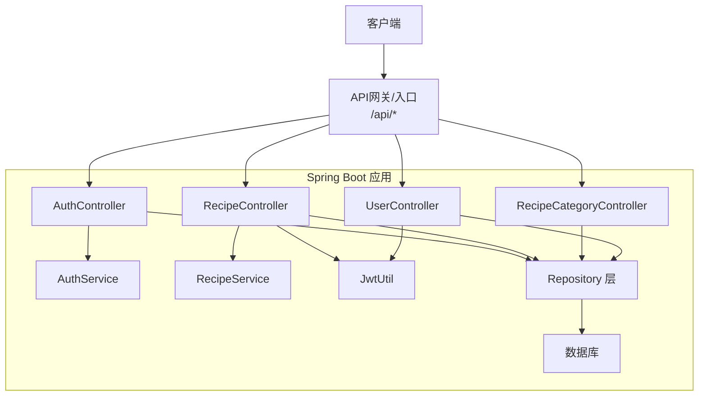
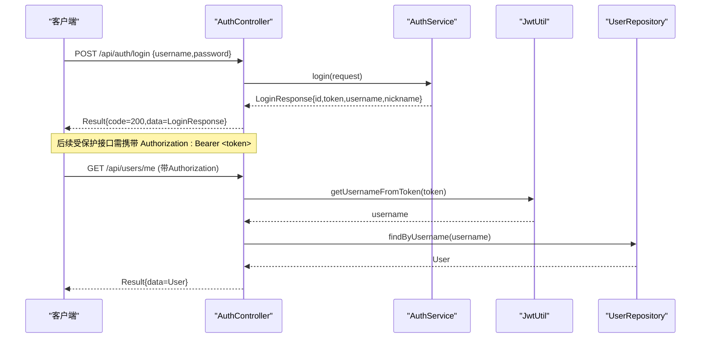
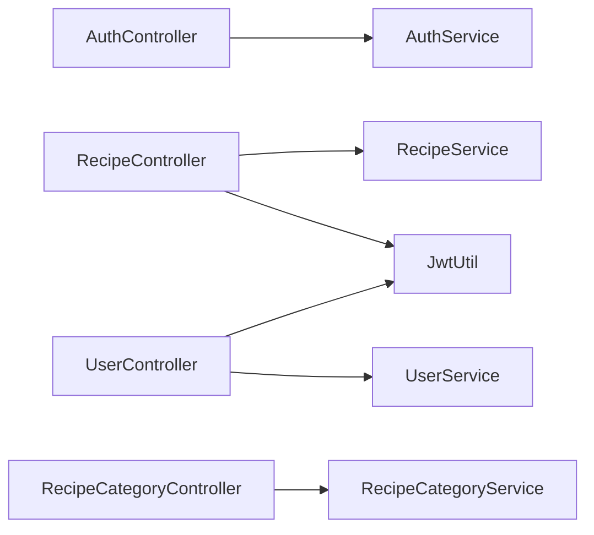

# RESTful API接口

<cite>
**本文引用的文件**
- [AuthController.java](file://java_server/po/src/main/java/com/goodzheng/po/controller/AuthController.java)
- [RecipeController.java](file://java_server/po/src/main/java/com/goodzheng/po/controller/RecipeController.java)
- [RecipeCategoryController.java](file://java_server/po/src/main/java/com/goodzheng/po/controller/RecipeCategoryController.java)
- [UserController.java](file://java_server/po/src/main/java/com/goodzheng/po/controller/UserController.java)
- [LoginRequest.java](file://java_server/po/src/main/java/com/goodzheng/po/dto/LoginRequest.java)
- [LoginResponse.java](file://java_server/po/src/main/java/com/goodzheng/po/dto/LoginResponse.java)
- [Result.java](file://java_server/po/src/main/java/com/goodzheng/po/dto/Result.java)
- [RecipeRequest.java](file://java_server/po/src/main/java/com/goodzheng/po/dto/RecipeRequest.java)
- [UserRequest.java](file://java_server/po/src/main/java/com/goodzheng/po/dto/UserRequest.java)
- [JwtUtil.java](file://java_server/po/src/main/java/com/goodzheng/po/util/JwtUtil.java)
- [application.yaml](file://java_server/po/src/main/resources/application.yaml)
- [AuthService.java](file://java_server/po/src/main/java/com/goodzheng/po/service/AuthService.java)
- [RecipeService.java](file://java_server/po/src/main/java/com/goodzheng/po/service/RecipeService.java)
- [Recipe.java](file://java_server/po/src/main/java/com/goodzheng/po/entity/Recipe.java)
- [User.java](file://java_server/po/src/main/java/com/goodzheng/po/entity/User.java)
- [RecipeCategory.java](file://java_server/po/src/main/java/com/goodzheng/po/entity/RecipeCategory.java)
</cite>

## 目录
1. [简介](#简介)
2. [项目结构](#项目结构)
3. [核心组件](#核心组件)
4. [架构总览](#架构总览)
5. [详细接口说明](#详细接口说明)
6. [依赖关系分析](#依赖关系分析)
7. [性能与扩展建议](#性能与扩展建议)
8. [故障排查指南](#故障排查指南)
9. [结论](#结论)
10. [附录：客户端集成示例](#附录客户端集成示例)

## 简介
本接口文档面向菜谱管理、用户认证、分类管理等业务，提供完整的RESTful API规范。内容涵盖HTTP方法、URL路径、请求参数、响应数据结构、状态码、JWT认证流程、数据验证规则、权限控制与安全注意事项，并提供常见错误处理与客户端集成示例。

## 项目结构
后端基于Spring Boot，统一前缀为/api（由应用上下文配置）。控制器层暴露REST端点，服务层封装业务逻辑，实体层定义数据模型，DTO用于请求/响应契约，工具类提供JWT能力。

图表来源
- [application.yaml:4-7](file://java_server/po/src/main/resources/application.yaml#L4-L7)
- [AuthController.java:11-19](file://java_server/po/src/main/java/com/goodzheng/po/controller/AuthController.java#L11-L19)
- [RecipeController.java:18-29](file://java_server/po/src/main/java/com/goodzheng/po/controller/RecipeController.java#L18-L29)
- [RecipeCategoryController.java:11-21](file://java_server/po/src/main/java/com/goodzheng/po/controller/RecipeCategoryController.java#L11-L21)
- [UserController.java:19-31](file://java_server/po/src/main/java/com/goodzheng/po/controller/UserController.java#L19-L31)
- [JwtUtil.java:13-33](file://java_server/po/src/main/java/com/goodzheng/po/util/JwtUtil.java#L13-L33)

章节来源
- [application.yaml:4-7](file://java_server/po/src/main/resources/application.yaml#L4-L7)

## 核心组件
- 统一响应体 Result：包含 code、message、data，所有接口均返回该结构。
- JWT工具 JwtUtil：负责生成与解析令牌，使用HS256签名，过期时间可配置。
- 控制器：按领域划分，分别处理认证、菜谱、分类、用户等请求。
- DTO：对输入输出进行约束与建模，配合Bean Validation进行校验。
- 实体：映射数据库表结构，承载业务数据。

章节来源
- [Result.java:7-31](file://java_server/po/src/main/java/com/goodzheng/po/dto/Result.java#L7-L31)
- [JwtUtil.java:13-55](file://java_server/po/src/main/java/com/goodzheng/po/util/JwtUtil.java#L13-L55)
- [AuthController.java:11-39](file://java_server/po/src/main/java/com/goodzheng/po/controller/AuthController.java#L11-L39)
- [RecipeController.java:18-118](file://java_server/po/src/main/java/com/goodzheng/po/controller/RecipeController.java#L18-L118)
- [RecipeCategoryController.java:11-27](file://java_server/po/src/main/java/com/goodzheng/po/controller/RecipeCategoryController.java#L11-L27)
- [UserController.java:19-131](file://java_server/po/src/main/java/com/goodzheng/po/controller/UserController.java#L19-L131)

## 架构总览
认证流程采用无状态的JWT方案：客户端登录成功后获得token，后续请求在Authorization头中携带Bearer token；服务端通过JwtUtil解析并校验，再根据用户名查询用户ID以完成鉴权。

图表来源
- [AuthController.java:19-27](file://java_server/po/src/main/java/com/goodzheng/po/controller/AuthController.java#L19-L27)
- [AuthService.java:6-11](file://java_server/po/src/main/java/com/goodzheng/po/service/AuthService.java#L6-L11)
- [JwtUtil.java:25-37](file://java_server/po/src/main/java/com/goodzheng/po/util/JwtUtil.java#L25-L37)
- [UserController.java:56-64](file://java_server/po/src/main/java/com/goodzheng/po/controller/UserController.java#L56-L64)

## 详细接口说明

### 通用约定
- 基础路径：/api（由应用上下文决定）
- 统一响应体：Result<T>，字段包括 code、message、data
- 认证方式：Bearer Token，放入请求头 Authorization: Bearer <token>
- 字符编码：UTF-8
- 分页：page从0开始，size默认值见各接口

章节来源
- [application.yaml:4-7](file://java_server/po/src/main/resources/application.yaml#L4-L7)
- [Result.java:7-31](file://java_server/po/src/main/java/com/goodzheng/po/dto/Result.java#L7-L31)

### 认证模块
- 登录
  - 方法：POST
  - 路径：/api/auth/login
  - 请求体：LoginRequest（username、password，必填）
  - 成功响应：Result<LoginResponse>，data包含 id、token、username、nickname
  - 失败：401（认证失败），Result.code=401
- 注册
  - 方法：POST
  - 路径：/api/auth/register
  - 参数：username、password（必填）、email（可选）
  - 成功响应：Result<String>，data为提示信息
  - 失败：400（参数或业务异常），Result.code=400

章节来源
- [AuthController.java:19-39](file://java_server/po/src/main/java/com/goodzheng/po/controller/AuthController.java#L19-L39)
- [LoginRequest.java:6-14](file://java_server/po/src/main/java/com/goodzheng/po/dto/LoginRequest.java#L6-L14)
- [LoginResponse.java:6-14](file://java_server/po/src/main/java/com/goodzheng/po/dto/LoginResponse.java#L6-L14)
- [AuthService.java:6-11](file://java_server/po/src/main/java/com/goodzheng/po/service/AuthService.java#L6-L11)

### 菜谱模块
- 创建菜谱（需认证）
  - 方法：POST
  - 路径：/api/recipes
  - 请求头：Authorization: Bearer <token>
  - 请求体：RecipeRequest（title必填、difficulty必填，其他可选；支持嵌套ingredients、steps）
  - 成功响应：Result<Recipe>
  - 失败：400（参数或业务异常）
- 获取菜谱详情
  - 方法：GET
  - 路径：/api/recipes/{id}
  - 成功响应：Result<Recipe>
  - 失败：404（不存在）
- 分页列表
  - 方法：GET
  - 路径：/api/recipes?page=0&size=20&categoryId=&keyword=
  - 参数：page、size、categoryId（多值）、keyword（模糊搜索）
  - 成功响应：Result<Page<Recipe>>
- 我的菜谱（需认证）
  - 方法：GET
  - 路径：/api/recipes/mine?page=0&size=20
  - 请求头：Authorization: Bearer <token>
  - 成功响应：Result<Page<Recipe>>
  - 失败：401（未认证）
- 更新菜谱（需认证）
  - 方法：PUT
  - 路径：/api/recipes/{id}
  - 请求头：Authorization: Bearer <token>
  - 请求体：RecipeRequest
  - 成功响应：Result<Recipe>
  - 失败：400
- 删除菜谱（软删除，需认证）
  - 方法：DELETE
  - 路径：/api/recipes/{id}
  - 请求头：Authorization: Bearer <token>
  - 成功响应：Result<String>
  - 失败：400

章节来源
- [RecipeController.java:28-118](file://java_server/po/src/main/java/com/goodzheng/po/controller/RecipeController.java#L28-L118)
- [RecipeRequest.java:10-65](file://java_server/po/src/main/java/com/goodzheng/po/dto/RecipeRequest.java#L10-L65)
- [Recipe.java:10-92](file://java_server/po/src/main/java/com/goodzheng/po/entity/Recipe.java#L10-L92)
- [RecipeService.java:10-27](file://java_server/po/src/main/java/com/goodzheng/po/service/RecipeService.java#L10-L27)

### 分类模块
- 获取全部分类（公开）
  - 方法：GET
  - 路径：/api/recipe-categories
  - 成功响应：Result<List<RecipeCategory>>
  - 失败：500（服务器异常）

章节来源
- [RecipeCategoryController.java:19-27](file://java_server/po/src/main/java/com/goodzheng/po/controller/RecipeCategoryController.java#L19-L27)
- [RecipeCategory.java:8-45](file://java_server/po/src/main/java/com/goodzheng/po/entity/RecipeCategory.java#L8-L45)

### 用户模块
- 分页列表
  - 方法：GET
  - 路径：/api/users?page=0&size=10&keyword=
  - 成功响应：Result<Page<User>>
- 单个详情
  - 方法：GET
  - 路径：/api/users/{id}
  - 成功响应：Result<User>
  - 失败：404
- 当前用户信息（需认证）
  - 方法：GET
  - 路径：/api/users/me
  - 请求头：Authorization: Bearer <token>
  - 成功响应：Result<User>
  - 失败：401
- 创建用户
  - 方法：POST
  - 路径：/api/users
  - 请求体：UserRequest（username必填）
  - 成功响应：Result<User>
  - 失败：400
- 更新用户
  - 方法：PUT
  - 路径：/api/users/{id}
  - 请求体：UserRequest
  - 成功响应：Result<User>
  - 失败：400
- 删除用户
  - 方法：DELETE
  - 路径：/api/users/{id}
  - 成功响应：Result<String>
  - 失败：400
- 批量删除
  - 方法：DELETE
  - 路径：/api/users/batch
  - 请求体：List<Long> ids
  - 成功响应：Result<String>
  - 失败：400
- 批量修改状态
  - 方法：PUT
  - 路径：/api/users/batch/status
  - 请求体：{ids:[...], status:"active|inactive|invited|suspended"}
  - 成功响应：Result<String>
  - 失败：400

章节来源
- [UserController.java:29-131](file://java_server/po/src/main/java/com/goodzheng/po/controller/UserController.java#L29-L131)
- [UserRequest.java:6-29](file://java_server/po/src/main/java/com/goodzheng/po/dto/UserRequest.java#L6-L29)
- [User.java:8-58](file://java_server/po/src/main/java/com/goodzheng/po/entity/User.java#L8-L58)

### 数据模型与校验要点
- RecipeRequest
  - title：必填
  - difficulty：必填
  - ingredients：数组，每项name必填
  - steps：数组，每项stepNumber、content必填
- UserRequest
  - username：必填
- LoginRequest
  - username、password：必填
- 实体字段
  - Recipe：包含标题、描述、封面图、耗时、难度、份数、分类、标签、作者ID、是否公开、点赞数、营养信息、提示、风味、软删除标记、时间戳，以及食材与步骤集合
  - User：包含用户名、密码（忽略序列化）、邮箱、昵称、头像、姓名、电话、角色、状态、时间戳
  - RecipeCategory：名称唯一、图标、描述、排序权重、软删除标记、时间戳

章节来源
- [RecipeRequest.java:10-65](file://java_server/po/src/main/java/com/goodzheng/po/dto/RecipeRequest.java#L10-L65)
- [UserRequest.java:6-29](file://java_server/po/src/main/java/com/goodzheng/po/dto/UserRequest.java#L6-L29)
- [LoginRequest.java:6-14](file://java_server/po/src/main/java/com/goodzheng/po/dto/LoginRequest.java#L6-L14)
- [Recipe.java:10-92](file://java_server/po/src/main/java/com/goodzheng/po/entity/Recipe.java#L10-L92)
- [User.java:8-58](file://java_server/po/src/main/java/com/goodzheng/po/entity/User.java#L8-L58)
- [RecipeCategory.java:8-45](file://java_server/po/src/main/java/com/goodzheng/po/entity/RecipeCategory.java#L8-L45)

### 认证机制与权限控制
- 令牌获取
  - 调用 /api/auth/login，成功后返回token
- 令牌使用
  - 在Authorization头部设置：Authorization: Bearer <token>
  - 受保护接口会解析token中的用户名，并据此查询用户ID进行鉴权
- 安全考虑
  - 使用HS256签名，密钥与过期时间在配置文件中设置
  - 敏感字段（如密码）在实体上忽略序列化
  - 跨域已开放（开发环境），生产环境建议限制允许的源

章节来源
- [JwtUtil.java:13-55](file://java_server/po/src/main/java/com/goodzheng/po/util/JwtUtil.java#L13-L55)
- [application.yaml:104-109](file://java_server/po/src/main/resources/application.yaml#L104-L109)
- [User.java:20-22](file://java_server/po/src/main/java/com/goodzheng/po/entity/User.java#L20-L22)
- [AuthController.java:11-13](file://java_server/po/src/main/java/com/goodzheng/po/controller/AuthController.java#L11-L13)

## 依赖关系分析
- 控制器依赖服务与工具：
  - AuthController -> AuthService
  - RecipeController -> RecipeService + JwtUtil + UserRepository
  - UserController -> UserService + JwtUtil + UserRepository
  - RecipeCategoryController -> RecipeCategoryService
- 工具类依赖配置：
  - JwtUtil 读取jwt.secret与jwt.expiration

图表来源
- [AuthController.java:11-27](file://java_server/po/src/main/java/com/goodzheng/po/controller/AuthController.java#L11-L27)
- [RecipeController.java:18-35](file://java_server/po/src/main/java/com/goodzheng/po/controller/RecipeController.java#L18-L35)
- [UserController.java:19-64](file://java_server/po/src/main/java/com/goodzheng/po/controller/UserController.java#L19-L64)
- [RecipeCategoryController.java:11-23](file://java_server/po/src/main/java/com/goodzheng/po/controller/RecipeCategoryController.java#L11-L23)
- [JwtUtil.java:13-33](file://java_server/po/src/main/java/com/goodzheng/po/util/JwtUtil.java#L13-L33)

章节来源
- [AuthController.java:11-39](file://java_server/po/src/main/java/com/goodzheng/po/controller/AuthController.java#L11-L39)
- [RecipeController.java:18-118](file://java_server/po/src/main/java/com/goodzheng/po/controller/RecipeController.java#L18-L118)
- [UserController.java:19-131](file://java_server/po/src/main/java/com/goodzheng/po/controller/UserController.java#L19-L131)
- [RecipeCategoryController.java:11-27](file://java_server/po/src/main/java/com/goodzheng/po/controller/RecipeCategoryController.java#L11-L27)

## 性能与扩展建议
- 连接池与线程：HikariCP最大连接数与Tomcat线程数可按负载调优
- 缓存：Redis已配置，可在热点查询（如分类、热门菜谱）引入缓存层
- 分页与索引：确保常用查询字段（如authorId、category、createdAt）建立索引
- 限流与防抖：对登录、注册等敏感接口增加限流策略
- 日志与监控：开启Actuator指标，结合Prometheus/Grafana观测

[本节为通用建议，不直接分析具体文件]

## 故障排查指南
- 401 未认证
  - 检查Authorization头格式是否为“Bearer <token>”
  - 确认token未过期且未被篡改
- 400 参数或业务异常
  - 检查请求体验证规则（如必填项）
  - 查看服务端异常消息定位原因
- 404 资源不存在
  - 检查路径与ID是否正确
- 500 服务器异常
  - 检查数据库连接、Redis配置与服务日志

章节来源
- [AuthController.java:19-39](file://java_server/po/src/main/java/com/goodzheng/po/controller/AuthController.java#L19-L39)
- [RecipeController.java:28-118](file://java_server/po/src/main/java/com/goodzheng/po/controller/RecipeController.java#L28-L118)
- [UserController.java:29-131](file://java_server/po/src/main/java/com/goodzheng/po/controller/UserController.java#L29-L131)
- [Result.java:16-31](file://java_server/po/src/main/java/com/goodzheng/po/dto/Result.java#L16-L31)

## 结论
本API以Spring Boot为基础，采用统一的Result响应结构与JWT无状态认证，覆盖认证、菜谱、分类、用户等核心功能。通过清晰的控制器分层、严格的DTO校验与可扩展的服务层设计，便于后续功能迭代与性能优化。

[本节为总结性内容，不直接分析具体文件]

## 附录：客户端集成示例
- 登录获取令牌
  - 请求：POST /api/auth/login
  - 请求体：{"username":"your_username","password":"your_password"}
  - 响应：Result<LoginResponse>，从中提取token
- 访问受保护接口
  - 在请求头添加：Authorization: Bearer <token>
  - 示例：GET /api/users/me
- 错误处理
  - 当Result.code非200时，根据message提示进行用户反馈或重试

[本节为概念性示例，不直接分析具体文件]