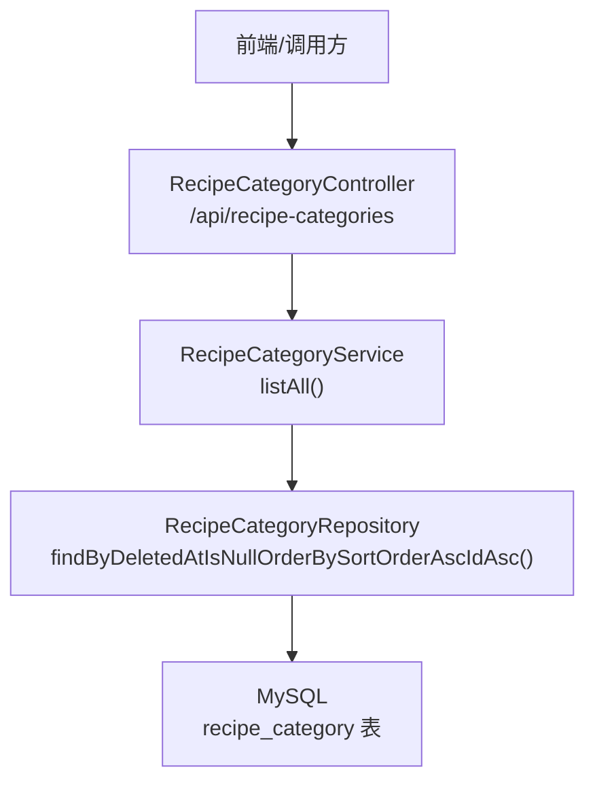
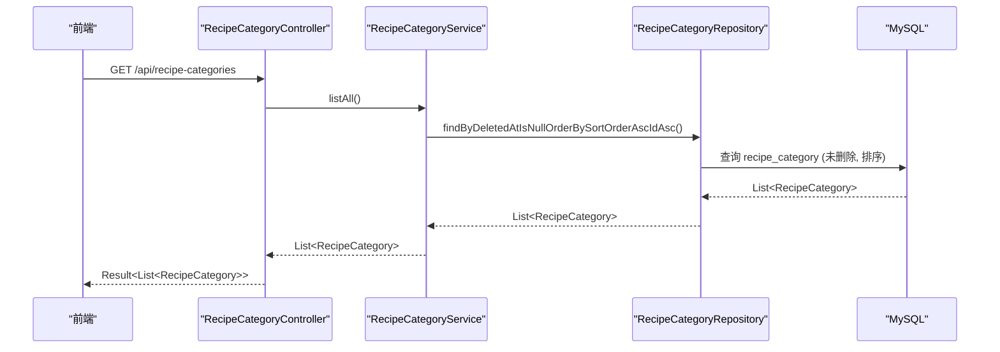
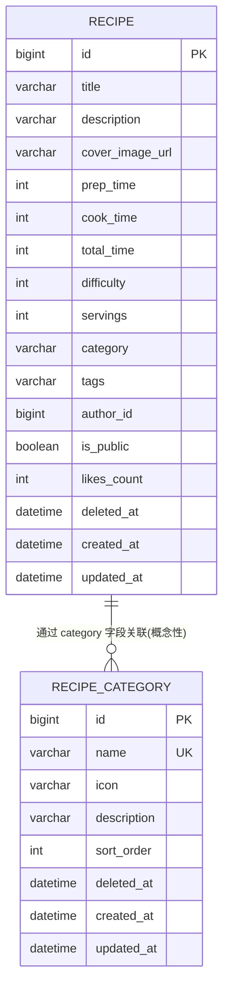
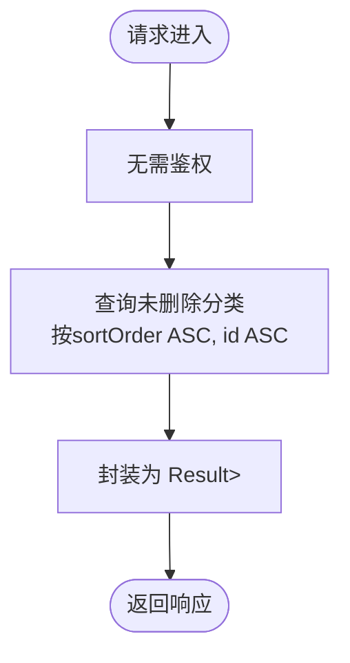
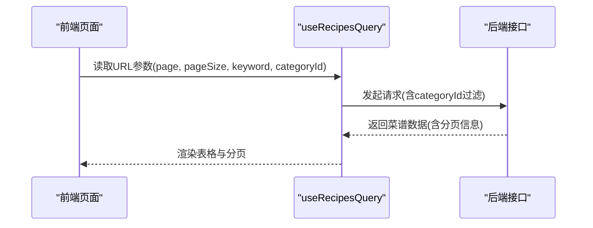
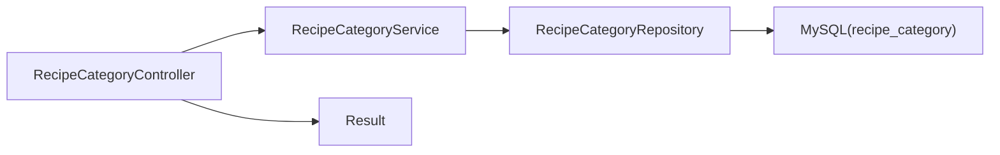

# 分类管理API

<cite>
**本文引用的文件**
- [RecipeCategoryController.java](file://java_server/po/src/main/java/com/goodzheng/po/controller/RecipeCategoryController.java)
- [RecipeCategoryService.java](file://java_server/po/src/main/java/com/goodzheng/po/service/RecipeCategoryService.java)
- [RecipeCategoryServiceImpl.java](file://java_server/po/src/main/java/com/goodzheng/po/service/impl/RecipeCategoryServiceImpl.java)
- [RecipeCategoryRepository.java](file://java_server/po/src/main/java/com/goodzheng/po/repository/RecipeCategoryRepository.java)
- [RecipeCategory.java](file://java_server/po/src/main/java/com/goodzheng/po/entity/RecipeCategory.java)
- [Recipe.java](file://java_server/po/src/main/java/com/goodzheng/po/entity/Recipe.java)
- [Result.java](file://java_server/po/src/main/java/com/goodzheng/po/dto/Result.java)
- [application.yaml](file://java_server/po/src/main/resources/application.yaml)
- [data-category.sql](file://java_server/po/src/main/resources/data-category.sql)
- [recipes/index.tsx](file://web_client/shadcn-admin/src/features/recipes/index.tsx)
</cite>

## 目录
1. [简介](#简介)
2. [项目结构](#项目结构)
3. [核心组件](#核心组件)
4. [架构总览](#架构总览)
5. [详细组件分析](#详细组件分析)
6. [依赖关系分析](#依赖关系分析)
7. [性能考虑](#性能考虑)
8. [故障排查指南](#故障排查指南)
9. [结论](#结论)
10. [附录](#附录)

## 简介
本文件为“菜谱分类管理”的RESTful API接口文档，聚焦于分类数据的增删改查能力、数据模型设计、与菜谱的关联关系、查询参数（分页与排序）、验证规则与业务约束、请求响应示例、前端集成方式以及错误处理方案。当前代码库已提供分类列表查询接口，并预留了后续扩展CRUD的能力；同时提供了分类实体、仓库层与服务层的实现基础，便于快速完善全量管理能力。

## 项目结构
后端采用Spring Boot分层架构：
- Controller层：暴露HTTP接口，统一返回Result包装体
- Service层：封装业务逻辑，事务控制
- Repository层：基于JPA的数据访问
- Entity层：数据库表映射
- DTO层：统一响应结构
- 配置：应用端口、上下文路径、JPA、Redis等

图表来源
- [RecipeCategoryController.java:11-28](file://java_server/po/src/main/java/com/goodzheng/po/controller/RecipeCategoryController.java#L11-L28)
- [RecipeCategoryService.java:7-11](file://java_server/po/src/main/java/com/goodzheng/po/service/RecipeCategoryService.java#L7-L11)
- [RecipeCategoryRepository.java:10-16](file://java_server/po/src/main/java/com/goodzheng/po/repository/RecipeCategoryRepository.java#L10-L16)
- [application.yaml:4-7](file://java_server/po/src/main/resources/application.yaml#L4-L7)

章节来源
- [application.yaml:4-7](file://java_server/po/src/main/resources/application.yaml#L4-L7)

## 核心组件
- 控制器：RecipeCategoryController，提供分类列表查询接口，统一异常捕获并返回Result
- 服务：RecipeCategoryService及其实现，负责查询未删除的分类并按排序字段升序返回
- 仓库：RecipeCategoryRepository，定义按软删除过滤与排序的查询方法
- 实体：RecipeCategory，包含名称、图标、描述、排序权重、软删除时间戳及创建更新时间
- 统一响应：Result<T>，包含code、message、data

章节来源
- [RecipeCategoryController.java:11-28](file://java_server/po/src/main/java/com/goodzheng/po/controller/RecipeCategoryController.java#L11-L28)
- [RecipeCategoryService.java:7-11](file://java_server/po/src/main/java/com/goodzheng/po/service/RecipeCategoryService.java#L7-L11)
- [RecipeCategoryServiceImpl.java:12-23](file://java_server/po/src/main/java/com/goodzheng/po/service/impl/RecipeCategoryServiceImpl.java#L12-L23)
- [RecipeCategoryRepository.java:10-16](file://java_server/po/src/main/java/com/goodzheng/po/repository/RecipeCategoryRepository.java#L10-L16)
- [RecipeCategory.java:8-45](file://java_server/po/src/main/java/com/goodzheng/po/entity/RecipeCategory.java#L8-L45)
- [Result.java:7-31](file://java_server/po/src/main/java/com/goodzheng/po/dto/Result.java#L7-L31)

## 架构总览
分类管理的后端由控制器→服务→仓库→数据库构成，所有响应通过Result进行统一封装。当前已实现的接口为“获取全部未删除分类”，后续可扩展创建、更新、删除等接口。

图表来源
- [RecipeCategoryController.java:19-27](file://java_server/po/src/main/java/com/goodzheng/po/controller/RecipeCategoryController.java#L19-L27)
- [RecipeCategoryServiceImpl.java:18-22](file://java_server/po/src/main/java/com/goodzheng/po/service/impl/RecipeCategoryServiceImpl.java#L18-L22)
- [RecipeCategoryRepository.java:12-12](file://java_server/po/src/main/java/com/goodzheng/po/repository/RecipeCategoryRepository.java#L12-L12)

## 详细组件分析

### 数据模型设计
- 分类实体 RecipeCategory
  - id：主键自增
  - name：分类名称，非空且唯一
  - icon：图标（Lucide图标名或emoji）
  - description：分类描述
  - sortOrder：排序权重，越小越靠前，非空
  - deletedAt：软删除时间戳
  - createdAt/updatedAt：创建与更新时间，自动维护

- 菜谱实体 Recipe
  - category：字符串类型，用于存储分类标识（如名称或ID），便于筛选
  - 其他字段包括标题、描述、封面图、耗时、难度、标签、作者、公开状态、点赞数等

图表来源
- [RecipeCategory.java:8-45](file://java_server/po/src/main/java/com/goodzheng/po/entity/RecipeCategory.java#L8-L45)
- [Recipe.java:10-92](file://java_server/po/src/main/java/com/goodzheng/po/entity/Recipe.java#L10-L92)

章节来源
- [RecipeCategory.java:8-45](file://java_server/po/src/main/java/com/goodzheng/po/entity/RecipeCategory.java#L8-L45)
- [Recipe.java:10-92](file://java_server/po/src/main/java/com/goodzheng/po/entity/Recipe.java#L10-L92)

### 接口规范与示例

#### 通用约定
- 基础路径：/api（由应用上下文决定）
- 统一响应体：Result<T>，包含 code、message、data
- 跨域：控制器启用跨域注解，允许前端直接调用

章节来源
- [application.yaml:4-7](file://java_server/po/src/main/resources/application.yaml#L4-L7)
- [RecipeCategoryController.java:11-14](file://java_server/po/src/main/java/com/goodzheng/po/controller/RecipeCategoryController.java#L11-L14)
- [Result.java:7-31](file://java_server/po/src/main/java/com/goodzheng/po/dto/Result.java#L7-L31)

#### 查询分类列表
- 接口：GET /api/recipe-categories
- 功能：获取所有未删除的分类，按sortOrder升序、id升序返回
- 认证：无需登录（公开接口）
- 请求参数：无
- 响应体：Result<List<RecipeCategory>>
  - data：数组元素包含 id、name、icon、description、sortOrder、deletedAt、createdAt、updatedAt

图表来源
- [RecipeCategoryController.java:19-27](file://java_server/po/src/main/java/com/goodzheng/po/controller/RecipeCategoryController.java#L19-L27)
- [RecipeCategoryRepository.java:12-12](file://java_server/po/src/main/java/com/goodzheng/po/repository/RecipeCategoryRepository.java#L12-L12)

请求示例
- 请求：GET /api/recipe-categories
- 响应：
  - code: 200
  - message: "success"
  - data: [
      {
        "id": 1,
        "name": "家常菜",
        "icon": "🍳",
        "description": "日常家庭烹饪，简单实用",
        "sortOrder": 1,
        "deletedAt": null,
        "createdAt": "2024-01-01T10:00:00",
        "updatedAt": "2024-01-01T10:00:00"
      },
      ...
    ]

注意：上述示例字段来源于实体定义与种子数据，具体值以实际数据库为准。

章节来源
- [RecipeCategoryController.java:19-27](file://java_server/po/src/main/java/com/goodzheng/po/controller/RecipeCategoryController.java#L19-L27)
- [RecipeCategoryRepository.java:12-12](file://java_server/po/src/main/java/com/goodzheng/po/repository/RecipeCategoryRepository.java#L12-L12)
- [data-category.sql:6-38](file://java_server/po/src/main/resources/data-category.sql#L6-L38)

#### 创建分类（建议扩展）
- 接口：POST /api/recipe-categories
- 功能：新增分类
- 请求体：包含 name、icon、description、sortOrder
- 校验规则：
  - name 必填，长度不超过50，唯一
  - icon 可选，长度不超过100
  - description 可选，长度不超过200
  - sortOrder 必填，整数
- 响应：Result<RecipeCategory>

章节来源
- [RecipeCategory.java:17-31](file://java_server/po/src/main/java/com/goodzheng/po/entity/RecipeCategory.java#L17-L31)

#### 更新分类（建议扩展）
- 接口：PUT /api/recipe-categories/{id}
- 功能：更新分类信息
- 路径参数：id
- 请求体：可更新 name、icon、description、sortOrder
- 校验规则：同创建，name需唯一
- 响应：Result<RecipeCategory>

章节来源
- [RecipeCategory.java:17-31](file://java_server/po/src/main/java/com/goodzheng/po/entity/RecipeCategory.java#L17-L31)

#### 删除分类（建议扩展）
- 接口：DELETE /api/recipe-categories/{id}
- 功能：软删除分类（设置deletedAt）
- 路径参数：id
- 响应：Result<Void>

章节来源
- [RecipeCategory.java:33-34](file://java_server/po/src/main/java/com/goodzheng/po/entity/RecipeCategory.java#L33-L34)

### 分类与菜谱的关联关系
- 关联方式：Recipe.category 字段为字符串，用于存储分类标识（例如分类名称或ID），便于在菜谱列表中进行筛选
- 使用场景：前端可通过传入 categoryId 或 category 名称对菜谱进行过滤展示
- 数据一致性：建议在业务层保证 category 值与分类表中的 name/id 保持一致

章节来源
- [Recipe.java:40-46](file://java_server/po/src/main/java/com/goodzheng/po/entity/Recipe.java#L40-L46)

### 分类列表查询的参数说明（分页与排序）
- 当前实现：GET /api/recipe-categories 无分页参数，返回全部未删除分类，默认按 sortOrder 升序、id 升序
- 建议扩展：如需分页，可增加 page、size 参数；如需排序，可增加 sortBy、order 参数
- 排序策略：后端已内置按 sortOrder 升序排序，避免前端自行排序导致不一致

章节来源
- [RecipeCategoryRepository.java:12-12](file://java_server/po/src/main/java/com/goodzheng/po/repository/RecipeCategoryRepository.java#L12-L12)

### 验证规则与业务约束
- 名称唯一性：name 字段具有唯一约束，重复创建将触发唯一性异常
- 非空约束：name、sortOrder 为非空字段
- 长度限制：name≤50，icon≤100，description≤200
- 软删除：删除操作应设置 deletedAt，查询时排除已删除记录

章节来源
- [RecipeCategory.java:17-34](file://java_server/po/src/main/java/com/goodzheng/po/entity/RecipeCategory.java#L17-L34)

### 前端集成示例
- 路由与页面：recipes/index.tsx 展示了如何从URL中读取分页、关键词、分类ID等搜索参数，并调用useRecipesQuery获取数据
- 分类筛选：categoryId 作为查询参数传递给后端，用于过滤菜谱列表
- 分类管理界面：可在管理后台增加分类管理模块，调用分类相关接口完成增删改查

图表来源
- [recipes/index.tsx:24-36](file://web_client/shadcn-admin/src/features/recipes/index.tsx#L24-L36)

章节来源
- [recipes/index.tsx:24-36](file://web_client/shadcn-admin/src/features/recipes/index.tsx#L24-L36)

## 依赖关系分析
- 控制器依赖服务，服务依赖仓库，仓库依赖数据库
- 统一响应Result贯穿整个调用链
- 当前仅实现了分类列表查询，后续可扩展CRUD接口

图表来源
- [RecipeCategoryController.java:11-28](file://java_server/po/src/main/java/com/goodzheng/po/controller/RecipeCategoryController.java#L11-L28)
- [RecipeCategoryService.java:7-11](file://java_server/po/src/main/java/com/goodzheng/po/service/RecipeCategoryService.java#L7-L11)
- [RecipeCategoryRepository.java:10-16](file://java_server/po/src/main/java/com/goodzheng/po/repository/RecipeCategoryRepository.java#L10-L16)
- [Result.java:7-31](file://java_server/po/src/main/java/com/goodzheng/po/dto/Result.java#L7-L31)

章节来源
- [RecipeCategoryController.java:11-28](file://java_server/po/src/main/java/com/goodzheng/po/controller/RecipeCategoryController.java#L11-L28)
- [RecipeCategoryService.java:7-11](file://java_server/po/src/main/java/com/goodzheng/po/service/RecipeCategoryService.java#L7-L11)
- [RecipeCategoryRepository.java:10-16](file://java_server/po/src/main/java/com/goodzheng/po/repository/RecipeCategoryRepository.java#L10-L16)
- [Result.java:7-31](file://java_server/po/src/main/java/com/goodzheng/po/dto/Result.java#L7-L31)

## 性能考虑
- 查询优化：当前查询已按sortOrder与id排序，避免前端排序开销
- 连接池：HikariCP连接池大小与超时已在配置中设定，可根据负载调整
- 缓存：可考虑对分类列表进行Redis缓存，减少数据库压力
- 索引：建议在category_name上建立索引以提升查询效率（若未来按名称查询）

章节来源
- [application.yaml:24-33](file://java_server/po/src/main/resources/application.yaml#L24-L33)

## 故障排查指南
- 唯一性冲突：当创建重复name的分类时会抛出异常，需在控制器或全局异常处理器中捕获并返回友好提示
- 数据库连接失败：检查application.yaml中的数据源配置是否正确
- 跨域问题：控制器已启用跨域，确保前端域名在白名单内
- 软删除数据污染：确认查询方法正确过滤deletedAt为空的数据

章节来源
- [RecipeCategoryController.java:22-26](file://java_server/po/src/main/java/com/goodzheng/po/controller/RecipeCategoryController.java#L22-L26)
- [application.yaml:24-33](file://java_server/po/src/main/resources/application.yaml#L24-L33)
- [RecipeCategoryRepository.java:12-12](file://java_server/po/src/main/java/com/goodzheng/po/repository/RecipeCategoryRepository.java#L12-L12)

## 结论
当前分类管理API已具备稳定的列表查询能力，数据模型清晰，支持软删除与排序。建议后续补充完整的CRUD接口，增强参数校验与异常处理，并结合前端实现分类管理界面，提升用户体验。同时，结合缓存与索引优化，进一步提升查询性能。

## 附录
- 种子数据：data-category.sql 提供了初始分类数据，便于本地测试与演示
- 前端示例：recipes/index.tsx 展示了如何在页面中读取URL参数并进行数据请求与渲染

章节来源
- [data-category.sql:6-38](file://java_server/po/src/main/resources/data-category.sql#L6-L38)
- [recipes/index.tsx:24-36](file://web_client/shadcn-admin/src/features/recipes/index.tsx#L24-L36)