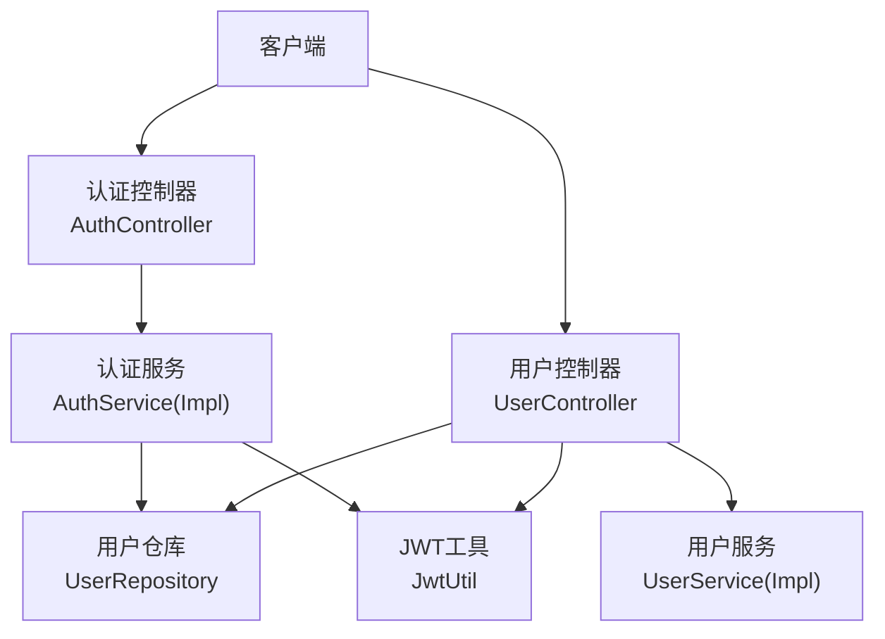
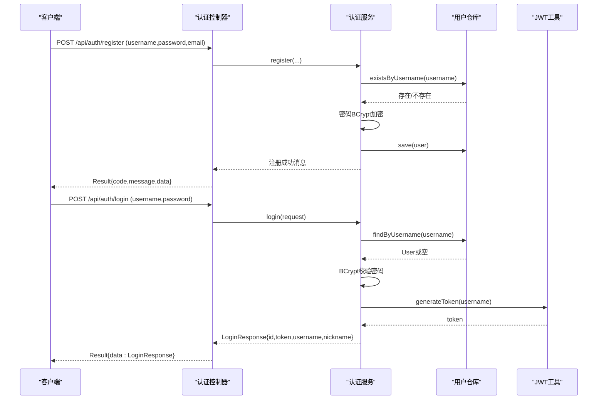
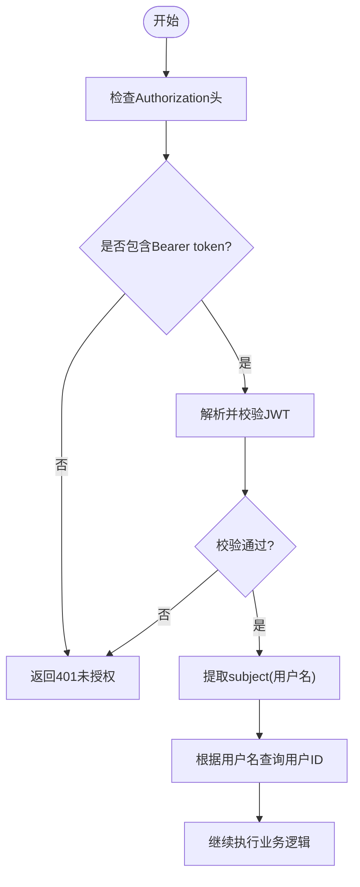
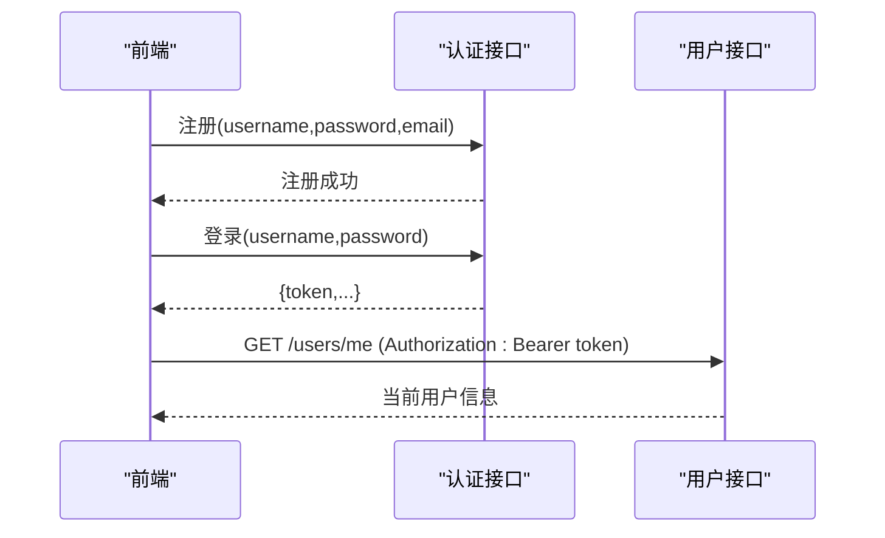
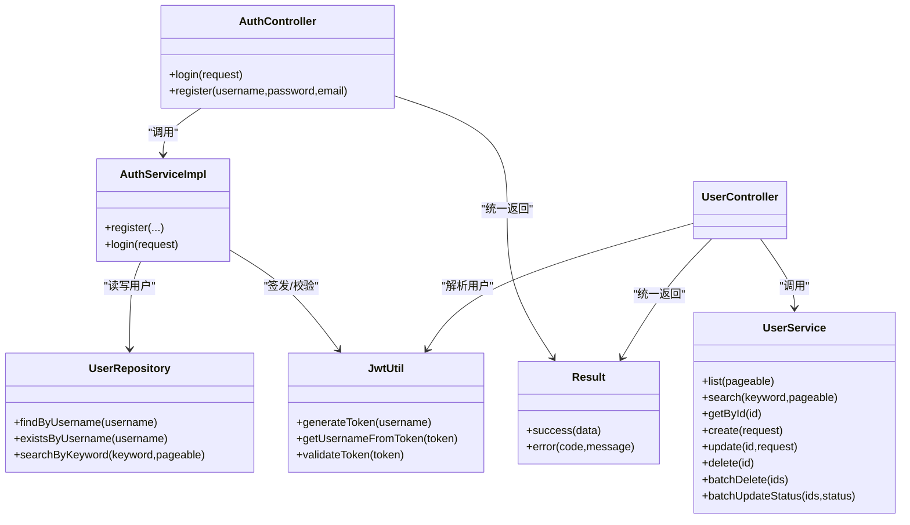

# 用户认证API

<cite>
**本文引用的文件**
- [AuthController.java](file://java_server/po/src/main/java/com/goodzheng/po/controller/AuthController.java)
- [UserController.java](file://java_server/po/src/main/java/com/goodzheng/po/controller/UserController.java)
- [AuthServiceImpl.java](file://java_server/po/src/main/java/com/goodzheng/po/service/impl/AuthServiceImpl.java)
- [AuthService.java](file://java_server/po/src/main/java/com/goodzheng/po/service/AuthService.java)
- [UserService.java](file://java_server/po/src/main/java/com/goodzheng/po/service/UserService.java)
- [JwtUtil.java](file://java_server/po/src/main/java/com/goodzheng/po/util/JwtUtil.java)
- [UserRepository.java](file://java_server/po/src/main/java/com/goodzheng/po/repository/UserRepository.java)
- [LoginRequest.java](file://java_server/po/src/main/java/com/goodzheng/po/dto/LoginRequest.java)
- [LoginResponse.java](file://java_server/po/src/main/java/com/goodzheng/po/dto/LoginResponse.java)
- [UserRequest.java](file://java_server/po/src/main/java/com/goodzheng/po/dto/UserRequest.java)
- [User.java](file://java_server/po/src/main/java/com/goodzheng/po/entity/User.java)
- [Result.java](file://java_server/po/src/main/java/com/goodzheng/po/dto/Result.java)
- [application.yaml](file://java_server/po/src/main/resources/application.yaml)
</cite>

## 目录
1. [简介](#简介)
2. [项目结构](#项目结构)
3. [核心组件](#核心组件)
4. [架构总览](#架构总览)
5. [详细组件分析](#详细组件分析)
6. [依赖关系分析](#依赖关系分析)
7. [性能考虑](#性能考虑)
8. [故障排查指南](#故障排查指南)
9. [结论](#结论)
10. [附录](#附录)

## 简介
本文件为“用户认证RESTful API”的完整接口文档，覆盖用户注册、登录、登出（通过令牌失效策略实现）、当前用户信息查询等认证相关能力。重点说明JWT令牌认证机制：Authorization请求头格式（Bearer token）、令牌获取流程与有效期管理；并给出用户信息管理的CRUD接口说明。提供从注册到获取访问令牌的端到端示例，解释密码加密存储、会话管理与安全注意事项，并附带前端集成建议与常见错误处理方案。

## 项目结构
后端采用Spring Boot分层架构：
- Controller层：对外暴露REST接口（认证与用户管理）
- Service层：业务逻辑（认证、用户操作）
- Repository层：数据访问（JPA）
- Util层：JWT工具类
- DTO/Entity：请求响应模型与数据库实体
- 配置：应用与JWT参数

图表来源
- [AuthController.java:11-39](file://java_server/po/src/main/java/com/goodzheng/po/controller/AuthController.java#L11-L39)
- [UserController.java:19-131](file://java_server/po/src/main/java/com/goodzheng/po/controller/UserController.java#L19-L131)
- [AuthServiceImpl.java:13-47](file://java_server/po/src/main/java/com/goodzheng/po/service/impl/AuthServiceImpl.java#L13-L47)
- [JwtUtil.java:13-55](file://java_server/po/src/main/java/com/goodzheng/po/util/JwtUtil.java#L13-L55)
- [UserRepository.java:13-26](file://java_server/po/src/main/java/com/goodzheng/po/repository/UserRepository.java#L13-L26)

章节来源
- [application.yaml:1-109](file://java_server/po/src/main/resources/application.yaml#L1-L109)

## 核心组件
- 认证控制器：提供注册与登录接口，统一返回结果封装
- 用户控制器：提供用户列表、详情、当前用户信息、创建/更新/删除、批量操作等
- 认证服务：实现用户名唯一性校验、密码BCrypt加密、登录校验与JWT签发
- JWT工具：生成、解析、校验JWT，支持过期时间配置
- 用户仓库：基于JPA的用户数据访问
- 数据模型：登录请求/响应、用户请求、用户实体、统一结果封装

章节来源
- [AuthController.java:11-39](file://java_server/po/src/main/java/com/goodzheng/po/controller/AuthController.java#L11-L39)
- [UserController.java:19-131](file://java_server/po/src/main/java/com/goodzheng/po/controller/UserController.java#L19-L131)
- [AuthServiceImpl.java:13-47](file://java_server/po/src/main/java/com/goodzheng/po/service/impl/AuthServiceImpl.java#L13-L47)
- [JwtUtil.java:13-55](file://java_server/po/src/main/java/com/goodzheng/po/util/JwtUtil.java#L13-L55)
- [UserRepository.java:13-26](file://java_server/po/src/main/java/com/goodzheng/po/repository/UserRepository.java#L13-L26)
- [LoginRequest.java:1-15](file://java_server/po/src/main/java/com/goodzheng/po/dto/LoginRequest.java#L1-L15)
- [LoginResponse.java:1-15](file://java_server/po/src/main/java/com/goodzheng/po/dto/LoginResponse.java#L1-L15)
- [UserRequest.java:1-30](file://java_server/po/src/main/java/com/goodzheng/po/dto/UserRequest.java#L1-L30)
- [User.java:1-59](file://java_server/po/src/main/java/com/goodzheng/po/entity/User.java#L1-L59)
- [Result.java:1-32](file://java_server/po/src/main/java/com/goodzheng/po/dto/Result.java#L1-L32)

## 架构总览
系统以无状态JWT为核心进行认证：客户端在登录成功后获得token，并在后续请求中通过Authorization: Bearer <token>传递。服务端通过JwtUtil解析并校验令牌，从而识别当前用户身份。

图表来源
- [AuthController.java:19-39](file://java_server/po/src/main/java/com/goodzheng/po/controller/AuthController.java#L19-L39)
- [AuthServiceImpl.java:21-46](file://java_server/po/src/main/java/com/goodzheng/po/service/impl/AuthServiceImpl.java#L21-L46)
- [JwtUtil.java:25-33](file://java_server/po/src/main/java/com/goodzheng/po/util/JwtUtil.java#L25-L33)
- [UserRepository.java:16-18](file://java_server/po/src/main/java/com/goodzheng/po/repository/UserRepository.java#L16-L18)

## 详细组件分析

### 认证接口
- 注册
  - 路径与方法：POST /api/auth/register
  - 请求参数：username、password、email（可选）
  - 成功响应：Result<String>，data为注册成功消息
  - 失败场景：用户名已存在返回400
  - 安全要点：密码在服务层使用BCrypt加密后持久化

- 登录
  - 路径与方法：POST /api/auth/login
  - 请求体：LoginRequest（username、password）
  - 成功响应：Result<LoginResponse>，包含id、token、username、nickname
  - 失败场景：用户名或密码错误返回401

- 登出
  - 说明：当前为无状态JWT设计，服务端不维护会话。登出由客户端删除本地存储的token实现。若需服务端强制失效，可在JWT中加入黑名单或使用短时效+刷新令牌机制（扩展点）。

章节来源
- [AuthController.java:19-39](file://java_server/po/src/main/java/com/goodzheng/po/controller/AuthController.java#L19-L39)
- [AuthServiceImpl.java:21-46](file://java_server/po/src/main/java/com/goodzheng/po/service/impl/AuthServiceImpl.java#L21-L46)
- [LoginRequest.java:1-15](file://java_server/po/src/main/java/com/goodzheng/po/dto/LoginRequest.java#L1-L15)
- [LoginResponse.java:1-15](file://java_server/po/src/main/java/com/goodzheng/po/dto/LoginResponse.java#L1-L15)
- [Result.java:1-32](file://java_server/po/src/main/java/com/goodzheng/po/dto/Result.java#L1-L32)

### 用户信息管理接口（CRUD）
- 分页列表
  - GET /api/users?page=0&size=10&keyword=xxx
  - 返回：分页用户列表

- 详情
  - GET /api/users/{id}
  - 返回：用户详情

- 当前用户信息
  - GET /api/users/me
  - 鉴权：需要Authorization: Bearer <token>
  - 返回：当前登录用户信息

- 创建用户
  - POST /api/users
  - 请求体：UserRequest
  - 返回：新建用户

- 更新用户
  - PUT /api/users/{id}
  - 请求体：UserRequest
  - 返回：更新后的用户

- 删除用户
  - DELETE /api/users/{id}
  - 返回：删除成功消息

- 批量删除
  - DELETE /api/users/batch
  - 请求体：List<Long> ids

- 批量修改状态
  - PUT /api/users/batch/status
  - 请求体：{ids:[...], status:"active|inactive|invited|suspended"}

章节来源
- [UserController.java:29-122](file://java_server/po/src/main/java/com/goodzheng/po/controller/UserController.java#L29-L122)
- [UserRequest.java:1-30](file://java_server/po/src/main/java/com/goodzheng/po/dto/UserRequest.java#L1-L30)
- [User.java:1-59](file://java_server/po/src/main/java/com/goodzheng/po/entity/User.java#L1-L59)

### JWT令牌认证机制
- Authorization头部格式：Authorization: Bearer <token>
- 令牌获取流程：登录成功后从LoginResponse中获取token
- 有效期管理：通过jwt.expiration配置控制（默认86400000毫秒，即24小时）
- 令牌校验：服务端通过JwtUtil解析并验证签名与过期时间

图表来源
- [UserController.java:55-64](file://java_server/po/src/main/java/com/goodzheng/po/controller/UserController.java#L55-L64)
- [JwtUtil.java:25-55](file://java_server/po/src/main/java/com/goodzheng/po/util/JwtUtil.java#L25-L55)
- [UserRepository.java:16-18](file://java_server/po/src/main/java/com/goodzheng/po/repository/UserRepository.java#L16-L18)
- [application.yaml:107-109](file://java_server/po/src/main/resources/application.yaml#L107-L109)

### 端到端认证流程示例
- 步骤1：注册
  - 调用POST /api/auth/register，提交username、password、email
  - 成功后保存用户，密码已加密

- 步骤2：登录
  - 调用POST /api/auth/login，提交username、password
  - 成功后返回LoginResponse，包含token

- 步骤3：携带令牌访问受保护资源
  - 在Authorization头设置Bearer token
  - 调用GET /api/users/me获取当前用户信息

图表来源
- [AuthController.java:19-39](file://java_server/po/src/main/java/com/goodzheng/po/controller/AuthController.java#L19-L39)
- [UserController.java:55-64](file://java_server/po/src/main/java/com/goodzheng/po/controller/UserController.java#L55-L64)

### 密码加密存储与安全
- 密码加密：使用BCryptPasswordEncoder对明文密码进行哈希存储
- 登录校验：使用matches方法比对明文与密文
- 安全建议：
  - 传输层使用HTTPS
  - 限制登录尝试次数，防止暴力破解
  - 定期轮换JWT密钥与调整过期时间
  - 敏感字段（如密码）避免在响应中返回

章节来源
- [AuthServiceImpl.java:13-46](file://java_server/po/src/main/java/com/goodzheng/po/service/impl/AuthServiceImpl.java#L13-L46)
- [User.java:20-22](file://java_server/po/src/main/java/com/goodzheng/po/entity/User.java#L20-L22)

### 前端集成示例（React）
- 令牌存储：登录后将token存入localStorage或sessionStorage
- 请求拦截：在发起HTTP请求时自动附加Authorization: Bearer <token>
- 状态管理：维护登录态（isAuthenticated），根据路由守卫保护受保护页面
- 登出：清除本地token并跳转至登录页

参考实现位置（示意）：
- 登录/注册页面与服务调用可参考前端工程中的用户相关页面与服务模块
- 全局请求拦截器可在axios实例中统一添加Authorization头

[本节为通用实践说明，不直接分析具体源码文件]

## 依赖关系分析
- 控制器依赖服务，服务依赖仓库与JWT工具
- 统一结果封装Result贯穿各接口
- 配置项jwt.secret与jwt.expiration驱动JWT生成与校验

图表来源
- [AuthController.java:11-39](file://java_server/po/src/main/java/com/goodzheng/po/controller/AuthController.java#L11-L39)
- [AuthServiceImpl.java:13-47](file://java_server/po/src/main/java/com/goodzheng/po/service/impl/AuthServiceImpl.java#L13-L47)
- [UserService.java:10-27](file://java_server/po/src/main/java/com/goodzheng/po/service/UserService.java#L10-L27)
- [UserRepository.java:13-26](file://java_server/po/src/main/java/com/goodzheng/po/repository/UserRepository.java#L13-L26)
- [JwtUtil.java:13-55](file://java_server/po/src/main/java/com/goodzheng/po/util/JwtUtil.java#L13-L55)
- [Result.java:1-32](file://java_server/po/src/main/java/com/goodzheng/po/dto/Result.java#L1-L32)

章节来源
- [application.yaml:107-109](file://java_server/po/src/main/resources/application.yaml#L107-L109)

## 性能考虑
- JWT无状态：无需服务端会话存储，适合水平扩展
- 令牌有效期：合理设置过期时间，平衡安全性与用户体验
- 数据库查询：分页与关键词搜索已优化，注意索引建设
- 连接池：HikariCP连接池大小与超时可根据负载调优
- 缓存：可引入Redis缓存热点用户信息或令牌黑名单（扩展）

[本节为通用指导，不直接分析具体源码文件]

## 故障排查指南
- 401 未授权
  - 原因：缺少Authorization头或token无效/过期
  - 处理：检查请求头格式、重新登录获取新token
- 400 请求错误
  - 原因：参数校验失败或业务异常（如用户名已存在）
  - 处理：检查请求参数、查看返回message
- 404 资源不存在
  - 原因：用户ID不存在
  - 处理：确认ID有效性
- 登录失败
  - 原因：用户名或密码错误
  - 处理：核对凭据，必要时重置密码
- 跨域问题
  - 控制器已开启跨域，确保前端正确配置域名与协议

章节来源
- [AuthController.java:19-39](file://java_server/po/src/main/java/com/goodzheng/po/controller/AuthController.java#L19-L39)
- [UserController.java:45-64](file://java_server/po/src/main/java/com/goodzheng/po/controller/UserController.java#L45-L64)
- [Result.java:16-30](file://java_server/po/src/main/java/com/goodzheng/po/dto/Result.java#L16-L30)

## 结论
本项目提供了完整的用户认证与用户管理REST API，采用JWT无状态认证，具备清晰的接口定义、统一的响应封装与良好的可扩展性。通过合理的密码加密、令牌有效期管理与前端集成策略，可实现安全的认证与会话管理。建议在生产环境启用HTTPS、加强限流与审计，并根据业务需求扩展刷新令牌与权限控制。

## 附录

### 接口清单与规范
- 基础路径：/api
- 统一响应：Result<T>，包含code、message、data
- 认证头：Authorization: Bearer <token>
- 主要接口：
  - POST /api/auth/register
  - POST /api/auth/login
  - GET /api/users
  - GET /api/users/{id}
  - GET /api/users/me
  - POST /api/users
  - PUT /api/users/{id}
  - DELETE /api/users/{id}
  - DELETE /api/users/batch
  - PUT /api/users/batch/status

章节来源
- [application.yaml:4-8](file://java_server/po/src/main/resources/application.yaml#L4-L8)
- [AuthController.java:11-39](file://java_server/po/src/main/java/com/goodzheng/po/controller/AuthController.java#L11-L39)
- [UserController.java:29-122](file://java_server/po/src/main/java/com/goodzheng/po/controller/UserController.java#L29-L122)
- [Result.java:1-32](file://java_server/po/src/main/java/com/goodzheng/po/dto/Result.java#L1-L32)