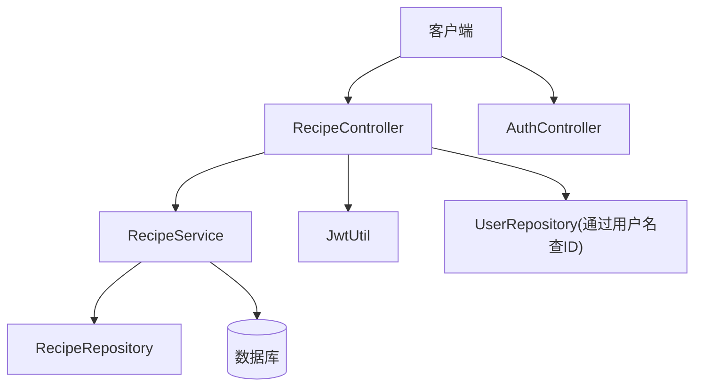
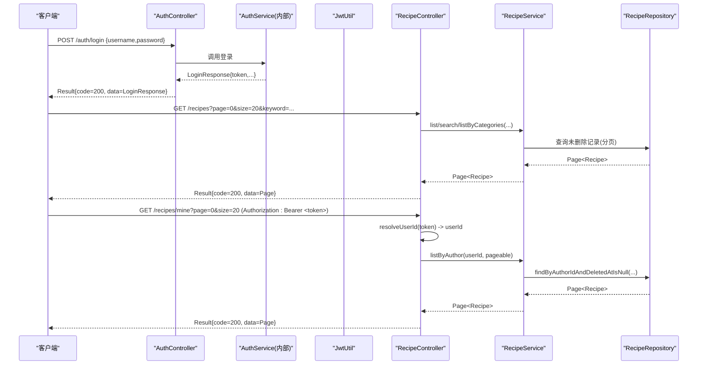
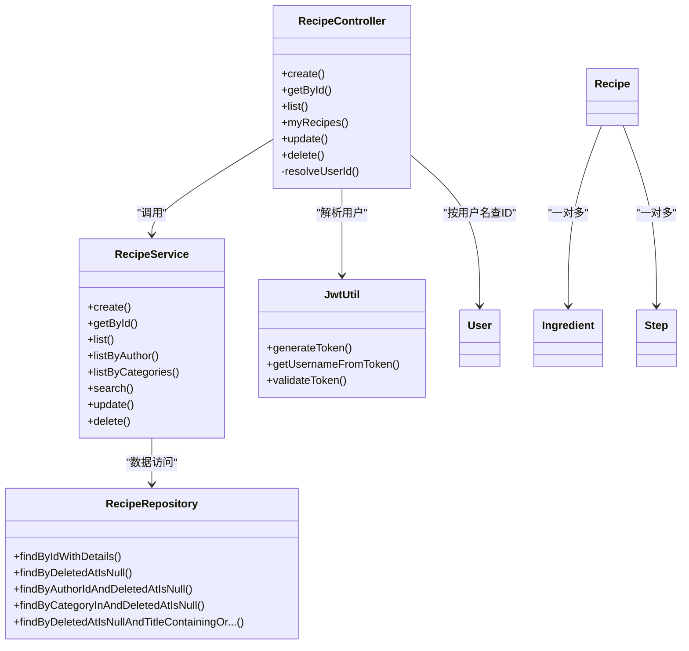

# 菜谱管理API

<cite>
**本文引用的文件**
- [RecipeController.java](file://java_server/po/src/main/java/com/goodzheng/po/controller/RecipeController.java)
- [AuthController.java](file://java_server/po/src/main/java/com/goodzheng/po/controller/AuthController.java)
- [RecipeService.java](file://java_server/po/src/main/java/com/goodzheng/po/service/RecipeService.java)
- [RecipeRepository.java](file://java_server/po/src/main/java/com/goodzheng/po/repository/RecipeRepository.java)
- [JwtUtil.java](file://java_server/po/src/main/java/com/goodzheng/po/util/JwtUtil.java)
- [Result.java](file://java_server/po/src/main/java/com/goodzheng/po/dto/Result.java)
- [RecipeRequest.java](file://java_server/po/src/main/java/com/goodzheng/po/dto/RecipeRequest.java)
- [Recipe.java](file://java_server/po/src/main/java/com/goodzheng/po/entity/Recipe.java)
- [Ingredient.java](file://java_server/po/src/main/java/com/goodzheng/po/entity/Ingredient.java)
- [Step.java](file://java_server/po/src/main/java/com/goodzheng/po/entity/Step.java)
- [User.java](file://java_server/po/src/main/java/com/goodzheng/po/entity/User.java)
- [LoginRequest.java](file://java_server/po/src/main/java/com/goodzheng/po/dto/LoginRequest.java)
- [LoginResponse.java](file://java_server/po/src/main/java/com/goodzheng/po/dto/LoginResponse.java)
</cite>

## 目录
1. [简介](#简介)
2. [项目结构](#项目结构)
3. [核心组件](#核心组件)
4. [架构总览](#架构总览)
5. [详细接口说明](#详细接口说明)
6. [依赖关系分析](#依赖关系分析)
7. [性能与分页](#性能与分页)
8. [故障排查指南](#故障排查指南)
9. [结论](#结论)
10. [附录：客户端集成示例](#附录客户端集成示例)

## 简介
本文件为“菜谱管理”RESTful API 的完整接口文档，覆盖创建、查询、更新、删除等全部操作。重点说明：
- 分页查询 /recipes 的支持参数：page、size、categoryId、keyword
- “我的菜谱” /recipes/mine 的 JWT 认证与权限控制
- 统一的请求/响应结构与状态码约定
- 数据验证规则与业务约束
- 常见错误处理与客户端集成建议

## 项目结构
后端采用 Spring Boot 分层架构：
- 控制器层：暴露 REST 接口（RecipeController、AuthController）
- 服务层：业务逻辑（RecipeService 及其实现）
- 数据访问层：JPA Repository（RecipeRepository）
- 实体与DTO：领域模型与传输对象（Recipe、Ingredient、Step、RecipeRequest、Result）
- 工具类：JWT 生成与校验（JwtUtil）

图表来源
- [RecipeController.java:18-119](file://java_server/po/src/main/java/com/goodzheng/po/controller/RecipeController.java#L18-L119)
- [AuthController.java:11-40](file://java_server/po/src/main/java/com/goodzheng/po/controller/AuthController.java#L11-L40)
- [RecipeService.java:10-27](file://java_server/po/src/main/java/com/goodzheng/po/service/RecipeService.java#L10-L27)
- [RecipeRepository.java:13-35](file://java_server/po/src/main/java/com/goodzheng/po/repository/RecipeRepository.java#L13-L35)
- [JwtUtil.java:13-55](file://java_server/po/src/main/java/com/goodzheng/po/util/JwtUtil.java#L13-L55)

章节来源
- [RecipeController.java:18-119](file://java_server/po/src/main/java/com/goodzheng/po/controller/RecipeController.java#L18-L119)
- [AuthController.java:11-40](file://java_server/po/src/main/java/com/goodzheng/po/controller/AuthController.java#L11-L40)

## 核心组件
- 统一响应体 Result：包含 code、message、data 三字段，提供 success/error 静态方法构造
- 菜谱请求 RecipeRequest：定义标题、描述、难度、分类、标签、营养信息、食材与步骤等字段及校验规则
- 实体 Recipe：持久化模型，含软删除字段 deletedAt、时间戳 createdAt/updatedAt、公开标记 isPublic、作者 authorId 等
- 关联实体 Ingredient、Step：分别表示食材与步骤，按排序字段有序返回
- JWT 工具 JwtUtil：基于配置密钥生成与解析 token，支持获取用户名与校验有效性
- 认证入口 AuthController：提供登录与注册，返回 token 供后续鉴权使用

章节来源
- [Result.java:7-31](file://java_server/po/src/main/java/com/goodzheng/po/dto/Result.java#L7-L31)
- [RecipeRequest.java:10-65](file://java_server/po/src/main/java/com/goodzheng/po/dto/RecipeRequest.java#L10-L65)
- [Recipe.java:10-92](file://java_server/po/src/main/java/com/goodzheng/po/entity/Recipe.java#L10-L92)
- [Ingredient.java:9-41](file://java_server/po/src/main/java/com/goodzheng/po/entity/Ingredient.java#L9-L41)
- [Step.java:9-39](file://java_server/po/src/main/java/com/goodzheng/po/entity/Step.java#L9-L39)
- [JwtUtil.java:13-55](file://java_server/po/src/main/java/com/goodzheng/po/util/JwtUtil.java#L13-L55)
- [AuthController.java:11-40](file://java_server/po/src/main/java/com/goodzheng/po/controller/AuthController.java#L11-L40)

## 架构总览

图表来源
- [AuthController.java:19-27](file://java_server/po/src/main/java/com/goodzheng/po/controller/AuthController.java#L19-L27)
- [RecipeController.java:28-83](file://java_server/po/src/main/java/com/goodzheng/po/controller/RecipeController.java#L28-L83)
- [RecipeRepository.java:20-34](file://java_server/po/src/main/java/com/goodzheng/po/repository/RecipeRepository.java#L20-L34)
- [JwtUtil.java:25-53](file://java_server/po/src/main/java/com/goodzheng/po/util/JwtUtil.java#L25-L53)

## 详细接口说明

### 通用约定
- 基础路径：/recipes
- 统一响应体：Result<T>
  - code：业务状态码（200 成功，其他见各接口）
  - message：提示信息
  - data：具体数据或分页对象
- 分页对象：Spring Data Page<Recipe>，包含内容列表与分页元信息（如 totalElements、totalPages、number、size 等）
- 认证方式：需要认证的接口在请求头携带 Authorization: Bearer <token>

章节来源
- [Result.java:7-31](file://java_server/po/src/main/java/com/goodzheng/po/dto/Result.java#L7-L31)
- [RecipeController.java:18-119](file://java_server/po/src/main/java/com/goodzheng/po/controller/RecipeController.java#L18-L119)

### 认证接口
- 登录
  - URL：POST /auth/login
  - 请求体：LoginRequest（username、password，均必填）
  - 响应：Result<LoginResponse>，data 包含 id、token、username、nickname
  - 状态码：200 成功；401 认证失败
- 注册
  - URL：POST /auth/register?username=...&password=...&email=...
  - 响应：Result<String>，提示注册结果
  - 状态码：200 成功；400 参数或业务错误

章节来源
- [AuthController.java:19-39](file://java_server/po/src/main/java/com/goodzheng/po/controller/AuthController.java#L19-L39)
- [LoginRequest.java:6-14](file://java_server/po/src/main/java/com/goodzheng/po/dto/LoginRequest.java#L6-L14)
- [LoginResponse.java:6-14](file://java_server/po/src/main/java/com/goodzheng/po/dto/LoginResponse.java#L6-L14)

### 创建菜谱
- URL：POST /recipes
- 认证：需要（Authorization: Bearer <token>）
- 请求体：RecipeRequest（字段校验见下节）
- 响应：Result<Recipe>
- 状态码：200 成功；400 参数或业务错误（如重复、非法值）
- 业务逻辑：
  - 从 token 解析用户 ID 并写入 authorId
  - 保存后返回完整实体（含关联的 ingredients、steps）

章节来源
- [RecipeController.java:28-39](file://java_server/po/src/main/java/com/goodzheng/po/controller/RecipeController.java#L28-L39)
- [RecipeRequest.java:10-65](file://java_server/po/src/main/java/com/goodzheng/po/dto/RecipeRequest.java#L10-L65)
- [Recipe.java:48-53](file://java_server/po/src/main/java/com/goodzheng/po/entity/Recipe.java#L48-L53)

### 查询单个菜谱详情
- URL：GET /recipes/{id}
- 认证：不需要
- 响应：Result<Recipe>
- 状态码：200 成功；404 未找到
- 说明：预加载食材与步骤，避免懒加载异常

章节来源
- [RecipeController.java:41-49](file://java_server/po/src/main/java/com/goodzheng/po/controller/RecipeController.java#L41-L49)
- [RecipeRepository.java:16-18](file://java_server/po/src/main/java/com/goodzheng/po/repository/RecipeRepository.java#L16-L18)

### 分页查询菜谱列表
- URL：GET /recipes
- 认证：不需要
- 查询参数：
  - page：页码，默认 0
  - size：每页条数，默认 20
  - categoryId：可选，分类过滤（注意：当前控制器接收 List<Long>，但仓库按 String 分类查询；请确保前端传入与后端一致的类型，或根据实际分类类型调整）
  - keyword：可选，关键字搜索（标题/描述）
- 排序：按创建时间倒序
- 响应：Result<Page<Recipe>>
- 状态码：200 成功
- 优先级：若提供 keyword，则优先执行关键字搜索；否则若提供 categoryId，则按分类过滤；否则返回全部分页

章节来源
- [RecipeController.java:51-68](file://java_server/po/src/main/java/com/goodzheng/po/controller/RecipeController.java#L51-L68)
- [RecipeRepository.java:20-34](file://java_server/po/src/main/java/com/goodzheng/po/repository/RecipeRepository.java#L20-L34)

### 我的菜谱
- URL：GET /recipes/mine
- 认证：需要（Authorization: Bearer <token>）
- 查询参数：
  - page：页码，默认 0
  - size：每页条数，默认 20
- 响应：Result<Page<Recipe>>
- 状态码：200 成功；401 认证失败或用户不存在
- 权限控制：
  - 从 Authorization 头提取 token
  - 使用 JwtUtil 解析出 username
  - 通过用户名查询用户表得到 userId
  - 仅返回该 userId 创建的菜谱（且未软删除）

章节来源
- [RecipeController.java:70-83](file://java_server/po/src/main/java/com/goodzheng/po/controller/RecipeController.java#L70-L83)
- [JwtUtil.java:25-53](file://java_server/po/src/main/java/com/goodzheng/po/util/JwtUtil.java#L25-L53)
- [User.java:10-18](file://java_server/po/src/main/java/com/goodzheng/po/entity/User.java#L10-L18)
- [RecipeRepository.java:23-24](file://java_server/po/src/main/java/com/goodzheng/po/repository/RecipeRepository.java#L23-L24)

### 更新菜谱
- URL：PUT /recipes/{id}
- 认证：需要（Authorization: Bearer <token>）
- 请求体：RecipeRequest（同创建）
- 响应：Result<Recipe>
- 状态码：200 成功；400 参数或业务错误（如非本人菜谱）
- 业务逻辑：
  - 校验 token 并解析 authorId
  - 更新指定 id 的菜谱，并限制只能由作者修改

章节来源
- [RecipeController.java:85-96](file://java_server/po/src/main/java/com/goodzheng/po/controller/RecipeController.java#L85-L96)

### 删除菜谱（软删除）
- URL：DELETE /recipes/{id}
- 认证：需要（Authorization: Bearer <token>）
- 响应：Result<String>，message 提示删除成功
- 状态码：200 成功；400 参数或业务错误（如非本人菜谱）
- 说明：软删除，设置 deletedAt 时间戳，查询时排除已删除记录

章节来源
- [RecipeController.java:98-109](file://java_server/po/src/main/java/com/goodzheng/po/controller/RecipeController.java#L98-L109)
- [Recipe.java:70-71](file://java_server/po/src/main/java/com/goodzheng/po/entity/Recipe.java#L70-L71)
- [RecipeRepository.java:20-24](file://java_server/po/src/main/java/com/goodzheng/po/repository/RecipeRepository.java#L20-L24)

### 数据验证规则与业务约束
- 必填校验（来自 RecipeRequest）：
  - title：不可为空
  - difficulty：不可为空（默认 1）
  - 食材项：name 不可为空
  - 步骤项：stepNumber、content 不可为空
- 业务约束：
  - 创建/更新/删除需携带有效 token，且仅允许操作本人菜谱
  - 查询默认排除已软删除的记录
  - 列表默认按创建时间倒序

章节来源
- [RecipeRequest.java:10-65](file://java_server/po/src/main/java/com/goodzheng/po/dto/RecipeRequest.java#L10-L65)
- [RecipeController.java:28-109](file://java_server/po/src/main/java/com/goodzheng/po/controller/RecipeController.java#L28-L109)
- [RecipeRepository.java:20-34](file://java_server/po/src/main/java/com/goodzheng/po/repository/RecipeRepository.java#L20-L34)

### 请求与响应示例（文本示意）
- 登录
  - 请求：POST /auth/login
    - 请求体：{"username":"demo","password":"123456"}
  - 响应：{"code":200,"message":"success","data":{"id":1,"token":"eyJhbGciOi...","username":"demo","nickname":"演示"}}
- 创建菜谱
  - 请求：POST /recipes
    - 请求头：Authorization: Bearer <token>
    - 请求体：{"title":"红烧肉","difficulty":2,"ingredients":[{"name":"五花肉","amount":"500g"}],"steps":[{"stepNumber":1,"content":"焯水"}]}
  - 响应：{"code":200,"message":"success","data":{...}}
- 分页查询
  - 请求：GET /recipes?page=0&size=20&keyword=红烧
  - 响应：{"code":200,"message":"success","data":{"content":[...],"totalElements":10,"totalPages":1,"number":0,"size":20}}
- 我的菜谱
  - 请求：GET /recipes/mine?page=0&size=20
    - 请求头：Authorization: Bearer <token>
  - 响应：{"code":200,"message":"success","data":{"content":[...],...}}
- 错误场景
  - 未授权：{"code":401,"message":"用户不存在",...}
  - 参数错误：{"code":400,"message":"xxx不能为空",...}
  - 未找到：{"code":404,"message":"未找到",...}

注：以上为示意格式，实际字段以 Result 与实体为准。

## 依赖关系分析

图表来源
- [RecipeController.java:18-119](file://java_server/po/src/main/java/com/goodzheng/po/controller/RecipeController.java#L18-L119)
- [RecipeService.java:10-27](file://java_server/po/src/main/java/com/goodzheng/po/service/RecipeService.java#L10-L27)
- [RecipeRepository.java:13-35](file://java_server/po/src/main/java/com/goodzheng/po/repository/RecipeRepository.java#L13-L35)
- [JwtUtil.java:13-55](file://java_server/po/src/main/java/com/goodzheng/po/util/JwtUtil.java#L13-L55)
- [Recipe.java:84-91](file://java_server/po/src/main/java/com/goodzheng/po/entity/Recipe.java#L84-L91)
- [Ingredient.java:18-23](file://java_server/po/src/main/java/com/goodzheng/po/entity/Ingredient.java#L18-L23)
- [Step.java:18-23](file://java_server/po/src/main/java/com/goodzheng/po/entity/Step.java#L18-L23)

章节来源
- [RecipeController.java:18-119](file://java_server/po/src/main/java/com/goodzheng/po/controller/RecipeController.java#L18-L119)
- [RecipeService.java:10-27](file://java_server/po/src/main/java/com/goodzheng/po/service/RecipeService.java#L10-L27)
- [RecipeRepository.java:13-35](file://java_server/po/src/main/java/com/goodzheng/po/repository/RecipeRepository.java#L13-L35)

## 性能与分页
- 分页参数：page、size 由 Spring Data 自动处理，默认按 createdAt 降序
- 预加载：详情接口使用 JOIN FETCH 预加载 ingredients、steps，减少 N+1 查询
- 软删除：所有列表查询默认排除 deletedAt 不为空的记录，保证数据一致性
- 搜索优化：关键字搜索对 title、description 进行模糊匹配，建议在数据库层面建立合适索引以提升性能
- 分类过滤：当前控制器接收 categoryId 为 List<Long>，而仓库按 String 分类查询；请确保前后端分类类型一致，必要时调整控制器参数类型或仓库查询方法

章节来源
- [RecipeController.java:51-68](file://java_server/po/src/main/java/com/goodzheng/po/controller/RecipeController.java#L51-L68)
- [RecipeRepository.java:16-34](file://java_server/po/src/main/java/com/goodzheng/po/repository/RecipeRepository.java#L16-L34)

## 故障排查指南
- 401 未授权
  - 检查 Authorization 头是否携带 Bearer token
  - 确认 token 未过期且签名正确
- 400 参数错误
  - 检查必填字段是否缺失（如 title、difficulty、步骤序号与内容等）
  - 检查嵌套数组元素是否符合校验规则
- 404 未找到
  - 检查菜谱 ID 是否存在
- 软删除导致查询不到
  - 确认查询条件是否排除了 deletedAt 不为空的数据
- 分类过滤无效
  - 核对 categoryId 类型与仓库查询字段类型是否一致

章节来源
- [RecipeController.java:28-109](file://java_server/po/src/main/java/com/goodzheng/po/controller/RecipeController.java#L28-L109)
- [RecipeRepository.java:20-34](file://java_server/po/src/main/java/com/goodzheng/po/repository/RecipeRepository.java#L20-L34)

## 结论
本 API 提供了完整的菜谱管理能力，涵盖创建、查询、更新、删除与“我的菜谱”等核心场景。通过统一的 Result 响应体与严格的参数校验，保证了接口的健壮性与可维护性。结合 JWT 认证与软删除机制，实现了安全的权限控制与数据一致性保障。建议在生产环境完善分类类型对齐、索引优化与全局异常处理策略。

## 附录：客户端集成示例
- 登录获取 token
  - 调用 POST /auth/login，保存返回的 token
- 调用受保护接口
  - 在请求头添加 Authorization: Bearer <token>
- 分页查询
  - GET /recipes?page=0&size=20&keyword=xxx
- 我的菜谱
  - GET /recipes/mine?page=0&size=20（需带 token）
- 错误处理
  - 当 code != 200 时，读取 message 提示用户

章节来源
- [AuthController.java:19-39](file://java_server/po/src/main/java/com/goodzheng/po/controller/AuthController.java#L19-L39)
- [RecipeController.java:28-109](file://java_server/po/src/main/java/com/goodzheng/po/controller/RecipeController.java#L28-L109)
- [Result.java:7-31](file://java_server/po/src/main/java/com/goodzheng/po/dto/Result.java#L7-L31)