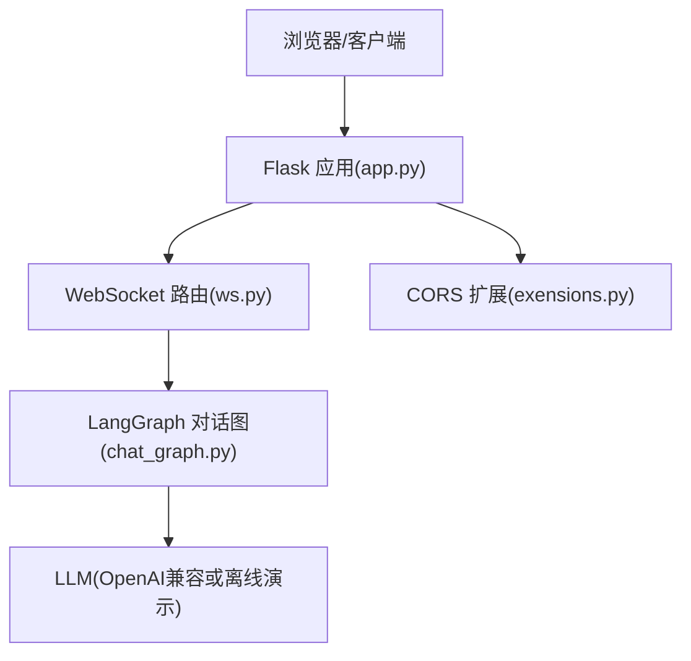
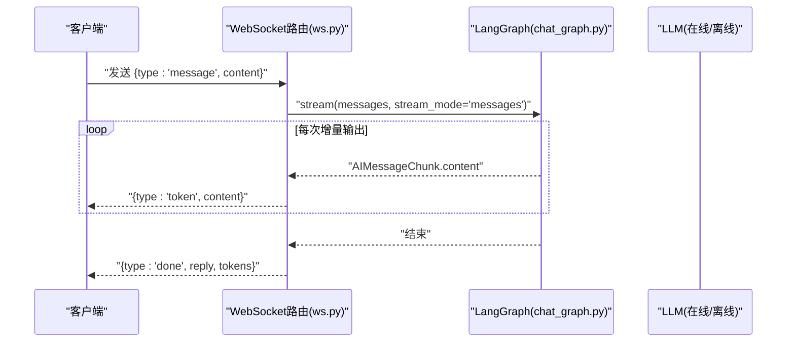
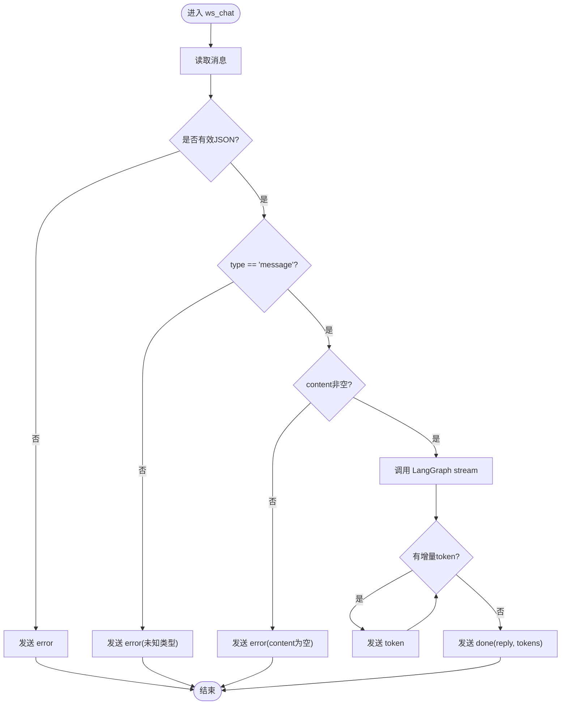
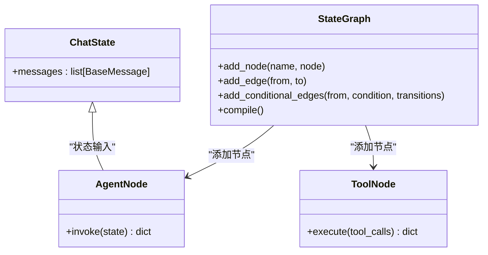
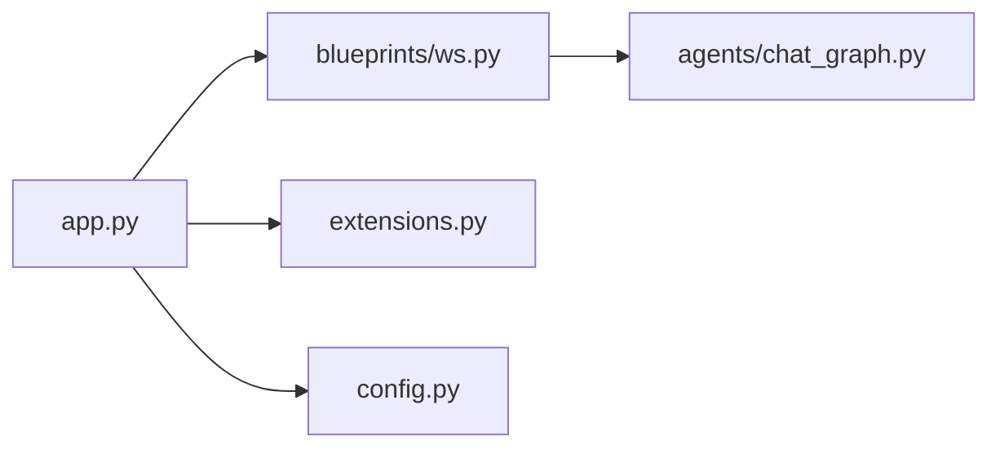

# WebSocket API接口

<cite>
**本文引用的文件**
- [py_server/blueprints/ws.py](file://py_server/blueprints/ws.py)
- [py_server/scripts/ws_client_demo.py](file://py_server/scripts/ws_client_demo.py)
- [py_server/app.py](file://py_server/app.py)
- [py_server/config.py](file://py_server/config.py)
- [py_server/extensions.py](file://py_server/extensions.py)
- [py_server/agents/chat_graph.py](file://py_server/agents/chat_graph.py)
- [py_server/README.md](file://py_server/README.md)
</cite>

## 目录
1. [简介](#简介)
2. [项目结构](#项目结构)
3. [核心组件](#核心组件)
4. [架构总览](#架构总览)
5. [详细组件分析](#详细组件分析)
6. [依赖关系分析](#依赖关系分析)
7. [性能与扩展性](#性能与扩展性)
8. [故障排查指南](#故障排查指南)
9. [结论](#结论)
10. [附录：前端集成示例与调试方法](#附录：前端集成示例与调试方法)

## 简介
本接口文档面向AI对话服务的实时通信协议，基于WebSocket实现流式响应。服务端使用Flask + flask-sock提供原生WebSocket支持，通过LangGraph编排智能体（agent）与工具（tools），以“逐token”推送的方式向前端输出结果，提升交互体验。

## 项目结构
后端服务位于 py_server 目录，关键文件职责如下：
- app.py：应用工厂、蓝图注册、CORS配置、启动入口
- blueprints/ws.py：WebSocket路由 /ws/chat，处理消息收发与流式输出
- agents/chat_graph.py：LangGraph对话图，负责模型调用与工具执行
- config.py：环境变量读取与服务配置
- extensions.py：flask-sock与CORS实例
- scripts/ws_client_demo.py：Python联调客户端，验证流式链路
- README.md：接口说明与快速开始



图表来源
- [py_server/app.py:24-43](file://py_server/app.py#L24-L43)
- [py_server/blueprints/ws.py:30-89](file://py_server/blueprints/ws.py#L30-L89)
- [py_server/agents/chat_graph.py:75-86](file://py_server/agents/chat_graph.py#L75-L86)
- [py_server/extensions.py:1-7](file://py_server/extensions.py#L1-L7)

章节来源
- [py_server/app.py:1-51](file://py_server/app.py#L1-L51)
- [py_server/blueprints/ws.py:1-90](file://py_server/blueprints/ws.py#L1-L90)
- [py_server/agents/chat_graph.py:1-92](file://py_server/agents/chat_graph.py#L1-L92)
- [py_server/config.py:1-25](file://py_server/config.py#L1-L25)
- [py_server/extensions.py:1-7](file://py_server/extensions.py#L1-L7)
- [py_server/README.md:53-125](file://py_server/README.md#L53-L125)

## 核心组件
- WebSocket路由：/ws/chat，接收JSON文本帧，按type分发处理
- 流式输出：通过LangGraph的stream模式逐token推送
- 心跳机制：ping/pong用于连接保活
- 错误处理：统一返回error类型消息并记录日志
- 配置与扩展：CORS允许跨域，flask-sock管理WebSocket连接

章节来源
- [py_server/blueprints/ws.py:26-89](file://py_server/blueprints/ws.py#L26-L89)
- [py_server/agents/chat_graph.py:46-86](file://py_server/agents/chat_graph.py#L46-L86)
- [py_server/extensions.py:1-7](file://py_server/extensions.py#L1-L7)
- [py_server/config.py:10-25](file://py_server/config.py#L10-L25)

## 架构总览
下图展示了从客户端到LangGraph的完整调用链，以及流式数据如何逐token回推至客户端。



图表来源
- [py_server/blueprints/ws.py:67-82](file://py_server/blueprints/ws.py#L67-L82)
- [py_server/agents/chat_graph.py:75-86](file://py_server/agents/chat_graph.py#L75-L86)

## 详细组件分析

### WebSocket路由 /ws/chat
- 连接建立：客户端通过 ws://host:port/ws/chat 建立连接
- 消息格式：
  - 客户端 -> 服务端：
    - {"type": "message", "content": "..."} 发起一轮对话
    - {"type": "ping"} 心跳探测
  - 服务端 -> 客户端：
    - {"type": "token", "content": "..."} 增量token
    - {"type": "done", "reply": "...", "tokens": N} 本轮结束
    - {"type": "pong"} 心跳应答
    - {"type": "error", "message": "..."} 错误信息
- 处理流程：
  - 解析JSON帧，校验type与content
  - 调用LangGraph的stream模式，逐token推送
  - 结束时发送done消息，包含完整回复与分片数
  - 异常捕获并返回error，同时记录日志
- 连接生命周期：
  - 连接关闭时记录日志，清理资源



图表来源
- [py_server/blueprints/ws.py:30-89](file://py_server/blueprints/ws.py#L30-L89)

章节来源
- [py_server/blueprints/ws.py:1-90](file://py_server/blueprints/ws.py#L1-L90)

### LangGraph对话图
- 图结构：START -> agent -> (条件边) tools -> END
- 工具：get_current_time 获取服务器本地时间
- 模型选择：
  - 配置OPENAI_API_KEY时使用ChatOpenAI（开启streaming）
  - 未配置时降级为FakeListChatModel（离线演示）
- 缓存：get_chat_graph使用lru_cache保证进程内单例



图表来源
- [py_server/agents/chat_graph.py:40-86](file://py_server/agents/chat_graph.py#L40-L86)

章节来源
- [py_server/agents/chat_graph.py:1-92](file://py_server/agents/chat_graph.py#L1-L92)

### 应用工厂与扩展
- 应用创建：create_app初始化Flask、加载配置、注册蓝图
- CORS：允许/api/*与/ws/*跨域
- Sock：初始化flask-sock以支持WebSocket
- 预热：启动时编译LangGraph图，便于尽早暴露配置问题

章节来源
- [py_server/app.py:24-43](file://py_server/app.py#L24-L43)
- [py_server/extensions.py:1-7](file://py_server/extensions.py#L1-L7)

## 依赖关系分析
- 模块耦合：
  - ws.py依赖chat_graph.py获取LangGraph实例
  - app.py注册ws_bp蓝图并启用CORS与Sock
  - config.py提供运行时配置（端口、模型参数等）
- 外部依赖：
  - flask-sock：WebSocket支持
  - langchain/langgraph：智能体编排与流式输出
  - flask-cors：跨域控制



图表来源
- [py_server/app.py:24-43](file://py_server/app.py#L24-L43)
- [py_server/blueprints/ws.py:20-23](file://py_server/blueprints/ws.py#L20-L23)
- [py_server/agents/chat_graph.py:75-86](file://py_server/agents/chat_graph.py#L75-L86)
- [py_server/extensions.py:1-7](file://py_server/extensions.py#L1-L7)
- [py_server/config.py:10-25](file://py_server/config.py#L10-L25)

章节来源
- [py_server/app.py:1-51](file://py_server/app.py#L1-L51)
- [py_server/blueprints/ws.py:1-90](file://py_server/blueprints/ws.py#L1-L90)
- [py_server/agents/chat_graph.py:1-92](file://py_server/agents/chat_graph.py#L1-L92)
- [py_server/extensions.py:1-7](file://py_server/extensions.py#L1-L7)
- [py_server/config.py:1-25](file://py_server/config.py#L1-L25)

## 性能与扩展性
- 流式传输：
  - 使用LangGraph的stream_mode="messages"逐token推送，降低首屏延迟
  - 前端可即时渲染，提升用户体验
- 连接管理：
  - 心跳ping/pong维持长连接活跃
  - 连接关闭时记录日志，便于监控
- 部署建议：
  - 生产环境建议使用gevent worker以提升并发长连接能力
  - 合理设置超时与重试策略，避免僵尸连接
- 优化点：
  - 对频繁创建的图对象进行缓存（已使用lru_cache）
  - 限制单次请求的消息长度，防止过大payload影响性能

章节来源
- [py_server/README.md:115-125](file://py_server/README.md#L115-L125)
- [py_server/blueprints/ws.py:30-89](file://py_server/blueprints/ws.py#L30-L89)
- [py_server/agents/chat_graph.py:75-86](file://py_server/agents/chat_graph.py#L75-L86)

## 故障排查指南
- 常见问题：
  - JSON解析失败：检查客户端发送的帧是否为合法JSON
  - 未知消息类型：确保type字段为message或ping
  - content为空：发送前校验内容非空
  - 连接断开：检查网络状况与防火墙规则
- 日志定位：
  - 服务端记录连接建立与断开事件
  - 异常路径记录错误堆栈，便于回溯
- 联调工具：
  - 使用scripts/ws_client_demo.py进行端到端测试
  - 浏览器控制台查看WebSocket消息

章节来源
- [py_server/blueprints/ws.py:30-89](file://py_server/blueprints/ws.py#L30-L89)
- [py_server/scripts/ws_client_demo.py:19-52](file://py_server/scripts/ws_client_demo.py#L19-L52)

## 结论
该WebSocket API提供了简洁高效的流式对话能力，通过LangGraph实现智能体与工具的灵活编排，结合心跳与错误处理机制，满足实时交互需求。前端可按协议接入，实现低延迟、高响应的聊天界面。

## 附录：前端集成示例与调试方法

### 连接建立与消息格式
- 连接地址：ws://host:port/ws/chat
- 客户端发送：
  - {"type": "message", "content": "你好"}
  - {"type": "ping"}
- 服务端返回：
  - {"type": "token", "content": "..."}
  - {"type": "done", "reply": "...", "tokens": N}
  - {"type": "pong"}
  - {"type": "error", "message": "..."}

章节来源
- [py_server/blueprints/ws.py:3-12](file://py_server/blueprints/ws.py#L3-L12)
- [py_server/README.md:69-100](file://py_server/README.md#L69-L100)

### JavaScript客户端集成示例
以下示例展示如何在浏览器中建立WebSocket连接、发送消息并处理流式响应：

```js
const ws = new WebSocket("ws://127.0.0.1:5090/ws/chat");
ws.onopen = () => ws.send(JSON.stringify({ type: "message", content: "你好" }));
ws.onmessage = (event) => {
  const frame = JSON.parse(event.data);
  if (frame.type === "token") console.log(frame.content);
  if (frame.type === "done") console.log("完成:", frame.reply);
};
```

章节来源
- [py_server/README.md:90-100](file://py_server/README.md#L90-L100)

### 错误处理与重连机制
- 错误处理：
  - 监听onerror与onclose事件，捕获连接异常
  - 根据error.message提示用户或记录日志
- 重连策略：
  - 指数退避重连：初始间隔1s，逐步增加至最大间隔
  - 最大重试次数：避免无限重试导致资源耗尽
  - 心跳检测：定期发送ping，若长时间无pong则判定连接失效

### 性能优化策略
- 前端：
  - 合并UI更新：使用requestAnimationFrame批量渲染token
  - 防抖滚动：避免大量token导致的频繁滚动计算
- 后端：
  - 合理设置缓冲区大小，避免内存溢出
  - 使用gevent worker提升并发能力

### 调试工具与监控方法
- 浏览器开发者工具：
  - Network面板查看WebSocket帧
  - Console面板打印日志
- 服务端日志：
  - 记录连接建立/断开事件
  - 捕获异常堆栈信息
- 联调脚本：
  - 使用scripts/ws_client_demo.py进行快速验证

章节来源
- [py_server/scripts/ws_client_demo.py:19-52](file://py_server/scripts/ws_client_demo.py#L19-L52)
- [py_server/blueprints/ws.py:30-89](file://py_server/blueprints/ws.py#L30-L89)