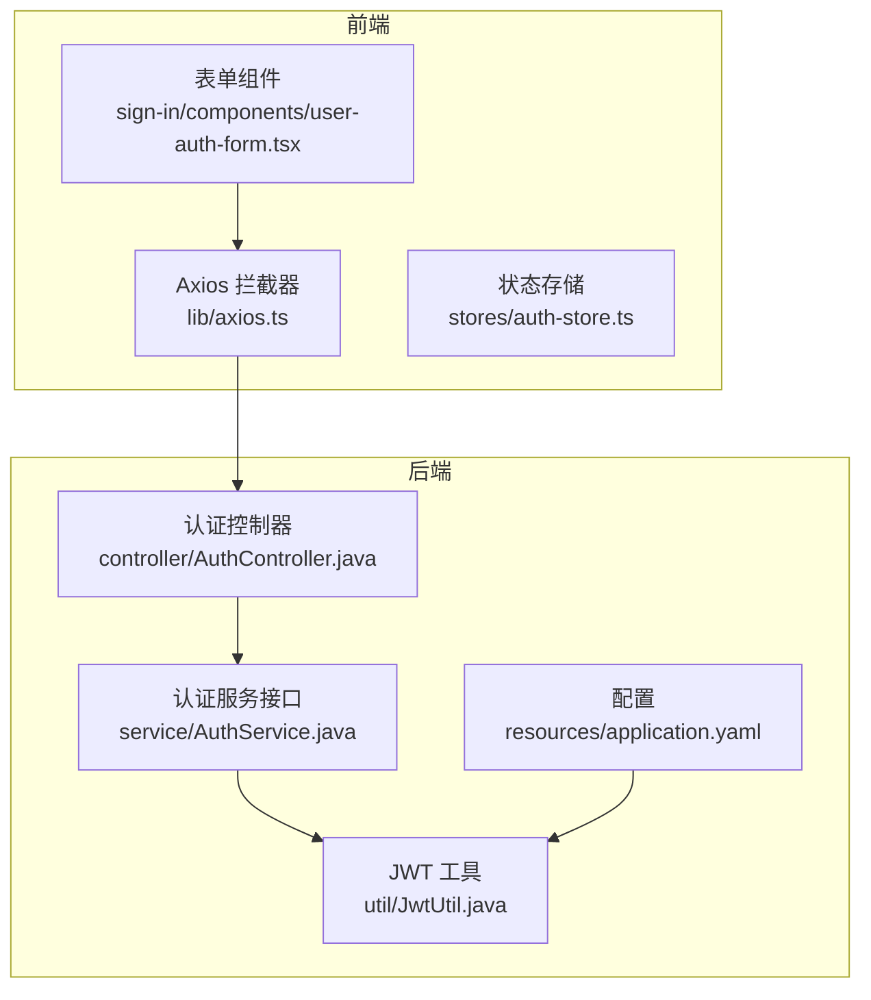
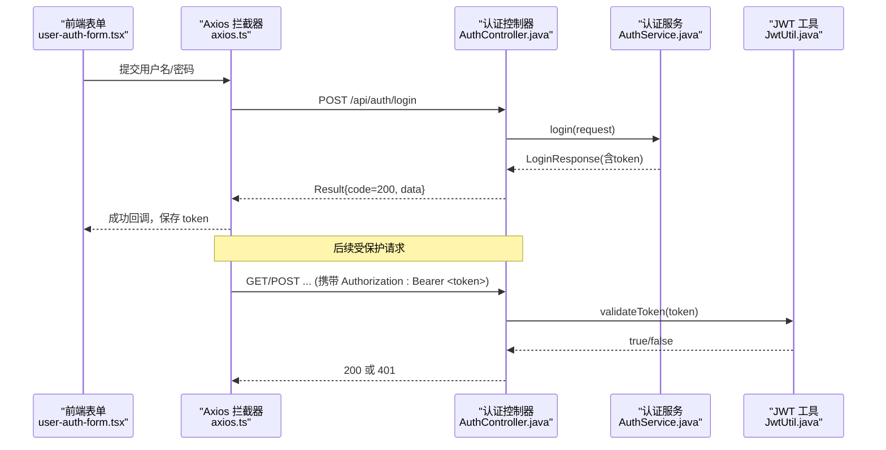
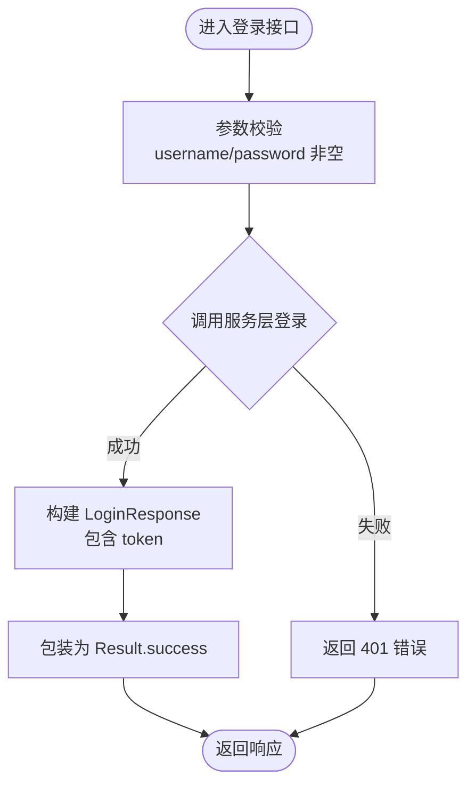
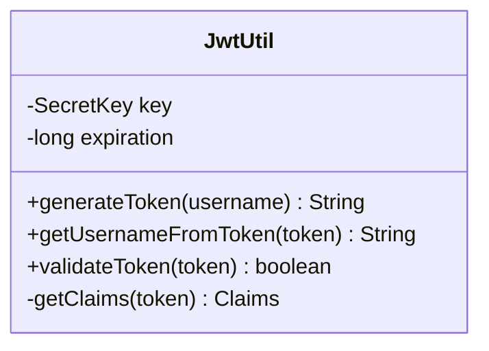
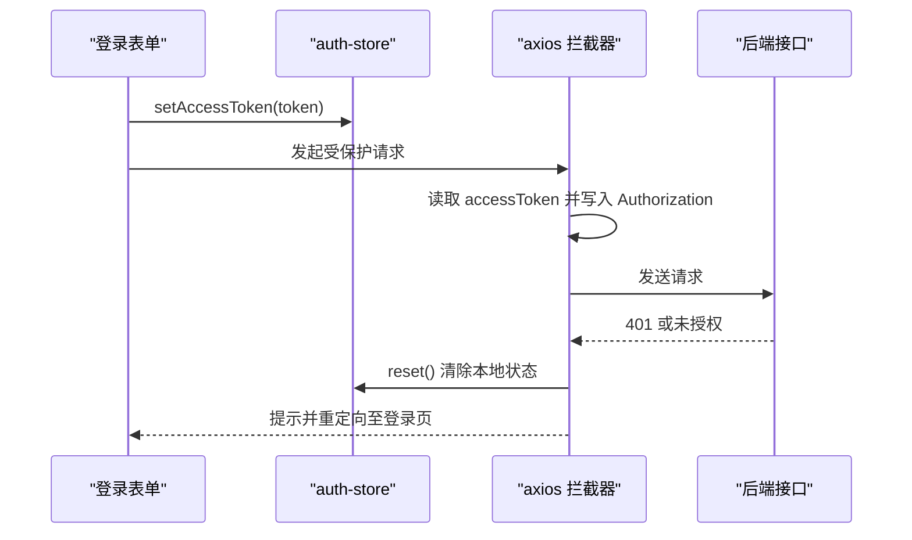
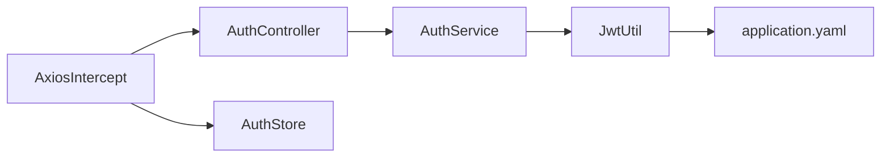

# 认证授权接口

<cite>
**本文引用的文件**
- [AuthController.java](file://java_server/po/src/main/java/com/goodzheng/po/controller/AuthController.java)
- [JwtUtil.java](file://java_server/po/src/main/java/com/goodzheng/po/util/JwtUtil.java)
- [AuthService.java](file://java_server/po/src/main/java/com/goodzheng/po/service/AuthService.java)
- [LoginRequest.java](file://java_server/po/src/main/java/com/goodzheng/po/dto/LoginRequest.java)
- [LoginResponse.java](file://java_server/po/src/main/java/com/goodzheng/po/dto/LoginResponse.java)
- [Result.java](file://java_server/po/src/main/java/com/goodzheng/po/dto/Result.java)
- [User.java](file://java_server/po/src/main/java/com/goodzheng/po/entity/User.java)
- [application.yaml](file://java_server/po/src/main/resources/application.yaml)
- [axios.ts](file://web_client/shadcn-admin/src/lib/axios.ts)
- [auth-store.ts](file://web_client/shadcn-admin/src/stores/auth-store.ts)
- [user-auth-form.tsx](file://web_client/shadcn-admin/src/features/auth/sign-in/components/user-auth-form.tsx)
</cite>

## 目录
1. [简介](#简介)
2. [项目结构](#项目结构)
3. [核心组件](#核心组件)
4. [架构总览](#架构总览)
5. [详细组件分析](#详细组件分析)
6. [依赖关系分析](#依赖关系分析)
7. [性能考虑](#性能考虑)
8. [故障排查指南](#故障排查指南)
9. [结论](#结论)
10. [附录](#附录)

## 简介
本文件面向前后端开发者，系统化说明本项目中基于 JWT 的认证与授权机制。内容涵盖：
- 登录、注册接口的完整规范（请求/响应、错误码）
- JWT 令牌的生成、验证与过期处理流程
- 用户权限与角色管理现状与建议
- 前端令牌存储、请求拦截器与 401 处理流程
- 安全最佳实践与常见安全问题防护方案

## 项目结构
后端采用 Spring Boot 分层架构：控制器层暴露 REST API，服务层封装业务逻辑，工具类提供 JWT 能力；前端使用 React + TanStack Router，通过 Axios 拦截器统一附加 Authorization 头并处理 401 跳转。

图表来源
- [user-auth-form.tsx:1-123](file://web_client/shadcn-admin/src/features/auth/sign-in/components/user-auth-form.tsx#L1-L123)
- [axios.ts:1-87](file://web_client/shadcn-admin/src/lib/axios.ts#L1-L87)
- [AuthController.java:1-41](file://java_server/po/src/main/java/com/goodzheng/po/controller/AuthController.java#L1-L41)
- [AuthService.java:1-12](file://java_server/po/src/main/java/com/goodzheng/po/service/AuthService.java#L1-L12)
- [JwtUtil.java:1-56](file://java_server/po/src/main/java/com/goodzheng/po/util/JwtUtil.java#L1-L56)
- [application.yaml:104-109](file://java_server/po/src/main/resources/application.yaml#L104-L109)

章节来源
- [AuthController.java:1-41](file://java_server/po/src/main/java/com/goodzheng/po/controller/AuthController.java#L1-L41)
- [JwtUtil.java:1-56](file://java_server/po/src/main/java/com/goodzheng/po/util/JwtUtil.java#L1-L56)
- [application.yaml:104-109](file://java_server/po/src/main/resources/application.yaml#L104-L109)
- [axios.ts:1-87](file://web_client/shadcn-admin/src/lib/axios.ts#L1-L87)
- [auth-store.ts:1-55](file://web_client/shadcn-admin/src/stores/auth-store.ts#L1-L55)

## 核心组件
- 认证控制器：提供登录与注册接口，统一返回 Result 包装体。
- JWT 工具：负责生成、解析与校验 JWT，密钥与过期时间来自配置。
- 认证服务接口：定义登录与注册方法（实现位于 service.impl）。
- 数据模型：登录请求/响应、通用结果封装、用户实体包含角色字段。
- 前端 Axios 拦截器：自动注入 Authorization 头，集中处理 401 与业务错误码。
- 前端状态存储：以 Cookie 持久化访问令牌，并提供重置与清空能力。

章节来源
- [AuthController.java:1-41](file://java_server/po/src/main/java/com/goodzheng/po/controller/AuthController.java#L1-L41)
- [JwtUtil.java:1-56](file://java_server/po/src/main/java/com/goodzheng/po/util/JwtUtil.java#L1-L56)
- [AuthService.java:1-12](file://java_server/po/src/main/java/com/goodzheng/po/service/AuthService.java#L1-L12)
- [LoginRequest.java:1-15](file://java_server/po/src/main/java/com/goodzheng/po/dto/LoginRequest.java#L1-L15)
- [LoginResponse.java:1-15](file://java_server/po/src/main/java/com/goodzheng/po/dto/LoginResponse.java#L1-L15)
- [Result.java:1-32](file://java_server/po/src/main/java/com/goodzheng/po/dto/Result.java#L1-L32)
- [User.java:1-59](file://java_server/po/src/main/java/com/goodzheng/po/entity/User.java#L1-L59)
- [axios.ts:1-87](file://web_client/shadcn-admin/src/lib/axios.ts#L1-L87)
- [auth-store.ts:1-55](file://web_client/shadcn-admin/src/stores/auth-store.ts#L1-L55)

## 架构总览
下图展示从前端登录到后端签发 JWT，再到后续受保护请求鉴权的完整链路。

图表来源
- [user-auth-form.tsx:1-123](file://web_client/shadcn-admin/src/features/auth/sign-in/components/user-auth-form.tsx#L1-L123)
- [axios.ts:1-87](file://web_client/shadcn-admin/src/lib/axios.ts#L1-L87)
- [AuthController.java:1-41](file://java_server/po/src/main/java/com/goodzheng/po/controller/AuthController.java#L1-L41)
- [AuthService.java:1-12](file://java_server/po/src/main/java/com/goodzheng/po/service/AuthService.java#L1-L12)
- [JwtUtil.java:1-56](file://java_server/po/src/main/java/com/goodzheng/po/util/JwtUtil.java#L1-L56)

## 详细组件分析

### 登录接口
- 路径与方法：POST /api/auth/login
- 请求体：LoginRequest（username、password，均非空）
- 响应：Result<LoginResponse>，成功时 code=200，data 包含 id、token、username、nickname
- 异常：捕获运行时异常返回 401 及错误信息

图表来源
- [AuthController.java:19-27](file://java_server/po/src/main/java/com/goodzheng/po/controller/AuthController.java#L19-L27)
- [LoginRequest.java:1-15](file://java_server/po/src/main/java/com/goodzheng/po/dto/LoginRequest.java#L1-L15)
- [LoginResponse.java:1-15](file://java_server/po/src/main/java/com/goodzheng/po/dto/LoginResponse.java#L1-L15)
- [Result.java:16-22](file://java_server/po/src/main/java/com/goodzheng/po/dto/Result.java#L16-L22)

章节来源
- [AuthController.java:19-27](file://java_server/po/src/main/java/com/goodzheng/po/controller/AuthController.java#L19-L27)
- [LoginRequest.java:1-15](file://java_server/po/src/main/java/com/goodzheng/po/dto/LoginRequest.java#L1-L15)
- [LoginResponse.java:1-15](file://java_server/po/src/main/java/com/goodzheng/po/dto/LoginResponse.java#L1-L15)
- [Result.java:16-22](file://java_server/po/src/main/java/com/goodzheng/po/dto/Result.java#L16-L22)

### 注册接口
- 路径与方法：POST /api/auth/register
- 查询参数：username、password、email（可选）
- 响应：Result<String>，成功返回消息，失败返回 400 及错误信息

章节来源
- [AuthController.java:29-39](file://java_server/po/src/main/java/com/goodzheng/po/controller/AuthController.java#L29-L39)

### JWT 令牌机制
- 生成：使用 HMAC-SHA 密钥对签名，载荷包含 subject（用户名）、issuedAt、expiration
- 验证：解析签名并校验有效期，返回布尔值
- 配置：密钥与过期时长来自 application.yaml 的 jwt.secret 与 jwt.expiration

图表来源
- [JwtUtil.java:13-54](file://java_server/po/src/main/java/com/goodzheng/po/util/JwtUtil.java#L13-L54)
- [application.yaml:104-109](file://java_server/po/src/main/resources/application.yaml#L104-L109)

章节来源
- [JwtUtil.java:13-54](file://java_server/po/src/main/java/com/goodzheng/po/util/JwtUtil.java#L13-L54)
- [application.yaml:104-109](file://java_server/po/src/main/resources/application.yaml#L104-L109)

### 前端令牌存储与请求拦截
- 令牌存储：使用 Cookie 持久化 accessToken，并提供设置、重置、清空方法
- 请求拦截：在请求头附加 Authorization: Bearer <token>
- 响应拦截：统一处理后端 Result.code != 200 的业务错误；对 401 进行登出并跳转到登录页

图表来源
- [auth-store.ts:1-55](file://web_client/shadcn-admin/src/stores/auth-store.ts#L1-L55)
- [axios.ts:42-83](file://web_client/shadcn-admin/src/lib/axios.ts#L42-L83)

章节来源
- [auth-store.ts:1-55](file://web_client/shadcn-admin/src/stores/auth-store.ts#L1-L55)
- [axios.ts:1-87](file://web_client/shadcn-admin/src/lib/axios.ts#L1-L87)

### 用户权限与角色管理
- 当前模型：User 实体包含 role 字段（默认 admin），可用于后续 RBAC 扩展
- 建议实现：在服务层或网关层根据角色进行资源级权限控制；可在 JWT 载荷中附加角色声明以便前端渲染与后端校验

章节来源
- [User.java:42-47](file://java_server/po/src/main/java/com/goodzheng/po/entity/User.java#L42-L47)

## 依赖关系分析
- 控制器依赖服务接口，服务实现可依赖仓库与 JWT 工具
- JWT 工具依赖应用配置中的密钥与过期时间
- 前端 Axios 依赖状态存储以获取令牌，并在响应侧统一处理错误

图表来源
- [AuthController.java:1-41](file://java_server/po/src/main/java/com/goodzheng/po/controller/AuthController.java#L1-L41)
- [AuthService.java:1-12](file://java_server/po/src/main/java/com/goodzheng/po/service/AuthService.java#L1-L12)
- [JwtUtil.java:1-56](file://java_server/po/src/main/java/com/goodzheng/po/util/JwtUtil.java#L1-L56)
- [application.yaml:104-109](file://java_server/po/src/main/resources/application.yaml#L104-L109)
- [axios.ts:1-87](file://web_client/shadcn-admin/src/lib/axios.ts#L1-L87)
- [auth-store.ts:1-55](file://web_client/shadcn-admin/src/stores/auth-store.ts#L1-L55)

章节来源
- [AuthController.java:1-41](file://java_server/po/src/main/java/com/goodzheng/po/controller/AuthController.java#L1-L41)
- [AuthService.java:1-12](file://java_server/po/src/main/java/com/goodzheng/po/service/AuthService.java#L1-L12)
- [JwtUtil.java:1-56](file://java_server/po/src/main/java/com/goodzheng/po/util/JwtUtil.java#L1-L56)
- [application.yaml:104-109](file://java_server/po/src/main/resources/application.yaml#L104-L109)
- [axios.ts:1-87](file://web_client/shadcn-admin/src/lib/axios.ts#L1-L87)
- [auth-store.ts:1-55](file://web_client/shadcn-admin/src/stores/auth-store.ts#L1-L55)

## 性能考虑
- JWT 无状态校验，服务端无需会话存储，适合水平扩展
- 合理设置过期时间，避免频繁刷新带来的额外开销
- 前端在请求前判断令牌是否即将过期，可提前刷新以减少 401 抖动
- 数据库连接池与 JPA 配置已优化，注意在高并发下监控慢查询

[本节为通用指导，不直接分析具体文件]

## 故障排查指南
- 401 未授权：检查前端是否携带 Authorization 头；确认后端是否启用令牌校验；核对密钥配置一致
- 令牌无效：确认 JWT 签名算法与密钥一致；检查是否被篡改或跨域传输问题
- 业务错误：前端统一处理 Result.code != 200，定位对应 message
- 登录失败：检查参数校验规则与服务层返回的错误信息

章节来源
- [axios.ts:51-83](file://web_client/shadcn-admin/src/lib/axios.ts#L51-L83)
- [AuthController.java:19-39](file://java_server/po/src/main/java/com/goodzheng/po/controller/AuthController.java#L19-L39)
- [Result.java:16-30](file://java_server/po/src/main/java/com/goodzheng/po/dto/Result.java#L16-L30)

## 结论
本项目实现了基于 JWT 的无状态认证：后端通过控制器暴露登录/注册接口，服务层结合 JWT 工具签发与校验令牌；前端通过 Axios 拦截器统一注入令牌并处理 401。建议在后续版本中完善令牌刷新机制与基于角色的细粒度权限控制，并遵循安全最佳实践提升系统安全性。

[本节为总结性内容，不直接分析具体文件]

## 附录

### 接口规范速查
- 登录
  - 方法：POST
  - 路径：/api/auth/login
  - 请求体：LoginRequest（username、password）
  - 响应：Result<LoginResponse>（id、token、username、nickname）
- 注册
  - 方法：POST
  - 路径：/api/auth/register
  - 查询参数：username、password、email（可选）
  - 响应：Result<String>

章节来源
- [AuthController.java:19-39](file://java_server/po/src/main/java/com/goodzheng/po/controller/AuthController.java#L19-L39)
- [LoginRequest.java:1-15](file://java_server/po/src/main/java/com/goodzheng/po/dto/LoginRequest.java#L1-L15)
- [LoginResponse.java:1-15](file://java_server/po/src/main/java/com/goodzheng/po/dto/LoginResponse.java#L1-L15)
- [Result.java:16-30](file://java_server/po/src/main/java/com/goodzheng/po/dto/Result.java#L16-L30)

### 安全最佳实践
- 使用强随机密钥与合适的算法（HMAC-SHA），密钥定期轮换
- 设置合理的令牌过期时间，必要时引入刷新令牌机制
- 仅通过 HTTPS 传输令牌，避免中间人攻击
- 不在日志中输出敏感信息（如密码、完整令牌）
- 对输入进行严格校验与防注入处理
- 限制登录尝试次数，防止暴力破解

[本节为通用指导，不直接分析具体文件]