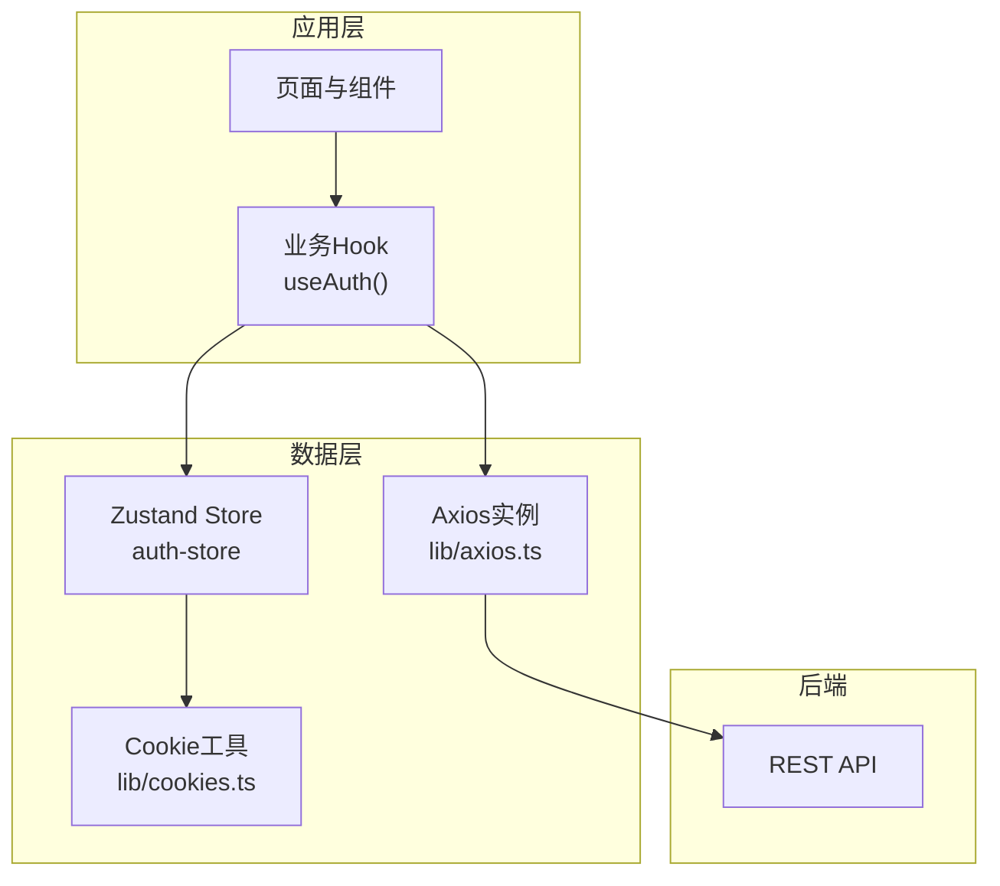
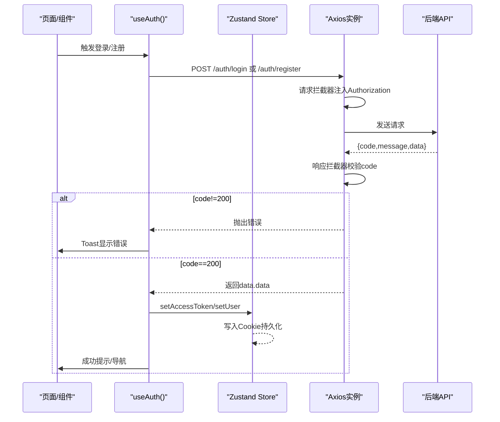
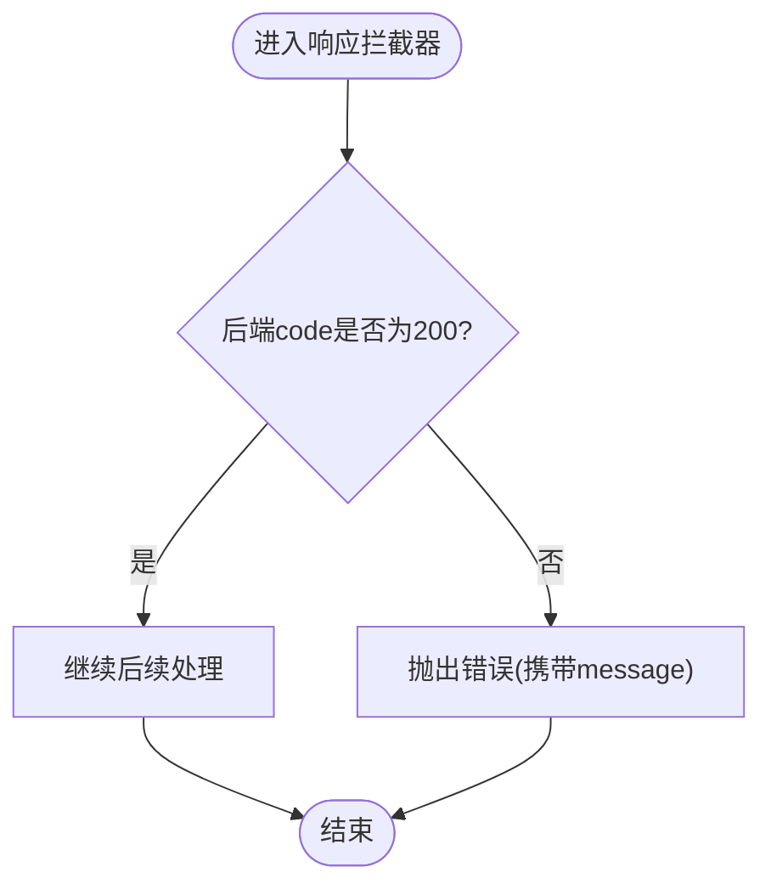
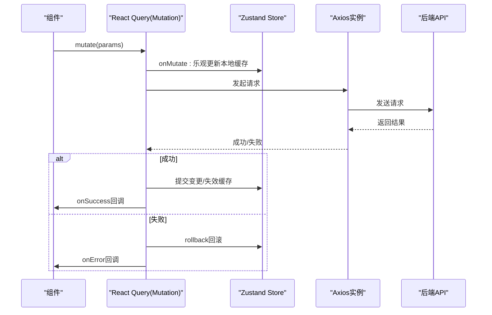
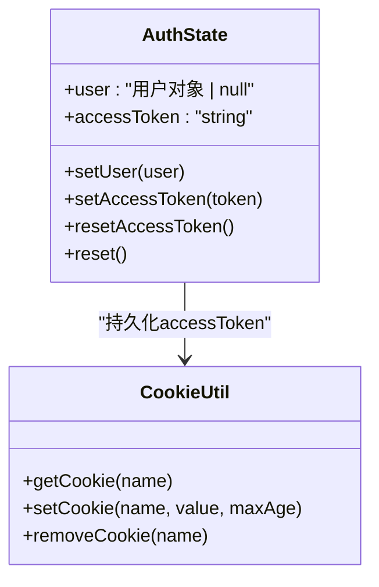
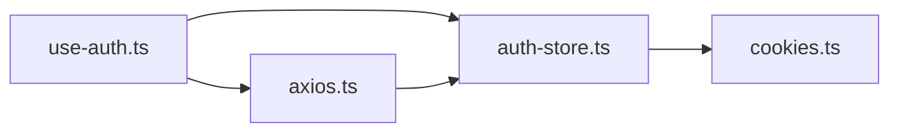

# API集成与数据流

<cite>
**本文引用的文件**
- [axios.ts](file://web_client/shadcn-admin/src/lib/axios.ts)
- [auth-store.ts](file://web_client/shadcn-admin/src/stores/auth-store.ts)
- [use-auth.ts](file://web_client/shadcn-admin/src/hooks/use-auth.ts)
- [cookies.ts](file://web_client/shadcn-admin/src/lib/cookies.ts)
</cite>

## 目录
1. [简介](#简介)
2. [项目结构](#项目结构)
3. [核心组件](#核心组件)
4. [架构总览](#架构总览)
5. [详细组件分析](#详细组件分析)
6. [依赖关系分析](#依赖关系分析)
7. [性能考虑](#性能考虑)
8. [故障排查指南](#故障排查指南)
9. [结论](#结论)
10. [附录](#附录)

## 简介
本技术文档聚焦前端API集成与数据流管理，围绕以下目标展开：
- Axios请求拦截器配置：认证令牌注入、统一错误处理、登录过期自动跳转。
- React Query集成使用：查询客户端配置、缓存策略、乐观更新实践（结合Mutation）。
- 状态管理方案：Zustand store设计、异步状态处理、状态持久化（Cookie）。
- WebSocket实时通信：连接管理、消息处理、错误恢复机制（概念性说明）。
- API调用示例：RESTful接口封装、GraphQL查询与实时订阅的最佳实践（概念性说明）。

## 项目结构
本项目采用模块化组织方式，关键目录与职责如下：
- lib：HTTP客户端与工具函数（Axios实例、Cookie操作等）
- stores：全局状态管理（Zustand）
- hooks：业务Hook封装（React Query + Zustand）
- features：按功能域划分的页面与逻辑（如recipes、users等）
- routes：路由定义与布局

图表来源
- [axios.ts:34-49](file://web_client/shadcn-admin/src/lib/axios.ts#L34-L49)
- [auth-store.ts:25-53](file://web_client/shadcn-admin/src/stores/auth-store.ts#L25-L53)
- [use-auth.ts:25-80](file://web_client/shadcn-admin/src/hooks/use-auth.ts#L25-L80)
- [cookies.ts:11-43](file://web_client/shadcn-admin/src/lib/cookies.ts#L11-L43)

章节来源
- [axios.ts:34-86](file://web_client/shadcn-admin/src/lib/axios.ts#L34-L86)
- [auth-store.ts:1-55](file://web_client/shadcn-admin/src/stores/auth-store.ts#L1-L55)
- [use-auth.ts:1-82](file://web_client/shadcn-admin/src/hooks/use-auth.ts#L1-L82)
- [cookies.ts:1-44](file://web_client/shadcn-admin/src/lib/cookies.ts#L1-L44)

## 核心组件
- Axios实例与拦截器
  - 请求拦截器：从Zustand读取accessToken并注入Authorization头。
  - 响应拦截器：统一解析后端返回的{code,message,data}结构；对401进行统一处理（提示、清理状态、重定向）。
  - 基础配置：baseURL、超时、默认Content-Type。
- Zustand状态管理
  - 维护用户信息与accessToken，提供设置、重置方法。
  - 通过Cookie实现accessToken持久化，支持服务端渲染或刷新后恢复。
- React Query Hook
  - useAuth封装登录/注册流程，使用Mutation发起请求，成功后写入Store并提示用户。
  - 错误处理通过Toast反馈，保持UI一致性。

章节来源
- [axios.ts:42-84](file://web_client/shadcn-admin/src/lib/axios.ts#L42-L84)
- [auth-store.ts:25-53](file://web_client/shadcn-admin/src/stores/auth-store.ts#L25-L53)
- [use-auth.ts:25-80](file://web_client/shadcn-admin/src/hooks/use-auth.ts#L25-L80)

## 架构总览
下图展示了从页面到后端的数据流，包括认证、缓存与错误处理的关键路径。

图表来源
- [use-auth.ts:29-51](file://web_client/shadcn-admin/src/hooks/use-auth.ts#L29-L51)
- [axios.ts:42-84](file://web_client/shadcn-admin/src/lib/axios.ts#L42-L84)
- [auth-store.ts:34-51](file://web_client/shadcn-admin/src/stores/auth-store.ts#L34-L51)
- [cookies.ts:26-43](file://web_client/shadcn-admin/src/lib/cookies.ts#L26-L43)

## 详细组件分析

### Axios请求拦截器与错误处理
- 认证令牌注入
  - 在请求拦截器中读取Zustand中的accessToken，若存在则附加到Authorization头。
  - 令牌有效性检查：提供isTokenExpired辅助函数，用于前端判断是否提前刷新或重新登录。
- 统一错误处理
  - 响应拦截器根据后端统一格式{code,message,data}进行判定，非200时抛出错误，便于上层统一捕获。
  - 401处理：检测到未授权时，弹出提示、清空状态并重定向至登录页，避免重复处理。
- 重试机制
  - 当前未内置重试逻辑。可在响应拦截器中对特定错误码（如网络错误、5xx）增加指数退避重试，或在请求前基于isTokenExpired进行预检与刷新。

图表来源
- [axios.ts:52-84](file://web_client/shadcn-admin/src/lib/axios.ts#L52-L84)

章节来源
- [axios.ts:18-32](file://web_client/shadcn-admin/src/lib/axios.ts#L18-L32)
- [axios.ts:42-84](file://web_client/shadcn-admin/src/lib/axios.ts#L42-L84)

### React Query集成与缓存策略
- 查询客户端配置
  - 使用@tanstack/react-query的useMutation封装写操作（登录/注册），集中处理请求、成功回调与错误提示。
  - 可结合QueryClientProvider在全局配置默认缓存时间、重试次数、去重策略等。
- 数据缓存策略
  - 读操作建议使用useQuery，利用key去重与staleTime/gcTime控制缓存生命周期。
  - 写操作完成后通过invalidateQueries或setQueryData使相关列表失效或更新。
- 乐观更新实现
  - 在Mutation中使用onMutate先更新本地缓存，再发起请求；失败时通过rollback回滚。
  - 适用于评论、点赞、任务状态切换等场景，提升交互即时性。

图表来源
- [use-auth.ts:29-51](file://web_client/shadcn-admin/src/hooks/use-auth.ts#L29-L51)
- [axios.ts:42-84](file://web_client/shadcn-admin/src/lib/axios.ts#L42-L84)
- [auth-store.ts:34-51](file://web_client/shadcn-admin/src/stores/auth-store.ts#L34-L51)

章节来源
- [use-auth.ts:1-82](file://web_client/shadcn-admin/src/hooks/use-auth.ts#L1-L82)

### Zustand Store设计与持久化
- 状态模型
  - auth.user：用户基本信息（id、账号、邮箱、角色、过期时间等）。
  - auth.accessToken：访问令牌，随请求注入。
- 操作方法
  - setUser、setAccessToken、resetAccessToken、reset：分别用于设置用户信息、令牌、清除令牌与完整登出。
- 持久化
  - 通过Cookie保存accessToken，确保刷新后仍可恢复登录态。
  - 提供getCookie/setCookie/removeCookie工具函数，兼容SSR环境。

图表来源
- [auth-store.ts:6-23](file://web_client/shadcn-admin/src/stores/auth-store.ts#L6-L23)
- [auth-store.ts:25-53](file://web_client/shadcn-admin/src/stores/auth-store.ts#L25-L53)
- [cookies.ts:11-43](file://web_client/shadcn-admin/src/lib/cookies.ts#L11-L43)

章节来源
- [auth-store.ts:1-55](file://web_client/shadcn-admin/src/stores/auth-store.ts#L1-L55)
- [cookies.ts:1-44](file://web_client/shadcn-admin/src/lib/cookies.ts#L1-L44)

### WebSocket实时通信（概念性说明）
- 连接管理
  - 建立WebSocket连接，监听open/close/error事件；在鉴权通过后携带token进行握手。
  - 断线重连：基于指数退避策略自动重连，避免雪崩。
- 消息处理
  - 定义消息协议（类型、载荷、时间戳），按类型分发处理；对重要消息进行ACK确认。
- 错误恢复
  - 网络异常时降级为轮询或队列暂存；服务端推送失败时提供补偿机制。
- 与状态管理集成
  - 将实时数据写入Zustand，并通过React Query的setQueryData同步到缓存，保证UI一致性与可预测性。

[本节为概念性说明，不直接分析具体代码文件]

## 依赖关系分析
- 模块耦合
  - use-auth依赖axios与auth-store，负责登录/注册流程与状态更新。
  - axios依赖auth-store以获取accessToken，并在401时触发登出流程。
  - auth-store依赖cookies实现持久化。
- 外部依赖
  - @tanstack/react-query：用于数据获取与缓存。
  - sonner：用于Toast提示。
  - TanStack Router：用于401时的重定向。

图表来源
- [use-auth.ts:1-82](file://web_client/shadcn-admin/src/hooks/use-auth.ts#L1-L82)
- [axios.ts:1-86](file://web_client/shadcn-admin/src/lib/axios.ts#L1-L86)
- [auth-store.ts:1-55](file://web_client/shadcn-admin/src/stores/auth-store.ts#L1-L55)
- [cookies.ts:1-44](file://web_client/shadcn-admin/src/lib/cookies.ts#L1-L44)

章节来源
- [use-auth.ts:1-82](file://web_client/shadcn-admin/src/hooks/use-auth.ts#L1-L82)
- [axios.ts:1-86](file://web_client/shadcn-admin/src/lib/axios.ts#L1-L86)
- [auth-store.ts:1-55](file://web_client/shadcn-admin/src/stores/auth-store.ts#L1-L55)
- [cookies.ts:1-44](file://web_client/shadcn-admin/src/lib/cookies.ts#L1-L44)

## 性能考虑
- 请求优化
  - 合理设置staleTime与gcTime，减少重复请求。
  - 使用queryKey去重，避免并发相同请求。
- 缓存策略
  - 对热点数据设置较长staleTime，配合后台刷新策略提升体验。
  - 对写操作后的列表使用invalidateQueries精准失效。
- 错误与重试
  - 对幂等GET请求启用重试，对POST等非幂等操作谨慎重试。
  - 针对网络抖动与临时错误，采用指数退避重试。
- 状态持久化
  - 仅持久化必要字段（如accessToken），避免存储过大状态。
  - 使用Cookie时注意安全属性（如HttpOnly、Secure）与服务端配置。

[本节提供通用指导，不直接分析具体代码文件]

## 故障排查指南
- 401未授权
  - 现象：登录后仍被重定向至登录页。
  - 排查：检查请求头是否包含Authorization；确认accessToken是否有效且未过期；查看响应拦截器是否正确处理401。
- 登录/注册失败
  - 现象：Toast提示错误。
  - 排查：检查后端返回的code与message；确认请求参数与接口契约一致；查看use-auth的错误回调。
- 状态不同步
  - 现象：UI未反映最新数据。
  - 排查：确认Mutation成功后是否调用invalidateQueries或setQueryData；检查queryKey是否与列表查询一致。
- 持久化问题
  - 现象：刷新后丢失登录态。
  - 排查：确认Cookie是否正确写入与读取；检查浏览器隐私模式或第三方Cookie限制。

章节来源
- [axios.ts:52-84](file://web_client/shadcn-admin/src/lib/axios.ts#L52-L84)
- [use-auth.ts:48-73](file://web_client/shadcn-admin/src/hooks/use-auth.ts#L48-L73)
- [auth-store.ts:34-51](file://web_client/shadcn-admin/src/stores/auth-store.ts#L34-L51)
- [cookies.ts:11-43](file://web_client/shadcn-admin/src/lib/cookies.ts#L11-L43)

## 结论
本项目通过Axios拦截器实现了统一的认证与错误处理，结合Zustand与React Query构建了清晰的数据流与缓存策略。登录态通过Cookie持久化，提升了用户体验与系统健壮性。对于WebSocket实时通信与GraphQL查询，建议遵循本文的概念性最佳实践，逐步落地以实现更丰富的交互能力。

[本节为总结性内容，不直接分析具体代码文件]

## 附录
- RESTful接口封装建议
  - 统一封装api.post/get等方法，屏蔽底层细节；集中处理错误与加载状态。
  - 对分页、排序、筛选等参数进行标准化处理。
- GraphQL查询建议
  - 使用Typed Document Node确保类型安全；通过Fragment复用字段。
  - 结合React Query的cache-and-network策略，平衡实时性与性能。
- 实时数据订阅建议
  - 使用WebSocket或Server-Sent Events；对消息进行版本控制与兼容性处理。
  - 与Zustand集成，确保状态单一事实来源；必要时与React Query缓存保持一致。

[本节为概念性说明，不直接分析具体代码文件]