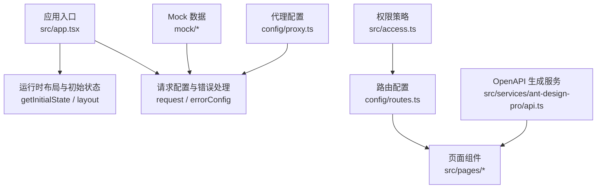
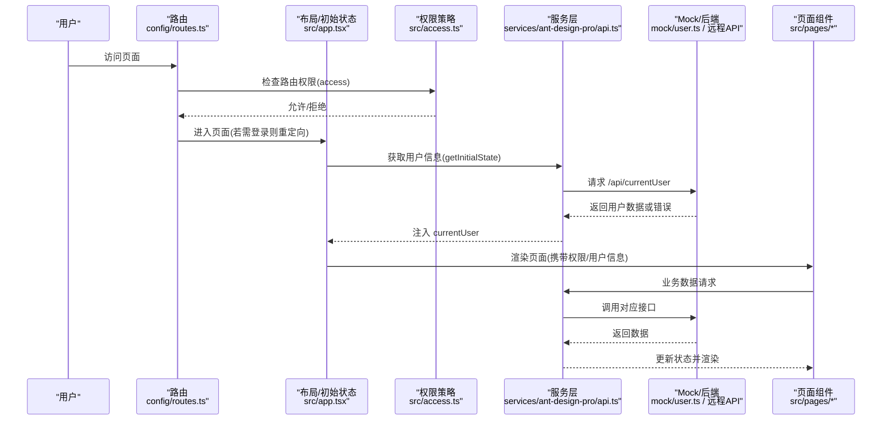
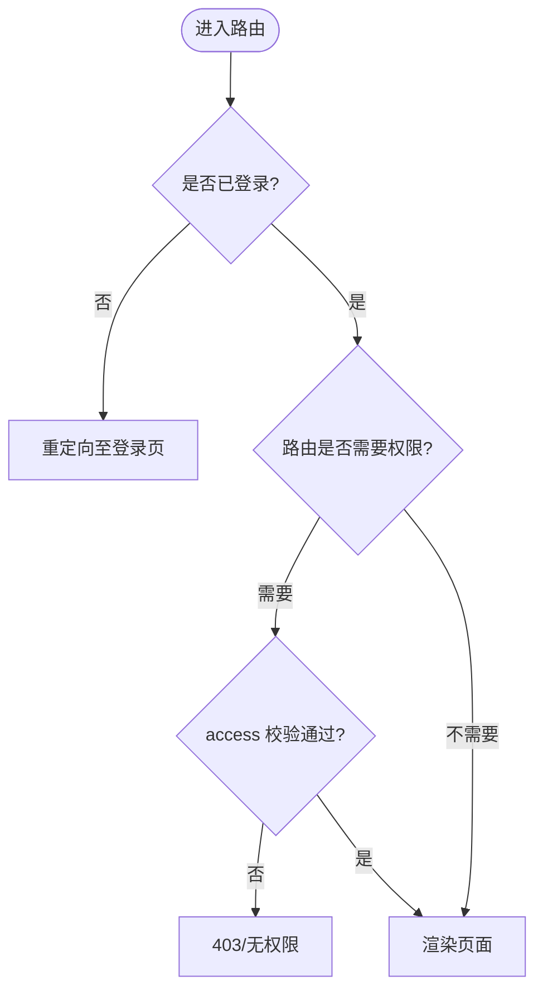
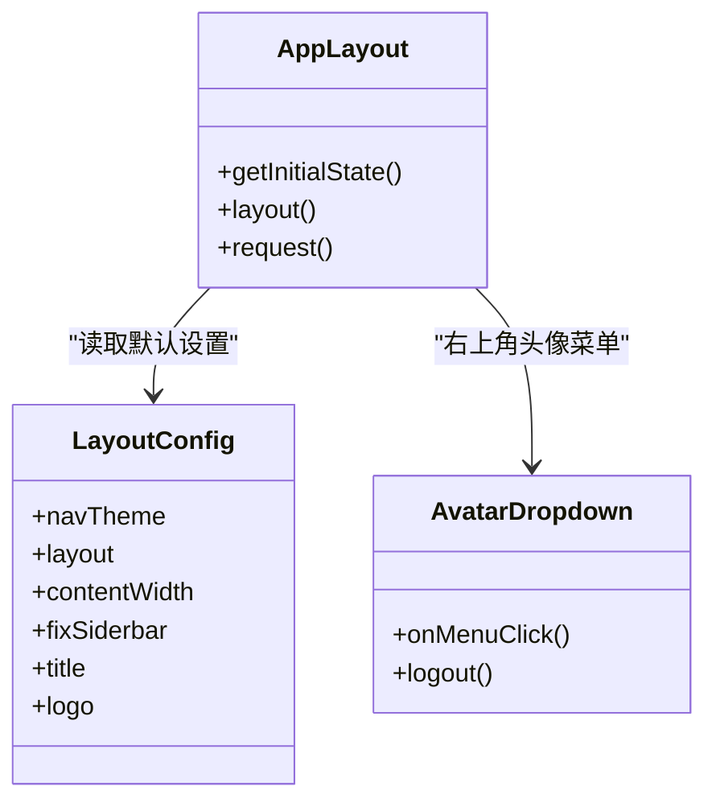
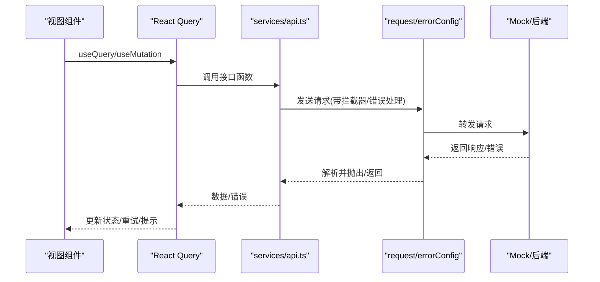
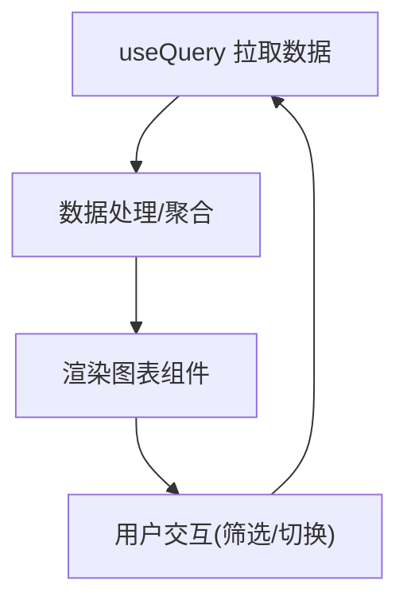
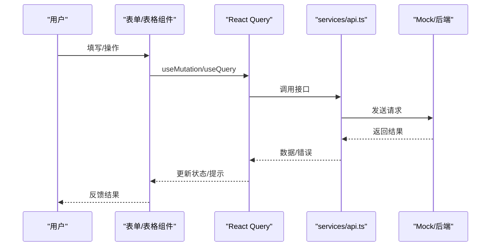
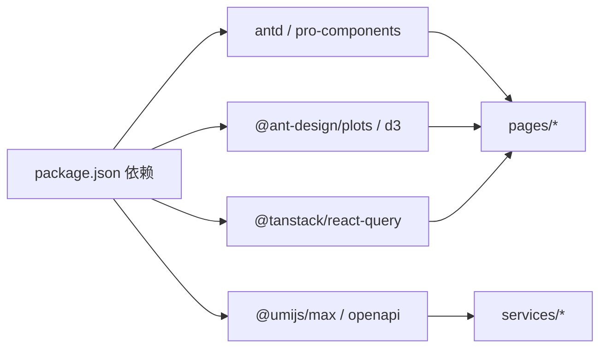

# Ant Design Pro管理后台

<cite>
**本文引用的文件**
- [package.json](file://web_client/po-admin/package.json)
- [config.ts](file://web_client/po-admin/config/config.ts)
- [routes.ts](file://web_client/po-admin/config/routes.ts)
- [proxy.ts](file://web_client/po-admin/config/proxy.ts)
- [defaultSettings.ts](file://web_client/po-admin/config/defaultSettings.ts)
- [app.tsx](file://web_client/po-admin/src/app.tsx)
- [access.ts](file://web_client/po-admin/src/access.ts)
- [requestErrorConfig.ts](file://web_client/po-admin/src/requestErrorConfig.ts)
- [api.ts](file://web_client/po-admin/src/services/ant-design-pro/api.ts)
- [user.ts](file://web_client/po-admin/mock/user.ts)
- [index.tsx（仪表盘分析）](file://web_client/po-admin/src/pages/dashboard/analysis/index.tsx)
- [index.tsx（基础表单）](file://web_client/po-admin/src/pages/form/basic-form/index.tsx)
- [index.tsx（表格列表）](file://web_client/po-admin/src/pages/table-list/index.tsx)
- [AvatarDropdown.tsx](file://web_client/po-admin/src/components/RightContent/AvatarDropdown.tsx)
</cite>

## 目录
1. [简介](#简介)
2. [项目结构](#项目结构)
3. [核心组件](#核心组件)
4. [架构总览](#架构总览)
5. [详细组件分析](#详细组件分析)
6. [依赖关系分析](#依赖关系分析)
7. [性能考量](#性能考量)
8. [故障排查指南](#故障排查指南)
9. [结论](#结论)
10. [附录](#附录)

## 简介
本仓库包含前端 Ant Design Pro 管理后台（Umi.js + Max）、Java 后端与 Python 服务。本文聚焦于 web_client/po-admin 的前端工程，系统阐述 Umi.js 的项目结构与配置、路由与代理、构建优化、布局系统与权限控制、数据流与 Mock、图表可视化实践，以及典型业务页面（仪表盘、表单、表格）的实现要点。

## 项目结构
- 工程根目录位于 web_client/po-admin，采用 Umi Max 约定式目录：
  - config：全局配置（路由、主题、代理、插件等）
  - src：源码目录（页面、组件、服务、国际化、运行时配置）
  - mock：本地 Mock 数据
  - public：静态资源
- 关键入口与配置：
  - 应用初始化与布局：src/app.tsx
  - 路由定义：config/routes.ts
  - 全局请求与错误处理：src/requestErrorConfig.ts
  - 权限策略：src/access.ts
  - OpenAPI 生成与服务封装：src/services/ant-design-pro/api.ts
  - 代理与环境变量：config/proxy.ts、config/config.ts

**图示来源**
- [app.tsx:32-185](file://web_client/po-admin/src/app.tsx#L32-L185)
- [routes.ts:13-298](file://web_client/po-admin/config/routes.ts#L13-L298)
- [requestErrorConfig.ts:28-108](file://web_client/po-admin/src/requestErrorConfig.ts#L28-L108)
- [proxy.ts:12-41](file://web_client/po-admin/config/proxy.ts#L12-L41)
- [api.ts:5-95](file://web_client/po-admin/src/services/ant-design-pro/api.ts#L5-L95)

**章节来源**
- [config.ts:36-236](file://web_client/po-admin/config/config.ts#L36-L236)
- [routes.ts:13-298](file://web_client/po-admin/config/routes.ts#L13-L298)
- [proxy.ts:12-41](file://web_client/po-admin/config/proxy.ts#L12-L41)
- [app.tsx:32-185](file://web_client/po-admin/src/app.tsx#L32-L185)

## 核心组件
- 应用初始化与全局状态
  - getInitialState：在启动时获取当前用户信息，未登录且非白名单路由则重定向到登录页；同时注入默认布局设置。
  - layout：配置菜单渲染、右上角操作区、页脚、离线提示、设置抽屉、错误边界等。
- 请求与错误处理
  - request：统一 baseURL、拦截器与错误处理；开发环境使用空前缀，生产指向演示 API。
  - errorConfig：统一业务错误码、网络异常、离线提示、跳转登录等。
- 权限控制
  - access：基于 initialState.currentUser 的访问能力判定（如 canAdmin）。
- 路由与菜单
  - routes：声明式路由，支持嵌套、重定向、图标、名称、权限 access。
- 服务与 Mock
  - services：通过 OpenAPI 生成的类型化接口调用。
  - mock：模拟登录、用户信息、错误场景等。

**章节来源**
- [app.tsx:32-195](file://web_client/po-admin/src/app.tsx#L32-L195)
- [requestErrorConfig.ts:28-108](file://web_client/po-admin/src/requestErrorConfig.ts#L28-L108)
- [access.ts:4-11](file://web_client/po-admin/src/access.ts#L4-L11)
- [routes.ts:13-298](file://web_client/po-admin/config/routes.ts#L13-L298)
- [api.ts:5-95](file://web_client/po-admin/src/services/ant-design-pro/api.ts#L5-L95)
- [user.ts:18-144](file://web_client/po-admin/mock/user.ts#L18-L144)

## 架构总览
下图展示从浏览器发起请求到页面渲染的关键路径，包括路由匹配、权限校验、初始状态加载、请求拦截与错误处理、Mock/真实 API 返回、状态更新与 UI 渲染。

**图示来源**
- [routes.ts:13-298](file://web_client/po-admin/config/routes.ts#L13-L298)
- [access.ts:4-11](file://web_client/po-admin/src/access.ts#L4-L11)
- [app.tsx:32-185](file://web_client/po-admin/src/app.tsx#L32-L185)
- [api.ts:5-95](file://web_client/po-admin/src/services/ant-design-pro/api.ts#L5-L95)
- [user.ts:18-144](file://web_client/po-admin/mock/user.ts#L18-L144)

## 详细组件分析

### Umi.js 框架配置与构建优化
- 路由与预取
  - 启用 routePrefetch 与 manifest，提升页面切换速度。
- 主题与国际化
  - antd 主题 token 定制；locale 默认 zh-CN，开启 baseNavigator。
- 代理与环境
  - proxy 按 UMI_ENV 选择不同目标；dev/test/pre 环境可分别配置。
- 构建产物
  - hash 开启以支持增量发布与缓存失效；publicPath 可配置部署子路径。
- 插件与工具链
  - openAPI 插件根据 oneapi.json 生成服务与类型；moment2dayjs 替换时间库；tailwindcss 集成。
- 环境变量注入
  - define 注入 CI、COMMIT_HASH、版本信息等。

**章节来源**
- [config.ts:36-236](file://web_client/po-admin/config/config.ts#L36-L236)
- [proxy.ts:12-41](file://web_client/po-admin/config/proxy.ts#L12-L41)
- [package.json:7-32](file://web_client/po-admin/package.json#L7-L32)

### 路由配置与权限控制
- 路由组织
  - 顶层路由包含用户相关、欢迎页、管理员专属、仪表盘、表单、列表、个人中心、结果页、异常页、聊天机器人等。
  - 支持重定向、子路由分组、图标与名称映射菜单。
- 权限控制
  - 路由级 access 字段（如 admin 路由 require canAdmin），由 src/access.ts 基于 currentUser.access 判定。
- 导航与预加载
  - 菜单项使用 Link 并启用 prefetch，提升交互体验。

**图示来源**
- [routes.ts:13-298](file://web_client/po-admin/config/routes.ts#L13-L298)
- [access.ts:4-11](file://web_client/po-admin/src/access.ts#L4-L11)
- [app.tsx:113-121](file://web_client/po-admin/src/app.tsx#L113-L121)

**章节来源**
- [routes.ts:13-298](file://web_client/po-admin/config/routes.ts#L13-L298)
- [access.ts:4-11](file://web_client/po-admin/src/access.ts#L4-L11)
- [app.tsx:81-121](file://web_client/po-admin/src/app.tsx#L81-L121)

### 布局系统与全局头部、侧边栏菜单
- 布局配置
  - 通过 defaultSettings 设置主题、布局模式（mix）、内容宽度、固定侧边栏等。
  - layout 中自定义菜单渲染、右上角动作区（文档链接、版本、语言切换）、页脚、设置抽屉、错误边界。
- 用户头像下拉
  - AvatarDropdown 提供个人设置、主题设置、退出登录等功能；退出后清空用户状态并重定向。

**图示来源**
- [defaultSettings.ts:6-25](file://web_client/po-admin/config/defaultSettings.ts#L6-L25)
- [app.tsx:76-185](file://web_client/po-admin/src/app.tsx#L76-L185)
- [AvatarDropdown.tsx:17-103](file://web_client/po-admin/src/components/RightContent/AvatarDropdown.tsx#L17-L103)

**章节来源**
- [defaultSettings.ts:6-25](file://web_client/po-admin/config/defaultSettings.ts#L6-L25)
- [app.tsx:76-185](file://web_client/po-admin/src/app.tsx#L76-L185)
- [AvatarDropdown.tsx:17-103](file://web_client/po-admin/src/components/RightContent/AvatarDropdown.tsx#L17-L103)

### 数据流管理：Mock、API 封装与状态同步
- Mock 数据
  - mock/user.ts 提供当前用户、登录、登出、错误码等模拟接口，便于本地开发与演示。
- API 封装
  - services/ant-design-pro/api.ts 暴露类型化函数，统一调用 request，支持参数、headers、options。
- 状态同步
  - 使用 @tanstack/react-query 进行服务端状态管理：useQuery 拉取数据，useMutation 提交变更，并通过 invalidateQueries 触发刷新。
- 错误处理
  - requestErrorConfig 统一处理业务错误、网络错误、离线提示与跳转。

**图示来源**
- [api.ts:5-95](file://web_client/po-admin/src/services/ant-design-pro/api.ts#L5-L95)
- [requestErrorConfig.ts:28-108](file://web_client/po-admin/src/requestErrorConfig.ts#L28-L108)
- [user.ts:18-144](file://web_client/po-admin/mock/user.ts#L18-L144)

**章节来源**
- [api.ts:5-95](file://web_client/po-admin/src/services/ant-design-pro/api.ts#L5-L95)
- [requestErrorConfig.ts:28-108](file://web_client/po-admin/src/requestErrorConfig.ts#L28-L108)
- [user.ts:18-144](file://web_client/po-admin/mock/user.ts#L18-L144)

### 图表可视化实现与最佳实践
- 技术选型
  - 使用 @ant-design/plots 与 d3 进行图表绘制；结合 React Query 管理数据生命周期。
- 数据驱动
  - 仪表盘分析页通过 useQuery 拉取数据，将数据传递给各图表子组件（销售卡片、占比饼图、离线数据折线图等）。
- 交互与性能
  - 使用 Suspense 包裹异步组件，避免首屏阻塞；按需切换时间段与维度，减少不必要重绘。
- 最佳实践
  - 图表数据扁平化与聚合在 service/utils 中完成；UI 仅负责展示与交互。

**图示来源**
- [index.tsx（仪表盘分析）:27-161](file://web_client/po-admin/src/pages/dashboard/analysis/index.tsx#L27-L161)

**章节来源**
- [index.tsx（仪表盘分析）:27-161](file://web_client/po-admin/src/pages/dashboard/analysis/index.tsx#L27-L161)

### 业务页面示例：仪表盘、表单、表格
- 仪表盘分析
  - 组合多个图表与统计卡片，支持时间范围选择与维度切换；通过 useQuery 管理数据与加载态。
- 基础表单
  - 使用 ProForm 系列组件，内置校验与联动；提交使用 useMutation，成功后刷新相关查询缓存。
- 表格列表
  - 使用 ProTable 实现分页、排序、搜索、批量操作；结合 Drawer 与 ProDescriptions 查看详情；删除操作通过 mutation 触发并刷新列表。

**图示来源**
- [index.tsx（基础表单）:18-197](file://web_client/po-admin/src/pages/form/basic-form/index.tsx#L18-L197)
- [index.tsx（表格列表）:20-348](file://web_client/po-admin/src/pages/table-list/index.tsx#L20-L348)
- [api.ts:5-95](file://web_client/po-admin/src/services/ant-design-pro/api.ts#L5-L95)

**章节来源**
- [index.tsx（基础表单）:18-197](file://web_client/po-admin/src/pages/form/basic-form/index.tsx#L18-L197)
- [index.tsx（表格列表）:20-348](file://web_client/po-admin/src/pages/table-list/index.tsx#L20-L348)

## 依赖关系分析
- 运行时依赖
  - antd、@ant-design/pro-components、@ant-design/plots、@tanstack/react-query、dayjs、d3 等。
- 构建与工具
  - @umijs/max、@umijs/max-plugin-openapi、vitest、biome、tailwindcss、husky 等。
- 模块耦合
  - app.tsx 作为入口协调布局、请求、权限；services 与 pages 通过 react-query 解耦数据与视图；mock 与 services 解耦测试与真实后端。

**图示来源**
- [package.json:37-92](file://web_client/po-admin/package.json#L37-L92)

**章节来源**
- [package.json:37-92](file://web_client/po-admin/package.json#L37-L92)

## 性能考量
- 路由预加载与资源清单：routePrefetch 与 manifest 提升切换速度。
- 代码分割与懒加载：Suspense 包裹异步组件，按需加载图表与页面。
- 时间库替换：moment2dayjs 减小包体积。
- 主题与样式：Tailwind 与 antd token 定制，避免冗余样式。
- 构建产物：hash 与 publicPath 优化缓存与部署路径。

[本节为通用指导，不直接分析具体文件]

## 故障排查指南
- 登录与权限
  - 未登录访问受保护路由会被重定向到登录页；权限不足会触发 403。
- 网络与离线
  - 请求失败或离线时，errorConfig 会给出友好提示；必要时跳转到登录页。
- Mock 与真实接口
  - 开发阶段可通过 mock 快速验证；切换到真实接口时注意 baseURL 与跨域配置。
- 常见问题定位
  - 检查路由是否正确、access 策略是否符合预期；确认 services 中的接口路径与后端一致；查看 request 拦截器与错误处理逻辑。

**章节来源**
- [app.tsx:32-121](file://web_client/po-admin/src/app.tsx#L32-L121)
- [requestErrorConfig.ts:28-108](file://web_client/po-admin/src/requestErrorConfig.ts#L28-L108)
- [user.ts:18-144](file://web_client/po-admin/mock/user.ts#L18-L144)

## 结论
本项目基于 Umi Max 构建了企业级管理后台，具备完善的路由、权限、布局、数据流与错误处理机制。通过 OpenAPI 生成服务与 Mock，显著降低样板代码；结合 React Query 与 Ant Design Pro 组件，实现了高效的数据管理与丰富的交互体验。图表可视化采用 @ant-design/plots 与 d3，满足复杂数据分析需求。整体架构清晰、可扩展性强，适合持续迭代与团队协作。

[本节为总结性内容，不直接分析具体文件]

## 附录
- 常用命令
  - 开发：npm run start
  - 构建：npm run build
  - 预览：npm run preview
  - 测试：npm run test
- 环境变量
  - UMI_ENV：开发/测试/预发环境
  - MOCK：是否启用 Mock
  - COMMIT_HASH：构建时注入的版本标识

[本节为补充说明，不直接分析具体文件]