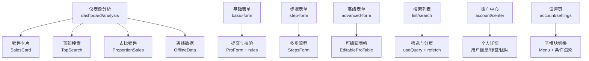
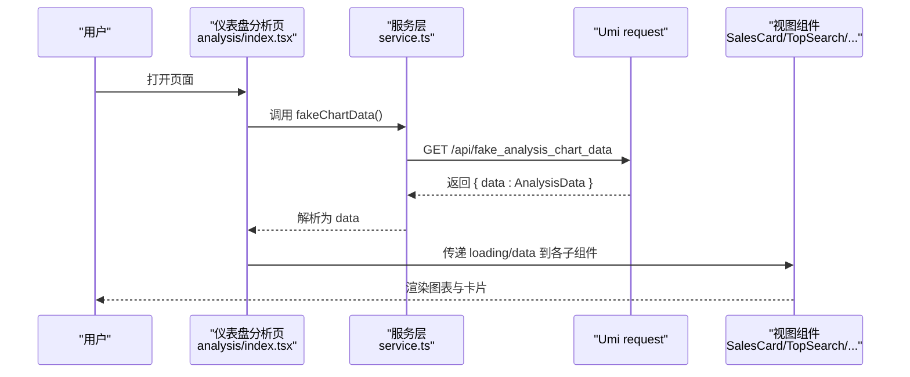
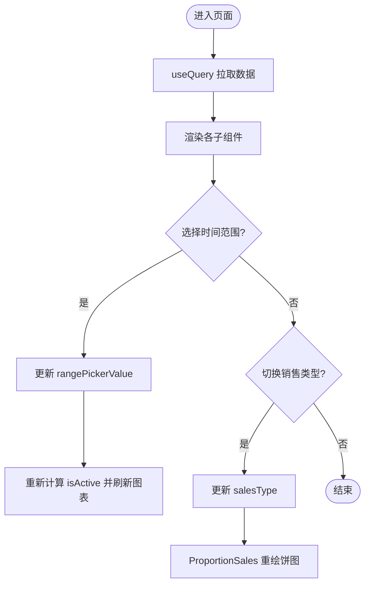
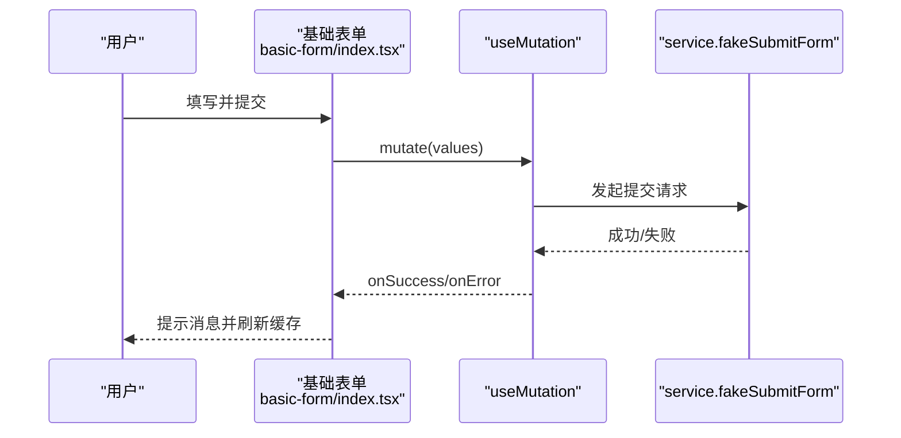
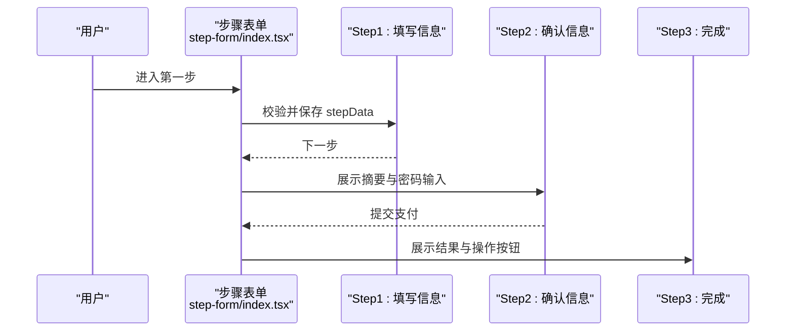
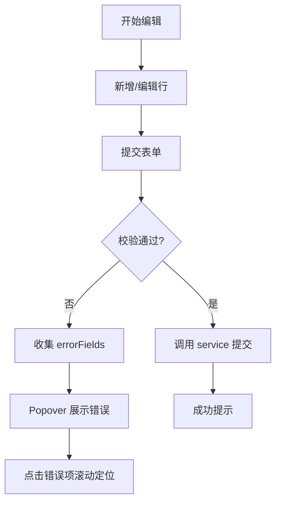
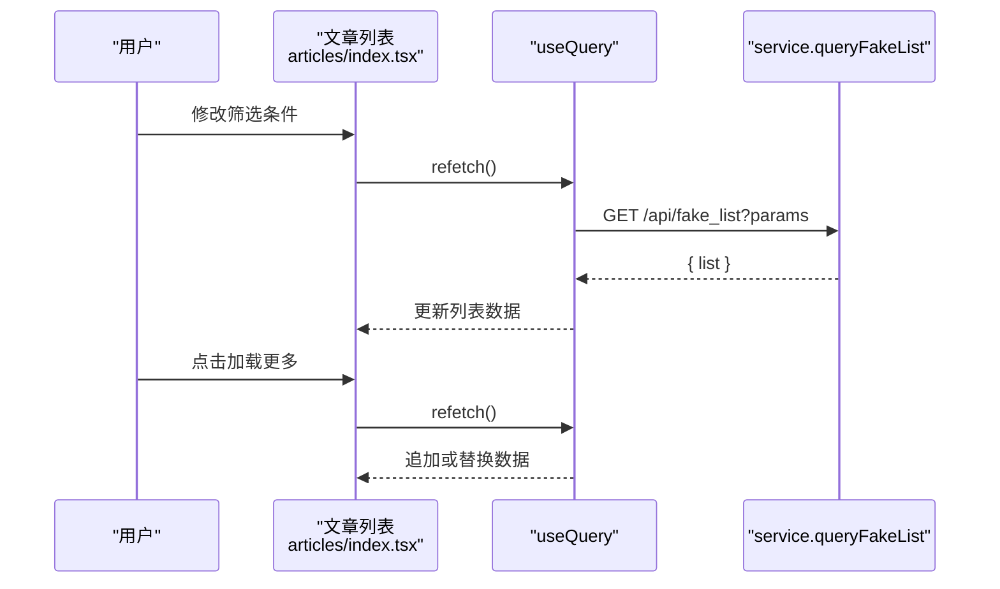
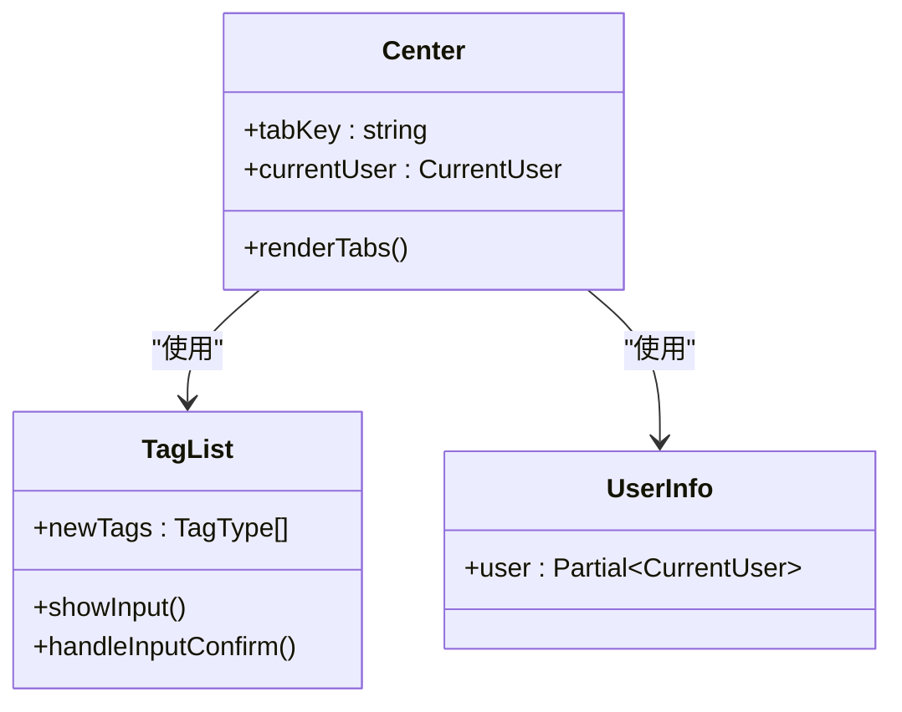
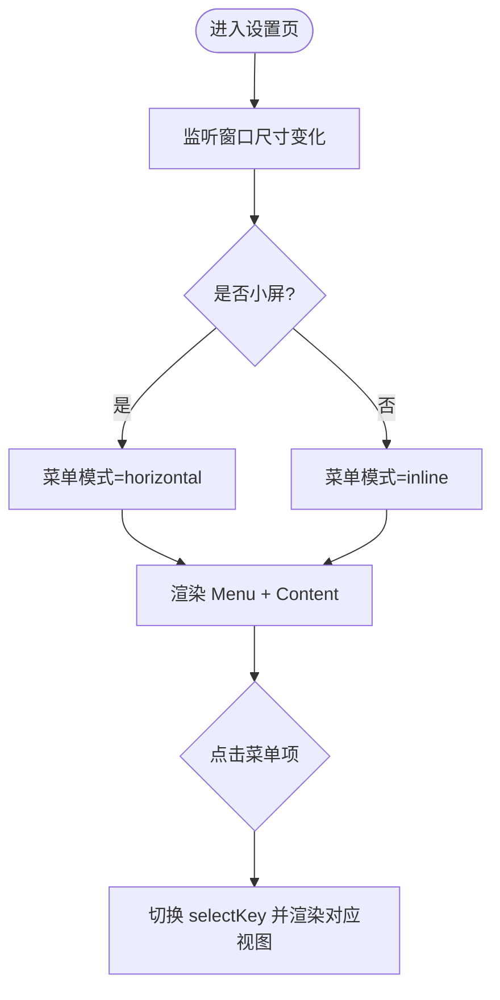
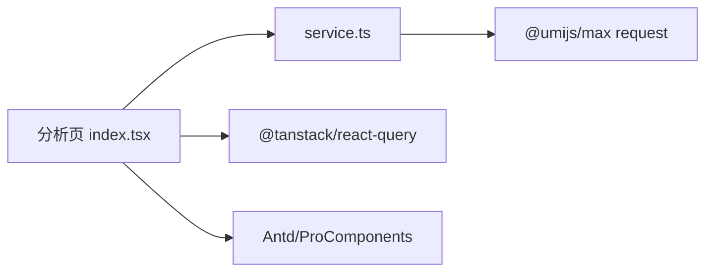

# 业务页面

<cite>
**本文引用的文件**
- [web_client/po-admin/src/pages/dashboard/analysis/index.tsx](file://web_client/po-admin/src/pages/dashboard/analysis/index.tsx)
- [web_client/po-admin/src/pages/dashboard/analysis/service.ts](file://web_client/po-admin/src/pages/dashboard/analysis/service.ts)
- [web_client/po-admin/src/pages/form/basic-form/index.tsx](file://web_client/po-admin/src/pages/form/basic-form/index.tsx)
- [web_client/po-admin/src/pages/form/step-form/index.tsx](file://web_client/po-admin/src/pages/form/step-form/index.tsx)
- [web_client/po-admin/src/pages/form/advanced-form/index.tsx](file://web_client/po-admin/src/pages/form/advanced-form/index.tsx)
- [web_client/po-admin/src/pages/list/search/index.tsx](file://web_client/po-admin/src/pages/list/search/index.tsx)
- [web_client/po-admin/src/pages/list/search/articles/index.tsx](file://web_client/po-admin/src/pages/list/search/articles/index.tsx)
- [web_client/po-admin/src/pages/list/search/articles/service.ts](file://web_client/po-admin/src/pages/list/search/articles/service.ts)
- [web_client/po-admin/src/pages/account/center/index.tsx](file://web_client/po-admin/src/pages/account/center/index.tsx)
- [web_client/po-admin/src/pages/account/settings/index.tsx](file://web_client/po-admin/src/pages/account/settings/index.tsx)
</cite>

## 目录
1. [简介](#简介)
2. [项目结构](#项目结构)
3. [核心组件](#核心组件)
4. [架构总览](#架构总览)
5. [详细组件分析](#详细组件分析)
6. [依赖分析](#依赖分析)
7. [性能考虑](#性能考虑)
8. [故障排查指南](#故障排查指南)
9. [结论](#结论)
10. [附录](#附录)

## 简介
本文件面向Ant Design Pro业务页面的实现与最佳实践，聚焦以下目标：
- 仪表盘分析页的数据可视化集成、实时数据更新与响应式布局
- 表单页（基础表单、步骤表单、高级表单）的验证规则与提交流程
- 列表页的搜索筛选、分页加载、批量操作与表格定制
- 用户账户中心的功能实现（个人信息管理、安全设置、通知配置）
- 页面组件复用模式与开发规范（状态管理、错误处理、用户体验优化）
- 通过真实业务场景展示复杂页面开发流程

## 项目结构
本项目采用按“功能域”组织的前端目录结构，关键业务页面位于 web_client/po-admin/src/pages 下：
- dashboard/analysis：仪表盘分析页，聚合多个图表与卡片
- form/basic-form、form/step-form、form/advanced-form：三类典型表单
- list/search：带标签页与搜索的列表页
- account/center、account/settings：用户中心与设置页

**图示来源**
- [web_client/po-admin/src/pages/dashboard/analysis/index.tsx:1-161](file://web_client/po-admin/src/pages/dashboard/analysis/index.tsx#L1-L161)
- [web_client/po-admin/src/pages/form/basic-form/index.tsx:1-197](file://web_client/po-admin/src/pages/form/basic-form/index.tsx#L1-L197)
- [web_client/po-admin/src/pages/form/step-form/index.tsx:1-246](file://web_client/po-admin/src/pages/form/step-form/index.tsx#L1-L246)
- [web_client/po-admin/src/pages/form/advanced-form/index.tsx:1-554](file://web_client/po-admin/src/pages/form/advanced-form/index.tsx#L1-L554)
- [web_client/po-admin/src/pages/list/search/index.tsx:1-80](file://web_client/po-admin/src/pages/list/search/index.tsx#L1-L80)
- [web_client/po-admin/src/pages/list/search/articles/index.tsx:1-280](file://web_client/po-admin/src/pages/list/search/articles/index.tsx#L1-L280)
- [web_client/po-admin/src/pages/account/center/index.tsx:1-278](file://web_client/po-admin/src/pages/account/center/index.tsx#L1-L278)
- [web_client/po-admin/src/pages/account/settings/index.tsx:1-115](file://web_client/po-admin/src/pages/account/settings/index.tsx#L1-L115)

**章节来源**
- [web_client/po-admin/src/pages/dashboard/analysis/index.tsx:1-161](file://web_client/po-admin/src/pages/dashboard/analysis/index.tsx#L1-L161)
- [web_client/po-admin/src/pages/form/basic-form/index.tsx:1-197](file://web_client/po-admin/src/pages/form/basic-form/index.tsx#L1-L197)
- [web_client/po-admin/src/pages/form/step-form/index.tsx:1-246](file://web_client/po-admin/src/pages/form/step-form/index.tsx#L1-L246)
- [web_client/po-admin/src/pages/form/advanced-form/index.tsx:1-554](file://web_client/po-admin/src/pages/form/advanced-form/index.tsx#L1-L554)
- [web_client/po-admin/src/pages/list/search/index.tsx:1-80](file://web_client/po-admin/src/pages/list/search/index.tsx#L1-L80)
- [web_client/po-admin/src/pages/list/search/articles/index.tsx:1-280](file://web_client/po-admin/src/pages/list/search/articles/index.tsx#L1-L280)
- [web_client/po-admin/src/pages/account/center/index.tsx:1-278](file://web_client/po-admin/src/pages/account/center/index.tsx#L1-L278)
- [web_client/po-admin/src/pages/account/settings/index.tsx:1-115](file://web_client/po-admin/src/pages/account/settings/index.tsx#L1-L115)

## 核心组件
- 仪表盘分析页：使用 GridContent 布局，组合 IntroduceRow、SalesCard、TopSearch、ProportionSales、OfflineData 等子组件；通过 useQuery 拉取数据，结合日期选择器控制时间范围，动态切换销售类型以更新饼图数据。
- 基础表单：基于 ProForm 与各类 Pro* 表单项，集中声明 rules 完成必填、格式校验；使用 useMutation 提交并刷新缓存。
- 步骤表单：使用 StepsForm 将复杂流程拆分为多步，每步独立校验与提交，最终统一结果展示。
- 高级表单：在 ProForm 中嵌入 EditableProTable 实现行内编辑与批量录入，配合 FooterToolbar 与错误提示弹窗提升交互体验。
- 搜索列表：使用 Form 进行筛选，TagSelect 多选类目，Select 多选 owner，结合 useQuery 的 queryKey 与 refetch 实现筛选与加载更多。
- 账户中心：左侧展示用户头像、签名、标签、团队；右侧通过 Tab 切换文章、应用、项目内容。
- 设置页：左侧菜单切换基础、安全、绑定、通知四个子模块，根据屏幕宽度自适应菜单布局。

**章节来源**
- [web_client/po-admin/src/pages/dashboard/analysis/index.tsx:1-161](file://web_client/po-admin/src/pages/dashboard/analysis/index.tsx#L1-L161)
- [web_client/po-admin/src/pages/form/basic-form/index.tsx:1-197](file://web_client/po-admin/src/pages/form/basic-form/index.tsx#L1-L197)
- [web_client/po-admin/src/pages/form/step-form/index.tsx:1-246](file://web_client/po-admin/src/pages/form/step-form/index.tsx#L1-L246)
- [web_client/po-admin/src/pages/form/advanced-form/index.tsx:1-554](file://web_client/po-admin/src/pages/form/advanced-form/index.tsx#L1-L554)
- [web_client/po-admin/src/pages/list/search/articles/index.tsx:1-280](file://web_client/po-admin/src/pages/list/search/articles/index.tsx#L1-L280)
- [web_client/po-admin/src/pages/account/center/index.tsx:1-278](file://web_client/po-admin/src/pages/account/center/index.tsx#L1-L278)
- [web_client/po-admin/src/pages/account/settings/index.tsx:1-115](file://web_client/po-admin/src/pages/account/settings/index.tsx#L1-L115)

## 架构总览
前端采用 React + Ant Design Pro 组件库，数据层使用 @tanstack/react-query 进行请求与缓存管理，网络请求通过 Umi 的 request 封装。页面通过 GridContent/Row/Col 实现响应式栅格布局，表单与表格使用 ProComponents 提供的增强能力。

**图示来源**
- [web_client/po-admin/src/pages/dashboard/analysis/index.tsx:34-43](file://web_client/po-admin/src/pages/dashboard/analysis/index.tsx#L34-L43)
- [web_client/po-admin/src/pages/dashboard/analysis/service.ts:4-6](file://web_client/po-admin/src/pages/dashboard/analysis/service.ts#L4-L6)

**章节来源**
- [web_client/po-admin/src/pages/dashboard/analysis/index.tsx:1-161](file://web_client/po-admin/src/pages/dashboard/analysis/index.tsx#L1-L161)
- [web_client/po-admin/src/pages/dashboard/analysis/service.ts:1-7](file://web_client/po-admin/src/pages/dashboard/analysis/service.ts#L1-L7)

## 详细组件分析

### 仪表盘分析页（数据可视化与响应式）
- 数据获取：使用 useQuery 以固定 queryKey 拉取分析数据，loading 状态用于子组件懒加载与占位。
- 时间范围控制：通过 RangePicker 与 getTimeDistance 工具函数切换年/月/日维度，影响 SalesCard 的折线图区间。
- 销售类型切换：all/online/offline 三种类型，动态决定 ProportionSales 的饼图数据源。
- 响应式布局：使用 Row/Col 栅格在不同断点下调整列宽，保证大屏与小屏一致体验。
- 子组件职责：
  - IntroduceRow：概览指标
  - SalesCard：销售趋势与时间选择
  - TopSearch：访问热度与搜索词排行
  - ProportionSales：线上/线下销售占比
  - OfflineData：离线渠道数据与Tab切换

**图示来源**
- [web_client/po-admin/src/pages/dashboard/analysis/index.tsx:27-101](file://web_client/po-admin/src/pages/dashboard/analysis/index.tsx#L27-L101)
- [web_client/po-admin/src/pages/dashboard/analysis/index.tsx:102-156](file://web_client/po-admin/src/pages/dashboard/analysis/index.tsx#L102-L156)

**章节来源**
- [web_client/po-admin/src/pages/dashboard/analysis/index.tsx:1-161](file://web_client/po-admin/src/pages/dashboard/analysis/index.tsx#L1-L161)

### 基础表单（验证与提交）
- 表单结构：ProForm 包裹多个 Pro* 表单项，集中定义 rules 完成必填、格式校验。
- 提交流程：onFinish 调用 useMutation 的 mutate，成功后 message 提示并 invalidateQueries 刷新相关缓存。
- 联动逻辑：ProFormDependency 根据公开类型显示/隐藏可选成员选择。

**图示来源**
- [web_client/po-admin/src/pages/form/basic-form/index.tsx:21-30](file://web_client/po-admin/src/pages/form/basic-form/index.tsx#L21-L30)
- [web_client/po-admin/src/pages/form/basic-form/index.tsx:31-191](file://web_client/po-admin/src/pages/form/basic-form/index.tsx#L31-L191)

**章节来源**
- [web_client/po-admin/src/pages/form/basic-form/index.tsx:1-197](file://web_client/po-admin/src/pages/form/basic-form/index.tsx#L1-L197)

### 步骤表单（多步流程）
- 步骤拆分：StepsForm 将转账流程拆为“填写信息”、“确认信息”、“完成”三步。
- 校验策略：每步独立校验，完成后汇总展示；密码字段仅在确认步骤出现。
- 结果反馈：Result 组件展示成功态，并提供“再转一笔”重置流程。

**图示来源**
- [web_client/po-admin/src/pages/form/step-form/index.tsx:70-224](file://web_client/po-admin/src/pages/form/step-form/index.tsx#L70-L224)

**章节来源**
- [web_client/po-admin/src/pages/form/step-form/index.tsx:1-246](file://web_client/po-admin/src/pages/form/step-form/index.tsx#L1-L246)

### 高级表单（批量录入与错误提示）
- 表单+表格：ProForm 内嵌 EditableProTable，支持新增、编辑、删除行数据。
- 错误收集：onFinishFailed 捕获 errorFields，FooterToolbar 中通过 Popover 展示错误项并可滚动定位。
- 提交流程：统一 onFinish 调用 service，成功提示，失败则保持错误可见。

**图示来源**
- [web_client/po-admin/src/pages/form/advanced-form/index.tsx:66-138](file://web_client/po-admin/src/pages/form/advanced-form/index.tsx#L66-L138)
- [web_client/po-admin/src/pages/form/advanced-form/index.tsx:175-549](file://web_client/po-admin/src/pages/form/advanced-form/index.tsx#L175-L549)

**章节来源**
- [web_client/po-admin/src/pages/form/advanced-form/index.tsx:1-554](file://web_client/po-admin/src/pages/form/advanced-form/index.tsx#L1-L554)

### 搜索列表（筛选、分页与加载）
- 筛选：Form 内 TagSelect 多选类目，Select 多选 owner，onValuesChange 触发 reload。
- 分页加载：pageSize 固定，点击“加载更多”调用 refetch，isFetching 控制加载态。
- 数据请求：queryFakeList 通过 params 传递筛选条件，useQuery 的 queryKey 包含 pageSize 与 filtersRef.current 确保缓存正确失效。

**图示来源**
- [web_client/po-admin/src/pages/list/search/articles/index.tsx:82-110](file://web_client/po-admin/src/pages/list/search/articles/index.tsx#L82-L110)
- [web_client/po-admin/src/pages/list/search/articles/index.tsx:150-274](file://web_client/po-admin/src/pages/list/search/articles/index.tsx#L150-L274)
- [web_client/po-admin/src/pages/list/search/articles/service.ts:4-10](file://web_client/po-admin/src/pages/list/search/articles/service.ts#L4-L10)

**章节来源**
- [web_client/po-admin/src/pages/list/search/index.tsx:1-80](file://web_client/po-admin/src/pages/list/search/index.tsx#L1-L80)
- [web_client/po-admin/src/pages/list/search/articles/index.tsx:1-280](file://web_client/po-admin/src/pages/list/search/articles/index.tsx#L1-L280)
- [web_client/po-admin/src/pages/list/search/articles/service.ts:1-11](file://web_client/po-admin/src/pages/list/search/articles/service.ts#L1-L11)

### 账户中心（个人信息、标签、团队）
- 用户信息：useQuery 获取 currentUser，展示头像、签名、职位、分组、地理位置。
- 标签管理：本地维护 newTags，支持新增标签并去重。
- 团队展示：遍历 notice 列表，展示团队成员头像与名称。
- 内容切换：通过 Card tabList 切换文章、应用、项目三个子模块。

**图示来源**
- [web_client/po-admin/src/pages/account/center/index.tsx:75-143](file://web_client/po-admin/src/pages/account/center/index.tsx#L75-L143)
- [web_client/po-admin/src/pages/account/center/index.tsx:144-204](file://web_client/po-admin/src/pages/account/center/index.tsx#L144-L204)
- [web_client/po-admin/src/pages/account/center/index.tsx:206-278](file://web_client/po-admin/src/pages/account/center/index.tsx#L206-L278)

**章节来源**
- [web_client/po-admin/src/pages/account/center/index.tsx:1-278](file://web_client/po-admin/src/pages/account/center/index.tsx#L1-L278)

### 设置页（基础、安全、绑定、通知）
- 菜单切换：Menu 根据 selectKey 渲染对应子视图。
- 响应式布局：监听窗口 resize，在小屏时将菜单切换为水平模式。
- 子模块：BaseView、SecurityView、BindingView、NotificationView 分别负责不同设置项。

**图示来源**
- [web_client/po-admin/src/pages/account/settings/index.tsx:44-115](file://web_client/po-admin/src/pages/account/settings/index.tsx#L44-L115)

**章节来源**
- [web_client/po-admin/src/pages/account/settings/index.tsx:1-115](file://web_client/po-admin/src/pages/account/settings/index.tsx#L1-L115)

## 依赖分析
- 数据流依赖：页面组件依赖 service 层发起请求，service 依赖 Umi 的 request；@tanstack/react-query 负责缓存与状态。
- 组件耦合：仪表盘分析页对子组件存在较强耦合（数据透传），建议将子组件进一步抽象为独立业务模块以提升可测试性。
- 外部依赖：Ant Design 与 ProComponents 提供 UI 与表单/表格能力；dayjs 用于日期比较。

**图示来源**
- [web_client/po-admin/src/pages/dashboard/analysis/index.tsx:3-18](file://web_client/po-admin/src/pages/dashboard/analysis/index.tsx#L3-L18)
- [web_client/po-admin/src/pages/dashboard/analysis/service.ts:1-6](file://web_client/po-admin/src/pages/dashboard/analysis/service.ts#L1-L6)

**章节来源**
- [web_client/po-admin/src/pages/dashboard/analysis/index.tsx:1-161](file://web_client/po-admin/src/pages/dashboard/analysis/index.tsx#L1-L161)
- [web_client/po-admin/src/pages/dashboard/analysis/service.ts:1-7](file://web_client/po-admin/src/pages/dashboard/analysis/service.ts#L1-L7)

## 性能考虑
- 数据缓存：使用 useQuery 的 queryKey 精确控制缓存失效，避免重复请求；在表单提交后使用 invalidateQueries 主动刷新。
- 懒加载与占位：Suspense 包裹子组件，结合 loading 状态减少首屏压力。
- 列表加载：分页加载时仅增量更新，避免全量重渲染；isFetching 控制加载态提升体验。
- 响应式优化：栅格布局在不同断点下合理分配空间，减少不必要的重排。

[本节为通用指导，不直接分析具体文件]

## 故障排查指南
- 表单校验失败：检查 rules 配置是否正确，查看 onFinishFailed 中的 errorFields 并通过错误提示定位问题字段。
- 列表无数据：确认 queryKey 是否包含最新筛选参数；检查 service 接口返回结构与字段映射。
- 图表不更新：确认时间范围与类型切换逻辑是否正确更新 state；检查子组件 props 传递是否完整。
- 设置页菜单异常：检查 window.resize 事件监听是否正确移除；确认 mode 状态与 Menu 的 selectedKeys 同步。

**章节来源**
- [web_client/po-admin/src/pages/form/advanced-form/index.tsx:127-138](file://web_client/po-admin/src/pages/form/advanced-form/index.tsx#L127-L138)
- [web_client/po-admin/src/pages/list/search/articles/index.tsx:90-110](file://web_client/po-admin/src/pages/list/search/articles/index.tsx#L90-L110)
- [web_client/po-admin/src/pages/account/settings/index.tsx:75-82](file://web_client/po-admin/src/pages/account/settings/index.tsx#L75-L82)

## 结论
本仓库的业务页面以 Ant Design Pro 为核心，结合 @tanstack/react-query 与 Umi request 实现了清晰的数据流与良好的交互体验。仪表盘分析页通过模块化子组件与响应式布局承载复杂可视化；表单页覆盖基础、步骤、高级三种典型场景；列表页提供灵活的筛选与分页；账户中心与设置页完善用户管理与配置。建议在后续迭代中继续推进组件抽象、错误边界与单元测试，以提升可维护性与健壮性。

[本节为总结性内容，不直接分析具体文件]

## 附录
- 推荐实践
  - 统一使用 ProComponents 的表单项与表格，减少样板代码
  - 使用 useQuery 的 queryKey 精准控制缓存，避免脏数据
  - 表单错误集中收集与展示，提升用户纠错效率
  - 列表分页与筛选分离关注点，便于扩展与测试
  - 响应式布局优先栅格，其次媒体查询

[本节为通用指导，不直接分析具体文件]