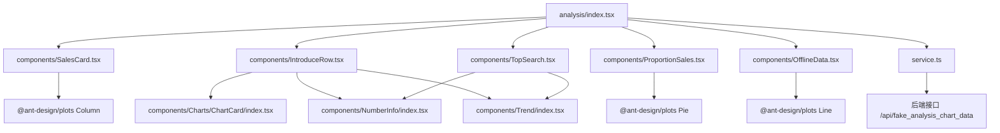
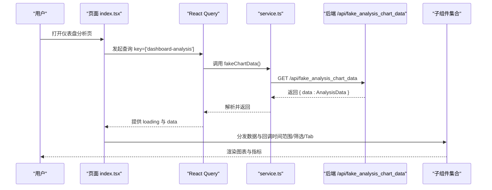
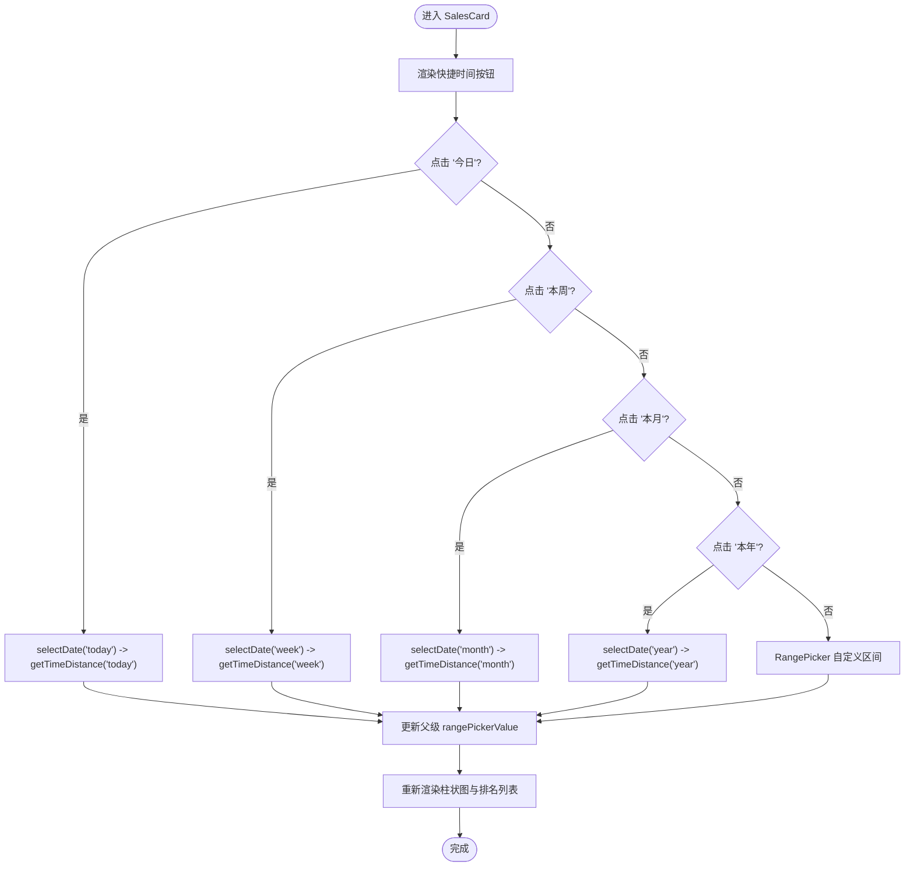
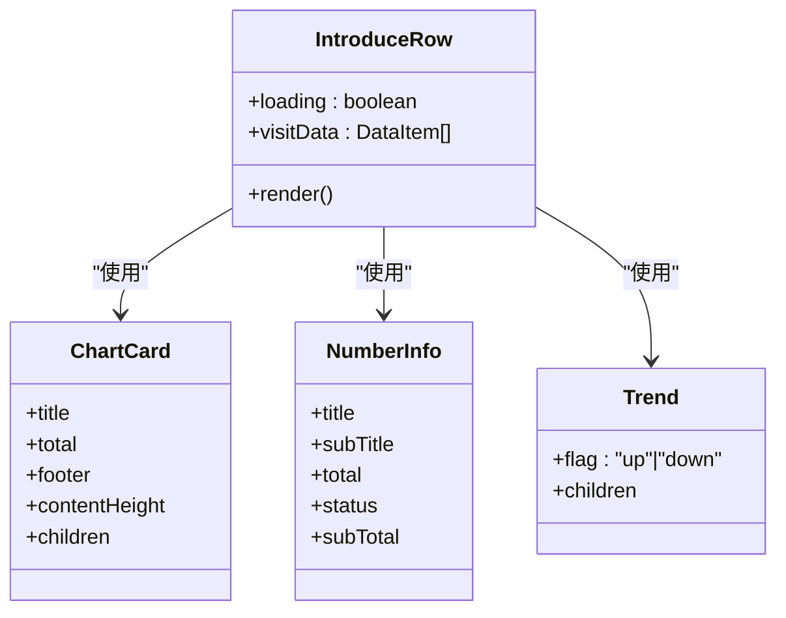
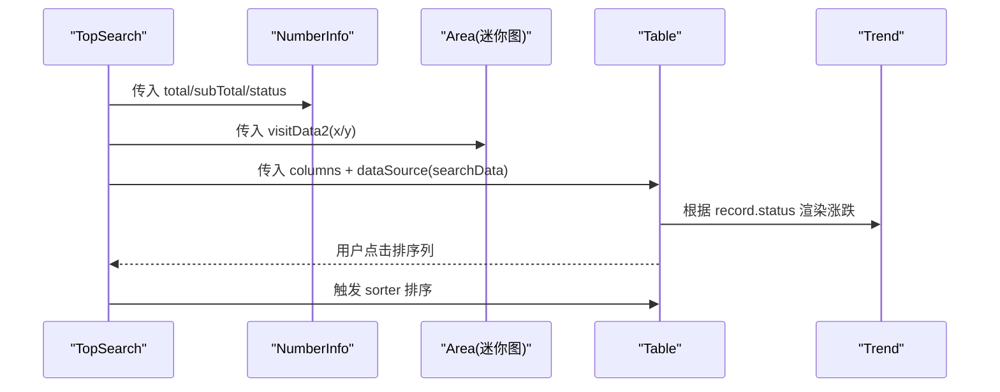
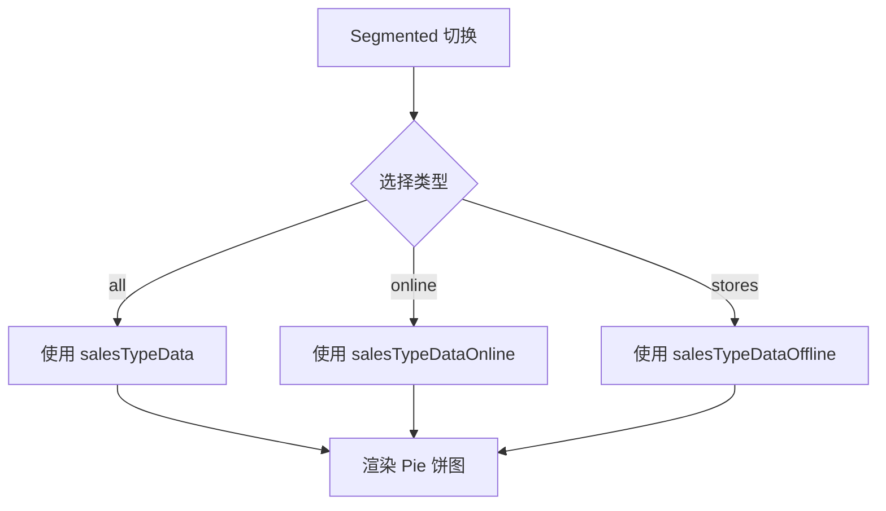
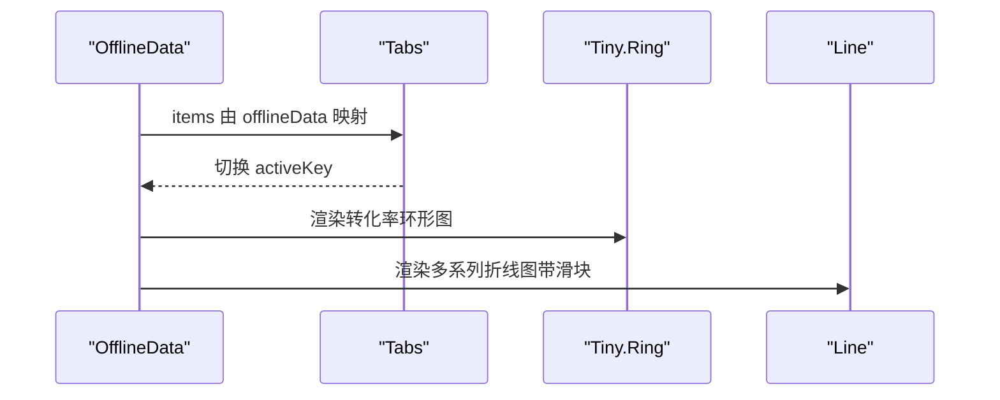
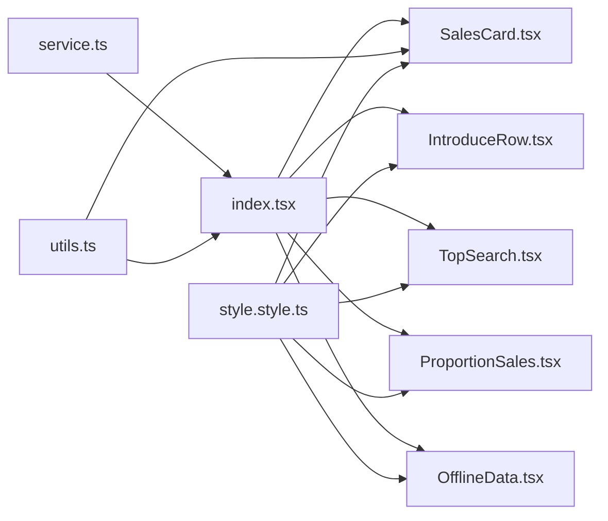

# 仪表盘分析页面

<cite>
**本文引用的文件**
- [index.tsx](file://web_client/po-admin/src/pages/dashboard/analysis/index.tsx)
- [service.ts](file://web_client/po-admin/src/pages/dashboard/analysis/service.ts)
- [data.d.ts](file://web_client/po-admin/src/pages/dashboard/analysis/data.d.ts)
- [SalesCard.tsx](file://web_client/po-admin/src/pages/dashboard/analysis/components/SalesCard.tsx)
- [IntroduceRow.tsx](file://web_client/po-admin/src/pages/dashboard/analysis/components/IntroduceRow.tsx)
- [TopSearch.tsx](file://web_client/po-admin/src/pages/dashboard/analysis/components/TopSearch.tsx)
- [ProportionSales.tsx](file://web_client/po-admin/src/pages/dashboard/analysis/components/ProportionSales.tsx)
- [OfflineData.tsx](file://web_client/po-admin/src/pages/dashboard/analysis/components/OfflineData.tsx)
- [ChartCard/index.tsx](file://web_client/po-admin/src/pages/dashboard/analysis/components/Charts/ChartCard/index.tsx)
- [NumberInfo/index.tsx](file://web_client/po-admin/src/pages/dashboard/analysis/components/NumberInfo/index.tsx)
- [Trend/index.tsx](file://web_client/po-admin/src/pages/dashboard/analysis/components/Trend/index.tsx)
- [utils.ts](file://web_client/po-admin/src/pages/dashboard/analysis/utils/utils.ts)
- [style.style.ts](file://web_client/po-admin/src/pages/dashboard/analysis/style.style.ts)
</cite>

## 目录
1. [简介](#简介)
2. [项目结构](#项目结构)
3. [核心组件](#核心组件)
4. [架构总览](#架构总览)
5. [详细组件分析](#详细组件分析)
6. [依赖关系分析](#依赖关系分析)
7. [性能考虑](#性能考虑)
8. [故障排查指南](#故障排查指南)
9. [结论](#结论)
10. [附录](#附录)

## 简介
本页面为“仪表盘分析”主视图，聚合了关键业务指标、销售趋势、渠道占比、线上热门搜索与线下门店数据等。页面通过 ECharts 的替代方案（@ant-design/plots）实现图表渲染，使用 Ant Design 的栅格与卡片构建响应式布局，并通过 React Query 进行数据请求与缓存。时间范围选择器支持“今日/本周/本月/本年”快捷切换与自定义区间；销售卡片提供销售额与访问量双 Tab 展示；比例销售图支持按“全部渠道/线上/门店”筛选；顶部搜索模块包含搜索用户数、人均搜索次数与热门关键词表格；线下数据以 Tabs + 折线图呈现各门店转化率与趋势。

## 项目结构
- 页面入口：analysis/index.tsx 负责组合子组件、状态管理与数据获取
- 数据层：service.ts 封装请求；data.d.ts 定义数据结构
- 组件层：components 下包含 SalesCard、IntroduceRow、TopSearch、ProportionSales、OfflineData 以及 Charts、NumberInfo、Trend 等可复用子组件
- 工具与样式：utils/utils.ts 提供日期区间计算；style.style.ts 集中样式

图示来源
- [index.tsx:1-161](file://web_client/po-admin/src/pages/dashboard/analysis/index.tsx#L1-L161)
- [service.ts:1-7](file://web_client/po-admin/src/pages/dashboard/analysis/service.ts#L1-L7)
- [SalesCard.tsx:1-226](file://web_client/po-admin/src/pages/dashboard/analysis/components/SalesCard.tsx#L1-L226)
- [IntroduceRow.tsx:1-163](file://web_client/po-admin/src/pages/dashboard/analysis/components/IntroduceRow.tsx#L1-L163)
- [TopSearch.tsx:1-187](file://web_client/po-admin/src/pages/dashboard/analysis/components/TopSearch.tsx#L1-L187)
- [ProportionSales.tsx:1-70](file://web_client/po-admin/src/pages/dashboard/analysis/components/ProportionSales.tsx#L1-L70)
- [OfflineData.tsx:1-111](file://web_client/po-admin/src/pages/dashboard/analysis/components/OfflineData.tsx#L1-L111)

章节来源
- [index.tsx:1-161](file://web_client/po-admin/src/pages/dashboard/analysis/index.tsx#L1-L161)
- [service.ts:1-7](file://web_client/po-admin/src/pages/dashboard/analysis/service.ts#L1-L7)
- [data.d.ts:1-46](file://web_client/po-admin/src/pages/dashboard/analysis/data.d.ts#L1-L46)

## 核心组件
- 页面容器 analysis/index.tsx
  - 使用 useQuery 拉取 dashboard-analysis 数据，键为 ['dashboard-analysis']
  - 管理 salesType（all/online/stores）、rangePickerValue（日期区间）、currentTabKey（线下数据活跃标签）
  - 将数据分发至 IntroduceRow、SalesCard、TopSearch、ProportionSales、OfflineData
- 销售卡片 SalesCard
  - 提供“销售额/访问量”两个 Tab，均基于 @ant-design/plots Column 柱状图
  - 支持“今日/本周/本月/本年”快捷按钮与 RangePicker 自定义区间
  - 右侧展示门店排名列表（静态示例数据）
- 引入行 IntroduceRow
  - 四个指标卡片：总销售额、访问量、支付笔数、运营活动效果
  - 使用 ChartCard、Field、Trend、Area/Column/Progress 组合展示
- 顶部搜索 TopSearch
  - 展示“搜索用户数”和“人均搜索次数”两个 NumberInfo + Area 迷你图
  - 下方 Table 展示热门关键词、用户数、周涨幅（含排序与 Trend 指示）
- 比例销售 ProportionSales
  - 使用 Segmented 切换“全部渠道/线上/门店”，动态更新饼图数据
  - 使用 @ant-design/plots Pie 展示类别占比
- 线下数据 OfflineData
  - 使用 Tabs 展示多个门店，每个 Tab 内显示转化率 NumberInfo + Tiny.Ring 环形进度
  - 使用 Line 折线图展示多系列趋势（带 x 轴滑块）

章节来源
- [index.tsx:27-157](file://web_client/po-admin/src/pages/dashboard/analysis/index.tsx#L27-L157)
- [SalesCard.tsx:23-224](file://web_client/po-admin/src/pages/dashboard/analysis/components/SalesCard.tsx#L23-L224)
- [IntroduceRow.tsx:22-161](file://web_client/po-admin/src/pages/dashboard/analysis/components/IntroduceRow.tsx#L22-L161)
- [TopSearch.tsx:36-185](file://web_client/po-admin/src/pages/dashboard/analysis/components/TopSearch.tsx#L36-L185)
- [ProportionSales.tsx:9-68](file://web_client/po-admin/src/pages/dashboard/analysis/components/ProportionSales.tsx#L9-L68)
- [OfflineData.tsx:46-109](file://web_client/po-admin/src/pages/dashboard/analysis/components/OfflineData.tsx#L46-L109)

## 架构总览
页面采用“容器组件 + 展示组件”的分层模式：
- 容器层（index.tsx）负责数据获取、状态管理、路由级交互（如时间范围、筛选）
- 展示层（各 components）专注 UI 渲染与局部交互（如 Tab 切换、Segmented 切换）
- 数据层（service.ts）统一封装请求，返回 AnalysisData 类型
- 图表层（@ant-design/plots）提供 Area/Column/Pie/Line/Tiny.Ring 等可视化能力
- 样式层（style.style.ts）集中主题化样式与响应式规则

图示来源
- [index.tsx:34-37](file://web_client/po-admin/src/pages/dashboard/analysis/index.tsx#L34-L37)
- [service.ts:4-6](file://web_client/po-admin/src/pages/dashboard/analysis/service.ts#L4-L6)

## 详细组件分析

### 销售卡片组件（SalesCard）
- 交互逻辑
  - 快捷时间按钮：点击触发 selectDate(type)，内部调用 getTimeDistance(type) 生成区间并设置到父级 state
  - 自定义区间：RangePicker onChange 直接更新父级 rangePickerValue
  - 高亮当前选中：isActive 比较当前区间与预设区间是否一致，匹配时添加样式类
- 数据与渲染
  - 柱状图：Column 使用 salesData（x/y），配置 tooltip、坐标轴与间距
  - 排名列表：静态 rankingListData 渲染，前三名高亮序号
- 性能要点
  - 图表高度固定，减少重排
  - 列表项数量固定，避免大列表开销

图示来源
- [SalesCard.tsx:49-91](file://web_client/po-admin/src/pages/dashboard/analysis/components/SalesCard.tsx#L49-L91)
- [utils.ts:10-57](file://web_client/po-admin/src/pages/dashboard/analysis/utils/utils.ts#L10-L57)

章节来源
- [SalesCard.tsx:23-224](file://web_client/po-admin/src/pages/dashboard/analysis/components/SalesCard.tsx#L23-L224)
- [utils.ts:10-57](file://web_client/po-admin/src/pages/dashboard/analysis/utils/utils.ts#L10-L57)

### 引入行组件（IntroduceRow）
- 关键指标计算与趋势
  - 总销售额：展示总额、日销售额、周同比/日同比趋势（Trend）
  - 访问量：面积图（Area）展示短期波动
  - 支付笔数：柱状图（Column）展示分布
  - 运营活动效果：进度条（Progress）展示完成率
- 数据绑定
  - visitData 作为 Area/Column 的数据源（x/y）
  - Field 用于 footer 中的辅助信息展示
- 响应式布局
  - Col 栅格在不同断点自适应列宽，保证移动端可读性

图示来源
- [IntroduceRow.tsx:22-161](file://web_client/po-admin/src/pages/dashboard/analysis/components/IntroduceRow.tsx#L22-L161)
- [ChartCard/index.tsx:87-108](file://web_client/po-admin/src/pages/dashboard/analysis/components/Charts/ChartCard/index.tsx#L87-L108)
- [NumberInfo/index.tsx:17-83](file://web_client/po-admin/src/pages/dashboard/analysis/components/NumberInfo/index.tsx#L17-L83)
- [Trend/index.tsx:16-45](file://web_client/po-admin/src/pages/dashboard/analysis/components/Trend/index.tsx#L16-L45)

章节来源
- [IntroduceRow.tsx:22-161](file://web_client/po-admin/src/pages/dashboard/analysis/components/IntroduceRow.tsx#L22-L161)

### 顶部搜索组件（TopSearch）
- 功能实现
  - 两个 NumberInfo + Area 迷你图分别展示“搜索用户数”和“人均搜索次数”
  - Table 展示热门关键词，支持按用户数与周涨幅排序，并使用 Trend 展示涨跌
- 数据流
  - visitData2 驱动迷你面积图
  - searchData 驱动表格数据源
- 交互
  - 表头排序：sorter 对 count/range 字段进行数值排序
  - 趋势指示：根据 status 决定 up/down

图示来源
- [TopSearch.tsx:36-185](file://web_client/po-admin/src/pages/dashboard/analysis/components/TopSearch.tsx#L36-L185)
- [NumberInfo/index.tsx:17-83](file://web_client/po-admin/src/pages/dashboard/analysis/components/NumberInfo/index.tsx#L17-L83)
- [Trend/index.tsx:16-45](file://web_client/po-admin/src/pages/dashboard/analysis/components/Trend/index.tsx#L16-L45)

章节来源
- [TopSearch.tsx:36-185](file://web_client/po-admin/src/pages/dashboard/analysis/components/TopSearch.tsx#L36-L185)

### 比例销售组件（ProportionSales）
- 筛选机制
  - Segmented 切换 all/online/stores，onChange 回调 handleChangeSalesType
  - 父组件根据 salesType 选择对应数据源（salesTypeData/salesTypeDataOnline/salesTypeDataOffline）
- 图表渲染
  - Pie 饼图：angleField=y, colorField=x, label spider 定位，格式化数值
- 响应式
  - 卡片高度自适应，标题与操作区分离

图示来源
- [ProportionSales.tsx:9-68](file://web_client/po-admin/src/pages/dashboard/analysis/components/ProportionSales.tsx#L9-L68)
- [index.tsx:64-72](file://web_client/po-admin/src/pages/dashboard/analysis/index.tsx#L64-L72)

章节来源
- [ProportionSales.tsx:9-68](file://web_client/po-admin/src/pages/dashboard/analysis/components/ProportionSales.tsx#L9-L68)
- [index.tsx:64-72](file://web_client/po-admin/src/pages/dashboard/analysis/index.tsx#L64-L72)

### 线下数据组件（OfflineData）
- 展示模式
  - Tabs 动态生成，每个 Tab 标签内嵌 NumberInfo + Tiny.Ring 展示转化率
  - 内容区使用 Line 折线图，colorField=type 区分多系列，启用 x 轴滑块
- 交互
  - activeKey 控制当前激活 Tab，handleTabChange 由父组件管理
- 数据
  - offlineData 提供 Tab 列表与转化率
  - offlineChartData 提供折线数据（date/value/type）

图示来源
- [OfflineData.tsx:46-109](file://web_client/po-admin/src/pages/dashboard/analysis/components/OfflineData.tsx#L46-L109)

章节来源
- [OfflineData.tsx:46-109](file://web_client/po-admin/src/pages/dashboard/analysis/components/OfflineData.tsx#L46-L109)

## 依赖关系分析
- 组件耦合
  - index.tsx 作为容器，强依赖各子组件的 props 契约（loading、数据数组、回调）
  - 子组件之间低耦合，主要通过父组件传递数据与事件
- 外部依赖
  - @ant-design/plots：图表渲染（Area/Column/Pie/Line/Tiny.Ring）
  - antd：UI 组件（Card/Col/Row/DatePicker/Table/Segmented/Tabs）
  - dayjs：日期处理（在 utils.ts 中）
  - @umijs/max request：网络请求封装
- 潜在循环依赖
  - 未发现循环引用；数据流向单向：service -> index -> 子组件

图示来源
- [index.tsx:1-161](file://web_client/po-admin/src/pages/dashboard/analysis/index.tsx#L1-L161)
- [service.ts:1-7](file://web_client/po-admin/src/pages/dashboard/analysis/service.ts#L1-L7)
- [utils.ts:1-58](file://web_client/po-admin/src/pages/dashboard/analysis/utils/utils.ts#L1-L58)
- [style.style.ts:1-161](file://web_client/po-admin/src/pages/dashboard/analysis/style.style.ts#L1-L161)

章节来源
- [index.tsx:1-161](file://web_client/po-admin/src/pages/dashboard/analysis/index.tsx#L1-L161)
- [service.ts:1-7](file://web_client/po-admin/src/pages/dashboard/analysis/service.ts#L1-L7)
- [utils.ts:1-58](file://web_client/po-admin/src/pages/dashboard/analysis/utils/utils.ts#L1-L58)
- [style.style.ts:1-161](file://web_client/po-admin/src/pages/dashboard/analysis/style.style.ts#L1-L161)

## 性能考虑
- 数据缓存
  - 使用 React Query 的 queryKey ['dashboard-analysis'] 自动缓存结果，避免重复请求
  - 建议在 service.ts 中结合请求去抖或条件缓存策略（如按时间范围变化）
- 懒加载与 Suspense
  - 页面已使用 Suspense 包裹子组件，配合异步数据加载提升首屏体验
  - 可将复杂图表组件进一步拆分为懒加载模块（import()）
- 虚拟滚动
  - 当前排行榜与搜索列表数据量较小，未使用虚拟滚动
  - 若后续数据量增长，可在 Table 与列表中使用虚拟化库（如 react-window）优化长列表渲染
- 图表性能
  - 固定图表高度，减少重绘
  - 合理配置 tooltip、网格线与动画开关，降低渲染压力
  - 大数据集建议分页或采样后展示
- 样式与响应式
  - 使用 createStyles 与媒体查询适配不同屏幕，避免不必要的重排

[本节为通用指导，不直接分析具体文件]

## 故障排查指南
- 数据为空或加载失败
  - 检查 service.ts 的请求路径与后端接口是否可达
  - 确认 useQuery 的 queryKey 是否正确，必要时增加重试与错误提示
- 时间范围不生效
  - 核对 getTimeDistance 返回值是否为有效的 Dayjs 数组
  - 检查 RangePicker 的 value 与 onChange 是否被正确传递与更新
- 图表不渲染
  - 确认传入数据格式符合 @ant-design/plots 要求（x/y、colorField 等）
  - 检查组件 height、padding 与 axis 配置是否冲突
- 排序异常
  - 确保 Table 的 sorter 函数比较的是数值类型，避免字符串比较导致顺序错误
- 样式错乱
  - 检查 style.style.ts 中的媒体查询断点是否与全局主题一致
  - 确认 className 与样式作用域未被覆盖

章节来源
- [service.ts:4-6](file://web_client/po-admin/src/pages/dashboard/analysis/service.ts#L4-L6)
- [utils.ts:10-57](file://web_client/po-admin/src/pages/dashboard/analysis/utils/utils.ts#L10-L57)
- [TopSearch.tsx:48-102](file://web_client/po-admin/src/pages/dashboard/analysis/components/TopSearch.tsx#L48-L102)
- [style.style.ts:1-161](file://web_client/po-admin/src/pages/dashboard/analysis/style.style.ts#L1-L161)

## 结论
该仪表盘分析页面通过清晰的组件分层与统一的样式管理，实现了丰富的数据可视化与交互。ECharts 的替代方案 @ant-design/plots 提供了轻量且易用的图表能力；React Query 简化了数据获取与缓存；Ant Design 栅格与卡片构建了良好的响应式体验。未来可在大数据场景下引入虚拟滚动与更细粒度的懒加载，进一步提升性能与用户体验。

[本节为总结性内容，不直接分析具体文件]

## 附录
- 关键数据模型（AnalysisData）
  - visitData/visitData2：访问趋势（x/y）
  - salesData：销售/访问量（x/y）
  - searchData：搜索热词（index/keyword/count/range/status）
  - offlineData：线下门店（name/cvr）
  - offlineChartData：线下趋势（date/value/type）
  - salesTypeData(s)/radarData：渠道占比与雷达数据

章节来源
- [data.d.ts:1-46](file://web_client/po-admin/src/pages/dashboard/analysis/data.d.ts#L1-L46)