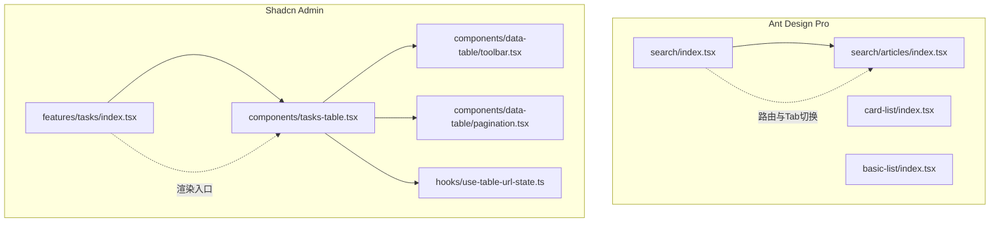
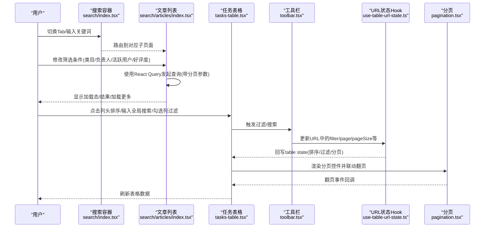
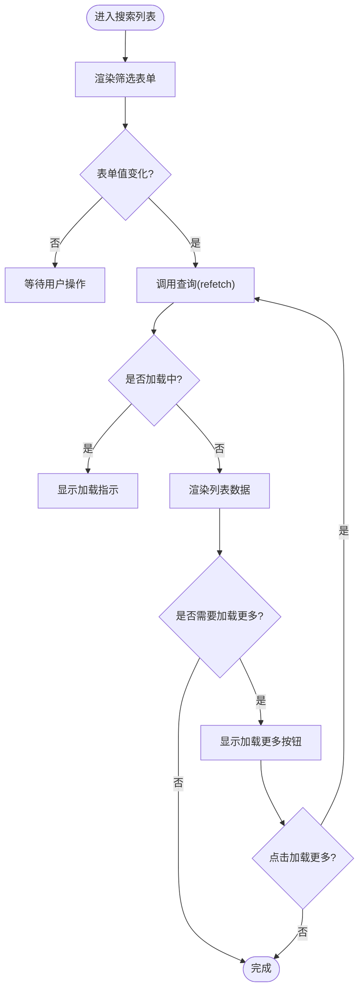
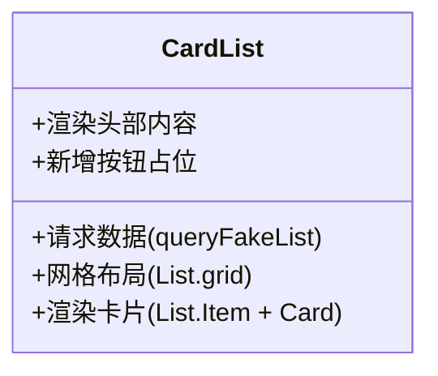
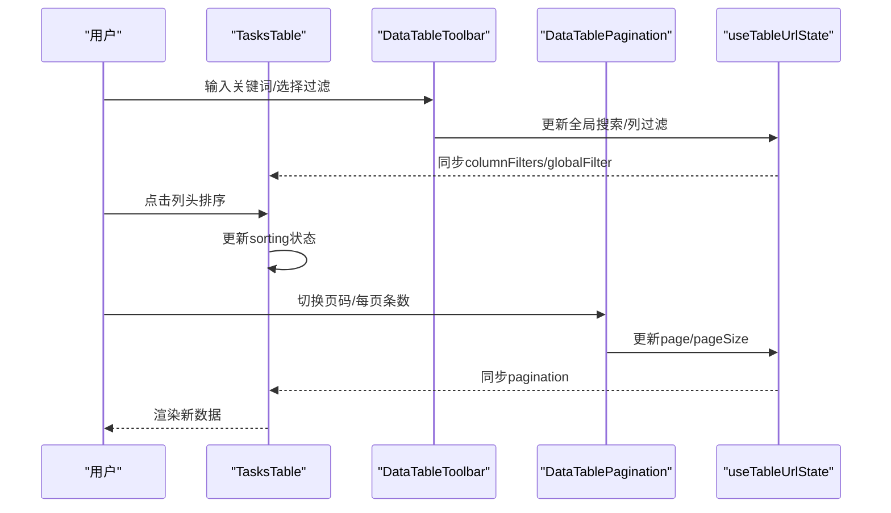
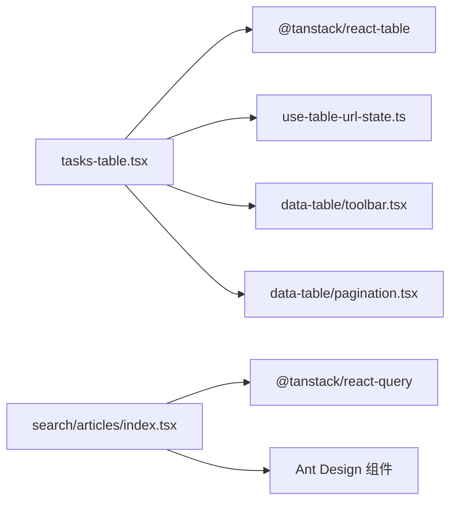

# 列表页面

<cite>
**本文引用的文件**
- [web_client/po-admin/src/pages/list/search/index.tsx](file://web_client/po-admin/src/pages/list/search/index.tsx)
- [web_client/po-admin/src/pages/list/search/articles/index.tsx](file://web_client/po-admin/src/pages/list/search/articles/index.tsx)
- [web_client/po-admin/src/pages/list/card-list/index.tsx](file://web_client/po-admin/src/pages/list/card-list/index.tsx)
- [web_client/po-admin/src/pages/list/basic-list/index.tsx](file://web_client/po-admin/src/pages/list/basic-list/index.tsx)
- [web_client/shadcn-admin/src/features/tasks/index.tsx](file://web_client/shadcn-admin/src/features/tasks/index.tsx)
- [web_client/shadcn-admin/src/features/tasks/components/tasks-table.tsx](file://web_client/shadcn-admin/src/features/tasks/components/tasks-table.tsx)
- [web_client/shadcn-admin/src/components/data-table/toolbar.tsx](file://web_client/shadcn-admin/src/components/data-table/toolbar.tsx)
- [web_client/shadcn-admin/src/components/data-table/pagination.tsx](file://web_client/shadcn-admin/src/components/data-table/pagination.tsx)
- [web_client/shadcn-admin/src/hooks/use-table-url-state.ts](file://web_client/shadcn-admin/src/hooks/use-table-url-state.ts)
</cite>

## 目录
1. [简介](#简介)
2. [项目结构](#项目结构)
3. [核心组件](#核心组件)
4. [架构总览](#架构总览)
5. [详细组件分析](#详细组件分析)
6. [依赖关系分析](#依赖关系分析)
7. [性能考量](#性能考量)
8. [故障排查指南](#故障排查指南)
9. [结论](#结论)
10. [附录](#附录)

## 简介
本文件围绕“列表页面”的实现方案进行系统化文档化，覆盖以下关键主题：
- 搜索列表：多条件筛选、关键词搜索与结果排序
- 卡片列表：网格布局、卡片交互与数据分页
- 表格列表：列配置、行操作与批量处理
- 性能优化：虚拟滚动、懒加载与数据缓存
- 用户体验：加载状态、错误处理与空状态展示
- 业务实践：复杂列表功能的开发模式与最佳实践

## 项目结构
本项目包含两套前端实现：
- Ant Design Pro（po-admin）：提供基础列表、卡片列表与搜索列表的示例页面
- Shadcn Admin（shadcn-admin）：基于 TanStack Table 的高级表格能力，支持 URL 同步的状态管理、工具栏过滤、分页与批量操作

图表来源
- [web_client/po-admin/src/pages/list/search/index.tsx:1-80](file://web_client/po-admin/src/pages/list/search/index.tsx#L1-L80)
- [web_client/po-admin/src/pages/list/search/articles/index.tsx:1-280](file://web_client/po-admin/src/pages/list/search/articles/index.tsx#L1-L280)
- [web_client/po-admin/src/pages/list/card-list/index.tsx:1-129](file://web_client/po-admin/src/pages/list/card-list/index.tsx#L1-L129)
- [web_client/po-admin/src/pages/list/basic-list/index.tsx:1-280](file://web_client/po-admin/src/pages/list/basic-list/index.tsx#L1-L280)
- [web_client/shadcn-admin/src/features/tasks/index.tsx:1-42](file://web_client/shadcn-admin/src/features/tasks/index.tsx#L1-L42)
- [web_client/shadcn-admin/src/features/tasks/components/tasks-table.tsx:1-198](file://web_client/shadcn-admin/src/features/tasks/components/tasks-table.tsx#L1-L198)
- [web_client/shadcn-admin/src/components/data-table/toolbar.tsx:1-146](file://web_client/shadcn-admin/src/components/data-table/toolbar.tsx#L1-L146)
- [web_client/shadcn-admin/src/components/data-table/pagination.tsx:1-131](file://web_client/shadcn-admin/src/components/data-table/pagination.tsx#L1-L131)
- [web_client/shadcn-admin/src/hooks/use-table-url-state.ts:1-220](file://web_client/shadcn-admin/src/hooks/use-table-url-state.ts#L1-L220)

章节来源
- [web_client/po-admin/src/pages/list/search/index.tsx:1-80](file://web_client/po-admin/src/pages/list/search/index.tsx#L1-L80)
- [web_client/shadcn-admin/src/features/tasks/index.tsx:1-42](file://web_client/shadcn-admin/src/features/tasks/index.tsx#L1-L42)

## 核心组件
- 搜索列表容器：提供 Tab 切换与全局搜索输入框，承载子路由内容
- 文章搜索列表：表单式多条件筛选 + 无限加载（加载更多）
- 卡片列表：响应式网格布局，首项为新增按钮占位
- 基础列表：统计信息 + 列表项操作（编辑/删除），内置分页
- 任务表格：基于 TanStack Table 的完整表格能力（排序、过滤、分页、批量选择）
- 表格工具栏：防抖搜索、列级多选过滤、重置与视图选项
- 分页组件：页码、每页条数、跳转控制
- URL 状态同步 Hook：将分页、全局搜索、列过滤持久化到 URL

章节来源
- [web_client/po-admin/src/pages/list/search/index.tsx:1-80](file://web_client/po-admin/src/pages/list/search/index.tsx#L1-L80)
- [web_client/po-admin/src/pages/list/search/articles/index.tsx:1-280](file://web_client/po-admin/src/pages/list/search/articles/index.tsx#L1-L280)
- [web_client/po-admin/src/pages/list/card-list/index.tsx:1-129](file://web_client/po-admin/src/pages/list/card-list/index.tsx#L1-L280)
- [web_client/po-admin/src/pages/list/basic-list/index.tsx:1-280](file://web_client/po-admin/src/pages/list/basic-list/index.tsx#L1-L280)
- [web_client/shadcn-admin/src/features/tasks/components/tasks-table.tsx:1-198](file://web_client/shadcn-admin/src/features/tasks/components/tasks-table.tsx#L1-L198)
- [web_client/shadcn-admin/src/components/data-table/toolbar.tsx:1-146](file://web_client/shadcn-admin/src/components/data-table/toolbar.tsx#L1-L146)
- [web_client/shadcn-admin/src/components/data-table/pagination.tsx:1-131](file://web_client/shadcn-admin/src/components/data-table/pagination.tsx#L1-L131)
- [web_client/shadcn-admin/src/hooks/use-table-url-state.ts:1-220](file://web_client/shadcn-admin/src/hooks/use-table-url-state.ts#L1-L220)

## 架构总览
下图展示了从用户交互到数据获取与渲染的整体流程，涵盖搜索、筛选、排序、分页与批量操作。

图表来源
- [web_client/po-admin/src/pages/list/search/index.tsx:1-80](file://web_client/po-admin/src/pages/list/search/index.tsx#L1-L80)
- [web_client/po-admin/src/pages/list/search/articles/index.tsx:1-280](file://web_client/po-admin/src/pages/list/search/articles/index.tsx#L1-L280)
- [web_client/shadcn-admin/src/features/tasks/components/tasks-table.tsx:1-198](file://web_client/shadcn-admin/src/features/tasks/components/tasks-table.tsx#L1-L198)
- [web_client/shadcn-admin/src/components/data-table/toolbar.tsx:1-146](file://web_client/shadcn-admin/src/components/data-table/toolbar.tsx#L1-L146)
- [web_client/shadcn-admin/src/components/data-table/pagination.tsx:1-131](file://web_client/shadcn-admin/src/components/data-table/pagination.tsx#L1-L131)
- [web_client/shadcn-admin/src/hooks/use-table-url-state.ts:1-220](file://web_client/shadcn-admin/src/hooks/use-table-url-state.ts#L1-L220)

## 详细组件分析

### 搜索列表（多条件筛选、关键词搜索、结果排序）
- 搜索容器：通过 Tab 切换不同列表类型，顶部提供统一搜索输入框；子路由由 Outlet 承载
- 文章列表：
  - 多条件筛选：类目（TagSelect）、负责人（多选 Select）、活跃用户、好评度
  - 关键词搜索：可结合表单值与后端接口参数
  - 结果排序：可在后端或前端对返回数据进行排序
  - 分页/加载：采用“加载更多”方式，配合 React Query 的 refetch 与 isFetching 状态
- 基础列表：
  - 顶部统计信息与分段控制器（全部/进行中/等待中）
  - 列表项操作：编辑、删除（二次确认）
  - 分页：内置分页器，支持快速跳转与每页条数切换

图表来源
- [web_client/po-admin/src/pages/list/search/articles/index.tsx:1-280](file://web_client/po-admin/src/pages/list/search/articles/index.tsx#L1-L280)
- [web_client/po-admin/src/pages/list/basic-list/index.tsx:1-280](file://web_client/po-admin/src/pages/list/basic-list/index.tsx#L1-L280)

章节来源
- [web_client/po-admin/src/pages/list/search/index.tsx:1-80](file://web_client/po-admin/src/pages/list/search/index.tsx#L1-L80)
- [web_client/po-admin/src/pages/list/search/articles/index.tsx:1-280](file://web_client/po-admin/src/pages/list/search/articles/index.tsx#L1-L280)
- [web_client/po-admin/src/pages/list/basic-list/index.tsx:1-280](file://web_client/po-admin/src/pages/list/basic-list/index.tsx#L1-L280)

### 卡片列表（网格布局、卡片交互、数据分页）
- 网格布局：使用 List 的 grid 属性，按断点自适应列数
- 卡片交互：hoverable、Meta 展示头像/标题/描述，底部操作按钮
- 数据分页：当前示例以固定数量拉取，可按需接入分页逻辑
- 新增入口：首项为虚线按钮占位，用于新增条目

图表来源
- [web_client/po-admin/src/pages/list/card-list/index.tsx:1-129](file://web_client/po-admin/src/pages/list/card-list/index.tsx#L1-L129)

章节来源
- [web_client/po-admin/src/pages/list/card-list/index.tsx:1-129](file://web_client/po-admin/src/pages/list/card-list/index.tsx#L1-L129)

### 表格列表（列配置、行操作、批量处理）
- 列配置：通过 columns 定义列、表头、单元格渲染与元信息（如样式类名）
- 行操作：行选择（checkbox），配合批量操作工具栏
- 批量处理：DataTableBulkActions 根据选中行执行批量动作
- 排序与过滤：
  - 全局搜索：在自定义函数中对 id/title 进行模糊匹配
  - 列过滤：状态/优先级等多选过滤
  - 排序：点击列头进行升/降序
- URL 同步：分页、全局搜索、列过滤均持久化到 URL，便于分享与刷新保持状态

图表来源
- [web_client/shadcn-admin/src/features/tasks/components/tasks-table.tsx:1-198](file://web_client/shadcn-admin/src/features/tasks/components/tasks-table.tsx#L1-L198)
- [web_client/shadcn-admin/src/components/data-table/toolbar.tsx:1-146](file://web_client/shadcn-admin/src/components/data-table/toolbar.tsx#L1-L146)
- [web_client/shadcn-admin/src/components/data-table/pagination.tsx:1-131](file://web_client/shadcn-admin/src/components/data-table/pagination.tsx#L1-L131)
- [web_client/shadcn-admin/src/hooks/use-table-url-state.ts:1-220](file://web_client/shadcn-admin/src/hooks/use-table-url-state.ts#L1-L220)

章节来源
- [web_client/shadcn-admin/src/features/tasks/components/tasks-table.tsx:1-198](file://web_client/shadcn-admin/src/features/tasks/components/tasks-table.tsx#L1-L198)
- [web_client/shadcn-admin/src/components/data-table/toolbar.tsx:1-146](file://web_client/shadcn-admin/src/components/data-table/toolbar.tsx#L1-L146)
- [web_client/shadcn-admin/src/components/data-table/pagination.tsx:1-131](file://web_client/shadcn-admin/src/components/data-table/pagination.tsx#L1-L131)
- [web_client/shadcn-admin/src/hooks/use-table-url-state.ts:1-220](file://web_client/shadcn-admin/src/hooks/use-table-url-state.ts#L1-L220)

### 概念性概览
- 搜索列表适合“重筛选、轻分页”的场景，推荐“加载更多”提升体验
- 卡片列表适合“视觉优先、操作简洁”的数据呈现
- 表格列表适合“高信息密度、强交互”的数据管理场景

[本节为概念性说明，不直接分析具体文件]

## 依赖关系分析
- 搜索列表依赖 Ant Design 的 Form/List/Select/TagSelect 等组件，以及 React Query 进行数据获取与缓存
- 表格列表依赖 TanStack Table 的核心能力（排序、过滤、分页、选择），并通过自定义 Hook 将状态与 URL 同步
- 工具栏与分页组件解耦于表格，通过 table 实例进行通信，具备良好复用性

图表来源
- [web_client/shadcn-admin/src/features/tasks/components/tasks-table.tsx:1-198](file://web_client/shadcn-admin/src/features/tasks/components/tasks-table.tsx#L1-L198)
- [web_client/shadcn-admin/src/hooks/use-table-url-state.ts:1-220](file://web_client/shadcn-admin/src/hooks/use-table-url-state.ts#L1-L220)
- [web_client/shadcn-admin/src/components/data-table/toolbar.tsx:1-146](file://web_client/shadcn-admin/src/components/data-table/toolbar.tsx#L1-L146)
- [web_client/shadcn-admin/src/components/data-table/pagination.tsx:1-131](file://web_client/shadcn-admin/src/components/data-table/pagination.tsx#L1-L131)
- [web_client/po-admin/src/pages/list/search/articles/index.tsx:1-280](file://web_client/po-admin/src/pages/list/search/articles/index.tsx#L1-L280)

章节来源
- [web_client/shadcn-admin/src/features/tasks/components/tasks-table.tsx:1-198](file://web_client/shadcn-admin/src/features/tasks/components/tasks-table.tsx#L1-L198)
- [web_client/po-admin/src/pages/list/search/articles/index.tsx:1-280](file://web_client/po-admin/src/pages/list/search/articles/index.tsx#L1-L280)

## 性能考量
- 虚拟滚动
  - 当前代码未直接使用虚拟滚动组件。对于超大数据集，建议引入虚拟滚动（如 antd-virtual-list 或 tanstack-virtual）以减少 DOM 节点数量
- 懒加载
  - 搜索列表已实现“加载更多”，避免一次性加载大量数据
  - 图片等资源建议使用懒加载策略（浏览器原生 loading="lazy" 或 IntersectionObserver）
- 数据缓存
  - 搜索列表使用 React Query，默认具备缓存与去重能力；可通过 queryKey 精确控制缓存失效时机
  - 表格列表为本地数据演示，若改为服务端数据，建议结合 TanStack Query 或 SWR 进行缓存与重试
- 防抖与节流
  - 工具栏搜索输入框实现了中文输入法组合阶段兼容与 300ms 防抖，减少无效过滤计算
- 分页与 URL 同步
  - 通过 useTableUrlState 将分页、过滤、搜索持久化到 URL，避免重复请求并提升可分享性

[本节提供通用指导，不直接分析具体文件]

## 故障排查指南
- 搜索无结果
  - 检查全局搜索与列过滤是否清空；工具栏提供“重置”按钮一键清空
  - 确认 URL 中的 filter/status/priority 等参数是否正确
- 分页异常
  - 当数据为空或页数变化时，确保 ensurePageInRange 被调用以避免越界页码
- 中文输入问题
  - 工具栏输入框已处理 compositionstart/compositionend，确保在组合结束后才触发搜索
- 加载状态与错误
  - 搜索列表使用 isLoading/isFetching 控制加载态；建议在 UI 层增加错误提示与重试机制
- 空状态展示
  - 表格在 rows.length 为 0 时显示“无结果”行；可根据业务扩展更友好的空状态文案与引导

章节来源
- [web_client/shadcn-admin/src/components/data-table/toolbar.tsx:1-146](file://web_client/shadcn-admin/src/components/data-table/toolbar.tsx#L1-L146)
- [web_client/shadcn-admin/src/features/tasks/components/tasks-table.tsx:1-198](file://web_client/shadcn-admin/src/features/tasks/components/tasks-table.tsx#L1-L198)
- [web_client/shadcn-admin/src/hooks/use-table-url-state.ts:1-220](file://web_client/shadcn-admin/src/hooks/use-table-url-state.ts#L1-L220)

## 结论
- 搜索列表通过表单式多条件筛选与“加载更多”模式，兼顾灵活性与性能
- 卡片列表以响应式网格与简洁交互满足可视化展示需求
- 表格列表借助 TanStack Table 与 URL 状态同步，提供强大的列配置、排序、过滤、分页与批量处理能力
- 通过防抖搜索、缓存与分页等手段，整体性能与用户体验得到保障
- 建议在超大列表场景中引入虚拟滚动，并结合服务端分页进一步优化

[本节为总结性内容，不直接分析具体文件]

## 附录
- 最佳实践清单
  - 使用 React Query 管理异步数据，合理设置 queryKey 与缓存策略
  - 将分页、过滤、搜索等状态与 URL 同步，提升可分享性与可回溯性
  - 对高频输入（搜索）进行防抖，减少不必要的计算与请求
  - 为列表提供明确的加载、错误与空状态反馈
  - 对大列表考虑虚拟滚动与按需加载
  - 表格列配置与渲染逻辑解耦，便于维护与扩展

[本节为补充建议，不直接分析具体文件]