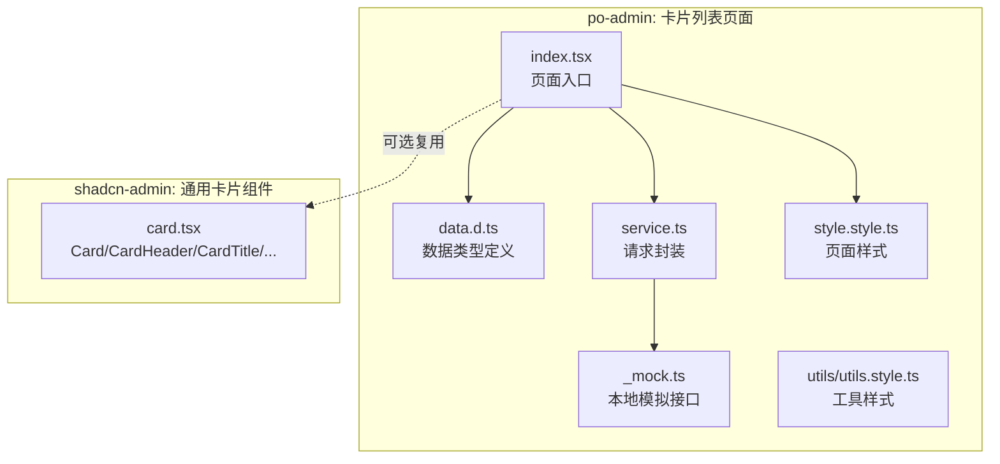
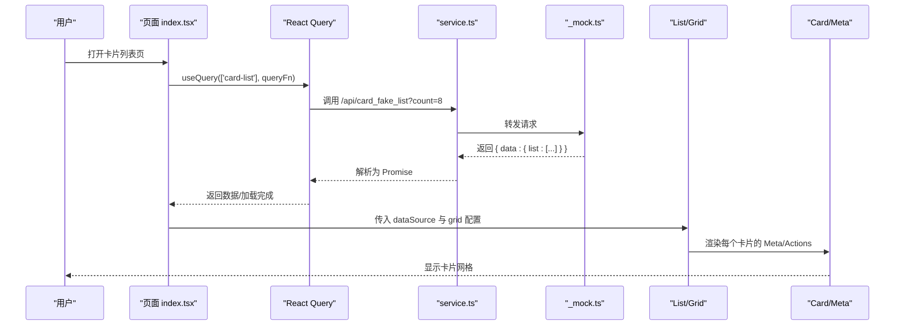
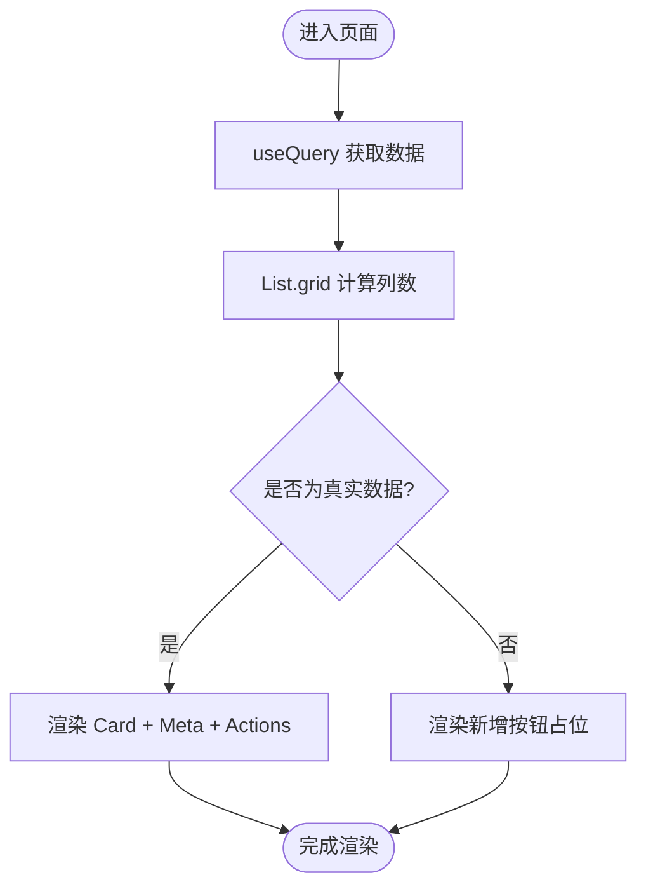
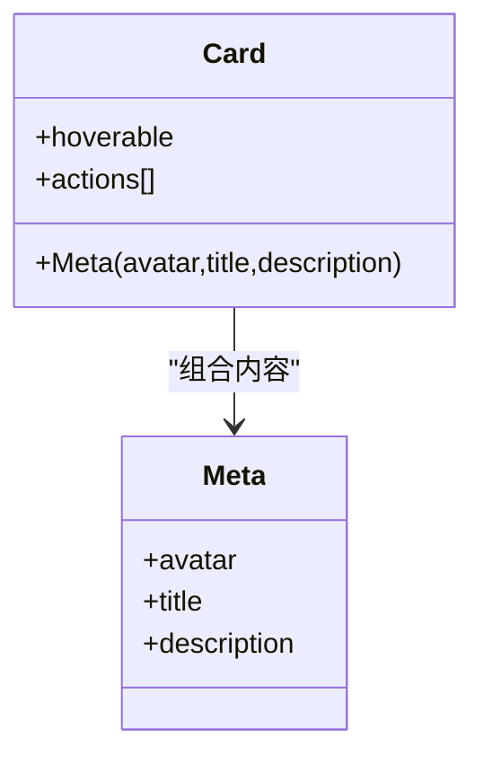
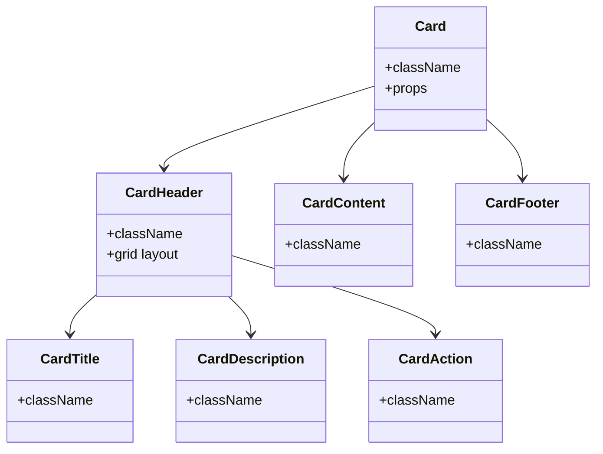
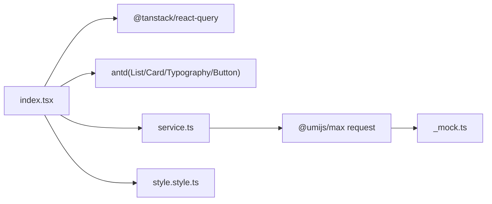

# 卡片列表

<cite>
**本文引用的文件**
- [index.tsx](file://web_client/po-admin/src/pages/list/card-list/index.tsx)
- [data.d.ts](file://web_client/po-admin/src/pages/list/card-list/data.d.ts)
- [service.ts](file://web_client/po-admin/src/pages/list/card-list/service.ts)
- [_mock.ts](file://web_client/po-admin/src/pages/list/card-list/_mock.ts)
- [style.style.ts](file://web_client/po-admin/src/pages/list/card-list/style.style.ts)
- [utils.style.ts](file://web_client/po-admin/src/pages/list/card-list/utils/utils.style.ts)
- [card.tsx](file://web_client/shadcn-admin/src/components/ui/card.tsx)
</cite>

## 目录
1. [简介](#简介)
2. [项目结构](#项目结构)
3. [核心组件](#核心组件)
4. [架构总览](#架构总览)
5. [详细组件分析](#详细组件分析)
6. [依赖分析](#依赖分析)
7. [性能考虑](#性能考虑)
8. [故障排查指南](#故障排查指南)
9. [结论](#结论)
10. [附录](#附录)

## 简介
本章节面向“卡片列表”功能，聚焦以下目标：
- 卡片网格布局的实现与响应式/自适应设计
- Card 组件的高级用法（内容定制、操作按钮、交互效果）
- 数据展示最佳实践（图片处理、文本截断、状态标识）
- 卡片交互实现（点击事件、悬停效果、动画过渡）
- 结合业务场景的设计模式与开发技巧，提供可落地的样式定制方案

## 项目结构
该功能位于 po-admin 的 list/card-list 目录下，采用页面级组织方式，包含视图、类型、服务、样式与模拟数据等。同时，shadcn-admin 提供了通用的 Card 基础组件，可用于更灵活的组合与主题化。

图表来源
- [index.tsx:1-129](file://web_client/po-admin/src/pages/list/card-list/index.tsx#L1-L129)
- [data.d.ts:1-30](file://web_client/po-admin/src/pages/list/card-list/data.d.ts#L1-L30)
- [service.ts:1-11](file://web_client/po-admin/src/pages/list/card-list/service.ts#L1-L11)
- [_mock.ts:1-20](file://web_client/po-admin/src/pages/list/card-list/_mock.ts#L1-L20)
- [style.style.ts:1-97](file://web_client/po-admin/src/pages/list/card-list/style.style.ts#L1-L97)
- [card.tsx:1-92](file://web_client/shadcn-admin/src/components/ui/card.tsx#L1-L92)

章节来源
- [index.tsx:1-129](file://web_client/po-admin/src/pages/list/card-list/index.tsx#L1-L129)
- [style.style.ts:1-97](file://web_client/po-admin/src/pages/list/card-list/style.style.ts#L1-L97)

## 核心组件
- 页面容器与列表
  - 使用 PageContainer 承载页面内容与额外信息区
  - 使用 List 的 grid 能力渲染卡片网格，并支持响应式列数配置
- 卡片组件
  - 使用 Ant Design 的 Card + Card.Meta 快速构建标题、头像、描述与操作区
  - 通过 actions 注入操作按钮，支持链接型按钮
  - 通过 hoverable 开启悬停阴影与微动效
- 数据层
  - 使用 React Query 发起查询，统一加载态管理
  - service.ts 封装请求，_mock.ts 提供本地模拟接口
- 样式层
  - antd-style createStyles 生成主题感知样式
  - 针对标题、描述、头像、新增按钮等进行精细化控制

章节来源
- [index.tsx:12-123](file://web_client/po-admin/src/pages/list/card-list/index.tsx#L12-L123)
- [service.ts:4-10](file://web_client/po-admin/src/pages/list/card-list/service.ts#L4-L10)
- [_mock.ts:4-19](file://web_client/po-admin/src/pages/list/card-list/_mock.ts#L4-L19)
- [style.style.ts:3-93](file://web_client/po-admin/src/pages/list/card-list/style.style.ts#L3-L93)

## 架构总览
下图展示了从页面到数据再到样式的完整调用链，以及响应式布局的关键点。

图表来源
- [index.tsx:14-17](file://web_client/po-admin/src/pages/list/card-list/index.tsx#L14-L17)
- [index.tsx:62-74](file://web_client/po-admin/src/pages/list/card-list/index.tsx#L62-L74)
- [index.tsx:75-122](file://web_client/po-admin/src/pages/list/card-list/index.tsx#L75-L122)
- [service.ts:4-10](file://web_client/po-admin/src/pages/list/card-list/service.ts#L4-L10)
- [_mock.ts:4-19](file://web_client/po-admin/src/pages/list/card-list/_mock.ts#L4-L19)

## 详细组件分析

### 卡片网格布局与响应式设计
- 网格配置
  - 通过 List 的 grid 属性设置 gutter 与 xs/sm/md/lg/xl/xxl 多档列数，实现从小屏到大屏的自适应
  - 在极小屏下单列展示，平板双列，桌面端三至四列
- 间距与对齐
  - 使用 gutter 控制卡片间距，避免拥挤
  - 通过样式类对列表项内容最大宽度进行约束，保证视觉一致性
- 新增占位
  - 在数据前插入一个空项用于渲染“新增产品”按钮，保持网格对齐与操作便捷性

图表来源
- [index.tsx:62-74](file://web_client/po-admin/src/pages/list/card-list/index.tsx#L62-L74)
- [index.tsx:75-122](file://web_client/po-admin/src/pages/list/card-list/index.tsx#L75-L122)

章节来源
- [index.tsx:62-74](file://web_client/po-admin/src/pages/list/card-list/index.tsx#L62-L74)
- [style.style.ts:23-25](file://web_client/po-admin/src/pages/list/card-list/style.style.ts#L23-L25)

### Card 组件高级用法
- 内容定制
  - 使用 Card.Meta 组合头像、标题与描述，标题支持链接跳转
  - 描述使用 Typography.Paragraph 并启用 ellipsis 多行省略，提升长文本可读性
- 操作按钮
  - 通过 Card.actions 注入多个 link 类型按钮，语义清晰且易于扩展
- 交互效果
  - 使用 hoverable 开启悬停阴影与轻微位移，增强可点击暗示
  - 通过样式覆盖 .ant-card-body:hover 下的标题颜色变化，强化反馈

图表来源
- [index.tsx:79-111](file://web_client/po-admin/src/pages/list/card-list/index.tsx#L79-L111)
- [style.style.ts:5-19](file://web_client/po-admin/src/pages/list/card-list/style.style.ts#L5-L19)

章节来源
- [index.tsx:79-111](file://web_client/po-admin/src/pages/list/card-list/index.tsx#L79-L111)
- [style.style.ts:5-19](file://web_client/po-admin/src/pages/list/card-list/style.style.ts#L5-L19)

### 数据展示最佳实践
- 图片处理
  - 头像使用固定宽高与圆角，确保一致性与美观
  - 可通过外层容器限制尺寸，避免大图撑破布局
- 文本截断
  - 描述区域使用多行省略（rows 控制行数），配合换行策略，兼顾可读性与空间利用
- 状态标识
  - 数据类型中包含 status 字段，可在后续扩展中用于标签或徽标展示（如正常/异常/活跃/成功）
  - 当前页面未直接渲染状态，但已具备扩展基础

章节来源
- [data.d.ts:7-29](file://web_client/po-admin/src/pages/list/card-list/data.d.ts#L7-L29)
- [index.tsx:91-109](file://web_client/po-admin/src/pages/list/card-list/index.tsx#L91-L109)
- [style.style.ts:42-52](file://web_client/po-admin/src/pages/list/card-list/style.style.ts#L42-L52)

### 卡片交互功能的实现
- 点击事件
  - 标题链接通过 a 标签实现跳转；如需 SPA 路由跳转，可替换为路由组件
  - 操作按钮可绑定 onClick 处理函数，执行删除、收藏、分享等业务逻辑
- 悬停效果
  - hoverable 提供默认悬停阴影与过渡；样式中进一步调整标题颜色变化
- 动画过渡
  - 借助 CSS transition 与 hover 伪类实现平滑过渡；如需入场动画，可在 List.Item 上添加动画类

章节来源
- [index.tsx:79-111](file://web_client/po-admin/src/pages/list/card-list/index.tsx#L79-L111)
- [style.style.ts:5-19](file://web_client/po-admin/src/pages/list/card-list/style.style.ts#L5-L19)

### 通用 Card 组件（shadcn-admin）
- 组件构成
  - Card、CardHeader、CardTitle、CardDescription、CardAction、CardContent、CardFooter 等原子化子组件
  - 通过 data-slot 与栅格布局实现灵活的内容排布
- 适用场景
  - 当需要更细粒度的卡片结构控制或自定义主题时，可直接引入并组合
  - 与页面中的 Ant Design Card 形成互补，可按需选择

图表来源
- [card.tsx:4-91](file://web_client/shadcn-admin/src/components/ui/card.tsx#L4-L91)

章节来源
- [card.tsx:4-91](file://web_client/shadcn-admin/src/components/ui/card.tsx#L4-L91)

## 依赖分析
- 页面依赖
  - 页面组件依赖 antd 的 List、Card、Typography、Button 等
  - 使用 @tanstack/react-query 管理数据请求与缓存
  - 使用 @umijs/max 的 request 发起网络请求
- 数据流依赖
  - service.ts 暴露查询方法，_mock.ts 提供本地接口，便于前后端联调
- 样式依赖
  - antd-style createStyles 生成主题变量驱动的样式，适配不同屏幕尺寸

图表来源
- [index.tsx:1-7](file://web_client/po-admin/src/pages/list/card-list/index.tsx#L1-L7)
- [service.ts:1-10](file://web_client/po-admin/src/pages/list/card-list/service.ts#L1-L10)
- [_mock.ts:1-19](file://web_client/po-admin/src/pages/list/card-list/_mock.ts#L1-L19)
- [style.style.ts:1-93](file://web_client/po-admin/src/pages/list/card-list/style.style.ts#L1-L93)

章节来源
- [index.tsx:1-7](file://web_client/po-admin/src/pages/list/card-list/index.tsx#L1-L7)
- [service.ts:1-10](file://web_client/po-admin/src/pages/list/card-list/service.ts#L1-L10)
- [_mock.ts:1-19](file://web_client/po-admin/src/pages/list/card-list/_mock.ts#L1-L19)
- [style.style.ts:1-93](file://web_client/po-admin/src/pages/list/card-list/style.style.ts#L1-L93)

## 性能考虑
- 列表渲染
  - 合理使用 List 的 grid 与分页/虚拟滚动（如需）优化大数据量场景
  - 将空项仅用于占位，避免重复渲染开销
- 图片优化
  - 头像与封面图建议使用合适尺寸与懒加载，减少首屏压力
- 请求与缓存
  - 使用 React Query 的 key 与缓存策略，避免重复请求
  - 合理设置 staleTime 与 gcTime，平衡实时性与性能
- 样式与主题
  - 使用 createStyles 按需生成样式，减少冗余 CSS
  - 媒体查询仅在必要时使用，避免过度重排

[本节为通用指导，不直接分析具体文件]

## 故障排查指南
- 列表不显示或空白
  - 检查 useQuery 的 key 与 queryFn 是否正确
  - 确认 service.ts 的请求路径与 _mock.ts 的接口匹配
- 网格错位或按钮溢出
  - 检查 List.grid 的 xs/sm/md/lg/xl/xxl 配置是否合理
  - 查看 .ant-list .ant-list-item-content-single 的最大宽度样式是否生效
- 文本截断不生效
  - 确认 Paragraph 的 ellipsis.rows 配置与父容器高度是否匹配
- 图片变形
  - 检查头像宽高与圆角样式，确保容器尺寸稳定

章节来源
- [index.tsx:62-74](file://web_client/po-admin/src/pages/list/card-list/index.tsx#L62-L74)
- [index.tsx:91-109](file://web_client/po-admin/src/pages/list/card-list/index.tsx#L91-L109)
- [style.style.ts:23-52](file://web_client/po-admin/src/pages/list/card-list/style.style.ts#L23-L52)

## 结论
本方案基于 Ant Design 的 List 与 Card 构建了高可用的卡片列表，结合响应式网格与主题化样式，满足多端适配与交互体验需求。通过 React Query 与 mock 接口，实现了前后端解耦与高效联调。未来可在此基础上扩展状态标识、筛选排序、无限滚动与更丰富的卡片模板，以支撑更多业务场景。

[本节为总结性内容，不直接分析具体文件]

## 附录
- 关键实现位置参考
  - 页面入口与渲染逻辑：[index.tsx:12-123](file://web_client/po-admin/src/pages/list/card-list/index.tsx#L12-L123)
  - 数据类型定义：[data.d.ts:7-29](file://web_client/po-admin/src/pages/list/card-list/data.d.ts#L7-L29)
  - 请求封装与模拟接口：[service.ts:4-10](file://web_client/po-admin/src/pages/list/card-list/service.ts#L4-L10)、[_mock.ts:4-19](file://web_client/po-admin/src/pages/list/card-list/_mock.ts#L4-L19)
  - 样式与响应式：[style.style.ts:3-93](file://web_client/po-admin/src/pages/list/card-list/style.style.ts#L3-L93)
  - 通用卡片组件（可选复用）：[card.tsx:4-91](file://web_client/shadcn-admin/src/components/ui/card.tsx#L4-L91)

[本节为索引性内容，不直接分析具体文件]