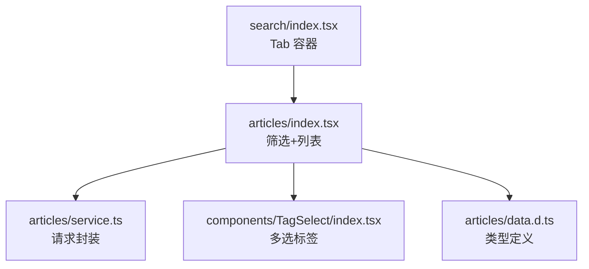
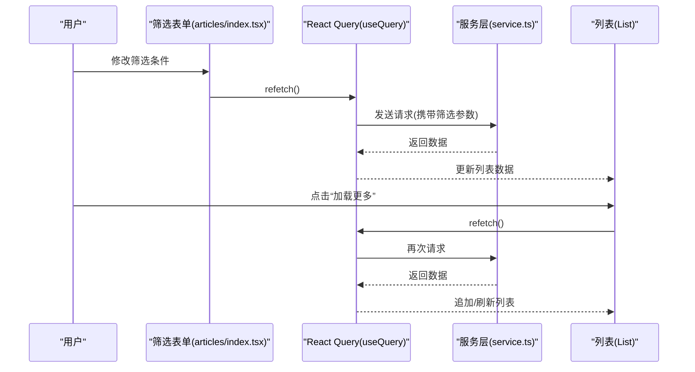
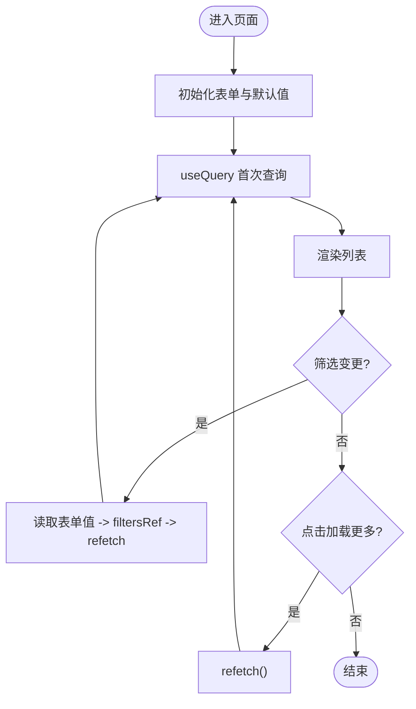
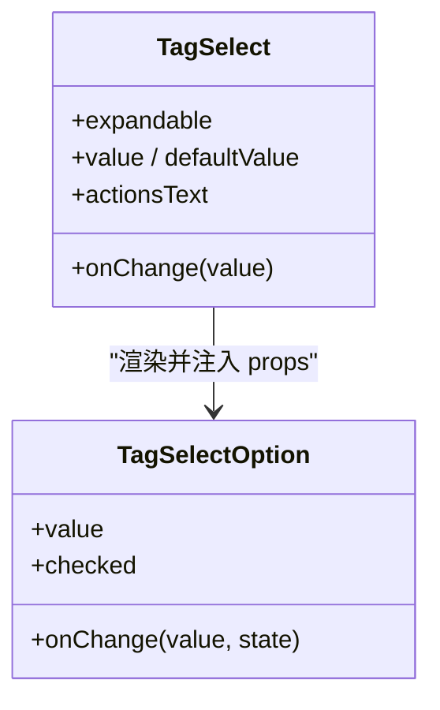
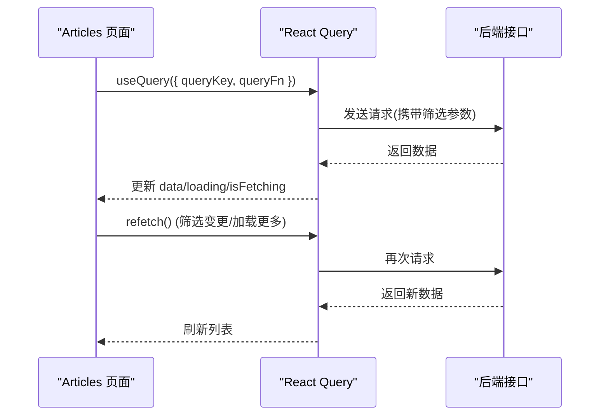
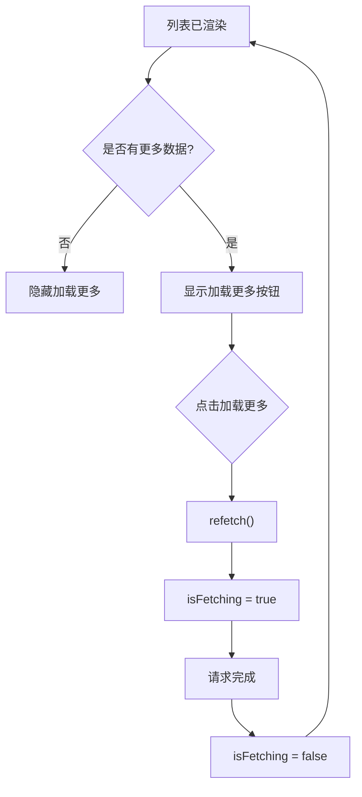
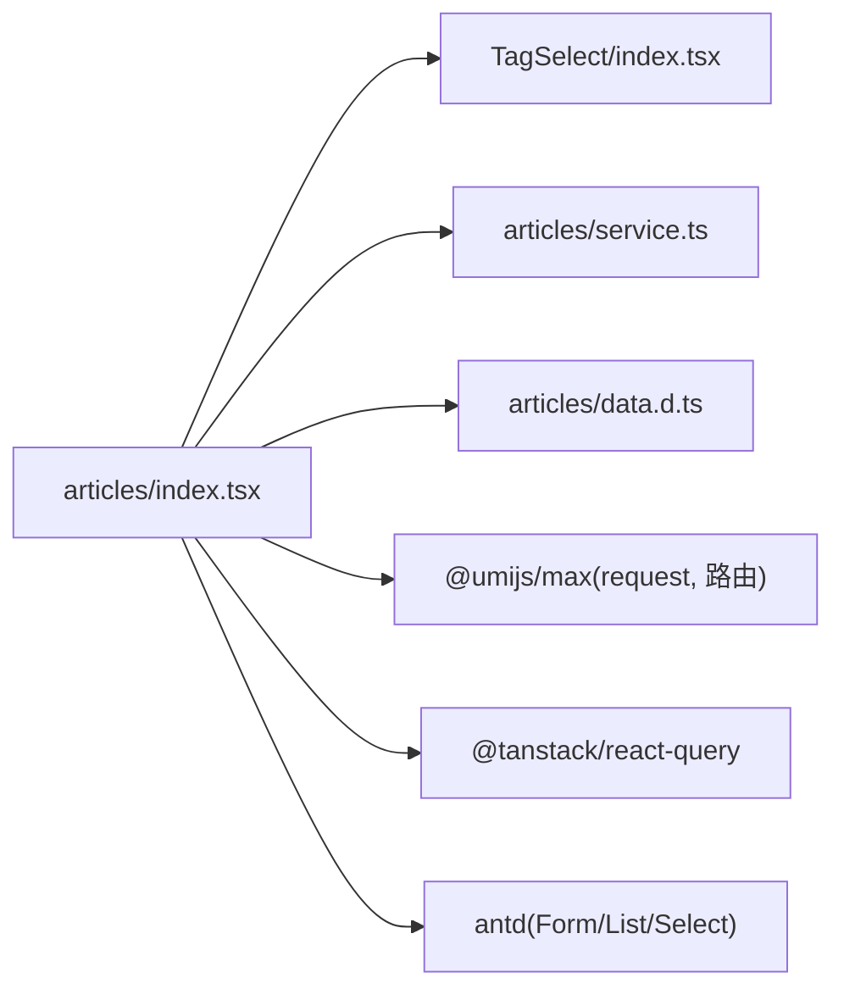

# 搜索列表

<cite>
**本文引用的文件**
- [web_client/po-admin/src/pages/list/search/index.tsx](file://web_client/po-admin/src/pages/list/search/index.tsx)
- [web_client/po-admin/src/pages/list/search/articles/index.tsx](file://web_client/po-admin/src/pages/list/search/articles/index.tsx)
- [web_client/po-admin/src/pages/list/search/articles/service.ts](file://web_client/po-admin/src/pages/list/search/articles/service.ts)
- [web_client/po-admin/src/pages/list/search/articles/data.d.ts](file://web_client/po-admin/src/pages/list/search/articles/data.d.ts)
- [web_client/po-admin/src/components/TagSelect/index.tsx](file://web_client/po-admin/src/components/TagSelect/index.tsx)
</cite>

## 目录
1. [简介](#简介)
2. [项目结构](#项目结构)
3. [核心组件](#核心组件)
4. [架构总览](#架构总览)
5. [详细组件分析](#详细组件分析)
6. [依赖关系分析](#依赖关系分析)
7. [性能考虑](#性能考虑)
8. [故障排查指南](#故障排查指南)
9. [结论](#结论)
10. [附录](#附录)

## 简介
本章节面向“搜索列表”功能，系统性说明多条件筛选表单的实现方式与交互流程，重点覆盖：
- 类目选择、所有者筛选、活跃用户和好评度等高级筛选条件的组合使用
- TagSelect 可展开多选标签组件的使用与扩展
- React Query 的查询缓存机制（queryKey 设计、数据预取与实时更新策略）
- 分页加载方案（加载更多按钮、加载状态管理与性能优化）
并通过实际代码路径指引，帮助读者快速定位实现细节。

## 项目结构
搜索列表位于 web_client/po-admin 的 pages/list/search 目录下，采用“按功能域组织”的结构：
- 顶层路由容器负责 Tab 切换与全局搜索入口
- articles 子页面承载文章类目的搜索列表、筛选表单与列表渲染
- service.ts 封装请求方法，data.d.ts 定义类型
- components/TagSelect 提供可复用的可展开多选标签组件

图表来源
- [web_client/po-admin/src/pages/list/search/index.tsx:1-80](file://web_client/po-admin/src/pages/list/search/index.tsx#L1-L80)
- [web_client/po-admin/src/pages/list/search/articles/index.tsx:1-280](file://web_client/po-admin/src/pages/list/search/articles/index.tsx#L1-L280)
- [web_client/po-admin/src/pages/list/search/articles/service.ts:1-11](file://web_client/po-admin/src/pages/list/search/articles/service.ts#L1-L11)
- [web_client/po-admin/src/pages/list/search/articles/data.d.ts:1-33](file://web_client/po-admin/src/pages/list/search/articles/data.d.ts#L1-L33)
- [web_client/po-admin/src/components/TagSelect/index.tsx:1-161](file://web_client/po-admin/src/components/TagSelect/index.tsx#L1-L161)

章节来源
- [web_client/po-admin/src/pages/list/search/index.tsx:1-80](file://web_client/po-admin/src/pages/list/search/index.tsx#L1-L80)

## 核心组件
- 搜索列表容器（search/index.tsx）
  - 提供顶部搜索框与 Tab 切换（文章/项目/应用），通过路由跳转至对应子页面
- 文章搜索页（articles/index.tsx）
  - 基于 Ant Design Form 的多条件筛选表单
  - 使用 TagSelect 实现类目多选与展开收起
  - 使用 Select 实现所有者、活跃用户、好评度等筛选
  - 使用 @tanstack/react-query 管理数据获取与缓存
  - 提供“加载更多”能力与加载状态展示
- 多选标签组件（TagSelect/index.tsx）
  - 支持全选、单选、展开/收起、自定义文案
  - 内部维护选中值集合，支持受控与非受控模式
- 服务层（service.ts）
  - 统一封装请求方法，透传筛选参数
- 类型定义（data.d.ts）
  - 定义列表项结构与查询参数类型

章节来源
- [web_client/po-admin/src/pages/list/search/articles/index.tsx:1-280](file://web_client/po-admin/src/pages/list/search/articles/index.tsx#L1-L280)
- [web_client/po-admin/src/components/TagSelect/index.tsx:1-161](file://web_client/po-admin/src/components/TagSelect/index.tsx#L1-L161)
- [web_client/po-admin/src/pages/list/search/articles/service.ts:1-11](file://web_client/po-admin/src/pages/list/search/articles/service.ts#L1-L11)
- [web_client/po-admin/src/pages/list/search/articles/data.d.ts:1-33](file://web_client/po-admin/src/pages/list/search/articles/data.d.ts#L1-L33)

## 架构总览
搜索列表的数据流与交互如下：
- 用户在筛选表单中修改条件时，触发 onValuesChange，更新 filtersRef 并调用 refetch
- useQuery 根据 queryKey 变化发起请求，service.ts 将参数发送至后端
- 返回数据后，List 渲染条目；当列表已有数据时显示“加载更多”，点击后再次 refetch
- TagSelect 在类目筛选中提供可展开的多选体验，提升复杂选项的可读性与操作效率

图表来源
- [web_client/po-admin/src/pages/list/search/articles/index.tsx:90-139](file://web_client/po-admin/src/pages/list/search/articles/index.tsx#L90-L139)
- [web_client/po-admin/src/pages/list/search/articles/service.ts:4-10](file://web_client/po-admin/src/pages/list/search/articles/service.ts#L4-L10)

## 详细组件分析

### 多条件筛选表单（Articles 页面）
- 表单布局
  - 所属类目：使用 TagSelect 包裹多个 TagSelect.Option，支持展开/收起与全选
  - 所有者：Select multiple 多选，并提供“只看自己的”快捷设置
  - 其它选项：活跃用户、好评度为独立 Select 下拉
- 状态与联动
  - 使用 Form.useForm 管理表单值，onValuesChange 触发 reload
  - reload 读取当前表单值写入 filtersRef，并调用 refetch 重新查询
- 列表与分页
  - List 接收 data?.list 作为 dataSource，loading 由 useQuery 的 isLoading 控制
  - “加载更多”按钮在 list.length > 0 时显示，点击触发 refetch，isFetching 控制加载态

图表来源
- [web_client/po-admin/src/pages/list/search/articles/index.tsx:82-139](file://web_client/po-admin/src/pages/list/search/articles/index.tsx#L82-L139)

章节来源
- [web_client/po-admin/src/pages/list/search/articles/index.tsx:82-274](file://web_client/po-admin/src/pages/list/search/articles/index.tsx#L82-L274)

### TagSelect 组件（可展开多选标签）
- 功能要点
  - 支持全选、单项勾选、展开/收起
  - 内部维护 valueSet 用于 O(1) 查找，避免重复计算
  - 支持受控（value + onChange）与非受控（defaultValue）两种模式
- 与表单集成
  - 在 Articles 页面中，TagSelect 作为 Form.Item 的子组件，配合 form 的值变化自动触发查询
- 性能优化
  - 使用 useMemo 缓存 children 解析结果与 valueSet
  - 通过 isTagSelectOption 识别 Option 节点，批量注入 checked 与 onChange

图表来源
- [web_client/po-admin/src/components/TagSelect/index.tsx:8-56](file://web_client/po-admin/src/components/TagSelect/index.tsx#L8-L56)
- [web_client/po-admin/src/components/TagSelect/index.tsx:57-160](file://web_client/po-admin/src/components/TagSelect/index.tsx#L57-L160)

章节来源
- [web_client/po-admin/src/components/TagSelect/index.tsx:1-161](file://web_client/po-admin/src/components/TagSelect/index.tsx#L1-L161)

### React Query 查询缓存机制
- queryKey 设计
  - 使用 ['search-articles', pageSize, filtersRef.current] 作为 key，确保不同筛选条件产生不同的缓存条目
- 数据预取与实时更新
  - 首次进入页面即触发查询，后续筛选变更通过 refetch 主动更新
  - 可通过按需配置 staleTime 或 gcTime 调整缓存生命周期（当前未显式配置，使用默认策略）
- 错误与重试
  - 当前未显式处理错误与重试逻辑，可在 useQuery 中补充 onError 与 retry 配置以增强健壮性

图表来源
- [web_client/po-admin/src/pages/list/search/articles/index.tsx:90-109](file://web_client/po-admin/src/pages/list/search/articles/index.tsx#L90-L109)
- [web_client/po-admin/src/pages/list/search/articles/service.ts:4-10](file://web_client/po-admin/src/pages/list/search/articles/service.ts#L4-L10)

章节来源
- [web_client/po-admin/src/pages/list/search/articles/index.tsx:90-109](file://web_client/po-admin/src/pages/list/search/articles/index.tsx#L90-L109)

### 分页加载实现方案
- 加载更多按钮
  - 当列表存在数据时显示，点击触发 refetch
  - 使用 isFetching 控制按钮内加载态提示
- 加载状态管理
  - loading 来自 isLoading，用于整体列表骨架或禁用交互
  - isFetching 用于局部“加载中...”反馈
- 性能优化建议
  - 合理设置 pageSize，避免单次数据量过大
  - 对大型列表可考虑虚拟滚动（当前未启用）
  - 结合服务端分页与排序，减少前端处理压力

图表来源
- [web_client/po-admin/src/pages/list/search/articles/index.tsx:103-139](file://web_client/po-admin/src/pages/list/search/articles/index.tsx#L103-L139)

章节来源
- [web_client/po-admin/src/pages/list/search/articles/index.tsx:103-139](file://web_client/po-admin/src/pages/list/search/articles/index.tsx#L103-L139)

## 依赖关系分析
- 页面与组件耦合
  - Articles 页面依赖 TagSelect、Form、List、Select 等 UI 组件
  - 通过 service.ts 解耦网络请求，便于替换 Mock 或真实接口
- 外部依赖
  - @umijs/max 提供 request 与路由能力
  - @tanstack/react-query 提供查询缓存与状态管理
  - antd 提供表单、列表、选择器等基础组件

图表来源
- [web_client/po-admin/src/pages/list/search/articles/index.tsx:1-16](file://web_client/po-admin/src/pages/list/search/articles/index.tsx#L1-L16)
- [web_client/po-admin/src/pages/list/search/articles/service.ts:1-11](file://web_client/po-admin/src/pages/list/search/articles/service.ts#L1-L11)
- [web_client/po-admin/src/components/TagSelect/index.tsx:1-10](file://web_client/po-admin/src/components/TagSelect/index.tsx#L1-L10)

章节来源
- [web_client/po-admin/src/pages/list/search/articles/index.tsx:1-16](file://web_client/po-admin/src/pages/list/search/articles/index.tsx#L1-L16)
- [web_client/po-admin/src/pages/list/search/articles/service.ts:1-11](file://web_client/po-admin/src/pages/list/search/articles/service.ts#L1-L11)

## 性能考虑
- 查询缓存
  - 利用 queryKey 区分不同筛选条件，避免不必要重绘
  - 可根据业务需求配置 staleTime/gcTime，平衡实时性与缓存命中率
- 列表渲染
  - 大数据量场景建议使用虚拟滚动或分页加载
  - 合理使用 rowKey 提升 diff 性能
- 表单交互
  - TagSelect 内部使用 Set 与 useMemo 优化选择状态计算
  - 避免在 onValuesChange 中执行昂贵计算，尽量只更新 filtersRef 并 refetch

[本节为通用性能建议，不直接分析具体文件]

## 故障排查指南
- 筛选不生效
  - 检查 onValuesChange 是否正确触发 reload
  - 确认 filtersRef 是否被正确赋值并参与 queryKey
- 加载更多无响应
  - 检查 refetch 是否被调用
  - 查看 isFetching 状态与网络请求是否发出
- TagSelect 全选异常
  - 确认 allTags 计算是否正确
  - 检查 valueSet 与 onChange 传递的参数是否一致
- 请求失败
  - 在 useQuery 中添加 onError 处理
  - 检查 service.ts 的请求地址与参数格式

章节来源
- [web_client/po-admin/src/pages/list/search/articles/index.tsx:90-139](file://web_client/po-admin/src/pages/list/search/articles/index.tsx#L90-L139)
- [web_client/po-admin/src/components/TagSelect/index.tsx:79-104](file://web_client/po-admin/src/components/TagSelect/index.tsx#L79-L104)

## 结论
该搜索列表通过清晰的组件分层与 React Query 的缓存机制，实现了高效的多条件筛选与分页加载。TagSelect 提供了良好的可扩展性与用户体验。建议在后续迭代中补充错误处理、缓存策略调优与大数据列表的虚拟化方案，进一步提升稳定性与性能。

[本节为总结性内容，不直接分析具体文件]

## 附录
- 关键实现路径参考
  - 筛选表单与列表：[articles/index.tsx](file://web_client/po-admin/src/pages/list/search/articles/index.tsx)
  - 请求封装：[articles/service.ts](file://web_client/po-admin/src/pages/list/search/articles/service.ts)
  - 类型定义：[articles/data.d.ts](file://web_client/po-admin/src/pages/list/search/articles/data.d.ts)
  - 多选标签组件：[TagSelect/index.tsx](file://web_client/po-admin/src/components/TagSelect/index.tsx)
  - 搜索容器与 Tab：[search/index.tsx](file://web_client/po-admin/src/pages/list/search/index.tsx)

[本节为索引信息，不直接分析具体文件]