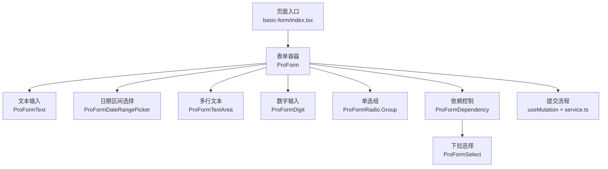
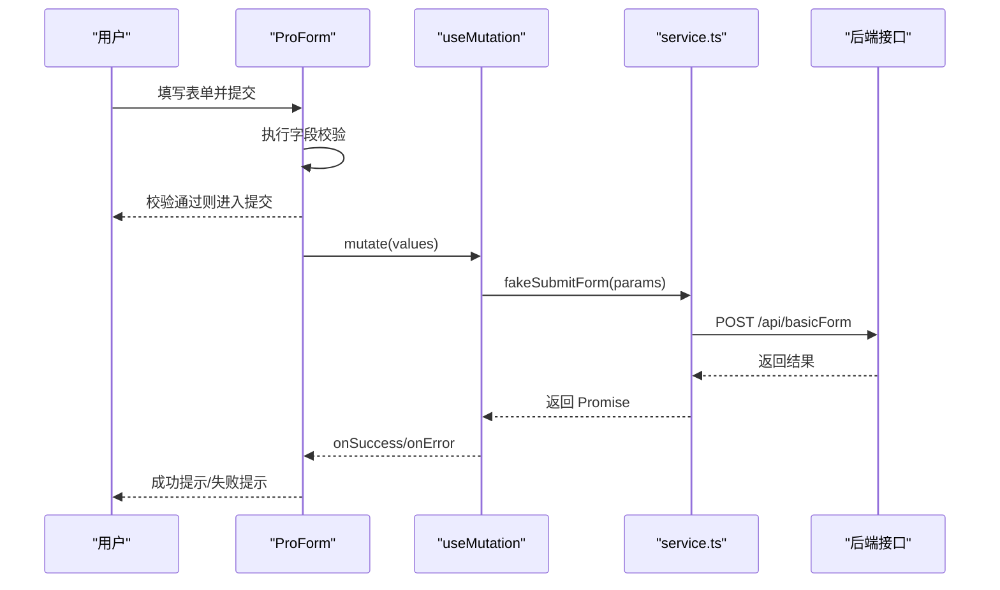
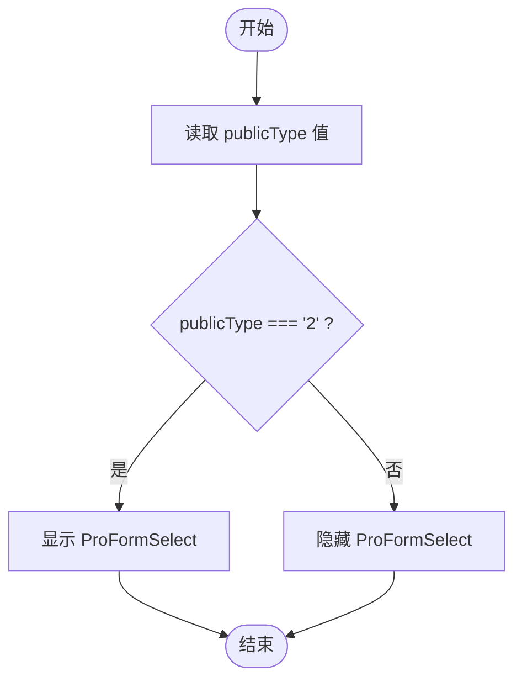
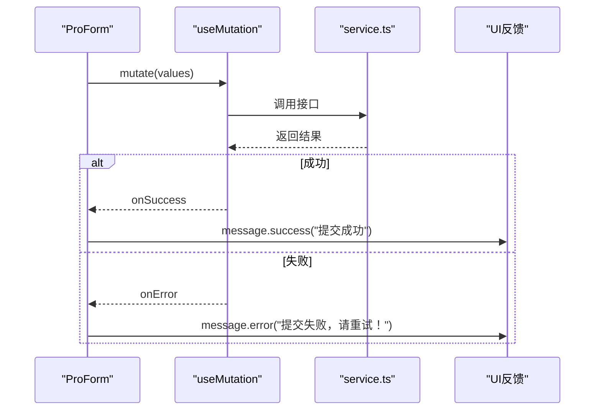
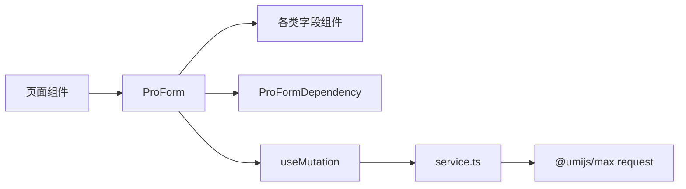

# 基础表单

<cite>
**本文引用的文件**
- [web_client/po-admin/src/pages/form/basic-form/index.tsx](file://web_client/po-admin/src/pages/form/basic-form/index.tsx)
- [web_client/po-admin/src/pages/form/basic-form/service.ts](file://web_client/po-admin/src/pages/form/basic-form/service.ts)
- [web_client/po-admin/src/pages/form/advanced-form/index.tsx](file://web_client/po-admin/src/pages/form/advanced-form/index.tsx)
- [web_client/po-admin/src/pages/form/step-form/index.tsx](file://web_client/po-admin/src/pages/form/step-form/index.tsx)
</cite>

## 目录
1. [简介](#简介)
2. [项目结构](#项目结构)
3. [核心组件](#核心组件)
4. [架构总览](#架构总览)
5. [详细组件分析](#详细组件分析)
6. [依赖关系分析](#依赖关系分析)
7. [性能考虑](#性能考虑)
8. [故障排查指南](#故障排查指南)
9. [结论](#结论)
10. [附录](#附录)

## 简介
本章节面向使用 Ant Design Pro Components 的开发者，系统讲解基础表单（ProForm）的用法与最佳实践。内容涵盖：
- 表单布局配置、字段类型定义与验证规则设置
- 常用控件（ProFormText、ProFormDateRangePicker、ProFormTextArea、ProFormDigit 等）的属性配置要点
- 基于 ProFormDependency 的条件显示逻辑
- 表单提交流程：结合 useMutation 的错误处理与成功反馈
- 性能优化建议：字段懒加载与验证策略
- 通过仓库中的实际示例展示基础表单的最佳实践模式

## 项目结构
本项目在 web_client/po-admin 中提供了三类表单示例：
- 基础表单：演示单页简单录入、条件显示与提交
- 高级表单：演示复杂布局、错误聚合提示与批量数据编辑
- 分步表单：演示多步骤流程与结果页

图表来源
- [web_client/po-admin/src/pages/form/basic-form/index.tsx:1-197](file://web_client/po-admin/src/pages/form/basic-form/index.tsx#L1-L197)
- [web_client/po-admin/src/pages/form/basic-form/service.ts:1-9](file://web_client/po-admin/src/pages/form/basic-form/service.ts#L1-L9)

章节来源
- [web_client/po-admin/src/pages/form/basic-form/index.tsx:1-197](file://web_client/po-admin/src/pages/form/basic-form/index.tsx#L1-L197)
- [web_client/po-admin/src/pages/form/advanced-form/index.tsx:1-554](file://web_client/po-admin/src/pages/form/advanced-form/index.tsx#L1-L554)
- [web_client/po-admin/src/pages/form/step-form/index.tsx:1-246](file://web_client/po-admin/src/pages/form/step-form/index.tsx#L1-L246)

## 核心组件
- ProForm：表单容器，负责布局、初始值、校验与提交回调
- ProFormText：单行文本输入，支持 rules、placeholder、tooltip 等
- ProFormDateRangePicker：起止日期范围选择器，支持 placeholder 数组与必填校验
- ProFormTextArea：多行文本输入，适合长描述类字段
- ProFormDigit：数字输入，支持 min/max、fieldProps 格式化（如百分比）
- ProFormRadio.Group：单选组，用于枚举型选项
- ProFormSelect：下拉选择，常用于联动或条件显示
- ProFormDependency：根据其他字段值动态渲染/隐藏子字段

章节来源
- [web_client/po-admin/src/pages/form/basic-form/index.tsx:1-197](file://web_client/po-admin/src/pages/form/basic-form/index.tsx#L1-L197)

## 架构总览
基础表单的数据流与交互如下：
- 用户填写各字段，触发本地校验
- 点击提交后，调用 onFinish，内部通过 useMutation 发起网络请求
- 成功后给出消息提示并刷新相关缓存；失败时捕获异常并提示

图表来源
- [web_client/po-admin/src/pages/form/basic-form/index.tsx:21-30](file://web_client/po-admin/src/pages/form/basic-form/index.tsx#L21-L30)
- [web_client/po-admin/src/pages/form/basic-form/service.ts:3-8](file://web_client/po-admin/src/pages/form/basic-form/service.ts#L3-L8)

章节来源
- [web_client/po-admin/src/pages/form/basic-form/index.tsx:21-30](file://web_client/po-admin/src/pages/form/basic-form/index.tsx#L21-L30)
- [web_client/po-admin/src/pages/form/basic-form/service.ts:1-9](file://web_client/po-admin/src/pages/form/basic-form/service.ts#L1-L9)

## 详细组件分析

### 表单布局与初始化
- 布局：使用 layout="vertical" 实现标签在上、输入在下的纵向布局
- 初始值：通过 initialValues 提供默认值，例如公开类型的默认值
- 必填标记：可通过 requiredMark 控制是否显示必填标识
- 样式：通过 style 控制居中、最大宽度等

章节来源
- [web_client/po-admin/src/pages/form/basic-form/index.tsx:34-46](file://web_client/po-admin/src/pages/form/basic-form/index.tsx#L34-L46)

### 字段类型与验证规则
- 标题（ProFormText）：设置 width、label、name、rules（required）、placeholder
- 起止日期（ProFormDateRangePicker）：设置 label、width、name、rules（required）、placeholder 数组
- 目标描述（ProFormTextArea）：设置 label、width、name、rules（required）、placeholder
- 衡量标准（ProFormTextArea）：同上
- 客户/邀评人（ProFormText）：可选字段，可配合 tooltip 说明
- 权重（ProFormDigit）：设置 min、max、width、fieldProps（formatter/parser），实现百分比显示与解析
- 目标公开（ProFormRadio.Group）：options 定义枚举项，help 提供辅助说明

章节来源
- [web_client/po-admin/src/pages/form/basic-form/index.tsx:48-159](file://web_client/po-admin/src/pages/form/basic-form/index.tsx#L48-L159)

### 依赖关系与条件显示
- 使用 ProFormDependency 监听 publicType 字段变化
- 当值为“部分公开”时，显示 ProFormSelect 供选择可见人员
- 通过 fieldProps.style.display 控制显隐

图表来源
- [web_client/po-admin/src/pages/form/basic-form/index.tsx:160-190](file://web_client/po-admin/src/pages/form/basic-form/index.tsx#L160-L190)

章节来源
- [web_client/po-admin/src/pages/form/basic-form/index.tsx:160-190](file://web_client/po-admin/src/pages/form/basic-form/index.tsx#L160-L190)

### 表单提交流程与错误处理
- 使用 useMutation 封装提交逻辑，mutationFn 指向 service.ts 中的 fakeSubmitForm
- onSuccess 中显示成功消息并失效对应查询缓存
- 在高级表单中，onFinishFailed 收集 errorFields，并通过 Popover 集中展示校验错误

图表来源
- [web_client/po-admin/src/pages/form/basic-form/index.tsx:21-30](file://web_client/po-admin/src/pages/form/basic-form/index.tsx#L21-L30)
- [web_client/po-admin/src/pages/form/basic-form/service.ts:3-8](file://web_client/po-admin/src/pages/form/basic-form/service.ts#L3-L8)
- [web_client/po-admin/src/pages/form/advanced-form/index.tsx:127-138](file://web_client/po-admin/src/pages/form/advanced-form/index.tsx#L127-L138)

章节来源
- [web_client/po-admin/src/pages/form/basic-form/index.tsx:21-30](file://web_client/po-admin/src/pages/form/basic-form/index.tsx#L21-L30)
- [web_client/po-admin/src/pages/form/advanced-form/index.tsx:127-138](file://web_client/po-admin/src/pages/form/advanced-form/index.tsx#L127-L138)

### 高级表单与分步表单要点
- 高级表单：使用 FooterToolbar 自定义底部工具栏，聚合错误信息；EditableProTable 用于表格内编辑
- 分步表单：StepsForm 将复杂流程拆分为多步，每步独立校验与提交，最终展示结果页

章节来源
- [web_client/po-admin/src/pages/form/advanced-form/index.tsx:175-550](file://web_client/po-admin/src/pages/form/advanced-form/index.tsx#L175-L550)
- [web_client/po-admin/src/pages/form/step-form/index.tsx:70-246](file://web_client/po-admin/src/pages/form/step-form/index.tsx#L70-L246)

## 依赖关系分析
- 组件耦合：ProForm 作为容器，组合多个具体字段组件；ProFormDependency 仅依赖字段名进行条件渲染，低耦合
- 外部依赖：useMutation 来自 @tanstack/react-query，service.ts 通过 @umijs/max 的 request 发起 HTTP 请求
- 数据流向：页面状态 -> ProForm -> useMutation -> service -> 后端 -> 回调更新 UI

图表来源
- [web_client/po-admin/src/pages/form/basic-form/index.tsx:1-197](file://web_client/po-admin/src/pages/form/basic-form/index.tsx#L1-L197)
- [web_client/po-admin/src/pages/form/basic-form/service.ts:1-9](file://web_client/po-admin/src/pages/form/basic-form/service.ts#L1-L9)

章节来源
- [web_client/po-admin/src/pages/form/basic-form/index.tsx:1-197](file://web_client/po-admin/src/pages/form/basic-form/index.tsx#L1-L197)
- [web_client/po-admin/src/pages/form/basic-form/service.ts:1-9](file://web_client/po-admin/src/pages/form/basic-form/service.ts#L1-L9)

## 性能考虑
- 字段懒加载
  - 将非关键或重型字段（如大列表、复杂计算）延迟到需要时再渲染或请求
  - 使用 ProFormDependency 仅在必要时渲染联动字段，减少初始渲染开销
- 验证策略
  - 合理使用 rules，避免过于频繁的实时校验；对耗时校验采用防抖或失焦触发
  - 对数值型字段使用 ProFormDigit 的 formatter/parser 减少重复转换成本
- 提交与缓存
  - 使用 useMutation 的 onSuccess 中精准失效相关查询缓存，避免全量刷新
  - 对频繁更新的列表或详情，合理设置 staleTime 与 refetchOnWindowFocus

[本节为通用性能建议，不直接分析具体文件]

## 故障排查指南
- 提交失败
  - 检查 service.ts 的请求路径与方法是否正确
  - 确认 useMutation 的 onError 分支已处理错误并提示用户
- 校验未生效
  - 核对字段的 name 是否与 rules 绑定一致
  - 对于依赖字段，确保 ProFormDependency 监听的字段名正确
- 条件显示异常
  - 检查 ProFormDependency 返回值与条件判断逻辑
  - 注意 fieldProps.style.display 的值是否为字符串 "block"/"none"

章节来源
- [web_client/po-admin/src/pages/form/basic-form/index.tsx:160-190](file://web_client/po-admin/src/pages/form/basic-form/index.tsx#L160-L190)
- [web_client/po-admin/src/pages/form/advanced-form/index.tsx:127-138](file://web_client/po-admin/src/pages/form/advanced-form/index.tsx#L127-L138)

## 结论
通过本项目的三个表单示例，可以掌握：
- 使用 ProForm 快速搭建表单布局与校验
- 借助 ProFormDependency 实现灵活的字段联动
- 结合 useMutation 完成稳健的提交流程与错误处理
- 在复杂场景中参考高级表单与分步表单的模式，提升用户体验与可维护性

[本节为总结性内容，不直接分析具体文件]

## 附录
- 常用字段属性速查
  - ProFormText：width、label、name、rules、placeholder、tooltip
  - ProFormDateRangePicker：label、width、name、rules、placeholder（数组）
  - ProFormTextArea：label、width、name、rules、placeholder
  - ProFormDigit：label、name、min、max、width、fieldProps（formatter/parser）
  - ProFormRadio.Group：options、label、help、name
  - ProFormSelect：options、name、width、fieldProps
- 推荐实践
  - 统一使用 layout="vertical" 保证一致性
  - 所有必填字段均配置 rules.required 与 message
  - 对数值与百分比字段使用 ProFormDigit 的格式化能力
  - 使用 ProFormDependency 管理复杂联动，保持代码可读性

[本节为补充说明，不直接分析具体文件]