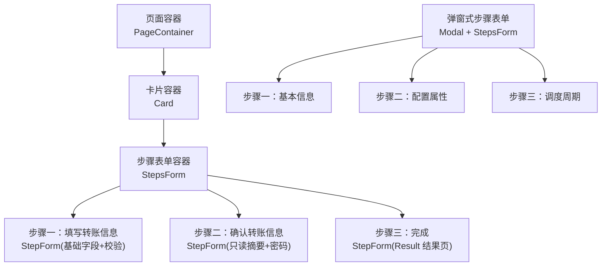
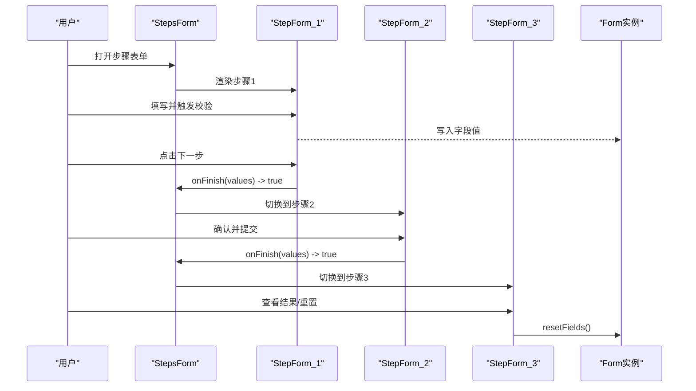
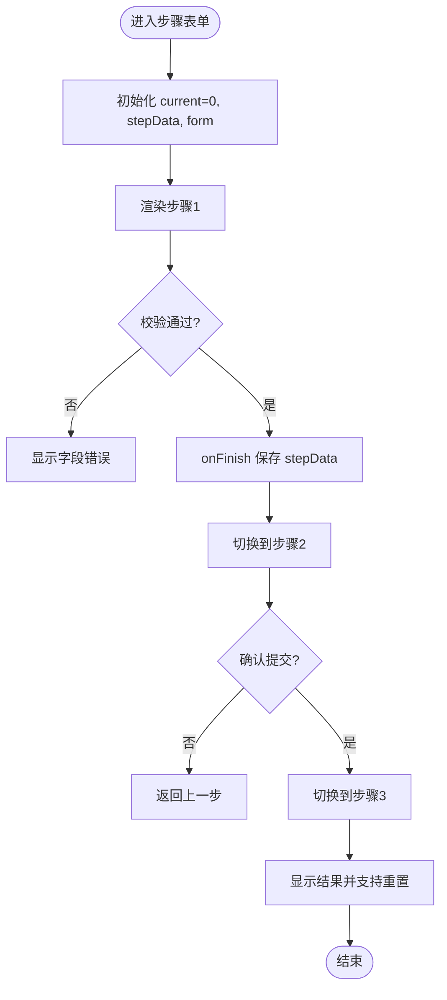
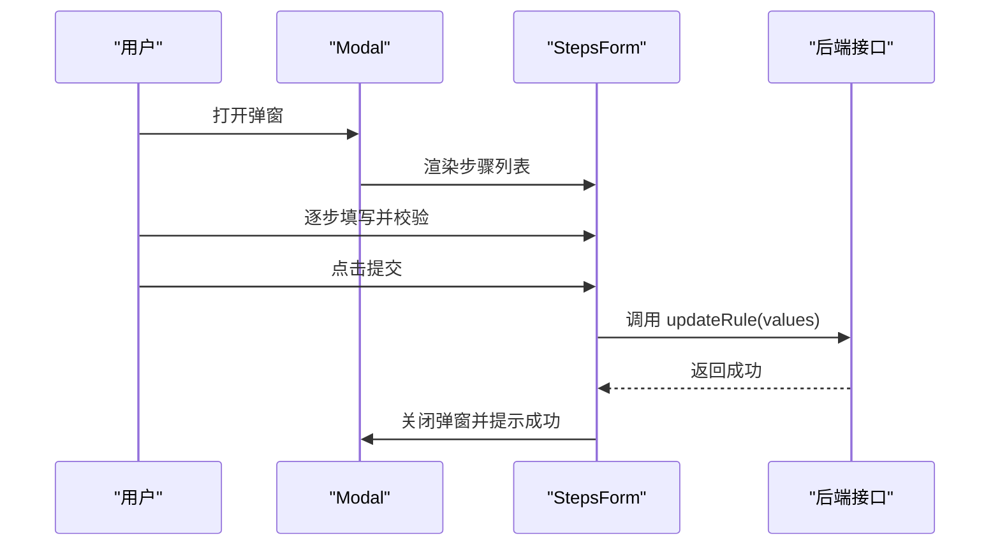
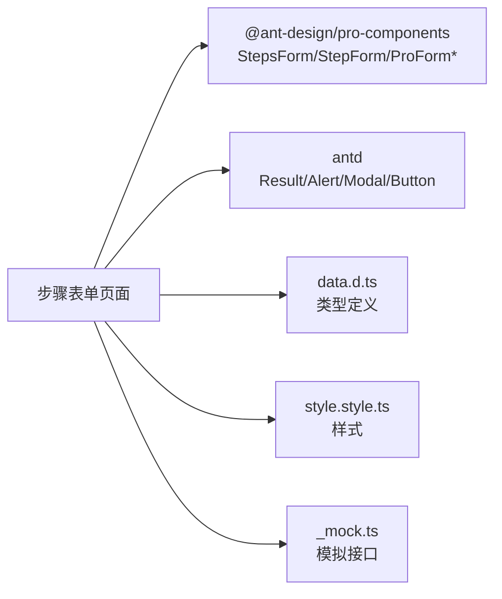

# 步骤表单

<cite>
**本文引用的文件**
- [web_client/po-admin/src/pages/form/step-form/index.tsx](file://web_client/po-admin/src/pages/form/step-form/index.tsx)
- [web_client/po-admin/src/pages/form/step-form/data.d.ts](file://web_client/po-admin/src/pages/form/step-form/data.d.ts)
- [web_client/po-admin/src/pages/form/step-form/style.style.ts](file://web_client/po-admin/src/pages/form/step-form/style.style.ts)
- [web_client/po-admin/src/pages/table-list/components/UpdateForm.tsx](file://web_client/po-admin/src/pages/table-list/components/UpdateForm.tsx)
- [web_client/po-admin/src/pages/form/step-form/_mock.ts](file://web_client/po-admin/src/pages/form/step-form/_mock.ts)
</cite>

## 目录
1. [简介](#简介)
2. [项目结构](#项目结构)
3. [核心组件](#核心组件)
4. [架构总览](#架构总览)
5. [详细组件分析](#详细组件分析)
6. [依赖关系分析](#依赖关系分析)
7. [性能考虑](#性能考虑)
8. [故障排查指南](#故障排查指南)
9. [结论](#结论)
10. [附录](#附录)

## 简介
本文件围绕仓库中的“步骤表单”实现，系统性说明多步骤表单的架构与实现要点：步骤状态管理、数据流转与进度控制；步骤导航（切换、前进后退、验证）；步骤间数据共享（持久化与同步）；用户体验设计（进度指示器、提示与反馈）；以及复杂业务场景下的设计模式（动态步骤生成、条件分支）。文末提供基于仓库内实际案例的开发流程与最佳实践。

## 项目结构
步骤表单在 Ant Design Pro 示例中位于 web_client/po-admin 下，包含两个典型实现：
- 转账类多步表单：用于演示信息填写、确认与结果页的完整流程
- 规则配置弹窗式多步表单：将 StepsForm 嵌入 Modal，展示在表格编辑场景中

图表来源
- [web_client/po-admin/src/pages/form/step-form/index.tsx:84-224](file://web_client/po-admin/src/pages/form/step-form/index.tsx#L84-L224)
- [web_client/po-admin/src/pages/table-list/components/UpdateForm.tsx:67-240](file://web_client/po-admin/src/pages/table-list/components/UpdateForm.tsx#L67-L240)

章节来源
- [web_client/po-admin/src/pages/form/step-form/index.tsx:1-246](file://web_client/po-admin/src/pages/form/step-form/index.tsx#L1-L246)
- [web_client/po-admin/src/pages/table-list/components/UpdateForm.tsx:1-246](file://web_client/po-admin/src/pages/table-list/components/UpdateForm.tsx#L1-L246)

## 核心组件
- StepsForm：步骤容器，负责步骤渲染、提交与整体生命周期
- StepForm：单步表单，承载字段、校验与本地提交回调
- Form.useForm：跨步骤共享的表单实例，用于读取/重置/设置值
- Result/Descriptions/Alert：结果页与摘要展示
- Modal：包裹 StepsForm，实现在对话框内的多步流程

章节来源
- [web_client/po-admin/src/pages/form/step-form/index.tsx:1-246](file://web_client/po-admin/src/pages/form/step-form/index.tsx#L1-L246)
- [web_client/po-admin/src/pages/table-list/components/UpdateForm.tsx:1-246](file://web_client/po-admin/src/pages/table-list/components/UpdateForm.tsx#L1-L246)

## 架构总览
步骤表单采用“容器-步骤-字段”的分层结构：
- 容器层：StepsForm 管理当前步骤、提交行为与整体布局
- 步骤层：每个 StepForm 独立维护自身字段与校验，通过 onFinish 将数据回传容器
- 字段层：ProForm* 系列组件负责输入与校验

图表来源
- [web_client/po-admin/src/pages/form/step-form/index.tsx:84-224](file://web_client/po-admin/src/pages/form/step-form/index.tsx#L84-L224)

## 详细组件分析

### 转账步骤表单（主流程）
- 步骤状态管理
  - 使用 useState 维护 current 与 stepData，current 驱动 StepsForm.current，stepData 作为初始值与结果汇总
  - 通过 onCurrentChange 双向绑定当前步骤索引
- 数据流转
  - 第一步 onFinish 中将 values 写入 stepData，供后续步骤展示
  - 第三步完成后调用 form.resetFields() 清空状态，便于再次操作
- 进度控制与导航
  - StepsForm 内置前进/后退逻辑，submitter 可自定义按钮显示（如最后一步隐藏默认提交）
- 校验
  - 各字段通过 rules 进行必填、格式等校验，错误提示由 ProForm 统一处理
- 结果页
  - 使用 Result 展示成功态，并提供“再转一笔”和“查看账单”等操作入口

图表来源
- [web_client/po-admin/src/pages/form/step-form/index.tsx:70-224](file://web_client/po-admin/src/pages/form/step-form/index.tsx#L70-L224)

章节来源
- [web_client/po-admin/src/pages/form/step-form/index.tsx:70-224](file://web_client/po-admin/src/pages/form/step-form/index.tsx#L70-L224)
- [web_client/po-admin/src/pages/form/step-form/data.d.ts:1-10](file://web_client/po-admin/src/pages/form/step-form/data.d.ts#L1-L10)
- [web_client/po-admin/src/pages/form/step-form/style.style.ts:1-16](file://web_client/po-admin/src/pages/form/step-form/style.style.ts#L1-L16)

### 弹窗式步骤表单（更新规则）
- 容器与交互
  - 使用 Modal 包裹 StepsForm，footer 直接透传 submitter，保持统一的提交体验
  - stepsProps.size 控制步骤条尺寸，适配弹窗空间
- 步骤划分
  - 步骤一：基本信息（名称、描述）
  - 步骤二：配置属性（目标、模板、类型）
  - 步骤三：调度周期（时间、频率）
- 数据流与提交
  - 通过 useMutation 封装提交逻辑，成功后刷新缓存并关闭弹窗
  - 每步 initialValues 可单独设置，便于复用与默认值控制

图表来源
- [web_client/po-admin/src/pages/table-list/components/UpdateForm.tsx:67-240](file://web_client/po-admin/src/pages/table-list/components/UpdateForm.tsx#L67-L240)

章节来源
- [web_client/po-admin/src/pages/table-list/components/UpdateForm.tsx:67-240](file://web_client/po-admin/src/pages/table-list/components/UpdateForm.tsx#L67-L240)

### 步骤间数据共享机制
- 内存级共享
  - 通过父组件 state（stepData）在各 StepForm 之间传递数据，适合短期流程
- 表单实例共享
  - 使用 Form.useForm 创建单一表单实例，并通过 formRef 注入到 StepForm，实现跨步骤读写与重置
- 持久化建议
  - 对于需要跨会话保留的数据，可在 onFinish 时写入 localStorage/sessionStorage 或后端暂存接口
  - 进入页面时从存储恢复 stepData 与 current，提升容错与续填体验

章节来源
- [web_client/po-admin/src/pages/form/step-form/index.tsx:70-224](file://web_client/po-admin/src/pages/form/step-form/index.tsx#L70-L224)

### 步骤导航与验证
- 步骤切换
  - StepsForm 内部维护 current，onCurrentChange 用于外部同步
  - 可通过 submitter.render 根据 step 控制按钮显隐
- 前进/后退
  - 由 StepsForm 自动处理，结合每步 onFinish 返回值决定是否允许前进
- 验证策略
  - 字段级 rules 保证单步数据质量
  - 关键步骤可增加二次确认（如支付密码）

章节来源
- [web_client/po-admin/src/pages/form/step-form/index.tsx:84-224](file://web_client/po-admin/src/pages/form/step-form/index.tsx#L84-L224)

### 用户体验设计
- 进度指示器
  - StepsForm 顶部步骤条清晰展示当前位置与剩余步骤
- 步骤提示
  - 使用 Alert/Descriptions 在确认步骤给出重要提示与数据摘要
- 操作反馈
  - 提交后通过 Result 展示成功态，并提供继续操作入口
  - 弹窗场景使用 message 提示成功/失败

章节来源
- [web_client/po-admin/src/pages/form/step-form/index.tsx:184-223](file://web_client/po-admin/src/pages/form/step-form/index.tsx#L184-L223)
- [web_client/po-admin/src/pages/table-list/components/UpdateForm.tsx:31-41](file://web_client/po-admin/src/pages/table-list/components/UpdateForm.tsx#L31-L41)

### 复杂业务场景的设计模式
- 动态步骤生成
  - 根据用户选择或后端配置，动态构建 StepForm 数组并渲染
  - 结合路由或状态机管理步骤顺序与可见性
- 条件分支处理
  - 在 StepForm 的 onFinish 中根据值决定下一步跳转
  - 使用条件渲染隐藏/插入特定步骤，减少无关干扰
- 大表单拆分
  - 将长表单拆分为多个语义清晰的步骤，降低认知负荷
- 并发与幂等
  - 提交前禁用按钮防止重复提交
  - 对关键操作增加确认与重试机制

[本节为概念性说明，不直接分析具体文件]

## 依赖关系分析
- 组件依赖
  - StepsForm/StepForm 来自 @ant-design/pro-components
  - 表单控件 ProForm* 同属该库，统一校验与样式
  - UI 组件来自 antd（Result、Alert、Modal、Button 等）
- 数据与样式
  - data.d.ts 定义步骤数据结构
  - style.style.ts 使用 antd-style 定义局部样式
- 模拟接口
  - _mock.ts 提供 POST /api/stepForm 的模拟响应，便于联调

图表来源
- [web_client/po-admin/src/pages/form/step-form/index.tsx:1-21](file://web_client/po-admin/src/pages/form/step-form/index.tsx#L1-L21)
- [web_client/po-admin/src/pages/form/step-form/data.d.ts:1-10](file://web_client/po-admin/src/pages/form/step-form/data.d.ts#L1-L10)
- [web_client/po-admin/src/pages/form/step-form/style.style.ts:1-16](file://web_client/po-admin/src/pages/form/step-form/style.style.ts#L1-L16)
- [web_client/po-admin/src/pages/form/step-form/_mock.ts:1-8](file://web_client/po-admin/src/pages/form/step-form/_mock.ts#L1-L8)

章节来源
- [web_client/po-admin/src/pages/form/step-form/index.tsx:1-246](file://web_client/po-admin/src/pages/form/step-form/index.tsx#L1-L246)
- [web_client/po-admin/src/pages/form/step-form/data.d.ts:1-10](file://web_client/po-admin/src/pages/form/step-form/data.d.ts#L1-L10)
- [web_client/po-admin/src/pages/form/step-form/style.style.ts:1-16](file://web_client/po-admin/src/pages/form/step-form/style.style.ts#L1-L16)
- [web_client/po-admin/src/pages/form/step-form/_mock.ts:1-8](file://web_client/po-admin/src/pages/form/step-form/_mock.ts#L1-L8)

## 性能考虑
- 避免不必要的重渲染
  - 将步骤内容拆分为独立子组件，减少父组件状态变化导致的整表重绘
- 懒加载步骤
  - 对大型步骤使用 React.lazy 按需加载，缩短首屏时间
- 表单校验优化
  - 合理设置触发时机（onChange/onBlur），避免频繁计算
- 网络请求合并
  - 将多步数据在最终提交时合并发送，减少请求次数
- 内存管理
  - 完成流程后及时重置表单与清理副作用

[本节为通用指导，不直接分析具体文件]

## 故障排查指南
- 步骤无法前进
  - 检查当前步骤是否全部通过校验
  - 确认 StepForm 的 onFinish 返回值为 true
- 数据未同步
  - 确认 formRef 正确注入且指向同一 Form 实例
  - 检查 stepData 是否在 onFinish 中被更新
- 提交无响应
  - 检查网络请求是否被拦截或 mock 未生效
  - 确认 mutation 的错误处理与消息提示
- 弹窗关闭异常
  - 确保 footer 透传 submitter，并在成功后调用关闭逻辑

章节来源
- [web_client/po-admin/src/pages/form/step-form/index.tsx:84-224](file://web_client/po-admin/src/pages/form/step-form/index.tsx#L84-L224)
- [web_client/po-admin/src/pages/table-list/components/UpdateForm.tsx:31-57](file://web_client/po-admin/src/pages/table-list/components/UpdateForm.tsx#L31-L57)

## 结论
本仓库提供了两种典型的步骤表单实现：页面级转账流程与弹窗式规则配置。两者均基于 StepsForm/StepForm 构建，具备清晰的步骤划分、完善的校验与良好的用户体验。通过共享表单实例与状态管理，实现了步骤间数据的高效流转。在此基础上，可进一步扩展动态步骤、条件分支与持久化能力，以应对更复杂的业务场景。

[本节为总结性内容，不直接分析具体文件]

## 附录
- 开发流程建议
  - 定义数据结构与步骤枚举（参考 data.d.ts）
  - 搭建 StepsForm 骨架，按业务拆分 StepForm
  - 逐步骤实现字段与校验，完善提示信息
  - 集成提交逻辑与结果页，补充错误处理
  - 进行端到端测试，覆盖正常与异常路径
- 最佳实践
  - 保持每步职责单一，避免过度耦合
  - 使用统一的校验与提示规范
  - 对关键步骤提供二次确认
  - 做好无障碍与键盘导航支持

[本节为通用指导，不直接分析具体文件]