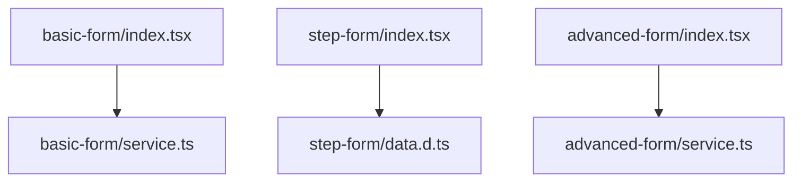
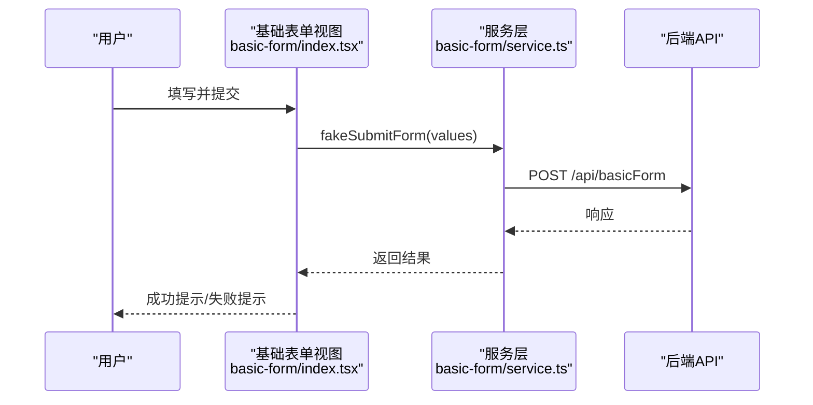
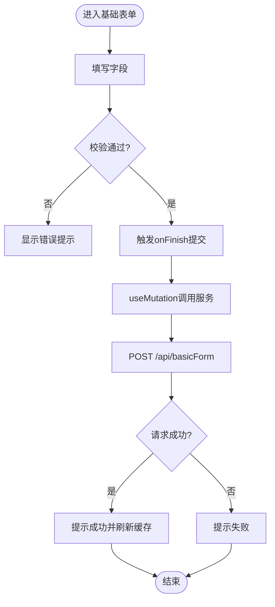
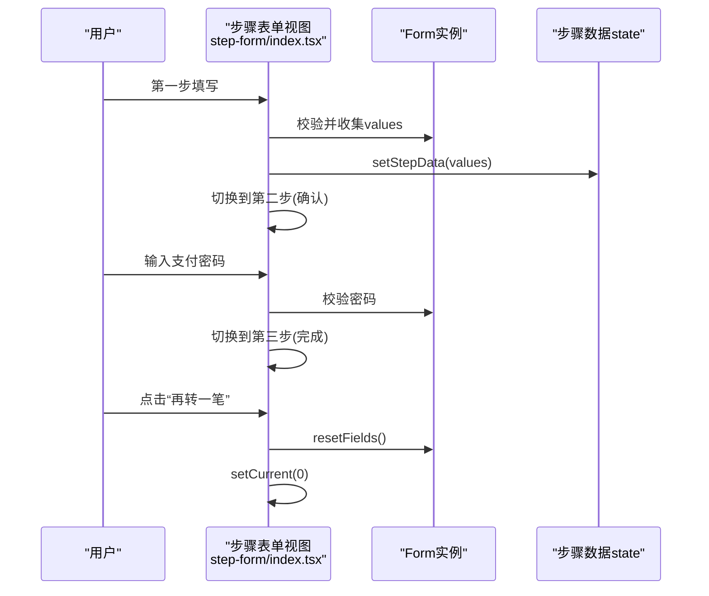
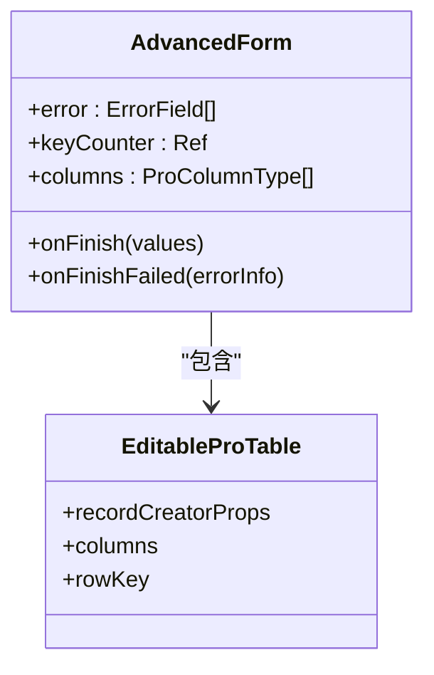
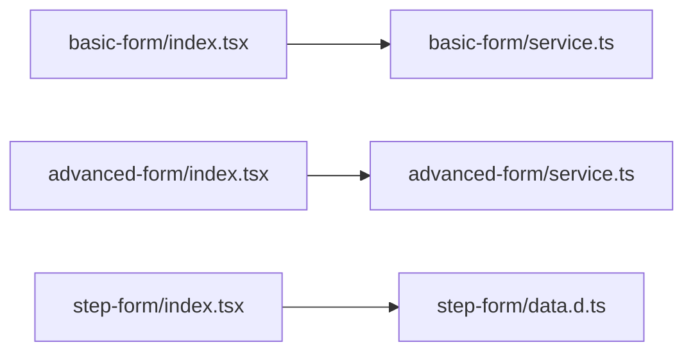

# 表单页面

<cite>
**本文引用的文件**
- [web_client/po-admin/src/pages/form/basic-form/index.tsx](file://web_client/po-admin/src/pages/form/basic-form/index.tsx)
- [web_client/po-admin/src/pages/form/basic-form/service.ts](file://web_client/po-admin/src/pages/form/basic-form/service.ts)
- [web_client/po-admin/src/pages/form/step-form/index.tsx](file://web_client/po-admin/src/pages/form/step-form/index.tsx)
- [web_client/po-admin/src/pages/form/step-form/data.d.ts](file://web_client/po-admin/src/pages/form/step-form/data.d.ts)
- [web_client/po-admin/src/pages/form/advanced-form/index.tsx](file://web_client/po-admin/src/pages/form/advanced-form/index.tsx)
- [web_client/po-admin/src/pages/form/advanced-form/service.ts](file://web_client/po-admin/src/pages/form/advanced-form/service.ts)
</cite>

## 目录
1. [简介](#简介)
2. [项目结构](#项目结构)
3. [核心组件](#核心组件)
4. [架构总览](#架构总览)
5. [详细组件分析](#详细组件分析)
6. [依赖关系分析](#依赖关系分析)
7. [性能考虑](#性能考虑)
8. [故障排查指南](#故障排查指南)
9. [结论](#结论)
10. [附录](#附录)

## 简介
本页面聚焦于前端表单页面的实现与最佳实践，覆盖三类典型场景：基础表单、步骤表单与高级表单。文档从字段类型定义、验证规则、提交处理、多步骤流程控制、数据持久化、进度指示器、动态表单生成、嵌套表单结构与批量操作等维度展开，并结合实际业务场景给出可复用的模式与优化策略（防抖、增量验证、内存管理）。

## 项目结构
表单相关代码位于 web_client/po-admin/src/pages/form 目录下，按功能拆分为三个子模块：
- basic-form：基础表单，演示常用字段、联动与提交
- step-form：步骤表单，演示分步填写、确认与结果展示
- advanced-form：高级表单，演示复杂布局、错误汇总与表格内联编辑

图表来源
- [web_client/po-admin/src/pages/form/basic-form/index.tsx:1-197](file://web_client/po-admin/src/pages/form/basic-form/index.tsx#L1-L197)
- [web_client/po-admin/src/pages/form/basic-form/service.ts:1-9](file://web_client/po-admin/src/pages/form/basic-form/service.ts#L1-L9)
- [web_client/po-admin/src/pages/form/step-form/index.tsx:1-246](file://web_client/po-admin/src/pages/form/step-form/index.tsx#L1-L246)
- [web_client/po-admin/src/pages/form/step-form/data.d.ts:1-10](file://web_client/po-admin/src/pages/form/step-form/data.d.ts#L1-L10)
- [web_client/po-admin/src/pages/form/advanced-form/index.tsx:1-554](file://web_client/po-admin/src/pages/form/advanced-form/index.tsx#L1-L554)
- [web_client/po-admin/src/pages/form/advanced-form/service.ts:1-9](file://web_client/po-admin/src/pages/form/advanced-form/service.ts#L1-L9)

章节来源
- [web_client/po-admin/src/pages/form/basic-form/index.tsx:1-197](file://web_client/po-admin/src/pages/form/basic-form/index.tsx#L1-L197)
- [web_client/po-admin/src/pages/form/step-form/index.tsx:1-246](file://web_client/po-admin/src/pages/form/step-form/index.tsx#L1-L246)
- [web_client/po-admin/src/pages/form/advanced-form/index.tsx:1-554](file://web_client/po-admin/src/pages/form/advanced-form/index.tsx#L1-L554)

## 核心组件
- 基础表单（ProForm + ProForm*）：使用 ProFormText、ProFormDateRangePicker、ProFormTextArea、ProFormDigit、ProFormRadio.Group、ProFormSelect、ProFormDependency 组合完成常见输入、联动与校验。
- 步骤表单（StepsForm）：通过 StepsForm.StepForm 将复杂流程切分为“填写信息”“确认信息”“完成”三步，配合 Form.useForm 进行状态管理与重置。
- 高级表单（ProForm + EditableProTable）：在统一表单中嵌入可编辑表格，支持批量新增/编辑成员；同时提供错误汇总与滚动定位。

章节来源
- [web_client/po-admin/src/pages/form/basic-form/index.tsx:18-197](file://web_client/po-admin/src/pages/form/basic-form/index.tsx#L18-L197)
- [web_client/po-admin/src/pages/form/step-form/index.tsx:70-246](file://web_client/po-admin/src/pages/form/step-form/index.tsx#L70-L246)
- [web_client/po-admin/src/pages/form/advanced-form/index.tsx:66-554](file://web_client/po-admin/src/pages/form/advanced-form/index.tsx#L66-L554)

## 架构总览
三类表单均遵循“视图层（ProForm/StepsForm）— 状态层（useState/Form.useForm）— 服务层（service.ts）”的清晰分层。提交时调用后端接口，成功后刷新缓存或提示用户。

图表来源
- [web_client/po-admin/src/pages/form/basic-form/index.tsx:21-30](file://web_client/po-admin/src/pages/form/basic-form/index.tsx#L21-L30)
- [web_client/po-admin/src/pages/form/basic-form/service.ts:3-8](file://web_client/po-admin/src/pages/form/basic-form/service.ts#L3-L8)

章节来源
- [web_client/po-admin/src/pages/form/basic-form/index.tsx:21-30](file://web_client/po-admin/src/pages/form/basic-form/index.tsx#L21-L30)
- [web_client/po-admin/src/pages/form/basic-form/service.ts:3-8](file://web_client/po-admin/src/pages/form/basic-form/service.ts#L3-L8)

## 详细组件分析

### 基础表单（BasicForm）
- 字段类型与布局
  - 文本、日期范围、长文本、数字、单选、下拉等字段通过 ProForm* 组件声明式配置。
  - 使用 layout="vertical" 与宽度控制提升可读性。
- 验证规则
  - required 必填校验，message 自定义提示。
  - 数字字段通过 min/max 限制范围。
  - 可选字段通过 label 中的“选填”标识与 tooltip 说明。
- 联动逻辑
  - 使用 ProFormDependency 根据公开类型显示/隐藏“公开用户”选择框。
- 提交处理
  - 使用 useMutation 封装提交，成功后提示并失效对应查询缓存，避免脏数据。
- 数据流
  - 表单值 → onFinish → mutate → service → 后端 → 回调更新 UI。

图表来源
- [web_client/po-admin/src/pages/form/basic-form/index.tsx:21-30](file://web_client/po-admin/src/pages/form/basic-form/index.tsx#L21-L30)
- [web_client/po-admin/src/pages/form/basic-form/index.tsx:48-190](file://web_client/po-admin/src/pages/form/basic-form/index.tsx#L48-L190)
- [web_client/po-admin/src/pages/form/basic-form/service.ts:3-8](file://web_client/po-admin/src/pages/form/basic-form/service.ts#L3-L8)

章节来源
- [web_client/po-admin/src/pages/form/basic-form/index.tsx:18-197](file://web_client/po-admin/src/pages/form/basic-form/index.tsx#L18-L197)
- [web_client/po-admin/src/pages/form/basic-form/service.ts:1-9](file://web_client/po-admin/src/pages/form/basic-form/service.ts#L1-L9)

### 步骤表单（StepForm）
- 步骤状态管理
  - 使用 useState 维护 current 步骤索引与 stepData 数据。
  - StepsForm 的 onCurrentChange 同步步骤变化。
- 数据持久化
  - 第一步完成后将 values 写入 stepData，后续步骤读取该数据进行展示与校验。
- 进度指示器
  - StepsForm 自带步骤条，第三步为结果页，不显示提交按钮。
- 表单实例复用
  - 通过 Form.useForm 获取 form 引用，用于重置与跨步骤共享数据。
- 交互流程
  - 填写转账信息 → 确认信息（含密码校验）→ 完成（展示结果并可再转一笔）。

图表来源
- [web_client/po-admin/src/pages/form/step-form/index.tsx:70-246](file://web_client/po-admin/src/pages/form/step-form/index.tsx#L70-L246)
- [web_client/po-admin/src/pages/form/step-form/data.d.ts:1-10](file://web_client/po-admin/src/pages/form/step-form/data.d.ts#L1-L10)

章节来源
- [web_client/po-admin/src/pages/form/step-form/index.tsx:70-246](file://web_client/po-admin/src/pages/form/step-form/index.tsx#L70-L246)
- [web_client/po-admin/src/pages/form/step-form/data.d.ts:1-10](file://web_client/po-admin/src/pages/form/step-form/data.d.ts#L1-L10)

### 高级表单（AdvancedForm）
- 复杂场景处理
  - 多卡片分组：仓库管理、任务管理、成员管理。
  - 响应式布局：使用 Row/Col 在不同屏幕下调整列宽。
- 动态表单生成
  - 通过 EditableProTable 实现“成员管理”的动态行增删改，recordCreatorProps 控制新行 key 生成。
- 嵌套表单结构
  - 表格作为表单的一个字段（ProForm.Item name="members"），整体随表单提交。
- 批量操作
  - 表格行内编辑，支持批量新增成员后一次性提交。
- 错误处理与用户体验
  - 自定义错误汇总 Popover，点击错误项自动滚动到对应字段。
  - onFinishFailed 捕获 errorFields 并渲染到 FooterToolbar。

图表来源
- [web_client/po-admin/src/pages/form/advanced-form/index.tsx:66-554](file://web_client/po-admin/src/pages/form/advanced-form/index.tsx#L66-L554)

章节来源
- [web_client/po-admin/src/pages/form/advanced-form/index.tsx:66-554](file://web_client/po-admin/src/pages/form/advanced-form/index.tsx#L66-L554)

## 依赖关系分析
- 基础表单依赖 service.ts 发起网络请求，使用 @umijs/max 的 request。
- 步骤表单依赖 data.d.ts 的类型定义，保证步骤数据的类型安全。
- 高级表单依赖 service.ts 提交整体表单数据（包含表格数据）。

图表来源
- [web_client/po-admin/src/pages/form/basic-form/index.tsx:1-197](file://web_client/po-admin/src/pages/form/basic-form/index.tsx#L1-L197)
- [web_client/po-admin/src/pages/form/basic-form/service.ts:1-9](file://web_client/po-admin/src/pages/form/basic-form/service.ts#L1-L9)
- [web_client/po-admin/src/pages/form/step-form/index.tsx:1-246](file://web_client/po-admin/src/pages/form/step-form/index.tsx#L1-L246)
- [web_client/po-admin/src/pages/form/step-form/data.d.ts:1-10](file://web_client/po-admin/src/pages/form/step-form/data.d.ts#L1-L10)
- [web_client/po-admin/src/pages/form/advanced-form/index.tsx:1-554](file://web_client/po-admin/src/pages/form/advanced-form/index.tsx#L1-L554)
- [web_client/po-admin/src/pages/form/advanced-form/service.ts:1-9](file://web_client/po-admin/src/pages/form/advanced-form/service.ts#L1-L9)

章节来源
- [web_client/po-admin/src/pages/form/basic-form/service.ts:1-9](file://web_client/po-admin/src/pages/form/basic-form/service.ts#L1-L9)
- [web_client/po-admin/src/pages/form/step-form/data.d.ts:1-10](file://web_client/po-admin/src/pages/form/step-form/data.d.ts#L1-L10)
- [web_client/po-admin/src/pages/form/advanced-form/service.ts:1-9](file://web_client/po-admin/src/pages/form/advanced-form/service.ts#L1-L9)

## 性能考虑
- 防抖处理
  - 对频繁触发的输入（如搜索、筛选）建议加入防抖，减少不必要的校验与网络请求。可在 onChange 中结合定时器或使用第三方工具库实现。
- 增量验证
  - 优先使用字段级 rules 与 onBlur/onInput 触发局部校验，避免整表重校验带来的卡顿。
- 内存管理
  - 步骤表单在切换步骤时仅保留必要数据（如 stepData），并在完成或重置时清理临时状态，防止内存泄漏。
  - 高级表单中表格新增行时使用稳定且唯一的 key，避免重复渲染。
- 列表与表格优化
  - 为 EditableProTable 设置合理的 rowKey，必要时对 columns 与 recordCreatorProps 做静态化，减少重建开销。
- 缓存与失效
  - 基础表单提交成功后使用 queryClient.invalidateQueries 精准失效相关缓存，避免全量刷新。

[本节为通用指导，不直接分析具体文件]

## 故障排查指南
- 基础表单
  - 问题：提交无响应或报错
    - 检查 service.ts 的请求路径与方法是否正确
    - 检查 onFinish 是否被正确绑定与调用
  - 参考位置
    - [web_client/po-admin/src/pages/form/basic-form/index.tsx:21-30](file://web_client/po-admin/src/pages/form/basic-form/index.tsx#L21-L30)
    - [web_client/po-admin/src/pages/form/basic-form/service.ts:3-8](file://web_client/po-admin/src/pages/form/basic-form/service.ts#L3-L8)
- 步骤表单
  - 问题：步骤间数据丢失或无法重置
    - 确认 setStepData 与 form.resetFields 的调用时机
    - 检查 StepsForm 的 submitter.render 是否阻止了最后一步的提交按钮
  - 参考位置
    - [web_client/po-admin/src/pages/form/step-form/index.tsx:70-246](file://web_client/po-admin/src/pages/form/step-form/index.tsx#L70-L246)
- 高级表单
  - 问题：错误提示未滚动到对应字段
    - 检查 getErrorInfo 中 label 的 for 属性是否与字段 id 匹配
    - 确认 scrollToField 的实现与 DOM 节点存在性
  - 参考位置
    - [web_client/po-admin/src/pages/form/advanced-form/index.tsx:70-138](file://web_client/po-admin/src/pages/form/advanced-form/index.tsx#L70-L138)

章节来源
- [web_client/po-admin/src/pages/form/basic-form/index.tsx:21-30](file://web_client/po-admin/src/pages/form/basic-form/index.tsx#L21-L30)
- [web_client/po-admin/src/pages/form/basic-form/service.ts:3-8](file://web_client/po-admin/src/pages/form/basic-form/service.ts#L3-L8)
- [web_client/po-admin/src/pages/form/step-form/index.tsx:70-246](file://web_client/po-admin/src/pages/form/step-form/index.tsx#L70-L246)
- [web_client/po-admin/src/pages/form/advanced-form/index.tsx:70-138](file://web_client/po-admin/src/pages/form/advanced-form/index.tsx#L70-L138)

## 结论
本项目通过 ProForm/StepsForm/EditableProTable 的组合，实现了从简单到复杂的完整表单能力。基础表单强调字段类型与联动；步骤表单关注流程控制与状态管理；高级表单则体现批量操作与错误聚合。结合防抖、增量验证与缓存失效等策略，可在保证体验的同时提升性能。建议在新增表单时遵循“先拆分步骤、再集中校验、最后统一提交”的模式，确保可维护性与可扩展性。

[本节为总结性内容，不直接分析具体文件]

## 附录
- 字段类型与规则示例（路径引用）
  - 文本与必填：[web_client/po-admin/src/pages/form/basic-form/index.tsx:48-59](file://web_client/po-admin/src/pages/form/basic-form/index.tsx#L48-L59)
  - 日期范围：[web_client/po-admin/src/pages/form/basic-form/index.tsx:60-71](file://web_client/po-admin/src/pages/form/basic-form/index.tsx#L60-L71)
  - 数字与范围：[web_client/po-admin/src/pages/form/basic-form/index.tsx:123-139](file://web_client/po-admin/src/pages/form/basic-form/index.tsx#L123-L139)
  - 单选与帮助文案：[web_client/po-admin/src/pages/form/basic-form/index.tsx:141-159](file://web_client/po-admin/src/pages/form/basic-form/index.tsx#L141-L159)
  - 联动显示：[web_client/po-admin/src/pages/form/basic-form/index.tsx:160-190](file://web_client/po-admin/src/pages/form/basic-form/index.tsx#L160-L190)
- 步骤表单数据模型（路径引用）
  - 类型定义：[web_client/po-admin/src/pages/form/step-form/data.d.ts:1-10](file://web_client/po-admin/src/pages/form/step-form/data.d.ts#L1-L10)
- 高级表单错误聚合（路径引用）
  - 错误处理与滚动：[web_client/po-admin/src/pages/form/advanced-form/index.tsx:70-138](file://web_client/po-admin/src/pages/form/advanced-form/index.tsx#L70-L138)

[本节为补充说明，不直接分析具体文件]