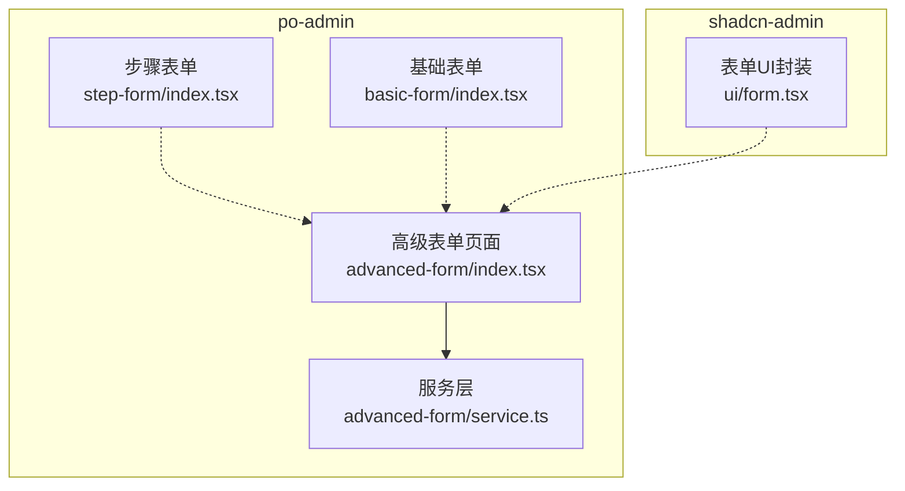
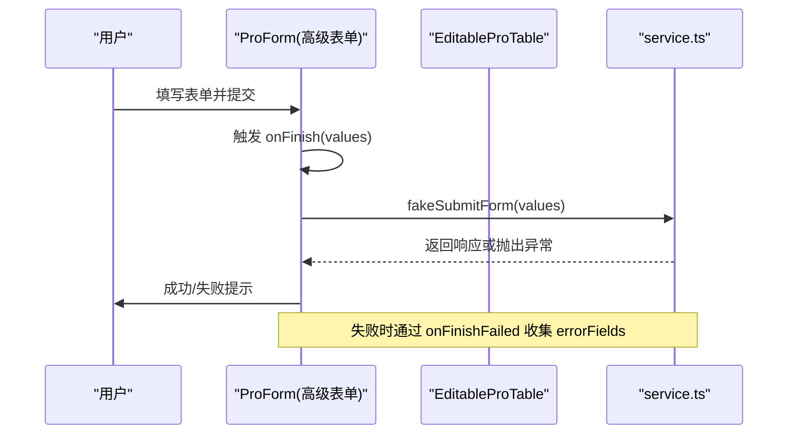
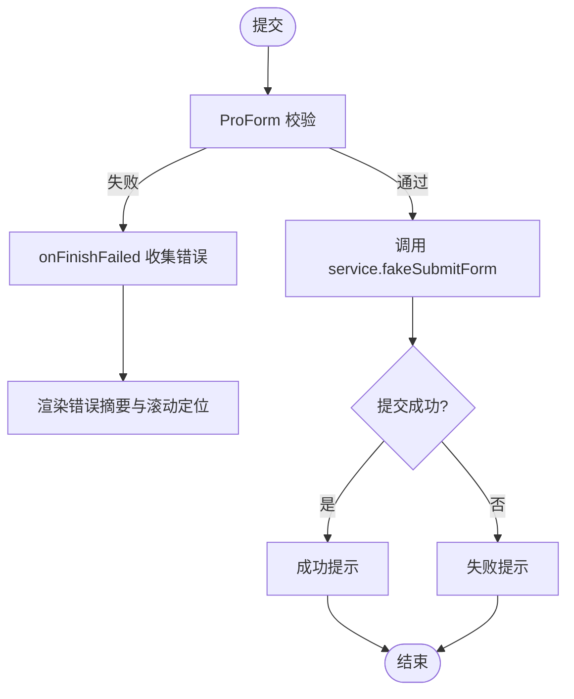
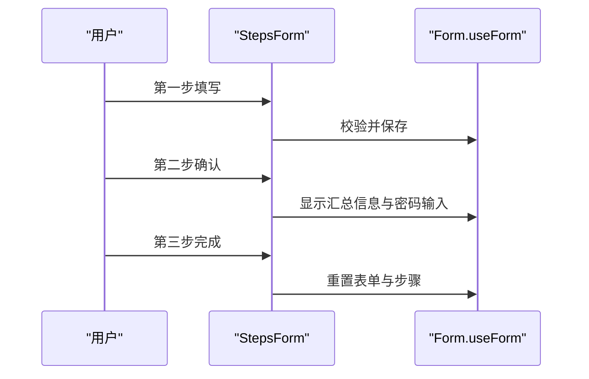
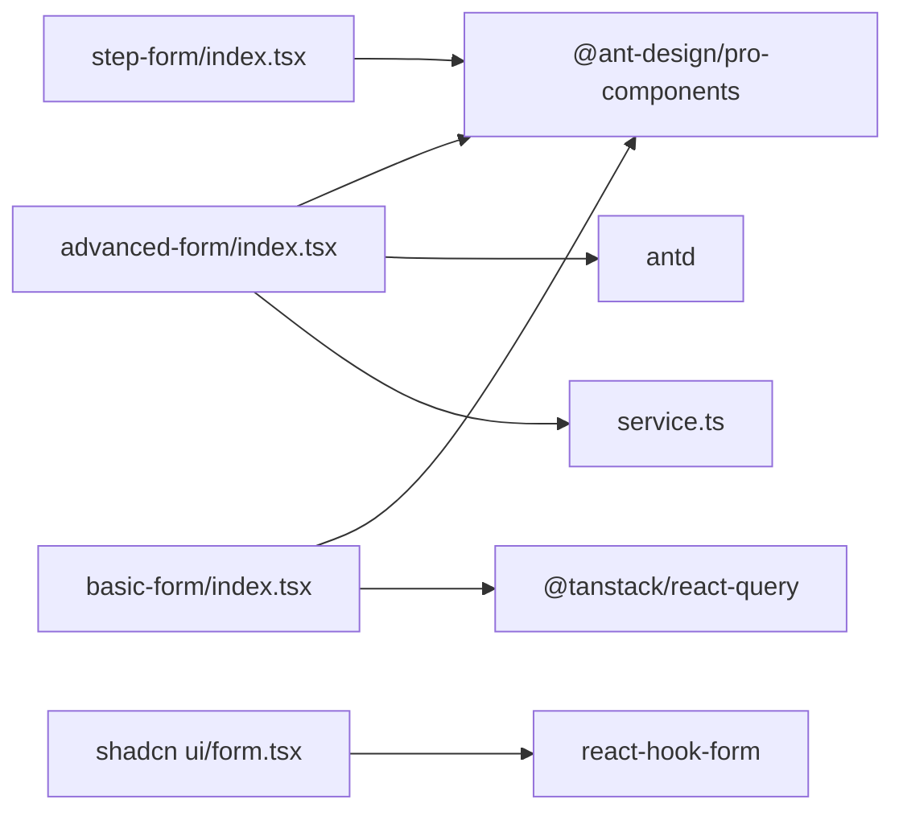

# 高级表单

<cite>
**本文引用的文件**
- [web_client/po-admin/src/pages/form/advanced-form/index.tsx](file://web_client/po-admin/src/pages/form/advanced-form/index.tsx)
- [web_client/po-admin/src/pages/form/advanced-form/service.ts](file://web_client/po-admin/src/pages/form/advanced-form/service.ts)
- [web_client/po-admin/src/pages/form/step-form/index.tsx](file://web_client/po-admin/src/pages/form/step-form/index.tsx)
- [web_client/po-admin/src/pages/form/basic-form/index.tsx](file://web_client/po-admin/src/pages/form/basic-form/index.tsx)
- [web_client/shadcn-admin/src/components/ui/form.tsx](file://web_client/shadcn-admin/src/components/ui/form.tsx)
</cite>

## 目录
1. [简介](#简介)
2. [项目结构](#项目结构)
3. [核心组件](#核心组件)
4. [架构总览](#架构总览)
5. [详细组件分析](#详细组件分析)
6. [依赖关系分析](#依赖关系分析)
7. [性能考虑](#性能考虑)
8. [故障排查指南](#故障排查指南)
9. [结论](#结论)
10. [附录](#附录)

## 简介
本文件面向“高级表单”场景，围绕动态表单生成、嵌套表单结构与批量操作能力展开，系统阐述表单状态管理、数据绑定与事件处理机制；说明复杂验证规则（跨字段校验、异步校验、自定义校验器）的实现思路；给出性能优化策略（虚拟滚动、增量更新、内存管理）与可扩展性设计（插件化、主题定制）。并通过仓库中的实际页面示例，展示大数据量与复杂交互的最佳实践。

## 项目结构
本项目在 web_client 下包含两套前端实现：
- po-admin：基于 Ant Design Pro 的高级表单示例，涵盖基础表单、步骤表单与高级表单（含可编辑表格的批量录入）。
- shadcn-admin：基于 React Hook Form 的可组合表单 UI 组件，提供表单上下文、字段状态与消息渲染等基础能力。

图表来源
- [web_client/po-admin/src/pages/form/advanced-form/index.tsx:1-554](file://web_client/po-admin/src/pages/form/advanced-form/index.tsx#L1-L554)
- [web_client/po-admin/src/pages/form/advanced-form/service.ts:1-9](file://web_client/po-admin/src/pages/form/advanced-form/service.ts#L1-L9)
- [web_client/po-admin/src/pages/form/step-form/index.tsx:1-246](file://web_client/po-admin/src/pages/form/step-form/index.tsx#L1-L246)
- [web_client/po-admin/src/pages/form/basic-form/index.tsx:1-197](file://web_client/po-admin/src/pages/form/basic-form/index.tsx#L1-L197)
- [web_client/shadcn-admin/src/components/ui/form.tsx:1-165](file://web_client/shadcn-admin/src/components/ui/form.tsx#L1-L165)

章节来源
- [web_client/po-admin/src/pages/form/advanced-form/index.tsx:1-554](file://web_client/po-admin/src/pages/form/advanced-form/index.tsx#L1-L554)
- [web_client/po-admin/src/pages/form/advanced-form/service.ts:1-9](file://web_client/po-admin/src/pages/form/advanced-form/service.ts#L1-L9)
- [web_client/po-admin/src/pages/form/step-form/index.tsx:1-246](file://web_client/po-admin/src/pages/form/step-form/index.tsx#L1-L246)
- [web_client/po-admin/src/pages/form/basic-form/index.tsx:1-197](file://web_client/po-admin/src/pages/form/basic-form/index.tsx#L1-L197)
- [web_client/shadcn-admin/src/components/ui/form.tsx:1-165](file://web_client/shadcn-admin/src/components/ui/form.tsx#L1-L165)

## 核心组件
- 高级表单页面（po-admin）：使用 ProForm 组织多区块表单，集成 ProFormText/Select/DateRangePicker/TimePicker 等控件，结合 EditableProTable 实现成员列表的批量录入与行内编辑。提交时通过 service 调用后端接口，统一错误提示与滚动定位。
- 步骤表单（po-admin）：使用 StepsForm 将复杂流程拆分为多步，每步独立校验与展示，最终汇总提交。
- 基础表单（po-admin）：演示常用控件、依赖联动与数值格式化，体现表单联动与数据格式化能力。
- 表单UI封装（shadcn-admin）：基于 react-hook-form 的 FormProvider/Controller/useFormField 组合，提供统一的字段状态、描述与错误消息渲染，便于构建可复用的表单原子组件。

章节来源
- [web_client/po-admin/src/pages/form/advanced-form/index.tsx:175-550](file://web_client/po-admin/src/pages/form/advanced-form/index.tsx#L175-L550)
- [web_client/po-admin/src/pages/form/step-form/index.tsx:70-246](file://web_client/po-admin/src/pages/form/step-form/index.tsx#L70-L246)
- [web_client/po-admin/src/pages/form/basic-form/index.tsx:18-197](file://web_client/po-admin/src/pages/form/basic-form/index.tsx#L18-L197)
- [web_client/shadcn-admin/src/components/ui/form.tsx:16-165](file://web_client/shadcn-admin/src/components/ui/form.tsx#L16-L165)

## 架构总览
高级表单采用“页面容器 + 表单域 + 子表 + 服务层”的分层结构：
- 页面容器：负责布局、初始值、提交回调与失败回调。
- 表单域：各业务区块以卡片划分，使用 ProForm.* 控件声明式配置。
- 子表：EditableProTable 作为嵌套表单，承载批量数据录入，行级编辑与新增由 table 内置能力驱动。
- 服务层：统一请求封装，集中处理网络异常与结果反馈。

图表来源
- [web_client/po-admin/src/pages/form/advanced-form/index.tsx:127-138](file://web_client/po-admin/src/pages/form/advanced-form/index.tsx#L127-L138)
- [web_client/po-admin/src/pages/form/advanced-form/service.ts:3-8](file://web_client/po-admin/src/pages/form/advanced-form/service.ts#L3-L8)

章节来源
- [web_client/po-admin/src/pages/form/advanced-form/index.tsx:127-138](file://web_client/po-admin/src/pages/form/advanced-form/index.tsx#L127-L138)
- [web_client/po-admin/src/pages/form/advanced-form/service.ts:1-9](file://web_client/po-admin/src/pages/form/advanced-form/service.ts#L1-L9)

## 详细组件分析

### 高级表单（po-admin）
- 表单状态与事件
  - 使用 ProForm 的 initialValues 注入默认数据（如 members 列表）。
  - onFinish 中调用服务层进行提交，成功后提示并清空错误。
  - onFinishFailed 捕获校验失败字段，用于顶部错误摘要与滚动定位。
- 嵌套表单与批量操作
  - 使用 ProForm.Item(name="members") 包裹 EditableProTable，实现行级新增/编辑，key 自增避免重复。
  - columns 定义列与操作按钮，支持行内编辑入口。
- 错误提示与用户体验
  - 自定义错误摘要 Popover，点击条目自动滚动到对应字段标签位置。
  - 通过 fieldLabels 映射字段名到中文标签，提升可读性。

图表来源
- [web_client/po-admin/src/pages/form/advanced-form/index.tsx:66-138](file://web_client/po-admin/src/pages/form/advanced-form/index.tsx#L66-L138)
- [web_client/po-admin/src/pages/form/advanced-form/index.tsx:175-550](file://web_client/po-admin/src/pages/form/advanced-form/index.tsx#L175-L550)
- [web_client/po-admin/src/pages/form/advanced-form/service.ts:3-8](file://web_client/po-admin/src/pages/form/advanced-form/service.ts#L3-L8)

章节来源
- [web_client/po-admin/src/pages/form/advanced-form/index.tsx:66-138](file://web_client/po-admin/src/pages/form/advanced-form/index.tsx#L66-L138)
- [web_client/po-admin/src/pages/form/advanced-form/index.tsx:175-550](file://web_client/po-admin/src/pages/form/advanced-form/index.tsx#L175-L550)
- [web_client/po-admin/src/pages/form/advanced-form/service.ts:1-9](file://web_client/po-admin/src/pages/form/advanced-form/service.ts#L1-L9)

### 步骤表单（po-admin）
- 多步流程拆分：StepsForm 将复杂任务拆为“填写信息 -> 确认信息 -> 完成”，每步独立校验与展示。
- 表单状态共享：通过 formRef 与 useState 维护 stepData，在各步之间传递与回显。
- 提交后行为：完成步重置表单与步骤，便于再次操作。

图表来源
- [web_client/po-admin/src/pages/form/step-form/index.tsx:70-246](file://web_client/po-admin/src/pages/form/step-form/index.tsx#L70-L246)

章节来源
- [web_client/po-admin/src/pages/form/step-form/index.tsx:70-246](file://web_client/po-admin/src/pages/form/step-form/index.tsx#L70-L246)

### 基础表单（po-admin）
- 常用控件组合：文本、日期范围、数字、单选、依赖联动等。
- 数据格式化：数字字段通过 formatter/parser 实现百分比显示与解析。
- 依赖联动：ProFormDependency 根据公开类型动态显示可选用户选择。

章节来源
- [web_client/po-admin/src/pages/form/basic-form/index.tsx:18-197](file://web_client/po-admin/src/pages/form/basic-form/index.tsx#L18-L197)

### 表单UI封装（shadcn-admin）
- 基于 react-hook-form 的 Provider/Controller/useFormField 组合，提供：
  - 字段上下文与状态获取（useFormContext、getFieldState）
  - 统一的 Label/Control/Description/Message 组件
  - 无障碍属性与错误态样式控制
- 适合封装业务表单原子组件，复用校验与展示逻辑。

章节来源
- [web_client/shadcn-admin/src/components/ui/form.tsx:16-165](file://web_client/shadcn-admin/src/components/ui/form.tsx#L16-L165)

## 依赖关系分析
- 高级表单页面依赖：
  - @ant-design/pro-components：ProForm、ProForm.*、EditableProTable、PageContainer、FooterToolbar 等。
  - antd：Button、Card、Col、Row、message、Popover 等。
  - 本地 service.ts：封装 /api/advancedForm 的 POST 请求。
- 步骤表单依赖：
  - StepsForm 及 ProForm.* 控件，配合 antd Result、Descriptions、Statistic 等。
- 基础表单依赖：
  - ProForm.* 控件与 antd message，以及 react-query 的 useMutation 做缓存失效。
- shadcn-admin 表单封装依赖：
  - react-hook-form、@radix-ui/react-label、Slot 等，提供可组合的表单原语。

图表来源
- [web_client/po-admin/src/pages/form/advanced-form/index.tsx:1-17](file://web_client/po-admin/src/pages/form/advanced-form/index.tsx#L1-L17)
- [web_client/po-admin/src/pages/form/advanced-form/service.ts:1-8](file://web_client/po-admin/src/pages/form/advanced-form/service.ts#L1-L8)
- [web_client/po-admin/src/pages/form/step-form/index.tsx:1-21](file://web_client/po-admin/src/pages/form/step-form/index.tsx#L1-L21)
- [web_client/po-admin/src/pages/form/basic-form/index.tsx:1-16](file://web_client/po-admin/src/pages/form/basic-form/index.tsx#L1-L16)
- [web_client/shadcn-admin/src/components/ui/form.tsx:1-15](file://web_client/shadcn-admin/src/components/ui/form.tsx#L1-L15)

章节来源
- [web_client/po-admin/src/pages/form/advanced-form/index.tsx:1-17](file://web_client/po-admin/src/pages/form/advanced-form/index.tsx#L1-L17)
- [web_client/po-admin/src/pages/form/advanced-form/service.ts:1-8](file://web_client/po-admin/src/pages/form/advanced-form/service.ts#L1-L8)
- [web_client/po-admin/src/pages/form/step-form/index.tsx:1-21](file://web_client/po-admin/src/pages/form/step-form/index.tsx#L1-L21)
- [web_client/po-admin/src/pages/form/basic-form/index.tsx:1-16](file://web_client/po-admin/src/pages/form/basic-form/index.tsx#L1-L16)
- [web_client/shadcn-admin/src/components/ui/form.tsx:1-15](file://web_client/shadcn-admin/src/components/ui/form.tsx#L1-L15)

## 性能考虑
- 虚拟滚动
  - 当成员列表规模较大时，建议对 EditableProTable 启用分页或虚拟滚动方案（例如结合外部虚拟化库），减少首屏渲染节点数量，降低内存占用与重排开销。
- 增量更新
  - 在步骤表单中，仅在当前步骤变更时更新局部状态，避免全量重渲染；提交前再合并完整数据。
  - 基础表单中使用 react-query 的 mutation 与 invalidateQueries，精准刷新相关数据缓存，减少不必要的全局状态更新。
- 内存管理
  - 为动态新增的行设置稳定且唯一的 key（如自增 id），避免 React Diff 误判导致重复创建节点。
  - 及时清理不必要的副作用与监听器，避免闭包引用导致的内存泄漏。
- 校验优化
  - 将耗时校验（如远程唯一性检查）延迟到失焦或提交阶段，避免频繁触发。
  - 合理使用 rules 的 type/pattern 等内置校验，减少自定义校验复杂度。

[本节为通用指导，不直接分析具体文件]

## 故障排查指南
- 提交失败
  - 检查 onFinishFailed 是否正确收集 errorFields，并在界面展示错误摘要。
  - 确认 service 层请求路径与方法正确，网络异常时给出明确提示。
- 滚动定位失效
  - 确保 label 的 for 属性与目标字段关联，滚动函数依据该属性查找 DOM 节点。
- 步骤表单状态不同步
  - 确认 formRef 指向同一实例，步骤间通过 setStepData 同步数据。
- 表单联动未生效
  - 检查 ProFormDependency 的 name 数组是否覆盖所有依赖字段，确保条件渲染逻辑正确。

章节来源
- [web_client/po-admin/src/pages/form/advanced-form/index.tsx:66-138](file://web_client/po-admin/src/pages/form/advanced-form/index.tsx#L66-L138)
- [web_client/po-admin/src/pages/form/step-form/index.tsx:70-246](file://web_client/po-admin/src/pages/form/step-form/index.tsx#L70-L246)
- [web_client/po-admin/src/pages/form/basic-form/index.tsx:18-197](file://web_client/po-admin/src/pages/form/basic-form/index.tsx#L18-L197)

## 结论
本项目提供了从基础到高级的完整表单范式：基础表单演示常用控件与联动；步骤表单解决长流程体验问题；高级表单通过 EditableProTable 实现批量录入与行内编辑，并结合错误摘要与滚动定位提升可用性。结合 shadcn-admin 的表单封装，可在更大范围内复用字段状态与展示逻辑。针对大数据量与复杂交互，建议引入虚拟滚动、增量更新与内存管理策略，以获得更优的性能表现。

[本节为总结性内容，不直接分析具体文件]

## 附录
- 扩展建议
  - 插件化：将常见字段（如地址、电话、富文本）封装为可插拔组件，通过配置项接入表单。
  - 主题定制：利用 CSS-in-JS 或样式变量，统一表单间距、字号与颜色，适配多套主题。
  - 国际化：将字段标签与提示信息抽离至 i18n 资源，便于多语言切换。
- 最佳实践清单
  - 使用稳定的 key 与合理的初始值。
  - 将复杂校验下沉到服务层或异步校验器。
  - 对大列表使用分页/虚拟滚动。
  - 提交前后保持状态一致，错误信息清晰可定位。

[本节为通用指导，不直接分析具体文件]