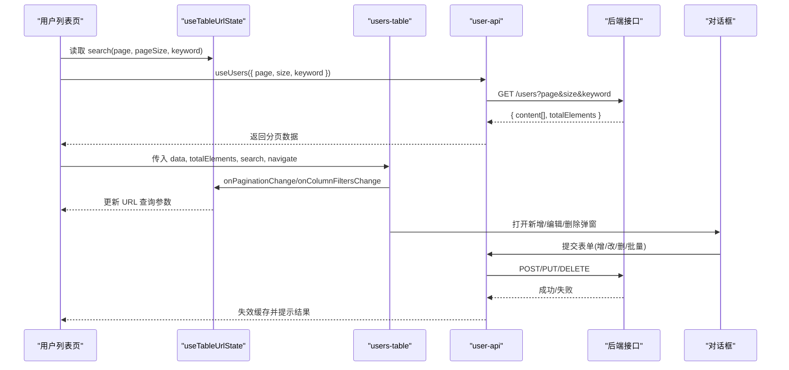
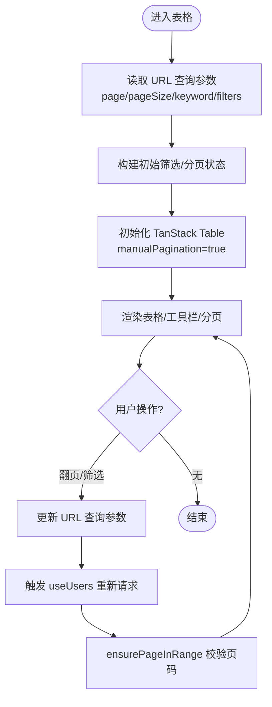
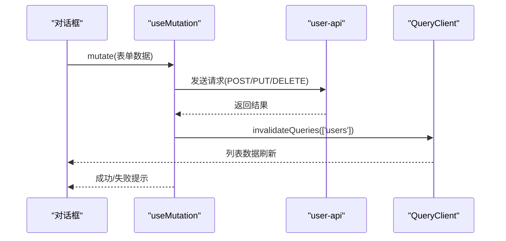
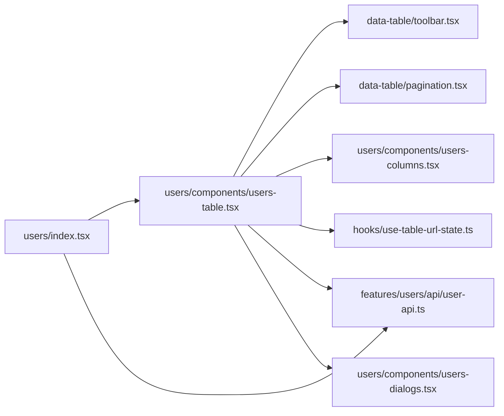

# 表格管理页面

<cite>
**本文引用的文件**
- [web_client/shadcn-admin/src/features/users/index.tsx](file://web_client/shadcn-admin/src/features/users/index.tsx)
- [web_client/shadcn-admin/src/features/users/components/users-table.tsx](file://web_client/shadcn-admin/src/features/users/components/users-table.tsx)
- [web_client/shadcn-admin/src/features/users/components/users-columns.tsx](file://web_client/shadcn-admin/src/features/users/components/users-columns.tsx)
- [web_client/shadcn-admin/src/features/users/api/user-api.ts](file://web_client/shadcn-admin/src/features/users/api/user-api.ts)
- [web_client/shadcn-admin/src/hooks/use-table-url-state.ts](file://web_client/shadcn-admin/src/hooks/use-table-url-state.ts)
- [web_client/shadcn-admin/src/components/data-table/pagination.tsx](file://web_client/shadcn-admin/src/components/data-table/pagination.tsx)
- [web_client/shadcn-admin/src/components/data-table/toolbar.tsx](file://web_client/shadcn-admin/src/components/data-table/toolbar.tsx)
- [web_client/shadcn-admin/src/components/data-table/index.ts](file://web_client/shadcn-admin/src/components/data-table/index.ts)
- [web_client/shadcn-admin/src/features/users/components/data-table-bulk-actions.tsx](file://web_client/shadcn-admin/src/features/users/components/data-table-bulk-actions.tsx)
- [web_client/shadcn-admin/src/features/users/components/data-table-row-actions.tsx](file://web_client/shadcn-admin/src/features/users/components/data-table-row-actions.tsx)
- [web_client/shadcn-admin/src/features/users/components/users-dialogs.tsx](file://web_client/shadcn-admin/src/features/users/components/users-dialogs.tsx)
</cite>

## 目录
1. [简介](#简介)
2. [项目结构](#项目结构)
3. [核心组件](#核心组件)
4. [架构总览](#架构总览)
5. [详细组件分析](#详细组件分析)
6. [依赖关系分析](#依赖关系分析)
7. [性能考量](#性能考量)
8. [故障排查指南](#故障排查指南)
9. [结论](#结论)
10. [附录](#附录)

## 简介
本文件面向“表格管理页面”的完整实现，围绕数据表格的核心能力展开：CRUD 操作、排序与分页加载、创建/更新表单集成（含验证、提交与错误处理）、高级特性（列定制、行选择、批量操作），以及大数据量下的性能优化策略。文档以用户管理页面为业务场景，结合任务列表作为对比示例，帮助读者快速掌握从数据获取到交互落地的端到端流程与最佳实践。

## 项目结构
前端采用 React + TanStack Table + React Query 的组合，表格能力由通用 data-table 组件提供，业务页面通过 features 模块组织。关键路径如下：
- 页面入口：用户列表页负责路由状态解析、数据请求与渲染调度
- 表格容器：封装 TanStack Table 实例、URL 状态同步、筛选/分页/排序等
- 工具栏与分页：搜索防抖、多列筛选、分页控件
- API 层：基于 React Query 的查询与变更钩子，统一错误与缓存刷新
- 对话框：新增/编辑/删除/邀请等弹窗的统一挂载与管理

```mermaid
graph TB
subgraph "页面"
UIndex["users/index.tsx"]
end
subgraph "表格"
UTable["users/components/users-table.tsx"]
Toolbar["components/data-table/toolbar.tsx"]
Pagination["components/data-table/pagination.tsx"]
Columns["users/components/users-columns.tsx"]
end
subgraph "API"
API["features/users/api/user-api.ts"]
end
subgraph "URL状态"
URLHook["hooks/use-table-url-state.ts"]
end
subgraph "对话框"
Dialogs["users/components/users-dialogs.tsx"]
end
UIndex --> UTable
UTable --> Toolbar
UTable --> Pagination
UTable --> Columns
UTable --> URLHook
UIndex --> API
UTable --> API
UTable --> Dialogs
```

图表来源
- [web_client/shadcn-admin/src/features/users/index.tsx:1-75](file://web_client/shadcn-admin/src/features/users/index.tsx#L1-L75)
- [web_client/shadcn-admin/src/features/users/components/users-table.tsx:1-196](file://web_client/shadcn-admin/src/features/users/components/users-table.tsx#L1-L196)
- [web_client/shadcn-admin/src/components/data-table/toolbar.tsx:1-146](file://web_client/shadcn-admin/src/components/data-table/toolbar.tsx#L1-L146)
- [web_client/shadcn-admin/src/components/data-table/pagination.tsx:1-131](file://web_client/shadcn-admin/src/components/data-table/pagination.tsx#L1-L131)
- [web_client/shadcn-admin/src/features/users/components/users-columns.tsx:1-139](file://web_client/shadcn-admin/src/features/users/components/users-columns.tsx#L1-L139)
- [web_client/shadcn-admin/src/features/users/api/user-api.ts:1-148](file://web_client/shadcn-admin/src/features/users/api/user-api.ts#L1-L148)
- [web_client/shadcn-admin/src/hooks/use-table-url-state.ts:1-220](file://web_client/shadcn-admin/src/hooks/use-table-url-state.ts#L1-L220)
- [web_client/shadcn-admin/src/features/users/components/users-dialogs.tsx:1-52](file://web_client/shadcn-admin/src/features/users/components/users-dialogs.tsx#L1-L52)

章节来源
- [web_client/shadcn-admin/src/features/users/index.tsx:1-75](file://web_client/shadcn-admin/src/features/users/index.tsx#L1-L75)

## 核心组件
- 用户列表页：解析路由参数（页码、每页条数、关键词），调用 useUsers 获取分页数据，渲染表格与对话框。
- 表格容器：使用 TanStack Table 配置手动分页、行选择、列可见性、过滤与排序；通过 useTableUrlState 将筛选/分页状态与 URL 双向同步。
- 工具栏：支持全局搜索与多列筛选，内置中文输入法组合阶段防抖，避免频繁触发过滤。
- 分页器：展示页码、每页条数选择、前后翻页与首尾页跳转。
- API 层：useQuery 获取列表/详情，useMutation 完成增删改与批量操作，成功后自动失效并刷新列表缓存。
- 对话框：统一管理新增、编辑、删除、邀请等弹窗生命周期，支持预填充与关闭后清理。

章节来源
- [web_client/shadcn-admin/src/features/users/index.tsx:1-75](file://web_client/shadcn-admin/src/features/users/index.tsx#L1-L75)
- [web_client/shadcn-admin/src/features/users/components/users-table.tsx:1-196](file://web_client/shadcn-admin/src/features/users/components/users-table.tsx#L1-L196)
- [web_client/shadcn-admin/src/components/data-table/toolbar.tsx:1-146](file://web_client/shadcn-admin/src/components/data-table/toolbar.tsx#L1-L146)
- [web_client/shadcn-admin/src/components/data-table/pagination.tsx:1-131](file://web_client/shadcn-admin/src/components/data-table/pagination.tsx#L1-L131)
- [web_client/shadcn-admin/src/features/users/api/user-api.ts:1-148](file://web_client/shadcn-admin/src/features/users/api/user-api.ts#L1-L148)
- [web_client/shadcn-admin/src/features/users/components/users-dialogs.tsx:1-52](file://web_client/shadcn-admin/src/features/users/components/users-dialogs.tsx#L1-L52)

## 架构总览
下图展示了从页面到数据再到 UI 的完整链路，包括 URL 状态同步、服务端分页、表单提交与缓存刷新。



图表来源
- [web_client/shadcn-admin/src/features/users/index.tsx:1-75](file://web_client/shadcn-admin/src/features/users/index.tsx#L1-L75)
- [web_client/shadcn-admin/src/features/users/components/users-table.tsx:1-196](file://web_client/shadcn-admin/src/features/users/components/users-table.tsx#L1-L196)
- [web_client/shadcn-admin/src/features/users/api/user-api.ts:1-148](file://web_client/shadcn-admin/src/features/users/api/user-api.ts#L1-L148)
- [web_client/shadcn-admin/src/hooks/use-table-url-state.ts:1-220](file://web_client/shadcn-admin/src/hooks/use-table-url-state.ts#L1-L220)

## 详细组件分析

### 表格容器与 URL 状态同步
- 使用 TanStack Table 的 manualPagination 模式，pageCount 由服务端 totalElements 计算，避免前端全量排序/过滤带来的性能问题。
- 通过 useTableUrlState 将分页、列筛选、全局筛选与 URL 查询参数双向绑定，支持分享链接与浏览器前进后退。
- 在数据变化后调用 ensurePageInRange，防止当前页码超出范围导致空白页。



图表来源
- [web_client/shadcn-admin/src/features/users/components/users-table.tsx:1-196](file://web_client/shadcn-admin/src/features/users/components/users-table.tsx#L1-L196)
- [web_client/shadcn-admin/src/hooks/use-table-url-state.ts:1-220](file://web_client/shadcn-admin/src/hooks/use-table-url-state.ts#L1-L220)

章节来源
- [web_client/shadcn-admin/src/features/users/components/users-table.tsx:1-196](file://web_client/shadcn-admin/src/features/users/components/users-table.tsx#L1-L196)
- [web_client/shadcn-admin/src/hooks/use-table-url-state.ts:1-220](file://web_client/shadcn-admin/src/hooks/use-table-url-state.ts#L1-L220)

### 工具栏与搜索防抖
- 支持按列筛选与全局搜索，针对中文输入法的组合阶段进行拦截，避免中间态触发过滤。
- 输入停止 300ms 后才执行 onChange，减少不必要的请求与重渲染。
- 当存在筛选时提供一键重置按钮，清空列筛选与全局筛选。

章节来源
- [web_client/shadcn-admin/src/components/data-table/toolbar.tsx:1-146](file://web_client/shadcn-admin/src/components/data-table/toolbar.tsx#L1-L146)

### 分页器
- 显示当前页/总页数、每页条数选择、前后翻页与首尾页跳转。
- 与 URL 状态联动，切换页码或每页条数会同步至 URL，便于分享与恢复。

章节来源
- [web_client/shadcn-admin/src/components/data-table/pagination.tsx:1-131](file://web_client/shadcn-admin/src/components/data-table/pagination.tsx#L1-L131)

### 列定义与高级特性
- 列定制：支持列隐藏、排序开关、自定义渲染（如状态徽章、角色图标）。
- 行选择：启用多选，配合批量操作工具栏。
- 列头：可点击排序（若开启），并提供统一的列头样式。

章节来源
- [web_client/shadcn-admin/src/features/users/components/users-columns.tsx:1-139](file://web_client/shadcn-admin/src/features/users/components/users-columns.tsx#L1-L139)

### CRUD 与表单集成
- 创建表单：通过对话框挂载，提交后调用 useCreateUser，成功后使列表缓存失效并提示成功。
- 更新表单：动态加载当前行数据进行预填充，提交后调用 useUpdateUser，同样失效缓存并提示。
- 删除与批量操作：单行删除与批量删除/状态更新，均通过 mutation 完成，并在成功后刷新列表。
- 错误处理：统一通过 onError 捕获错误消息并提示，保证用户体验一致。



图表来源
- [web_client/shadcn-admin/src/features/users/api/user-api.ts:1-148](file://web_client/shadcn-admin/src/features/users/api/user-api.ts#L1-L148)
- [web_client/shadcn-admin/src/features/users/components/users-dialogs.tsx:1-52](file://web_client/shadcn-admin/src/features/users/components/users-dialogs.tsx#L1-L52)

章节来源
- [web_client/shadcn-admin/src/features/users/api/user-api.ts:1-148](file://web_client/shadcn-admin/src/features/users/api/user-api.ts#L1-L148)
- [web_client/shadcn-admin/src/features/users/components/users-dialogs.tsx:1-52](file://web_client/shadcn-admin/src/features/users/components/users-dialogs.tsx#L1-L52)

### 批量操作
- 行选择后，批量操作工具栏提供激活/停用、邀请、批量删除等操作。
- 批量状态更新与批量删除通过专用 mutation 完成，成功后清空选择并刷新列表。

章节来源
- [web_client/shadcn-admin/src/features/users/components/data-table-bulk-actions.tsx:1-127](file://web_client/shadcn-admin/src/features/users/components/data-table-bulk-actions.tsx#L1-L127)
- [web_client/shadcn-admin/src/features/users/api/user-api.ts:116-148](file://web_client/shadcn-admin/src/features/users/api/user-api.ts#L116-L148)

### 行操作菜单
- 每行提供下拉菜单，支持编辑与删除，点击后将当前行数据注入上下文并打开对应对话框。

章节来源
- [web_client/shadcn-admin/src/features/users/components/data-table-row-actions.tsx:1-64](file://web_client/shadcn-admin/src/features/users/components/data-table-row-actions.tsx#L1-L64)

## 依赖关系分析
- 页面依赖表格容器、API 与对话框；表格容器依赖工具栏、分页器、列定义与 URL 状态钩子。
- API 层依赖 axios 与 React Query，负责数据获取与缓存管理。
- 工具栏与分页器为通用组件，被多个表格复用。



图表来源
- [web_client/shadcn-admin/src/features/users/index.tsx:1-75](file://web_client/shadcn-admin/src/features/users/index.tsx#L1-L75)
- [web_client/shadcn-admin/src/features/users/components/users-table.tsx:1-196](file://web_client/shadcn-admin/src/features/users/components/users-table.tsx#L1-L196)
- [web_client/shadcn-admin/src/components/data-table/toolbar.tsx:1-146](file://web_client/shadcn-admin/src/components/data-table/toolbar.tsx#L1-L146)
- [web_client/shadcn-admin/src/components/data-table/pagination.tsx:1-131](file://web_client/shadcn-admin/src/components/data-table/pagination.tsx#L1-L131)
- [web_client/shadcn-admin/src/features/users/components/users-columns.tsx:1-139](file://web_client/shadcn-admin/src/features/users/components/users-columns.tsx#L1-L139)
- [web_client/shadcn-admin/src/features/users/api/user-api.ts:1-148](file://web_client/shadcn-admin/src/features/users/api/user-api.ts#L1-L148)
- [web_client/shadcn-admin/src/hooks/use-table-url-state.ts:1-220](file://web_client/shadcn-admin/src/hooks/use-table-url-state.ts#L1-L220)
- [web_client/shadcn-admin/src/features/users/components/users-dialogs.tsx:1-52](file://web_client/shadcn-admin/src/features/users/components/users-dialogs.tsx#L1-L52)

章节来源
- [web_client/shadcn-admin/src/features/users/index.tsx:1-75](file://web_client/shadcn-admin/src/features/users/index.tsx#L1-L75)
- [web_client/shadcn-admin/src/features/users/components/users-table.tsx:1-196](file://web_client/shadcn-admin/src/features/users/components/users-table.tsx#L1-L196)
- [web_client/shadcn-admin/src/features/users/api/user-api.ts:1-148](file://web_client/shadcn-admin/src/features/users/api/user-api.ts#L1-L148)

## 性能考量
- 服务端分页：使用 manualPagination，仅渲染当前页数据，降低内存占用与渲染压力。
- URL 状态同步：分页与筛选状态持久化到 URL，避免重复请求与状态丢失。
- 搜索防抖：工具栏输入延迟 300ms 触发过滤，减少频繁请求与重渲染。
- 缓存失效：表单提交成功后仅失效相关查询键，精准刷新列表。
- 列渲染优化：对长文本使用截断组件，减少布局抖动；禁用不必要的排序/隐藏以提升性能。
- 大数据建议：
  - 合理设置每页条数，避免过大导致首屏卡顿。
  - 对复杂筛选尽量在服务端完成，前端只做轻量过滤。
  - 对图片/富文本等资源进行懒加载与压缩。
  - 必要时引入虚拟滚动或增量加载。

[本节为通用指导，不直接分析具体文件]

## 故障排查指南
- 列表为空：检查 URL 查询参数是否正确传递至 useUsers；确认后端返回结构与字段名是否匹配。
- 分页异常：确保 pageCount 由服务端 totalElements 计算；使用 ensurePageInRange 校验页码范围。
- 筛选无效：确认列筛选类型（string/array）与序列化/反序列化逻辑；检查工具栏是否启用了对应列的 filterFn。
- 表单提交失败：查看 onError 回调中的错误信息；确认请求体字段与后端契约一致。
- 批量操作无响应：检查选中行是否为空；确认批量接口地址与参数格式正确。

章节来源
- [web_client/shadcn-admin/src/features/users/api/user-api.ts:1-148](file://web_client/shadcn-admin/src/features/users/api/user-api.ts#L1-L148)
- [web_client/shadcn-admin/src/features/users/components/users-table.tsx:92-94](file://web_client/shadcn-admin/src/features/users/components/users-table.tsx#L92-L94)
- [web_client/shadcn-admin/src/components/data-table/toolbar.tsx:14-66](file://web_client/shadcn-admin/src/components/data-table/toolbar.tsx#L14-L66)

## 结论
该表格管理页面以 TanStack Table 为核心，结合 React Query 与服务端分页，实现了高效、可维护的数据管理能力。通过 URL 状态同步、搜索防抖、列定制与批量操作，兼顾了功能完整性与用户体验。在大数据场景下，建议继续强化服务端能力与前端渲染优化，以获得更流畅的交互体验。

[本节为总结，不直接分析具体文件]

## 附录
- 参考示例：任务列表页面展示了类似的表格结构与列定义方式，可作为扩展业务的模板。

章节来源
- [web_client/shadcn-admin/src/features/tasks/index.tsx:1-42](file://web_client/shadcn-admin/src/features/tasks/index.tsx#L1-L42)
- [web_client/shadcn-admin/src/features/tasks/components/tasks-columns.tsx:1-124](file://web_client/shadcn-admin/src/features/tasks/components/tasks-columns.tsx#L1-L124)