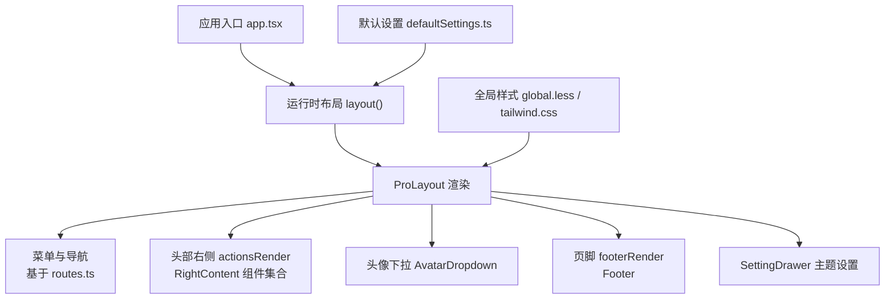
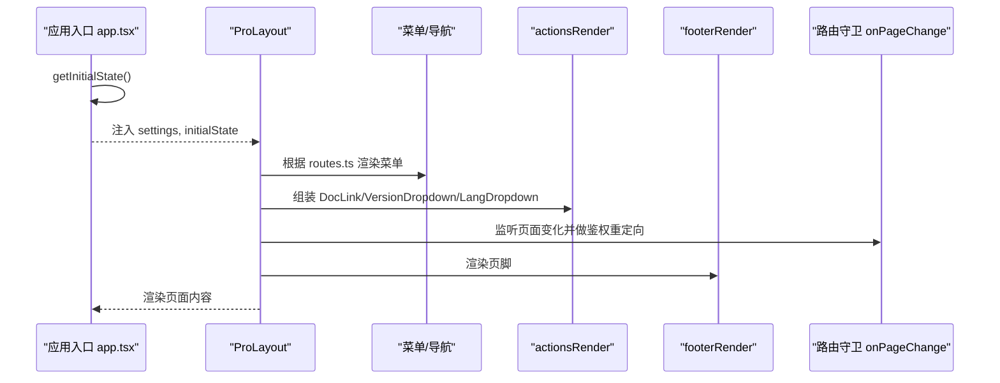
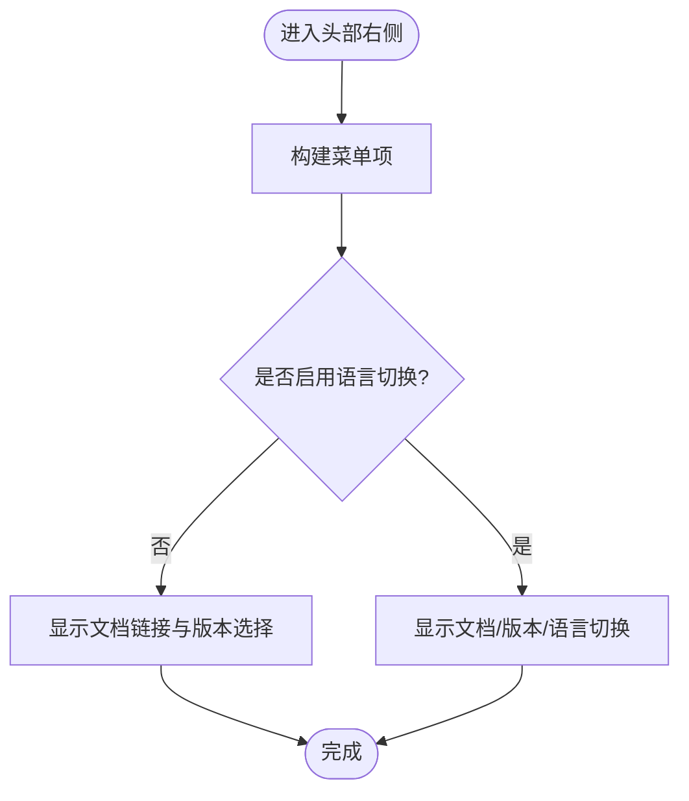
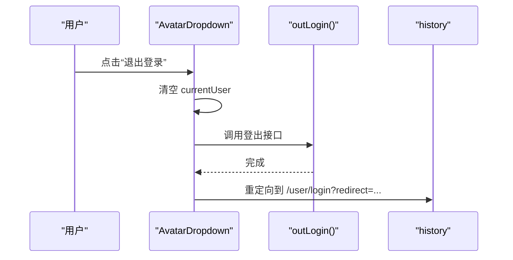
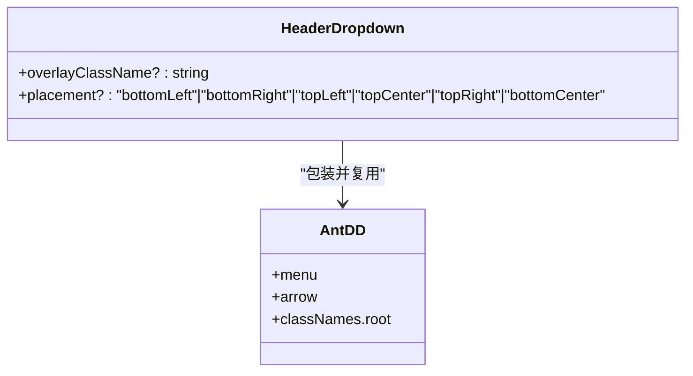
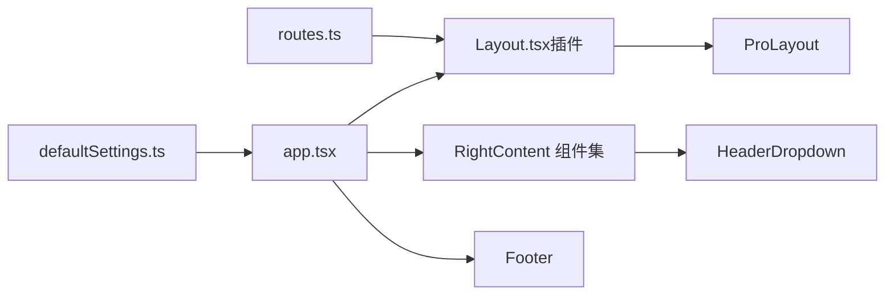

# 布局系统

<cite>
**本文引用的文件**
- [app.tsx](file://web_client/po-admin/src/app.tsx)
- [defaultSettings.ts](file://web_client/po-admin/config/defaultSettings.ts)
- [routes.ts](file://web_client/po-admin/config/routes.ts)
- [index.tsx（RightContent）](file://web_client/po-admin/src/components/RightContent/index.tsx)
- [LangDropdown.tsx](file://web_client/po-admin/src/components/RightContent/LangDropdown.tsx)
- [VersionDropdown.tsx](file://web_client/po-admin/src/components/RightContent/VersionDropdown.tsx)
- [AvatarDropdown.tsx](file://web_client/po-admin/src/components/RightContent/AvatarDropdown.tsx)
- [HeaderDropdown.tsx](file://web_client/po-admin/src/components/HeaderDropdown/index.tsx)
- [Footer/index.tsx](file://web_client/po-admin/src/components/Footer/index.tsx)
- [global.less](file://web_client/po-admin/src/global.less)
- [tailwind.css](file://web_client/po-admin/tailwind.css)
- [Layout.tsx（插件生成）](file://web_client/po-admin/src/.umi/plugin-layout/Layout.tsx)
</cite>

## 目录
1. [简介](#简介)
2. [项目结构](#项目结构)
3. [核心组件](#核心组件)
4. [架构总览](#架构总览)
5. [详细组件分析](#详细组件分析)
6. [依赖关系分析](#依赖关系分析)
7. [性能考虑](#性能考虑)
8. [故障排查指南](#故障排查指南)
9. [结论](#结论)
10. [附录](#附录)

## 简介
本文件面向 Ant Design Pro 的布局系统，围绕 ProLayout 的布局与导航架构进行系统化说明。重点覆盖：
- 侧边栏菜单配置与路由集成
- 顶部头部区域与用户交互组件（头像下拉、语言切换、版本信息）
- HeaderDropdown 下拉实现模式与事件处理
- Footer 页脚定制与版权信息展示
- 全局样式与主题定制、响应式适配
- 布局扩展方法与自定义布局实践

## 项目结构
本项目采用 Umi + Ant Design Pro 的工程组织方式，布局相关代码主要分布在以下位置：
- 应用入口与运行时布局配置：src/app.tsx
- 默认布局设置：config/defaultSettings.ts
- 路由定义：config/routes.ts
- 头部右侧组件：components/RightContent/*
- 通用下拉容器：components/HeaderDropdown/index.tsx
- 页脚：components/Footer/index.tsx
- 全局样式与主题：src/global.less、tailwind.css
- 插件生成的布局壳：src/.umi/plugin-layout/Layout.tsx

图表来源
- [app.tsx:76-184](file://web_client/po-admin/src/app.tsx#L76-L184)
- [defaultSettings.ts:1-26](file://web_client/po-admin/config/defaultSettings.ts#L1-L26)
- [routes.ts:1-298](file://web_client/po-admin/config/routes.ts#L1-L298)

章节来源
- [app.tsx:76-184](file://web_client/po-admin/src/app.tsx#L76-L184)
- [defaultSettings.ts:1-26](file://web_client/po-admin/config/defaultSettings.ts#L1-L26)
- [routes.ts:1-298](file://web_client/po-admin/config/routes.ts#L1-L298)

## 核心组件
- ProLayout 运行时配置：在应用入口通过 layout 钩子注入菜单渲染、动作区、头像区、页脚、页面跳转守卫等能力。
- RightContent 组件集：文档链接、版本选择、语言切换按钮，统一使用 HeaderDropdown 提供一致的下拉体验。
- HeaderDropdown：封装 antd Dropdown，提供移动端宽度适配与图标对齐样式。
- Footer：展示版本号、提交哈希、Umi/Utoo 版本及 GitHub 链接。
- 全局样式：字体引入、基础重置、表格响应式、侧边栏固定定位修正等。

章节来源
- [app.tsx:76-184](file://web_client/po-admin/src/app.tsx#L76-L184)
- [index.tsx（RightContent）:1-27](file://web_client/po-admin/src/components/RightContent/index.tsx#L1-L27)
- [HeaderDropdown.tsx:1-52](file://web_client/po-admin/src/components/HeaderDropdown/index.tsx#L1-L52)
- [Footer/index.tsx:1-135](file://web_client/po-admin/src/components/Footer/index.tsx#L1-L135)
- [global.less:1-93](file://web_client/po-admin/src/global.less#L1-L93)

## 架构总览
下图展示了从应用启动到页面渲染的关键流程，包括初始状态获取、路由守卫、菜单渲染、头部动作区组装以及页脚挂载。

图表来源
- [app.tsx:32-73](file://web_client/po-admin/src/app.tsx#L32-L73)
- [app.tsx:76-184](file://web_client/po-admin/src/app.tsx#L76-L184)
- [routes.ts:1-298](file://web_client/po-admin/config/routes.ts#L1-L298)

## 详细组件分析

### ProLayout 运行时配置与导航
- 菜单渲染：通过 menuItemRender 将菜单项包裹为 Link，支持预加载 prefetch。
- 动作区：actionsRender 动态返回文档链接、版本选择、语言切换；当 locale 被禁用时不显示语言切换。
- 头像区：avatarProps 传入头像地址与 render，将头像包裹为 AvatarDropdown。
- 页脚：footerRender 挂载自定义 Footer。
- 路由守卫：onPageChange 在未登录且非登录页时重定向至登录页并携带 redirect 参数。
- 背景装饰：bgLayoutImgList 提供装饰图。
- 开发工具：links 在开发环境显示 OpenAPI 文档入口。
- 错误边界与抽屉：childrenRender 中注入 SettingDrawer，支持暗色主题与折叠控制。

章节来源
- [app.tsx:76-184](file://web_client/po-admin/src/app.tsx#L76-L184)

### 头部右侧组件（RightContent）
- 文档链接：DocLink 按钮跳转到欢迎页，带 Tooltip 提示。
- 版本选择：VersionDropdown 列出历史版本并在新窗口打开。
- 语言切换：LangDropdown 读取所有可用语言，当前语言打勾，点击后调用 setLocale 切换。
- 样式：统一使用 useHeaderActionStyles 保证按钮尺寸与对齐一致。

图表来源
- [index.tsx（RightContent）:1-27](file://web_client/po-admin/src/components/RightContent/index.tsx#L1-L27)
- [LangDropdown.tsx:1-64](file://web_client/po-admin/src/components/RightContent/LangDropdown.tsx#L1-L64)
- [VersionDropdown.tsx:1-37](file://web_client/po-admin/src/components/RightContent/VersionDropdown.tsx#L1-L37)

章节来源
- [index.tsx（RightContent）:1-27](file://web_client/po-admin/src/components/RightContent/index.tsx#L1-L27)
- [LangDropdown.tsx:1-64](file://web_client/po-admin/src/components/RightContent/LangDropdown.tsx#L1-L64)
- [VersionDropdown.tsx:1-37](file://web_client/po-admin/src/components/RightContent/VersionDropdown.tsx#L1-L37)

### 头像下拉菜单（AvatarDropdown）
- 菜单项：个人设置、主题设置、退出登录。
- 退出登录：调用 outLogin，清理本地状态并重定向到登录页，保留 redirect 参数以便登录后回跳。
- 主题设置：打开 SettingDrawer。
- 其他设置：跳转到对应账户页面。
- 加载态：initialState 或 currentUser 未就绪时显示 Spin。

图表来源
- [AvatarDropdown.tsx:1-103](file://web_client/po-admin/src/components/RightContent/AvatarDropdown.tsx#L1-L103)

章节来源
- [AvatarDropdown.tsx:1-103](file://web_client/po-admin/src/components/RightContent/AvatarDropdown.tsx#L1-L103)

### 下拉容器（HeaderDropdown）
- 基于 antd Dropdown 封装，统一样式与移动端适配：在小屏下宽度占满，图标垂直居中。
- 支持 overlayClassName 透传，便于外部覆盖样式。
- 作为 RightContent 各下拉的统一底座，简化重复样式与行为。

图表来源
- [HeaderDropdown.tsx:1-52](file://web_client/po-admin/src/components/HeaderDropdown/index.tsx#L1-L52)

章节来源
- [HeaderDropdown.tsx:1-52](file://web_client/po-admin/src/components/HeaderDropdown/index.tsx#L1-L52)

### 页脚（Footer）
- 版权信息：显示年份与品牌名。
- 版本元数据：应用版本、提交哈希（可选）、Umi 版本、Utoo 版本。
- 外链：GitHub 仓库链接，自动解析 package.json.repository。
- 样式：使用 antd-style token 保持与设计系统一致。

章节来源
- [Footer/index.tsx:1-135](file://web_client/po-admin/src/components/Footer/index.tsx#L1-L135)

### 全局样式与主题定制
- 字体：引入 AlibabaSans 多字重，提升中文排版质量。
- 基础重置：html/body/#root 高度与字体栈，颜色弱模式滤镜。
- 布局修正：侧边栏固定定位偏移修正、折叠态文本隐藏。
- 响应式：小屏表格横向滚动与列换行优化。
- Tailwind：通过 tailwind.css 引入并扫描 src 目录以生成原子类。

章节来源
- [global.less:1-93](file://web_client/po-admin/src/global.less#L1-L93)
- [tailwind.css:1-4](file://web_client/po-admin/tailwind.css#L1-L4)

## 依赖关系分析
- 应用入口依赖默认设置与运行时布局，组合头部动作区、头像下拉、页脚与主题抽屉。
- 路由决定菜单结构与页面跳转，配合 onPageChange 实现鉴权重定向。
- 插件生成的 Layout 负责将 ProLayout 与路由、异常页、childrenRender 等整合。

图表来源
- [routes.ts:1-298](file://web_client/po-admin/config/routes.ts#L1-L298)
- [defaultSettings.ts:1-26](file://web_client/po-admin/config/defaultSettings.ts#L1-L26)
- [app.tsx:76-184](file://web_client/po-admin/src/app.tsx#L76-L184)
- [Layout.tsx（插件生成）:115-195](file://web_client/po-admin/src/.umi/plugin-layout/Layout.tsx#L115-L195)

章节来源
- [routes.ts:1-298](file://web_client/po-admin/config/routes.ts#L1-L298)
- [defaultSettings.ts:1-26](file://web_client/po-admin/config/defaultSettings.ts#L1-L26)
- [app.tsx:76-184](file://web_client/po-admin/src/app.tsx#L76-L184)
- [Layout.tsx（插件生成）:115-195](file://web_client/po-admin/src/.umi/plugin-layout/Layout.tsx#L115-L195)

## 性能考虑
- 菜单项预加载：menuItemRender 中使用 prefetch，减少首次点击延迟。
- 条件渲染：LangDropdown 仅在支持语言数量大于 1 时渲染，避免无意义开销。
- 下拉样式：HeaderDropdown 针对小屏优化宽度，减少重排与溢出问题。
- 请求与状态：getInitialState 中异步获取用户信息，失败时快速重定向，降低无效渲染。

[本节为通用指导，无需特定文件引用]

## 故障排查指南
- 未登录访问受保护页面：检查 onPageChange 逻辑与 getInitialState 中的用户信息获取，确认重定向路径包含 redirect 参数。
- 语言切换无效：确认 getAllLocales 返回的语言是否在 localeLabelMap 中，且 setLocale 调用正确。
- 头像下拉无法触发：检查 initialState.currentUser 是否存在，必要时查看 Loading 态分支。
- 页脚版本信息为空：确认 __APP_VERSION__、__UMI_VERSION__、__UTOO_VERSION__ 编译期常量是否正确注入。
- 小屏下拉样式异常：检查 HeaderDropdown 的 classNames.root 与媒体查询是否生效。

章节来源
- [app.tsx:32-73](file://web_client/po-admin/src/app.tsx#L32-L73)
- [app.tsx:76-184](file://web_client/po-admin/src/app.tsx#L76-L184)
- [LangDropdown.tsx:1-64](file://web_client/po-admin/src/components/RightContent/LangDropdown.tsx#L1-L64)
- [AvatarDropdown.tsx:1-103](file://web_client/po-admin/src/components/RightContent/AvatarDropdown.tsx#L1-L103)
- [Footer/index.tsx:1-135](file://web_client/po-admin/src/components/Footer/index.tsx#L1-L135)
- [HeaderDropdown.tsx:1-52](file://web_client/po-admin/src/components/HeaderDropdown/index.tsx#L1-L52)

## 结论
本布局系统以 ProLayout 为核心，结合 Umi 路由与运行时配置，实现了可扩展的侧边栏导航、头部动作区、用户头像下拉与页脚定制。通过统一的 HeaderDropdown 与样式策略，保证了跨组件的一致性与响应式体验。借助 SettingDrawer 与全局样式，可灵活定制主题与视觉风格，满足复杂业务场景下的界面需求。

[本节为总结性内容，无需特定文件引用]

## 附录
- 扩展方法建议
  - 在 actionsRender 中按需添加新按钮（如通知、帮助），复用 HeaderDropdown 保持一致体验。
  - 通过 menuItemRender 自定义菜单项行为（如外链、权限判断）。
  - 在 childrenRender 中注入全局 Banner、Loading、ErrorBoundary 等横切关注点。
  - 通过 defaultSettings 与 SettingDrawer 暴露主题与布局开关，供用户实时调整。

[本节为通用指导，无需特定文件引用]