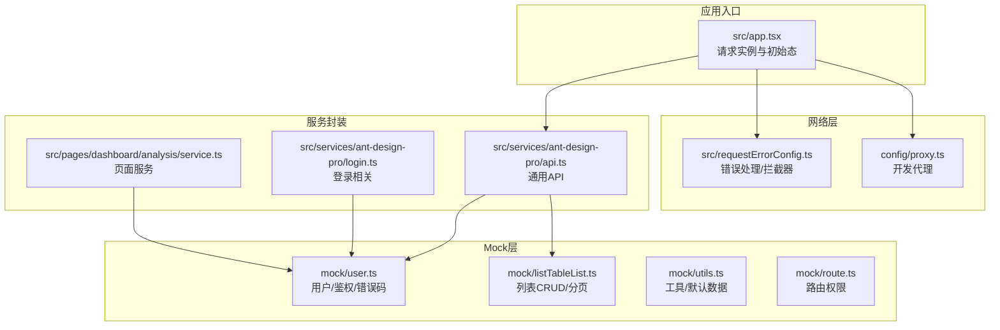
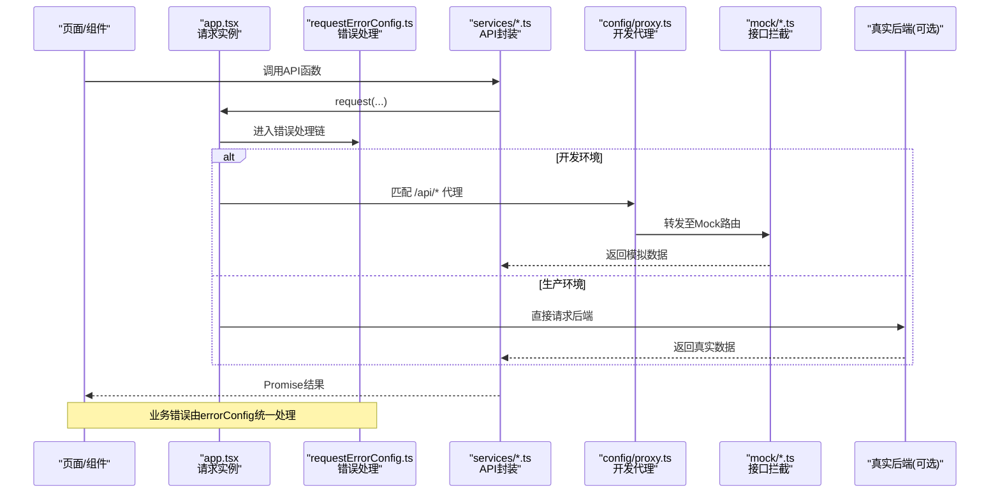
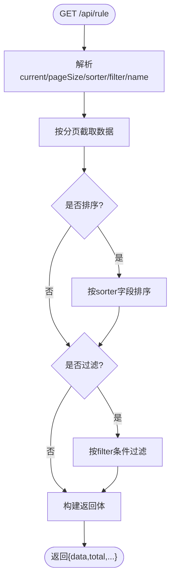
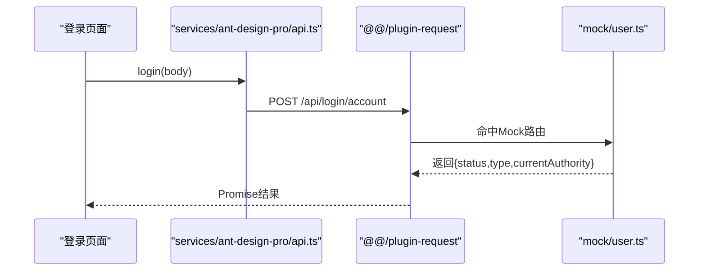
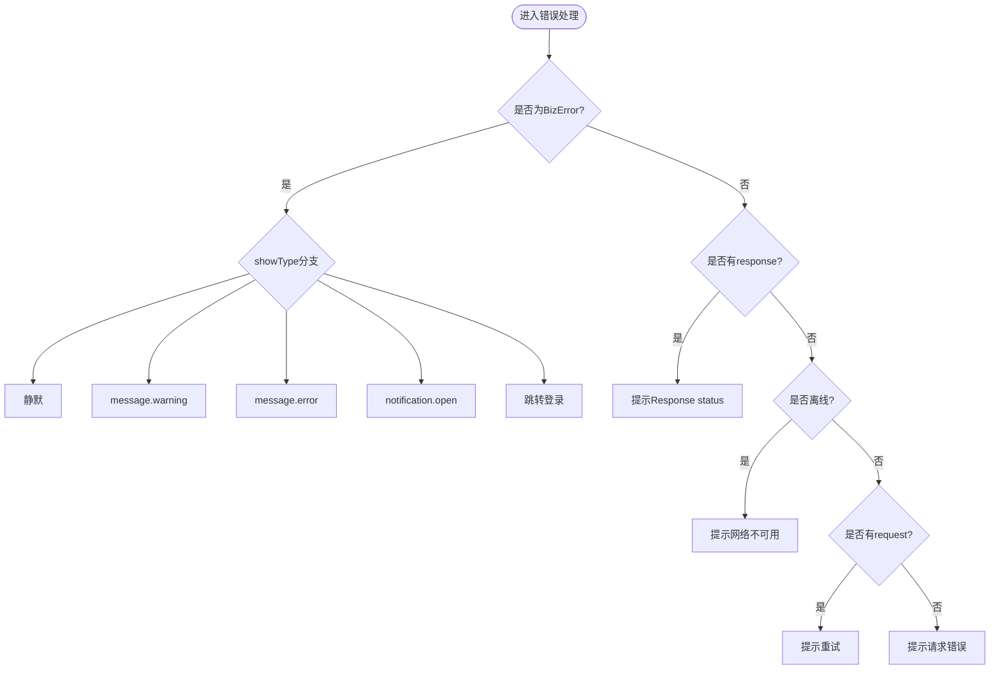
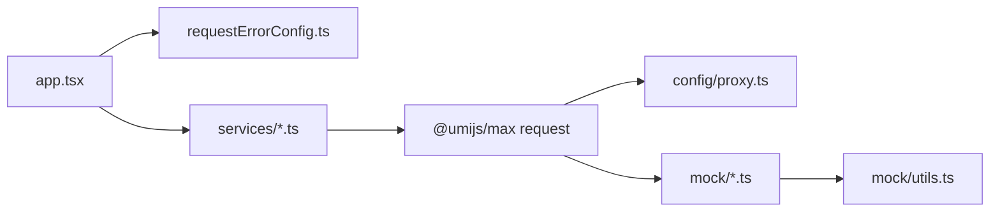

# 数据管理

<cite>
**本文引用的文件**
- [app.tsx](file://web_client/po-admin/src/app.tsx)
- [requestErrorConfig.ts](file://web_client/po-admin/src/requestErrorConfig.ts)
- [api.ts](file://web_client/po-admin/src/services/ant-design-pro/api.ts)
- [login.ts](file://web_client/po-admin/src/services/ant-design-pro/login.ts)
- [proxy.ts](file://web_client/po-admin/config/proxy.ts)
- [route.ts](file://web_client/po-admin/mock/route.ts)
- [user.ts](file://web_client/po-admin/mock/user.ts)
- [utils.ts](file://web_client/po-admin/mock/utils.ts)
- [listTableList.ts](file://web_client/po-admin/mock/listTableList.ts)
- [service.ts](file://web_client/po-admin/src/pages/dashboard/analysis/service.ts)
- [index.tsx](file://web_client/po-admin/src/components/ErrorBoundary/index.tsx)
</cite>

## 目录
1. [简介](#简介)
2. [项目结构](#项目结构)
3. [核心组件](#核心组件)
4. [架构总览](#架构总览)
5. [详细组件分析](#详细组件分析)
6. [依赖关系分析](#依赖关系分析)
7. [性能与缓存优化](#性能与缓存优化)
8. [故障排查指南](#故障排查指南)
9. [结论](#结论)
10. [附录：真实后端集成示例](#附录真实后端集成示例)

## 简介
本文件面向 Ant Design Pro 的数据管理，系统性说明 Mock 数据模拟机制、API 服务封装模式、错误处理策略、状态管理模式（含 useModel）、数据流最佳实践（缓存、分页、性能），并通过具体代码路径展示如何接入真实后端 API 并处理异步数据流。目标是帮助开发者快速理解并落地稳定、可维护的前端数据层方案。

## 项目结构
前端工程位于 web_client/po-admin，数据相关的关键目录与文件如下：
- mock：开发期接口拦截与模拟数据定义
- src/services：按业务域组织的 API 调用封装
- config/proxy.ts：本地开发代理配置
- src/app.tsx：运行时配置、请求实例初始化、全局初始态获取
- src/requestErrorConfig.ts：统一错误处理与拦截器
- src/pages/**/service.ts：页面级数据服务封装
- src/components/ErrorBoundary：错误边界与离线提示

图表来源
- [app.tsx:192-195](file://web_client/po-admin/src/app.tsx#L192-L195)
- [requestErrorConfig.ts:28-108](file://web_client/po-admin/src/requestErrorConfig.ts#L28-L108)
- [proxy.ts:12-41](file://web_client/po-admin/config/proxy.ts#L12-L41)
- [api.ts:1-95](file://web_client/po-admin/src/services/ant-design-pro/api.ts#L1-L95)
- [login.ts:1-22](file://web_client/po-admin/src/services/ant-design-pro/login.ts#L1-L22)
- [user.ts:1-144](file://web_client/po-admin/mock/user.ts#L1-L144)
- [listTableList.ts:1-171](file://web_client/po-admin/mock/listTableList.ts#L1-L171)
- [utils.ts:1-141](file://web_client/po-admin/mock/utils.ts#L1-L141)
- [route.ts:1-6](file://web_client/po-admin/mock/route.ts#L1-L6)

章节来源
- [app.tsx:192-195](file://web_client/po-admin/src/app.tsx#L192-L195)
- [proxy.ts:12-41](file://web_client/po-admin/config/proxy.ts#L12-L41)

## 核心组件
- 请求实例与运行时配置：在 app.tsx 中导出 request 配置，设置 baseURL，并合并 errorConfig；同时提供 getInitialState 用于获取当前用户信息，驱动布局与路由守卫。
- 统一错误处理：requestErrorConfig.ts 定义了错误类型枚举、响应结构、错误抛出与处理器，以及请求/响应拦截器扩展点。
- API 服务封装：services/ant-design-pro 下按模块组织函数式 API，使用 @umijs/max 的 request 发起请求，统一返回类型与参数。
- Mock 数据：mock 目录下以“方法+路径”为键声明接口，支持同步与异步，内置分页、排序、过滤、增删改等能力，便于前后端并行开发。

章节来源
- [app.tsx:32-73](file://web_client/po-admin/src/app.tsx#L32-L73)
- [requestErrorConfig.ts:6-108](file://web_client/po-admin/src/requestErrorConfig.ts#L6-L108)
- [api.ts:1-95](file://web_client/po-admin/src/services/ant-design-pro/api.ts#L1-L95)
- [user.ts:1-144](file://web_client/po-admin/mock/user.ts#L1-L144)
- [listTableList.ts:1-171](file://web_client/po-admin/mock/listTableList.ts#L1-L171)

## 架构总览
下图展示了从页面到 Mock/后端的完整数据流，包括请求拦截、错误处理、Mock 路由分发与服务封装。

图表来源
- [app.tsx:192-195](file://web_client/po-admin/src/app.tsx#L192-L195)
- [requestErrorConfig.ts:28-108](file://web_client/po-admin/src/requestErrorConfig.ts#L28-L108)
- [proxy.ts:12-41](file://web_client/po-admin/config/proxy.ts#L12-L41)
- [user.ts:1-144](file://web_client/po-admin/mock/user.ts#L1-L144)
- [listTableList.ts:1-171](file://web_client/po-admin/mock/listTableList.ts#L1-L171)

## 详细组件分析

### Mock 数据模拟机制
- 目录结构与职责
  - mock/user.ts：用户、登录、退出、验证码及常见HTTP错误码模拟（401/403/404/500）。
  - mock/listTableList.ts：规则列表的查询、排序、过滤、分页、新增、更新、删除。
  - mock/utils.ts：公共数据与工具（如 waitTime、fakeList、默认用户信息）。
  - mock/route.ts：路由权限映射（例如表单高级页的 authority）。
- 接口拦截方式
  - 通过“方法+路径”字符串作为键声明接口，框架在开发时自动注册 Express 风格路由。
  - 支持同步数组/对象与异步函数两种形式，便于模拟延迟与复杂逻辑。
- 分页与筛选实现
  - 解析 query 中的 current、pageSize，计算切片范围。
  - 支持 sorter（排序）与 filter（多字段过滤），name 关键字模糊匹配。
  - 返回统一结构 { data, total, success, pageSize, current }。

图表来源
- [listTableList.ts:35-106](file://web_client/po-admin/mock/listTableList.ts#L35-L106)

章节来源
- [user.ts:1-144](file://web_client/po-admin/mock/user.ts#L1-L144)
- [listTableList.ts:1-171](file://web_client/po-admin/mock/listTableList.ts#L1-L171)
- [utils.ts:1-141](file://web_client/po-admin/mock/utils.ts#L1-L141)
- [route.ts:1-6](file://web_client/po-admin/mock/route.ts#L1-L6)

### API 服务封装模式
- 请求实例配置
  - 在 app.tsx 中导出 request 配置，设置 baseURL（开发为空串，生产指向演示API），并合并 errorConfig。
  - 通过 proxy.ts 将 /api/* 代理到目标地址，便于本地联调。
- 请求与响应处理
  - services/ant-design-pro/api.ts 暴露函数式 API，统一 method、headers、params/data 传递。
  - login.ts 提供验证码等登录相关接口封装。
  - 页面级 service.ts 封装特定页面的数据请求，保持职责单一。
- 典型调用流程（以登录为例）

图表来源
- [api.ts:23-33](file://web_client/po-admin/src/services/ant-design-pro/api.ts#L23-L33)
- [user.ts:61-98](file://web_client/po-admin/mock/user.ts#L61-L98)

章节来源
- [app.tsx:192-195](file://web_client/po-admin/src/app.tsx#L192-L195)
- [proxy.ts:12-41](file://web_client/po-admin/config/proxy.ts#L12-L41)
- [api.ts:1-95](file://web_client/po-admin/src/services/ant-design-pro/api.ts#L1-L95)
- [login.ts:1-22](file://web_client/po-admin/src/services/ant-design-pro/login.ts#L1-L22)

### 错误处理策略（errorConfig.ts）
- 业务错误抛出
  - errorThrower 根据响应 success 字段判断，非成功则抛出自定义 BizError，携带 errorCode、errorMessage、showType、data。
- 错误接收与展示
  - errorHandler 区分 BizError、Axios 错误、离线、无响应等场景，分别采用 message.warning/error、notification 或重定向到登录页。
  - 支持 skipErrorHandler 选项，允许上层自行处理错误（如 getInitialState 中跳过统一提示）。
- 请求/响应拦截器
  - requestInterceptors 预留附加 token 等个性化处理位置。
  - responseInterceptors 可扩展响应数据预处理。

图表来源
- [requestErrorConfig.ts:28-108](file://web_client/po-admin/src/requestErrorConfig.ts#L28-L108)

章节来源
- [requestErrorConfig.ts:6-108](file://web_client/po-admin/src/requestErrorConfig.ts#L6-L108)
- [app.tsx:39-52](file://web_client/po-admin/src/app.tsx#L39-L52)

### 状态管理模式（useModel 与全局状态）
- 全局初始态
  - app.tsx 的 getInitialState 负责拉取 currentUser，并在未登录时重定向到登录页；同时将 settings、fetchUserInfo 注入 initialState。
- useModel 的使用
  - 通过 useModel('@@initialState') 读取/更新全局状态，常用于头像下拉、登录态控制等。
  - 在页面或组件中结合 setInitialState 进行局部状态更新。
- 建议
  - 将跨页面共享的状态（如用户信息、主题设置）放在 @@initialState。
  - 页面内临时状态优先使用 useState/useRef，避免过度污染全局。

章节来源
- [app.tsx:32-73](file://web_client/po-admin/src/app.tsx#L32-L73)

### 数据流最佳实践
- 缓存策略
  - 对静态或低频变化的数据（如字典、配置）可在组件层做简单缓存（useState + useEffect 惰性加载），或在请求层基于 key 做内存缓存。
  - 对于需要失效的场景，提供显式刷新接口（如重新调用 fetchUserInfo）。
- 分页处理
  - 遵循 Mock 的分页约定：current、pageSize，服务端/后端返回 total 与 data。
  - 列表组件仅渲染当前页数据，避免一次性加载全部数据。
- 性能优化技巧
  - 合理使用请求去抖/节流，减少重复请求。
  - 大列表虚拟滚动、按需加载图片与详情。
  - 利用浏览器缓存（ETag/Last-Modified）与 Service Worker 缓存静态资源。
  - 拆分路由与懒加载，降低首屏体积。

[本节为通用指导，不直接分析具体文件]

## 依赖关系分析
- 模块耦合
  - app.tsx 依赖 requestErrorConfig.ts 提供统一错误处理，依赖 services 获取用户信息。
  - services 依赖 @umijs/max 的 request，并与 mock 层解耦（通过 /api 前缀）。
  - mock 层相互独立，utils 提供共享数据，user.ts 与 listTableList.ts 分别覆盖认证与列表场景。
- 外部依赖
  - 开发代理 proxy.ts 将 /api 转发到演示后端，便于联调。
  - 生产环境 baseURL 指向远程 API，无需代理。

图表来源
- [app.tsx:192-195](file://web_client/po-admin/src/app.tsx#L192-L195)
- [proxy.ts:12-41](file://web_client/po-admin/config/proxy.ts#L12-L41)
- [user.ts:1-144](file://web_client/po-admin/mock/user.ts#L1-L144)
- [listTableList.ts:1-171](file://web_client/po-admin/mock/listTableList.ts#L1-L171)
- [utils.ts:1-141](file://web_client/po-admin/mock/utils.ts#L1-L141)

章节来源
- [app.tsx:192-195](file://web_client/po-admin/src/app.tsx#L192-L195)
- [proxy.ts:12-41](file://web_client/po-admin/config/proxy.ts#L12-L41)

## 性能与缓存优化
- 请求层面
  - 使用统一的 baseURL 与拦截器，集中处理鉴权头、超时、重试策略。
  - 对幂等 GET 请求启用浏览器缓存；对频繁变更数据增加版本号或时间戳。
- 数据层面
  - 列表分页加载，避免全量渲染；详情页按需懒加载。
  - 对热点数据（如用户信息）在首次获取后缓存于全局状态，减少重复请求。
- 渲染层面
  - 大表格使用虚拟滚动；图片懒加载与压缩；关键 CSS 内联。
- 监控与降级
  - 结合 ErrorBoundary 捕获渲染异常与 chunk 加载失败，提供重试与回退。
  - 离线检测与友好提示，必要时降级为只读模式。

[本节为通用指导，不直接分析具体文件]

## 故障排查指南
- 常见问题定位
  - 网络错误：检查 baseURL、代理配置与 CORS；查看 errorHandler 中的 Response status 提示。
  - 业务错误：确认后端返回 success=false 时的 errorCode、errorMessage、showType。
  - 未登录重定向：getInitialState 中若 currentUser 为空会跳转到登录页，检查鉴权逻辑。
- 调试建议
  - 打开浏览器 Network，观察请求 URL、Headers、Payload 与响应。
  - 在 requestErrorConfig 的 errorHandler 中打印 error 与 opts，定位问题阶段。
  - 使用 Mock 快速验证前端逻辑，再逐步切换到真实后端。
- 错误边界
  - ErrorBoundary 捕获组件渲染异常与 chunk 加载失败，并提供重试与离线提示。

章节来源
- [requestErrorConfig.ts:43-89](file://web_client/po-admin/src/requestErrorConfig.ts#L43-L89)
- [app.tsx:39-52](file://web_client/po-admin/src/app.tsx#L39-L52)
- [index.tsx:87-131](file://web_client/po-admin/src/components/ErrorBoundary/index.tsx#L87-L131)

## 结论
本项目通过清晰的分层与统一的错误处理，实现了高内聚、低耦合的数据管理方案。Mock 层支撑前后端并行开发，API 服务封装简化了调用复杂度，错误处理策略提升了用户体验与可维护性。配合合理的缓存与分页策略，可有效提升性能与稳定性。

[本节为总结，不直接分析具体文件]

## 附录：真实后端集成示例
- 步骤概览
  - 配置 baseURL 与代理：在 app.tsx 设置 baseURL，在 proxy.ts 配置开发代理目标。
  - 编写服务函数：在 services 中按模块封装 API，明确 method、params、data。
  - 对接错误处理：沿用 errorConfig，确保业务错误与网络错误统一展示。
  - 页面集成：在页面中调用服务函数，结合 useModel 管理全局状态。
- 示例路径参考
  - 登录流程：调用 services/ant-design-pro/api.ts 的 login，后端返回鉴权信息。
  - 列表分页：调用 services/ant-design-pro/api.ts 的 rule，后端返回分页数据。
  - 页面服务：dashboard/analysis/service.ts 封装特定数据请求。

章节来源
- [app.tsx:192-195](file://web_client/po-admin/src/app.tsx#L192-L195)
- [proxy.ts:12-41](file://web_client/po-admin/config/proxy.ts#L12-L41)
- [api.ts:23-61](file://web_client/po-admin/src/services/ant-design-pro/api.ts#L23-L61)
- [service.ts:1-7](file://web_client/po-admin/src/pages/dashboard/analysis/service.ts#L1-L7)