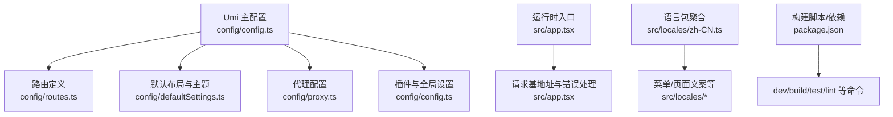
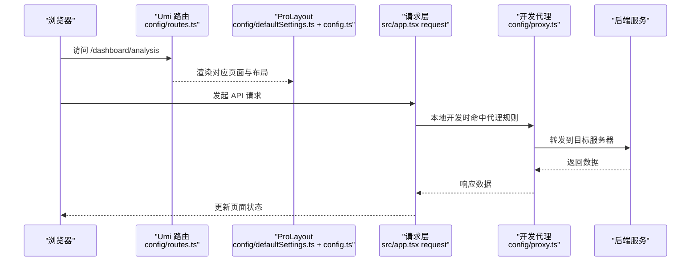
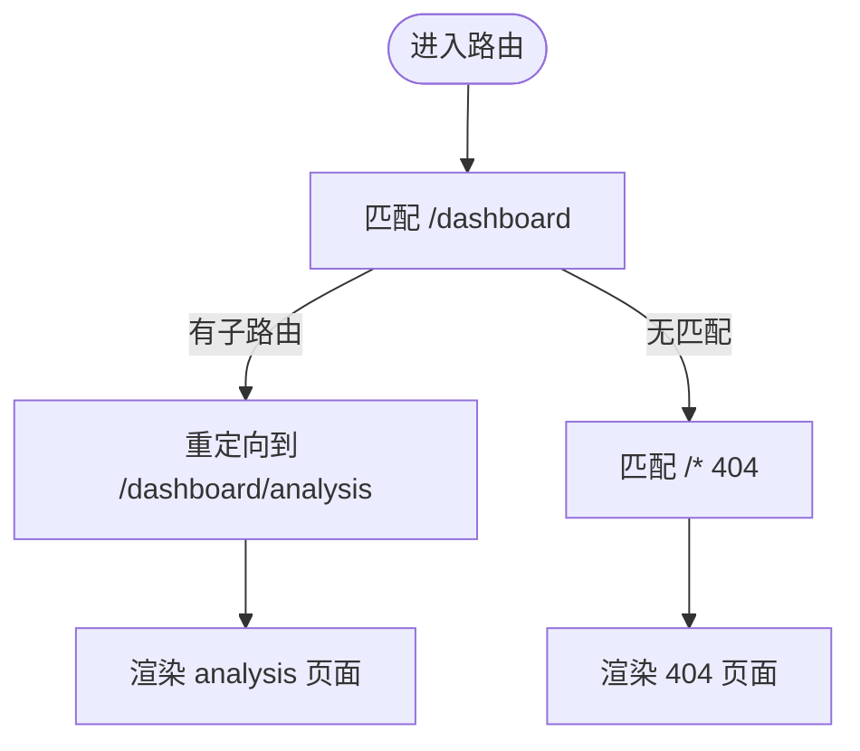
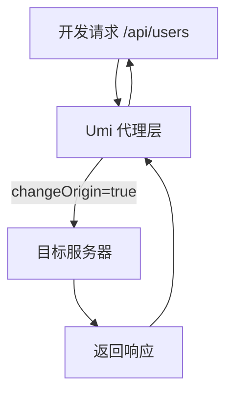
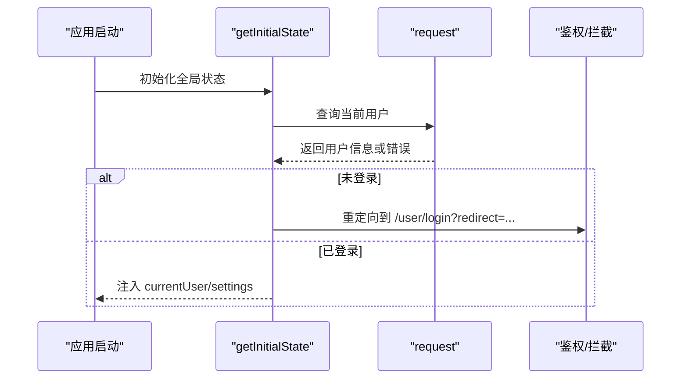
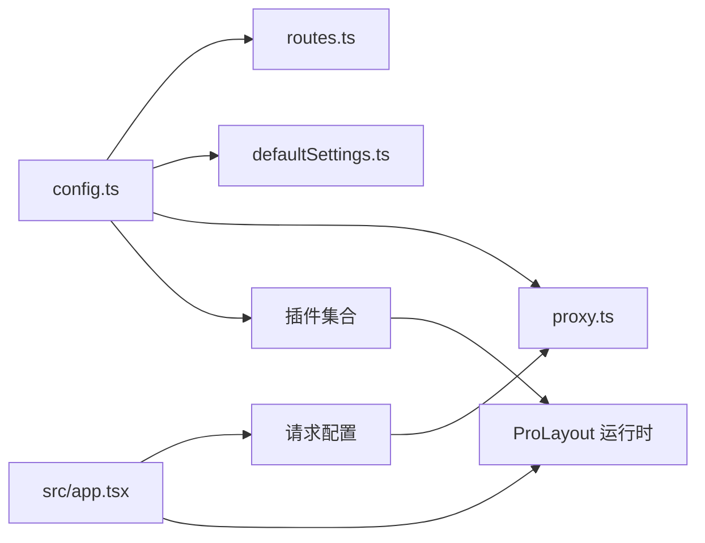

# 项目配置

<cite>
**本文引用的文件**
- [config.ts](file://web_client/po-admin/config/config.ts)
- [routes.ts](file://web_client/po-admin/config/routes.ts)
- [defaultSettings.ts](file://web_client/po-admin/config/defaultSettings.ts)
- [proxy.ts](file://web_client/po-admin/config/proxy.ts)
- [package.json](file://web_client/po-admin/package.json)
- [app.tsx](file://web_client/po-admin/src/app.tsx)
- [zh-CN.ts](file://web_client/po-admin/src/locales/zh-CN.ts)
</cite>

## 目录
1. [简介](#简介)
2. [项目结构](#项目结构)
3. [核心组件](#核心组件)
4. [架构总览](#架构总览)
5. [详细组件分析](#详细组件分析)
6. [依赖分析](#依赖分析)
7. [性能考虑](#性能考虑)
8. [故障排查指南](#故障排查指南)
9. [结论](#结论)
10. [附录](#附录)

## 简介
本文件面向 Ant Design Pro（基于 Umi.js）项目的“配置”主题，系统性说明以下关键配置：
- 路由配置 routes.ts 的结构化组织方式、动态路由与嵌套路由实现
- 默认设置 defaultSettings.ts 的主题、布局与国际化相关选项
- 代理配置 proxy.ts 在开发环境下的 API 请求转发、跨域处理与拦截机制
- package.json 中的构建脚本、依赖管理与开发工具链配置
并提供最佳实践与示例路径，帮助开发者快速理解并定制项目。

## 项目结构
本项目的前端工程位于 web_client/po-admin，核心配置集中在 config 目录，运行时入口在 src/app.tsx，语言包在 src/locales。

图表来源
- [config.ts:36-236](file://web_client/po-admin/config/config.ts#L36-L236)
- [routes.ts:13-297](file://web_client/po-admin/config/routes.ts#L13-L297)
- [defaultSettings.ts:6-25](file://web_client/po-admin/config/defaultSettings.ts#L6-L25)
- [proxy.ts:12-41](file://web_client/po-admin/config/proxy.ts#L12-L41)
- [app.tsx:192-195](file://web_client/po-admin/src/app.tsx#L192-L195)
- [zh-CN.ts:9-22](file://web_client/po-admin/src/locales/zh-CN.ts#L9-L22)
- [package.json:7-32](file://web_client/po-admin/package.json#L7-L32)

章节来源
- [config.ts:36-236](file://web_client/po-admin/config/config.ts#L36-L236)
- [routes.ts:13-297](file://web_client/po-admin/config/routes.ts#L13-L297)
- [defaultSettings.ts:6-25](file://web_client/po-admin/config/defaultSettings.ts#L6-L25)
- [proxy.ts:12-41](file://web_client/po-admin/config/proxy.ts#L12-L41)
- [app.tsx:192-195](file://web_client/po-admin/src/app.tsx#L192-L195)
- [zh-CN.ts:9-22](file://web_client/po-admin/src/locales/zh-CN.ts#L9-L22)
- [package.json:7-32](file://web_client/po-admin/package.json#L7-L32)

## 核心组件
- 路由系统：通过 config/routes.ts 声明式定义，支持嵌套、重定向、权限控制与图标/标题等元信息。
- 布局与主题：通过 config/defaultSettings.ts 与 config/config.ts 的 layout 插件组合，统一主题色、布局模式、内容宽度、固定侧边栏等。
- 代理与网络：config/proxy.ts 提供开发环境代理；src/app.tsx 中 request 配置统一 baseURL 与错误处理。
- 构建与工具：package.json 提供 dev/build/test/lint 等脚本，配合 Umi Max、Biome、Vitest、Tailwind 等工具链。

章节来源
- [routes.ts:13-297](file://web_client/po-admin/config/routes.ts#L13-L297)
- [defaultSettings.ts:6-25](file://web_client/po-admin/config/defaultSettings.ts#L6-L25)
- [config.ts:117-157](file://web_client/po-admin/config/config.ts#L117-L157)
- [proxy.ts:12-41](file://web_client/po-admin/config/proxy.ts#L12-L41)
- [app.tsx:192-195](file://web_client/po-admin/src/app.tsx#L192-L195)
- [package.json:7-32](file://web_client/po-admin/package.json#L7-L32)

## 架构总览
下图展示了从浏览器到后端 API 的请求链路，以及路由、布局、代理、请求层之间的关系。

图表来源
- [routes.ts:70-96](file://web_client/po-admin/config/routes.ts#L70-L96)
- [defaultSettings.ts:6-25](file://web_client/po-admin/config/defaultSettings.ts#L6-L25)
- [config.ts:117-157](file://web_client/po-admin/config/config.ts#L117-L157)
- [proxy.ts:28-41](file://web_client/po-admin/config/proxy.ts#L28-L41)
- [app.tsx:192-195](file://web_client/po-admin/src/app.tsx#L192-L195)

## 详细组件分析

### 路由配置 routes.ts
- 结构化组织
  - 顶层路由按业务域划分，如 /user、/admin、/dashboard、/form、/list、/profile、/result、/exception、/account、/chatbot 等。
  - 每个模块可包含子路由 routes，用于共享布局或分组导航。
- 动态路由与通配符
  - 支持 :id 形式的动态参数与 * 通配符（仅出现在路由字符串末尾），例如 /user/* 作为兜底 404。
- 嵌套路由与重定向
  - 使用 redirect 将父级路径重定向到默认子页，如 /dashboard -> /dashboard/analysis。
  - 多层嵌套示例：/list/search 下再分 articles/projects/applications。
- 权限与菜单
  - 通过 access 字段进行路由级权限控制（如 /admin）。
  - name、icon 用于生成菜单项与页面标题（name 会映射到国际化 key）。
- 兜底 404
  - 末位 path: '/*' 指向 exception/404，确保未匹配路由统一处理。

图表来源
- [routes.ts:70-96](file://web_client/po-admin/config/routes.ts#L70-L96)
- [routes.ts:290-297](file://web_client/po-admin/config/routes.ts#L290-L297)

章节来源
- [routes.ts:13-297](file://web_client/po-admin/config/routes.ts#L13-L297)

### 默认设置 defaultSettings.ts
- 主题与外观
  - navTheme 设置导航主题（light/dark 等）。
  - colorPrimary 设置主色调。
  - token 可扩展 antd 设计令牌以精细化样式。
- 布局选项
  - layout 选择布局模式（如 mix）。
  - contentWidth 控制内容宽度策略（Fluid 等）。
  - fixedHeader、fixSiderbar 控制头部与侧边栏固定行为。
  - title、logo、iconfontUrl 等用于品牌展示。
- 与 Umi 集成
  - 在 config/config.ts 中通过 layout 插件合并 defaultSettings，使 ProLayout 生效。

章节来源
- [defaultSettings.ts:6-25](file://web_client/po-admin/config/defaultSettings.ts#L6-L25)
- [config.ts:117-121](file://web_client/po-admin/config/config.ts#L117-L121)

### 代理配置 proxy.ts
- 作用范围
  - 仅在开发环境生效，生产环境需通过 Nginx/网关等方式配置反向代理。
- 多环境代理
  - 通过环境变量 UMI_ENV 选择不同代理配置（test、pre 等）。
  - 示例中将 /api/** 转发至远程演示服务，并开启 changeOrigin 以解决跨域问题。
- 与 Umi 集成
  - 在 config/config.ts 中读取 proxy[UMI_ENV] 注入到 Umi 的 proxy 配置。

图表来源
- [proxy.ts:28-41](file://web_client/po-admin/config/proxy.ts#L28-L41)
- [config.ts:84-84](file://web_client/po-admin/config/config.ts#L84-L84)

章节来源
- [proxy.ts:12-41](file://web_client/po-admin/config/proxy.ts#L12-L41)
- [config.ts:84-84](file://web_client/po-admin/config/config.ts#L84-L84)

### 请求层与拦截机制（app.tsx）
- 统一 baseURL
  - 开发环境为空字符串（走代理），生产环境指向远端 API 域名。
- 错误处理
  - 通过 errorConfig 注入请求错误处理逻辑（如鉴权失败跳转登录）。
- 运行时初始化
  - getInitialState 中获取当前用户信息，未登录时重定向到登录页并携带 redirect 参数。
  - onPageChange 守卫未登录访问，防止直接访问受保护路由。

图表来源
- [app.tsx:32-73](file://web_client/po-admin/src/app.tsx#L32-L73)
- [app.tsx:113-121](file://web_client/po-admin/src/app.tsx#L113-L121)
- [app.tsx:192-195](file://web_client/po-admin/src/app.tsx#L192-L195)

章节来源
- [app.tsx:32-73](file://web_client/po-admin/src/app.tsx#L32-L73)
- [app.tsx:113-121](file://web_client/po-admin/src/app.tsx#L113-L121)
- [app.tsx:192-195](file://web_client/po-admin/src/app.tsx#L192-L195)

### 国际化设置
- 语言包聚合
  - zh-CN.ts 聚合 menu、pages、globalHeader、settingDrawer、settings、network、component 等模块文案。
- 启用方式
  - 在 config/config.ts 中启用 locale 插件，设置默认语言为 zh-CN，并允许根据浏览器语言覆盖。
- 运行时切换
  - 通过右上角语言下拉组件切换语言（由 app.tsx 的 actionsRender 控制显示）。

章节来源
- [zh-CN.ts:9-22](file://web_client/po-admin/src/locales/zh-CN.ts#L9-L22)
- [config.ts:135-141](file://web_client/po-admin/config/config.ts#L135-L141)
- [app.tsx:91-101](file://web_client/po-admin/src/app.tsx#L91-L101)

### 构建脚本与工具链（package.json）
- 常用脚本
  - start/dev：启动开发服务器（可关闭 mock）。
  - build：生产构建。
  - analyze：构建产物分析。
  - deploy：构建并发布到 gh-pages。
  - test/vitest：单元测试与覆盖率。
  - lint/biome：代码检查与格式化。
  - openapi：基于 OpenAPI 规范生成接口代码。
- 依赖管理
  - 运行时依赖包括 antd、@ant-design/pro-components、react-query、dayjs、tailwindcss 等。
  - 开发依赖包括 @umijs/max、vitest、biome、typescript、mockjs、express 等。
- 引擎与环境
  - engines.node 指定最低 Node 版本。
  - overrides 用于锁定某些包的版本一致性。

章节来源
- [package.json:7-32](file://web_client/po-admin/package.json#L7-L32)
- [package.json:37-93](file://web_client/po-admin/package.json#L37-L93)
- [package.json:99-101](file://web_client/po-admin/package.json#L99-L101)

## 依赖分析
- 配置耦合关系
  - config.ts 聚合 routes、defaultSettings、proxy，并启用多个插件（layout、locale、antd、request、reactQuery、access、openAPI、tailwindcss 等）。
  - app.tsx 在运行时注入请求 baseURL 与错误处理，并与 layout 插件联动完成鉴权与 UI 交互。
- 外部依赖
  - Umi Max 提供路由、构建、插件生态。
  - Ant Design Pro Components 提供 Layout、SettingDrawer 等高级组件。
  - React Query 管理服务端状态与缓存。
  - Tailwind CSS 提供原子化样式能力。

图表来源
- [config.ts:36-236](file://web_client/po-admin/config/config.ts#L36-L236)
- [app.tsx:192-195](file://web_client/po-admin/src/app.tsx#L192-L195)

章节来源
- [config.ts:36-236](file://web_client/po-admin/config/config.ts#L36-L236)
- [app.tsx:192-195](file://web_client/po-admin/src/app.tsx#L192-L195)

## 性能考虑
- 路由预加载：启用 routePrefetch 与 manifest，提升页面切换速度。
- 资源哈希：开启 hash 输出，利于缓存与增量发布。
- 时间库替换：使用 moment2dayjs 将 moment 替换为 dayjs，减小体积。
- 按需引入：Antd 与 Pro Components 通过插件自动按需引入，减少打包体积。
- 静态导出：exportStatic 可用于静态站点部署场景，减少运行时开销。

章节来源
- [config.ts:45-45](file://web_client/po-admin/config/config.ts#L45-L45)
- [config.ts:91-100](file://web_client/po-admin/config/config.ts#L91-L100)
- [config.ts:127-130](file://web_client/po-admin/config/config.ts#L127-L130)
- [config.ts:228-228](file://web_client/po-admin/config/config.ts#L228-L228)

## 故障排查指南
- 代理不生效
  - 确认 UMI_ENV 与 proxy.ts 中的键一致（如 test/pre）。
  - 确认请求路径匹配代理前缀（如 /api/**）。
  - 生产环境无法使用代理，需通过服务端反向代理配置。
- 跨域问题
  - 开启 changeOrigin，必要时在服务端配置 CORS。
  - 若涉及 Cookie，确保同源策略与 secure/sameSite 设置正确。
- 未登录被重定向
  - 检查 getInitialState 是否成功获取用户信息。
  - 检查 onPageChange 是否正确判断 currentUser。
- 构建产物过大
  - 使用 analyze 脚本分析依赖体积。
  - 检查是否有大体积库未按需引入。
- 国际化文案缺失
  - 确认 zh-CN.ts 已聚合所需模块。
  - 检查路由 name 对应的菜单 key 是否存在于语言包。

章节来源
- [proxy.ts:28-41](file://web_client/po-admin/config/proxy.ts#L28-L41)
- [app.tsx:32-73](file://web_client/po-admin/src/app.tsx#L32-L73)
- [app.tsx:113-121](file://web_client/po-admin/src/app.tsx#L113-L121)
- [package.json:7-32](file://web_client/po-admin/package.json#L7-L32)

## 结论
通过对 routes.ts、defaultSettings.ts、proxy.ts、config.ts 与 app.tsx 的系统梳理，可以清晰掌握 Ant Design Pro 在路由、布局、代理、请求与国际化方面的配置要点。结合 package.json 的工具链脚本，开发者可以快速搭建、调试与交付企业级前端应用。建议在实际项目中：
- 将路由按业务域拆分并保持扁平化层级，避免过深嵌套。
- 使用 defaultSettings 集中管理主题与布局，便于统一风格。
- 在开发阶段充分利用代理与 mock，屏蔽后端差异。
- 借助 Umi 插件生态与构建优化手段，持续提升性能与可维护性。

## 附录
- 常见配置位置速查
  - 路由：config/routes.ts
  - 布局与主题：config/defaultSettings.ts + config/config.ts
  - 代理：config/proxy.ts + config/config.ts
  - 请求与错误处理：src/app.tsx
  - 国际化：src/locales/* + config/config.ts
  - 构建脚本：package.json