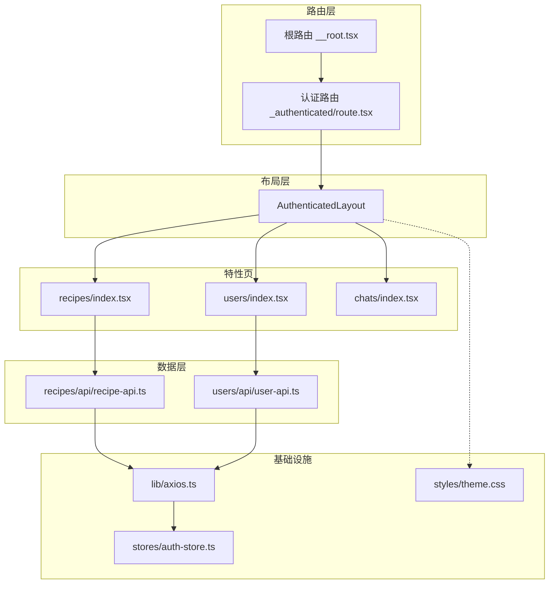
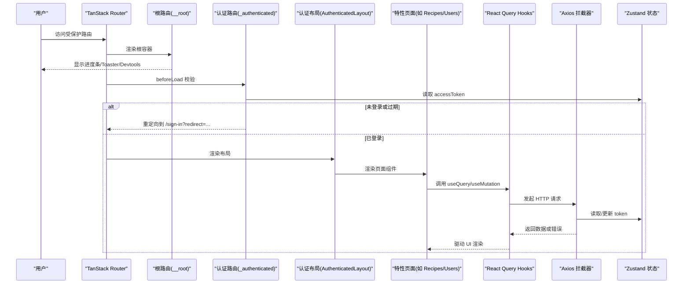
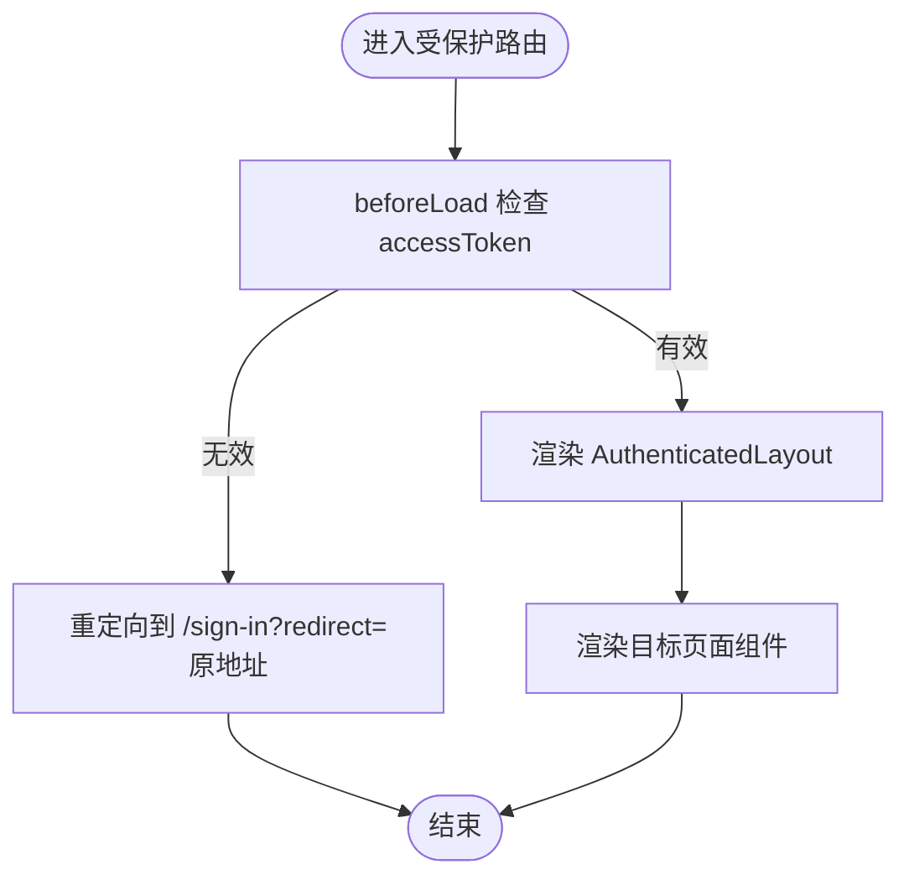
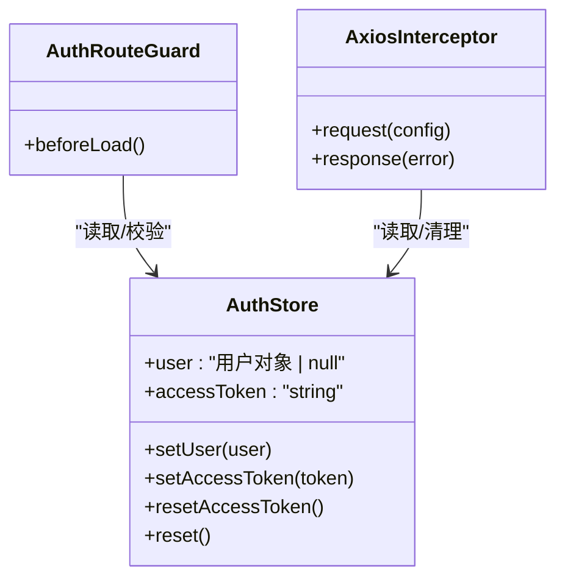
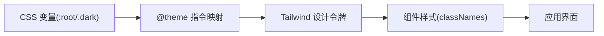
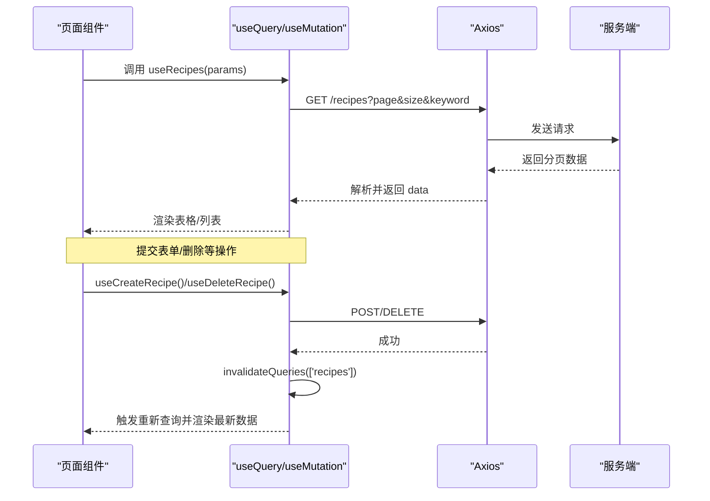
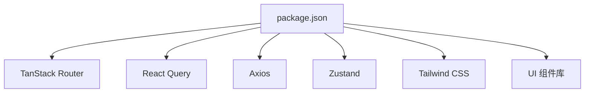

# Shadcn Admin现代界面

<cite>
**本文引用的文件**
- [__root.tsx](file://web_client/shadcn-admin/src/routes/__root.tsx)
- [_authenticated/route.tsx](file://web_client/shadcn-admin/src/routes/_authenticated/route.tsx)
- [auth-store.ts](file://web_client/shadcn-admin/src/stores/auth-store.ts)
- [axios.ts](file://web_client/shadcn-admin/src/lib/axios.ts)
- [theme.css](file://web_client/shadcn-admin/src/styles/theme.css)
- [package.json](file://web_client/shadcn-admin/package.json)
- [recipes/index.tsx](file://web_client/shadcn-admin/src/features/recipes/index.tsx)
- [recipes/api/recipe-api.ts](file://web_client/shadcn-admin/src/features/recipes/api/recipe-api.ts)
- [users/index.tsx](file://web_client/shadcn-admin/src/features/users/index.tsx)
- [users/api/user-api.ts](file://web_client/shadcn-admin/src/features/users/api/user-api.ts)
- [chats/index.tsx](file://web_client/shadcn-admin/src/features/chats/index.tsx)
- [authenticated-layout.tsx](file://web_client/shadcn-admin/src/components/layout/authenticated-layout.tsx)
</cite>

## 目录
1. [简介](#简介)
2. [项目结构](#项目结构)
3. [核心组件](#核心组件)
4. [架构总览](#架构总览)
5. [详细组件分析](#详细组件分析)
6. [依赖关系分析](#依赖关系分析)
7. [性能考量](#性能考量)
8. [故障排查指南](#故障排查指南)
9. [结论](#结论)
10. [附录](#附录)

## 简介
本技术文档围绕 Shadcn Admin 前端工程，系统性阐述基于 TanStack Router 的文件路由架构、Zustand 全局状态管理、Tailwind CSS 主题与样式体系、React Query 数据获取与缓存机制，并结合菜谱管理、用户管理与 AI 对话界面的具体实现进行说明。目标是帮助开发者快速理解并高效扩展该项目的功能与样式。

## 项目结构
Shadcn Admin 采用“按特性（feature）组织”的前端工程结构：
- routes：基于 TanStack Router 的文件路由约定，根路由、认证路由组、业务子路由分别位于不同目录，便于权限控制与布局复用。
- features：按业务域划分页面与 API 封装，如 recipes、users、chats 等，每个特性包含页面、API Hook、数据模型与组件。
- components：通用 UI 组件与布局组件，如侧边栏、头部、主内容区、对话框等。
- stores：使用 Zustand 管理全局状态（如认证信息）。
- lib：工具与基础设施，如 axios 封装、Cookie 操作、错误处理等。
- styles：主题变量与 Tailwind 集成样式。
- context：应用级上下文（主题、语言、布局、搜索等）。

图表来源
- [__root.tsx:10-30](file://web_client/shadcn-admin/src/routes/__root.tsx#L10-L30)
- [_authenticated/route.tsx:6-19](file://web_client/shadcn-admin/src/routes/_authenticated/route.tsx#L6-L19)
- [authenticated-layout.tsx:14-42](file://web_client/shadcn-admin/src/components/layout/authenticated-layout.tsx#L14-L42)
- [recipes/index.tsx:17-81](file://web_client/shadcn-admin/src/features/recipes/index.tsx#L17-L81)
- [users/index.tsx:17-74](file://web_client/shadcn-admin/src/features/users/index.tsx#L17-L74)
- [chats/index.tsx:34-354](file://web_client/shadcn-admin/src/features/chats/index.tsx#L34-L354)
- [recipes/api/recipe-api.ts:82-160](file://web_client/shadcn-admin/src/features/recipes/api/recipe-api.ts#L82-L160)
- [users/api/user-api.ts:37-147](file://web_client/shadcn-admin/src/features/users/api/user-api.ts#L37-L147)
- [axios.ts:34-86](file://web_client/shadcn-admin/src/lib/axios.ts#L34-L86)
- [auth-store.ts:25-54](file://web_client/shadcn-admin/src/stores/auth-store.ts#L25-L54)
- [theme.css:1-103](file://web_client/shadcn-admin/src/styles/theme.css#L1-L103)

章节来源
- [__root.tsx:10-30](file://web_client/shadcn-admin/src/routes/__root.tsx#L10-L30)
- [_authenticated/route.tsx:6-19](file://web_client/shadcn-admin/src/routes/_authenticated/route.tsx#L6-L19)
- [authenticated-layout.tsx:14-42](file://web_client/shadcn-admin/src/components/layout/authenticated-layout.tsx#L14-L42)

## 核心组件
- 根路由与全局容器：提供查询客户端注入、导航进度条、全局提示、开发工具挂载以及未找到/错误页面兜底。
- 认证路由守卫：在加载受保护路由前校验访问令牌是否有效，过期或未登录时重定向至登录页并携带返回地址。
- 认证布局：包裹侧边栏、搜索、布局上下文等，统一承载受保护页面的内容区域。
- 特性页面：以 recipes、users、chats 为代表，组合 Header、Main、表格/列表、对话框等组件，并通过 React Query Hook 拉取数据。
- 数据层：基于 React Query 的 useQuery/useMutation，封装分页、筛选、增删改查逻辑，并在变更成功后使相关查询失效以刷新列表。
- 请求拦截器：自动附加 JWT、统一处理后端响应格式、对 401 进行登出与跳转。
- 全局状态：Zustand 存储用户信息与访问令牌，并提供持久化到 Cookie 的能力。
- 主题系统：通过 CSS 变量定义明暗主题色板，配合 Tailwind 的 @theme 指令映射为设计令牌。

章节来源
- [__root.tsx:10-30](file://web_client/shadcn-admin/src/routes/__root.tsx#L10-L30)
- [_authenticated/route.tsx:6-19](file://web_client/shadcn-admin/src/routes/_authenticated/route.tsx#L6-L19)
- [authenticated-layout.tsx:14-42](file://web_client/shadcn-admin/src/components/layout/authenticated-layout.tsx#L14-L42)
- [recipes/index.tsx:17-81](file://web_client/shadcn-admin/src/features/recipes/index.tsx#L17-L81)
- [users/index.tsx:17-74](file://web_client/shadcn-admin/src/features/users/index.tsx#L17-L74)
- [recipes/api/recipe-api.ts:82-160](file://web_client/shadcn-admin/src/features/recipes/api/recipe-api.ts#L82-L160)
- [users/api/user-api.ts:37-147](file://web_client/shadcn-admin/src/features/users/api/user-api.ts#L37-L147)
- [axios.ts:34-86](file://web_client/shadcn-admin/src/lib/axios.ts#L34-L86)
- [auth-store.ts:25-54](file://web_client/shadcn-admin/src/stores/auth-store.ts#L25-L54)
- [theme.css:1-103](file://web_client/shadcn-admin/src/styles/theme.css#L1-L103)

## 架构总览
下图展示了从路由到布局、页面、数据层与基础设施的整体交互流程。

图表来源
- [__root.tsx:10-30](file://web_client/shadcn-admin/src/routes/__root.tsx#L10-L30)
- [_authenticated/route.tsx:6-19](file://web_client/shadcn-admin/src/routes/_authenticated/route.tsx#L6-L19)
- [authenticated-layout.tsx:14-42](file://web_client/shadcn-admin/src/components/layout/authenticated-layout.tsx#L14-L42)
- [recipes/index.tsx:17-81](file://web_client/shadcn-admin/src/features/recipes/index.tsx#L17-L81)
- [users/index.tsx:17-74](file://web_client/shadcn-admin/src/features/users/index.tsx#L17-L74)
- [recipes/api/recipe-api.ts:82-160](file://web_client/shadcn-admin/src/features/recipes/api/recipe-api.ts#L82-L160)
- [users/api/user-api.ts:37-147](file://web_client/shadcn-admin/src/features/users/api/user-api.ts#L37-L147)
- [axios.ts:34-86](file://web_client/shadcn-admin/src/lib/axios.ts#L34-L86)
- [auth-store.ts:25-54](file://web_client/shadcn-admin/src/stores/auth-store.ts#L25-L54)

## 详细组件分析

### 基于 TanStack Router 的路由架构
- 文件路由约定
  - 根路由：负责注入 QueryClient、挂载全局 UI（进度条、Toast）、开发期调试面板，并设置未找到与错误组件。
  - 认证路由组：通过 beforeLoad 钩子检查访问令牌有效性，必要时重定向至登录页并保留原始地址。
  - 受保护布局：统一包裹侧边栏、搜索、布局上下文，确保所有受保护页面共享一致的布局体验。
- 嵌套路由与动态路由
  - 通过目录层级体现嵌套关系，例如 _authenticated 下的 recipes、users、chats 等子路由。
  - 动态路由可通过文件名占位符实现（例如 /recipes/:id），结合 getRouteApi 在页面中读取参数与搜索参数。
- 路由与布局协作
  - 根路由保证全局能力；认证路由完成鉴权；认证布局提供侧边栏与内容容器；页面组件专注业务展示。

图表来源
- [_authenticated/route.tsx:6-19](file://web_client/shadcn-admin/src/routes/_authenticated/route.tsx#L6-L19)
- [authenticated-layout.tsx:14-42](file://web_client/shadcn-admin/src/components/layout/authenticated-layout.tsx#L14-L42)

章节来源
- [__root.tsx:10-30](file://web_client/shadcn-admin/src/routes/__root.tsx#L10-L30)
- [_authenticated/route.tsx:6-19](file://web_client/shadcn-admin/src/routes/_authenticated/route.tsx#L6-L19)
- [authenticated-layout.tsx:14-42](file://web_client/shadcn-admin/src/components/layout/authenticated-layout.tsx#L14-L42)

### Zustand 状态管理模式
- 全局状态设计
  - 使用 create 创建 store，维护用户对象与访问令牌，并提供设置、重置等方法。
  - 初始值从 Cookie 恢复，保证刷新后仍保持登录态。
- 异步状态处理
  - 登录成功后通过 setAccessToken 写入状态并持久化到 Cookie；登出时清除 Cookie 并重置状态。
- 与路由和请求层的协作
  - 认证路由守卫读取状态判断是否允许访问。
  - Axios 拦截器在请求头附加 Bearer Token，并在 401 时触发登出与跳转。

图表来源
- [auth-store.ts:25-54](file://web_client/shadcn-admin/src/stores/auth-store.ts#L25-L54)
- [axios.ts:42-83](file://web_client/shadcn-admin/src/lib/axios.ts#L42-L83)
- [_authenticated/route.tsx:6-19](file://web_client/shadcn-admin/src/routes/_authenticated/route.tsx#L6-L19)

章节来源
- [auth-store.ts:25-54](file://web_client/shadcn-admin/src/stores/auth-store.ts#L25-L54)
- [axios.ts:42-83](file://web_client/shadcn-admin/src/lib/axios.ts#L42-L83)
- [_authenticated/route.tsx:6-19](file://web_client/shadcn-admin/src/routes/_authenticated/route.tsx#L6-L19)

### Tailwind CSS 样式系统与主题定制
- 主题变量
  - 通过 CSS 变量定义明/暗两套色板，涵盖背景、前景、卡片、主色、强调、破坏性、边框、输入、环形等语义化颜色。
  - 使用 @theme inline 将 CSS 变量映射为 Tailwind 的设计令牌，便于在组件中直接使用 color-* 类名。
- 响应式设计与组件样式规范
  - 利用 Tailwind 的响应式前缀与容器查询（@container/content）适配不同屏幕尺寸。
  - 组件样式遵循语义化命名与可组合的原子类，避免内联样式与硬编码颜色。
- 主题切换
  - 通过切换 dark 类名或使用主题上下文，动态改变 CSS 变量，从而全局切换明暗主题。

图表来源
- [theme.css:1-103](file://web_client/shadcn-admin/src/styles/theme.css#L1-L103)

章节来源
- [theme.css:1-103](file://web_client/shadcn-admin/src/styles/theme.css#L1-L103)

### React Query 数据获取与缓存机制
- 查询优化
  - 使用 queryKey 区分不同数据集与参数，支持分页与筛选的组合键，避免重复请求。
  - 对静态数据（如分类列表）设置 staleTime，减少频繁刷新。
- 错误处理与重试策略
  - 通过 onError 捕获异常并提示用户；结合 Axios 拦截器统一处理 401 等网络错误。
  - 可在 useQuery 配置 retry 与 retryDelay 实现重试与退避（示例中未显式配置，可按需添加）。
- 写操作与缓存失效
  - 使用 useMutation 执行增删改，并在 onSuccess 中 invalidateQueries 使相关列表失效，触发重新拉取。

图表来源
- [recipes/api/recipe-api.ts:82-160](file://web_client/shadcn-admin/src/features/recipes/api/recipe-api.ts#L82-L160)
- [users/api/user-api.ts:37-147](file://web_client/shadcn-admin/src/features/users/api/user-api.ts#L37-L147)
- [axios.ts:34-86](file://web_client/shadcn-admin/src/lib/axios.ts#L34-L86)

章节来源
- [recipes/api/recipe-api.ts:82-160](file://web_client/shadcn-admin/src/features/recipes/api/recipe-api.ts#L82-L160)
- [users/api/user-api.ts:37-147](file://web_client/shadcn-admin/src/features/users/api/user-api.ts#L37-L147)
- [axios.ts:34-86](file://web_client/shadcn-admin/src/lib/axios.ts#L34-L86)

### 页面开发示例

#### 菜谱管理（Recipes）
- 路由与布局
  - 通过 getRouteApi 绑定到受保护的 recipes 路由，继承认证布局。
- 数据获取
  - 使用 useRecipes 查询分页与筛选结果，将 URL 中的 page、pageSize、keyword、categoryId 转换为后端参数。
- 交互与反馈
  - 加载中显示旋转图标，错误时展示无数据提示；成功时渲染表格与对话框。
- 关键实现路径
  - 页面入口：[recipes/index.tsx:17-81](file://web_client/shadcn-admin/src/features/recipes/index.tsx#L17-L81)
  - 数据接口：[recipes/api/recipe-api.ts:82-160](file://web_client/shadcn-admin/src/features/recipes/api/recipe-api.ts#L82-L160)

章节来源
- [recipes/index.tsx:17-81](file://web_client/shadcn-admin/src/features/recipes/index.tsx#L17-L81)
- [recipes/api/recipe-api.ts:82-160](file://web_client/shadcn-admin/src/features/recipes/api/recipe-api.ts#L82-L160)

#### 用户管理（Users）
- 路由与布局
  - 同样挂载于受保护路由下，复用统一布局。
- 数据获取
  - 使用 useUsers 获取用户列表，支持分页与关键词搜索。
- 交互与反馈
  - 加载与错误态处理同菜谱页面；支持批量删除与状态更新等写操作。
- 关键实现路径
  - 页面入口：[users/index.tsx:17-74](file://web_client/shadcn-admin/src/features/users/index.tsx#L17-L74)
  - 数据接口：[users/api/user-api.ts:37-147](file://web_client/shadcn-admin/src/features/users/api/user-api.ts#L37-L147)

章节来源
- [users/index.tsx:17-74](file://web_client/shadcn-admin/src/features/users/index.tsx#L17-L74)
- [users/api/user-api.ts:37-147](file://web_client/shadcn-admin/src/features/users/api/user-api.ts#L37-L147)

#### AI 对话界面（Chats）
- 页面结构
  - 左侧会话列表，右侧聊天窗口；支持搜索、新建对话、消息分组与时间戳格式化。
- 数据与交互
  - 当前版本使用本地假数据进行演示，易于替换为真实 WebSocket 或 REST 接口。
- 关键实现路径
  - 页面入口：[chats/index.tsx:34-354](file://web_client/shadcn-admin/src/features/chats/index.tsx#L34-L354)

章节来源
- [chats/index.tsx:34-354](file://web_client/shadcn-admin/src/features/chats/index.tsx#L34-L354)

## 依赖关系分析
- 运行时依赖
  - 路由：@tanstack/react-router
  - 数据：@tanstack/react-query、axios
  - 状态：zustand
  - 样式：tailwindcss、@tailwindcss/vite
  - UI：lucide-react、sonner、recharts 等
- 构建与开发依赖
  - vite、typescript、eslint、prettier、vitest、playwright 等

图表来源
- [package.json:21-66](file://web_client/shadcn-admin/package.json#L21-L66)

章节来源
- [package.json:21-66](file://web_client/shadcn-admin/package.json#L21-L66)

## 性能考量
- 路由与布局
  - 使用 beforeLoad 提前进行鉴权，减少无效渲染。
  - 布局组件集中管理侧边栏与上下文，降低重复开销。
- 数据获取
  - 合理设置 queryKey 与 staleTime，避免不必要刷新；对静态数据（如分类）启用缓存。
  - 写操作后及时 invalidateQueries，保证列表一致性。
- 网络层
  - Axios 拦截器统一处理错误与 401，避免分散的错误处理逻辑。
- 样式与主题
  - 通过 CSS 变量与 Tailwind 令牌提升主题切换性能；合理使用响应式类减少媒体查询复杂度。

## 故障排查指南
- 401 未授权
  - 现象：登录后仍被重定向至登录页。
  - 排查：确认 Axios 拦截器是否正确附加 Authorization 头；检查 isTokenExpired 逻辑与 Cookie 中的 token 是否一致；查看路由守卫 beforeLoad 的重定向条件。
- 列表不刷新
  - 现象：新增/删除/更新后列表未更新。
  - 排查：确认 mutation 的 onSuccess 中是否调用了 invalidateQueries，且 queryKey 与查询保持一致。
- 主题不生效
  - 现象：切换主题后颜色未变化。
  - 排查：确认 theme.css 中变量与 @theme 映射正确；检查是否在根节点正确应用 dark 类或主题上下文。
- 路由跳转异常
  - 现象：重定向后无法回到原页面。
  - 排查：确认 beforeLoad 重定向时是否携带 redirect 参数；登录成功后是否正确解析并跳转。

章节来源
- [axios.ts:42-83](file://web_client/shadcn-admin/src/lib/axios.ts#L42-L83)
- [_authenticated/route.tsx:6-19](file://web_client/shadcn-admin/src/routes/_authenticated/route.tsx#L6-L19)
- [recipes/api/recipe-api.ts:112-160](file://web_client/shadcn-admin/src/features/recipes/api/recipe-api.ts#L112-L160)
- [users/api/user-api.ts:66-147](file://web_client/shadcn-admin/src/features/users/api/user-api.ts#L66-L147)
- [theme.css:1-103](file://web_client/shadcn-admin/src/styles/theme.css#L1-L103)

## 结论
本项目以 TanStack Router 的文件路由为基础，结合 Zustand 的全局状态管理与 React Query 的数据缓存机制，构建了清晰、可扩展的管理后台架构。Tailwind CSS 的主题系统提供了灵活的视觉定制能力。通过菜谱、用户与对话三个典型页面的实践，展现了从路由、布局、状态、数据到样式的完整链路。建议在此基础上继续完善错误边界、单元测试与性能监控，进一步提升用户体验与可维护性。

## 附录
- 关键依赖版本参考：见 package.json 的 dependencies 与 devDependencies 部分。
- 主题变量与令牌映射：见 theme.css 的 :root、.dark 与 @theme 块。
- 路由与布局：根路由与认证路由、认证布局的职责与协作方式已在文中详述。