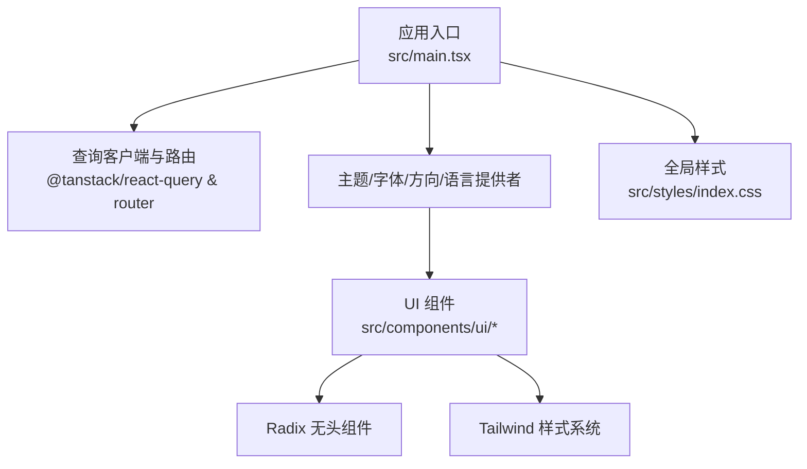
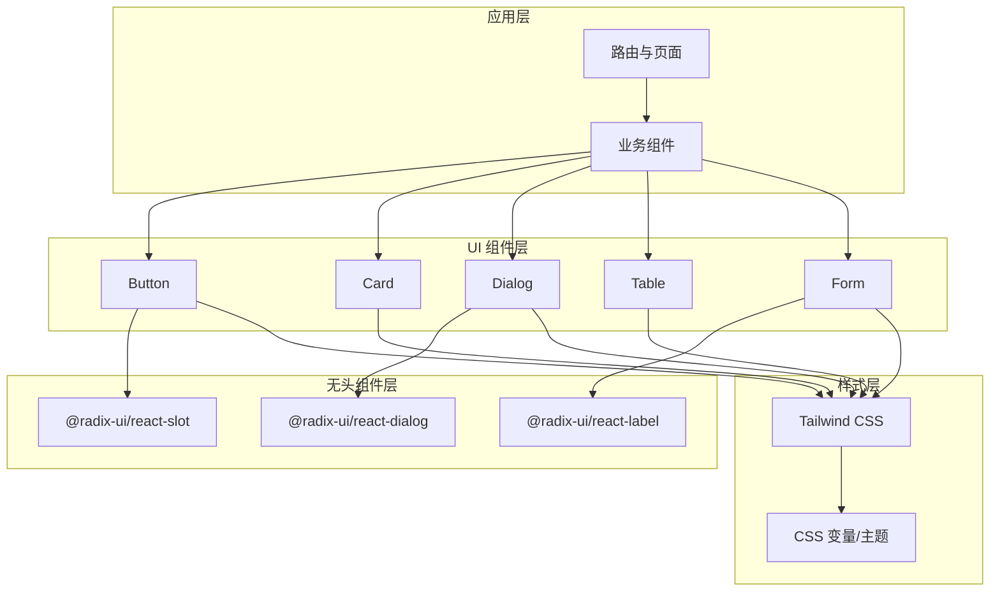
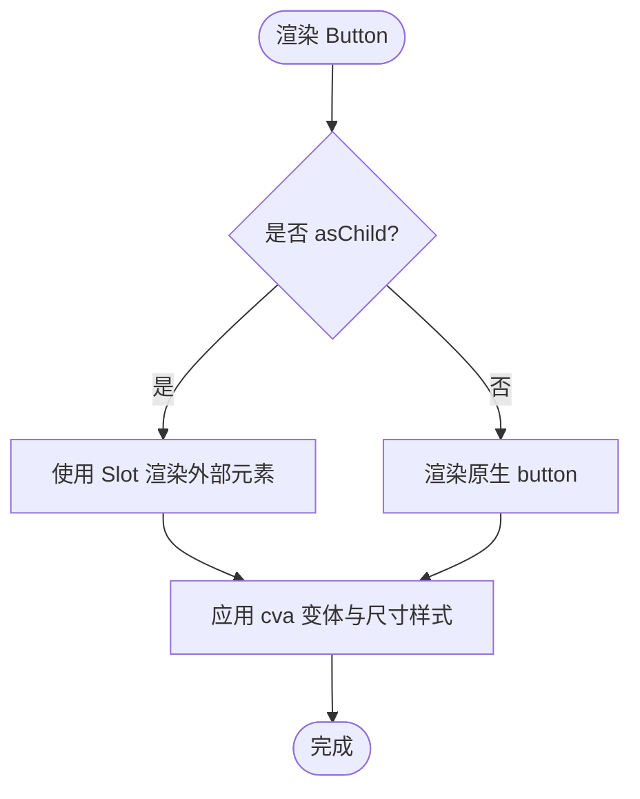
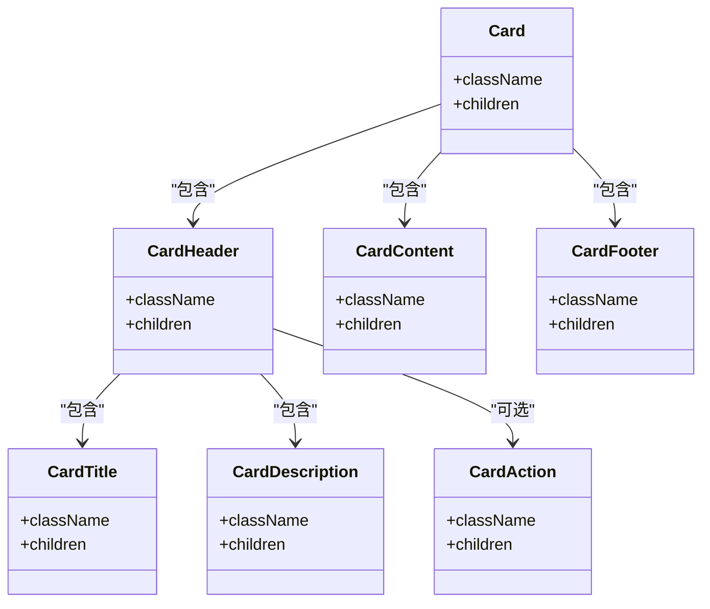
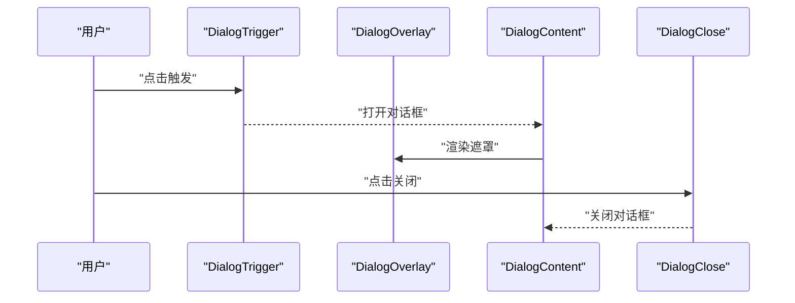
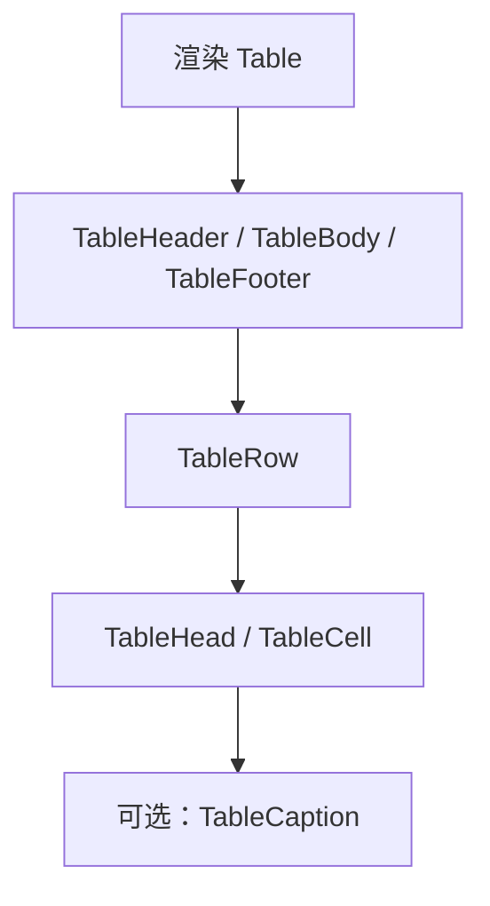
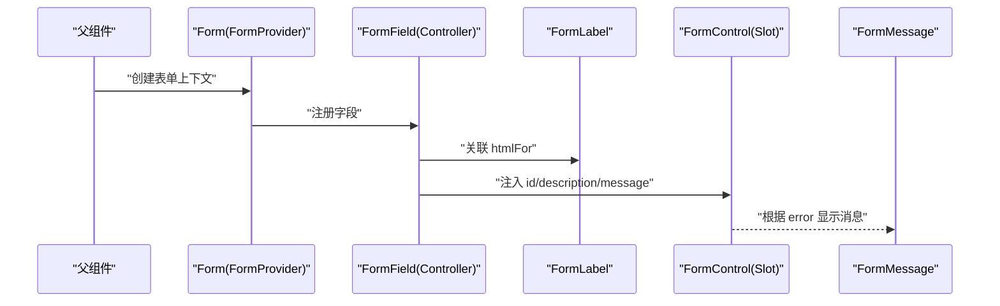
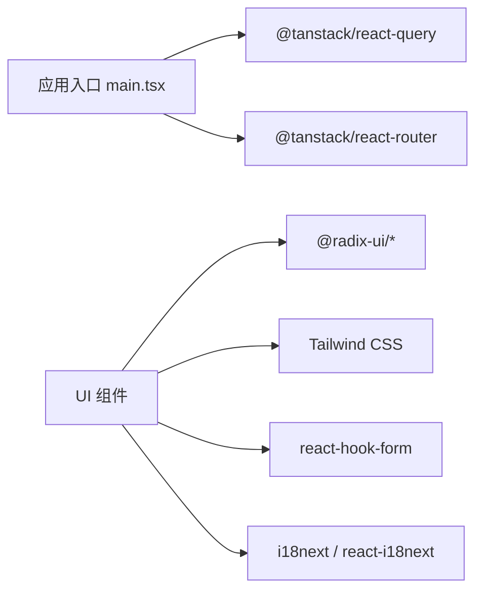

# UI组件库

<cite>
**本文引用的文件**
- [package.json](file://web_client/shadcn-admin/package.json)
- [components.json](file://web_client/shadcn-admin/components.json)
- [main.tsx](file://web_client/shadcn-admin/src/main.tsx)
- [index.css](file://web_client/shadcn-admin/src/styles/index.css)
- [theme-provider.tsx](file://web_client/shadcn-admin/src/context/theme-provider.tsx)
- [utils.ts](file://web_client/shadcn-admin/src/lib/utils.ts)
- [button.tsx](file://web_client/shadcn-admin/src/components/ui/button.tsx)
- [card.tsx](file://web_client/shadcn-admin/src/components/ui/card.tsx)
- [dialog.tsx](file://web_client/shadcn-admin/src/components/ui/dialog.tsx)
- [table.tsx](file://web_client/shadcn-admin/src/components/ui/table.tsx)
- [form.tsx](file://web_client/shadcn-admin/src/components/ui/form.tsx)
</cite>

## 目录
1. [简介](#简介)
2. [项目结构](#项目结构)
3. [核心组件](#核心组件)
4. [架构总览](#架构总览)
5. [详细组件分析](#详细组件分析)
6. [依赖关系分析](#依赖关系分析)
7. [性能考量](#性能考量)
8. [故障排查指南](#故障排查指南)
9. [结论](#结论)
10. [附录](#附录)

## 简介
本技术文档面向基于 Radix UI 与 Tailwind CSS 的 Shadcn Admin 前端 UI 组件库，系统性阐述其组件架构、组合模式、样式定制方案以及可访问性与国际化支持。文档覆盖按钮、卡片、对话框、表格、表单等核心组件的使用方式、属性配置与事件处理；并提供主题定制（颜色变量、字体、响应式）与复杂场景示例（复杂表单、数据表格、交互对话框）的实现思路与最佳实践。

## 项目结构
- 入口与全局上下文
  - 应用入口通过 React Query、路由、主题、字体、方向与语言等多层 Provider 包裹，确保全局状态一致与可组合性。
  - 全局样式引入 Tailwind 与自定义主题，定义基础样式、滚动锁定覆盖、移动端输入字号优化等。
- 组件组织
  - 基础 UI 组件位于 components/ui，采用“原子化”拆分与组合，如 Button、Card、Dialog、Table、Form 等。
  - 业务级组件与页面按功能域划分，复用基础组件构建复杂界面。
- 配置与工具
  - 通过 shadcn 配置文件声明样式风格、CSS 变量、别名与图标库。
  - 工具函数提供类名合并、分页计算、首字母生成等通用能力。

图表来源
- [main.tsx:24-110](file://web_client/shadcn-admin/src/main.tsx#L24-L110)
- [index.css:1-39](file://web_client/shadcn-admin/src/styles/index.css#L1-L39)

章节来源
- [main.tsx:24-110](file://web_client/shadcn-admin/src/main.tsx#L24-L110)
- [index.css:1-39](file://web_client/shadcn-admin/src/styles/index.css#L1-L39)

## 核心组件
- 按钮（Button）
  - 使用 class-variance-authority 管理变体与尺寸，结合 Tailwind 实现多态样式。
  - 支持 asChild 透传至 Slot，便于与第三方元素或路由链接组合。
  - 焦点与无障碍：统一 focus-visible 环与 aria-invalid 错误态样式。
- 卡片（Card）
  - 拆分为 Card、CardHeader、CardTitle、CardDescription、CardAction、CardContent、CardFooter，语义清晰、布局稳定。
  - 使用容器查询与网格布局适配不同内容密度。
- 对话框（Dialog）
  - 基于 Radix Dialog 封装，包含 Overlay、Content、Header、Footer、Title、Description、Close 等子组件。
  - 内置关闭按钮与动画过渡，支持可访问性焦点管理与屏幕阅读器提示。
- 表格（Table）
  - 提供 Table、TableHeader、TableBody、TableRow、TableHead、TableCell、TableCaption 等语义化子组件。
  - 支持选中态高亮、悬停背景与底部边框等交互反馈。
- 表单（Form）
  - 基于 react-hook-form 与 Radix Label 封装，提供 Form、FormField、FormItem、FormLabel、FormControl、FormDescription、FormMessage。
  - 自动关联 id、aria-describedby、aria-invalid，提升可访问性；错误信息动态渲染。

章节来源
- [button.tsx:6-58](file://web_client/shadcn-admin/src/components/ui/button.tsx#L6-L58)
- [card.tsx:4-91](file://web_client/shadcn-admin/src/components/ui/card.tsx#L4-L91)
- [dialog.tsx:8-142](file://web_client/shadcn-admin/src/components/ui/dialog.tsx#L8-L142)
- [table.tsx:4-113](file://web_client/shadcn-admin/src/components/ui/table.tsx#L4-L113)
- [form.tsx:16-164](file://web_client/shadcn-admin/src/components/ui/form.tsx#L16-L164)

## 架构总览
Shadcn Admin 采用“无头组件 + 样式层 + 业务组合”的分层架构：
- 无头组件层：Radix UI 提供可访问、可组合的底层能力（如 Dialog、Select、Tabs 等）。
- 样式层：Tailwind CSS 配合 CSS 变量与主题，实现一致的视觉系统与主题切换。
- 组合层：在 components/ui 中封装具体 UI 组件，暴露简洁 API；业务组件按需组合。

图表来源
- [dialog.tsx:4-79](file://web_client/shadcn-admin/src/components/ui/dialog.tsx#L4-L79)
- [form.tsx:11-16](file://web_client/shadcn-admin/src/components/ui/form.tsx#L11-L16)
- [button.tsx:2-4](file://web_client/shadcn-admin/src/components/ui/button.tsx#L2-L4)
- [index.css:1-3](file://web_client/shadcn-admin/src/styles/index.css#L1-L3)

## 详细组件分析

### 按钮（Button）
- 设计要点
  - 使用 cva 定义 variant（default、destructive、outline、secondary、ghost、link）与 size（default、sm、lg、icon），默认值集中管理。
  - 通过 Slot 支持 asChild 透传，使按钮可与路由链接或第三方元素无缝组合。
  - 统一的焦点环与错误态样式，保证键盘导航与可访问性一致性。
- 使用建议
  - 优先通过 variant 与 size 控制外观，避免内联样式。
  - 需要与 Link 或第三方组件组合时，启用 asChild。
- 可访问性
  - 聚焦可见、禁用态指针事件屏蔽、错误态 ring 与 border 提示。

图表来源
- [button.tsx:6-58](file://web_client/shadcn-admin/src/components/ui/button.tsx#L6-L58)

章节来源
- [button.tsx:6-58](file://web_client/shadcn-admin/src/components/ui/button.tsx#L6-L58)

### 卡片（Card）
- 设计要点
  - 将卡片拆分为 Header、Title、Description、Action、Content、Footer，职责单一、组合灵活。
  - 使用容器查询与网格布局，适配标题与操作区的对齐与换行。
- 使用建议
  - 通过 CardHeader/CardContent/CardFooter 组织内容层次；CardAction 用于放置操作按钮或标签。
- 可访问性
  - 语义化 div 结构，配合外层容器与标题层级，利于屏幕阅读器理解。

图表来源
- [card.tsx:4-91](file://web_client/shadcn-admin/src/components/ui/card.tsx#L4-L91)

章节来源
- [card.tsx:4-91](file://web_client/shadcn-admin/src/components/ui/card.tsx#L4-L91)

### 对话框（Dialog）
- 设计要点
  - 基于 Radix Dialog 封装，提供 Trigger、Portal、Overlay、Content、Header、Footer、Title、Description、Close。
  - Content 默认居中、最大宽度限制、入场/出场动画；Close 按钮可配置显示。
- 使用建议
  - 使用 DialogTrigger 触发打开；DialogContent 承载主要内容；DialogHeader/DialogFooter 组织标题与操作区。
  - 通过 showCloseButton 控制右上角关闭按钮显隐。
- 可访问性
  - 焦点陷阱、Esc 关闭、屏幕阅读器友好描述；关闭按钮含 sr-only 文本。

图表来源
- [dialog.tsx:8-79](file://web_client/shadcn-admin/src/components/ui/dialog.tsx#L8-L79)

章节来源
- [dialog.tsx:8-142](file://web_client/shadcn-admin/src/components/ui/dialog.tsx#L8-L142)

### 表格（Table）
- 设计要点
  - 提供 TableContainer、Table、TableHeader、TableBody、TableRow、TableHead、TableCell、TableCaption。
  - 行悬停与选中态高亮，表头与单元格对齐与间距统一。
- 使用建议
  - 与 TanStack Table 搭配可实现排序、筛选、分页等高级功能；当前组件负责结构与样式。
- 可访问性
  - 语义化 table 结构，适合屏幕阅读器读取行列关系。

图表来源
- [table.tsx:4-113](file://web_client/shadcn-admin/src/components/ui/table.tsx#L4-L113)

章节来源
- [table.tsx:4-113](file://web_client/shadcn-admin/src/components/ui/table.tsx#L4-L113)

### 表单（Form）
- 设计要点
  - 基于 react-hook-form 的 Controller 与 Context，提供 Form、FormField、FormItem、FormLabel、FormControl、FormDescription、FormMessage。
  - 自动建立 id 关联与 aria-describedby，错误时设置 aria-invalid。
- 使用建议
  - 使用 FormProvider 包裹表单；FormField 绑定字段；FormLabel/FormControl/FormMessage 组合展示。
  - 校验逻辑由 react-hook-form 与 Zod/Hookform Resolvers 驱动。
- 可访问性
  - 标签与控件关联、错误消息与描述分离，符合 WCAG 要求。

图表来源
- [form.tsx:16-164](file://web_client/shadcn-admin/src/components/ui/form.tsx#L16-L164)

章节来源
- [form.tsx:16-164](file://web_client/shadcn-admin/src/components/ui/form.tsx#L16-L164)

## 依赖关系分析
- 运行时依赖
  - Radix UI 系列组件提供无头、可访问的交互能力（Dialog、Label、Slot 等）。
  - Tailwind CSS 与 tw-animate-css 提供样式与动画。
  - react-hook-form 与 @hookform/resolvers 驱动表单状态与校验。
  - @tanstack/react-query 与 @tanstack/react-router 提供数据请求与路由能力。
  - i18next 与 react-i18next 支持国际化。
- 构建与开发
  - Vite 作为构建工具，TypeScript 类型检查，ESLint/Prettier 代码规范。
  - Vitest 与 Playwright 进行单元测试与浏览器测试。

图表来源
- [package.json:21-66](file://web_client/shadcn-admin/package.json#L21-L66)
- [main.tsx:24-110](file://web_client/shadcn-admin/src/main.tsx#L24-L110)

章节来源
- [package.json:21-66](file://web_client/shadcn-admin/package.json#L21-L66)
- [main.tsx:24-110](file://web_client/shadcn-admin/src/main.tsx#L24-L110)

## 性能考量
- 主题切换
  - 使用 useMemo 计算 resolvedTheme，减少不必要的重渲染；监听系统主题变化并同步更新根节点 class。
- 样式合并
  - 通过 clsx + tailwind-merge 合并类名，避免冲突与冗余，提高渲染效率。
- 列表与表格
  - 大数据量建议使用虚拟滚动或分页；当前表格组件为样式与结构层，可与 TanStack Table 配合实现高效渲染。
- 网络请求
  - React Query 配置了重试策略与缓存时间，生产环境窗口聚焦时重新获取，降低重复请求。

章节来源
- [theme-provider.tsx:45-76](file://web_client/shadcn-admin/src/context/theme-provider.tsx#L45-L76)
- [utils.ts:4-5](file://web_client/shadcn-admin/src/lib/utils.ts#L4-L5)
- [main.tsx:24-71](file://web_client/shadcn-admin/src/main.tsx#L24-L71)

## 故障排查指南
- 主题不生效
  - 确认根节点已添加 light/dark 类；检查 ThemeProvider 是否正确包裹应用。
  - 若使用 system 主题，确认媒体查询监听正常。
- 表单验证无效
  - 确认 FormField 正确绑定 name；检查 useFormField 是否在 FormField 内部使用。
  - 查看 FormMessage 是否渲染错误信息；确保控制器与校验器配置正确。
- 对话框无法关闭或焦点异常
  - 确认 DialogTrigger/DialogContent/DialogClose 成对使用；检查是否被其他模态遮挡。
  - 关注焦点陷阱与 Esc 行为是否符合预期。
- 表格样式错乱
  - 确认 TableHeader/TableBody/TableRow/TableCell 层级正确；避免多余嵌套影响布局。

章节来源
- [theme-provider.tsx:55-86](file://web_client/shadcn-admin/src/context/theme-provider.tsx#L55-L86)
- [form.tsx:42-63](file://web_client/shadcn-admin/src/components/ui/form.tsx#L42-L63)
- [dialog.tsx:48-79](file://web_client/shadcn-admin/src/components/ui/dialog.tsx#L48-L79)
- [table.tsx:19-89](file://web_client/shadcn-admin/src/components/ui/table.tsx#L19-L89)

## 结论
Shadcn Admin 以 Radix UI 为基础，结合 Tailwind CSS 的原子化样式与 CSS 变量主题，构建了高内聚、低耦合的 UI 组件体系。通过清晰的组合模式与完善的可访问性支持，开发者可以快速搭建企业级后台界面。建议在项目中遵循“先组合、后定制”的原则，充分利用现有组件的能力，并通过主题与样式层进行品牌化定制。

## 附录

### 主题定制与样式系统
- 颜色与变量
  - 通过 Tailwind CSS 与 CSS 变量统一管理色彩、边框、背景与前景色；主题切换时动态更新根节点 class。
- 字体配置
  - 通过 FontProvider 与字体配置文件，集中管理字体族与加载策略。
- 响应式设计
  - 使用 Tailwind 断点与容器查询，适配不同屏幕尺寸；移动端输入字号优化避免缩放问题。

章节来源
- [index.css:1-39](file://web_client/shadcn-admin/src/styles/index.css#L1-L39)
- [theme-provider.tsx:45-76](file://web_client/shadcn-admin/src/context/theme-provider.tsx#L45-L76)

### 可访问性与国际化
- 可访问性
  - 所有交互组件遵循 WAI-ARIA 规范，提供焦点管理、键盘导航与屏幕阅读器支持。
  - 表单组件自动关联 label、描述与错误信息，确保无障碍体验。
- 国际化
  - 通过 i18next 与 react-i18next 实现文案多语言；LanguageProvider 管理当前语言与切换。

章节来源
- [form.tsx:87-120](file://web_client/shadcn-admin/src/components/ui/form.tsx#L87-L120)
- [main.tsx:13-18](file://web_client/shadcn-admin/src/main.tsx#L13-L18)

### 复杂场景示例指引
- 复杂表单
  - 使用 Form + FormField 组合多个字段；通过 react-hook-form 与校验器实现联动与异步校验；利用 FormMessage 展示错误。
- 数据表格
  - 基于 Table 组件与 TanStack Table 集成，实现列定义、排序、筛选、分页与批量操作。
- 交互对话框
  - 使用 Dialog 组合表单或内容区域；通过状态管理控制打开/关闭与提交流程；必要时结合 Toast 反馈结果。

[本节为概念性说明，不直接分析具体文件]