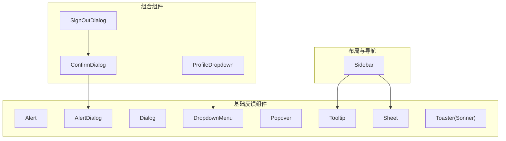
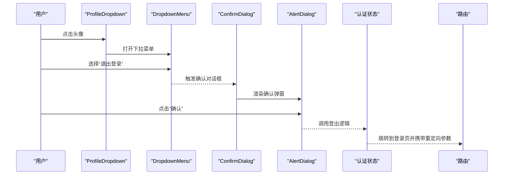
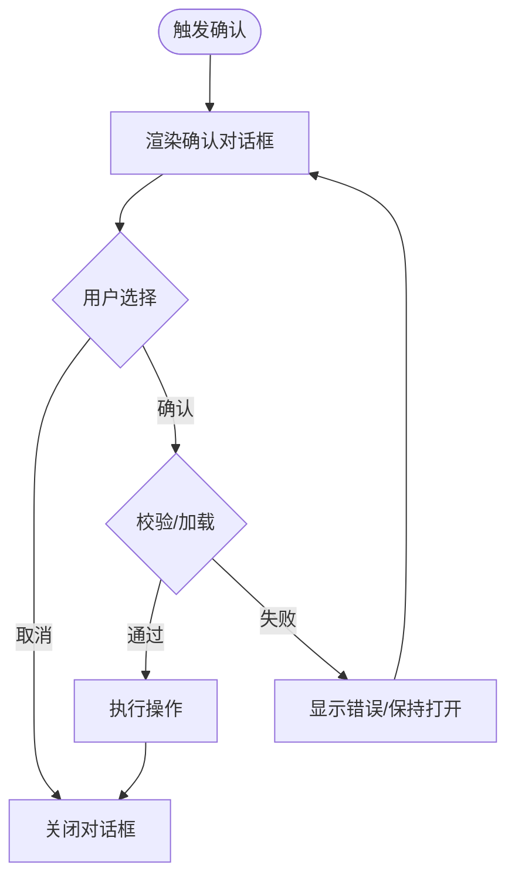
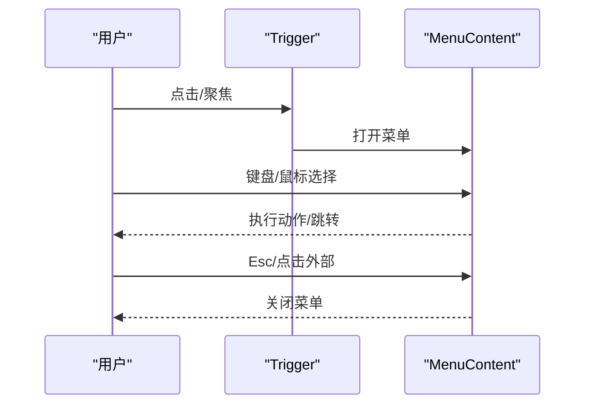
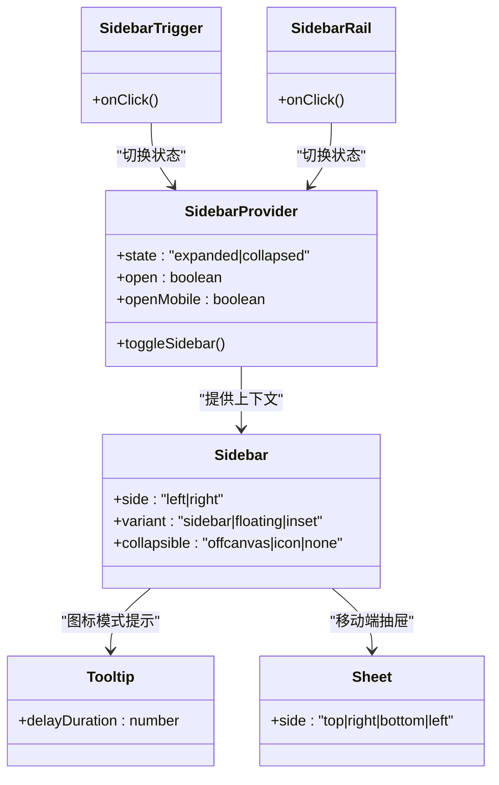
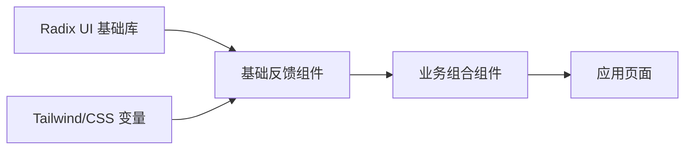

# 反馈组件

<cite>
**本文引用的文件**
- [alert.tsx](file://web_client/shadcn-admin/src/components/ui/alert.tsx)
- [alert-dialog.tsx](file://web_client/shadcn-admin/src/components/ui/alert-dialog.tsx)
- [dialog.tsx](file://web_client/shadcn-admin/src/components/ui/dialog.tsx)
- [dropdown-menu.tsx](file://web_client/shadcn-admin/src/components/ui/dropdown-menu.tsx)
- [popover.tsx](file://web_client/shadcn-admin/src/components/ui/popover.tsx)
- [tooltip.tsx](file://web_client/shadcn-admin/src/components/ui/tooltip.tsx)
- [sidebar.tsx](file://web_client/shadcn-admin/src/components/ui/sidebar.tsx)
- [sheet.tsx](file://web_client/shadcn-admin/src/components/ui/sheet.tsx)
- [sonner.tsx](file://web_client/shadcn-admin/src/components/ui/sonner.tsx)
- [confirm-dialog.tsx](file://web_client/shadcn-admin/src/components/confirm-dialog.tsx)
- [sign-out-dialog.tsx](file://web_client/shadcn-admin/src/components/sign-out-dialog.tsx)
- [profile-dropdown.tsx](file://web_client/shadcn-admin/src/components/profile-dropdown.tsx)
</cite>

## 目录
1. [简介](#简介)
2. [项目结构](#项目结构)
3. [核心组件](#核心组件)
4. [架构总览](#架构总览)
5. [详细组件分析](#详细组件分析)
6. [依赖关系分析](#依赖关系分析)
7. [性能考量](#性能考量)
8. [故障排查指南](#故障排查指南)
9. [结论](#结论)
10. [附录](#附录)

## 简介
本技术文档聚焦 Shadcn Admin 中的用户反馈组件，覆盖警告提示、确认对话框、下拉菜单、弹出层（Popover）、工具提示（Tooltip）与侧边栏等。文档从触发条件、显示逻辑、交互行为、层级管理、焦点控制、动画过渡、可访问性与键盘导航等方面深入解析，并提供复杂交互场景的组合使用示例，帮助开发者在项目中稳定、一致地实现高质量的用户反馈体验。

## 项目结构
反馈相关组件主要位于 UI 基础组件目录与业务组合组件中：
- 基础反馈组件：Alert、AlertDialog、Dialog、DropdownMenu、Popover、Tooltip、Sheet、Toaster（基于 Sonner）
- 组合型反馈：ConfirmDialog、SignOutDialog、ProfileDropdown
- 侧边栏：Sidebar（含折叠态、移动端抽屉式展示、快捷键切换）

图表来源
- [alert.tsx:1-66](file://web_client/shadcn-admin/src/components/ui/alert.tsx#L1-L66)
- [alert-dialog.tsx:1-155](file://web_client/shadcn-admin/src/components/ui/alert-dialog.tsx#L1-L155)
- [dialog.tsx:1-143](file://web_client/shadcn-admin/src/components/ui/dialog.tsx#L1-L143)
- [dropdown-menu.tsx:1-255](file://web_client/shadcn-admin/src/components/ui/dropdown-menu.tsx#L1-L255)
- [popover.tsx:1-46](file://web_client/shadcn-admin/src/components/ui/popover.tsx#L1-L46)
- [tooltip.tsx:1-61](file://web_client/shadcn-admin/src/components/ui/tooltip.tsx#L1-L61)
- [sheet.tsx:1-137](file://web_client/shadcn-admin/src/components/ui/sheet.tsx#L1-L137)
- [sonner.tsx:1-22](file://web_client/shadcn-admin/src/components/ui/sonner.tsx#L1-L22)
- [confirm-dialog.tsx:1-73](file://web_client/shadcn-admin/src/components/confirm-dialog.tsx#L1-L73)
- [sign-out-dialog.tsx:1-39](file://web_client/shadcn-admin/src/components/sign-out-dialog.tsx#L1-L39)
- [profile-dropdown.tsx:1-76](file://web_client/shadcn-admin/src/components/profile-dropdown.tsx#L1-L76)
- [sidebar.tsx:1-729](file://web_client/shadcn-admin/src/components/ui/sidebar.tsx#L1-L729)

章节来源
- [alert.tsx:1-66](file://web_client/shadcn-admin/src/components/ui/alert.tsx#L1-L66)
- [alert-dialog.tsx:1-155](file://web_client/shadcn-admin/src/components/ui/alert-dialog.tsx#L1-L155)
- [dialog.tsx:1-143](file://web_client/shadcn-admin/src/components/ui/dialog.tsx#L1-L143)
- [dropdown-menu.tsx:1-255](file://web_client/shadcn-admin/src/components/ui/dropdown-menu.tsx#L1-L255)
- [popover.tsx:1-46](file://web_client/shadcn-admin/src/components/ui/popover.tsx#L1-L46)
- [tooltip.tsx:1-61](file://web_client/shadcn-admin/src/components/ui/tooltip.tsx#L1-L61)
- [sheet.tsx:1-137](file://web_client/shadcn-admin/src/components/ui/sheet.tsx#L1-L137)
- [sonner.tsx:1-22](file://web_client/shadcn-admin/src/components/ui/sonner.tsx#L1-L22)
- [confirm-dialog.tsx:1-73](file://web_client/shadcn-admin/src/components/confirm-dialog.tsx#L1-L73)
- [sign-out-dialog.tsx:1-39](file://web_client/shadcn-admin/src/components/sign-out-dialog.tsx#L1-L39)
- [profile-dropdown.tsx:1-76](file://web_client/shadcn-admin/src/components/profile-dropdown.tsx#L1-L76)
- [sidebar.tsx:1-729](file://web_client/shadcn-admin/src/components/ui/sidebar.tsx#L1-L729)

## 核心组件
- Alert：用于非模态的轻量提示，支持多种变体（如默认、破坏性），通过 role="alert" 提供可访问性语义。
- AlertDialog：模态确认对话框，包含遮罩、内容区、标题、描述、操作按钮，适合危险或重要操作的二次确认。
- Dialog：通用模态框，支持自定义头部/尾部、关闭按钮、动画与焦点管理。
- DropdownMenu：上下文菜单/下拉菜单，支持分组、分隔符、子菜单、复选/单选项、快捷键提示等。
- Popover：浮层内容容器，常用于表单字段说明、详情预览等轻量信息展示。
- Tooltip：工具提示，用于对不可见信息进行即时解释，支持延迟与方向定位。
- Sheet：侧滑面板，常用于设置、筛选、详情等需要较大内容的场景。
- Toaster：全局通知（Toast），用于成功、错误、信息等短暂反馈。
- ConfirmDialog：封装 AlertDialog 的确认对话框，统一标题、描述、取消/确认按钮与加载态。
- SignOutDialog：基于 ConfirmDialog 的登出确认，结合路由跳转与状态重置。
- ProfileDropdown：头像下拉菜单，集成设置、账单、退出登录等入口，并与确认对话框联动。
- Sidebar：侧边栏，支持展开/折叠、移动端抽屉模式、快捷键切换、图标模式下的 Tooltip 提示。

章节来源
- [alert.tsx:1-66](file://web_client/shadcn-admin/src/components/ui/alert.tsx#L1-L66)
- [alert-dialog.tsx:1-155](file://web_client/shadcn-admin/src/components/ui/alert-dialog.tsx#L1-L155)
- [dialog.tsx:1-143](file://web_client/shadcn-admin/src/components/ui/dialog.tsx#L1-L143)
- [dropdown-menu.tsx:1-255](file://web_client/shadcn-admin/src/components/ui/dropdown-menu.tsx#L1-L255)
- [popover.tsx:1-46](file://web_client/shadcn-admin/src/components/ui/popover.tsx#L1-L46)
- [tooltip.tsx:1-61](file://web_client/shadcn-admin/src/components/ui/tooltip.tsx#L1-L61)
- [sheet.tsx:1-137](file://web_client/shadcn-admin/src/components/ui/sheet.tsx#L1-L137)
- [sonner.tsx:1-22](file://web_client/shadcn-admin/src/components/ui/sonner.tsx#L1-L22)
- [confirm-dialog.tsx:1-73](file://web_client/shadcn-admin/src/components/confirm-dialog.tsx#L1-L73)
- [sign-out-dialog.tsx:1-39](file://web_client/shadcn-admin/src/components/sign-out-dialog.tsx#L1-L39)
- [profile-dropdown.tsx:1-76](file://web_client/shadcn-admin/src/components/profile-dropdown.tsx#L1-L76)
- [sidebar.tsx:1-729](file://web_client/shadcn-admin/src/components/ui/sidebar.tsx#L1-L729)

## 架构总览
反馈组件以 Radix UI 为底层能力（Dialog、DropdownMenu、Popover、Tooltip、Sheet、AlertDialog），通过样式与组合封装形成一致的视觉与交互规范；业务组件进一步将多个基础组件组合，形成开箱即用的交互模式。

图表来源
- [profile-dropdown.tsx:1-76](file://web_client/shadcn-admin/src/components/profile-dropdown.tsx#L1-L76)
- [dropdown-menu.tsx:1-255](file://web_client/shadcn-admin/src/components/ui/dropdown-menu.tsx#L1-L255)
- [confirm-dialog.tsx:1-73](file://web_client/shadcn-admin/src/components/confirm-dialog.tsx#L1-L73)
- [alert-dialog.tsx:1-155](file://web_client/shadcn-admin/src/components/ui/alert-dialog.tsx#L1-L155)
- [sign-out-dialog.tsx:1-39](file://web_client/shadcn-admin/src/components/sign-out-dialog.tsx#L1-L39)

## 详细组件分析

### 警告提示（Alert）
- 触发条件：由业务逻辑决定何时展示（如请求失败、操作完成）。
- 显示逻辑：非模态，常驻于页面中，可通过样式控制位置与尺寸。
- 交互行为：无强制交互，通常配合关闭按钮或自动消失策略。
- 可访问性：使用 role="alert" 确保屏幕阅读器及时播报。
- 动画与过渡：通过 Tailwind 类名控制淡入/缩放等过渡。
- 组合模式：可与 Toast 或 Drawer 搭配，用于不同粒度的反馈。

章节来源
- [alert.tsx:1-66](file://web_client/shadcn-admin/src/components/ui/alert.tsx#L1-L66)

### 确认对话框（AlertDialog + ConfirmDialog）
- 触发条件：危险操作（删除、清空、退出登录）前进行二次确认。
- 显示逻辑：模态遮罩+居中内容区，阻止背景交互，聚焦锁定在对话框内。
- 交互行为：支持取消与确认，支持加载态禁用确认按钮；可嵌入表单提交。
- 可访问性：标题、描述、按钮均具备语义化属性；ESC 关闭、Tab 循环聚焦。
- 动画与过渡：打开/关闭时包含淡入淡出与缩放过渡。
- 组合模式：ConfirmDialog 封装常用文案与按钮样式；SignOutDialog 演示与路由/状态管理的结合。

图表来源
- [alert-dialog.tsx:1-155](file://web_client/shadcn-admin/src/components/ui/alert-dialog.tsx#L1-L155)
- [confirm-dialog.tsx:1-73](file://web_client/shadcn-admin/src/components/confirm-dialog.tsx#L1-L73)
- [sign-out-dialog.tsx:1-39](file://web_client/shadcn-admin/src/components/sign-out-dialog.tsx#L1-L39)

章节来源
- [alert-dialog.tsx:1-155](file://web_client/shadcn-admin/src/components/ui/alert-dialog.tsx#L1-L155)
- [confirm-dialog.tsx:1-73](file://web_client/shadcn-admin/src/components/confirm-dialog.tsx#L1-L73)
- [sign-out-dialog.tsx:1-39](file://web_client/shadcn-admin/src/components/sign-out-dialog.tsx#L1-L39)

### 下拉菜单（DropdownMenu）
- 触发条件：点击触发器或键盘 Enter/Space。
- 显示逻辑：通过 Portal 渲染到根节点，避免父级 overflow 裁剪；支持多向对齐与偏移。
- 交互行为：支持分组、分隔符、子菜单、复选/单选项、快捷键提示；支持 disabled 状态。
- 可访问性：遵循 WAI-ARIA 菜单约定，支持箭头键导航、Enter/Space 选择、Esc 关闭。
- 动画与过渡：打开/关闭包含淡入淡出与缩放过渡，按方位滑动进入。
- 组合模式：ProfileDropdown 展示头像入口与设置项，并可联动确认对话框。

图表来源
- [dropdown-menu.tsx:1-255](file://web_client/shadcn-admin/src/components/ui/dropdown-menu.tsx#L1-L255)
- [profile-dropdown.tsx:1-76](file://web_client/shadcn-admin/src/components/profile-dropdown.tsx#L1-L76)

章节来源
- [dropdown-menu.tsx:1-255](file://web_client/shadcn-admin/src/components/ui/dropdown-menu.tsx#L1-L255)
- [profile-dropdown.tsx:1-76](file://web_client/shadcn-admin/src/components/profile-dropdown.tsx#L1-L76)

### 弹出层（Popover）
- 触发条件：点击或聚焦触发器。
- 显示逻辑：浮层定位于触发元素附近，支持 align/sideOffset 配置。
- 交互行为：点击外部或 Esc 关闭；适合承载简短说明、表单辅助信息。
- 可访问性：与触发元素建立关联，支持键盘导航。
- 动画与过渡：打开/关闭包含淡入淡出与缩放过渡，按方位滑动进入。

章节来源
- [popover.tsx:1-46](file://web_client/shadcn-admin/src/components/ui/popover.tsx#L1-L46)

### 工具提示（Tooltip）
- 触发条件：悬停或聚焦触发器。
- 显示逻辑：轻量浮层，默认延迟显示以避免误触。
- 交互行为：离开触发区域或失焦后隐藏；适合补充不可见信息的解释。
- 可访问性：为触发器提供 aria-describedby 关联，屏幕阅读器可读。
- 动画与过渡：打开/关闭包含淡入淡出与缩放过渡，按方位滑动进入。

章节来源
- [tooltip.tsx:1-61](file://web_client/shadcn-admin/src/components/ui/tooltip.tsx#L1-L61)

### 侧边栏（Sidebar）
- 触发条件：点击触发按钮、拖拽轨道、键盘快捷键（Ctrl/Cmd + B）。
- 显示逻辑：桌面端固定宽度侧栏，支持展开/折叠/图标模式；移动端以 Sheet 抽屉形式呈现。
- 交互行为：支持键盘快捷键切换、轨道拖拽调整宽度、图标模式下 Tooltip 提示。
- 可访问性：触发按钮具备无障碍标签；移动端 Sheet 提供标题与描述。
- 动画与过渡：宽度变化与进出场使用平滑过渡。
- 组合模式：与 Tooltip 配合在图标模式下提供文字提示；与 Sheet 配合在移动端提供抽屉式导航。

图表来源
- [sidebar.tsx:1-729](file://web_client/shadcn-admin/src/components/ui/sidebar.tsx#L1-L729)
- [tooltip.tsx:1-61](file://web_client/shadcn-admin/src/components/ui/tooltip.tsx#L1-L61)
- [sheet.tsx:1-137](file://web_client/shadcn-admin/src/components/ui/sheet.tsx#L1-L137)

章节来源
- [sidebar.tsx:1-729](file://web_client/shadcn-admin/src/components/ui/sidebar.tsx#L1-L729)

### 全局通知（Toaster/Sonner）
- 触发条件：业务事件完成后调用（如保存成功、网络错误）。
- 显示逻辑：全局挂载，不阻塞主流程，支持主题适配。
- 交互行为：自动消失或手动关闭；支持堆叠显示。
- 可访问性：通过 aria-live 等机制播报新消息。
- 动画与过渡：入场/出场动画由底层库提供。

章节来源
- [sonner.tsx:1-22](file://web_client/shadcn-admin/src/components/ui/sonner.tsx#L1-L22)

### 通用对话框（Dialog）
- 触发条件：点击触发器或键盘 Enter/Space。
- 显示逻辑：模态遮罩+居中内容区，支持自定义头部/尾部与关闭按钮。
- 交互行为：支持 ESC 关闭、Tab 聚焦循环、点击遮罩关闭（可选）。
- 可访问性：标题、描述、关闭按钮具备语义化属性。
- 动画与过渡：打开/关闭包含淡入淡出与缩放过渡。

章节来源
- [dialog.tsx:1-143](file://web_client/shadcn-admin/src/components/ui/dialog.tsx#L1-L143)

### 侧滑面板（Sheet）
- 触发条件：点击触发器或键盘 Enter/Space。
- 显示逻辑：从指定方向滑入，带遮罩；适合大内容面板（设置、筛选、详情）。
- 交互行为：支持关闭按钮、ESC 关闭、点击遮罩关闭（可选）。
- 可访问性：标题与描述提供语义化信息。
- 动画与过渡：滑入/滑出动画时长与缓动可调。

章节来源
- [sheet.tsx:1-137](file://web_client/shadcn-admin/src/components/ui/sheet.tsx#L1-L137)

## 依赖关系分析
- 基础能力依赖 Radix UI 的 Dialog/DropdownMenu/Popover/Tooltip/Sheet/AlertDialog，保证可访问性与焦点管理。
- 样式与主题依赖 Tailwind 与 CSS 变量，统一过渡与配色。
- 业务组件依赖基础组件与状态管理（如认证状态、路由），形成组合式交互。

图表来源
- [alert-dialog.tsx:1-155](file://web_client/shadcn-admin/src/components/ui/alert-dialog.tsx#L1-L155)
- [dialog.tsx:1-143](file://web_client/shadcn-admin/src/components/ui/dialog.tsx#L1-L143)
- [dropdown-menu.tsx:1-255](file://web_client/shadcn-admin/src/components/ui/dropdown-menu.tsx#L1-L255)
- [popover.tsx:1-46](file://web_client/shadcn-admin/src/components/ui/popover.tsx#L1-L46)
- [tooltip.tsx:1-61](file://web_client/shadcn-admin/src/components/ui/tooltip.tsx#L1-L61)
- [sheet.tsx:1-137](file://web_client/shadcn-admin/src/components/ui/sheet.tsx#L1-L137)
- [confirm-dialog.tsx:1-73](file://web_client/shadcn-admin/src/components/confirm-dialog.tsx#L1-L73)
- [sign-out-dialog.tsx:1-39](file://web_client/shadcn-admin/src/components/sign-out-dialog.tsx#L1-L39)
- [profile-dropdown.tsx:1-76](file://web_client/shadcn-admin/src/components/profile-dropdown.tsx#L1-L76)

章节来源
- [alert-dialog.tsx:1-155](file://web_client/shadcn-admin/src/components/ui/alert-dialog.tsx#L1-L155)
- [dialog.tsx:1-143](file://web_client/shadcn-admin/src/components/ui/dialog.tsx#L1-L143)
- [dropdown-menu.tsx:1-255](file://web_client/shadcn-admin/src/components/ui/dropdown-menu.tsx#L1-L255)
- [popover.tsx:1-46](file://web_client/shadcn-admin/src/components/ui/popover.tsx#L1-L46)
- [tooltip.tsx:1-61](file://web_client/shadcn-admin/src/components/ui/tooltip.tsx#L1-L61)
- [sheet.tsx:1-137](file://web_client/shadcn-admin/src/components/ui/sheet.tsx#L1-L137)
- [confirm-dialog.tsx:1-73](file://web_client/shadcn-admin/src/components/confirm-dialog.tsx#L1-L73)
- [sign-out-dialog.tsx:1-39](file://web_client/shadcn-admin/src/components/sign-out-dialog.tsx#L1-L39)
- [profile-dropdown.tsx:1-76](file://web_client/shadcn-admin/src/components/profile-dropdown.tsx#L1-L76)

## 性能考量
- 使用 Portal 渲染浮层，避免 DOM 嵌套导致的重排与溢出裁剪问题。
- 合理设置延迟与动画时长，减少不必要的重绘与卡顿。
- 在移动端使用 Sheet 替代全屏 Dialog，提升交互效率。
- 列表或大量菜单项时，考虑虚拟滚动或分页加载。
- 避免在高频触发处创建重型组件实例，尽量复用与懒加载。

## 故障排查指南
- 浮层被遮挡：检查父容器是否设置了 overflow:hidden 或 z-index 冲突；确保使用 Portal 渲染。
- 键盘导航异常：确认组件处于正确的焦点环内，必要时使用 ref 与 focus 管理。
- 动画不生效：检查 Tailwind 动画类名是否正确引入，浏览器是否支持相应动画。
- 移动端显示异常：确认使用 Sheet 或响应式分支，避免桌面端样式影响移动端。
- 可访问性问题：确保关键元素具备合适的 role/aria-* 属性，屏幕阅读器能正确播报。

章节来源
- [alert-dialog.tsx:1-155](file://web_client/shadcn-admin/src/components/ui/alert-dialog.tsx#L1-L155)
- [dialog.tsx:1-143](file://web_client/shadcn-admin/src/components/ui/dialog.tsx#L1-L143)
- [dropdown-menu.tsx:1-255](file://web_client/shadcn-admin/src/components/ui/dropdown-menu.tsx#L1-L255)
- [popover.tsx:1-46](file://web_client/shadcn-admin/src/components/ui/popover.tsx#L1-L46)
- [tooltip.tsx:1-61](file://web_client/shadcn-admin/src/components/ui/tooltip.tsx#L1-L61)
- [sheet.tsx:1-137](file://web_client/shadcn-admin/src/components/ui/sheet.tsx#L1-L137)
- [sidebar.tsx:1-729](file://web_client/shadcn-admin/src/components/ui/sidebar.tsx#L1-L729)

## 结论
Shadcn Admin 的反馈组件体系以 Radix UI 为基础，结合 Tailwind 样式与业务组合，提供了完整、一致且可访问的用户反馈能力。通过合理的触发条件、显示逻辑、交互行为与动画配置，可以在不同场景下实现高质量的反馈体验。建议在实际项目中根据需求选择合适的组件，并遵循可访问性与性能最佳实践。

## 附录
- 复杂交互示例
  - 确认对话框：删除数据前弹出 ConfirmDialog，确认后执行删除并刷新列表。
  - 上下文菜单：表格行右键或长按触发 DropdownMenu，提供编辑、复制、删除等操作。
  - 浮层内容：输入框旁使用 Popover 展示校验规则或示例。
  - 工具提示：图标按钮使用 Tooltip 解释功能含义。
  - 侧边栏：桌面端折叠为图标模式并显示 Tooltip；移动端以 Sheet 抽屉展示。
- 组合使用模式
  - ProfileDropdown + ConfirmDialog：头像菜单中选择退出登录，弹出确认对话框，确认后跳转登录页。
  - Sidebar + Tooltip：图标模式下为菜单项提供 Tooltip 提示。
  - Sheet + Form：在 Sheet 中放置表单，提交后通过 Toaster 反馈结果。