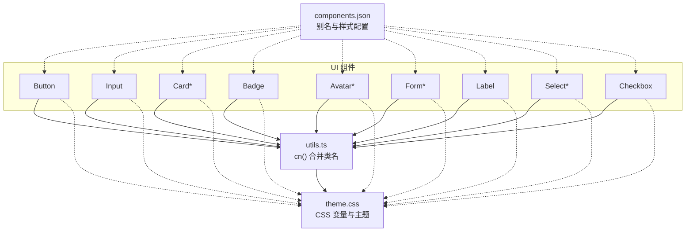
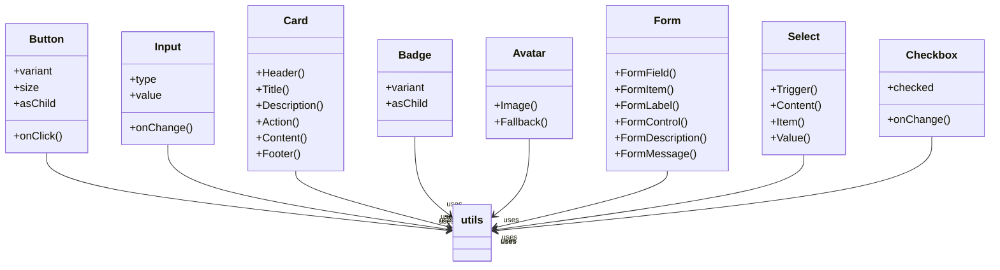
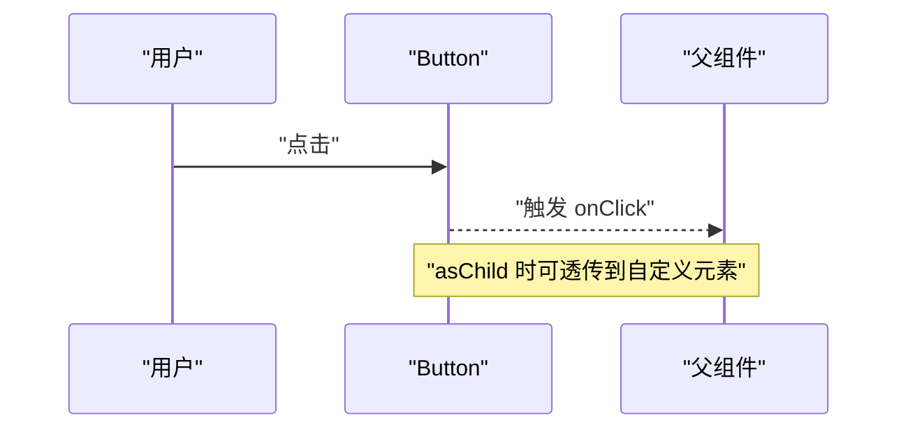
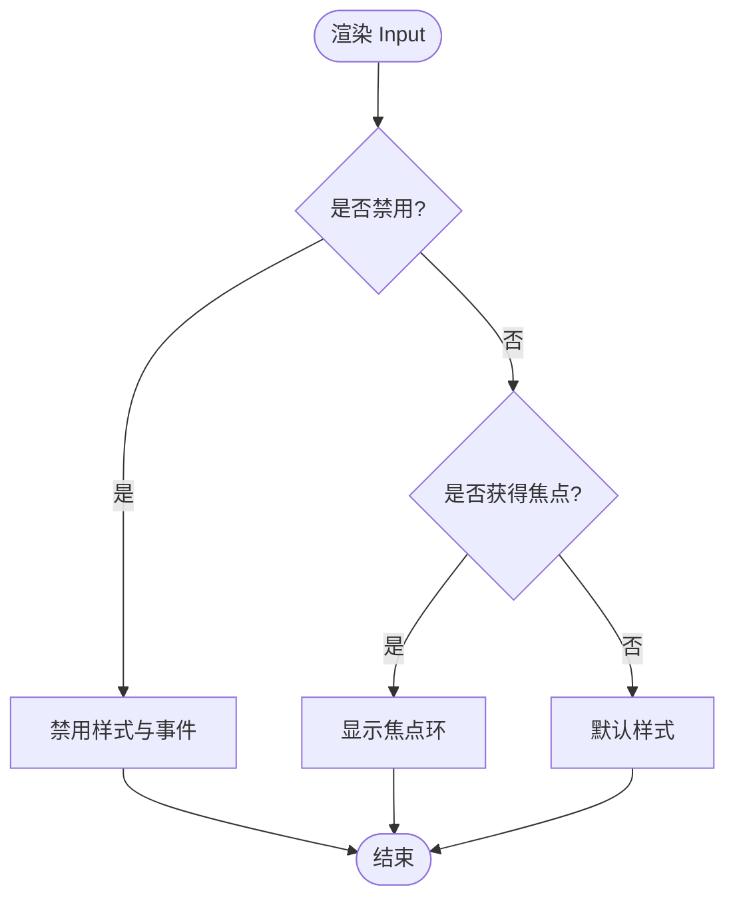
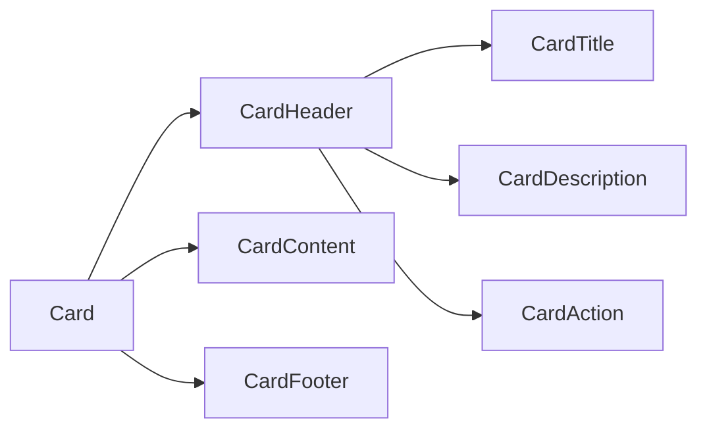
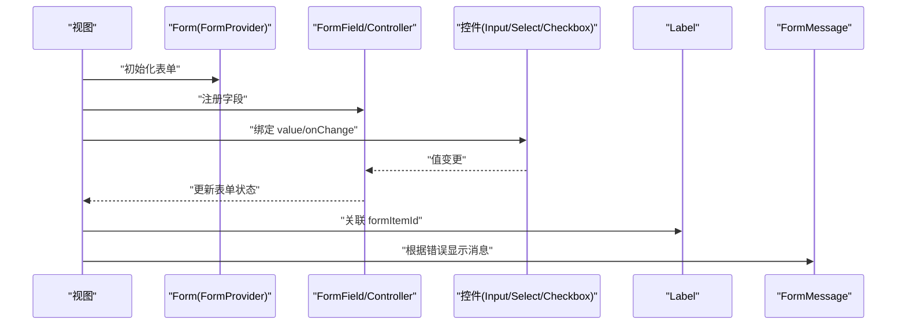
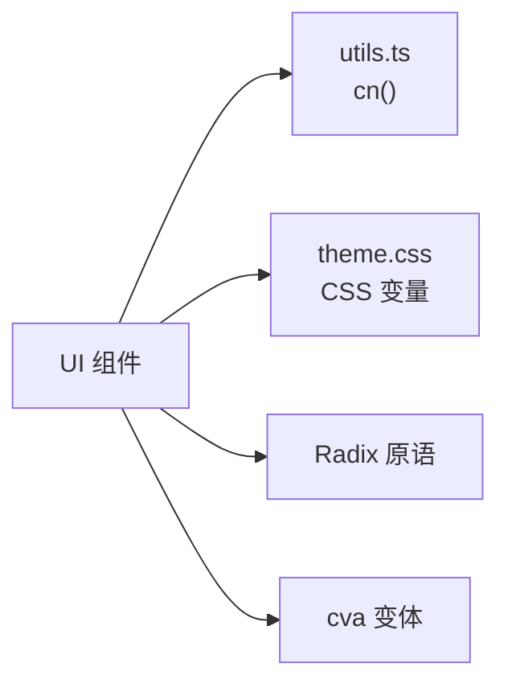

# 基础组件

<cite>
**本文引用的文件**
- [button.tsx](file://web_client/shadcn-admin/src/components/ui/button.tsx)
- [input.tsx](file://web_client/shadcn-admin/src/components/ui/input.tsx)
- [card.tsx](file://web_client/shadcn-admin/src/components/ui/card.tsx)
- [badge.tsx](file://web_client/shadcn-admin/src/components/ui/badge.tsx)
- [avatar.tsx](file://web_client/shadcn-admin/src/components/ui/avatar.tsx)
- [form.tsx](file://web_client/shadcn-admin/src/components/ui/form.tsx)
- [label.tsx](file://web_client/shadcn-admin/src/components/ui/label.tsx)
- [select.tsx](file://web_client/shadcn-admin/src/components/ui/select.tsx)
- [checkbox.tsx](file://web_client/shadcn-admin/src/components/ui/checkbox.tsx)
- [utils.ts](file://web_client/shadcn-admin/src/lib/utils.ts)
- [theme.css](file://web_client/shadcn-admin/src/styles/theme.css)
- [components.json](file://web_client/shadcn-admin/components.json)
</cite>

## 目录
1. [简介](#简介)
2. [项目结构](#项目结构)
3. [核心组件](#核心组件)
4. [架构总览](#架构总览)
5. [详细组件分析](#详细组件分析)
6. [依赖关系分析](#依赖关系分析)
7. [性能考量](#性能考量)
8. [故障排查指南](#故障排查指南)
9. [结论](#结论)
10. [附录](#附录)

## 简介
本技术文档聚焦 Shadcn Admin 的基础 UI 组件，围绕按钮、输入框、卡片、徽章和头像等核心组件，系统阐述其实现原理、Props 属性、事件处理、样式定制与状态管理。同时提供表单集成、数据展示与用户交互场景下的组合用法，并说明可访问性支持、响应式设计与主题适配能力，最后给出组件组合模式与最佳实践建议。

## 项目结构
Shadcn Admin 的基础组件位于 src/components/ui 目录下，采用“原子化 + 组合”的设计：每个组件职责单一，通过 Tailwind CSS 类名与 class-variance-authority（cva）进行变体管理；通用工具函数集中在 lib/utils.ts；主题变量定义在 styles/theme.css；组件安装与别名配置在 components.json。

图表来源
- [button.tsx:1-59](file://web_client/shadcn-admin/src/components/ui/button.tsx#L1-L59)
- [input.tsx:1-21](file://web_client/shadcn-admin/src/components/ui/input.tsx#L1-L21)
- [card.tsx:1-92](file://web_client/shadcn-admin/src/components/ui/card.tsx#L1-L92)
- [badge.tsx:1-46](file://web_client/shadcn-admin/src/components/ui/badge.tsx#L1-L46)
- [avatar.tsx:1-51](file://web_client/shadcn-admin/src/components/ui/avatar.tsx#L1-L51)
- [form.tsx:1-165](file://web_client/shadcn-admin/src/components/ui/form.tsx#L1-L165)
- [label.tsx:1-24](file://web_client/shadcn-admin/src/components/ui/label.tsx#L1-L24)
- [select.tsx:1-183](file://web_client/shadcn-admin/src/components/ui/select.tsx#L1-L183)
- [checkbox.tsx:1-30](file://web_client/shadcn-admin/src/components/ui/checkbox.tsx#L1-L30)
- [utils.ts:1-76](file://web_client/shadcn-admin/src/lib/utils.ts#L1-L76)
- [theme.css:1-103](file://web_client/shadcn-admin/src/styles/theme.css#L1-L103)
- [components.json:1-22](file://web_client/shadcn-admin/components.json#L1-L22)

章节来源
- [components.json:1-22](file://web_client/shadcn-admin/components.json#L1-L22)
- [utils.ts:1-76](file://web_client/shadcn-admin/src/lib/utils.ts#L1-L76)
- [theme.css:1-103](file://web_client/shadcn-admin/src/styles/theme.css#L1-L103)

## 核心组件
本节概述各基础组件的职责、关键 Props、事件与样式要点，便于快速定位与使用。

- 按钮 Button
  - 职责：统一风格的触发控件，支持多种变体与尺寸，支持作为子元素透传。
  - 关键 Props：variant、size、asChild、以及原生 button 属性（如 onClick、disabled）。
  - 事件：继承原生事件；可通过 asChild 将样式与行为透传到子节点。
  - 样式：基于 cva 的变体系统，支持 focus-visible、aria-invalid 等状态样式。
  - 参考路径
    - [button.tsx:6-35](file://web_client/shadcn-admin/src/components/ui/button.tsx#L6-L35)
    - [button.tsx:37-58](file://web_client/shadcn-admin/src/components/ui/button.tsx#L37-L58)

- 输入框 Input
  - 职责：标准文本输入控件，支持类型切换与无障碍属性。
  - 关键 Props：type、value、onChange、placeholder、disabled 等原生 input 属性。
  - 事件：继承原生事件（如 onChange、onFocus、onBlur）。
  - 样式：focus-visible、aria-invalid 状态样式，移动端适配。
  - 参考路径
    - [input.tsx:4-18](file://web_client/shadcn-admin/src/components/ui/input.tsx#L4-L18)

- 卡片 Card（含 Header/Title/Description/Action/Content/Footer）
  - 职责：信息容器，结构化布局头部、内容区与底部操作区。
  - 关键 Props：各子组件均接受 className 与原生 div 属性。
  - 事件：由业务层在子区域绑定。
  - 样式：栅格与间距控制，响应式布局。
  - 参考路径
    - [card.tsx:4-15](file://web_client/shadcn-admin/src/components/ui/card.tsx#L4-L15)
    - [card.tsx:17-28](file://web_client/shadcn-admin/src/components/ui/card.tsx#L17-L28)
    - [card.tsx:30-48](file://web_client/shadcn-admin/src/components/ui/card.tsx#L30-L48)
    - [card.tsx:50-61](file://web_client/shadcn-admin/src/components/ui/card.tsx#L50-L61)
    - [card.tsx:63-71](file://web_client/shadcn-admin/src/components/ui/card.tsx#L63-L71)
    - [card.tsx:73-81](file://web_client/shadcn-admin/src/components/ui/card.tsx#L73-L81)

- 徽章 Badge
  - 职责：轻量标签，用于状态或计数提示。
  - 关键 Props：variant、asChild、以及原生 span 属性。
  - 事件：继承原生事件；asChild 时透传给子元素。
  - 样式：多色变体，hover/focus 状态。
  - 参考路径
    - [badge.tsx:6-25](file://web_client/shadcn-admin/src/components/ui/badge.tsx#L6-L25)
    - [badge.tsx:27-43](file://web_client/shadcn-admin/src/components/ui/badge.tsx#L27-L43)

- 头像 Avatar（含 Image/Fallback）
  - 职责：用户头像展示，支持图片加载失败时的占位符。
  - 关键 Props：Root/Image/Fallback 分别对应 Radix Avatar 的 Root/Image/Fallback 属性。
  - 事件：继承 Radix 原生命题。
  - 样式：圆形裁剪、尺寸与背景色。
  - 参考路径
    - [avatar.tsx:5-19](file://web_client/shadcn-admin/src/components/ui/avatar.tsx#L5-L19)
    - [avatar.tsx:21-32](file://web_client/shadcn-admin/src/components/ui/avatar.tsx#L21-L32)
    - [avatar.tsx:34-48](file://web_client/shadcn-admin/src/components/ui/avatar.tsx#L34-L48)

- 表单 Form（基于 react-hook-form）
  - 职责：封装表单上下文、字段项、标签、描述与错误消息，提供无障碍关联。
  - 关键组件：Form、FormField、FormItem、FormLabel、FormControl、FormDescription、FormMessage。
  - 事件：通过 react-hook-form 的 Controller 与 useFormContext 管理。
  - 样式：错误态高亮、描述文字样式。
  - 参考路径
    - [form.tsx:16-40](file://web_client/shadcn-admin/src/components/ui/form.tsx#L16-L40)
    - [form.tsx:42-63](file://web_client/shadcn-admin/src/components/ui/form.tsx#L42-L63)
    - [form.tsx:73-85](file://web_client/shadcn-admin/src/components/ui/form.tsx#L73-L85)
    - [form.tsx:87-102](file://web_client/shadcn-admin/src/components/ui/form.tsx#L87-L102)
    - [form.tsx:104-120](file://web_client/shadcn-admin/src/components/ui/form.tsx#L104-L120)
    - [form.tsx:122-133](file://web_client/shadcn-admin/src/components/ui/form.tsx#L122-L133)
    - [form.tsx:135-153](file://web_client/shadcn-admin/src/components/ui/form.tsx#L135-L153)

- 标签 Label
  - 职责：表单标签，支持禁用态与可访问性。
  - 关键 Props：原生 label 属性。
  - 事件：点击联动关联控件。
  - 样式：字体大小、禁用态透明度。
  - 参考路径
    - [label.tsx:7-21](file://web_client/shadcn-admin/src/components/ui/label.tsx#L7-L21)

- 选择器 Select（Trigger/Content/Item/Value 等）
  - 职责：下拉选择控件，支持分组、分隔符与滚动按钮。
  - 关键 Props：size、position 等，以及原生 select 相关属性。
  - 事件：继承 Radix Select 事件。
  - 样式：焦点环、占位符、图标对齐。
  - 参考路径
    - [select.tsx:6-10](file://web_client/shadcn-admin/src/components/ui/select.tsx#L6-L10)
    - [select.tsx:24-48](file://web_client/shadcn-admin/src/components/ui/select.tsx#L24-L48)
    - [select.tsx:50-83](file://web_client/shadcn-admin/src/components/ui/select.tsx#L50-L83)
    - [select.tsx:98-120](file://web_client/shadcn-admin/src/components/ui/select.tsx#L98-L120)

- 复选框 Checkbox
  - 职责：多选开关，支持选中态与禁用态。
  - 关键 Props：原生 checkbox 属性。
  - 事件：继承 Radix Checkbox 事件。
  - 样式：选中边框与背景、焦点环、错误态。
  - 参考路径
    - [checkbox.tsx:6-27](file://web_client/shadcn-admin/src/components/ui/checkbox.tsx#L6-L27)

章节来源
- [button.tsx:1-59](file://web_client/shadcn-admin/src/components/ui/button.tsx#L1-L59)
- [input.tsx:1-21](file://web_client/shadcn-admin/src/components/ui/input.tsx#L1-L21)
- [card.tsx:1-92](file://web_client/shadcn-admin/src/components/ui/card.tsx#L1-L92)
- [badge.tsx:1-46](file://web_client/shadcn-admin/src/components/ui/badge.tsx#L1-L46)
- [avatar.tsx:1-51](file://web_client/shadcn-admin/src/components/ui/avatar.tsx#L1-L51)
- [form.tsx:1-165](file://web_client/shadcn-admin/src/components/ui/form.tsx#L1-L165)
- [label.tsx:1-24](file://web_client/shadcn-admin/src/components/ui/label.tsx#L1-L24)
- [select.tsx:1-183](file://web_client/shadcn-admin/src/components/ui/select.tsx#L1-L183)
- [checkbox.tsx:1-30](file://web_client/shadcn-admin/src/components/ui/checkbox.tsx#L1-L30)

## 架构总览
基础组件以“Radix 无样式原语 + Tailwind 样式 + cva 变体”为核心架构：
- 可访问性：大量组件基于 Radix 原语（如 Avatar、Select、Checkbox、Label），确保键盘导航与屏幕阅读器友好。
- 样式系统：通过 cn 工具合并类名，cva 管理变体，Tailwind 变量驱动主题。
- 组合模式：Card、Form 等由多个子组件协作完成复杂布局与状态联动。

图表来源
- [button.tsx:1-59](file://web_client/shadcn-admin/src/components/ui/button.tsx#L1-L59)
- [input.tsx:1-21](file://web_client/shadcn-admin/src/components/ui/input.tsx#L1-L21)
- [card.tsx:1-92](file://web_client/shadcn-admin/src/components/ui/card.tsx#L1-L92)
- [badge.tsx:1-46](file://web_client/shadcn-admin/src/components/ui/badge.tsx#L1-L46)
- [avatar.tsx:1-51](file://web_client/shadcn-admin/src/components/ui/avatar.tsx#L1-L51)
- [form.tsx:1-165](file://web_client/shadcn-admin/src/components/ui/form.tsx#L1-L165)
- [select.tsx:1-183](file://web_client/shadcn-admin/src/components/ui/select.tsx#L1-L183)
- [checkbox.tsx:1-30](file://web_client/shadcn-admin/src/components/ui/checkbox.tsx#L1-L30)
- [utils.ts:1-76](file://web_client/shadcn-admin/src/lib/utils.ts#L1-L76)

## 详细组件分析

### 按钮 Button
- 实现要点
  - 使用 cva 定义 variant（default、destructive、outline、secondary、ghost、link）与 size（default、sm、lg、icon）。
  - 支持 asChild 将样式与 data-slot 透传到任意子元素，便于与第三方组件集成。
  - 通过 cn 合并外部 className，保持可扩展性。
- 事件与状态
  - 继承原生 button 事件；disabled 自动禁用指针事件并降低不透明度。
  - focus-visible 与 aria-invalid 提供可访问性与错误态反馈。
- 样式定制
  - 通过 variant/size 快速切换外观；也可通过 className 覆盖。
- 使用示例（路径）
  - 基本按钮：[button.tsx:37-58](file://web_client/shadcn-admin/src/components/ui/button.tsx#L37-L58)
  - 变体与尺寸：[button.tsx:6-35](file://web_client/shadcn-admin/src/components/ui/button.tsx#L6-L35)

图表来源
- [button.tsx:37-58](file://web_client/shadcn-admin/src/components/ui/button.tsx#L37-L58)

章节来源
- [button.tsx:6-35](file://web_client/shadcn-admin/src/components/ui/button.tsx#L6-L35)
- [button.tsx:37-58](file://web_client/shadcn-admin/src/components/ui/button.tsx#L37-L58)

### 输入框 Input
- 实现要点
  - 标准 input 封装，支持 type 切换与 placeholder。
  - 通过 cn 应用焦点环与错误态样式。
- 事件与状态
  - 支持 onChange、onFocus、onBlur 等原生事件；disabled 不可交互。
- 样式定制
  - 通过 className 扩展；移动端字号与内边距优化。
- 使用示例（路径）
  - 基础用法：[input.tsx:4-18](file://web_client/shadcn-admin/src/components/ui/input.tsx#L4-L18)

图表来源
- [input.tsx:4-18](file://web_client/shadcn-admin/src/components/ui/input.tsx#L4-L18)

章节来源
- [input.tsx:4-18](file://web_client/shadcn-admin/src/components/ui/input.tsx#L4-L18)

### 卡片 Card
- 实现要点
  - 提供 Card、CardHeader、CardTitle、CardDescription、CardAction、CardContent、CardFooter 等语义化子组件。
  - 使用栅格与间距控制布局，支持 border-b/padding 等修饰。
- 事件与状态
  - 由业务层在各区域绑定事件。
- 样式定制
  - 通过 className 调整；响应式网格与容器查询。
- 使用示例（路径）
  - 结构与样式：[card.tsx:4-15](file://web_client/shadcn-admin/src/components/ui/card.tsx#L4-L15)
  - 头部与标题：[card.tsx:17-48](file://web_client/shadcn-admin/src/components/ui/card.tsx#L17-L48)
  - 内容与底部：[card.tsx:50-81](file://web_client/shadcn-admin/src/components/ui/card.tsx#L50-L81)

图表来源
- [card.tsx:4-81](file://web_client/shadcn-admin/src/components/ui/card.tsx#L4-L81)

章节来源
- [card.tsx:4-81](file://web_client/shadcn-admin/src/components/ui/card.tsx#L4-L81)

### 徽章 Badge
- 实现要点
  - 使用 cva 定义 default、secondary、destructive、outline 四种变体。
  - asChild 支持将样式与 data-slot 透传到链接或其他元素。
- 事件与状态
  - 继承原生 span 事件；focus-visible 与 aria-invalid 增强可访问性。
- 样式定制
  - 通过 variant 与 className 定制外观。
- 使用示例（路径）
  - 变体与渲染：[badge.tsx:6-25](file://web_client/shadcn-admin/src/components/ui/badge.tsx#L6-L25)
  - 组件主体：[badge.tsx:27-43](file://web_client/shadcn-admin/src/components/ui/badge.tsx#L27-L43)

章节来源
- [badge.tsx:6-25](file://web_client/shadcn-admin/src/components/ui/badge.tsx#L6-L25)
- [badge.tsx:27-43](file://web_client/shadcn-admin/src/components/ui/badge.tsx#L27-L43)

### 头像 Avatar
- 实现要点
  - 基于 Radix Avatar，提供 Root、Image、Fallback 三个部分。
  - 图片失败时回退到占位符，保证可用性。
- 事件与状态
  - 继承 Radix 原生命题；支持尺寸与圆角。
- 样式定制
  - 通过 className 调整；fallback 背景色与居中。
- 使用示例（路径）
  - 根节点：[avatar.tsx:5-19](file://web_client/shadcn-admin/src/components/ui/avatar.tsx#L5-L19)
  - 图片与回退：[avatar.tsx:21-48](file://web_client/shadcn-admin/src/components/ui/avatar.tsx#L21-L48)

章节来源
- [avatar.tsx:5-19](file://web_client/shadcn-admin/src/components/ui/avatar.tsx#L5-L19)
- [avatar.tsx:21-48](file://web_client/shadcn-admin/src/components/ui/avatar.tsx#L21-L48)

### 表单 Form（与 Label、Input、Select、Checkbox 组合）
- 实现要点
  - 使用 react-hook-form 的 FormProvider、Controller 与 useFormContext 管理表单状态。
  - FormItem/FormLabel/FormControl/FormDescription/FormMessage 提供无障碍关联与错误提示。
- 事件与状态
  - 通过 Controller 绑定 Input/Select/Checkbox 的值与变更回调。
  - 错误时 FormControl 设置 aria-invalid 与描述 ID。
- 样式定制
  - 错误态高亮、描述文字样式；Label 支持禁用态。
- 使用示例（路径）
  - 表单上下文与字段：[form.tsx:16-40](file://web_client/shadcn-admin/src/components/ui/form.tsx#L16-L40)
  - 字段项与标签：[form.tsx:73-102](file://web_client/shadcn-admin/src/components/ui/form.tsx#L73-L102)
  - 控件与描述/消息：[form.tsx:104-153](file://web_client/shadcn-admin/src/components/ui/form.tsx#L104-L153)
  - 标签样式：[label.tsx:7-21](file://web_client/shadcn-admin/src/components/ui/label.tsx#L7-L21)
  - 输入框接入：[input.tsx:4-18](file://web_client/shadcn-admin/src/components/ui/input.tsx#L4-L18)
  - 选择器接入：[select.tsx:24-48](file://web_client/shadcn-admin/src/components/ui/select.tsx#L24-L48)
  - 复选框接入：[checkbox.tsx:6-27](file://web_client/shadcn-admin/src/components/ui/checkbox.tsx#L6-L27)

图表来源
- [form.tsx:16-153](file://web_client/shadcn-admin/src/components/ui/form.tsx#L16-L153)
- [label.tsx:7-21](file://web_client/shadcn-admin/src/components/ui/label.tsx#L7-L21)
- [input.tsx:4-18](file://web_client/shadcn-admin/src/components/ui/input.tsx#L4-L18)
- [select.tsx:24-48](file://web_client/shadcn-admin/src/components/ui/select.tsx#L24-L48)
- [checkbox.tsx:6-27](file://web_client/shadcn-admin/src/components/ui/checkbox.tsx#L6-L27)

章节来源
- [form.tsx:16-153](file://web_client/shadcn-admin/src/components/ui/form.tsx#L16-L153)
- [label.tsx:7-21](file://web_client/shadcn-admin/src/components/ui/label.tsx#L7-L21)
- [input.tsx:4-18](file://web_client/shadcn-admin/src/components/ui/input.tsx#L4-L18)
- [select.tsx:24-48](file://web_client/shadcn-admin/src/components/ui/select.tsx#L24-L48)
- [checkbox.tsx:6-27](file://web_client/shadcn-admin/src/components/ui/checkbox.tsx#L6-L27)

## 依赖关系分析
- 组件间耦合
  - 所有 UI 组件通过 cn 工具统一合并类名，降低样式冲突风险。
  - 表单组件强依赖 react-hook-form 与 Radix 原语，形成稳定的状态与可访问性契约。
- 外部依赖
  - Radix 原语：Avatar、Select、Checkbox、Label 等，提供无障碍与可组合性。
  - Tailwind CSS：通过 CSS 变量与 @theme 声明主题，支持明暗主题切换。
  - class-variance-authority：集中管理变体与默认值。
- 潜在循环依赖
  - 当前组件均为单向依赖 utils 与主题变量，未见循环引用。

图表来源
- [utils.ts:1-76](file://web_client/shadcn-admin/src/lib/utils.ts#L1-L76)
- [theme.css:1-103](file://web_client/shadcn-admin/src/styles/theme.css#L1-L103)
- [button.tsx:1-59](file://web_client/shadcn-admin/src/components/ui/button.tsx#L1-L59)
- [avatar.tsx:1-51](file://web_client/shadcn-admin/src/components/ui/avatar.tsx#L1-L51)
- [select.tsx:1-183](file://web_client/shadcn-admin/src/components/ui/select.tsx#L1-L183)
- [checkbox.tsx:1-30](file://web_client/shadcn-admin/src/components/ui/checkbox.tsx#L1-L30)

章节来源
- [utils.ts:1-76](file://web_client/shadcn-admin/src/lib/utils.ts#L1-L76)
- [theme.css:1-103](file://web_client/shadcn-admin/src/styles/theme.css#L1-L103)

## 性能考量
- 渲染成本
  - 基础组件为轻量级包装，主要开销来自 React 渲染与 Tailwind 类名计算；cva 与 cn 在构建期与运行期均有良好表现。
- 样式合并
  - 使用 clsx + tailwind-merge 避免重复与冲突类名，减少不必要的重排。
- 可访问性
  - 基于 Radix 的原生语义与键盘导航，减少额外逻辑带来的性能损耗。
- 主题切换
  - 通过 CSS 变量切换明暗主题，避免全量样式重建。

## 故障排查指南
- 表单错误未显示
  - 检查是否在 FormField 中使用 Controller 正确绑定字段；确认 FormMessage 能读取到错误信息。
  - 参考路径：[form.tsx:135-153](file://web_client/shadcn-admin/src/components/ui/form.tsx#L135-L153)
- 输入框焦点环不生效
  - 确认未覆盖 focus-visible 样式；检查浏览器是否支持该伪类。
  - 参考路径：[input.tsx:9-13](file://web_client/shadcn-admin/src/components/ui/input.tsx#L9-L13)
- 按钮 asChild 后事件丢失
  - 确保子元素支持事件冒泡；必要时在子元素上转发事件。
  - 参考路径：[button.tsx:47-54](file://web_client/shadcn-admin/src/components/ui/button.tsx#L47-L54)
- 头像图片加载失败
  - 提供合适的 fallback 内容；检查图片 URL 与跨域策略。
  - 参考路径：[avatar.tsx:21-48](file://web_client/shadcn-admin/src/components/ui/avatar.tsx#L21-L48)
- 主题颜色异常
  - 检查 theme.css 中 CSS 变量是否正确注入；确认 dark 类已启用。
  - 参考路径：[theme.css:1-61](file://web_client/shadcn-admin/src/styles/theme.css#L1-L61)

章节来源
- [form.tsx:135-153](file://web_client/shadcn-admin/src/components/ui/form.tsx#L135-L153)
- [input.tsx:9-13](file://web_client/shadcn-admin/src/components/ui/input.tsx#L9-L13)
- [button.tsx:47-54](file://web_client/shadcn-admin/src/components/ui/button.tsx#L47-L54)
- [avatar.tsx:21-48](file://web_client/shadcn-admin/src/components/ui/avatar.tsx#L21-L48)
- [theme.css:1-61](file://web_client/shadcn-admin/src/styles/theme.css#L1-L61)

## 结论
Shadcn Admin 的基础组件以 Radix 原语为核心，结合 Tailwind 与 cva 变体，提供了高可访问性、易定制、可组合的 UI 基座。通过统一的样式工具与主题变量，组件在不同主题与设备下保持一致体验。表单组件与基础控件的组合，能够高效支撑复杂业务场景。遵循本文的最佳实践，可在保证可维护性的同时提升开发效率。

## 附录
- 主题与配置
  - 主题变量与 @theme 映射：[theme.css:63-103](file://web_client/shadcn-admin/src/styles/theme.css#L63-L103)
  - 组件别名与样式入口：[components.json:1-22](file://web_client/shadcn-admin/components.json#L1-L22)
- 工具函数
  - 类名合并与辅助方法：[utils.ts:1-76](file://web_client/shadcn-admin/src/lib/utils.ts#L1-L76)