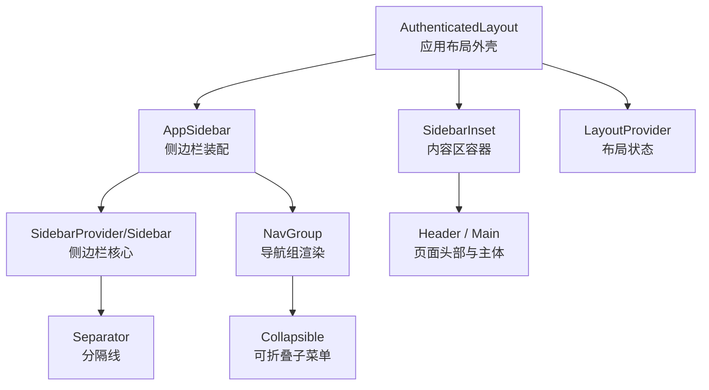
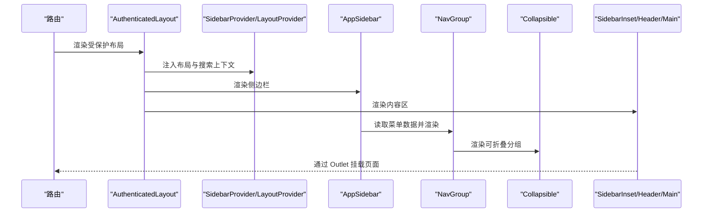
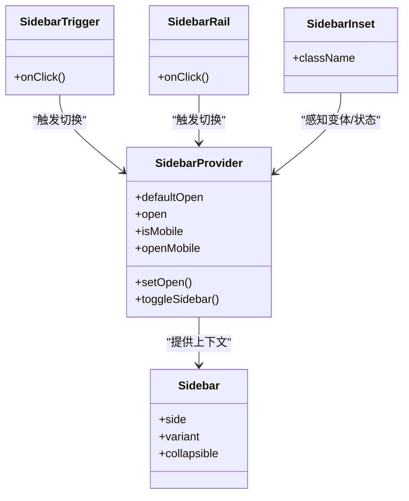
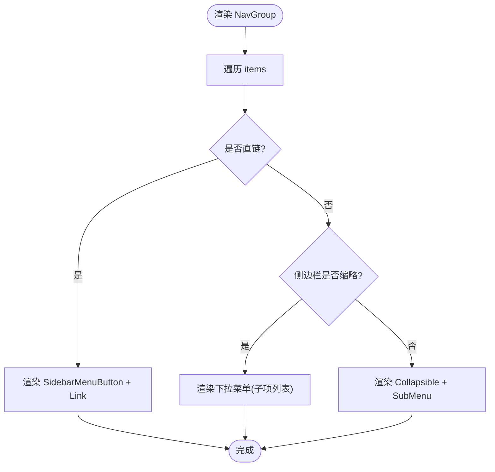
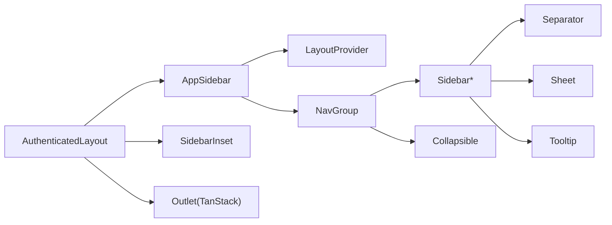

# 布局组件

<cite>
**本文引用的文件**
- [app-sidebar.tsx](file://web_client/shadcn-admin/src/components/layout/app-sidebar.tsx)
- [authenticated-layout.tsx](file://web_client/shadcn-admin/src/components/layout/authenticated-layout.tsx)
- [sidebar.tsx](file://web_client/shadcn-admin/src/components/ui/sidebar.tsx)
- [separator.tsx](file://web_client/shadcn-admin/src/components/ui/separator.tsx)
- [collapsible.tsx](file://web_client/shadcn-admin/src/components/ui/collapsible.tsx)
- [nav-group.tsx](file://web_client/shadcn-admin/src/components/layout/nav-group.tsx)
- [layout-provider.tsx](file://web_client/shadcn-admin/src/context/layout-provider.tsx)
- [header.tsx](file://web_client/shadcn-admin/src/components/layout/header.tsx)
- [main.tsx](file://web_client/shadcn-admin/src/components/layout/main.tsx)
- [types.ts](file://web_client/shadcn-admin/src/components/layout/types.ts)
- [sidebar-data.ts](file://web_client/shadcn-admin/src/components/layout/data/sidebar-data.ts)
</cite>

## 目录
1. [简介](#简介)
2. [项目结构](#项目结构)
3. [核心组件](#核心组件)
4. [架构总览](#架构总览)
5. [详细组件分析](#详细组件分析)
6. [依赖关系分析](#依赖关系分析)
7. [性能考量](#性能考量)
8. [故障排查指南](#故障排查指南)
9. [结论](#结论)
10. [附录](#附录)

## 简介
本技术文档聚焦 Shadcn Admin 的布局体系，围绕侧边栏、分隔线与可折叠容器三大基础能力，系统阐述其实现原理与使用方式。重点覆盖：
- 侧边栏的展开/收起、嵌套菜单、响应式适配（移动端抽屉模式）
- 分隔线在不同场景下的样式定制与语义化使用
- 可折叠容器的状态管理与动画配置
- 复杂布局场景：多级菜单、动态内容、自适应布局
- 与页面路由的集成方式
- 性能优化与用户体验改进方案

## 项目结构
Shadcn Admin 的布局由“应用级布局”和“UI 原子组件”共同构成：
- 应用级布局：AuthenticatedLayout 提供整体骨架，AppSidebar 负责侧边栏装配，Header/Main 组织页面头部与主体区域
- UI 原子组件：Sidebar 系列、Separator、Collapsible 等提供可复用能力
- 上下文与数据：LayoutProvider 管理布局变体与可折叠模式；NavGroup 渲染导航组；sidebar-data 提供菜单数据

图表来源
- [authenticated-layout.tsx:14-42](file://web_client/shadcn-admin/src/components/layout/authenticated-layout.tsx#L14-L42)
- [app-sidebar.tsx:16-40](file://web_client/shadcn-admin/src/components/layout/app-sidebar.tsx#L16-L40)
- [sidebar.tsx:53-149](file://web_client/shadcn-admin/src/components/ui/sidebar.tsx#L53-L149)
- [nav-group.tsx:36-59](file://web_client/shadcn-admin/src/components/layout/nav-group.tsx#L36-L59)
- [collapsible.tsx:3-31](file://web_client/shadcn-admin/src/components/ui/collapsible.tsx#L3-L31)
- [separator.tsx:5-25](file://web_client/shadcn-admin/src/components/ui/separator.tsx#L5-L25)
- [layout-provider.tsx:34-75](file://web_client/shadcn-admin/src/context/layout-provider.tsx#L34-L75)

章节来源
- [authenticated-layout.tsx:14-42](file://web_client/shadcn-admin/src/components/layout/authenticated-layout.tsx#L14-L42)
- [app-sidebar.tsx:16-40](file://web_client/shadcn-admin/src/components/layout/app-sidebar.tsx#L16-L40)
- [sidebar.tsx:53-149](file://web_client/shadcn-admin/src/components/ui/sidebar.tsx#L53-L149)
- [nav-group.tsx:36-59](file://web_client/shadcn-admin/src/components/layout/nav-group.tsx#L36-L59)
- [collapsible.tsx:3-31](file://web_client/shadcn-admin/src/components/ui/collapsible.tsx#L3-L31)
- [separator.tsx:5-25](file://web_client/shadcn-admin/src/components/ui/separator.tsx#L5-L25)
- [layout-provider.tsx:34-75](file://web_client/shadcn-admin/src/context/layout-provider.tsx#L34-L75)

## 核心组件
- 应用布局壳层：AuthenticatedLayout 包裹 SearchProvider、LayoutProvider、SidebarProvider，并输出 AppSidebar 与 SidebarInset 内容区
- 侧边栏：AppSidebar 组合 TeamSwitcher、NavGroup、NavUser，并通过 LayoutProvider 获取 collapsible 与 variant
- 侧边栏核心：Sidebar 系列组件提供展开/收起、移动端抽屉、轨道拖拽、快捷键切换等能力
- 导航组：NavGroup 根据当前路由高亮，支持直链、可折叠分组、图标、徽标、下拉菜单（缩略态）
- 分隔线：Separator 用于视觉分割，支持水平/垂直方向
- 可折叠容器：Collapsible 提供展开/收起状态与动画，配合 Tailwind 类名控制过渡
- 布局上下文：LayoutProvider 持久化布局变体与可折叠模式到 Cookie

章节来源
- [authenticated-layout.tsx:14-42](file://web_client/shadcn-admin/src/components/layout/authenticated-layout.tsx#L14-L42)
- [app-sidebar.tsx:16-40](file://web_client/shadcn-admin/src/components/layout/app-sidebar.tsx#L16-L40)
- [sidebar.tsx:53-149](file://web_client/shadcn-admin/src/components/ui/sidebar.tsx#L53-L149)
- [nav-group.tsx:36-59](file://web_client/shadcn-admin/src/components/layout/nav-group.tsx#L36-L59)
- [separator.tsx:5-25](file://web_client/shad/shadcn-admin/src/components/ui/separator.tsx#L5-L25)
- [collapsible.tsx:3-31](file://web_client/shadcn-admin/src/components/ui/collapsible.tsx#L3-L31)
- [layout-provider.tsx:34-75](file://web_client/shadcn-admin/src/context/layout-provider.tsx#L34-L75)

## 架构总览
下图展示了从应用入口到具体 UI 组件的调用链路与数据流向：

图表来源
- [authenticated-layout.tsx:14-42](file://web_client/shadcn-admin/src/components/layout/authenticated-layout.tsx#L14-L42)
- [app-sidebar.tsx:16-40](file://web_client/shadcn-admin/src/components/layout/app-sidebar.tsx#L16-L40)
- [nav-group.tsx:84-127](file://web_client/shadcn-admin/src/components/layout/nav-group.tsx#L84-L127)
- [collapsible.tsx:3-31](file://web_client/shadcn-admin/src/components/ui/collapsible.tsx#L3-L31)

## 详细组件分析

### 侧边栏组件（Sidebar 系列）
- 展开/收起
  - 通过 SidebarProvider 维护 open/openMobile 状态，并在桌面端写入 Cookie 以跨会话保持
  - 支持键盘快捷键（Ctrl/Cmd + B）切换
  - 提供 SidebarTrigger 按钮与 SidebarRail 轨道点击切换
- 响应式适配
  - 移动端使用 Sheet 作为抽屉呈现，宽度变量独立定义
  - 桌面端通过 data-state 与 data-collapsible 驱动不同宽度与定位
- 变体与可折叠模式
  - variant: sidebar/floating/inset 影响内边距、圆角、阴影与间距
  - collapsible: offcanvas/icon/none 控制收缩后的行为与尺寸
- 内部结构
  - Header/Footer/Content/Group/Menu/SubMenu 等 Slot 化子组件，便于组合
  - 菜单项支持 Tooltip、Badge、Action、Skeleton 等扩展

图表来源
- [sidebar.tsx:53-149](file://web_client/shadcn-admin/src/components/ui/sidebar.tsx#L53-L149)
- [sidebar.tsx:253-321](file://web_client/shadcn-admin/src/components/ui/sidebar.tsx#L253-L321)

章节来源
- [sidebar.tsx:53-149](file://web_client/shadcn-admin/src/components/ui/sidebar.tsx#L53-L149)
- [sidebar.tsx:253-321](file://web_client/shadcn-admin/src/components/ui/sidebar.tsx#L253-L321)

### 嵌套菜单与高亮（NavGroup）
- 数据结构
  - NavLink：直链项，含 url、icon、badge
  - NavCollapsible：可折叠分组，包含 items 子项
  - NavGroup：分组标题与 items
- 交互逻辑
  - 直链：使用 Link 跳转，点击后关闭移动端抽屉
  - 可折叠：默认打开状态基于当前路由匹配
  - 缩略态：当侧边栏处于 icon 模式时，将分组转为下拉菜单展示子项
- 高亮策略
  - 精确匹配 URL 或父级路径前缀匹配，确保父子联动高亮

图表来源
- [nav-group.tsx:36-59](file://web_client/shadcn-admin/src/components/layout/nav-group.tsx#L36-L59)
- [nav-group.tsx:84-127](file://web_client/shadcn-admin/src/components/layout/nav-group.tsx#L84-L127)
- [nav-group.tsx:130-174](file://web_client/shadcn-admin/src/components/layout/nav-group.tsx#L130-L174)
- [nav-group.tsx:176-185](file://web_client/shadcn-admin/src/components/layout/nav-group.tsx#L176-L185)

章节来源
- [nav-group.tsx:36-59](file://web_client/shadcn-admin/src/components/layout/nav-group.tsx#L36-L59)
- [nav-group.tsx:84-127](file://web_client/shadcn-admin/src/components/layout/nav-group.tsx#L84-L127)
- [nav-group.tsx:130-174](file://web_client/shadcn-admin/src/components/layout/nav-group.tsx#L130-L174)
- [nav-group.tsx:176-185](file://web_client/shadcn-admin/src/components/layout/nav-group.tsx#L176-L185)
- [types.ts:1-45](file://web_client/shadcn-admin/src/components/layout/types.ts#L1-L45)
- [sidebar-data.ts:31-213](file://web_client/shadcn-admin/src/components/layout/data/sidebar-data.ts#L31-L213)

### 分隔线组件（Separator）
- 用途
  - 在 Header 中作为垂直分隔，增强信息分区
  - 在侧边栏内部用于区块划分
- 样式定制
  - orientation: horizontal | vertical
  - 可通过 className 自定义颜色、尺寸、间距
  - 在侧边栏中使用 SidebarSeparator 包装，统一主题色与间距

章节来源
- [separator.tsx:5-25](file://web_client/shadcn-admin/src/components/ui/separator.tsx#L5-L25)
- [header.tsx:1-51](file://web_client/shadcn-admin/src/components/layout/header.tsx#L1-L51)
- [sidebar.tsx:359-371](file://web_client/shadcn-admin/src/components/ui/sidebar.tsx#L359-L371)

### 可折叠容器（Collapsible）
- 状态管理
  - 由 Collapsible 管理 open/state，配合 Tailwind 类名实现展开/收起动画
  - 在 NavGroup 中结合路由自动设置默认展开
- 动画效果
  - 通过 Radix Collapsible 内置过渡，配合 CSS 类名控制旋转箭头与层级缩进
- 使用建议
  - 避免过深嵌套导致滚动与性能问题
  - 在缩略模式下使用下拉替代深层折叠以提升可用性

章节来源
- [collapsible.tsx:3-31](file://web_client/shadcn-admin/src/components/ui/collapsible.tsx#L3-L31)
- [nav-group.tsx:84-127](file://web_client/shadcn-admin/src/components/layout/nav-group.tsx#L84-L127)

### 应用布局与内容区（AuthenticatedLayout / Header / Main）
- 布局外壳
  - 通过 SidebarProvider 与 LayoutProvider 注入全局状态
  - 默认打开状态从 Cookie 读取，保证刷新后一致
- 内容区
  - SidebarInset 根据 layout 变体调整高度与边距，防止溢出
  - Header 支持固定定位与滚动阴影，Main 支持固定/流体布局
- 路由集成
  - 使用 Outlet 渲染当前路由页面，便于多层嵌套路由

章节来源
- [authenticated-layout.tsx:14-42](file://web_client/shadcn-admin/src/components/layout/authenticated-layout.tsx#L14-L42)
- [header.tsx:1-51](file://web_client/shadcn-admin/src/components/layout/header.tsx#L1-L51)
- [main.tsx:1-28](file://web_client/shadcn-admin/src/components/layout/main.tsx#L1-L28)

## 依赖关系分析
- 组件耦合
  - AppSidebar 依赖 LayoutProvider 提供的 collapsible/variant，以及 NavGroup 渲染菜单
  - NavGroup 依赖 Sidebar 系列组件与 Collapsible，同时通过 useLocation 进行高亮判断
  - Sidebar 系列依赖 useIsMobile、Sheet、Tooltip、Separator 等基础组件
- 外部依赖
  - Radix UI 提供 Collapsible、Separator 等无障碍原语
  - TanStack Router 提供 Link、useLocation、Outlet
  - Lucide React 提供图标
- 潜在循环
  - 当前结构为单向依赖，未发现循环引用

图表来源
- [app-sidebar.tsx:16-40](file://web_client/shadcn-admin/src/components/layout/app-sidebar.tsx#L16-L40)
- [nav-group.tsx:36-59](file://web_client/shadcn-admin/src/components/layout/nav-group.tsx#L36-L59)
- [sidebar.tsx:53-149](file://web_client/shadcn-admin/src/components/ui/sidebar.tsx#L53-L149)
- [authenticated-layout.tsx:14-42](file://web_client/shadcn-admin/src/components/layout/authenticated-layout.tsx#L14-L42)

章节来源
- [app-sidebar.tsx:16-40](file://web_client/shadcn-admin/src/components/layout/app-sidebar.tsx#L16-L40)
- [nav-group.tsx:36-59](file://web_client/shadcn-admin/src/components/layout/nav-group.tsx#L36-L59)
- [sidebar.tsx:53-149](file://web_client/shadcn-admin/src/components/ui/sidebar.tsx#L53-L149)
- [authenticated-layout.tsx:14-42](file://web_client/shadcn-admin/src/components/layout/authenticated-layout.tsx#L14-L42)

## 性能考量
- 减少重排与重绘
  - 侧边栏宽度变化使用 CSS transition，避免频繁 JS 计算
  - 移动端使用 Sheet 抽屉，避免大 DOM 树常驻
- 懒加载与虚拟滚动
  - 对深层菜单或大量子项，考虑按需加载与虚拟列表
- 事件监听优化
  - Header 滚动监听使用 passive 选项，减少主线程阻塞
- 状态持久化
  - 布局状态与侧边栏开关通过 Cookie 持久化，避免重复初始化开销
- 图标与资源
  - 图标按需引入，避免打包体积过大

[本节为通用指导，不直接分析具体文件]

## 故障排查指南
- 侧边栏无法记住展开状态
  - 检查是否在 SidebarProvider 中正确写入 Cookie，且浏览器未禁用 Cookie
  - 确认默认值与读取逻辑一致
- 移动端抽屉不显示
  - 检查 isMobile 判断逻辑与 Sheet 的 open 状态绑定
- 菜单高亮异常
  - 核对 checkIsActive 的路径匹配规则，注意查询参数与父级路径前缀
- 可折叠动画不生效
  - 确认 Collapsible 的 state 与 Tailwind 类名是否正确关联
- 分隔线样式不符合预期
  - 检查 orientation 与自定义 className 是否冲突

章节来源
- [sidebar.tsx:53-149](file://web_client/shadcn-admin/src/components/ui/sidebar.tsx#L53-L149)
- [nav-group.tsx:176-185](file://web_client/shadcn-admin/src/components/layout/nav-group.tsx#L176-L185)
- [collapsible.tsx:3-31](file://web_client/shadcn-admin/src/components/ui/collapsible.tsx#L3-L31)
- [separator.tsx:5-25](file://web_client/shadcn-admin/src/components/ui/separator.tsx#L5-L25)

## 结论
Shadcn Admin 的布局体系以 SidebarProvider 为核心，结合 LayoutProvider 的全局配置，实现了可扩展、可定制、响应式的后台布局。侧边栏具备完善的展开/收起、嵌套菜单与移动端适配；分隔线提供灵活的视觉分割；可折叠容器提供稳定的状态与动画。通过合理的数据结构与路由集成，能够支撑复杂的多级菜单与动态内容场景。遵循本文的性能与体验建议，可在大规模应用中保持稳定流畅的用户体验。

[本节为总结性内容，不直接分析具体文件]

## 附录

### 复杂布局场景示例
- 多级菜单
  - 使用 NavGroup 的 NavCollapsible 构建二级/多级菜单，结合 Collapsible 实现展开/收起
  - 在缩略模式下自动降级为下拉菜单，提升可用性
- 动态内容
  - 通过 sidebar-data.ts 动态生成菜单，支持国际化与权限过滤
- 自适应布局
  - 使用 LayoutProvider 的 variant 与 collapsible 切换不同布局风格
  - 结合 Header/Main 的 fixed/fluid 属性适配不同页面密度

章节来源
- [sidebar-data.ts:31-213](file://web_client/shadcn-admin/src/components/layout/data/sidebar-data.ts#L31-L213)
- [layout-provider.tsx:34-75](file://web_client/shadcn-admin/src/context/layout-provider.tsx#L34-L75)
- [main.tsx:1-28](file://web_client/shadcn-admin/src/components/layout/main.tsx#L1-L28)

### 与页面路由的集成方式
- 使用 Link 进行导航，点击后自动关闭移动端抽屉
- 通过 useLocation 选择 href 进行高亮判断，支持查询参数与父级路径匹配
- 在受保护布局中使用 Outlet 渲染当前路由页面，支持嵌套路由

章节来源
- [nav-group.tsx:65-81](file://web_client/shadcn-admin/src/components/layout/nav-group.tsx#L65-L81)
- [nav-group.tsx:176-185](file://web_client/shadcn-admin/src/components/layout/nav-group.tsx#L176-L185)
- [authenticated-layout.tsx:14-42](file://web_client/shadcn-admin/src/components/layout/authenticated-layout.tsx#L14-L42)