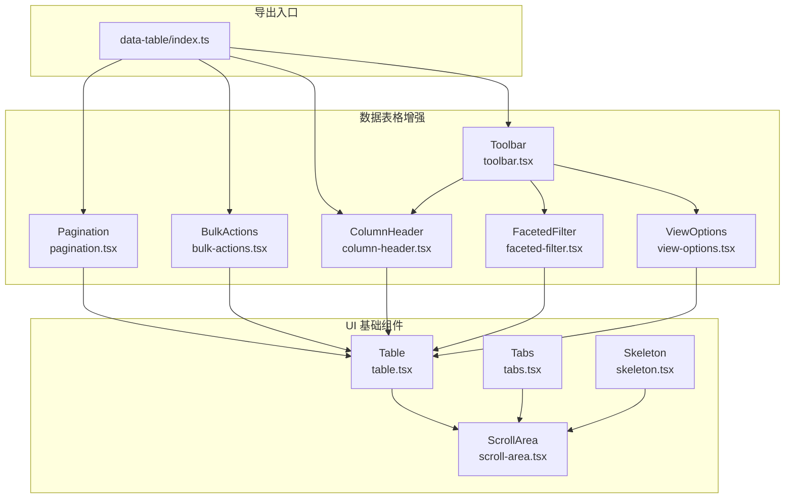
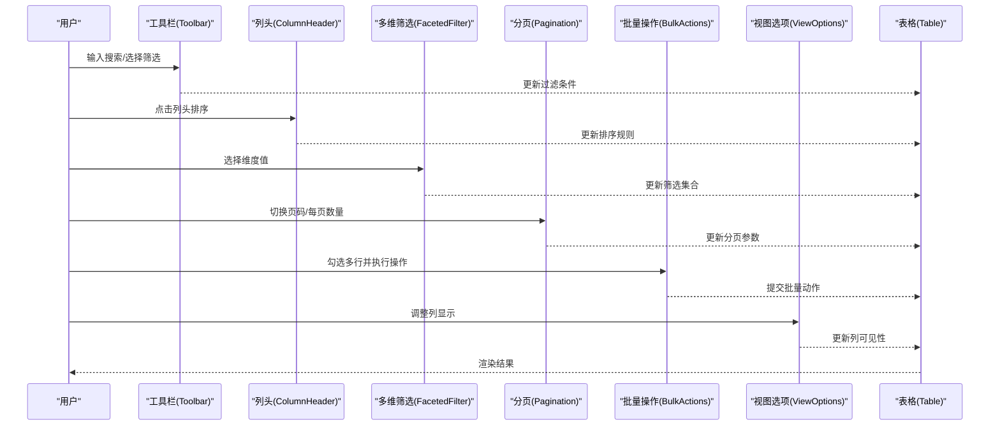
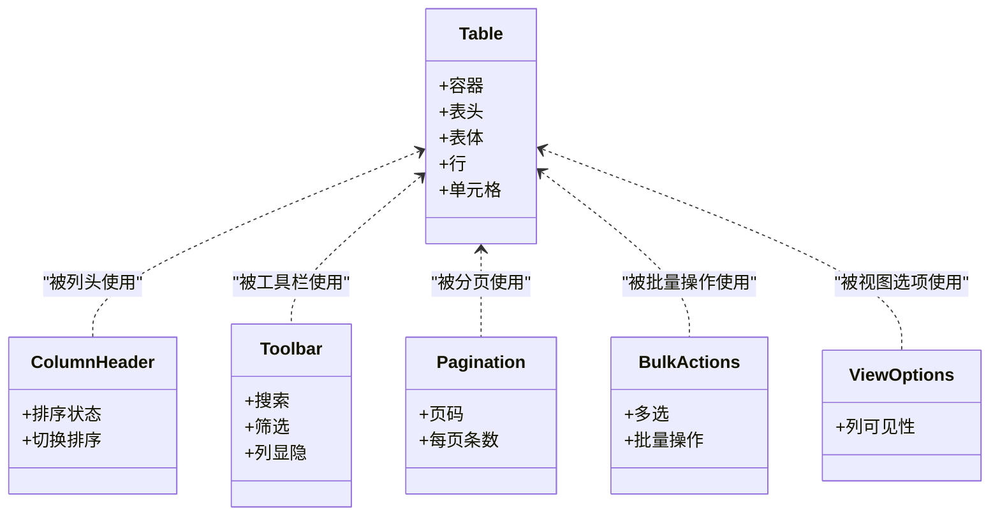
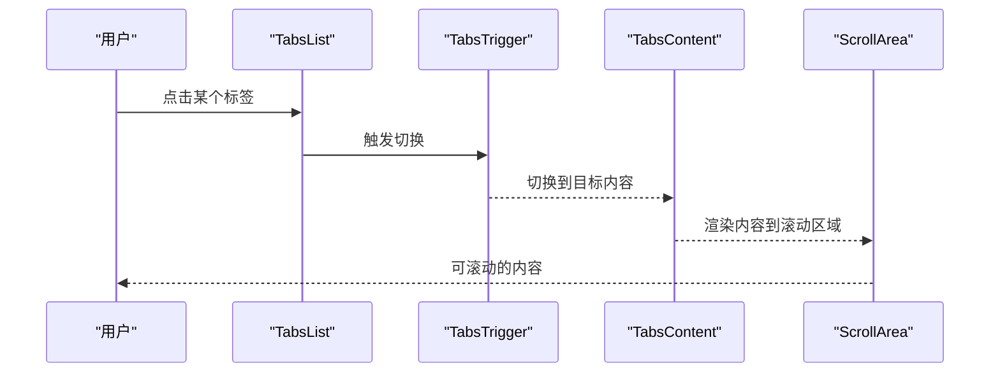
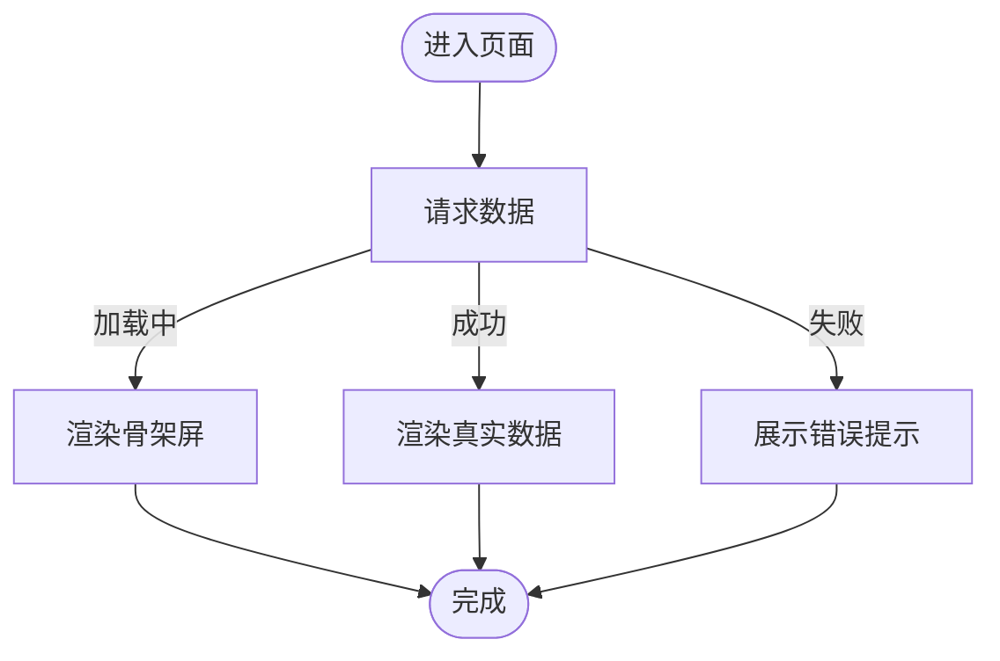
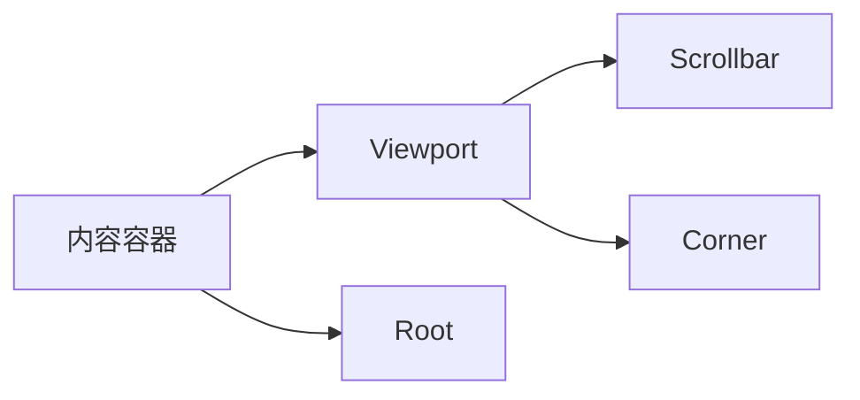
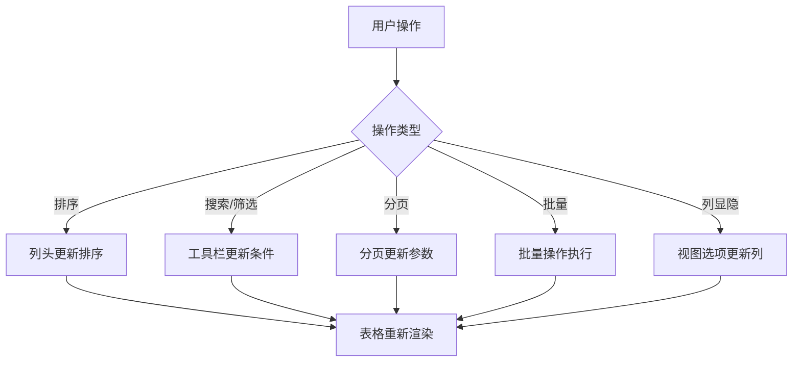
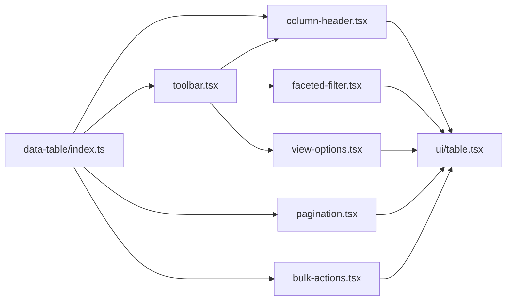

# 数据展示组件

<cite>
**本文引用的文件**
- [index.ts](file://web_client/shadcn-admin/src/components/data-table/index.ts)
- [table.tsx](file://web_client/shadcn-admin/src/components/ui/table.tsx)
- [tabs.tsx](file://web_client/shadcn-admin/src/components/ui/tabs.tsx)
- [skeleton.tsx](file://web_client/shadcn-admin/src/components/ui/skeleton.tsx)
- [scroll-area.tsx](file://web_client/shadcn-admin/src/components/ui/scroll-area.tsx)
- [pagination.tsx](file://web_client/shadcn-admin/src/components/data-table/pagination.tsx)
- [toolbar.tsx](file://web_client/shadcn-admin/src/components/data-table/toolbar.tsx)
- [column-header.tsx](file://web_client/shadcn-admin/src/components/data-table/column-header.tsx)
- [faceted-filter.tsx](file://web_client/shadcn-admin/src/components/data-table/faceted-filter.tsx)
- [bulk-actions.tsx](file://web_client/shadcn-admin/src/components/data-table/bulk-actions.tsx)
- [view-options.tsx](file://web_client/shadcn-admin/src/components/data-table/view-options.tsx)
</cite>

## 目录
1. [简介](#简介)
2. [项目结构](#项目结构)
3. [核心组件](#核心组件)
4. [架构总览](#架构总览)
5. [详细组件分析](#详细组件分析)
6. [依赖关系分析](#依赖关系分析)
7. [性能考量](#性能考量)
8. [故障排查指南](#故障排查指南)
9. [结论](#结论)
10. [附录](#附录)

## 简介
本技术文档聚焦 Shadcn Admin 的数据展示组件，围绕表格、标签页、骨架屏与滚动区域四大类能力展开，系统阐述其实现原理、状态管理、交互流程与性能优化策略。重点覆盖：
- 表格组件的排序、筛选、分页与行操作
- 标签页的状态管理与内容切换机制
- 骨架屏的加载态展示与性能优化
- 大数据量场景下的虚拟滚动与懒加载方案
- 可访问性与响应式设计实践
- 复杂数据界面的组合使用模式

## 项目结构
数据展示相关代码主要分布在以下位置：
- 基础 UI 组件：位于 ui 目录，提供 Table、Tabs、Skeleton、ScrollArea 等原子化组件
- 数据表格增强：位于 data-table 目录，封装了列头、工具栏、分页、批量操作、视图选项等高级能力
- 导出入口：data-table/index.ts 统一对外暴露常用子组件

图表来源
- [table.tsx:1-114](file://web_client/shadcn-admin/src/components/ui/table.tsx#L1-L114)
- [tabs.tsx:1-64](file://web_client/shadcn-admin/src/components/ui/tabs.tsx#L1-L64)
- [skeleton.tsx:1-14](file://web_client/shadcn-admin/src/components/ui/skeleton.tsx#L1-L14)
- [scroll-area.tsx:1-66](file://web_client/shadcn-admin/src/components/ui/scroll-area.tsx#L1-L66)
- [index.ts:1-5](file://web_client/shadcn-admin/src/components/data-table/index.ts#L1-L5)

章节来源
- [index.ts:1-5](file://web_client/shadcn-admin/src/components/data-table/index.ts#L1-L5)
- [table.tsx:1-114](file://web_client/shadcn-admin/src/components/ui/table.tsx#L1-L114)
- [tabs.tsx:1-64](file://web_client/shadcn-admin/src/components/ui/tabs.tsx#L1-L64)
- [skeleton.tsx:1-14](file://web_client/shadcn-admin/src/components/ui/skeleton.tsx#L1-L14)
- [scroll-area.tsx:1-66](file://web_client/shadcn-admin/src/components/ui/scroll-area.tsx#L1-L66)

## 核心组件
- 表格（Table）：基于原生 table 语义构建，提供表头、表体、行、单元格等子组件，支持选中态样式与横向滚动容器
- 标签页（Tabs）：基于 Radix Tabs，提供列表、触发器与内容区，支持键盘导航与焦点管理
- 骨架屏（Skeleton）：轻量占位动画，用于加载态占位
- 滚动区域（ScrollArea）：基于 Radix ScrollArea，支持垂直/水平方向，具备可访问性焦点环与滚动条

章节来源
- [table.tsx:1-114](file://web_client/shadcn-admin/src/components/ui/table.tsx#L1-L114)
- [tabs.tsx:1-64](file://web_client/shadcn-admin/src/components/ui/tabs.tsx#L1-L64)
- [skeleton.tsx:1-14](file://web_client/shadcn-admin/src/components/ui/skeleton.tsx#L1-L14)
- [scroll-area.tsx:1-66](file://web_client/shadcn-admin/src/components/ui/scroll-area.tsx#L1-L66)

## 架构总览
数据表格由“基础表格 + 增强模块”构成：
- 基础表格负责渲染与布局
- 增强模块通过工具栏聚合搜索、筛选、列显隐控制；列头承载排序；分页处理翻页；批量操作提供多选与批处理；视图选项维护列可见性
- 标签页作为页面级组织方式，结合滚动区域承载长内容；骨架屏在数据未就绪时提供加载反馈

图表来源
- [toolbar.tsx](file://web_client/shadcn-admin/src/components/data-table/toolbar.tsx)
- [column-header.tsx](file://web_client/shadcn-admin/src/components/data-table/column-header.tsx)
- [faceted-filter.tsx](file://web_client/shadcn-admin/src/components/data-table/faceted-filter.tsx)
- [pagination.tsx](file://web_client/shadcn-admin/src/components/data-table/pagination.tsx)
- [bulk-actions.tsx](file://web_client/shadcn-admin/src/components/data-table/bulk-actions.tsx)
- [view-options.tsx](file://web_client/shadcn-admin/src/components/data-table/view-options.tsx)
- [table.tsx:1-114](file://web_client/shadcn-admin/src/components/ui/table.tsx#L1-L114)

## 详细组件分析

### 表格组件（Table）
- 结构与职责
  - 容器与语义：提供 table 容器与 caption，确保无障碍语义
  - 表头/表体/行/单元格：分别对应 thead/tbody/tr/th/td，内置 hover/选中态样式
  - 横向滚动：外层容器支持 overflow-x，适配小屏
- 与增强模块集成
  - 列头（ColumnHeader）：封装排序图标与排序状态切换
  - 工具栏（Toolbar）：聚合搜索、筛选、列显隐控制
  - 分页（Pagination）：页码、跳转、每页条数
  - 批量操作（BulkActions）：多选、全选、批量删除/导出等
  - 视图选项（ViewOptions）：列可见性记忆与恢复
- 可访问性
  - 使用原生 table 语义，配合 caption、th、scope 等属性提升读屏体验
  - 行选中态通过 data-[state=selected] 驱动样式，便于键盘导航
- 响应式
  - 横向滚动容器在小屏下自动启用，避免布局溢出

图表来源
- [table.tsx:1-114](file://web_client/shadcn-admin/src/components/ui/table.tsx#L1-L114)
- [column-header.tsx](file://web_client/shadcn-admin/src/components/data-table/column-header.tsx)
- [toolbar.tsx](file://web_client/shadcn-admin/src/components/data-table/toolbar.tsx)
- [pagination.tsx](file://web_client/shadcn-admin/src/components/data-table/pagination.tsx)
- [bulk-actions.tsx](file://web_client/shadcn-admin/src/components/data-table/bulk-actions.tsx)
- [view-options.tsx](file://web_client/shadcn-admin/src/components/data-table/view-options.tsx)

章节来源
- [table.tsx:1-114](file://web_client/shadcn-admin/src/components/ui/table.tsx#L1-L114)
- [column-header.tsx](file://web_client/shadcn-admin/src/components/data-table/column-header.tsx)
- [toolbar.tsx](file://web_client/shadcn-admin/src/components/data-table/toolbar.tsx)
- [pagination.tsx](file://web_client/shadcn-admin/src/components/data-table/pagination.tsx)
- [bulk-actions.tsx](file://web_client/shadcn-admin/src/components/data-table/bulk-actions.tsx)
- [view-options.tsx](file://web_client/shadcn-admin/src/components/data-table/view-options.tsx)

### 标签页组件（Tabs）
- 状态管理
  - 基于 Radix Tabs，内部维护 active tab 状态与焦点管理
  - 通过 Trigger 切换 Content，Content 默认按需渲染
- 内容切换机制
  - 切换时仅更新激活态，避免全量重绘
  - 支持键盘 Tab/Shift+Tab 在触发器间移动
- 可访问性
  - 遵循 ARIA tabs 规范，提供 role/tablist/tab/tabpanel 语义
- 与滚动区域组合
  - 将长内容包裹于 ScrollArea，保证在大屏与小屏下均可平滑滚动

图表来源
- [tabs.tsx:1-64](file://web_client/shadcn-admin/src/components/ui/tabs.tsx#L1-L64)
- [scroll-area.tsx:1-66](file://web_client/shadcn-admin/src/components/ui/scroll-area.tsx#L1-L66)

章节来源
- [tabs.tsx:1-64](file://web_client/shadcn-admin/src/components/ui/tabs.tsx#L1-L64)
- [scroll-area.tsx:1-66](file://web_client/shadcn-admin/src/components/ui/scroll-area.tsx#L1-L66)

### 骨架屏组件（Skeleton）
- 加载状态展示
  - 使用脉冲动画与圆角背景模拟内容块
  - 可通过 className 定制尺寸与间距
- 性能优化策略
  - 仅在数据未就绪时渲染，减少不必要的 DOM
  - 与 Suspense/异步数据流配合，优先展示骨架屏，再替换为真实内容
- 与表格/标签页组合
  - 表格行或单元格可用 Skeleton 占位
  - 标签页内容在切换前以骨架屏呈现，降低首屏压力

图表来源
- [skeleton.tsx:1-14](file://web_client/shadcn-admin/src/components/ui/skeleton.tsx#L1-L14)

章节来源
- [skeleton.tsx:1-14](file://web_client/shadcn-admin/src/components/ui/skeleton.tsx#L1-L14)

### 滚动区域组件（ScrollArea）
- 功能特性
  - 支持垂直/水平方向滚动
  - 自定义滚动条样式与焦点环，提升可访问性
- 与数据展示组合
  - 表格横向滚动：当列较多时，使用 ScrollArea 替代原生横向滚动以获得一致体验
  - 标签页内容滚动：长列表或详情内容置于 ScrollArea 中，避免页面级滚动冲突

图表来源
- [scroll-area.tsx:1-66](file://web_client/shadcn-admin/src/components/ui/scroll-area.tsx#L1-L66)

章节来源
- [scroll-area.tsx:1-66](file://web_client/shadcn-admin/src/components/ui/scroll-area.tsx#L1-L66)

### 数据表格增强模块
- 列头（ColumnHeader）
  - 职责：封装排序图标、当前排序状态、切换逻辑
  - 与表格联动：点击后向表格层传递排序字段与方向
- 工具栏（Toolbar）
  - 职责：聚合搜索框、多维筛选、列显隐控制
  - 与表格联动：将筛选与列配置下发至表格层
- 多维筛选（FacetedFilter）
  - 职责：按维度选择多个值，生成筛选条件集合
  - 与表格联动：与搜索条件合并后刷新表格
- 分页（Pagination）
  - 职责：页码、每页条数、跳转
  - 与表格联动：改变 page/pageSize 触发数据刷新
- 批量操作（BulkActions）
  - 职责：多选、全选、批量删除/导出
  - 与表格联动：基于选中行集合执行后端或本地操作
- 视图选项（ViewOptions）
  - 职责：列可见性开关与记忆
  - 与表格联动：动态显示/隐藏列

图表来源
- [column-header.tsx](file://web_client/shadcn-admin/src/components/data-table/column-header.tsx)
- [toolbar.tsx](file://web_client/shadcn-admin/src/components/data-table/toolbar.tsx)
- [faceted-filter.tsx](file://web_client/shadcn-admin/src/components/data-table/faceted-filter.tsx)
- [pagination.tsx](file://web_client/shadcn-admin/src/components/data-table/pagination.tsx)
- [bulk-actions.tsx](file://web_client/shadcn-admin/src/components/data-table/bulk-actions.tsx)
- [view-options.tsx](file://web_client/shadcn-admin/src/components/data-table/view-options.tsx)

章节来源
- [column-header.tsx](file://web_client/shadcn-admin/src/components/data-table/column-header.tsx)
- [toolbar.tsx](file://web_client/shadcn-admin/src/components/data-table/toolbar.tsx)
- [faceted-filter.tsx](file://web_client/shadcn-admin/src/components/data-table/faceted-filter.tsx)
- [pagination.tsx](file://web_client/shadcn-admin/src/components/data-table/pagination.tsx)
- [bulk-actions.tsx](file://web_client/shadcn-admin/src/components/data-table/bulk-actions.tsx)
- [view-options.tsx](file://web_client/shadcn-admin/src/components/data-table/view-options.tsx)

## 依赖关系分析
- 组件内聚与耦合
  - data-table 各子组件均围绕 Table 进行协作，耦合点集中在“状态下发与事件回调”
  - index.ts 作为统一出口，降低上层引用复杂度
- 外部依赖
  - Tabs 与 ScrollArea 依赖 Radix 基础库，提供可访问性与稳定行为
- 潜在循环依赖
  - 当前结构为单向依赖：增强模块依赖基础 UI，无反向依赖，避免循环

图表来源
- [index.ts:1-5](file://web_client/shadcn-admin/src/components/data-table/index.ts#L1-L5)
- [table.tsx:1-114](file://web_client/shadcn-admin/src/components/ui/table.tsx#L1-L114)

章节来源
- [index.ts:1-5](file://web_client/shadcn-admin/src/components/data-table/index.ts#L1-L5)

## 性能考量
- 表格
  - 大数据量建议采用服务端分页与排序，前端仅维护当前页数据
  - 列宽固定或最小宽度，减少重排
  - 行高与单元格内容裁剪，避免过长文本导致回流
- 标签页
  - 使用懒加载：仅在激活时加载内容，减少初始渲染成本
  - 对重型内容（如图表、大表格）使用占位骨架屏，切换后再加载
- 骨架屏
  - 控制骨架屏数量与层级，避免过多节点造成抖动
  - 与边界情况结合：网络失败时及时替换为错误提示
- 滚动区域
  - 长列表建议使用虚拟滚动（如 react-window/virtuoso），仅渲染可视区域
  - 横向滚动时，优先使用 ScrollArea 以获得一致的滚动体验与可访问性

[本节为通用性能指导，不直接分析具体文件]

## 故障排查指南
- 表格列错位或溢出
  - 检查是否启用了横向滚动容器，必要时使用 ScrollArea 包裹
  - 确认列宽设置合理，避免过窄导致换行
- 标签页切换卡顿
  - 检查是否在每次切换时重复发起昂贵请求，考虑缓存或去抖
  - 对重型内容启用懒加载与骨架屏
- 骨架屏闪烁
  - 检查数据加载完成后的替换时机，避免过早移除骨架屏
- 滚动区域焦点问题
  - 确保焦点环可见，必要时自定义 focus-visible 样式
  - 在移动端验证触摸滚动与滚动条交互

[本节为通用故障排查指导，不直接分析具体文件]

## 结论
Shadcn Admin 的数据展示组件以“基础 UI + 增强模块”的清晰分层实现了高内聚、低耦合的可复用能力。表格通过列头、工具栏、分页、批量操作与视图选项形成完整的数据交互闭环；标签页与滚动区域提供了良好的内容组织与滚动体验；骨架屏则完善了加载态的用户感知。结合服务端分页、懒加载与虚拟滚动，可在大数据量场景下保持流畅与可访问性。

[本节为总结性内容，不直接分析具体文件]

## 附录
- 组合使用模式示例
  - 表格 + 工具栏 + 分页：典型的数据列表页
  - 标签页 + 滚动区域：长表单或多维信息面板
  - 表格 + 骨架屏：数据加载时的占位与过渡
- 可访问性要点
  - 表格：caption、th scope、行选中态
  - 标签页：tablist/tab/tabpanel 语义与键盘导航
  - 滚动区域：focus-visible 与滚动条可访问性
- 响应式要点
  - 表格横向滚动、列自适应
  - 标签页在小屏下的紧凑布局
  - 滚动区域在不同方向的适配

[本节为补充说明，不直接分析具体文件]