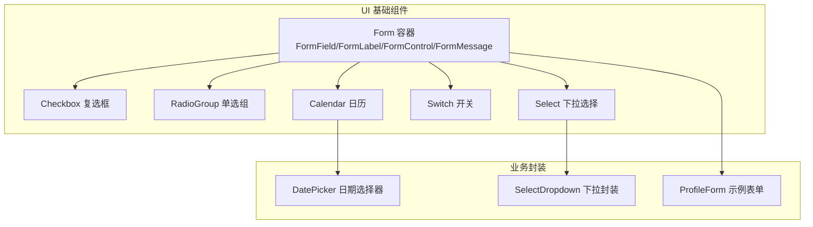
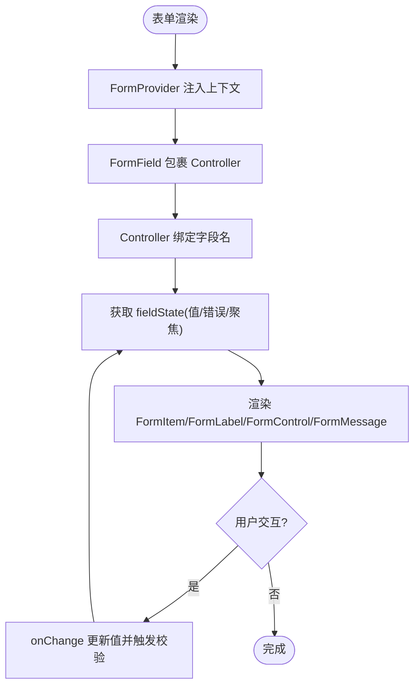
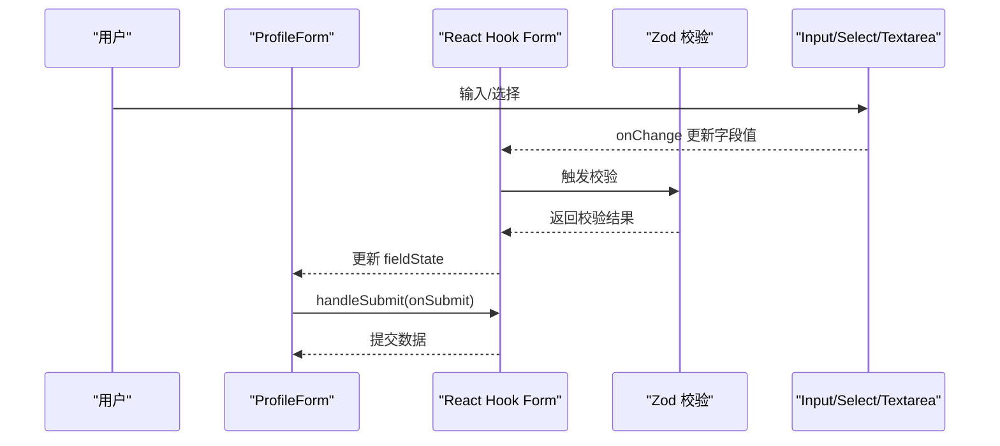
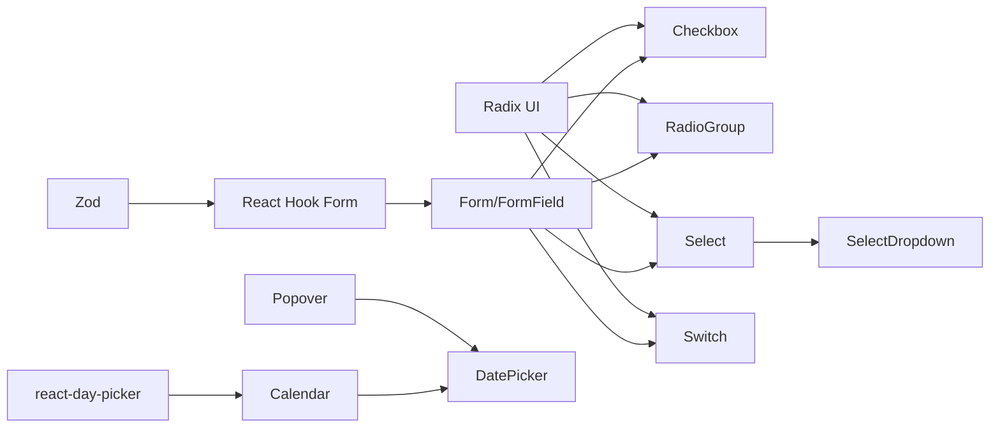

# 表单组件

<cite>
**本文引用的文件**
- [form.tsx](file://web_client/shadcn-admin/src/components/ui/form.tsx)
- [checkbox.tsx](file://web_client/shadcn-admin/src/components/ui/checkbox.tsx)
- [radio-group.tsx](file://web_client/shadcn-admin/src/components/ui/radio-group.tsx)
- [select.tsx](file://web_client/shadcn-admin/src/components/ui/select.tsx)
- [switch.tsx](file://web_client/shadcn-admin/src/components/ui/switch.tsx)
- [calendar.tsx](file://web_client/shadcn-admin/src/components/ui/calendar.tsx)
- [date-picker.tsx](file://web_client/shadcn-admin/src/components/date-picker.tsx)
- [select-dropdown.tsx](file://web_client/shadcn-admin/src/components/select-dropdown.tsx)
- [profile-form.tsx](file://web_client/shadcn-admin/src/features/settings/profile/profile-form.tsx)
</cite>

## 目录
1. [简介](#简介)
2. [项目结构](#项目结构)
3. [核心组件](#核心组件)
4. [架构总览](#架构总览)
5. [详细组件分析](#详细组件分析)
6. [依赖关系分析](#依赖关系分析)
7. [性能考量](#性能考量)
8. [故障排查指南](#故障排查指南)
9. [结论](#结论)
10. [附录](#附录)

## 简介
本技术文档围绕 Shadcn Admin 的表单体系，系统阐述表单验证、数据绑定与状态管理实现机制；详解复选框、单选框、下拉选择、开关、日历等控件的使用方式；给出复杂表单场景（动态表单、条件渲染、批量操作）的实现思路；说明与 React Hook Form 的集成方式（字段验证、错误处理、提交逻辑）；并覆盖可访问性支持与国际化适配方案，以及性能优化与用户体验改进的最佳实践。

## 项目结构
Shadcn Admin 将 UI 基础组件集中在 components/ui 下，并通过 form.tsx 提供基于 React Hook Form 的表单容器与语义化包装；业务表单示例位于 features/settings/profile/profile-form.tsx；日期选择器通过 date-picker.tsx 组合 Popover 与 Calendar；下拉选择封装了 SelectDropdown 以支持受控/非受控模式与加载态。

图表来源
- [form.tsx:16-163](file://web_client/shadcn-admin/src/components/ui/form.tsx#L16-L163)
- [checkbox.tsx:6-29](file://web_client/shadcn-admin/src/components/ui/checkbox.tsx#L6-L29)
- [radio-group.tsx:6-42](file://web_client/shadcn-admin/src/components/ui/radio-group.tsx#L6-L42)
- [select.tsx:6-182](file://web_client/shadcn-admin/src/components/ui/select.tsx#L6-L182)
- [switch.tsx:5-28](file://web_client/shadcn-admin/src/components/ui/switch.tsx#L5-L28)
- [calendar.tsx:11-169](file://web_client/shadcn-admin/src/components/ui/calendar.tsx#L11-L169)
- [date-picker.tsx:17-51](file://web_client/shadcn-admin/src/components/date-picker.tsx#L17-L51)
- [select-dropdown.tsx:23-62](file://web_client/shadcn-admin/src/components/select-dropdown.tsx#L23-L62)
- [profile-form.tsx:59-177](file://web_client/shadcn-admin/src/features/settings/profile/profile-form.tsx#L59-L177)

章节来源
- [form.tsx:16-163](file://web_client/shadcn-admin/src/components/ui/form.tsx#L16-L163)
- [profile-form.tsx:59-177](file://web_client/shadcn-admin/src/features/settings/profile/profile-form.tsx#L59-L177)

## 核心组件
- 表单容器与语义化包装：FormProvider 作为根容器，FormField 负责将字段接入 React Hook Form，FormItem/FormLabel/FormControl/FormDescription/FormMessage 提供布局与无障碍关联。
- 基础控件：Checkbox、RadioGroup/RadioGroupItem、Select/SelectTrigger/SelectContent/SelectItem、Switch、Calendar。
- 业务封装：DatePicker（基于 Popover + Calendar）、SelectDropdown（受控/非受控、加载态）。
- 示例表单：ProfileForm 展示与 React Hook Form + Zod 校验、useFieldArray 动态数组、Select 与 Input/Textarea 的组合使用。

章节来源
- [form.tsx:16-163](file://web_client/shadcn-admin/src/components/ui/form.tsx#L16-L163)
- [checkbox.tsx:6-29](file://web_client/shadcn-admin/src/components/ui/checkbox.tsx#L6-L29)
- [radio-group.tsx:6-42](file://web_client/shadcn-admin/src/components/ui/radio-group.tsx#L6-L42)
- [select.tsx:6-182](file://web_client/shadcn-admin/src/components/ui/select.tsx#L6-L182)
- [switch.tsx:5-28](file://web_client/shadcn-admin/src/components/ui/switch.tsx#L5-L28)
- [calendar.tsx:11-169](file://web_client/shadcn-admin/src/components/ui/calendar.tsx#L11-L169)
- [date-picker.tsx:17-51](file://web_client/shadcn-admin/src/components/date-picker.tsx#L17-L51)
- [select-dropdown.tsx:23-62](file://web_client/shadcn-admin/src/components/select-dropdown.tsx#L23-L62)
- [profile-form.tsx:59-177](file://web_client/shadcn-admin/src/features/settings/profile/profile-form.tsx#L59-L177)

## 架构总览
下图展示了从页面到表单容器、再到具体控件的数据流与事件流，以及与 React Hook Form 的集成点。

```mermaid
sequenceDiagram
participant Page as "页面/表单页"
participant RHF as "React Hook Form"
participant Form as "Form/FormField"
participant UI as "UI 控件(Select/Switch/Checkbox...)"
participant Schema as "Zod 校验"
Page->>RHF : useForm({ resolver, defaultValues })
Page->>Form : <Form {...form}>
Form->>RHF : FormProvider 注入上下文
Page->>Form : <FormField name="..." render={...}/>
Form->>RHF : Controller 绑定字段
UI-->>RHF : onChange/onValueChange 更新值
RHF->>Schema : 触发校验
Schema-->>RHF : 返回校验结果
RHF-->>Form : fieldState(error/value/...)
Form-->>UI : 通过 FormControl 传递 props
Page->>RHF : handleSubmit(onSubmit)
RHF-->>Page : 提交数据
```

图表来源
- [form.tsx:16-163](file://web_client/shadcn-admin/src/components/ui/form.tsx#L16-L163)
- [profile-form.tsx:59-177](file://web_client/shadcn-admin/src/features/settings/profile/profile-form.tsx#L59-L177)

## 详细组件分析

### 表单容器与字段绑定（Form/FormField/FormControl/FormMessage）
- 职责分工
  - Form：基于 FormProvider 提供表单上下文。
  - FormField：通过 Controller 将字段接入 React Hook Form，并提供字段名上下文。
  - useFormField：聚合字段上下文、项上下文与表单状态，生成 id、描述与消息 ID，便于无障碍关联。
  - FormItem/FormLabel/FormControl/FormDescription/FormMessage：构建栅格布局与语义化标签，自动设置 aria-describedby 与 aria-invalid。
- 数据绑定
  - 在 render 中接收 field，并将 {onChange,onBlur,value,...} 透传给底层输入控件。
- 错误处理
  - FormMessage 根据 error 显示消息；无消息时不渲染节点，减少 DOM 开销。
- 可访问性
  - FormLabel 的 htmlFor 指向 formItemId；FormControl 的 aria-describedby 包含描述与错误信息；aria-invalid 反映校验状态。

图表来源
- [form.tsx:16-163](file://web_client/shadcn-admin/src/components/ui/form.tsx#L16-L163)

章节来源
- [form.tsx:16-163](file://web_client/shadcn-admin/src/components/ui/form.tsx#L16-L163)

### 复选框（Checkbox）
- 基于 Radix Checkbox，提供选中态样式与禁用态。
- 与表单集成：在 FormField 中通过 Checkbox 的 checked/onCheckedChange 与 field 绑定。
- 可访问性：Radix 内置键盘与屏幕阅读器支持；可通过 data-state 与 aria-* 属性联动。

章节来源
- [checkbox.tsx:6-29](file://web_client/shadcn-admin/src/components/ui/checkbox.tsx#L6-L29)

### 单选框（RadioGroup / RadioGroupItem）
- 提供一组互斥选项，适合单选场景。
- 与表单集成：RadioGroup 的 value 与 onValueChange 由 field 驱动；RadioGroupItem 表示单个选项。
- 可访问性：Radix 保证 Tab/方向键导航与选中状态广播。

章节来源
- [radio-group.tsx:6-42](file://web_client/shadcn-admin/src/components/ui/radio-group.tsx#L6-L42)

### 下拉选择（Select）
- 组件族：Select/SelectTrigger/SelectContent/SelectItem/SelectValue 等，支持分组、分隔符与滚动按钮。
- 与表单集成：Select 的 value/onValueChange 由 field 驱动；SelectValue 显示当前值。
- 可访问性：焦点管理与键盘导航由 Radix 提供；支持 placeholder 与禁用态。

章节来源
- [select.tsx:6-182](file://web_client/shadcn-admin/src/components/ui/select.tsx#L6-L182)

### 开关（Switch）
- 用于布尔型开关场景，具备切换动画与禁用态。
- 与表单集成：checked/onCheckedChange 与 field 绑定。
- 可访问性：Radix Switch 提供键盘切换与语义状态。

章节来源
- [switch.tsx:5-28](file://web_client/shadcn-admin/src/components/ui/switch.tsx#L5-L28)

### 日历（Calendar）
- 基于 react-day-picker，提供月视图、范围选择、周数显示与自定义格式化。
- 与表单集成：selected/onSelect 与 field 绑定；可通过 disabled 限制可选范围。
- 可访问性：DayButton 聚焦管理、ARIA 属性由 DayPicker 提供。

章节来源
- [calendar.tsx:11-169](file://web_client/shadcn-admin/src/components/ui/calendar.tsx#L11-L169)

### 日期选择器（DatePicker）
- 组合 Popover 与 Calendar，提供“点击弹出日历”的交互。
- 与表单集成：selected 与 onSelect 由上层表单字段驱动；placeholder 提示未选择时的文案。
- 可访问性：Popover 提供焦点陷阱与关闭行为；Calendar 内部保持可访问性。

章节来源
- [date-picker.tsx:17-51](file://web_client/shadcn-admin/src/components/date-picker.tsx#L17-L51)
- [calendar.tsx:11-169](file://web_client/shadcn-admin/src/components/ui/calendar.tsx#L11-L169)

### 下拉选择封装（SelectDropdown）
- 支持受控与非受控两种模式（isControlled），统一 items 数据结构，提供占位符与禁用态。
- 加载态：当 isPending 为真时，显示加载指示器与禁用项。
- 与表单集成：可作为 FormField 的子控件，通过 defaultValue/onValueChange 或受控 props 与 field 同步。

章节来源
- [select-dropdown.tsx:23-62](file://web_client/shadcn-admin/src/components/select-dropdown.tsx#L23-L62)

### 示例表单（ProfileForm）
- 使用 zodResolver 进行字段级校验，mode 为 onChange 实时反馈。
- 使用 useFieldArray 管理 urls 数组，支持动态添加条目。
- 组合 Input、Textarea、Select 等基础控件，并通过 FormField 绑定。
- 提交逻辑：handleSubmit 收集数据后调用 showSubmittedData 演示提交。

图表来源
- [profile-form.tsx:59-177](file://web_client/shadcn-admin/src/features/settings/profile/profile-form.tsx#L59-L177)

章节来源
- [profile-form.tsx:59-177](file://web_client/shadcn-admin/src/features/settings/profile/profile-form.tsx#L59-L177)

## 依赖关系分析
- 表单层依赖
  - React Hook Form：提供表单状态、控制器与上下文。
  - Zod：类型安全的运行时校验，配合 zodResolver 接入 RHF。
- UI 层依赖
  - Radix UI：Checkbox、RadioGroup、Select、Switch 等提供可访问的原语。
  - react-day-picker：日历能力。
  - Popover：日期选择器的弹出容器。
- 业务封装
  - DatePicker：组合 Popover + Calendar。
  - SelectDropdown：对 Select 的二次封装，统一交互与加载态。

图表来源
- [form.tsx:16-163](file://web_client/shadcn-admin/src/components/ui/form.tsx#L16-L163)
- [checkbox.tsx:6-29](file://web_client/shadcn-admin/src/components/ui/checkbox.tsx#L6-L29)
- [radio-group.tsx:6-42](file://web_client/shadcn-admin/src/components/ui/radio-group.tsx#L6-L42)
- [select.tsx:6-182](file://web_client/shadcn-admin/src/components/ui/select.tsx#L6-L182)
- [switch.tsx:5-28](file://web_client/shadcn-admin/src/components/ui/switch.tsx#L5-L28)
- [calendar.tsx:11-169](file://web_client/shadcn-admin/src/components/ui/calendar.tsx#L11-L169)
- [date-picker.tsx:17-51](file://web_client/shadcn-admin/src/components/date-picker.tsx#L17-L51)
- [select-dropdown.tsx:23-62](file://web_client/shadcn-admin/src/components/select-dropdown.tsx#L23-L62)
- [profile-form.tsx:59-177](file://web_client/shadcn-admin/src/features/settings/profile/profile-form.tsx#L59-L177)

章节来源
- [form.tsx:16-163](file://web_client/shadcn-admin/src/components/ui/form.tsx#L16-L163)
- [profile-form.tsx:59-177](file://web_client/shadcn-admin/src/features/settings/profile/profile-form.tsx#L59-L177)

## 性能考量
- 校验策略
  - 使用 mode: 'onChange' 获得即时反馈；对于重型校验可考虑 'onBlur' 或 'onSubmit' 以降低重渲染频率。
  - 将校验规则收敛至 Zod schema，避免在组件内重复计算。
- 列表与动态字段
  - 使用 useFieldArray 管理动态数组，确保 key 稳定（field.id），避免不必要的重排。
- 组件粒度
  - 将复杂表单拆分为子组件，按需渲染；对大列表使用虚拟滚动或分页。
- 网络请求
  - 下拉选项等远程数据采用防抖与缓存；加载态期间禁用交互，避免无效提交。
- 无障碍与可维护性
  - 利用 FormMessage 仅在存在错误时渲染，减少 DOM 体积；合理使用 sr-only 隐藏冗余标签。

[本节为通用指导，无需特定文件引用]

## 故障排查指南
- 常见错误与定位
  - “useFormField should be used within <FormField>”：确保所有使用 useFormField 的组件被 FormField 包裹。
  - 校验不生效：确认 FormField 的 name 与 schema 字段一致；resolver 已正确传入 useForm。
  - 下拉/日期未更新：检查是否将 field 的 onChange/onValueChange 正确传递给控件；受控模式下需同时设置 value/defaultValue。
  - 错误消息不显示：确认 FormMessage 在 FormItem 内且存在错误；避免 children 覆盖默认消息。
- 调试建议
  - 打印 fieldState 观察值与错误；临时将 mode 改为 'onSubmit' 隔离问题。
  - 对远程下拉增加 isPending 与空数据兜底，避免空白下拉导致误判。

章节来源
- [form.tsx:42-63](file://web_client/shadcn-admin/src/components/ui/form.tsx#L42-L63)
- [profile-form.tsx:59-177](file://web_client/shadcn-admin/src/features/settings/profile/profile-form.tsx#L59-L177)

## 结论
Shadcn Admin 的表单体系以 React Hook Form 为核心，结合 Zod 实现类型安全与高效校验；通过 Form/FormField 等语义化组件统一数据绑定与错误展示；基础控件基于 Radix 提供可访问性与一致性体验；业务封装如 DatePicker、SelectDropdown 提升复用度与开发效率。遵循本文的实践，可在复杂表单场景中实现稳健的数据流、清晰的错误处理与良好的用户体验。

[本节为总结性内容，无需特定文件引用]

## 附录

### 复杂表单场景实践要点
- 动态表单
  - 使用 useFieldArray 增删改字段；为每个字段提供稳定的 key；对新增字段设置合理默认值。
- 条件渲染
  - 基于字段值控制显示/隐藏；注意在切换时重置相关字段，避免脏数据残留。
- 批量操作
  - 在表格行内嵌入表单控件，结合 rowSelection 与批量提交接口；提交前合并变更集，减少请求次数。

[本节为概念性指导，无需特定文件引用]

### 可访问性与国际化适配
- 可访问性
  - 充分利用 FormLabel/FormControl 的关联；确保错误信息通过 aria-describedby 传达；为不可用控件设置 disabled。
- 国际化
  - 将占位符、提示文案与错误消息抽离至 i18n 资源；在表单中按当前语言动态读取；日期格式与本地化由 date-fns/react-day-picker 配置。

[本节为概念性指导，无需特定文件引用]